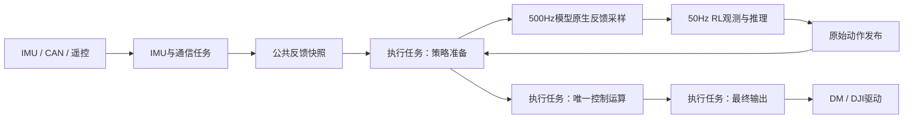

# 工程代码总览

2026-10-17按回退后的当前工作区源码更新。本文说明职责、调用关系和参数入口；数值以源码为准，编译成功不等于实机标定或控制效果已验证。

## 文档与阅读顺序

根目录[AGENTS.md](../AGENTS.md)提供AI自动阅读入口，规则正文统一在本目录。四份长期维护文档为：[AGENTS.md](AGENTS.md)（含Git与协作偏好）、[CLAUDE.md](CLAUDE.md)（阅读入口）、本文（代码总览）、[sysid-change-map.md](sysid-change-map.md)（历史记录）。作者另行要求的[训练部署对接说明](H7_RL_训练部署对接说明_20261015.md)为可交付的版本快照；历史参数、通道和规划不替代当前源码。

先看`main.c → freertos.c → robot_control.c`了解启动，再看`task_comm/task_imu → feedback_snapshot → task_actuation`了解控制主链；处理RL时继续看`task_policy → rl_observation/rl_policy/rl_torque`。

## 本轮修改概要

2026-10-17在回退后按作者重新确认的方案接入model5849平地命令与倒地恢复：复用公共rc.vel/yaw/len，仅在RL观测入口限制至训练命令包线；公共高度只求两腿L*cos(theta)均值；RL实际投入状态决定NORMAL/RECOVER、ground_start、policy_active和恢复出力。保留作者生成网络、K表、自起参数、IMU与电机标定。完整软件链路已接入并通过下述软件检查，板端站立、估计准确性和恢复效果仍待验证。

| 文件组 | 已实现变化 |
| --- | --- |
| rl_types、rl_observation C/H | 内部四腿两轮，网络原始action为左右两侧顺序；唯一映射[0,1,3,4,2,5]供目标/历史观测共用；原生q/dq构造obs39，仅保留最新样本，无人为延迟 |
| rl_policy C/H | 单float32输入39、输出6及独立I/O缓冲；保留SDK接口/返回/输出检查；作者新生成的model5849保留，外围支持平地命令和倒地恢复，板端效果待验证 |
| rl_torque C/H、machine_config C/H | 跟随训练默认角与参考角、腿60/2及轮0.1速度环；目标与力矩分别限幅，再配对还原固件方向；不使用CPU回放的轮0.12/0.02或装配角目标 |
| dm、feedback_snapshot、task_comm | 保留原驱动标定的单圈`pos_zero_rad`，经同一快照同时供腿几何、RL与镜像使用；动作停更/持续不可用分开处理 |
| robot_control、robot_state、task_policy、task_actuation | 大机500Hz采样/PD/正常下发、50Hz推理；普通初态无保持，趴地初态保持200ms；投入/退出/失败清历史，模式切换只撤销旧动作就绪并拒绝在途推理；观测完整发布，统一输出口复查许可 |
| air_detection、slip、leg_solver、斜坡、DM/DJI初始化 | 删除固定配置/初始参数合法性扫描及无消费者的状态字段；反馈、新运算、奇异性、公共协议/SDK边界、状态机和出力许可仍检查 |
| math_utils、PID/腿解算/LQR消费者 | clip、clampf和相同逐圈环绕统一公共内联入口；保留原NaN/Inf、负零、端点和舍入语义，独有fmodf/非有限清零/协议行为保持 |
| vofa_debug C/H | 所有模式固定通道赋值、一次发送；旧腿部/LQR赋值注释保留，换布局手动编辑，不用模式/就绪标志选帧 |

2026-10-17公共驱动采用作者提供的LQR可用标定，RL通过额外配对映射恢复作者提供的RL可用坐标：motor_sign按左前、左后、右前、右后、左轮、右轮填写为{1,1,-1,-1,1,-1}，额外motor_zero为0；不能按网络action的左右两侧顺序填写。24组电脑端对照确认模型q/dq和最终硬件方向力矩与原RL标定等价；单圈角跨协议角界、板端及实机控制效果待验证；权重正确和电脑端通过不等于机器人已验证能站立。

LQR仍使用原单圈标定角解算几何、原K/增益/限矩/补偿和1kHz周期；RL专属坐标、增益、限矩和节拍不套到LQR。RL计算频率增加会改变任务及总线负载，实机调度和控制效果尚未验证。

## 目录职责

| 路径 | 职责与主要入口 |
| --- | --- |
| [Core/Src/main.c](../Core/Src/main.c) | 时钟/外设与通信初始化，启动FreeRTOS；用户改动限定在CubeMX保护区 |
| [Core/Src/freertos.c](../Core/Src/freertos.c) | 五个任务的创建、初始化调用、等待与循环节拍 |
| [imcalib/config/machine_config.c](../imcalib/config/machine_config.c) / [头文件](../imcalib/config/machine_config.h) | 两机只读配置、编译选机和节拍宏；驱动/几何/IMU/LQR/RL共用 |
| imcalib/task | 反馈准备、策略仲裁、求解调用、最终输出及后台服务 |
| [control_detection.c](../imcalib/task/control_detection.c) / [头文件](../imcalib/task/inc/control_detection.h) | 同拍检测输入组装、公共观测与三态调度；管理后处理超时撤力、等待及旧历史复位后重判，返回进入FALLEN事件 |
| [fallen_detection.c](../imcalib/Algorithm/fallen_detection.c) / [头文件](../imcalib/Algorithm/fallen_detection.h) | 公共倒地姿态检测：反馈有效性、重力朝向、倒置及原普通异常；不选路、不生成力矩 |
| [ground_recovery.c](../imcalib/Algorithm/ground_recovery.c) / [头文件](../imcalib/Algorithm/ground_recovery.h) | FALLEN后的完整动作算法：普通自起和倒置自救阶段、目标、PID、映射与补偿，生成候选力矩 |
| [control_air_response.c](../imcalib/task/control_air_response.c) / [头文件](../imcalib/task/inc/control_air_response.h) | 消费已发布三态和落地沿，执行原AIR目标回置、基准复位及控制选择；不推进检测 |
| [control_strategy.c](../imcalib/task/control_strategy.c) / [头文件](../imcalib/task/inc/control_strategy.h) | 同拍RL恢复、模型准备和公共检测；只确认本拍策略及进入FALLEN事件，不求力矩 |
| [control_compute.c](../imcalib/task/control_compute.c) / [头文件](../imcalib/task/inc/control_compute.h) | 按已确认策略调用原LQR、自起、AIR、RL或补偿计算；只生成候选力矩，不发送报文 |
| [control_output.c](../imcalib/task/control_output.c) / [头文件](../imcalib/task/inc/control_output.h) | 复查候选力矩与最终许可、发布诊断并唯一发送DM/DJI；不更新检测或控制器状态 |
| imcalib/Algorithm | 姿态、几何、LQR/RL、自起、离地、速度融合与补偿；不直接发送控制报文 |
| imcalib/drivers | DR16、HI229、DM/DJI等协议解析、反馈换算、在线判定与报文发送 |
| imcalib/bsp | CAN/UART、DMA缓存、单调时间、VOFA发送及板级适配 |
| imcalib/common | PID、斜坡、低通、数学/DSP及motor/RC/RL纯类型；kalman是保留数学工具 |
| [imcalib/common/math_utils.h](../imcalib/common/math_utils.h) | 纯数学公共内联入口：区间clampf、对称clip、逐圈Angle_Wrap_180及Float_Array_Finite；不依赖几何/PID任务状态 |
| [tools/matlab/run_all.m](../tools/matlab/run_all.m) | LQR模型、Q/R选择及增益表生成入口 |
| X-CUBE-AI/App、Middlewares/ST/AI | networkzn1生成网络/权重和AI运行库；通过rl_policy封装调用 |
| Drivers、Middlewares | HAL/CMSIS、FreeRTOS、USB及厂商运行库，保留其版权和生成边界 |
| gcc_support | eIDE专用GCC补充依赖：原版FreeRTOS ARM_CM4F端口及CubeAI10.2.0 GCC库，置于CubeMX生成目录之外，内容与原版本一致 |
| USB_DEVICE | USB设备/CDC基础实现，当前不承担VOFA传输或电机控制协议 |

## 启动与任务主链

`main`在系统时钟配置后、三路MX_FDCAN初始化前，先于USER CODE SysInit调用Can_Bus_Reset_Hardware清共享FDCAN硬件和CAN待处理中断；完成外设初始化后调用FDCAN_Config更新FDCAN1/3的机器数据段时序，再由Can_Bus_Init统一执行HAL初始化/滤波/启动，最后启动RTOS。FDCAN2仍取其初始化配置。统一CAN初始化失败保留DEAD供任务重试，FDCAN_Config不再重复HAL初始化并直接Error_Handler。BMI088源文件保留，主初始化未启用它，运行姿态来源为HI229。

| 任务入口 | 单周期职责 | 节拍来源 |
| --- | --- | --- |
| [comm_task_body](../imcalib/task/task_comm.c) | DM/DJI解析与物理量刷新、两腿解算、遥控解算/发布、故障/跌倒与使能看门狗 | freertos中的osDelay |
| [imu_task_body](../imcalib/task/task_imu.c) | HI229读取/去重、按机器表取轴和符号、姿态/补角、IMU发布 | freertos中的osDelay |
| [ctrl_task_body](../imcalib/task/task_policy.c) | RL39观测、CubeAI推理、原始动作发布 | TIM6按MACHINE_POLICY_DIV释放策略信号量 |
| [output_task_body](../imcalib/task/task_actuation.c) | 读取快照并同步调用策略准备、唯一控制运算和最终输出 | TIM6基础执行信号量；RL按MACHINE_RL_CTRL_DIV执行分频 |
| [background_task_body](../imcalib/task/background_service.c) | 普通VOFA与灯效；USB初始化仍在默认任务入口 | 默认任务循环及osDelay |

LQR使用`MACHINE_LQR_DT`，RL内环使用`MACHINE_RL_CTRL_DT`，策略使用`MACHINE_POLICY_DT`。公共腿长拨轮累加在通信任务的`Rc_Command_Update`完成，按`MACHINE_TICK_DT`推进。原通用周期兼容别名已移除，不能用一个周期替代各路径。大机RL间隔拍保持原已发输出，退出/故障仍在每个基础执行拍优先检查。



<a id="shared-state"></a>
## 状态所有权与模块边界

[robot_control.c](../imcalib/task/robot_control.c)定义共享实例、总初始化和动作清零；[robot_control.h](../imcalib/task/inc/robot_control.h)声明任务/许可接口，[robot_state.h](../imcalib/task/inc/robot_state.h)声明共享状态。当前单模型RL已删除切换入口，参数直接读机器表；算法不能包含这两个任务头，应接收显式参数或读取只读机器配置。

执行拍类型`control_frame_t`定义在robot_control.h，实例仍由task_actuation.c私有持有；其compensation字段保存本拍统一预计算的模型值。反馈快照只保存当前控制会读取的IMU、电机、腿、遥控和公共高度；工程自有结构体类型统一放入对应头文件，类型可见不代表实例跨模块共享。

| 状态 | 周期写入方 | 消费方式 |
| --- | --- | --- |
| imu_state | IMU任务 | 经公共快照供策略/执行读取 |
| motor_state、leg_l/r | 通信任务 | 电机反馈及对应双腿解算配套发布 |
| rc_command、robot_state、ctrl_fault | 通信任务；有效落地更新公共len | 执行/策略消费命令和许可，后台读取状态 |
| RL最新反馈样本、PD/目标与力矩 | 执行任务500Hz | 策略在短临界区读取样本；PD使用当拍反馈 |
| RL39观测、上一请求、policy、action_state | 策略任务50Hz | 执行消费原始请求；执行清零时递增reset_count使旧推理失效 |
| lqr_state、leg_balance、自起/离地/速度状态、最终力矩及补偿诊断 | 执行任务 | 求解和最终输出；Watch及后台按实际代码读取 |

[feedback_snapshot.c](../imcalib/task/feedback_snapshot.c) / [头文件](../imcalib/task/inc/feedback_snapshot.h)由发布方在短临界区提交，执行任务每基础拍读取完整快照；策略任务读取执行任务准备的RL最新样本，不另直接读取原始快照。成功复制不代表传感器有效，各消费者仍检查所需online/valid和许可；同一软件快照不代表物理采样同步。

旧的IMU/遥控发布序号、发布时刻、快照时刻和样本接收时间链路没有消费者，已删除；它们不再构成样本龄门控。DM每台电机的`parsed_rx_ns`仍由驱动随电机快照发布，离地检测与固定控制周期的关系保持原实现。

几何、速度和雅可比只归`leg_solver`；DR16字节解析只归驱动，遥控死区/量程与模式请求解码只归`rc_command`；网络生命周期只归`rl_policy`。实际出力许可、控制求解与力矩下发只归`task_actuation`，通信任务保留电机使能/失能/故障看门狗职责。

## 数据有效性与校验边界

当前调用关系中，控制/观测对象和数组由任务提供固定有效地址；相应固定指针防御和重复扫描已精简。固定配置和代码初始化参数直接使用，不在初始化或实时循环扫描合法性。SDK动态缓冲区、可选模型、公共接口边界、反馈有效性、几何奇异性、新运算结果、设备/动作失联超时和最终发送许可仍按实际语义检查。离地不再另设样本龄、四髋时间偏差或新帧门控。

| 数据 | 当前保证与消费者 |
| --- | --- |
| IMU | Attitude_Update完成四元数归一化、欧拉角换算、三路数值验证，并调用原Attitude_Accel_Vertical生成accel_vertical；竖直结果也通过后才返回成功，由task_imu发布online=1。离地直接读取缓存值，不每执行拍重复投影和校验。pitch_world_valid仍独立表示补角可用；轴向和原计算公式保持 |
| 双腿 | comm在两路源电机在线时解算，否则清输出有效标志；Leg_Solve统一验证腿长/腿角/变化率/虚拟关节量与各雅可比，成功后valid=1。force_valid另外保证力映射行列式有限且满足原奇异性阈值。LQR/自起/离地消费这两个标志，不重复扫描原始反馈 |
| 电机组 | motor.valid由通信更新时一次汇总四髋/双轮online及四髋无DM故障；故障沿用Dm_Has_Fault原判据，与反馈复制共用一次遍历。RL、执行许可和Robot_Fault_Update直接读组标志，不再另遍历DM故障；CAN异常仍单独检查，数据可用不等同于电机已使能或命令已执行 |
| 轮速/遥控 | 轮速由int16_t RPM及本机固定非零齿比换算，LQR/RL的重复轮速有限性扫描已删；RC用整数通道及固定公共量程产生有限命令，LQR目标更新只保留在线门控 |
| RL观测/动作 | 电机和IMU由发布端保证；RL_Motor_Map验证新模型位置/速度，投影在采样生成处检查。RL39生成后发布valid，推理信任valid；SDK形状/类型、动态缓冲区、返回值及6维输出动作仍检查。不存在125维历史或latent |
| 补偿 | 执行拍准备阶段使用固定本机模型和同拍几何计算实体弹簧力、抵消量及两种角度引用的重力值；模型新结果在准备端验证，消费端读取valid，保留反馈反解和叠加新结果检查。模型、坐标、符号及原叠加顺序保持 |

LQR_State_Update已删除无计算用途的dt参数，只检查imu.online/左右腿valid后进行状态构建；速度融合、位置积分、PID/斜坡等实际使用周期的函数仍传各自周期。执行入口读取本拍IMU/补角/双腿/电机组可用标志后形成drive，避免仅等待缓存故障汇总。自起实测角度范围、运行状态、新计算结果、最终出力许可仍保留必要检查。纯计算助手只在调用方确认反馈可用后使用，不能把无效数据强行标为有效。

2026-10-13再次按作者要求检查当前全部自有源码调用：固定对象/数组不重复检查NULL；Slip消费LQR已验证的运动学速度/加速度和固定周期，LQR速度回填消费Slip.valid，不再逐层检查同一速度。斜坡实测量由几何保证、周期由任务保证，目标及新斜坡结果仍检查，固定速率范围检查已于2026-10-14删除。自起保留入口反馈标志与阶段/许可，删掉后续重复补角检查；补偿台架信任normal已包含的补角许可。Rc_Axis不再重复夹取DR16_Validate已验证范围内的原始通道，公共命令量程与腿长限幅保持。DM/DJI接收回调信任Can_Bus已经检查的标准数据帧和8字节长度，缓冲地址和上下文由注册表固定提供；协议入口、缓存容量、设备状态、SDK返回及最终发送保护仍保留。

2026-10-14按作者要求扩展检查所有自有模块：删除Air_Params_Valid及仅转调复位/校验的Air_Detection_Init，初始化直接Reset；Slip删除初始方差/Q/R/门限参数范围和独立noise正值检查，保留计算方差的有限/正值及状态/协方差结果检查。Leg_Input_Valid只验反馈，固定杆长和腿配置就绪标志不再扫描；腿map与config中无人消费的configured字段及初始化赋值同步删除。comm只按绑定电机的online决定腿解算；DM/DJI初始化不再扫描固定总线/ID。轨迹速率直接使用配置，保留目标/运算结果检查。机器功能开关、状态机保护、实际限幅、协议/公共接口边界以及SDK模型接口检查保持。

## 拨杆模式与输出许可

唯一解码入口为[Rc_Command_Update](../imcalib/task/rc_command.c)。每次通信更新生成`rc.mode.strategy / rc_enable / engage`，随遥控指令一起发布；执行快照直接读取`control_frame.rc.mode`，总使能检查读取`rc_command.mode`，不再重复解码。模式类型归公共`rc_types.h`，保留原策略枚举值；`robot_state.rc_enable`在发布时同步mode许可，供既有状态/调试读取。故障、跌倒恢复、电机使能和总输出开关仍按实际周期检查，不缓存成模式请求。

| 左拨杆 | 右拨杆 | 请求行为 |
| --- | --- | --- |
| 中 | 上 | 仅弹簧与完整重力台架，两轮为零；模型或许可不足则失能 |
| 中 | 中 | 自起/LQR投入 |
| 中 | 下 | 已选LQR，零力矩 |
| 上 | 中 | RL投入，实际出力仍须网络ready与有效动作 |
| 上 | 上或下 | 已选RL，零力矩 |
| 下或遥控离线 | 任意 | 失能 |

投入请求不等于实际出力，仍需在线、故障、翻倒/恢复许可、电机使能、总输出开关和求解有效性。`output_dispatch`在发送前复查实时故障与总输出开关；无效/失能路径发送零力矩或停止。发送入队、请求力矩和实际受力是不同概念。

## 配置与调参入口

只通过`MACHINE_DEFAULT`编译选机，`machine`指针不可运行时换机。小机RL未配置，不把大机网络参数直接套给小机。

| 配置 | 内容与生效位置 |
| --- | --- |
| machine.rc | 公共前进/偏航量程、腿长初值/速率；RC统一解算，LQR直接使用，RL读取同一命令后按训练包线限幅，不回写RC |
| machine.lqr | trim/位移目标、停车条件、角速度低通、腿长/横滚增益、支撑前馈、turn_comp向心参数和运行开关默认值；正常显式PD在初始化换算D单位，恢复仍使用原差分PID |
| lqr_debug | LQR运行时工作配置与对照入口；初始化取机器默认值，部分物理符号对照保持原源码，不能擅改 |
| machine.rl | 实体motor_sign/motor_zero、原生nominal_pos/reference_pos、RL39缩放/裁剪、训练四腿PD/轮速度比例及独立限矩；两条动作看门狗，无人为延迟或NORMAL启动保持 |
| ground_recovery_param / air_param / slip_param | 地面恢复、接触估计/空中接入、速度融合模块参数，读取对应源文件顶部 |
| machine.spring / machine.gravity | 弹簧几何模型及完整腿自重模型；大机绑定，小机按NULL旁路 |
| DM/DJI量程、极性、零点、几何、IMU映射 | 物理标定；只能由作者实测决定，遵守AGENTS红线 |

控制周期直接取`MACHINE_LQR_DT / MACHINE_RL_CTRL_DT / MACHINE_POLICY_DT`；仅为配套检查设置的`.lqr.dt`已删除。运行参数或PID在初始化/复位位置加载，不能假定改配置副本会自动同步现有控制器。name仅是调试标签，不参与控制。

`rc_command.len`为米，沿用原公式：拨轮死区/归一化后，`len += wheel × rc.len_rate × dt × 0.3`，回中保持，夹到原机械范围与K表域交集。通信任务直接传`MACHINE_TICK_DT`，更新后若未投入LQR/RL则把腿长恢复`rc.len_init`；离线由RC恢复初值。LQR离地时拨轮仍更新公共目标，轴向释放继续由执行层处理。有效落地仍设置0.20 m，写公共目标及执行当拍命令；作者已移除通信整段临界区，指令发布本身仍由快照接口保护。无新增累加状态、时间戳或复位接口，模式请求在RC解码，实际出力由执行层检查。

## LQR与腿力控

[lqr_balance.c](../imcalib/Algorithm/lqr_balance.c)构建十维状态/目标，按实测腿长求K并输出双轮及左右虚拟髋摆矩。状态顺序为`[s,ds,phi,dphi,thL,dthL,thR,dthR,pitch,dpitch]`，输出顺序为`[左轮,右轮,左虚拟髋,右虚拟髋]`。

2026-10-18按作者要求记录站立震荡分项：u_col保存左轮十列贡献，u_hip_col保存左虚拟髋十列贡献，均复用实际反馈求和中的term，包含原保持开关、角度环绕和AIR列选择，不在VOFA重算K/误差。每次求解开始及运算失败清分项，避免带出上次有效值；此清理只影响诊断。各分项为限幅前的N·m，求和加u_eq后再经过原限幅得到u；虚拟髋u不含腿长/横滚轴向力、模型补偿及最终电机门控，不能当作实测电机力矩。

[lqr_gain_table.c](../imcalib/Algorithm/lqr_gain_table.c)由`MACHINE_DEFAULT`编译绑定本机独立的`lqr_gain_small/big.c`，与machine配置选机使用同一宏；运行时不切换大小机K表，也不做机型/周期/几何/状态约定等配套检查。生成表中相关字段只保留来源描述。目标腿长夹到机械范围与K表域的交集；实测超域只夹增益求值位置，不伪造测量，也不证明域外稳定。实时输入/计算结果的有限性检查保留；LQR默认使用编译机型绑定的表，不再存储恒为1的lqr_configured；四态模型机型匹配与实际出力许可仍检查。

大小机固定使用各自当前生成表；小机历史表、对照开关/状态/分支和同系数旧候选文件已删除。腿长变化超过原阈值时重新求K，这是同一张表随实测腿长求值，不是切换表。

[leg_balance.c](../imcalib/Algorithm/leg_balance.c)在NORMAL下固定调用四态LQR/偏置观测求左右F，不再提供PD后备或关闭轴向环后只输出支撑前馈的路径。当前四态生成数据只匹配大机；其他机型若模型不匹配则返回无效候选，不借用大机模型、不退回PD。遥控投入、故障及最终发送许可仍由任务层原有逻辑检查。

原腿长斜坡、向心前馈与输出映射保留。NORMAL计算向心项后传给四态模块，只组合一次；F/Tp经原雅可比映射，再叠加弹簧/完整腿重力并执行原最终电机限矩。Tp与轮矩仍来自十态控制。向心系数以当前machine_config.c数值为准，不能依赖历史注释；本轮删除NORMAL PD不调整该参数。

非NORMAL调用固定使用原长度/横滚PD（包括AIR预接触）；已删除len_pid_enable及其固定支撑替代分支，NORMAL固定四态。AIR轴向释放保持F=0、暂停斜坡并清四态历史；主动轴向释放不等于Tp/重力全部清零。自起/翻身仍运行ground_recovery的独立PID、阶段/轨迹和超时机制，未改变。

Leg_Balance_Init/Reset继续初始化/清理共享PD实例，是为非NORMAL路径服务，不表示正常出力还在算PD。机器表machine.lqr.leg_len/roll继续供非NORMAL及恢复读取，参数和单位不变：非NORMAL显式PD初始化时Kd乘MACHINE_LQR_DT转为速度阻尼；恢复动作PID仍直接用原差分Kd。最终目标、斜坡目标与实测腿长仍为三种不同量，原Ramp_Target_Update从实测播种后按原速率推进，不在本轮重做轨迹或重新调参。

通用[pid.c](../imcalib/common/pid.c)位置式D使用每拍误差差分，未除周期；RL腿D则直接乘实际关节速度，两者不能按同一Kd口径解释。PID_History_Set只预置历史，不能每拍调用来抹掉真实阻尼。

2026-10-14按作者要求将重复纯数学助手统一到math_utils.h：rl_observation/rl_torque的clip、原leg_solver.h的clampf，以及腿解算/LQR/PID的逐圈角度环绕均共用该头。leg_solver.h和pid.h引入公共头维持现有调用可见性；新增调用可直接include math_utils.h。短函数使用static inline，无需新增C文件或修改构建清单。NaN处理、比较顺序、float常量与±π端点保持；Standup_Wrap原fmodf预处理、abs_limit非有限清零、fminf/fmaxf边界夹取及协议编码限幅保持原实现，不按名称强行替换。

<a id="rl39"></a>
## RL39观测、推理与实体电机执行

2026-10-15按作者批准方案迁移至`chuanliantui-huananhu-multimode-39-82-v1`、model3023；训练仓交付提交773f88e，导出源码记录269ba935eeb3a39fc3fedcb87b554a4f654ffcec。权威源为训练仓`docs/onnx-huananhu-multimode-model3023.md`、`docs/model-deliveries/20261015-model3023-onnx-export.md`及对应v14_observations、huananhu_action/env_cfg、model.py和版本化XML。本轮只改外部H7外围，不改训练源码和生成网络。首轮范围为平地NORMAL静站，不实现跳跃、台阶、坡地和地面恢复状态机。

模型位置/速度、PD目标/诊断及观测电机段采用`[lf0,lf00,rf0,rf00,lfwheel,rfwheel]`；网络原始action、action_state.a及last_action采用`[lf0,lf00,lfwheel,rf0,rf00,rfwheel]`。RL_Action_Index统一[0,1,3,4,2,5]，供PD目标与上一动作观测共用；这是通道排列，不是左右角色交换或极性变更。

### 输入与映射

DM反馈只保留单圈`pos_zero_rad`：驱动解码`pos_rad`后叠加已有`dm_zero`。同一量随电机快照发布，腿几何、RL与Jetson镜像均使用它；RL不使用thigh、virtual_shank或固定加π作为电机位置。

`motor_sign[6]`与`motor_zero[4]`仅描述已标定固件反馈至模型实体坐标的映射：`q_model=s*(q_zero-zero)`、`dq_model=s*dq_firmware`；输出采用`tau_firmware=s*tau_model`，驱动继续执行其既有物理极性和单位编码。

2026-10-17回退保留本轮前已确认的RL/LQR兼容入口：公共驱动保持作者提供的LQR可用dm_sign/dji_sign/dm_zero，RL额外motor_sign按四腿两轮顺序为[1,1,-1,-1,1,-1]、motor_zero为0。它将公共驱动反馈及输出配对转换到作者原RL可用坐标，不能按网络action的左右两侧顺序填表；此前24组电脑端等价对照记录见历史账本，单圈角跨协议角界和板端控制效果仍待验证。旧虚拟角sign/zero不恢复。

| 索引 | actor39内容 |
| --- | --- |
| 0～2 | clip(rc.vel,1.5)、0、clip(rc.yaw,1.5)，单位m/s及rad/s |
| 3 | clamp(rc.len,0.27,0.34)后×5；作者接受腿长目标直接作高度命令，初值0.15被截到0.27m |
| 4～6 | 机体系gyro限±100后×0.5 |
| 7～9 | inverse quaternion投影世界重力[0,0,-1]，限±100 |
| 10～13 | 四实体模型角减名义角，限±100 |
| 14～15 | 轮位置槽固定0 |
| 16～21 | 同顺序实测速度限±200后×0.1 |
| 22～27 | 上一拍原始网络action按[0,1,3,4,2,5]重排，再限±100 |
| 28～34 | 普通为[1,0,0,0,0,0,0]，启动保持/恢复为[0,0,0,1,0,0,0]；其余模式槽0 |
| 35～38 | ground_start在实际投入时锁存；policy_active仅NORMAL/RECOVER为1；airborne/step_active固定0 |

nominal_pos是训练微蹲默认姿态在模型原生坐标下的q_nominal；reference_pos是XML的qpos0，二者不是实机编码器零点。版本化XML与主线XML的19个body、19个joint、14个site属性一致；本机未安装指定mjlab环境，按相同前腿目标和定位点独立核算后链闭合，得到原生默认角，未冒充运行过训练环境。参数以machine_config.c为准。输入单位rad/rad/s，轮速已由驱动按轮轴齿比换算，不重复换算。

执行任务500Hz保存最新模型样本，策略50Hz在短临界区复制样本和动作历史，在本地构造39维输入后完整发布，避免遥测读到半更新观测。坏反馈立即清sample_valid。部署不主动添加训练噪声、观测/目标延迟或均值方差归一化，仅存在实际任务、总线与设备延迟。模式和启动标志来自执行任务的同一恢复状态，SDK ready与policy_active分开；当前接model5849的平地运动/起立/倒地恢复，不自动请求跳跃、台阶或坡地，不借用LQR离地检测制造airborne。

### 输出与启动

先按唯一映射取得各实体action。腿目标`clampf(q_nominal+0.5*a,q_reference-3.14,q_reference+3.14)`；轮速目标`clip(10*a,150)`。腿力矩为`60*(target-q)-2*dq`；轮为`0.1*(target-dq)`。采用训练侧定义，不使用独立CPU回放的q_reference目标或轮0.12/0.02公式。位置误差不做最短路径环绕，PD使用当前未缩放的模型原生反馈。先按RL独立40Nm/3.9Nm裁剪，再通过相同motor_sign还原固件电机力矩，进入唯一输出口。

训练腿D项是实际速度阻尼，现有pid_calc的位置式D是两拍误差差分且未除dt，目标变化也会进入D；相同Kd数值不能直接互换。当前直接计算训练公式，不维护多余PID历史或积分；若将来复用PID，必须保证P/D含义和P+D合成后的限幅顺序一致，不能先限P再叠D。RL独立限矩与公共DM/DJI限幅、MIT编码刻度分别维护。

RL不调用雅可比、不叠加弹簧抵消或重力。实体被动弹簧仍存在；LQR/自起/台架的几何、补偿和原参数保持。RL实体PD不依赖雅可比；恢复流程需要公共height_valid，因此坏腿几何不会被当作有效低高度，届时停止本次输出。IMU、补角、电机组、模型、故障和实际输出许可继续检查。

大机基础/LQR仍1kHz，RL分频2→500Hz，策略分频20→50Hz，一个原始action保持10个2ms控制子步。正常力矩每RL子步计算/下发，中间基础拍保持命令；退出/故障仍每基础拍检查。增加的执行与总线负载需要实测逐次周期、漏拍和发送成功，不能用宏定义或平均频率代替实测。

实际投入、退出、失能及恢复超时清原始动作/历史/PD目标；NORMAL与RECOVER/启动激活切换保留原始历史，仅清rl_ready并递增reset_count，拒绝切换前在途的推理，等待新模式首帧才出力。普通初态直接NORMAL；趴地初态200ms内继续推理但最终门控强制零力矩，之后进入RECOVER。ground_start锁存整个投入段，中途倒地不重新等待200ms。未实际投入但选择RL可零出力推理，不能提前推进恢复计时；零action不是零力矩。

退出/坏观测/推理失败清动作可用性并发送零输出；模型未就绪不触发尚未开始的动作超时。动作停更和实际投入持续不可用仍分别使用现有期限保护；SDK就绪、模型policy_active、实际硬件出力许可保持独立语义。

### 网络与接入

2026-10-17当前生成文件来源为作者的model5849，本次保留生成文件/IOC原样，接入其平地命令与恢复外围；下述3023导出及数值校对为2026-10-15历史，不是当前权重的验收结论。5849此前电脑端核对见历史账本，本次不重复生成/验证权重，也不把宿主任务检查说成板端或真实网络行为验收。

`rl_policy`仅接受float32单输入[1,39]、单输出[1,6]、batch1；初始化检查生成头及SDK实际逻辑元素数/格式，显式绑定独立的39/6维I/O缓冲，不依赖导出时是否将I/O放在activation。2026-10-15作者曾用ST Edge AI Core 2.2.0 / CubeAI 10.2.0生成并替换model3023网络，输入obs39、输出actions6、四层Dense和三个ELU；输出无tanh。当前静态接口匹配，板端policy.ready及实际SDK调用尚未验证，不能仅凭宏定义声称上板成功。

2026-10-15核对桌面ONNX的SHA256与3023交付记录一致；按生成C实际偏移逐字节比对8组权重/偏置，共51782个float，全部与ONNX一致。ST工具host模式用交付前64组参考输入/输出核对，384个输出最大绝对误差约6.635e-6，小于1e-4；该结果来自电脑端C模型，不代替板端数值验收。生成配置启用activation内I/O分配，与当前封装另行绑定独立I/O的方式兼容，无需为此修改作者生成文件。

当前自有机器配置中不再保存lqr_configured或rl.configured：LQR/RL策略选择默认允许，不按机型额外屏蔽RL；小机RL参数仍未补齐，网络/映射适用性由操作者确认。ctrl_task_init统一初始化已编译网络，ctrl_task_body只在遥控在线且选择RL时推理。policy.ready仅反映网络初始化及39/6接口检查，不能证明训练机型适配。反馈有效、动作期限、engage、电机状态和最终出力门保持。

rc_enable暂按作者最新要求保留。它表达当前模式是否允许参与控制，与online不同；在线且拨杆关闭时rc_enable仍为0，参与电机使能许可及有效策略选择。今后若以strategy==DISABLE替代该派生字段，必须保留停档语义，不能只删除所有判断。

2026-10-14按作者要求删除RL_Config_Valid及初始化中的配置限矩比较；固定RL极性、零点、缩放、增益、延迟和期限直接读取机器表，不扫描合法性。按当前作者要求，机型configured开关已删除；SDK接口/返回值、新观测/动作/力矩的运行时检查与最终出力许可保持。RL算法、配置及任务C/H已补核心流程、坐标、单位、延迟和状态切换注释。

新ONNX须使用上述实体契约及配套JSON；在CubeAI中保持网络名`networkzn1`，生成并成套替换`X-CUBE-AI/App/networkzn1.c/h`、`networkzn1_data*.c/h`及`networkzn1_config.h`（按实际生成清单），保留该工具链配套运行库。不能只改尺寸宏、只换部分权重或复用旧模型。当前只有单模型入口，旧多模型切换/索引及无人消费的命令镜像删除。导入后正常初始化自动恢复policy.ready，再做同输入PyTorch/ONNX/CubeAI对照。

Watch输入为`rl_control.observation.obs[0..38]`；原始请求为`action_state.a[0..5]`，按网络左右两侧顺序；PD目标、当前模型位置/速度、模型裁剪力矩及固件请求为`rl_control.torque_state.target/pos/vel/motor_torque/last_torque`，按四腿两轮顺序。最终门控后命令为`rl_output_dm_cmd_nm/rl_output_wheel_cmd_nm`，不能混为同一层量。板端网络数值与实际2ms/20ms周期、反馈更新和总线发送仍待验证。


RL恢复状态复用rl_observation.c/h内的模式生成逻辑，不新建公共离地/运行框架。执行任务每基础拍推进一次：request=遥控在线且选RL并投入，feedback_valid=实际驱动许可且公共高度有效；进入时锁存ground_start=(fallen || height<=0.20)。状态及时间如下：

| phase | 含义及转移 |
| --- | --- |
| 0 IDLE | 未实际投入/运行反馈不可用，不出力；等待有效投入 |
| 1 HOLD | 趴地投入前200ms，recover=1、policy_active=0，持续推理而最终力矩为0 |
| 2 RECOVER | 允许训练PD恢复出力；姿态正常且height>0.20连续500ms才转NORMAL |
| 3 NORMAL | 读取限幅后公共命令；fallen或height<=0.20立即转RECOVER，中途不重复HOLD |
| 4 FAILED | 连续倒地严格超过2000ms，清动作并禁止使能/输出；退出投入才复位 |

连续倒地计时在姿态回正且高度高于门槛时清零，恢复稳定计时被任意一次倒地打断就清零；不是从进入RECOVER起固定2秒超时。ground_start在成功及后续倒地时保持原值。故障、模型失败、源反馈不可用与最终发送许可各自保留，失败锁定不被姿态回正自动解除。RL可在公共fallen下使能，但不因此放开LQR的使能条件；公共40度判据本身仍由两种策略共用。

公共rc.len仍受机械/K表域限制，当前大机最大约0.31m，故直接夹取时实际可调RL高度为0.27～0.31m；低于0.27m的拨轮行程被截住。未额外重映射拨轮、修改公共初值或新建rc.height。

## 自起、离地与姿态补角

公共robot_state.fallen继续直接用IMU euler_deg（沿用LQR实际取轴），pitch或roll任一严格超过40度为倒地；IMU故障保留旧标志。公共高度由Leg_Height_Estimate单独计算0.5*(L_left*cos(theta_left)+L_right*cos(theta_right))，随同批电机/双腿发布到robot_state.height/height_valid及反馈快照；RL原语义保持，LQR新触地判断消费同一高度。该值是机体系髋轮投影间距，悬空/倾斜时不等于绝对离地高度，也不等于仿真base_contact>1N；收腿悬空与低机身触地仍可能不可唯一辨识。

[ground_recovery.c](../imcalib/Algorithm/ground_recovery.c)独立管理起立准备和倒置恢复，按姿态/许可推进阶段，生成目标后运行独立控制器与公共补偿；PREPARE/BALANCE/STOP路由交给执行层，准备过程两轮为零。其上下文分为`lifecycle`、`normal`、`self_right`、`actuator`，普通自起和翻身共用独立长度速率`ground_recovery_param.length_rate`，与LQR长度速率分开。

后摆与翻身扫腿共用`angle_rate`，当前为6.7 rad/s。翻身链为SETTLE→PRELOAD→FLIP：SETTLE在进入姿态播种目标与PID历史，PRELOAD持续给`recovery_len`且确认双腿均达到`recovery_len - length_tol`，才允许FLIP扫腿；PRELOAD不再按固定时间抢先进入FLIP，并用既有`length_timeout`兜底。FLIP以扫满`2π`或卡滞触发重试；翻身退出仍要求正立、`recovery_pitch_tol`内并连续满足`stable_time`。

普通起立只保留`length_timeout`和`angle_timeout`：EXTEND/RETRACT共用腿长超时，REAR/SWING共用摆角超时，当前均为1.5 s。`length_tol`同时表示伸腿下容差和收腿上容差，收腿可进入SWING的条件为双腿不大于`retract_len + length_tol`。翻身轴向力和虚拟腿摆矩均不再有恢复专用预映射限幅，统一由最终四髋限幅处理。

[air_detection.c](../imcalib/Algorithm/air_detection.c)用同侧髋反馈反解、弹簧/自重和IMU估计支持力；initialized表示已连续完成高或低支持力初判，valid是本拍估计有效，flight是接触状态。首次低支持力也可进入AIR，初次高/低力使用独立计时，不能互相接续。取消输入中的LQR运行/自起完成permit，改由已发布的IMU/双腿有效性、四髋在线/实际使能和模型结果保证反馈可用。缓存未更新仍按固定MACHINE_LQR_DT处理。

[fallen_detection.c](../imcalib/Algorithm/fallen_detection.c)独立维护`fallen_detection_param`：腿角异常、俯仰异常、异常确认时间和倒置/姿态保护阈值。`control_condition`使用它决定何时从NORMAL转FALLEN；`ground_recovery`只读取同一俯仰保护和确认时间以维持既有安全退出/重新恢复条件，检测模块不再包含恢复动作头文件。

2026-10-19首步仅提取检测调用；随后作者明确批准实际接入触地判断与三态，保留处理内部。[fallen_detection.c/h](../imcalib/Algorithm/fallen_detection.h)独立发布重力朝向、倒置、普通异常及反馈有效性；[control_condition.c/h](../imcalib/Algorithm/control_condition.h)只消费该结果和公共height，管理NORMAL=0/FALLEN=1/FLIGHT=2选路，实例control_condition可Watch。valid=0表示本拍不能选路，不是第四种控制状态。初始或明确零出力阶段以公共height不大于control_condition_param.body_contact_height连续确认（本次锁定0.15 m/50 ms）；等值成立，候选中断、源姿态或高度无效清连续计时，待确认候选优先于离地初判。

初始已支撑且无需恢复可直接进入NORMAL；NORMAL中的腿姿/俯仰异常沿用`ground_recovery_param`原门槛与持续时间，原倒置姿态条件也保留。只有已生成有效NORMAL候选后才累计新的异常触发；FLIGHT/FALLEN中的异常历史不带入正常运行。normal_ready仅表示求解候选有效，不证明HAL已发送或实体已执行。公共fallen和RL恢复不改用本模块。

FALLEN锁存`ground_recovery`动作，不被自身扫腿或AIR结果重启。2026-10-24按作者要求，FALLEN期间暂停AIR观察并清空旧flight/峰值，不将自起/翻身运动积累成下一次离地状态。恢复完成返回BALANCE时统一先进入NORMAL，不再根据AIR旧标志交接为FLIGHT，也不等待已暂停的AIR初始化。NORMAL控制连续有效运行满`control_condition_param.air_rearm_time=1.0 s`后才重新启动AIR检测；以`air_normal_ticks*MACHINE_LQR_DT`计时，反馈/投入中断或再次倒地清零计时。重新采样后仍按原支持力持续条件完成初判，在此之前保持正常LQR输出，不因AIR未初始化清掉NORMAL许可；新初判有效后解除`air_inhibit`，恢复原离地选路。未经历FALLEN的首次投入保持原AIR初判流程。

FLIGHT正常退出仍用原落地规则，保留真正倒置时转FALLEN的分支，不因低投影高度直接转FALLEN。FALLEN类超时撤力重判保留离地屏蔽，避免动作历史复位后绕过1 s正常确认。未完成首次判断/反馈失效使用默认无效零候选；对应处理开关关闭时不隐式改选NORMAL。

2026-10-22后处理超时统一为“撤力→等待→重新初判”：`control_postprocess.phase`为RUN=0、WITHDRAW_WAIT=1、RECHECK=2，与三态独立。实际持续生成有效AIR控制候选满5000 ms请求撤力；普通自起任一动作超时、翻身PRELOAD超时或FLIP卡滞/扫角耗尽统一报告`GROUND_RECOVERY_TIMEOUT`并返回STOP，不再超时跳后摆或直接重做预压。计算层在超时当拍清候选与补偿，等待/重判期间禁止所有LQR、自起、自救出力，最终输出口发送四髋/双轮零力矩；不主动失能电机。

等待共用`ground_recovery_param.retry_wait`（当前0.3 s），使用HAL毫秒时钟差独立计时，正常AIR响应多次调用不累计时间。等待到期清AIR锁存/峰值、三态初判历史和地面恢复动作历史，本拍仍为零，下一拍才重新确认；未确认或反馈无效继续零输出，不把复位生成落地沿或写回落地腿长。新判断按原规则进入NORMAL、FLIGHT或FALLEN，再由当前姿态选择自起/自救；重新进入AIR重新计5 s。`control_postprocess.recovery_retry`保留已消耗的恢复重试预算，地面超时增加一次重试，AIR超时不增加；现有5次重试用完后再次失败置`exhausted=1`，持续零输出，退出LQR投入/切换策略才取消等待并清预算。非超时故障仍按原保护处理。

实际主链为反馈快照→`Control_Strategy_Prepare`（RL恢复、一次模型准备、`Control_Detection_Update`）→进入FALLEN时由`Control_Compute_Run`复位动作并恢复本次重试预算→原LQR状态/速度融合和唯一处理求解→`Control_Output_Apply`诊断与唯一输出口。NORMAL/FLIGHT分别在原正常/AIR选择下调用原LQR路径；FALLEN调用`ground_recovery`路径。后处理撤力等待/重判优先于LQR控制分支；三段在同一actuationTask同步调用，不新增队列、任务或跨拍候选缓存。动作公式、轨迹、PID、检测阈值不变；超时出口与重判按上述规则执行。

`Ground_Recovery_Update`内的目标、PID与候选输出仍按同拍顺序执行，但`force/tp`已是`Ground_Recovery_Compute_Output`局部量：PID计算后立即执行原翻身期F限幅、腿端映射与补偿，映射成功才发布候选。`ground_recovery_ctx_t`将跨拍状态分为生命周期、普通起立路径、翻身路径和执行器历史四组，不保存单拍F/Tp。

`lqr_state`仅保存实际控制状态、目标、最终四路`u[]`、增益和跨拍滤波/积分历史；旧左轮/左髋逐列镜像未输出也未参与计算，已删除。遥控许可的唯一状态源为`rc_command.mode.rc_enable`，`robot_state`不再复制该位。

2026-10-19进一步按作者确认分层：Algorithm/air_detection.c/h只负责支持力及离地算法，Algorithm/control_condition.c/h只负责触地与三态判断；task/control_detection.c组装快照并依次调用这两部分，返回进入FALLEN事件，不调用Standup_Reset或控制处理。task/control_air_response.c通过Control_Air_Response_Update消费三态/落地沿，原样保留目标写回临界区、位移/偏航复位、释放和限幅赋值；task_actuation.c保留原两个响应调用位置、动作交接和唯一输出。原Air_Detection_Active仅有的控制选择表达式移入响应文件，不再作为检测模块接口。公共状态与参数实例复用，无新增副本、任务、开关或时序条件；两个新头文件复用control_frame_t，只属于执行层，算法层不引入任务头。

公共检测不由lqr_idle或LQR私有重建复位；初始化、关闭检测、超时撤力等待到期，以及FALLEN/恢复后屏蔽期间清AIR历史。普通观测失败仍清valid、initialized和连续计时并保留flight及峰值；反馈恢复需重新确认，已有AIR不会因初次高力确认被直接清除。原AIR运行分支完整保留：峰值更新、任一腿独立连续压缩退出、landing_enabled关闭的计时清零、非压缩模式的高力退出和新AIR峰值播种均未替换，不增加支持力与压缩联合条件。Watch新增观察`control_condition.air_inhibit/air_normal_ticks`，当前基础拍1 ms时1000拍对应1 s；1 s只是允许重新检测，真正进入FLIGHT仍需原低支持力持续确认。

当前VOFA布局未改。Watch建议观察control_condition.condition/valid/started、body_contact_candidate/body_contact_confirmed/contact_elapsed、trigger_elapsed/normal_ready、air_debug.initialized/valid/flight/mean_force、ground_recovery_control.lifecycle.phase/fault/retry及control_postprocess.phase/flight_timing/recovery_retry/exhausted。新判断已实际选路，软件检查通过不表示真实触地辨识或飞坡/掉落动作通过验收。

`air_detection`保留完整的每腿力估计、峰值和压缩跨拍历史；`air_debug`只在执行拍末尾复制当前VOFA需要的均值力、两腿压缩/计时和四个状态位。VOFA 3～11、45的含义不变，`air_debug`不再是完整检测器副本，Watch中需查看完整估计时读`air_detection`。

大机按作者要求收紧确认条件：更低的支持力均值持续更久才判离地，首次支撑需要更高支持力且持续更久；压缩落地需要更大的单腿压缩量并持续更久。小机保留原门槛。参数统一在air_param初始化中按机型维护，数值以源码为准；本次不新增起立后固定屏蔽时间，不改变任一腿满足即可确认压缩落地的原逻辑。确认更严格会增加真实离地/落地的判定延迟，误触发改善仍待实机验证。

作者2026-10-13进一步要求取消离地时间戳处理，统一固定dt并允许旧缓存参与。估力差分、两级滤波、初次支撑/离地与左右压缩计时均使用MACHINE_LQR_DT（当前两机1ms），不再传接收时间或按样本去重；首次和估计失败恢复仍先播种差分，首次有效拍也推进计时。joint_ready只汇总原四髋在线/实际使能条件，不包含新帧和时间偏差判断。竖直加速度随新IMU帧生成并随online发布，离地读取imu.accel_vertical。

Robot_Control_Init直接调用Air_Detection_Reset清检测历史；固定air_param不在上电或实时Update扫描合法性。IMU时间戳停滞门控仍按作者此前要求删除；本轮继续删除rx_ns/now_ns/sample_ns/valid_ns、sample_timeout/sample_skew及执行快照接收时间中转。输入可用性由原反馈标志和joint_ready保证，新估力结果仍验证；失败清连续计时、保留flight，并立即置诊断fault，恢复成功清fault，不新增失败时间计数器。

固定周期假设每次调用经过一个执行拍；重复缓存也持续满足条件时会完成状态切换。若反馈实际间隔变长，腿投影速度的阶跃差分可能增大；若执行任务漏拍，累计时间不补偿真实调度延迟。全项目审核发现其他控制算法已使用固定MACHINE周期，自起阶段计时已按固定dt累计，无其他接收时间dt链路需要替换。DM/DJI/DR16/HI229在线超时、RL动作停更/持续不可用、CAN重试/死链、SPI发送预算仍使用实际时钟；改成固定调用次数会在任务延迟或阻塞时改变保护时限。推理/任务耗时统计与预留接收元数据不属于控制dt门控。

执行层组合AIR与释放开关。释放期间轴向主动力为零，暂停长度/roll PID和执行斜坡，公共RC拨轮仍按原累加规则更新；跳过弹簧抵消，仍保留原空中摆矩及重力补偿。有效落地事件一次复位长度目标，恢复后从实测重播斜坡；退出、复位或坏反馈不伪造落地。AIR还暂停轮速修正及停车积分；恢复冲击、阈值与实时性仍需台架确认。

[pitch_world.c](../imcalib/task/pitch_world.c)保留原IMU pitch的大小，通过同帧四元数投影重力Z的符号选补角分支，返回环绕后的正常/倒置pitch；不重写公共IMU标定或LQR反馈。当前补角无法单独区分横滚倒置和俯仰倒置，输入/有效标志与物理姿态分类应分清。

## 弹簧与重力补偿

[gas_spring.c](../imcalib/Algorithm/gas_spring.c)按实测腿长求挂点几何传动比，把模型弹簧推力换算为等效伸腿力。Gas_Spring_Prepare一次生成gas_spring_result_t中的force[2]、delta_dm[4]及valid：实体力供离地估计，负等效力按原Leg_Force_Map_Forward映射成输出抵消量。Gas_Spring_Apply只叠加已准备值，不再查模型或映射。

当前模型把弹簧轴向推力作为常量force_n，随腿长变化的是几何传动比；没有另建弹簧行程/压力、摩擦或迟滞模型。命令路径先算Fs，再将F=-Fs、Tp=0转换为前后髋增量，与原控制力矩相加并在调用方限幅。只作用于四髋，不直接修改轮矩。

RL不叠加弹簧或重力；地面LQR、自起和补偿台架走弹簧加完整重力的组合入口。LQR空中轴向释放时跳过命令侧弹簧抵消，使实体弹簧自然伸腿，重力摆矩仍保留。GAS_SPRING_COMP_ENABLE控制是否生成/叠加抵消量，不关闭离地所需的实体力估计；未绑定spring的小机返回零实体弹簧力并旁路补偿。Gas_Spring_Force是准备端的模型入口，后续消费者直接读缓存force，不再重复调用。

Control_Compensation_Update按模式/许可准备原控制项，并在公共离地观测反馈可用时补齐其所需实体模型；仍每拍只准备一次，结果放在control_frame.compensation（leg_compensation_values_t）：spring供实体力和抵消量，gravity供原姿态引用，gravity_world供pitch_world补角引用。未投入或选RL时也可为公共检测准备实体弹簧/重力模型，但RL控制不叠加这些补偿。恢复路径重建LQR状态使用同拍准备值，不重复推进公共检测或计算模型。缓存仅属于当前快照，不新增跨周期命中、序号或时间状态；板端新增观测耗时尚未测量。

模型/检测链：准备Fs与原姿态引用重力摆矩 → Air_Estimate反馈反解 → 读取force[side]和gravity.leg[side].torque计算支持力。控制链：基础力矩 → 读取准备的spring.delta_dm → 读取对应gravity.delta_dm → 原限幅及诊断 → 唯一输出许可检查。LQR/自起/台架通过leg_compensation组合入口直接叠加；RL直接输出实体电机PD，不调用Gas_Spring_Apply。

[gravity_comp.c](../imcalib/Algorithm/gravity_comp.c)由腿长插值质心半径/偏角，用世界腿角算完整腿自重摆矩，只补摆矩，不增加轴向重力力。Gravity_Comp_Prepare生成摆矩、四髋增量和状态；两种引用需要同时准备时共用同腿查表值，相同规范化角度直接复用摆矩/映射，不再重复求值。原姿态角与pitch_world引用保持区别，自起原fmod环绕在有效角度域内与准备端规范化逐值核验一致；表外夹边界和诊断保持。旧Gravity_Comp_Apply包装已删除，叠加统一归leg_compensation。

[leg_compensation.c](../imcalib/Algorithm/leg_compensation.c)准备本拍模型值并按路径组合弹簧抵消、重力与最终四髋限幅。台架/自起/LQR使用组合入口，RL保留仅弹簧路径；保持base先加spring再加gravity的浮点顺序，不预先合并增量。诊断spring_dm仍取加弹簧后结果减base，避免改变舍入；失败不发布部分输出，保持最终保护。新增本拍缓存用于减少模型调用，不宣称源码行数或所有模式实测耗时下降；有效模型、轴向和极性只能按作者实测修改。

<a id="communication"></a>
## 通信与输入输出

DR16和HI229分别由驱动从UART IDLE/DMA快照取字节并解析；设备解析在任务内完成，UART中断/BSP只搬运和交付接收批次。[uart_idle.c](../imcalib/bsp/uart_idle.c)提供四参数初始化、ISR及统一带时间快照接口UART_Rx_Take_Timed；不需要时间时传NULL。未调用的普通Take包装、parse回调类型/字段/初始化参数和DR16空回调已清理。DMA接收缓存与发送缓存须保持M7 DCache一致性。

debug_rx按作者要求保留用于后续VOFA接收；当前只是预留实例，尚未接入初始化、中断和消费端。当前速度融合直接使用Slip_Update_Contact传入接触状态，未使用的默认接地Slip_Update包装已删除。低通/斜坡初始化与复位接口保持，气弹簧模型和补偿路径保持。

[rc_command.c](../imcalib/task/rc_command.c)唯一读取DR16通道并做死区/夹取/归一化、拨轮累加和模式请求解码。当前ch1为前进、ch2为偏航、wheel为长度/高度调节，保留原偏航符号；公共vel/yaw/len分别为m/s、rad/s、m。拨杆语义每次更新解码为rc.mode，执行层直接读取并检查实际出力许可。

[dm.c](../imcalib/drivers/dm.c)负责MIT量化、反馈换算、极性/零点、在线/使能看门狗及报文；[dji.c](../imcalib/drivers/dji.c)负责编码器/RPM/电流反馈、减速比、轮矩到raw电流及按反馈ID选择电流槽。所有控制者输出逻辑机体量，物理输出极性在驱动边界处理一次。

CAN恢复由通信任务原有的Can_Bus_Online(true)推进，实现位于[can_bus.c/h](../imcalib/bsp/can_bus.c)，[main.c](../Core/Src/main.c)仅在USER CODE中接入启动复位和统一时序应用。bus-off回调核对PSR.BO，只记录真正进入故障，不在中断内Stop；退出bus-off通知不触发重启。DEAD=1或RECOVERING=2每100ms恢复对应一路：屏蔽该控制器中断、取消旧发送请求，按HAL状态Stop，再按当前Init初始化、配置滤波器、Start并恢复通知。DEAD期间发送返回HAL_BUSY，避免高优先级执行任务打断重建后继续写消息RAM；RECOVERING允许发送，便于零力矩帧和现有协议恢复反馈。

单路软重试不刷新最后正常接收时间。如果所有已登记设备的总线均非ACTIVE、没有待确认的新接收计数，且各自至少1000 ms没有正常反馈，升级为共享硬件复位；任一已登记总线正常或出现新帧时不执行。先使三路DEAD并屏蔽外设中断，再逐路HAL_DeInit平衡MSP时钟/引脚/IRQ引用，然后RCC强制复位共享FDCAN模块，逐路按原Init恢复。软件路由/设备上下文保留，硬件复位最小间隔1000 ms。RCC复位位为三路共享，因此不能用它直接修复单路离线；未登记总线不计作阻止复位的健康设备。HAL带超时等待的调用均在临界区外执行。

本轮启动成功只进入RECOVERING；必须HAL处于BUSY、`CCCR.INIT=0`、`PSR.BO=0`且接收计数相对本次启动基准变化，才回ACTIVE=0。失败或尚未确认新接收帧时继续返回离线，沿用原FAULT_CAN和使能/零输出链。CAN接收计数不是每台电机的有效反馈，设备在线和motor.valid仍由原驱动/通信链判断。本项未增加TX完成中断、改DM或最终输出逻辑。

Watch查看can_bus[总线号-1]的state/recover_attempts/hardware_resets/failed_step/last_error/alive_cnt。recover_attempts包含启动统一初始化的一次尝试；hardware_resets只计运行期共享硬件复位。failed_step为0表示启动步骤通过，1停止、2初始化、3滤波、4启动、5通知；last_error保留最近一次HAL失败值。大机四髋对应下标0，双轮对应下标2。复位后仍须本轮新反馈才回ACTIVE，不清除电机故障来强行使能。软件替身与两机编译已验证；2026-10-24作者在原跨固件故障条件下复测未再离线，尚不代表全部故障情形均已验证；若主控卡在此前电源/时钟等待、CubeMX首次MX初始化的Error_Handler或CPU异常，通信任务恢复仍无法运行，本次没有绕过这些全局错误。

<a id="vofa"></a>
## 当前VOFA与调试入口

当前启用四状态LQR/力偏置观测诊断，固定48路JustFloat。后台短临界区只读复制后一次Vofa_Send；旧AIR/RL布局仍在源码注释中。

| 通道（从0开始） | 当前含义 |
| --- | --- |
| 0~2 | 在线掩码、原状态位、ctrl_fault |
| 3~9 | 三态0 NORMAL/1 FALLEN/2 FLIGHT、判断valid、模型匹配、四态valid、更新计数、支持力/偏置观测状态位、计算结果0正常/1非有限 |
| 10~12 | H-Href m、左右FN估计N（反馈反解+弹簧/轮重动态模型） |
| 13~19 | roll rad、原始/滤后roll速度rad/s、H/Href m、滤后Hdot m/s、Hdot低通系数 |
| 20~25 | 左右实际腿长m、左右最终腿长目标m、左右力偏置估计N（正偏置在控制中减去） |
| 26~31 | 左右总请求F、纯四态反馈/总力的均值、纯四态反馈/总力的半差；N |
| 32~37 | roll角度反馈半差N、roll速度反馈半差N、左右Tp Nm、最终电机限矩标志、左右腿长误差半差m |
| 38~41 | air_control、air_release、最终高度目标m、未经过四态Hdot低通的几何速度m/s |
| 42~47 | 原腿长斜坡目标均值m、扣除偏置后的平衡力均值N、H位置反馈均值N、Hdot反馈均值N、roll速度低通系数、fallen |

通道8低四位仍为air_detection状态：bit0 valid、bit1 initialized、bit2 fault、bit3 flight；新增bit4偏置观测已播种、bit5本拍更新偏置、bit6本拍偏置估计触界。常见NORMAL学习为51（0x33），暂停学习可退为3；不是接触传感器。FN11/12只在bit0有效时解释，不能与补偿前F26/27逐点当作同一物理量相减。24/25从旧的四态反馈修正力改为偏置，43从原支撑均值改为扣偏置后的平衡力，8增加高位；历史CSV必须按当时布局解析。

F是补偿前请求，Tp来自原十态控制；28/30仍只含-K反馈，31还含向心及偏置半差。向心项可由30-31-(24-25)/2还原。平衡/高度组合满足29≈43+44+45。重点看24/25是否缓慢稳定、43是否随之修正、10与44是否趋近零；若bit6频繁出现，不能靠继续抬偏置边界宣称模型有效。更新计数7每有效控制秒约增加1000；CSV行数不是执行拍数，0~2与其他数据不保证同一物理采样时刻。

<a id="jetson"></a>
## Jetson只读镜像与串口探测（UART10）

2026-10-20按训练仓`26_wheelleg`的`h7-jetson-kinematic-mirror-v1`接口在本地工程实现。与训练仓部署副本的差别：VOFA仍留在UART8发原LQR 48路布局，Jetson镜像改走独立UART10，两者不复用发送函数、缓冲或端口。

[Jetson_Mirror_Send](../imcalib/drivers/jetson_uart.c)由`background_task_body`每拍调用，按`HAL_GetTick`经过至少10ms尝试一次，使用静态`Robot_Feedback_Read`快照；DMA忙时跳过，只有提交成功才增加发送序号。帧为48个小端float32加`00 00 80 7F`尾，共196字节；第47槽是前47个float（188字节）的CRC16/CCITT-FALSE数值，参数poly=0x1021、init=0xFFFF、不反射、xorout=0。

| 通道 | 镜像v1定义 |
| --- | --- |
| 0～2 | 在线掩码（IMU/DR16/四髋/两轮原0～7位）、状态位（0使能、1跌倒、2左腿有效、3右腿有效、4～7四髋使能、8 LQR投入、9 RL投入）、`ctrl_fault` |
| 3～5 | 标识7101、版本1、编译机型（0大机／1小机，Jetson首期只接受0） |
| 6～7 | uint32发送序号的低／高16位；仅DMA提交成功增加，按uint32回绕 |
| 8～9 | `captured_ns/1000000`的低32位毫秒，拆低／高16位 |
| 10～13 | 四髋`pos_zero_rad`，左前／左后／右前／右后 |
| 14～17 | 同顺序`vel_rad_s` |
| 18～21 | 左右轮`angle_total_rad`两路、`vel_rad_s`两路 |
| 22～28 | 公共IMU四元数wxyz、角速度xyz |
| 29 | 数据有效位：0=IMU，1～4=四髋，5～6=两轮；无效来源填0 |
| 30～31 | IMU／电机的软件发布年龄ms；-1未发布，超过60000饱和 |
| 32 | 串口探测扩展版本1；旧固件为0 |
| 33～38 | 最近合法探测序号、主机随机数、合法包数的低／高16位 |
| 39～46 | 保留为0 |
| 47 | CRC16/CCITT-FALSE数值 |

下行探测由`comm_task_body`每拍调用`Jetson_Uart_Process`轮询256字节环形RX DMA：只接受`J7P1`＋小端uint32序号＋uint32随机数＋uint16 CRC的14字节包，CRC校验前12字节；噪声和坏CRC逐字节重新找包头，跨环尾与分包保留解析状态。RX只关闭HT半满中断、保留TC完成中断，使HAL接收错误后的异步DMA终止能完成并解锁；`RxState`离开BUSY_RX时由comm重启DMA并清半包，计入`rx_restarts`。

大机`MACHINE_JETSON_PORT=10`：USART10，PE3/TX、PE2/RX，1152000/8N1，RX用DMA1 Stream0环形、TX用DMA2 Stream0 NORMAL，ioc与生成代码都包含该外设；小机为0，三个入口为空实现。镜像只读，不接收动作、不改变RL/LQR许可、模式或物理标定，可与VOFA同时观察。

发布年龄是软件快照时刻减发布时刻，不是传感器采样年龄；序号缺口只表示未观测到已提交帧，不等同CAN丢帧。接线、电平、实际频率、往返耗时与板端时序待台架。

<a id="matlab-gain"></a>
## MATLAB增益表与模型

日常机器、模型与Q/R入口为[run_all.m](../tools/matlab/run_all.m)，机械来源为[machine_table.m](../tools/matlab/machine_table.m)，动力学为[model_AB.m](../tools/matlab/model_AB.m)，扫描/设计/拟合/闭环检查/写C由[build_gain_table.m](../tools/matlab/build_gain_table.m)完成。当前sjtu5路径已接入，newton15仍保留未接入错误分支。

运行前读取CFG.machine/model/deploy。开启deploy并通过检查后才覆盖对应机型生成表；不能覆盖公共lqr_gain_table绑定/求值实现，也不能用他机K。output中的候选C和报告是数值生成结果，不是板上运行或实机稳定性证明。当前只有大小机对应的生成表，不保留旧单表对照入口。

### 独立roll/高度四状态LQR与慢变力偏置观测（2026-10-26）

大机NORMAL使用1kHz四状态固定增益LQR及六状态力偏置观测，不使用MPC、实验mode或额外轴向力/力变化率限制。控制输入仍为补偿前虚拟轴向F，不是FN估计或电机力矩；四个反馈状态仍为roll、roll角速度、H、Hdot，观测器另估左右等效附加力。

| 职责 | 十状态 | 四状态 |
| --- | --- | --- |
| 调参/生成入口 | run_all.m | [run_roll_height4.m](../tools/matlab/roll_height4/run_roll_height4.m) |
| 机器物理参数 | machine_table.m | 同一[machine_table.m](../tools/matlab/machine_table.m)的m.roll_height |
| 连续/离散动力学 | model_AB.m | model_roll_height4.m |
| LQR/观测设计、检查、写出 | build_gain_table.m | build_roll_height4.m / verify_roll_height4.m / export_roll_height4.m |
| M端控制与观测参考 | 内部助手 | solve_roll_height4.m / observe_roll_height4.m，供生成前数值验证和C端一致性核对 |

```matlab
addpath('tools/matlab/roll_height4');
run_roll_height4
% 可选：[ok,result] = run_roll_height4;
```

正常只打印“生成成功”和“已覆盖文件：绝对路径”。CFG.deploy=true，检查通过才覆盖固件roll_height_model.c；检查失败或生成期间机器配置/入口文件变化时拒绝覆盖。CFG.deploy=false只输出候选。output中的候选/报告为忽略生成物，不能替代编译或实机验收。模型接口RH_MODEL_IFACE=5；M/C需配套，不保留旧数据回退。

Q/R和observer_tau只在run_roll_height4.m调整。observer_tau=[0.02,0.5]单位s，分别控制约20～24ms物理状态估计与约0.5s慢偏置估计；不是控制低通系数。build按当前1ms Ad/Bd分别在共模/差模坐标设计观测增益，再组成统一的6×4 L，避免引入额外roll/高度观测串扰。C端采用“上一拍已确认输入预测→当拍测量校正”，对应误差阵(I-LC)Ae，不能直接拷CKP的10ms矩阵或沿用其更新时序。

物理M=20.534、半轮距0.212755、I_roll=0.578、阻尼8、Ts=0.001保留原值，惯量/阻尼等仍待辨识。C端参数仍在machine_config.lqr：lpf_alpha[4]顺序为pitch角速/yaw角速/roll角速/高度速度；当前roll/Hdot采用0.05/0.15（1ms下约19.5/6.15ms），而不是直接复制CKP系数。作者临时改到0.005/0.15时，含观测/10ms假设延迟检查失败；0.02通过，后根据新日志的速度反馈滞后调为0.05并重新通过联合检查。数值以源码/生成C为准，不将更强平滑当作更稳定。

新增C参数roll_height_bias_common_max=100N/腿、roll_height_bias_diff_max=20N，分别约束两腿偏置均值及两腿偏置之差；只限制估计值，不是F输出限幅。控制公式为原支撑前馈+显式向心项-偏置估计-K*(x-ref)，向心项只加一次。支撑前馈与当前M模型mg/2一致。H/Hdot沿用包含roll与腿摆角的几何投影；给定沿用原腿长斜坡，参考速度仍为0，不新增角度/腿长/H低通。

观测器测量使用当拍roll、原roll角速度、H和未经过四态低通的几何Hdot；控制反馈的两项速度仍按lpf_alpha滤波。观测器的姿态/高度估计只用于估偏置，不替换原控制角度。这样不把控制低通的相位滞后直接当作物理扰动。

任务层只在上一拍四态/候选有效、DM/DJI发送接口成功、未电机限矩、候选髋力矩与最终输出镜像一致，且当前FN估计有效/已初始化/非flight/双腿均高于现有force_on时允许学习。模型输入为这一拍间隔对应的补偿前F请求（已包含向心和偏置修正），不输入FN，也不再次叠加弹簧/重力。HAL_OK只确认提交，不证明真实电机力；跟踪误差与未建模动力学仍可能进入残差。

发送失败、最终许可撤力、电机限矩或单侧支撑估计不足时，只暂停学习并重对齐物理状态，偏置暂时保持；恢复首拍重新播种，下一拍才学习。退出投入、无效反馈/计算、FLIGHT/FALLEN或策略切换沿用原Reset并清偏置，不把自起/自救当扰动学习。暂停观测不额外禁用原LQR出力，也不改变检测阈值/模式选路。最终输出层不新增控制器更新。

NORMAL固定四态且模型不匹配时拒绝候选，不再保留小机PD后备；非NORMAL继续原PD，AIR轴向释放仍为零；十态轮矩/Tp、J映射、弹簧/完整腿重力补偿及最终电机限矩不变。无效新运算结果仍通过原无效候选/最终许可零输出；不改物理极性、零点、轴向、刻度、几何或质量。

生成验证保留原稳定性保护，并检查单精度观测误差阵、物理/滤波/观测/0～10ms输入延迟联合闭环，几何导数和力分解、完整K表腿长范围的参考变化（使用C原给定斜坡速率）、共模44.3N/腿及左右6N偏置、代表性参数偏差和高频测量噪声、冻结/恢复与偏置边界。bias_within_10mm单独报告偏置性能，本轮理想模型下通过；不将其当作实机精度保证。模型未包含真实接触、执行器内环或已测物理延迟。

<a id="build"></a>
## 构建与验证

验证规模按作者2026-10-14要求，默认选择数十或数百个代表性特征点，覆盖正常输入、实际边界和关键状态切换；不是为了凑数量遍历几万组。已有检查通过后仅针对新改动或具体剩余疑点补覆盖。历史账本的大规模记录保留真实结果，不作为新工作的默认规模。

RL39外围迁移时已做大小机各104项GCC编译及完整链接；旧BMI088 packed告警保持。工程外宿主编译实际rl_observation、rl_torque、machine_config、task_policy及Action_State_Clear，240项断言覆盖映射、裁剪/缩放、动作重排、PD/限幅、最新样本、失败/退出与清零期间在途推理；另执行实际output_task_body的200个基础拍，361项断言核对100次采样、10次策略推理、首个有效动作后99次正常下发及投入/退出/失能。反馈、时钟、网络、其他控制器与IO为替身，只证明软件步序。作者替换网络后，本轮另完成大机104项GCC编译/链接、权重字节核对及64组ST host数值验收；未重跑之前的替身测试，也未执行AC5、烧录、板端数值、周期/CAN测量或物理标定。

Keil工程入口为[CtrBoard-H7_ALL.uvprojx](../MDK-ARM/CtrBoard-H7_ALL.uvprojx)，eIDE为[.eide/eide.yml](../.eide/eide.yml)。GCC/AC5分别使用各自的启动、FreeRTOS端口、硬浮点ABI与AI运行库，不混用厂商库。核验时读取当前compile_commands或工程参数，把对象、依赖、ELF/map输出到工程外临时目录，避免污染增量构建。

新增源必须核对eIDE实际生成的builder.params、compile_commands.json及objlist，不能仅凭srcDirs或工程外手工补齐来源清单的链接成功认定已接入IDE。2026-10-19两个新执行层文件曾未被收录，造成Control_Detection_Update/Control_Air_Response_Update未定义；刷新建议未解决，现由.eide/eide.yml的ControlModules虚拟源组显式登记。target.excludeList中的两个同名物理路径只排除目录扫描副本，虚拟路径仍编译，保证目录重新扫描后也各进入清单一次；不能单独删除虚拟登记或把这些排除项解释为禁用模块。修改工程配置后加载新配置再构建，不手工编辑生成的builder.params作为修复。此登记已用安装版eIDE源选择规则核对，并用实际unify_builder全量构建验证；实际IDE三份清单也已收录两个文件各一次。

CubeMX的.ioc目标为MDK-ARM，eIDE另用GCC。重生成曾删除Middlewares里的GCC端口和AI库；仅补回文件和关闭DeletePrevious后，文件再次丢失、开关也回到true。当前不再依赖该开关保留GCC文件：将原版port.c/portmacro.h迁至gcc_support/FreeRTOS/ARM_CM4F，AI库迁至gcc_support/AI，内容逐字节保持原样，.eide/eide.yml成套更新源、包含目录和链接库。原Middlewares旧GCC路径保持缺失时，eIDE实际unify_builder仍可全量编译并生成HEX/BIN；MDK继续使用自己的RVDS端口/Keil库，不改用RVDS头文件给GCC编译。没有新增自动恢复脚本或构建钩子。首次变更后重新加载eIDE工程再全量编译；若重新导入MDK工程，需保留这三项GCC专属引用。

本次持久路径修复使用eIDE实际unify_builder 3.11.1，按当前参数仅替换以上三处路径并将产物改到工程外临时目录，103个C文件、1个启动汇编、2个库完整构建成功。旧生成目录依赖未恢复，因此验证未借用旧路径。Flash仍为597592B，仅既有BMI088 packed告警；未烧录或重跑网络/控制数值测试。

变更共享头/配置后按两种MACHINE_DEFAULT核验相应消费者；需验证链接时使用完整来源清单。改动纯文档只检查文件、链接、历史保留与引用；注释/提示文字变更核验相应源文件。记录实际检查结果及告警，不能沿用旧测试计数宣称本轮通过。

工具链路径由本机配置提供，工程不写入个人依赖路径。eIDE旧实例可能回写缓存，目录或包含路径变更后先重载，再查源码/编译清单；找不到GCC/Newlib或.NET时核对安装位置、specs、PATH与DOTNET_ROOT。GCC构建通过不代表原任务栈一定足够，USB初始化后的栈余量与节拍信号量应在台架核验。

Python测试/工具和旧tests/Sysid固件已经移除，不再生成额外工程测试文件。旧测试命令、失败记录、源码指纹流程和USB/Sysid操作只保存在历史账本；当前优先使用实际工程编译、MATLAB已有检查和VOFA/Watch台架数据。

## 生成物与维护边界

.gitignore排除Keil输出目录MDK-ARM/CtrBoard-H7_ALL、个人uvguix布局、JLinkLog.txt及tools/matlab各级asv备份；这些文件不作为构建输入，克隆后需重新编译再烧录。保留uvprojx/uvoptx、eIDE配置、链接脚本、启动文件、依赖库及正式生成的C/H表和网络权重。忽略规则不自动取消已有文件的Git跟踪，本次未调整索引。

Core/USB的CubeMX生成区、HAL/CMSIS/FreeRTOS/USB库、CubeAI网络/权重、生成K表、链接脚本与编译缓存各有自己的维护入口。改Q/R走MATLAB；改模型走对应生成流程；业务算法不复制到任务循环或驱动。构建产物和数值报告不能替代当前源码或板端验证。

后续新增/删除模块更新本文的目录、职责、调用和参数入口；每次历史修改写入sysid-change-map。保持四份项目Markdown，不恢复独立模块文档或计划文件，除非作者另行要求。物理标定及修改授权遵守AGENTS。
