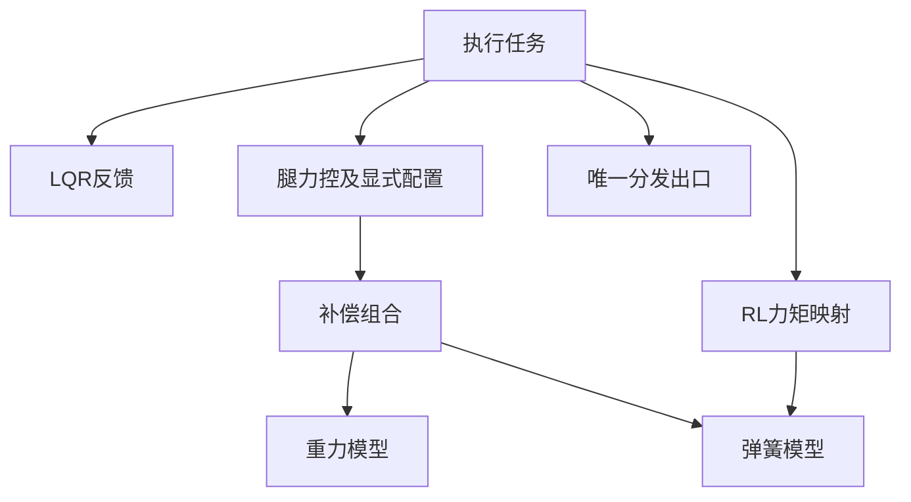

# 控制模块职责与依赖

2026-10-10按作者批准的结构优化计划实施。控制参数、极性、零点、状态机、任务数量、优先级和控制频率保持。当前验收见[structure-implementation.md](structure-implementation.md)。

## 接口与状态

`robot_control.h`只提供任务入口、策略/许可接口、故障位、节拍接口与信号量声明，不再导出整机共享数据。需要访问共享状态的任务显式包含`robot_state.h`。算法模块禁止包含这两个任务头文件。

`robot_state.h`集中共享数据类型与声明，实例仍定义于`robot_control.c`；保持原变量名、布局、初始化及Watch入口。共享状态仍是全局实例；反馈消费者通过feedback_snapshot.h读取，调试器仍可查看原Watch变量。

| 状态 | 周期写入方 | 主要读取方 |
| --- | --- | --- |
| `imu_state` | IMU任务 | 通信、策略、执行 |
| `motor_state`、`leg_l/r` | 通信任务 | 策略、执行 |
| `rc_command`、`robot_state`、`ctrl_fault` | 通信任务 | 策略、执行 |
| `action_state`、`rl_control.observation/policy` | 策略任务 | 执行、后台 |
| `input_command.mode` | 通信任务 | 策略 |
| `input_command`的RL目标字段 | 策略任务 | 后台调试 |
| `lqr_state`、`leg_balance`、执行力矩状态 | 执行任务 | 通信 |
| `ctrl_strategy`、最终命令、补偿与周期诊断 | 执行任务 | 通信 |

总初始化和模型切换仍可初始化/复位对应状态；上表描述周期运行的归属。电机反馈与对应腿解算同一临界区提交，IMU及遥控独立发布。

## 算法边界

| 模块 | 职责 |
| --- | --- |
| `rl_observation` | 观测、历史、训练角色转换 |
| `rl_policy` | CubeAI网络创建、校验和推理 |
| `rl_torque` | 动作/反馈到力矩，不读任务全局状态 |
| `lqr_balance` | LQR估计、目标和状态反馈，管理本模块运行配置 |
| `leg_balance` | 腿长/横滚力控，显式接收运行配置 |
| `gravity_comp` | 重力模型插值、摆矩与四髋增量 |
| `gas_spring` | 弹簧模型和弹簧力矩增量 |
| `leg_compensation` | 组合弹簧/重力、限幅和补偿诊断 |
| `leg_solver` | 腿几何和力域映射 |
| `math_utils.h` | 无任务/驱动依赖的有限数数组检查 |

`lqr_runtime_config_t`明确表示运行配置，`lqr_debug_t`作为原类型别名保留；`lqr_debug`原Watch变量保持。执行任务把配置传给`Leg_Balance_Compute`，腿力控不再隐式读取该全局变量。原开关、限幅、支撑前馈和离地行为保持。

所有力矩控制路径仍只由执行任务下发；通信任务保留使能、失能、停止和看门狗报文。算法使用纯类型和只读机器配置；CubeAI网络封装和RTOS任务接口保留对应平台依赖。

## 公共反馈快照

`Robot_Feedback_Read(robot_feedback_t *out)`只复制状态并读取单调时间。NULL返回0，非NULL返回1；返回成功不代表传感器有效，消费者沿用原IMU、腿解算、电机在线等有效性判断。

快照包含IMU、电机、左右腿、已计算遥控指令，以及各源发布元数据和实际接收时间。策略和执行每周期各读取一次，关节映射、观测和控制计算使用同一份输入。预览仍不要求电机在线，历史推理保留原门控，最终下发仍复核实时故障、遥控许可、总使能及电机状态。

- `*_meta.sequence`表示发布批次，允许回绕为0；`seen`独立表示已发布，不能以序号非0判断有效。
- `published_ns`为本源提交时间，`captured_ns`为读取时间，它们不代替接收时间。
- `*_sample.received_ns`跟随实际解码样本，DM/DJI从CAN ISR取时，HI229/DR16从UART接收批次取时。没有新样本或离线时保留最后接收时间，不用任务运行时间刷新。
- IMU的`last_timestamp_ms`仍是模块原始时间戳。MCU数据龄用`captured_ns - received_ns`，先检查`sample.seen`。本轮数据龄仅诊断，不新增超时门控。
- 不要求异步来源同时采样。电机与腿数据配套；三来源各自发布，可有不同接收时间及发布批次。

## 通信与后台

`comm_task_body`依次执行电机解析、反馈及腿解算发布、遥控发布、故障/跌倒/使能与看门狗，不调用灯效或普通VOFA。

`defaultTask`保留USB初始化及原osDelay(1)，每轮调用`background_task_body`，先VOFA后灯效。VOFA捕获所需字段后在临界区外打包，忙时跳过捕获和打包，无待发队列。UART/USB切换由后台统一管理，在短临界区内同时核验失能和发送完成。灯效按时间计算当前相位，单次轮询发送使用共享5ms预算，不追补遗漏颜色。

任务栈配置不变。反馈快照及后台打包缓冲为模块私有静态聚合，避免大结构占用默认任务栈；栈检查及台架项目见实施记录。

## 目录与依赖

| 目录 | 职责 |
| --- | --- |
| Algorithm/ | 几何、姿态、观测、控制器及CubeAI封装 |
| task/及task/inc/ | 周期流程、反馈快照、后台服务、遥控指令转换及任务状态 |
| drivers/ | DM/DJI、DR16、HI229、BMI088及寄存器、WS2812 |
| bsp/ | CAN/UART、DMA缓存、单调时钟、BMI088板级适配、VOFA传输 |
| common/ | PID、卡尔曼、斜坡、数学、DSP源码及motor/RC/RL纯类型 |
| config/ | 机器配置和既有物理标定 |

旧混合目录已移除，不保留转发头或重复源。motor_types.h、rc_types.h、rl_types.h提供纯类型，控制头不再借驱动/网络头获取索引或枚举。rl_policy.h仍依赖CubeAI，robot_control.h仍为RTOS任务接口。

## 校验

架构回归约束算法不得包含任务头、任务接口不得重新聚合共享状态、重力模型不得组合弹簧/限幅、腿力控不得隐式读运行开关。真实纯类型、快照和控制数据头可在无HAL/RTOS/CubeAI替身下宿主编译。快照、VOFA、传输切换和灯效时序见tests/test_structure_runtime.py及tests/test_vofa_standup.py。

最新编译、回放与宿主回归以[structure-implementation.md](structure-implementation.md)为准；早期失败及构建计数仅为历史，保留于[code-maintenance.md](code-maintenance.md)。
