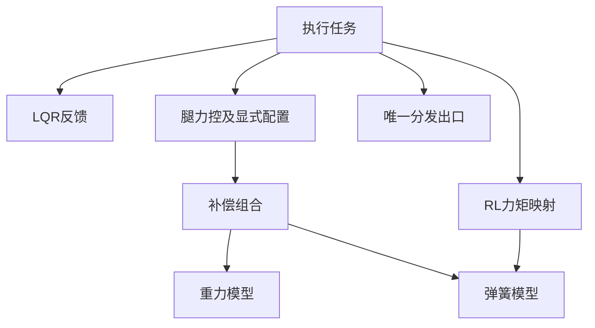

# 工程历史修改记录

本文件只保存历史变更、依据、验证与删除前的文档副本。当前规则看AGENTS.md，当前代码结构看file-guide.md；历史内容不能作为现行参数、已验证状态或可直接执行的操作步骤。阅读时按日期、模块或关键词检索，不必整份加载。

## 2026-10-26 · 补充编译产物与个人界面忽略规则

- 作者要求将已核对的四类文件加入.gitignore：Keil输出目录、个人uvguix布局、JLinkLog.txt，以及MATLAB各级目录的asv备份；保留原四态候选输出目录的忽略规则，更新现有总览。
- 仅调整忽略规则和维护说明，不删除本地文件、不取消已有Git跟踪、不暂存或提交。工程登记、下载配置、链接脚本、依赖、正式增益/模型/网络C/H及控制参数保持原状。
- 验证仅检查忽略规则匹配、必要构建文件未被忽略及本轮差异；未重新编译、克隆或烧录。

## 2026-10-26 · 取消PD选择开关与configured，保留rc_enable

- 作者进一步明确：NORMAL固定四态，非NORMAL固定原PD，不需要len_pid_enable。删除机器配置/运行配置字段、大小机初始化、LQR_Init拷贝及非NORMAL固定支撑替代分支；AIR轴向释放优先F=0，自起/倒置自救独立PID和参数未改。
- 逐项审计configured：lqr_configured在两机恒为1，仅送遥控解码，删除声明/赋值并默认LQR模式允许。rl.configured原来有大机1/小机0的真实启用作用，已告知后作者明确仍要求删除；按要求删除配置字段、两机赋值、机器人状态初始化/网络初始化/策略任务/电机许可/观测映射内的相关条件，小机.rl保持零参数，不编造网络/物理映射。
- 网络统一在ctrl_task_init初始化；未选RL不推理。SDK初始化/接口/结果检查、policy.ready、动作新鲜度、反馈有效、最终出力许可均保留。ready不代表训练网络机型匹配，删除后小机误选RL不再由configured拦截，适用性按作者要求由操作方负责。未改网络生成文件/权重。
- 作者在审计中明确提出先解释、不要直接删rc_enable；该字段和所有现有消费者保留。RL解码将它固定为1，关闭档/离线/缺少补偿模型时仍0。online只表示遥控在线，rc_enable仍承担模式许可；若未来移除它必须以DISABLE策略等方式承接原停档语义。本轮未删字段、未改控制选路/检测/恢复中对rc_enable的使用。
- 其余enable检查：wheel_enable/hip_enable实际屏蔽通道；AIR各开关改变检测/落地/释放接入；恢复enabled/recovery_enabled选择动作；motor_enabled为电机状态，torque_output_enabled为最终总门。它们不当作未用字段批量删除，尤其不扩大恢复/AIR修改范围。USB的USBD_STATE_CONFIGURED是真实协议枚举状态，不删。
- 12个相关C源×大小机共24项ARM GCC语法检查通过；源引用检查确认自有C/H已无configured/lqr_configured/len_pid_enable，rc_enable仍存在。现有RL_Policy、最终输出层、DM驱动和ground_recovery相对HEAD无改动。只做源码清理核对，未重跑整套桌面行为/完整链接或上机；未暂存/提交。

## 2026-10-26 · 删除NORMAL的腿长/roll PD后备

- 作者先要求清理旧独立PD，随后明确范围为仅NORMAL，不改其他路径/恢复。仅在leg_balance.c收敛NORMAL出力路径：固定四态LQR，删除NORMAL对len_pid_enable的依赖、模型不匹配时回退PD及关闭开关后只给支撑的行为。模型不匹配/四态失败返回无效候选，沿用最终零输出保护。
- 原PD计算/实例仍保留给非NORMAL（AIR预接触等）使用，旧len_pid_enable仅影响非NORMAL。Ground_Recovery_Init仍读取同一机器表长度参数，动作PID及配置不删除、不移动；恢复源与头文件相对HEAD无改动。不新增AIR处理或参数，不改K、Q/R、滤波、观测器、轨迹、Tp/轮矩、物理标定及最终映射/限矩。
- 当前只有大机匹配四态生成表；删去NORMAL后备后，小机NORMAL会拒绝该大机模型，不再执行原小机PD。不生成未经标定的小机四态数据。
- 同步leg_balance.h、lqr_balance.h和machine_config.h的用途注释；类型、成员和函数接口保持，新增的lqr_balance.h改动仅一行开关注释，后续Git分批清单应包含它。
- 检查生产Leg_PD_Update及Leg_Balance_Output相对本轮前内容一致，正常四态核心无公式变化；4个相关C源×大小机共8项ARM GCC语法检查通过。按本轮清理范围不重跑全套桌面控制行为或完整构建，也未做上机验证。无暂存/提交。

## 2026-10-26 · 19:04日志：减轻roll速度滤波滞后

- 本次CSV（19:04:34）22,881完整行，NORMAL有效15,869行，分4段投入（69.845s/20.285s/0.17s/9.215s）；反算K匹配Qroll20后的312.738/29.975，H仍1110.019/147.204，滤波0.02/0.15。公共fallen标志有15个过渡样本；35个限矩样本集中在仅0.17s、初始约-37度的重投入段，不将该段当普通转向对照。
- 排除各段开始1s/公共fallen/无效FN后，roll绝对值中位约0.317度、95分位2.951度，仍有第1段-20.53度和第2段+26.01度的大角度失稳。按相近向心估计量及较低Hdot分组，常规转向较前份波动减小，但两份操作/目标高度/输入强度不同，非严格A/B，不能仅用全程极值评价增益。新向心估计峰值约23.5N，旧份约9N，也不能直接当真实横向加速度比较。
- 第1段69.705s/CSV12153行，原roll角速度约-0.0139rad/s，滤后仍-1.2637rad/s，D分项约+37.88N；第2段结束同样存在明显滤后残留。用时间戳和原速度离线回放现有0.02滤波，与记录相关性0.99999、残差标准差约0.00103rad/s。这里只确认信号滤波滞后，不把回放当新闭环实测，也不把大角度欧拉变化率与单轴陀螺严格等同。
- 单变量将machine.lqr.lpf_alpha[2]从0.02→0.05，1ms时间常数约49.5→19.5ms，减轻速度反馈延迟；这是更轻/更快滤波，不是增强平滑。pitch/yaw0.6、Hdot0.15、Q/R、K、观测时间常数和边界、向心0.1及控制逻辑均不改。大角度存在单侧FN估计低/负值，不能声称单一滤波改动已解决接触/模型可行性问题。
- 已运行正常M入口，保留全部稳定性保护；含观测/滤波/0～10ms假设延迟、偏置/噪声/冻结等验证通过。大小机GCC增量编译链接通过；重新生成28个M参考快照并执行实际C闭环/门控/退出核对。C生成表数值不变，滤波仍取机器配置。未上机、未新增仓库测试源或提交Git，源CSV只读。

## 2026-10-26 · 18:45日志后增强转向roll回正

- 作者反馈行进转向时roll软。只读冻结本次CSV（18:45:21，22,498,765字节），50,000完整有限行，NORMAL有效28,452行，计数折算158.135s；Q/K反算匹配接手时[5,0.01,250,0.01]及roll156.844/21.802。在线255、故障/求解结果/最终电机限矩均0，无FALLEN/FLIGHT；不能据此把所有动态差异归作通信故障。
- 高度共模偏置中位约40.0N/腿，全程H绝对误差中位1.247mm（动态95分位24.887mm），26～38s定高片段绝对误差中位0.092mm、95分位0.681mm。仅说明该定义下的H偏置补偿效果，不是两条实体腿各自都达到此误差，也不代表全部工况精度通过。
- roll最大约+15.54/-14.60度；|roll|>3度的样本中偏置修正约79.6%与P回正同向，20.4%反向，未据此认定偏置是软的主要原因。1,646个样本出现偏置边界标志、左右差偏置约±10N（全差20N），但本轮不扩大边界。大角度时有单腿FN估计低于20N，观测暂停符合设计；FN不是接触传感器。
- 单变量修改run_roll_height4.m：Qroll角度5→20，其余Q/R/观测时间常数/滤波/高度/向心增益/偏置边界保持。新roll角度/速度K约312.738/29.975，原156.844/21.802；高度仍1110.019/147.204，观察L不变。5度时单腿角度修正约13.7→27.3N，增加早期回正刚度；速度增益由DARE联动增加，不单独修改速度Q。
- 已完整运行生成入口并覆盖C；含滤波/观测/0～10ms假设延迟、偏置/噪声/冻结/代表性模型偏差检查通过。大小机GCC增量编译链接通过；重新生成28个M参考快照并核对实际C闭环/停学/坏数据/门控。未改C控制逻辑、物理量或添加限幅。
- 未上机确认新增益的转向刚度和是否重新出现高频抖动。现有向心系数仍0.1，不能从本日志相关性直接认定其准确；本轮保留它，避免同时改变两条作用通路。原CSV未改、无仓库测试文件、未提交Git。

## 2026-10-26 · 四态LQR接入1kHz慢变力偏置观测

- 作者明确要求按前文方案实施：保留四态LQR，核对输入/输出口径与反馈带宽，移植慢变偏置观测。未恢复MPC、力箱/力变化率、实验mode、额外姿态低通或新的C模块；未改质量、极性、零点、轴向、刻度、几何及CAN/RL/恢复动作。
- M端run新增observer_tau=[0.02,0.5]s（状态估计/慢偏置），Q=[5,0.01,250,0.01]、R保持接手时工作区。build按1ms A/B在共/差模3态坐标设计先预测再校正的L，再组装6×4矩阵；export生成K/A/B/f/L，接口4→5。新增observe_roll_height4.m为M参考实现。生成前后检查入口/机器配置文本，变动则不覆盖，正常入口仍只打印生成成功/已覆盖。
- C端roll_height_balance.c/.h增加四个物理状态估计和左右偏置；用上一拍F请求预测，当前原roll速度与原几何Hdot校正，控制速度低通仍独立。F=原支撑+显式向心-bhat-K误差，bhat不重复抵消已知补偿。原F/Tp映射→弹簧/腿重力→电机限矩链不变。
- 新增两个machine.lqr边界：共模平均偏置100N/腿、左右偏置差20N，约束估计而非F输出。作者工作期间把速度低通调为0.005/0.15，联合10ms假设延迟极点1.00007182未通过；比较后仅将roll低通0.005→0.02，高度0.15保留。Q/R及物理量未变，roll/Hdot时间常数约49.5/6.15ms。
- control_compute新增上一拍输入确认：候选/四态有效、DM与DJI提交成功、未限矩、最终输出镜像与候选髋矩相同，且当前AIR估计有效/初始化/非flight、双腿FN>现有force_on。无需改最终输出层。HAL_OK仅表示提交；不是硬件力已实现。FN不作为模型F输入。限矩/提交失败/最终撤力/支撑不足时冻结偏置重对齐状态，恢复首拍播种；退出NORMAL/投入/策略、无效计算仍完整Reset并清偏置。
- VOFA保持48路：24/25改左右偏置；43改扣偏置后的平衡力；8新增bit4播种、bit5本拍学习、bit6本拍估计触界（原低四位不变）。28/30仍为纯四态反馈均值/半差，不把偏置混入；11/12仍FN，26/27仍总F。常见正常学习ch8=51，43与44/45组合可核对总共同F。
- M生成验证：原/单精度、含滤波/观测的0/1/3/5/10ms延迟联合极点均通过（联合最大约0.998002）；全腿长给定变化、共模44.3N/腿+左右6N偏置、代表性M/I/阻尼偏差、高频测量噪声、冻结/恢复、偏置边界通过。理想偏置工况最终高度/roll收敛，不能视作实机证明；真实电机/接触/延迟仍未辨识。
- 工程外实际C运行8s闭环，对照M的28个快照，最大力差约7.3e-5N、偏置差约0.00161N、观测状态差约1.45e-5；检查重复调用、原始速度/滤后速度分离、冻结/首拍恢复、边界、坏数据清理、退出投入。另从生产控制文件提取新增输入确认片段编译执行，覆盖发送失败、最终改零、限矩与单侧低支撑；不是整个任务/硬件运行证明。VOFA只读/位域/偏置等60项检查通过。
- 工程登记仍为既有2个四态C源，按已安装eIDE收录逻辑确认总131源无缺失/重复；大小机GCC完整编译链接通过（原BMI088 packed警告保留），AC5六相关源×两机共12个对象编译通过；7个M文件checkcode无问题。测试/脚本仅在工程外，未新增仓库测试源或新Markdown。
- 尚未烧录、未测板端耗时/栈余量、未验证观测估计准确性、控制效果或物理稳定；不将数学/宿主检查标作可上场。未提交Git，保留全部原WIP。

## 2026-10-26 · 高度速度滤波过重触发生成稳定性保护

- 作者报告verify_roll_height4在含滤波/延迟闭环assert失败。复现时工作区Q=[0.1,0.01,1750,0.01]、R=[1e-4,1e-4]、lpf_alpha={0.6,0.6,0.5,0.01}。实际解析为roll0.5/Hdot0.01，数组合并未读错位置。
- 工程外执行生产验证中的增广矩阵计算：名义/单精度极点模0.99613385，含滤波0ms为0.99773186、5ms为0.99903112、10ms为1.00029524；失败来自10ms假设输入延迟下的高度通道，不是实际测得10ms硬件延迟。Hdot alpha0.01对应约99.5ms低通时间常数，不能认为越平滑越稳定。
- 仅将大机lpf_alpha第4项0.01→0.05（Hdot时间常数约19.5ms），其余滤波不变；不移除/放宽稳定性assert，不改物理量。原失败Q下完整verify通过，含0～10ms假设延迟最大极点模约0.99610334。
- 工作期间作者继续手调参数。在一次生成时M入口为Q=[10,0.01,750,0.01]、Hdot0.05，运行正常入口完整设计/验证/生成并覆盖C模型，C头注释与该次Q一致；大小机GCC增量编译链接通过。随后工作区Hdot又改为0.5、Q数次变化，本轮保留作者改动，不回写旧Q/滤波。最终只读执行实际解析和完整verify，核验到Q=[0.1,0.01,1750,0.01]、roll/Hdot0.5/0.5，最大延迟极点模0.99610334，通过且该次检查期间输入文件未变。正常生成入口输出仍为生成成功/已覆盖文件。
- 本次修复证明给定模型/假设延迟下通过数值检查，不证明实机稳定或原高度静差消失。历史参数记录保留，当前值以C机器配置、M入口和生成C为准。

## 2026-10-26 · 合并低通数组并核对角度输入

- 作者明确要求将roll_height_lpf_alpha合并到lpf_alpha，并在注释明确顺序。machine_lqr_cfg_t改为单一float lpf_alpha[4]：[0]pitch角速度、[1]yaw角速度、[2]roll角速度、[3]高度变化速度；移除分立成员。
- 保留本轮开始时作者工作区数值：大机{0.6,0.6,0.5,0.01}（高度滤波已由作者改为0.01），小机{0.3,0.3,0,0}（原未初始化的四态项本就为0）。不改Q、K、控制公式、滤波推进周期/次数、遥控速率或物理量。
- Roll_Height_Reset改读数组2/3；原pitch/yaw仍0/1；VOFA19读3、46读2。MATLAB build正则读取四项，四态仍取第3/4项，不重算或覆盖K。配置与头文件均注明顺序及alpha越小越平滑/延迟越大的关系。
- 对照CKP的Driver/imu.c、Estimator/body.c与Task/leglen_task.c：roll角和H不另做控制入口低通，roll角速度alpha0.05、Hdot alpha0.8，10ms周期；当前本项目1ms，不可直接比较系数。两套接收链均使用惯导提供欧拉角；本项目Attitude_Update不在MCU重新融合姿态。未新增角度低通。惯导内部算法/滤波设置不能从接收代码确认。CKP H仅有腿长/roll投影，本项目还包含腿摆角投影，不能称高度输入公式完全相同。
- 按本轮纯配置整理范围仅做引用/差异检查：主动C/H/M已无旧字段引用；4个相关源×2机型，共8项ARM GCC语法检查通过；MATLAB执行实际解析段，确认读到roll0.5、Hdot0.01。不做完整链接、桌面控制行为测试或上机验证，不将命名整理称为控制效果改善。

## 2026-10-26 · 16:22支持力日志分析与拨轮腿长速率减半

- 原CSV 22,070,407字节，共50,000有限且48列完整行；NORMAL投入5,831行、更新计数折算34.18s。ch8有效位为1的支持力样本5,647行，其余184行未用于支持力解释。反算K与作者当前Q=[20,0.01,1750,0.01]一致；滤波仍[0.5,0.1]，控制故障/结果/最终限矩标志均0，无FLIGHT/FALLEN。
- 18～29.8s较平稳片段，roll均值0.1125度、标准差0.0235度；高度误差均值16.342mm、标准差0.085mm。左右请求F均值52.322/53.562N，FN估计58.607/59.822N；单腿差约6.3N与估计器轮重项6.38N量级相符，不能据此认定指令完全没有执行，也不能将FN当力传感器或据此改质量。
- 该片段共同请求约52.942N/腿，而支撑前馈100.719N/腿，位置反馈长期抵消约47.8N/腿；静差与支撑基准/模型净偏置需要独立核对。禁止从本日志直接改M、极性、刻度、零点或几何。
- 动态片段差动请求与FN半差的对齐相关性约0.945，最优时间平移约31ms；其中包含FN估计器10ms低通及轮重/加速度项，不能认定为电机或CAN的31ms纯延迟。末段32～34.18s，roll速度反馈标准差约51.7N、差动请求53.8N；估计单侧FN曾低于5N，不等于已由接触传感器确认离地。18～29.8s静稳数据不代表动态工况全部通过。
- 目标升降两次150→310→150mm，实际变化速度最高约0.3002m/s（Rc_Command_Update已有固定0.3系数）；在升降之后出现大幅速度反馈和共同腿力。作为单变量减振验证，只将大机machine.rc.len_rate从1.0改0.5；拨轮最大变化由约0.30→0.15m/s，满行程160mm由约0.53→1.07s。Q、K、滤波、出力限制及物理标定均不改，小机仍0.3。
- 公共RC.len同时供LQR/RL，二者拨轮高度响应都会减慢；LQR内部既有给定斜坡也读取该值。未新增参数、限幅、模式、轨迹或观测器。本轮改变不消除约16mm静差，也未证明升降速度是振荡唯一原因。
- 工程外编译执行生产rc_command.c/machine_config.c，11项检查覆盖最大变化速度、上下界、速度/转向原值、LQR/RL模式和离线复位；DR16死区及K表域用窄替身，不是遥控硬件验证。大小机GCC增量编译链接通过；未新增仓库测试文件。减速后的动态效果待上机，原CSV只读未改。

## 2026-10-26 · 14:02日志与支持力观测补齐

- 新CSV（修改14:02:13）4,122行，NORMAL有效投入2,933行，更新计数折算16.695s。反算增益约312.738/29.975/2923.299/241.159，匹配作者当前Q=[20,0.01,1750,0.01]；roll/Hdot滤波0.5/0.1生效。当前Q与上份不同，不能把表现变化单独归于滤波。
- 投入段在线255、故障0、四态结果0、最终电机限矩0，未切入FLIGHT/FALLEN。短腿目标150mm后段高度误差中位约16.2mm、两腿均值误差约16.4mm，较上份24～26mm减少；roll仍约-0.58度静差。
- 长腿目标276.389mm片段仍明显失稳。第13.045s/CSV2714行，roll+11.301度，左腿228.996mm、右腿342.275mm，左右请求F约41.861/167.425N；请求力不等于实际地面支持力，未据此断言正反馈或物理标定错误。
- 作者本轮观测确认：左侧高/右侧低时ch13为正；实物左腿伸缩对应ch20。两项与当前模型约定/代码命名一致，不能据日志腿长关系直接推断roll角度或左右输入应取反。未改符号/轴向/几何/标定；当前仍需用实际反馈受力区分接触/执行问题和模型失配。
- 仅改vofa_debug.c的3路：ch8从模型ID换air_detection状态位（valid1/initialized2/fault4/flight8），ch11/12从计算耗时/模型周期换左右FN估计。直接只读已有air_detection.leg[].force，不增加估计推进或控制缓存；原26/27请求F、34/35 Tp及其他通道保持。valid=0时旧估计值不能当有效接地力；FN是反馈反解+模型估计，不是力传感器，且与补偿前F坐标不同。
- 本轮不改Q、滤波、K或控制逻辑。工程外VOFA生产源码只读测试61项断言覆盖48路、估计状态、有效/失效及不修改检测历史；大小机GCC增量编译链接通过。尚未取得新FN日志，不能宣称roll问题已解决。原CSV与M/C参数未改。

## 2026-10-26 · 13:37日志分析与高度速度滤波调整

- 作者上传桌面roll腿长测试.csv（修改时间13:37:41，5,742,481字节）。工程外只读冻结分析，共12,540有效行，NORMAL投入10,705行，更新计数折算约67.89s。作者确认包含调腿长、转向行走，无手推/扶车；当前48路未记录摇杆原始输入，不能把所有摆动归作自发振荡。
- 从32/13、33/15、44/10、45/18反算增益约221.506/25.512/1918.135/194.644，与当前作者工作区Q=[10,0.01,750,0.01]匹配；46记录roll低通0.5、19记录Hdot低通0.3，不能沿用前轮Qroll0.1/滤波0.005解释。保留作者当前Q和roll滤波。
- 投入段在线掩码255、故障0、四态结果0、最终电机限矩标志0，未进入FLIGHT/FALLEN。短腿固定目标150mm、25.7～40.4s片段高度误差中位约24.7mm；roll均值约-0.62度、标准差约0.23度，存在静态偏差。
- 第7～8s固定目标约242.6mm，平均轴向请求标准差约100N，而roll反馈半差约4.2N；高度速度项有约41Hz强分量。50～58s又有约44Hz高度速度/共同腿力分量。只说明高频伸缩进入速度反馈后产生大幅请求，未证明噪声/结构共振/接触变化的唯一因果。
- 另记待核对片段：第42s目标两腿235.929mm，实测左314.330/right196.792mm，roll约-0.832度，H255.324mm（CSV7194行）。在双轮平地接触且现有几何投影含义成立时，117.5mm腿长差与该roll不相符。只标记模型接触/反馈条件需核对，不据此更改物理符号、轴向、几何或标定。
- 按前文参数调整授权，本轮仅将machine_config.c的Hdot低通0.3→0.1（roll仍0.5），并纠正旧滤波时间常数注释。1kHz下Hdot滤波约9.5ms，41.25Hz幅值增益由0.811→0.378（约原46.6%），用于降低该频段速度反馈请求；更强滤波也增加相位滞后，不能宣称实机振荡已解决。未新增限幅/开关，未改K或控制逻辑。
- M按当前Q/新滤波只生成候选并做单双精度/滤波/0～10ms输入延迟及代表性模型检查，固件K不重复覆盖；大小机GCC增量编译链接通过。修改后VOFA19应为0.1、46仍为0.5。原CSV未改；分析和图仅在工程外临时目录。新滤波效果、接触状态与精度仍待实测。

## 2026-10-26 · 无抖动基线上增强roll回正

- 作者反馈上一组Q=[0.01,0.01,750,0.01]已不抖，但roll控制效果差。保留该组M入口/C模型/C机器配置于工程外临时目录，未做Git操作。
- 本轮只把roll角度Q从0.01提高到0.1，其余Q、R和滤波保持：Q=[0.1,0.01,750,0.01]，R=[1e-4,1e-4]，速度低通[0.005,0.3]。不新增限幅、开关、观测器或物理量改动。
- 生成roll角度增益7.04945→22.27423（约3.16倍）、速度增益8.29736→10.49416（由LQR设计联动改变，速度Q未改）；高度仍1918.13535/194.64389。目标是逐步增加回正力，避免直接恢复曾失败的高roll增益。
- M入口已生成并覆盖C模型；名义单双精度/滤波/0～10ms输入延迟/几何/偏置与代表性模型偏差数值检查及大小机GCC增量编译链接通过。作者确认无抖动仅适用于上一组基线；新参数的roll回正及是否重新振荡仍待上机。高度23.1mm偏置性能未因此改变，未宣称精度达标。

## 2026-10-26 · 降低高度通道增益的减振试验

- 作者反馈roll增益/滤波调整后幅度减小但仍抖，并授权参数问题直接调整后汇报。本轮只改run_roll_height4.m的高度Q：5000/1→750/0.01；roll Q仍0.01/0.01，R仍1e-4/1e-4，C滤波仍0.005/0.3。未新增控制开关、降额或限幅，未改控制执行逻辑/物理标定。
- 新生成K的单腿高度位置/速度增益约1918.14N/m、194.64Ns/m，原约4921.69、321.49；roll仍7.04945、8.29736。与原PD在近直立双腿同向等量伸缩时的1900/150比较，减小共同高度通道的激振，不能据此认定剩余roll振荡已经解决。
- MATLAB保留原10mm偏置性能判定为bias_within_10mm报告项；低增益下每腿44.3N偏置预测23.095mm，实际仿真与预测一致，该指标为false。稳定性/几何/有限值/反馈方向/名义回稳检查继续执行，不以数值检查通过宣称精度达标；不再为让偏置性能过关而迫使提高K。
- 已运行生成入口覆盖roll_height_model.c；单双精度、速度滤波和0～10ms输入延迟数值检查、名义/偏置/代表性模型偏差检查通过。大小机GCC增量编译链接通过。本轮未烧录、未上机；高度静差可能增大，先验证振荡幅度。

## 2026-10-26 · 仅调参缓解roll高频振荡

- 作者明确拒绝额外限幅/降额，已撤销临时roll增益系数、单腿±5N限制及M端对应逻辑；不保留新增结构成员或旁路。
- 仅调整原有参数：machine_config.c的roll速度低通先0.05→0.01，复核时工作区进一步调为0.005（保留现值，1ms时间常数约199.5ms），Hdot仍0.3；run_roll_height4中Q=[1,1,5000,1]→[0.01,0.01,5000,1]（保留复核时入口现值），R保持[1e-4,1e-4]。降低roll增益与增强平滑同时进行，避免只增加滤波延迟。高度、原支撑/向心、补偿及最终电机限矩保持。
- 已运行M入口覆盖C数据，roll角度/速度增益约7.05/8.30；名义单双精度/滤波及0～10ms输入延迟检查通过，大小机GCC完整编译链接通过。弱反馈4s数值响应未达到原误差标准，观察延长为8s后通过，未放宽误差门槛。该组用于降低激振的测试，扶正较弱，不能宣称已解决实机振荡。未烧录。

## 2026-10-26 四态LQR简化与roll振荡排查（实机未通过）

- 按作者要求去掉实验mode，正常大机直接完整四态；删除独立roll_height_param.h、roll_height_lqr.c/.h、观测器/偏置配置、五次参考、F上下限/变化率与反解历史。C只在原machine_config.lqr保留两个速度低通，模型只留机型/Ts/K；小机与非NORMAL仍原PD。
- leg_balance复用原腿长斜坡，原支撑前馈及显式向心项加到四态反馈；保留原F/Tp映射、弹簧/重力和最终电机限矩。新增模块初始化速度滤波；同拍重复调用不推进历史，退出/无效清理。未改物理极性、零点、IMU轴向或几何。
- roll低通由工作区0.004改0.05，Hdot保留0.3；1kHz对应约19.5ms/2.8ms时间常数。候选Q=[72,0,5000,1]、R=[1e-4,1e-4]，roll增益约591.149/40.075；高度保留作者当时最新权重5000。作者随后继续调参，以当前入口和生成文件为准。
- 该候选单双精度、滤波及0/1/3/5/10ms输入延迟模型检查通过；44.3N等效单腿静偏置预测约9mm高度误差，仅数学预测。工程外生产C运行检查正常/非NORMAL/释放/重复调用/几何/坏数据、映射补偿和最终限矩；48通道只读发送检查通过。大小机GCC完整编译链接与AC5相关对象编译通过，不是上机效果证明。
- **作者上机反馈Qroll=[72,0]仍严重高频抖动，候选不通过。** 延迟模型未覆盖实际腿弹性、执行器/反馈动态和接触，不能以名义极点稳定宣称已解决。未继续盲调或启用扰动观测器。
- CKP实际leglen_tinympc.c每拍更新LESO，偏置进入下一拍动力学仿射项；其M脚本S.USE_DOBS=false仅控制仿真，不能推断C关闭。该观测器估计慢变的左右恒力偏置，可改善静差，是否对本机稳定性必要尚无实测对照。另查明新四态替换移除了原左右单腿PD的差模刚度/速度阻尼，不能只比较独立roll增益判定控制等价；物理因果需新日志验证。

## 2026-10-26 · 四状态LQR同步1kHz并集中C运行调参

- 作者要求四态与平衡同为1kHz、C调参集中，并另上传100Hz基准CSV。删除ROLL_HEIGHT_CTRL_DIV/ticks分频与保持分支，四态每个有效1ms拍直接计算，sampled防止同拍重复更新；M端Ts=0.001重新生成A/B/K和观测器L，不复用旧100Hz数据。
- 接手确认作者已将Q高度改305，保留q=[22 10 305 6]、M=20.534、I_roll=0.578等现值。新K的roll/roll速约305.260/207.812、高度/高度速约1221.076/229.293；不将升频或数值验证称为高度偏差已解决。
- 新增config/roll_height_param.h作为四态C运行调参唯一来源：模式、观测器开关、力箱、N/s力变化率、参考时长/速率、两处滤波与偏置限制；machine_config只引用宏，生成model不再存运行值。M四态build解析同一头文件，读入后设计/验证，原十态生成不依赖此解析；数值项使用直接数字常量。数据接口号升为3，原模型数据需重新生成。
- 滤波保持时间尺度：旧10ms alpha=0.04/0.8换算为1ms的0.0040738786/0.1486600775；force_rate=3000N/s，单拍上限由30N/10ms换成3N/1ms；参考0.5s不变。观测器极点按10ms设计极点的Ts/0.01次方换算，默认仍关闭。原状态判断、补偿和物理标定未改。
- VOFA仍48路，12由最大耗时改为控制周期ms（应为1）；最大耗时保留Watch字段。用户100Hz基准已在工程外复制留存，按旧10ms和旧12通道解析；21811帧中17408帧有效，LQR结果均正常、单次6~12us，无最终电机限矩，静态筛选高度误差中位约40.3mm。该数据不按1ms解释，也不能说明1kHz已修复静态工作点偏差。
- 工程外8110条生产C断言通过，包含1000拍1000次更新、同拍不重复、10个1ms滤波步与旧10ms响应一致、3N命令速率、2000拍可选观测器有界收敛、C/M力差最大约3.81e-5N、原PD影子/隔离/非NORMAL输出保持及降力回归。上下文224B、只读模型284B。VOFA108条打包断言通过，12在未投入时也显示模型周期1ms。
- 大小机GCC完整编译链接通过，Flash/AXIRAM分别613508/47744B和609788/46496B，仅原BMI088 packed告警；8个相关源在两机配置下共16个AC5对象编译通过。M端6个函数checkcode无提示；公共machine_table保留原有一处MSNU（旧AGROW抑制注释）提示，未为消除提示改无关代码。未做完整AC5链接、烧录、提交或推送；1kHz实机效果需新日志。

## 2026-10-26 · 四状态M/C全部改为直接LQR并重整生成流程

- 作者要求移除迭代控制、M/C均直接四状态LQR，继续以VOFA排查高度；同时要求M端结构参照已有十状态，并且正常只提示生成成功/已覆盖文件。删除旧roll_height_mpc.c/h，新增roll_height_lqr.c/h，机器枚举改LQR系列，移除预算字段；Keil登记同步新源，eIDE继续Algorithm目录扫描。
- C端直接计算平衡前馈、四个-K误差项和合计原始力，再作力箱/命令速率限制；没有迭代、超时、回退、热启动、预测窗和QP缓存。运行上下文保留观测/参考/100Hz调度及反解反馈诊断，非NORMAL与十状态平衡输出、最终映射补偿保持。滤波值0.04/0.8保留，统一从M端生成数据读取。
- 接手时发现M端已被作者改为M=20.534、q=[22 10 5500 6]，而C数据仍是M=25.544/q高度55。保留当前M端数值，机器参数迁到现有machine_table的roll_height字段、Q/R迁到独立run_roll_height4入口；设计/验证/导出/覆盖由build_roll_height4负责，model只建动力学。候选/报告写忽略的独立output目录，检查通过才覆盖固件，失败不覆盖；正常stdout仅两行。生成检查不等于上机稳定性。
- 实际MATLAB执行生成并覆盖成功；新K高度/高度速度约4386.834/329.542，roll增益约155.425/106.783；名义/单精度闭环与包含速度滤波的增广模型检查通过，滤波模型最大极点模约0.989205。名义/扰动/偏差与能力不足检查、几何17点和数值力分解通过并写报告，压力失败指标保留。负R失败设计未改变固件文件，6个M函数checkcode无提示。
- VOFA仍48路，新增直接LQR原始平均力、H-Href、原始几何Hdot、平衡前馈/高度位置/高度速度反馈及力限制标志；旧迭代/超时/回退通道含义退役，现行表同步。用户随后只要求生成提示简洁，保留完整验证并把细节写报告，不打印过程。
- 实际生产C工程外核验6109条断言通过，24组C/M数值对照最大力差约1.14e-4N，120拍原PD影子逐字节等价、完整/隔离/非NORMAL选路、1000拍100次更新、滤波及高反解反馈降力回归保留。新上下文224B、只读模型308B。新VOFA布局108条打包断言通过，确认只读、48路/一次发送及通道分解。
- 大小机GCC完整编译链接通过，Flash/AXIRAM分别613428/47744B和609740/46496B，仅原BMI088 packed告警；8个相关C源在两机下共16个AC5对象编译通过，未做完整AC5链接。安装版eIDE源选择与编译/链接清单中三源各一次，旧求解器无链接项。生成候选与固件文件逐字节一致；未烧录、提交或推送，实际抖动/高度仍需新版实机日志验证。

## 2026-10-25 · 为完整四状态日志恢复高度出力并增加PD平均力参考

- 作者明确要求完整四态恢复出力并录制新VOFA日志。将大机从ROLL_ONLY切回MACHINE_LEG_MPC，保持当前模型、Q/R、roll滤波0.04、高度速度滤波0.8、观测器关闭及100us预算不变；小机仍PD，隔离选项保留。
- 既有48通道保持，唯42由参考段时长改为原PD算法平均力参考：0.5*(左右长度PD输出+左右原支撑前馈)，roll/向心的反对称项在均值中抵消，不参与实际控制。完整模式下28/29应一致，42用作未选用的PD对照；现行通道表同步，明确旧roll腿长测试.csv的42仍应按旧的秒单位解析。
- 已分析的前次隔离日志显示2754次求解均回退、单轮222~279us超100us预算；本次未一并改预算，完整出力仍可能全由四状态LQR回退提供，需结合9通道判读。静态片段高度参考213.10mm、观测233.73mm，候选均值115.22N/腿而选用PD均值61.06N/腿；此数据说明直接接入平均力会明显加力，但不能据旧隔离日志认定完整模式顶腿的全部过程。
- 工程外6408条控制断言及108条VOFA打包断言通过，覆盖完整四状态实际选择及新的42通道、非投入时PD参考语义。未修改极性、补偿、CAN或其他工作区改动，未烧录、提交或推送。
- 大小机GCC增量编译及完整链接通过，vofa_debug/machine_config在两机配置下共4个AC5对象编译通过，未执行完整AC5链接。

## 2026-10-25 · VOFA切换四状态MPC隔离诊断布局

- 作者明确要求将对应观测量放到VOFA，并反馈关闭MPC高度输出后不再持续顶腿。该结果支持继续检查MPC平均力通道，不直接认定模型参数、符号或算法已定位。保留当前ROLL_ONLY模式与全部控制参数；读取时发现roll速度滤波已手调0.04，未改动该数值。
- vofa_debug.c注释保留旧AIR交接赋值，启用固定48路MPC布局，0~2保持公共状态；新增状态/模式/valid、求解次数与回退/时间、roll原始/滤后速度、H/Hdot与参考、左右腿长目标、候选与选用F、平均/差动力、命令历史/反解反馈、饱和/AIR及参考轨迹/残差/腿角。只读已有状态，同一短临界区复制后一次发送，未新增传输机制、页面或控制采样。
- Vofa_send.h仅同步48通道注释，数量/协议/UART未改；完整通道表同步file-guide。明确24/25和28为MPC候选，26/27和29为当前实际选用请求，均不是直接实测支持力。当前ROLL_ONLY下高度MPC候选仍计算但不直接用于平均支撑，无需切回全MPC即可采集其偏差。
- 工程外编译实际vofa_debug.c与机器配置，HAL/RTOS及发送为替身；108条断言覆盖两帧48通道位置/单位原值、均值/差值、NORMAL与退出后清零、一次发送在临界区外及控制对象逐字节未被修改。仅证明打包软件契约，不代表UART上位机已接收。未烧录、提交或推送。
- 大小机GCC增量编译及完整链接通过；vofa_debug.c在两种机器配置下AC5对象编译通过，未做完整AC5链接。无控制算法修改，未重跑整套物理控制替身测试。

## 2026-10-25 · 增加MPC平均力/差动力隔离诊断

- 作者要求先关闭roll或高度中的一项排查。新增MACHINE_LEG_MPC_ROLL_ONLY/HEIGHT_ONLY，保留既有枚举值；当前大机选择ROLL_ONLY，小机仍PD，Q/R、模型、滤波、预算和标定不变。
- leg_balance中令common=(Fl+Fr)/2、diff=(Fl-Fr)/2；ROLL_ONLY使用原PD common与MPC diff，HEIGHT_ONLY使用MPC common与原PD diff，再重构左右F。当前相当于暂不让MPC决定平均支撑，保留旧PD平均腿长支撑，并观察MPC差动roll效果。不是将支撑清零，也没有直接删状态或将Q改零。
- 属于输出隔离，内部仍求解四状态，候选力约束仍耦合；不能称完全解耦模型。候选20~150N/30N限制不直接约束混合F，但原映射、补偿和最终电机限矩保持。混合模式request_previous记录MPC候选而非混合后实际F，previous保留反解反馈供诊断/观测；控制器实际出力许可及非NORMAL清理沿用原逻辑。
- 工程外实际生产C检查6408条断言通过，新增12个不对称状态/两种最终限矩幅值组合，逐项核对ROLL_ONLY的PD均值/MPC差值、HEIGHT_ONLY的MPC均值/PD差值，并确认轮矩、Tp、非NORMAL输出与原路径一致。此前数值、滤波、降力回归仍通过。未烧录、提交或推送，实机隔离结果待作者复测。
- 大小机GCC增量编译及完整链接通过，Flash分别622444/618756B；相关4个C源在两机配置下共8个AC5对象编译通过，未做完整AC5链接。

## 2026-10-25 · 修复限矩反解反馈可能锁住MPC降力请求

- 作者反馈滤波后roll抖动减小，但仍缓慢升至最大腿长、拨轮不能下降；可控制行走且暂时无法使用VOFA。未把实机现象直接定为FLIGHT或质量错误，继续检查C/MATLAB命令历史差异。
- 找到可复现的软件边界：C端Roll_Height_Commit每1ms用最终限矩反解力重写previous，而求解器用它作为30N速率约束起点。若反解持续超箱并被钳为150N，即使H=0.34m且目标0.15m，下一拍请求仍被限制不低于120N；反复反馈又重置到150N，无法继续降力。MATLAB用的是上一份已发布合计力命令，不含这个额外闭环。
- 工程外实际生产C先复现失败：持续高反解反馈下，1000拍后请求仍为约120N/腿。随后仅修改roll_height_balance.c/h：新增request_previous保存有效候选经输出映射后的控制命令，速率约束读取该历史；原previous及applied_sum继续保存反解反馈作诊断/可选观测，不改变补偿、模型、滤波、Q/R、力箱和周期。复位仍统一清理全部历史。
- 同一回归修复后请求可降至约34.97N/腿，且连续请求变化不超过30N；此前数值/选路/滤波等检查保留，共6260条断言通过。上下文由960B增至968B。测试施加了构造的高反解反馈，证明该软件锁死路径已解除，不证明实机一定存在该饱和条件或振荡已全部解决；仍需有保护复测。
- 核验过程中发现当前工作区roll速度滤波已手调为0.01，保留该数值，递推检查读取当前宏而非继续写死0.05；不将该工作区调参归为本次降力修复。现行说明同步0.01与CKP参考0.05的区别。
- 当前大小机GCC增量编译及完整链接通过，Flash分别622188/618500B；相关4个C源在两机配置下共8个AC5对象编译通过，未做完整AC5链接。未烧录、提交或推送。

## 2026-10-25 · 四状态反馈滤波参数对齐CKP

- 作者报告MPC刚投入就roll持续摆动且高度升高，随后明确要求先将滤波参数按CKP对齐。本轮仅修改roll_height_balance.c/h及现有文档，不改质量/惯量、Q/R、力箱、参考轨迹、MPC模式、物理标定和其他控制路径。
- 核对CKP leglen_task.c：roll角速度0.05、Hdot 0.8两处一阶低通，每10ms更新；roll角、腿长和H没有该层低通。新增两个私有滤波状态及对应.h宏，复位清零；几何Hdot仍先用原始roll角速度计算，再滤波。保持现有H/Hdot一致的几何公式，不复制CKP的H未含腿摆角而Hdot含摆角差异，不新增不存在的腿长低通。
- 工程外生产C检查4259条断言通过，覆盖两处首拍/第二拍递推、9个保持拍与单拍重复调用不推进、退出/重进清零、17组非零姿态几何与滤后速度，并保留前述PD影子等价/实际MPC选路/数值与回退检查。运行上下文由952B增至960B；模型数据和纯求解器未变。额外离散名义模型检查四状态LQR含两处滤波的闭环最大极点模约0.988576，仅证明该简化无饱和模型，不代表实机稳定或已修复振荡。
- MATLAB默认仿真尚未加入这两处测量低通，未据此重调Q/R。滤波对齐会引入相应延迟，当前摆动根因及上机效果仍待验证；未烧录、提交或推送。
- 大小机GCC增量编译及完整链接通过，Flash/AXIRAM分别622156/48480B和618436/47232B；4个受影响C源在两机配置下共8个AC5对象编译通过，未执行完整AC5链接。

## 2026-10-25 · 按作者要求切换大机NORMAL为MPC实际出力

- 作者明确要求“改成直接使用mpc”，将大机roll_height.mode从MPC_SHADOW改为MPC，生成模型actuation_ready从0改为1。该标记只表示允许选择出力，不称本机参数已辨识/实机验证通过；模型浮点系数逐项核对未变，小机仍为PD，观测器仍关、求解预算仍100us。
- MATLAB导出函数增加enable_actuation第三参数，默认true匹配当前模式，仍默认写临时候选目录，不自动覆盖固件。模型头注释和file-guide同步实际语义。NORMAL已有选择分支直接采用MPC合计力，不重复叠加PD/支撑前馈/向心力；轮矩及摆矩仍由十状态LQR计算。MPC不收敛/超时仍按原设计用四状态LQR回退。
- 工程外原生检查更新为当前MPC模式，共4200条断言通过：确认NORMAL的F逐项等于MPC合计力、区别于原PD且没有额外叠加，轮矩/Tp保持；非NORMAL与轴向释放继续和原PD输出逐字节一致。保留先前24组MATLAB数值对照、17组几何及生命周期/预算等检查，最大力差7.63e-5N。未改工作区原有background_service.c及向心gain=0.1改动。板端最坏耗时、频繁回退情况、参数及实际动作仍待上机验证；未烧录或提交。
- 当前工作区大小机GCC增量编译及完整链接通过；此次改动的machine_config/model在大小机下共4个AC5对象编译通过，MATLAB导出函数checkcode无提示。未执行完整AC5链接或上机试验。

## 2026-10-25 · 四状态MPC C端接入与默认影子验证

- 作者要求制定方案并执行C端修改，按此前说明以默认影子运行作为本轮交付。新增roll_height_model/mpc/balance三对.c/.h、MATLAB export_roll_height4；修改leg_balance.c/h、control_compute.c、machine_config.c/h、Keil源登记。eIDE当前Algorithm目录扫描已在实际sourceList/compile_commands/链接清单收录三源各一次，无需另建任务或输出通道。
- 大机SHADOW、观测器关闭、100us求解预算；小机PD。正式MPC模式保留，但生成数据actuation_ready=0，不能直接使用未确认的CKP惯性参数和近直立力接口出力。保持十状态轮/摆矩、FALLEN、自救、AIR、公共检测及最终输出。现有工作区向心gain=0.1是作者先前修改，未改回HEAD的0.2；该行原注释仍是旧0.2，不作为当前数值依据。
- 状态取同拍roll/角速、腿长/伸缩速度及已有世界腿角/摆速，解析Hdot与H一致；参考从实测高度初始化，目标保持遥控腿长语义，五次轨迹支持中途更新连续。100Hz候选由1kHz执行入口单次计数调度，离开NORMAL/撤力/无效输出立即清历史。ADMM失败/预算超限给四状态LQR回退候选，非有限结果失败；实际力口仍统一映射、补偿和限矩。
- 最终限矩相对raw_dm的差反解为补偿前等效轴向请求，避免把限幅前规划当实际施力；记录饱和及种子钳位，可选观测在下一窗口以请求均值校正上一拍预测，默认关闭。所有时间/反馈均为既有接口，未增加真实电机反馈传感器或声称精确支持力。
- 工程外Clang原生检查实际生产源码（时钟替身、CMSIS sin/cos用标准数学函数桥接）：4185条断言通过。24组C/MATLAB最大力差7.63e-5N；17组非零姿态几何一致；120拍覆盖释放/使能开关/补偿/饱和/非NORMAL时，影子与修改前PD的最终力矩、F/Tp及补偿逐字节一致；1000拍恰好100次求解，覆盖单拍重复调用、退出/重进、冷启动、预算/迭代/非有限回退、参数未就绪阻断、可选观测和限矩种子。sizeof运行上下文952B，含688B求解工作区；只读模型5452B，不代表最终Flash增量。
- 大小机GCC完整编译链接通过（114C+1ASM），仅原BMI088 packed告警；新源各在编译/链接清单一次。6个相关C源在大小机下共12个AC5对象编译通过；未做完整AC5链接。参数导出在本机MATLAB R2024b执行。验证与构建位于系统临时h7-roll-height-c-*目录，不新增仓库测试源文件。尚未烧录/测板端最坏耗时及栈余量，也未确认本机M/I_roll和轴向/竖直力转换，未提交或推送。

## 2026-10-25 · 独立复现roll/高度四状态MATLAB模型

- 按作者授权在tools/matlab/roll_height4新增model/run/solve/verify四个m函数，单独存放建模、离线求解和仿真。保留现有十状态入口、固件、实体标定和限幅，不导出C表、不提交或推送。结果默认写系统临时目录，使用方法同步file-guide。
- CKP基准来源s03_leglen_tinympc.m，SHA256为ADD53DC991B391D87BCA8C8D6F759DCA4997062DA9853241EEE3EE24E53A29E3；复制其局部ADMM供复现对照。仅在工程外临时副本关闭D.WRITE后运行原脚本，未运行其部署写入；新基准400拍最大状态差4.44e-16、力差1.14e-13N，迭代次数完全一致。
- 优化版明确标准跟踪QP代价，Q/R与数值罚参数分离；同时约束整条力序列/差分而非原逐节点截断；使用因果五次平滑高度及速度参考。高度/速度几何函数来自同一公式，修正参考实现中H不含摆角而Hdot含摆角的接口不一致，尚未改实机观测链。扰动观测以同拍创新预测，已知力与偏置分别入模，发布总力沿用统一力箱和速率。
- MATLAB R2024b、Control/Optimization工具箱运行验证：平衡、可控性、连续积分与ZOH、观测器极点、17个几何点、6组标准QP整序列对照和显式轨迹代价通过。几何速度误差最大3.46e-11，严格容差下ADMM与quadprog力序列最大差9.75e-6N、目标差3.55e-14；四个m文件checkcode零提示。
- 六类闭环场景及观测器/热冷启动、上限/不可行回退检查通过发布力边界。正常阶跃场景，原版/优化版最大步变23.8689/4.1477N，末态高度误差约0.169/0.0166mm。匹配模型联合扰动中，优化版关闭/开启观测器末态高度误差约31.1/0.2mm。该比较同时包含参考/代价改变，不称单纯求解器改进。
- 压力结果明确保留失败：质量+5%、惯量-20%、阻尼+50%并叠加持续扰动/延迟时，4s内恢复存在明显高度误差，开启观测器仍不能保证恢复；标准quadprog对照也显示接近力上限时恢复缓慢。能力不足场景可出现负高度（模型已超物理适用域）。验证通过只代表数值契约/诊断，不代表所有场景稳定、参数辨识完成、H723实时性或上机效果。

## 2026-10-24 · CAN启动复位与全总线失联后的硬件恢复

- 实机反馈补充：作者在原来会离线的相同跨固件测试条件下复测，报告未再出现离线；此结果确认该已测场景改善，不扩展为全部硬件/启动故障均已覆盖。提交前核对当前工作区向心gain为0.2，保留现值并同步注释/现行说明；原0.5记录保留为调参历史。
- 提交前按当前gain=0.2重跑生产源码检查：大小机各83组腿控和各45条恢复屏蔽断言通过，合计1164/1913条；CAN替身检查362条通过。当前完整工作区的大小机GCC增量编译链接和差异检查通过，新增行凭据特征扫描未命中。
- 作者反馈别人的固件切回本固件后四髋/双轮全离线，重复烧录无效，部分故障同时无VOFA，并明确要求优先修改CAN恢复。现有软件流程只做Stop/Init/Start，缺少共享外设硬件复位；DEAD期间发送层仍可能接受高优先级任务写队列。本次仅修改can_bus.c/h和main.c的USER CODE业务区，保留其他已在工作区的向心/恢复屏蔽改动，不改电机协议、控制算法、物理参数或串口配置。
- 启动在SystemClock_Config之后、任意MX_FDCANx_Init之前清CAN IRQ挂起并RCC复位共享FDCAN硬件；机器附加时序只更新Init，由Can_Bus_Init统一HAL初始化/滤波/启动。该统一初始化失败留DEAD供通信任务重试，启动成功先RECOVERING等新反馈；不再在附加时序函数内失败即Error_Handler。CubeMX首次外设初始化Error_Handler和更早的电源/时钟卡住仍保留，不将它们宣称为已经修复的现场根因。
- 运行单路保留100 ms软重试，先屏蔽本路外设中断，DEAD期间发送返回HAL_BUSY，防止消息RAM/寄存器重建期间被执行任务再次写入；RECOVERING仍允许发送。软重试不刷新最后正常RX时间，防止不断重试掩盖长期无反馈。
- 所有已登记总线均离线、没有新RX且各自至少1 s无正常反馈，才升级共享硬件复位；有任一已登记总线正常时不动共享复位。先三路DEAD，再逐路HAL_DeInit以配对MSP时钟/引脚/中断引用，随后共享RCC复位并逐路Init/Start，软件路由和设备上下文保留；共享复位间隔至少1 s。新增hardware_resets计运行期共享复位次数。所有HAL超时等待在临界区外，复位后仍需新RX确认在线，不绕过原FAULT_CAN或使能许可。
- 桌面替身测试直接编译生产can_bus源码：修改前93条检查确认注入的硬件卡住不能由重复软重试清除、DEAD仍接受TX；修改后362条断言通过。覆盖启动硬件复位/IRQ清理、初始HAL失败返回、各恢复阶段失败、初始化时并发发送被拒绝、999/1000 ms升级、从最后正常RX计时、任一健康总线或临界前新帧取消升级、路由/当前Init保留、旧计数不提前判在线、共享MSP引用配对、复位后失败再试、连续复位限频及tick回绕。寄存器/HAL行为为替身模型，不等同于复现或解决了真实板端故障；无新增仓库测试源文件。
- 大小机GCC全量编译链接及最终增量链接通过，Flash分别607452/603724 B，AXIRAM分别47520/46272 B，仅原BMI088 packed告警；can_bus.c/main.c分别在大小机配置下通过Keil AC5对象编译。核对main.c所有非USER CODE内容与修改前一致。产物位于系统临时h7-can-hardware-recovery-eed74d3d3f4a40b5844fe1c33a929173目录；未烧录、提交或推送。

## 2026-10-24 · 向心系数降为0.5，FALLEN恢复后延迟重开离地检测

- 作者实机反馈向心系数1效果不如之前，明确要求降到0.5；machine_turn_comp_cfg_t增加gain字段，大机设0.5，小机设0，原质量/轮距/质心高度和左减右加方向保持。leg_balance按gain缩放计算，不新增补偿限幅或滤波。作者指定的新系数效果待上机，不调整已有电机极性、零点、IMU轴定义或最终力矩限幅。
- 根因：恢复动作期间AIR持续估力和累积flight；原Control_Condition_Recovery_Ready会按旧AIR标志选择FLIGHT，暂停观察后又可能因initialized为0而一直无法交接。现改为FALLEN期间清AIR历史并暂停观察，恢复完成统一先交接NORMAL；检测层及计算层两个恢复入口均更新，不再要求恢复阶段产生AIR初始化。
- control_condition.c/h新增air_inhibit、air_normal_ticks及air_rearm_time=1.0 s；仅在投入、drive、有效NORMAL和上拍NORMAL候选有效时累计，按MACHINE_LQR_DT换算连续时长。满1 s后才重新采样，初判尚未完成期间保持NORMAL输出，初判有效后才恢复AIR选路。再次倒地、反馈/投入中断清连续计时；首次投入从未经历FALLEN的原AIR初判不增加延迟。
- control_detection保留FALLEN类超时重判的air_inhibit；进入FALLEN当拍清flight/峰值并取消落地事件，避免复位制造假落地沿。计算层BALANCE后若候选失败回FALLEN，也重新置屏蔽和清计时。未调整原支持力、压缩、姿态、高度判据或自起/翻身动作公式。
- 桌面生产源码检查：大小机各83组腿控对照通过，验证0.5补偿、原最终限幅和小机/非NORMAL输出不变；另各45条恢复屏蔽断言通过，直接运行实际AIR/姿态/三态、检测调度、地面恢复、LQR/腿控及控制计算源码。覆盖两处恢复交接、999/1000拍边界、满时后新低力确认、高低支持力中间区间保持正常出力、再倒地/反馈中断重计时、超时重判屏蔽保留、模式退出、首次空中/接地投入。合计大机1164/小机1913条断言，时钟/反馈由桌面构造，不代表真实机器人或传感器验证；源码经stdin编译，无新增仓库测试文件。
- 大小机GCC全量编译链接通过，仅原BMI088 packed告警；Flash分别606828/603140 B，AXIRAM分别47520/46272 B。五个本次修改C源在大小机配置下均通过Keil AC5对象编译。产物位于工程外系统临时h7-recovery-air-guard-444fc8832fcc4f1abe6867fb404645d2目录；未烧录、提交或推送。

## 2026-10-24 · NORMAL左右腿力合成接入向心补偿

- 作者明确确认向心补偿系数1、方向+1，随后要求简化为“现有正常判断成立就计算并加入”，并授权开始修改。`leg_balance.c/h`在原左右F合成式直接左减右加`turn_ff`；计算采用实际融合速度ds_kf、现有滤波偏航角速度及平均实测腿长。`control_compute.c`仅传入现有有效NORMAL许可，不新增AIR/释放等重复状态判据；原控制分支和开关保持。
- 参数/方向单独记录：AI按当前模型表提取并向作者展示大机机身质量20.534 kg、全轮距0.42551 m、高度偏置0.07113 m（轮半径0.0525+质心相对髋轴0.01863）；作者在上述方案基础上指定系数1、左右方向+1并授权实施。新增machine.lqr.turn_comp保存质量/轮距/高度偏置，系数和方向直接体现于公式与左减右加。小机质量设0保持原行为，轮距0.6918 m/高度偏置0.0901 m取原小机模型。未修改已有电机极性、零点、IMU轴映射、轮力矩限幅或机械配置；该补偿的实机方向和效果待台架，不将模型值当作新称重结果。
- 不新增补偿限幅、滤波、任务、源文件或状态开关。原PD、向心与支撑先合成F，再与Tp经雅可比、弹簧/自重补偿和原电机限幅输出；没有在已限幅力矩之后追加。`leg_balance.turn_ff`每拍及复位清零供Watch使用，原VOFA布局不变。最终电机限幅不等于轮地接触约束。
- 验证：大小机各83组桌面生产腿控源码对照，大机1119/小机1868条断言通过；包含3种腿长、正/零/反车速与转速组合、左右不等长、非NORMAL与释放状态、原腿长/摆矩/轮矩开关、补偿复位和非有限请求拒绝。对照HEAD旧腿控，确认非NORMAL与小机输出一致、总F请求在限矩前不变、向心经实际雅可比和公共补偿叠加后仍受最终电机限幅。初用旧MinGW路径失败，后使用本机MATLAB所带Clang/LLD与Windows CRT接口运行，源码经stdin编译，不新增仓库测试源文件；构造反馈与时钟无关的腿控测试不代表实际接触力或整机模式实测。
- 大小机GCC全量编译链接均通过，Flash分别606400/602712 B，AXIRAM分别47488/46240 B，仅原BMI088 packed告警。三个修改C源在大小机配置下通过Keil AC5对象编译。产物位于工程外系统临时h7-turn-comp-96fc93b624f940e8bd7a643d2f3a72d1目录；未烧录、提交或推送。

## 2026-10-22 · 后处理超时统一撤力等待与重新初判

- 作者批准FLIGHT、自起、自救超时统一撤力等待后重判，不强制进入FALLEN或直接接续某个动作。`control_detection.c/h`新增任务层`control_postprocess`及请求撤力、AIR连续处理期限和输出禁止接口；实际有效AIR控制候选连续满5000 ms触发撤力，等待共用工作区原有`ground_recovery_param.retry_wait=0.3f`，以HAL毫秒差计时并处理计数回绕。
- `ground_recovery.c/h`取消EXTEND超时转REAR及翻身失败直接重做PRELOAD；普通动作超时、预压超时、翻身卡滞/扫角耗尽均报告TIMEOUT并返回STOP，算法内部不再自动重试TIMEOUT。其他故障保持原处理。
- `control_compute.c`收到超时当拍清候选与补偿，等待/重判期间禁止LQR、自起、自救出力并清理LQR运行历史；最终输出口沿用DM/DJI零力矩，不主动失能。等待到期复位AIR、三态初判及地面恢复动作历史，本拍仍为零，下一拍重新确认；不生成假落地沿或写回落地腿长。反馈无效或初判未完成继续零输出，不强制猜测接地状态。
- 地面超时消耗原重试预算，预算跨动作复位与FALLEN重新进入保留；5次重试后再次失败锁定零输出，退出LQR投入/切换策略才清除。AIR超时不增加地面重试次数，重判为AIR重新计5 s。未调整检测阈值、正常完成转段、控制公式、物理标定、RL或CAN。
- 软件验证：工程外stdin编译并运行实际检测、恢复、AIR响应、LQR/腿控和控制计算源码，大小机各1607条断言通过（包含逐拍零输出检查，不是1607个独立场景）；覆盖4999/5000 ms、299/300 ms边界，计时回绕、重复请求、三态重判与自起/自救选路、反馈失效、模式退出、重试预算和上限、各普通动作超时、预压/卡滞/扫角退出及正常伸腿完成。HAL时钟及执行拍输入由桌面构造，不代表实体动作或CAN发送验证；无新增仓库测试源文件。
- 工程外GCC大小机全量编译链接通过（各111个C源、1个启动汇编、2个库），仅原BMI088 packed告警；Flash分别606184/602496 B，AXIRAM分别47488/46240 B。三个修改C源在大小机配置下均通过Keil AC5对象编译。产物在系统临时`h7-postprocess-1811fc989b94438688735c33514300c7`目录；未覆盖工作区构建产物，未烧录、提交或推送，上机动作效果待验证。

## 2026-10-22 · RL统一使用DM单圈零点角

- 作者明确要求删除DM连续角相关实现。`dm.c/h`删除整数圈状态、跨圈更新和`pos_continuous_rad`；`pos_zero_rad = pos_rad + dm_zero`保留，原始协议反向解码仍使用`DM_ANGLE_CPR`常量。DJI轮子的`angle_total_rad`不变。
- `feedback_snapshot`、`task_comm`和`task_actuation`删除连续角快照链；RL的`control_frame.motor_pos`改为同一份`pos_zero_rad`。Jetson镜像四髋10～13槽也改为`pos_zero_rad`，因此其含义与RL输入一致。
- 未修改`dm_zero`、dm/dji极性、MIT量程或任何控制增益。DM单圈角跨协议角界时会出现约一圈跳变，RL位置PD不会自动作最短角差处理；该工作范围和台架影响待实测。
- 验证：工程外GCC全量编译链接通过，大小机各111个C源、1个启动汇编和2个库；大机Flash 605608 B、AXIRAM 47456 B，小机Flash 601888 B、AXIRAM 46208 B，仅保留原BMI088 packed告警。未烧录、未进行跨角界实机测试。

## 2026-10-22 · 倒地检测复用公共角度环绕

- 按作者要求，`fallen_detection.c`删除局部`Fallen_Wrap`，显式引入`math_utils.h`，左右腿角误差和pitch误差三处统一调用`Angle_Wrap_180`；检测阈值、输入来源和异常判断表达式不变。
- 环绕改用公共逐圈加减实现，范围仍为[-π,π]；不将它与原fmodf实现宣称为所有浮点输入逐位等价。本轮仅修改对应源码及本记录，未运行测试或构建。

## 2026-10-21 · 正常腿长与roll直接替换为显式PD

- 作者明确要求只替换显式PD，力分配与轨迹优化留待后续。`leg_balance.c/h`将正常左右长度环改为`Kp*(斜坡给定-实测长度)-Kd*d_virtual_leg_length`，roll改为`-Kp*roll-Kd*roll_rate`；复用原pid_t字段保存P/D/总输出与给定，不运行积分或误差差分。新增私有Leg_PD_Update，删除已经无作用的正常首拍历史预置及len_prime_enable/len_history_ready；恢复控制自身的同名历史状态不变。
- `lqr_balance.c/h`增加roll_rate，读取现有映射后的IMU机体X轴gyro_rad_s[0]，保留原roll角来源。未改IMU配置、极性、零点或任一物理标定；同轴、方向与真实阻尼仍待台架验证。没有新滤波、MPC、力分配、轨迹优化或目标速度前馈。
- 机器表参数值不变。正常初始化将原差分Kd乘MACHINE_LQR_DT后作为实际速度增益；本轮大机初始化对应腿长150 N·s/m、roll 0.1 N·s/rad，小机为10和0.05。地面恢复继续使用原机器表差分PID，通用pid.c不变。machine_config.h标注两种消费者的单位口径，VOFA仅更新注释，原分项字段和48路映射不变。
- 保留现有目标斜坡、支撑前馈、左右正负叠加、LQR输出/Tp符号、雅可比、弹簧/重力补偿、最终限幅与开关语义；AIR释放暂停PD/斜坡并清输出，恢复从实测重播给定，实际速度D在恢复首拍即生效。目标变化不再进入D，跟随和落地效果未实测。
- 构建：按当前compile_commands的111个C源和1个启动汇编，两机分别工程外重编/链接通过，仅原BMI088 packed告警。旧lnp遗漏当前已列入compile_commands及builder sourceList的jetson_uart对象，工程外链接按当前编译对象补齐；未改持久工程配置或覆盖工作区构建产物。Flash大机605928 B、小机602208 B。产物位于系统临时explicit-pd-c0600f1dbf5d45f8ad79898f0e6bb1bc目录。
- 桌面行为测试尝试未完成：本机LCC不支持工程所用C99指定初始化，Clang可编译探针，但配套LCC运行库/链接器不兼容；不称行为用例通过。没有在工程内新增测试文件；未烧录、提交或推送。

## 2026-10-20 · 收敛修复CAN故障后的重启处理

- 作者要求撤销上一轮扩展方案后，批准只修改`can_bus.c/h`并测试。bus-off回调现在核对真实`PSR.BO`，只记录DEAD及确认基准/时间；退出通知不再Stop，HAL恢复只由原通信任务执行。
- 新增私有`Can_Bus_Recover`：保留软件路由，取消挂起发送，按HAL状态Stop，再使用当前句柄原Init恢复对应控制器、滤波器、启动与原通知。Stop失败可继续尝试Init；任一步最终失败保持DEAD，每100ms再试。启动成功进入RECOVERING，硬件正常且本轮新接收计数变化才回ACTIVE。
- 仅新增RECOVERING枚举和recover_attempts、last_error、failed_step三项诊断。last_error保留最近HAL失败，failed_step=0表示启动步骤通过。沿用原FAULT_CAN与使能/零输出；未改DM、最终输出、物理量、自起、离地、控制周期或任务。C/H净增加67行，当前总览同步说明。
- 验证：修改前工程外生产源码复现7项检查中3项失败（退出通知误Stop、HAL ERROR未重新初始化/启动）；修改后140项通过，覆盖进出bus-off、HAL Init/Filter/Start/通知失败再试、Stop失败后Init恢复、新帧确认、旧计数不放行、静默及未使用总线、单路恢复、持续重试和32位时钟回绕。HAL/时钟/收帧用替身，不证明真实CAN行为。未在工程内增加测试文件。
- 构建：eIDE实际unify_builder在工程外按大小机各111个C源及1个启动汇编全量编译链接通过，仅原BMI088 packed告警；Flash分别605928/602208 B。can_bus.c另经Keil AC5两机对象编译通过。未烧录，跨固件烧录后的全电机离线现象及真实带电恢复效果仍待台架验收，不宣称已确认现场根因。

## 2026-10-20 · 接入Jetson UART10只读镜像与双向探测

- 训练仓`26_wheelleg`已合并PR#3（`codex/h7-uart10-probe`，`8329052`）。作者要求把该接口落到本地工程：新增`imcalib/drivers/jetson_uart.c/h`、`machine_config.h`的`MACHINE_JETSON_PORT`、`feedback_snapshot`的`imu_meta/motor_meta/captured_ns`；main初始化UART10，commTask每拍轮询探测，backgroundTask发送镜像。
- 与训练仓权威实现`Vofa_Debug_Send`的差异（作者本地适配）：镜像不再占用VOFA端口，改由UART10独立发送，VOFA保留UART8原LQR 48路布局；DMA由训练仓的DMA2 Stream0/1（USER CODE手写、ioc不含USART10）改为CubeMX生成的DMA1 Stream0收、DMA2 Stream0发，ioc已含USART10。帧格式、槽位、CRC参数和14字节探测包解析逐字段一致。
- 验证：按eIDE `compile_commands.json`的111个C源加启动汇编，在工程外用同一套GCC参数全量编译并链接通过，FLASH 605416 B（57.74%）、DTCMRAM 8680 B、AXIRAM 48224 B、USBRAM 6720 B；`jetson_uart.c`另用Keil AC5 `--c99`单文件编译通过。未在工作区跑eIDE增量构建。
- 未验证：未烧录、未接线；实际波特率与电平、镜像频率、探测往返耗时、板端时序和长时间稳定性均待台架。物理量未改动。
- 文档：file-guide新增Jetson节；训练仓`deployment/H7_RL`部署副本同步本工程。

## 2026-10-20 · 完整迁移地面恢复动作与子结构分组

- 删除 `standup.c/h`，将原普通起立、倒置翻身、阶段机、目标、PID、映射、补偿、超时和重试逐语句迁入 `ground_recovery.c/h`。旧薄包装变为唯一动作实现；全局状态、参数、枚举和公开接口统一为 `ground_recovery_*` / `GROUND_RECOVERY_*`，不保留旧符号、宏别名或兼容包装。
- `ground_recovery_ctx_t` 显式分为 `lifecycle`（许可/阶段/重试/计时）、`normal`（后摆连续路径）、`self_right`（翻身扫描/卡滞）和 `actuator`（目标、PID、Ramp、补偿诊断）。访问全部使用真实嵌套成员；动作公式、阶段顺序和跨拍状态的存储位置语义保持。
- 审查腿长相关复用：恢复仍直接读取机器的腿长PID、物理限位、电机限幅、支撑力和trim；`ground_recovery_param.length_rate`、阶段长度目标和两腿`length_cmd/ramp`保持独立，不能替换为`rc_command.len`或`machine->rc.len_rate`，否则会改变恢复的固定轨迹及机型恢复速率。
- `control_compute/control_strategy/control_detection/task_actuation/robot_control/control_condition/fallen_detection`、Keil源登记和现行文档同步改名。eIDE实际全量110个C源编译链接通过，Flash 600800 B、AXIRAM 45760 B，仅原BMI088 packed告警；未烧录。

## 2026-10-20 · 触发判据从恢复参数拆入倒地检测

- 将`trigger_angle`、`trigger_pitch`、`trigger_time`和`pitch_max`从`ground_recovery_param_t`移动到`fallen_detection_param_t`，初值保持50°、50°、0.2 s和1.0 rad。`fallen_detection`与`control_condition`不再包含或读取`ground_recovery.h`，检测→选路方向不再依赖动作参数。
- `pitch_max`和`trigger_time`此前还分别参与恢复姿态保护与DONE后的重新恢复确认；两处现读取同一个`fallen_detection_param`字段，比较、计时、阶段和输出顺序不变。恢复轨迹、腿长速率、目标、PID、限幅、超时和重试参数仍留在`ground_recovery_param`。eIDE实际全量110个C源编译链接通过，Flash 600800 B、AXIRAM 45760 B，仅原BMI088 packed告警；未烧录。

## 2026-10-20 · 收敛普通恢复超时、腿长容差和翻身力限幅

- 删除`extend_timeout`、`rear_timeout`和`timeout[2]`，替换为`length_timeout`与`angle_timeout`；EXTEND/RETRACT共用前者，REAR/SWING共用后者。当前源码的四个旧值为1.0、1.0、1.5、1.5 s，收敛后两项都取1.5 s，避免任何阶段整理后更早超时。
- 删除`retract_ready_len`，将`extend_tol`改名为`length_tol`；伸腿到位仍为`extend_len - length_tol`，收腿切入摆正改为`retract_len + length_tol`。当前收腿门槛由0.19 m收紧为0.16 m，属于作者指定的行为调整。
- 删除翻身轴向力预映射限幅`recovery_force_max`及其F裁剪，四髋继续由原`machine->dm_trq_clamp`在公共映射/补偿后最终限幅。虚拟摆矩`tp_max`仍保留，因其不是轴向力限幅。eIDE实际全量110个C源编译链接通过，Flash 600720 B、DTCMRAM 8696 B、AXIRAM 45760 B，仅原BMI088 packed告警；未烧录。

## 2026-10-20 · 删除恢复专用Tp预映射限幅

- 作者明确要求恢复摆矩也只走最终四髋限幅。删除`tp_max`字段、初始化值、摆角速度PID的`min(tp_max, machine->dm_trq_clamp)`输出上限及PID结果的Tp裁剪；该PID现在直接以`machine->dm_trq_clamp`为输出上限，随后仍经过原腿端映射、补偿和最终四髋限幅。
- 这会允许映射前虚拟腿Tp超过旧40 N·m；最终四髋保护保持，实际动作效果需台架确认。eIDE实际全量110个C源编译链接通过，Flash 600620 B、DTCMRAM 8696 B、AXIRAM 45760 B，仅原BMI088 packed告警；未烧录。

## 2026-10-20 · 翻身PRELOAD建立力臂后再扫腿

- `rear_rate`与`recovery_angle_rate`合并为`angle_rate=6.7 rad/s`，后摆与FLIP扫腿共用同一目标推进速率；`TUCK`更名为`PRELOAD`，因为该阶段实际是给翻身腿长目标建立力臂。
- 删除固定`recovery_preload_time`。新增私有`Ground_Recovery_Preloaded`，将`recovery_len`按机器腿长范围夹取后，要求两腿实际长度均不小于`recovery_len - length_tol`才转FLIP；PRELOAD仍受原`recovery_timeout`保护。原实现只等待50 ms，可能在目标腿长尚未到位时就开始扫腿。
- `recovery_ready_pitch`更名为`recovery_pitch_tol`，当前数值0.6 rad不变；仍需正立并连续稳定才结束翻身。eIDE实际全量110个C源编译链接通过，Flash 600740 B、DTCMRAM 8688 B、AXIRAM 45760 B，仅原BMI088 packed告警；未烧录，动作效果待台架确认。

## 2026-10-20 · 删除无效的通用翻身超时

- 参考Leg3自救阶段机后复核：当前`angle_rate=6.7 rad/s`时FLIP扫满`2π`约0.94 s，早于旧`recovery_timeout=1.5 s`；SETTLE固定0.05 s；PRELOAD此前也恰好使用1.5 s。删除`recovery_timeout`，不再让一项通用超时覆盖三个语义不同的阶段。
- PRELOAD改用已有`length_timeout`重试；FLIP继续使用扫满一圈或卡滞`recovery_stall_time`重试；SETTLE按`recovery_settle_time`转段。三条保护路径均保留。eIDE实际全量110个C源编译链接通过，Flash 600736 B、DTCMRAM 8680 B、AXIRAM 45760 B，仅原BMI088 packed告警；未烧录。

## 2026-10-20 · FALLEN检测与恢复动作分层

- 作者要求按AIR检测/后处理的方式拆分倒地链。新增Algorithm/fallen_detection.c/h，逐字保留control_condition原有的四元数重力朝向、倒置、普通腿角/俯仰异常及输入有效性计算；control_condition删除重复upright/pose_valid/inverted/abnormal字段，直接消费fallen_detection，触地高度、三态时序和FLIGHT倒置抢占保持。
- 新增Algorithm/ground_recovery.c/h作为FALLEN后处理动作入口，接收显式IMU、双腿、补偿、许可和dt，原样委托Standup_Update；control_compute不再直接调用Standup_Update。standup仍保留动作阶段、PID、轨迹、超时和重试，以及运行中姿态复核保护，不把安全复核误当成外层倒地检测。
- 未改standup参数和阶段公式；现有length_rate值保持。eIDE实际全量111个C源编译链接通过，fallen_detection/ground_recovery在sourceList和compile_commands各一次，只有原BMI088 packed告警。结构体进一步拆分待动作逐拍台架回归后再做。

## 2026-10-20 · 自起状态第一轮去冗余

- 作者授权简化自起结构与函数但不改控制逻辑。standup_ctx删除仅写不读的need、仅内部瞬时使用的pose/upright/ready_block；ready_block改为Standup_Ready局部变量。删除无引用STANDUP_OK、无生产路径的STANDUP_POSE枚举和始终被忽略的allow_restart参数。
- Standup_Need和Standup_Pose_Update的原腿角/俯仰/四元数计算改为读取同拍fallen_detection；ground_recovery是在control_condition更新检测之后调用，因而不增加检测拍延迟。翻身卡滞仍保存stall_upright，动作阶段、PID、目标、F/Tp、补偿、限幅、超时和重试均未改。
- eIDE实际全量111个C源编译链接通过，Flash 601472 B，仅原BMI088 packed告警。未烧录；结构体子分组和普通/翻身动作函数移动待台架逐拍回归后再做。

## 2026-10-20 · 自起状态第二轮临时缓存删除

- 作者要求继续简化且不增加结构复杂度。standup_ctx删除只在同一PID计算循环内使用的angle_speed_cmd、仅作函数内临时力矩容器的prepare、以及只写无消费者的raw_dm。Standup_Torque_Output改为局部prepared候选，补偿映射完整成功后才写入调用方torque，失败仍不发布部分输出。
- force/tp保留，因为恢复力限幅和映射跨函数共享；compensation保留，因为control_compute发布恢复诊断；length_cmd/angle_cmd和各PID/斜坡保留，因为它们是跨拍轨迹历史。未把状态强行嵌套成更多子结构，避免增加访问层级。
- eIDE实际全量111个C源编译链接通过，Flash 601376 B、DTCMRAM减少32 B，仅原BMI088 packed告警。未烧录，普通起立/翻身动作待台架确认。

## 2026-10-20 · 自起单拍输出计算合并

- `standup_ctx_t` 删除 `force[2]` 与 `tp[2]`：两者仅在一次 `Standup_Update` 内由PID写入、翻身力限幅读取、映射读取，未跨拍消费。`Standup_PID_Calculate` 与 `Standup_Torque_Output` 合并为私有 `Standup_Compute_Output`，以函数局部 `force/tp/base/prepared` 完成原计算和候选发布。
- 计算顺序保持：目标更新 → Ramp/PID/支撑前馈 → PID历史置就绪 → 翻身期F限幅 → 腿端映射 → 弹簧与重力补偿/电机限幅 → 完整候选写回。阶段、轨迹、PID、支撑公式、补偿、超时、重试和最终输出接口均未改。
- 本条只删除同拍临时缓存与一个内部转交边界。eIDE实际全量111个C源编译链接通过，Flash 601280 B，仅原BMI088 packed告警；未烧录，台架仍需分别确认普通起立与倒置翻身动作。

## 2026-10-20 · 全项目第一批无消费者结构体成员删除

- 删除 `lqr_state_t.u_col/u_hip_col`：全工程检索确认它们只在 `LQR_Control_Update` 中清零和写入，未被VOFA、Watch发布、输出或控制读取；LQR矩阵逐项求和和最终 `u[]` 计算未改。该项同时去掉每拍四次10元素清零与两路20次赋值。
- 删除 `robot_state_t.rc_enable` 及 `Robot_Feedback_Publish_Rc` 的镜像赋值：策略准备、检测和最终许可全部读取 `rc_command.mode.rc_enable`，没有任何消费者读取该镜像。遥控模式解释、互锁、输出和反馈临界区范围不变。
- 本批不删除驱动原始反馈、跨任务快照、AIR遥测或补偿诊断；这些仍有消费者或待台架诊断用途。eIDE实际全量111个C源编译链接通过，Flash 601152 B、AXIRAM显示45 KB，仅原BMI088 packed告警；未烧录。

## 2026-10-20 · 删除无消费者的反馈元数据链

- 后续全项目结构审查授权覆盖2026-10-11“暂留”决定后，删除 `feedback_metadata_t`、`feedback_meta_t`、`feedback_sample_t`、私有 `metadata`、`Feedback_Published`，以及 `robot_feedback_t` 中全程无人读取的发布/采样时间字段。`Robot_Feedback_Publish_Imu/Rc` 同步收窄为只接收真实状态，`task_imu.c/task_comm.c` 删除仅为该链构造的局部接收时间。
- `Robot_Feedback_Read` 仍在同一临界区复制IMU、电机、双腿、遥控和公共高度；`motor_state.dm.parsed_rx_ns`、驱动的CAN接收时间、离地检测输入、控制周期和许可逻辑均未改。删除的是没有任何控制、策略、VOFA或Watch消费者的镜像元数据，非电机原始反馈。
- 本项完成后全工程无 `feedback_metadata_t`、`feedback_meta_t`、`feedback_sample_t`、`metadata`、`Feedback_Published` 或旧快照时间字段引用。eIDE实际全量111个C源编译链接通过，Flash 600736 B、AXIRAM 45856 B，仅原BMI088 packed告警；未烧录。

## 2026-10-20 · 收紧AIR调试镜像

- `air_detection_t` 仍完整保存检测器运行所需的两腿估计、峰值、压缩和状态；`air_debug`从其同型整份副本改为 `air_debug_t`，仅含VOFA实际读取的均值支持力、两个压缩量、两个压缩计时、两类初判计时及flight/initialized/valid/fault。
- `Control_Output_Publish_Air_Debug` 在原临界区逐字段发布该快照；VOFA 3～11和45同步读取新扁平字段，数值定义、发布时机、控制状态机和AIR处理均未改。需要查看未镜像的中间估计时直接Watch `air_detection`。
- 此项删除的是调试镜像的冗余复制，不删除检测历史或改变VOFA通道。eIDE实际全量111个C源编译链接通过，Flash 600800 B、AXIRAM 45760 B，仅原BMI088 packed告警；未烧录。

## 2026-10-19 · 临时切换VOFA为AIR落地交接诊断

- 作者报告长腿长离地检测和离地后落地 pitch 翻滚，要求将根因数据放入VOFA后录制CSV。vofa_debug.c的3～47由常规LQR观察布局替换为支持力估计、flight/valid/initialized/计时、双腿压缩与力分量、三态/AIR release、pitch/速度/位置积分、四路LQR请求及腿长PID交接量；0～2公共状态不变。
- 所有通道仅读取已有air_debug、control_condition、lqr_state和leg_balance状态；未增加检测、控制、输出、任务、缓存或发送逻辑。当前布局是定位用临时观测，不能将后台VOFA时间视为同拍物理采样或控制结果；采集结论后再单独决定修复和恢复布局。

## 2026-10-19 · 倒置从FLIGHT抢占进入FALLEN

- CSV最后一次显示AIR支持力已恢复约55 N，但两腿相对压缩仅约3～5 mm，未达到既有20 mm/100 ms压缩落地条件，因此flight、condition=FLIGHT、air_control和air_release一直保持到结束；作者确认实体已倒置。原三态规则在FLIGHT内只等AIR退出，倒置也不会进入原翻身自救。
- control_condition.c仅在已处于FLIGHT且四元数重力朝向确认`upright < 0`时直接进入FALLEN，调用原自起/翻身处理。普通FLIGHT、相对压缩落地、支持力阈值、低高度规则和仅前倾但未倒置的情况不变；不以pitch Q代替此保护，因为AIR控制本身屏蔽LQR的pitch反馈列。
- VOFA 45～47改为inverted/upright/public fallen，用于台架确认抢占的实际触发。GCC全量109个C源编译链接通过，仅保留原BMI088 packed告警；未烧录，本改动对落地翻滚的实机效果待新CSV确认。

## 2026-10-19 · AIR落地支撑前馈150 ms渐进恢复

- 作者依据CSV确认落地瞬间AIR释放结束后，现有腿长PID虽从实测长度播种，但每腿约100 N的support_force立即恢复，导致腿长反弹、再次离地并放大pitch；要求先只验证支撑前馈渐进恢复。control_air_response新增私有落地比例：有效落地沿置0，之后按MACHINE_LQR_DT在线性150 ms内升至1；LQR退出清回1，普通地面投入保持原支撑力。
- leg_balance的唯一调用新增support_scale参数，仅将support_force乘该比例；腿长PID、斜坡、roll、弹簧补偿、AIR相对压缩落地、轮组、限幅及其他路径不改。策略准备每拍一次更新比例，避免standup内两次AIR响应重复推进。VOFA 45改为该比例，46/47保留upright/fallen。
- eIDE实际unify_builder全量编译109个C源并链接成功，Flash 602116 B，仅原BMI088 packed告警。未烧录或实机确认；下一次CSV需确认45从0连续升至1，以及腿长/轴向力和pitch是否仍出现反弹。

## 2026-10-19 · AIR落地LQR pitch列150 ms渐进恢复

- 作者基于新CSV确认支撑前馈渐进恢复已明显抑制反弹，但要求继续降低落地瞬间pitch列冲击。lqr_balance的LQR_Control_Update新增pitch_scale参数，仅对`LQR_X_THB`和`LQR_X_DTHB`两列贡献相乘；AIR内这两列原本已屏蔽，普通地面调用比例为1，AIR有效落地后复用既有150 ms比例。
- 未修改K表、Q/R、AIR中四列保留规则、轮组零力矩、其它八个LQR状态列、限幅、PID或检测。u_col/u_hip_col记录缩放后的实际分项，供后续区分比例恢复和饱和。eIDE全量109个C源编译链接通过，Flash 602180 B，仅原BMI088 packed告警；台架需确认落地时45比例、31～34请求及27～28 pitch响应。

## 2026-10-19 · 落地恢复比例简化并改为300 ms

- 作者要求简化落地比例更新并将0→1时间由150 ms改为300 ms。control_air_response删除额外active状态：有效落地沿直接置零，其他执行拍以`clampf(scale + dt / 0.30, 0, 1)`恢复；LQR退出仍清回1。支撑前馈和pitch两列继续共用该比例，其他处理不变。

## 2026-10-19 · 撤销落地渐进，观测腿长PID阻尼

- 作者要求撤销支撑前馈和pitch列渐进恢复，改为先确认现有腿长PID D项能否承担冲击缓冲。撤销control_air_response落地比例、control_strategy调用、leg_balance支撑比例参数和lqr_balance pitch比例参数，恢复原处理与接口。
- VOFA 45/46改为左右腿长PID的dout，47保留fallen；只增加观察，不修改Kp/Kd、腿长PID、支撑前馈、AIR判据或输出。eIDE全量109个C源编译链接成功，Flash恢复601792 B，仅原BMI088 packed告警。

## 2026-10-20 · VOFA改为腿长闭环落地诊断

- 作者反馈腿会压到底再弹起，要求确认目标斜坡、P/D与实际髋命令哪一环不足。保留AIR状态、压缩、三态、pitch、腿长、斜坡、轴向力、Tp和最终目标；12～21替换为左右腿长速度、P/D、PID总输出及roll项，31～34替换为最终门控后的四髋力矩，45/46为腿长历史预置/AIR释放。
- 该布局只读已有控制状态，不修改腿长目标、len_rate、PID、补偿或AIR处理；用于区分“斜坡尚未追上”“PID已顶力”“最终髋力矩受限”“AIR交接反复复位”。

## 2026-10-20 · 压缩候选期间提前接入腿长环

- 作者确认当前AIR需保持压缩持续时间才允许完整LQR投入，但要求检测到压缩后立即打开腿长环，避免腿先压到底。control_air_response在任一腿现有压缩判据已开始累计时保持`air_control=1`、轮组零及AIR pitch掩码，同时清`air_release`以接入原腿长P+D、支撑前馈和补偿；压缩计时满足原条件后仍由air_detection退出FLIGHT，再恢复完整LQR。
- 为保证预接触已先清air_release时仍可写回落地腿长目标，落地沿不再依赖was_release，只继续受AIR处理开关和有效判断保护。未改变compression_on、compression_time、flight状态机、轮组或LQR列掩码。VOFA 45为压缩候选，46为AIR释放，验证时45=1/46=0应先于flight清零。

## 2026-10-19 · 执行拍按策略准备、控制运算和最终输出横向拆分

- 作者确认离地/触地检测完成后，要求整体控制结构按横向三层整理，并锁定“不改算法控制代码、控制方式、控制周期或控制效果；先验证结构迁移，再另行优化结构体”。新增task/control_strategy.c/h、control_compute.c/h、control_output.c/h：前者按原序推进RL恢复、模型准备和公共检测；中者按原策略运行LQR、自起、AIR、RL或补偿并产生候选；后者保留唯一最终门控、诊断和DM/DJI发送。
- task_actuation.c只保留反馈快照与三段同步调用。原顺序保持为反馈快照→RL恢复→模型准备→AIR/触地/三态检测→进入FALLEN清原动作→LQR状态/速度融合→策略唯一求解→AIR诊断发布→最终输出；LQR与RL不在同拍共同求解，RL网络任务和50Hz/500Hz节拍不变。Algorithm目录、检测处理、参数、结构体、物理标定和驱动未改。
- Keil与eIDE分别登记三个新增源；eIDE仍采用ControlModules虚拟源登记并排除物理扫描副本，防止漏编或重复链接。结构体删改未在本条实施，待逐拍对照、完整链接和台架确认后另行评审。

## 2026-10-19 · 修复eIDE未收录两个新增执行源导致的链接失败

- 作者两次报告Control_Air_Response_Update和Control_Detection_Update未定义。实际builder.params、compile_commands及objlist均缺两个新C，日志新增C编译数为0；首次仅建议刷新未解决。本次只修工程接入，不改判断或处理源码。以用户当次真实lnp和既有对象在临时目录重现同样3个未定义引用，未以数学/AI库或控制算法问题解释。
- .eide/eide.yml新增ControlModules虚拟组，显式登记task/control_detection.c与task/control_air_response.c；target.excludeList排除这两个物理扫描路径，虚拟路径仍启用。直接运行已安装eIDE的getAllSources/isExcluded规则，验证目录树漏项与完整扫描两种情况下各收录一次，避免重复链接；未改编译/链接参数、库、头文件路径、工具链或生成缓存作为持久修复。
- 按当前工程配置导出来源清单，使用eIDE实际unify_builder 3.11.1在工程外全量编译106个C源并链接，生成ELF/HEX/BIN；仅原BMI088 packed告警。两个函数在ELF中均为已定义T符号，实际IDE的三份生成清单随后也各包含两个文件一次。另执行同参数增量构建成功。产物、原始失败、源选择校验及最新K表稳定指纹在C:/Users/ynz/AppData/Local/Temp/s2rgap-eide-registration-3tqp3cyg/；没有写入项目对象缓存或烧录设备。
- 本轮未修改任何C/H；核验期间检测到lqr_gain_big.c的外部更新，保留未覆盖，最终构建期间其指纹稳定；其余92个固件文件与本轮开始快照一致。file-guide及AGENTS补充实际IDE清单核验要求，纠正只依赖目录扫描的假设。未stage/commit/push，构建通过不表示实机接触/恢复或物理参数已验证。

## 2026-10-19 · 检测调度与AIR后处理分文件，保持当前行为

- 作者确认三态已接入后要求检测与后处理分层，逐项展示文件/接口并再次获准后实施。新增task/control_detection.c及task/inc/control_detection.h：合并原执行层两段检测调度，仍依次推进AIR观测和触地/三态判断，返回进入FALLEN事件；原Standup_Reset由task_actuation在相同位置消费事件，不进入检测文件。Algorithm/control_condition.c/h、触地参数和三态规则未改。
- 新增task/control_air_response.c及配套头：原Control_Air_Update的目标回置临界区、基准复位、AIR选择、释放/限幅和applied赋值迁入Control_Air_Response_Update，两个原调用位置保留。Air_Detection_Active的原布尔表达式内联至响应，删除检测C/H中的旧定义/声明；检测算法其余文本保持。task_actuation删除三段私有实现，只保留调度、状态进入动作、处理求解和唯一输出；Keil登记两个新源，eIDE沿用原目录扫描。
- 以本次迁移前的当前工作区为基线，大小机真实C执行夹具分别84/83项通过；每个检查点记录状态、计时、目标、控制量和最终发送候选，迁移前后十六进制浮点记录逐字节一致。固件/工具快照中仅原task_actuation.c及air_detection.c/h三个已有文件改变，其余99个文件（含作者当前K表和MATLAB改动）逐字节保持。执行层和响应体变换另作文本核对，无新增判断、配置副本或控制处理。
- 大小机GCC分别106个C源完整编译链接通过，相关AC5共12对象通过；GCC只有原BMI088 packed告警。产物在工程外C:/Users/ynz/AppData/Local/Temp/s2rgap-detection-response-split-56utithd/，未生成工程测试目录或改写eIDE构建缓存。未烧录、未stage/commit/push；对照基于反馈/IO替身，不作为实机耗时下降或真实接触辨识已通过的证明。

## 2026-10-19 · 接入触地判断、三态与实际选路，冻结原处理内部

- 作者纠正“只拆调用无法验证判断”，明确批准接入公共高度触地及NORMAL/FALLEN/FLIGHT实际切换，再考虑后处理修改。新增control_condition.c/h，使用已锁定的公共height≤0.15 m连续50 ms；候选等待优先，原standup_param门槛与异常持续时间作为正常运行重新恢复依据。公共IMU fallen、height生产及RL恢复语义不变；robot_state.h仅同步height消费注释，字段和布局保持。
- air_detection.c/h仅改变反馈入口、首次高/低力初判和失效重新确认：移除控制permit，armed改名initialized，初次低力独立计时。原Air_Estimate、air_param初值、初判之后整段AIR/压缩/支持力运行分支与快照文本一致；不将压缩落地改为支持力联合条件。失败清连续计时及initialized、保留已有flight和峰值；重新确认不绕过已有AIR的压缩退出。
- task_actuation.c主拍独立推进一次公共检测与三态。检测模型一次准备，不依赖LQR运行或自起完成；lqr_idle和LQR私有故障不再清公共观察器。FALLEN只在进入时初始化原动作，恢复运行和失败重试不被其他判断重启；原动作到位后按检测交接NORMAL/FLIGHT，未知则保持DONE等待。FLIGHT不能直接转FALLEN，原落地后先生成有效NORMAL候选再允许后续倒地。关闭对应处理不隐式改选NORMAL。原AIR目标回置、基准复位、掩码、释放、补偿、限幅、控制公式和最终出口保留，仅接入状态/许可条件。
- 初始化增加Control_Condition_Reset，Keil注册新源，eIDE原目录扫描保留；未迁移或新增后处理文件。standup.c/h、lqr_balance.c/h、leg_balance.c/h及相关动作/控制参数、补偿模型、K表、RL和驱动未改。实际source对照证明原估力与运行落地分支保持，原solve_lqr、RL分支及最终输出等任务函数保持。新增观察器会增加未投入/RL期间的模型准备，实机峰值耗时待测。
- 软件验证：实际C执行函数＋反馈/IO替身大机84、小机83项通过，覆盖高度等值/中断、49/50 ms、触地优先、无支撑上电、独立高低初判、原压缩任一腿退出/非压缩/关闭落地、失效保留峰值、FLIGHT归属、先NORMAL后FALLEN、READY＋AIR、未知READY等待、处理关闭、模式退出、故障撤力/原重试、RL 200基础拍100次下发；正常/自起消费的模型值与旧准备函数在代表姿态逐字节一致。初次检查暴露短故障丢失FALLEN归属，已修正为只在退出投入后重新初判。默认大小机GCC完整编译/链接各104个C源，相关AC5各5对象通过，仅GCC原BMI088 packed告警；产物见工程外C:/Users/ynz/AppData/Local/Temp/s2rgap-three-condition-dz2c12yb/。未烧录、未stage/commit/push，软件结果不代替真实接触辨识、恢复动作或1 kHz时序验收。

## 2026-10-19 · 仅提取离地检测输入组装与调用

- 作者已用Git撤销此前重构，随后明确只做检测调用，不改自起、倒置自救、离地处理或相对压缩规则；经逐项展示并获准执行后，固件仅修改task_actuation.c：新增私有Control_Air_Detection_Update，将原输入组装和Air_Detection_Update调用原样搬入，返回原input.permit；原Control_Air_Update通过返回值permit继续判断落地。
- 原检测调用位置及次数、许可表达式、落地目标回置、位置/偏航复位、AIR选择、轴向释放及限幅赋值保持；solve_lqr_standup原本就存在，本次未新增或修改。air_detection.c/h、standup.c/h、LQR/腿力控、参数、补偿、RL、VOFA、驱动、工程清单和最终输出函数均未改。未接入新三态或触地高度判断。
- 验证：相同输入组装文本与原响应逐项比对通过，其余任务函数保持；另外86个固件C/H与修改前快照逐字节一致。task_actuation.c分别通过大小机ARM GCC与Keil AC5编译，共4个对象，无告警；git差异另作检查。工程外证据位于C:/Users/ynz/AppData/Local/Temp/s2rgap-air-call-split-9aa0gqb4/。未做完整链接、烧录或实机时序测量，未stage/commit/push；此次拆分不作为检测效果改善的实测证明。

## 2026-10-19 · 修改任务与实施计划须展示文件和拟改代码（仅文档）

- 作者明确要求将“写对应任务时，展示需要修改的代码，并指出修改文件”记入记忆和AGENTS。AGENTS的“用户背景与解释”新增要求：按文件/函数/结构体列出拟新增、删除或替换的关键代码，使用片段或diff说明原因与影响，区分拟修改和已实施；不增加新的执行确认关卡。
- 记忆更新写入Codex指定的ad_hoc备注目录，不直接修改汇总记忆。当前离地/自起/NORMAL-FALLEN-FLIGHT方案仍处于讨论阶段，本次未修改控制实现或参数，未将方案标为已实施。
- 验证范围为文档差异、格式及记忆备注写入；不涉及固件构建、烧录、Git提交或推送。

## 2026-10-18 · 按作者要求撤销后两轮观测并汇总整定证据

- 作者要求删除最近两轮改动并总结原因及调参方法。本次撤销“辅助环与最终出力观测”及“四髋反馈样本龄/CAN接收间隔”：移除dm诊断间隔字段/计算/发布，CONTROL_TIME_VOFA_ENABLE恢复默认0，VOFA恢复此前LQR状态/目标、四路输出和左轮/左髋十列分项，47重新为AIR。保留更早的u_col/u_hip_col观测、离地阈值及作者其他工作区内容，没有整仓回退。
- 7个源码/头文件分别与对应两轮前保存的工作区快照逐字节一致；8个相关C源分别选大小机ARM GCC编译，16个对象通过、无警告。file-guide恢复当前通道说明并标记撤销；未链接/烧录、未stage/commit/push。
- 已有对照支持的结论：腿角速度Q从300降到50后站立力矩波动明显下降；取消俯仰角速度低通未改善该振动；有效段控制周期约1ms、接收间隔约1ms、发布样本龄小于0.6ms、无AIR切换。记录未显示明显调度超时、接收旧包或辅助轴向力大幅抖动；请求与回报的相位差不能直接证明实体执行延迟，唯一物理根因尚未定位。后续优先以较低腿角速度权重为整定基线，速度响应和加减速摆角需同时验收，不能只靠分项大小认定起因。
- 当前Q=[50,400,10,50,600,50,600,50,2000,10]、R=[10,10,1,1]和俯仰低通alpha=1.0均未代改。对话中提出的下一组权重/恢复alpha仅为建议，不标记已实施；所有计算回放与理想模型结果不代替真实闭环验证。

## 2026-10-18 · 接入四髋反馈样本龄和CAN接收间隔（已撤销）

- 作者要求继续将对应观测放入VOFA。仍48路，仅替换13～20：13～16为已发布四髋反馈的样本龄us（左前/左后/右前/右后），17～20为同帧相邻CAN接收回调间隔us；其他通道及45 AIR、42日志毫秒不变。旧腿长/PID赋值保留注释；发送容量说明和file-guide同步，未新增页面/框架。
- dm C/H在既有反馈实例中保存接收间隔，复用原接收回调时间读取；Dm_Parse将间隔与raw_data/接收时刻一起取出并发布，feedback_snapshot.h增加四路诊断字段，通信随同帧解码反馈复制。VOFA在原短临界区单次读取Mono_Ns_Get，基于对应已发布接收时刻计算龄期；首帧间隔0、尚无已发布接收时刻的龄期为-1，失联后旧反馈龄期继续增长。回调间隔不等于硬件总线分析仪测量的到帧间隔，龄期也不包含电机内部回报滤波/测量延迟，不能直接等同实体执行延迟。
- 仅接诊断，不修改协议字节/标定/使能/报文/发送节拍，不将时间字段接回离地或控制dt，不修改Q/R/K、滤波、PID、补偿、限幅或模式。
- 验证：8个相关C源分别选大小机ARM GCC编译，16个对象通过、无警告。电脑端提取实际Dm_Read、Dm_Parse和Motor_State_Update函数，检查首帧、真实相邻回调间隔、解析前多帧覆盖、复制后新中断到达时的帧/时刻/间隔配对及四电机索引；提取实际VOFA函数检查48路映射、统一龄期基准、未发布-1、旧反馈龄期增长及其余最终请求/状态通道，均通过。产物仅在系统临时目录，未新增项目测试文件；未链接/烧录、未stage/commit/push，实机更新间隔及龄期待新CSV确认。

## 2026-10-18 · VOFA切换到辅助环与最终出力观测（已撤销）

- 作者要求把下一步需要的量放入VOFA再录制。仍为48路，保留0～12公共/LQR状态及23～26四路LQR输出；13～22改为实测腿长、PID实际给定、长度PID总输出/D输出及横滚角/输出，27/28为左右轴向请求，29～32最终四髋门控后请求、33～36同方向反馈力矩、37/38最终双轮请求，39～41控制入口周期/耗时/分发周期us，42开机毫秒，43/44发送入队结果，45 AIR、46速度目标、47控制入口计数。旧目标/分项及RL布局保留注释；file-guide和发送容量说明同步。
- 直接复用leg_balance、LQR状态、最终命令缓存、motor_state及control_time_debug；将既有CONTROL_TIME_VOFA_ENABLE默认0改1，使计时实际更新，不修改控制dt。VOFA仅在短临界区复制，退出后按原节拍发送；PID D直接读取dout，不用5ms日志重新估计1ms控制差分。同帧不代表反馈与命令物理同步，发送成功仅表示HAL入队。旧47是AIR，新45才是AIR。
- 本轮不修改Q/R/K、滤波系数、PID、轴向/实体标定、模型补偿、限幅、离地阈值、模式或控制/日志节拍；作者当前alpha=1.0配置未代为恢复。仅增加/启用观测，原控制计算源码保持；既有LQR分项缓冲继续供Watch。
- 验证：6个相关C源分别选大小机ARM GCC编译，12个对象通过、无警告；电脑端提取实际Vofa_Debug_Send并使用真实算法/反馈类型及任务/驱动替身，48路映射、门控后零请求与旧LQR缓存的区分、发送标志、毫秒读取及临界区退出后发送均通过。machine_config、K表、LQR/腿长/PID计算及task_actuation源码SHA256与本轮前一致。所有产物在系统临时目录，未新增项目测试文件；未链接/烧录、未stage/commit/push，硬件时序及观测效果待实测。

## 2026-10-18 · 接入站立震荡的LQR分项观测

- 作者明确要求修改VOFA，随后录制站立震荡CSV。保留已有0～22状态/目标及其手动添加的23～26四路LQR输出；27～36记录左轮十列实际反馈求和项，37～46记录左虚拟髋十列实际求和项，47记录air_control，仍为48路。两组顺序均为[s,ds,phi,dphi,thL,dthL,thR,dthR,pitch,dpitch]，分项为限幅前N·m，四路u为限幅后LQR请求；不等于最终电机发送或反馈力矩。
- lqr_balance C/H增加左髋u_hip_col，直接保存控制循环已经计算的term，不重算增益/误差；每次求解开始及非有限失败清两组诊断，原控制出力计算不变。vofa_debug在短临界区复制LQR相关量，退出后按原节拍发送；Vofa_send.h只更新48路说明，file-guide同步实际布局。未改滤波、运动学、Q/R/K、轴向/实体标定、补偿、限幅、离地阈值或模式；保留其他工作区改动。
- 验证：6个相关C源分别选大小机ARM GCC编译，12个对象通过、无警告；电脑端包含修改前/后的实际LQR源码，在24组地面/保持开关/角度跨界/AIR/限幅/无效与非有限输入中，四路输出及有效标志完全一致，并核对分项求和、门控与失败清零。提取实际Vofa_Debug_Send函数做驱动/任务替身检查，48路映射、临界区配对及退出后发送均通过。产物仅在系统临时目录，未新增项目测试文件；未链接/烧录、未stage/commit/push，真实调度及CSV效果待实机。

## 2026-10-18 · 按实测反馈撤销速度低通对照

- 作者反馈“几乎没区别”，要求撤销上一轮。仅撤销基础速度低通的6个源码/头文件改动：删除velocity_lpf_hz及lpf_velocity，恢复原Slip融合速度进入LQR及位置积分、ds_kf赋值位置和VOFA布局，移除新增23～27对照通道。保留此前离地/落地阈值及用户其他工作区改动，未使用整仓回退；file-guide同步当前路径和实际通道。
- 验证：上述6个源码/头文件与低通改动前保存的工作区快照逐字节一致，新增参数/滤波状态无源码残留；4个相关C源分别选大小机ARM GCC编译，8个对象通过、无警告。构建产物仅在系统临时目录；未链接/烧录、未stage/commit/push。

## 2026-10-18 · 大机地面速度改为基础一阶低通对照（已撤销）

- 作者要求先用基础低通速度或IMU估计速度对照抖动，选择运动学速度一阶低通，避免纯IMU积分无轮速约束的漂移。大机machine.lqr.velocity_lpf_hz=30 Hz，alpha=1-exp(-2*pi*fc*MACHINE_LQR_DT)，1ms约0.1718；0选择原KF，小机默认0。lqr_balance C/H保存低通状态并初始化系数，task_actuation在首帧/无效恢复播种、每地面拍推进一次，将该速度送LQR状态和原停车位置积分。ds_kf改为执行层保存真实KF结果，不再被选定控制速度覆盖。
- 原Slip KF持续计算供对照及AIR使用；AIR保留原不吃轮速的惯性预测，低通历史跟随KF，落地首拍继续向地面观测滤波。运动学/IMU投影、轴向/物理标定、Q/R/K表、速度命令、腿角速度/俯仰低通、限幅与AIR阈值未改。30 Hz仅为对照起始值，静止/急停消振效果待实机。
- VOFA保留原0～22，使用原48通道内的23～27记录ds_raw、ds_kf、低通状态、a_fwd、air_control；真正进入控制的速度仍是4。未增加采样框架或页面；file-guide同步当前实际布局。
- 验证：6个相关源（lqr_balance、machine_config、task_actuation、vofa_debug、robot_control、task_comm）分别选大小机ARM GCC编译，12个对象均通过、无警告。电脑端直接包含实际LQR/Slip/低通源码并提取实际Control_State_Update，使用接触状态替身，覆盖非零首帧播种、阶跃、地面低通不受IMU加速度输入影响、强制重建、反馈无效恢复、AIR排除悬空轮速、落地衔接及位置积分；大机30 Hz、小机原KF和大机设0恢复KF均通过。该测试不覆盖真实调度/检测和硬件闭环；所有产物在系统临时目录，未新增项目测试文件，未链接/烧录、未stage/commit/push。

## 2026-10-17 · 收紧大机离地与落地确认门槛

- 作者反馈离地容易误触发，要求各阈值更严格。本次仅调整air_detection.c的大机参数快照：force_off由20降到10 N，time_off由10增到50 ms；force_on由35增到50 N，time_on由20增到50 ms；compression_on由0.01增到0.02 m，compression_time由50增到100 ms。force_off是低于门槛才触发，降低该值才是收紧离地条件，不能按字面调大。
- 时间与压缩门槛移到机型分支，小机原参数保持；估力公式、两级滤波、任一腿压缩确认、许可/复位、AIR出力、有效落地0.20 m目标复位、LQR/RL控制与实体标定均未改。未新增此前暂缓的起立后1.5 s屏蔽。副作用为真正离地/落地也需更长连续确认，实机误触发与运动效果待验证。
- 验证：air_detection.c按现有编译命令分别选择大小机，ARM GCC单文件编译均通过；在系统临时目录直接包含实际C源码运行状态边界检查，大机29项、小机13项通过，覆盖支撑/离地/压缩的门槛与持续时间、计时中断、左右腿独立计时、落地开关及许可复位。编译和测试产物均在系统临时目录，未新增项目测试文件；本轮未烧录、未stage/commit/push，实机效果待验证。

## 2026-10-17 · 按重新确认方案接入model5849平地命令与恢复

- 作者要求接入RL恢复，指定阈值直接采用仿真，并补充此前确认的摇杆也要一并完整接入。本轮沿用现有模块实现，不恢复旧robot_estimation/rl_runtime公共离地框架：rl_observation.c/h增加简化恢复状态及观测标志，task_actuation推进实际投入/恢复及最终许可，task_policy配套复制命令与状态，robot_control初始化状态；leg_solver增加独立公共投影间距函数，feedback_snapshot随同批电机/双腿发布高度/有效位，robot_state及执行帧配套字段同步。

- 命令直接取已有rc.vel/yaw/len，观测入口限至±1.5m/s、±1.5rad/s和0.27～0.34m，高度先限幅后乘5，不新增rc.height、不改公共RC量程/拨轮算法或LQR命令。作者已接受初值0.15被截到0.27及低段拨轮无效；现有K表将公共len上限约束为0.31，因此当前实际高度命令最多0.31。删除不再消费的machine.rl.height，配置表其余字节语义不变。

- 公共fallen继续直接读取IMU俯仰/横滚角、任一超过40度；高度单独计算0.5*(L_left*cos(theta_left)+L_right*cos(theta_right))，有效标志由几何及新结果保证，LQR不消费高度、不改air_detection。训练可直接复用的量为稳定高度>0.20m、连续稳定500ms、初始地面保持200ms、连续倒地严格超过2000ms；训练base_contact>1N没有对应实机传感器，本轮在执行前已说明使用上述相对间距<=0.20m作为低高度替代判断，不声称与仿真root高度/触地真值等价。未采用CAD偏移、轮半径或新标定。

- 实际投入锁存ground_start；趴地进入HOLD(1)，200ms内持续推理而最终零力矩，之后RECOVER(2)。普通初态直接NORMAL(3)，倒地或低高度进入RECOVER，不重复启动保持。连续姿态回正且高度>0.20满500ms回NORMAL，ground_start保持；连续倒地超过2000ms到FAILED(4)，清动作并禁止使能，退出投入才复位为IDLE(0)。失效反馈使未失败运行回IDLE/停止输出，不把无效高度当低高度。状态只供RL恢复使用，公共40度倒地标志仍由两种策略共用；LQR自起、控制律及离地估计未改。

- 观测28/31互斥选择NORMAL/RECOVER，35保持ground_start，36只在NORMAL/RECOVER为1；37/38保持0。当前范围为新模型平地运动、趴地起立和中途倒地恢复，不请求随机跳跃、坡地/台阶，也不借用LQR离地状态制造airborne。所有原生关节映射、39/6排列、q_nominal/q_reference、训练PD60/2、轮0.1、40/3.9Nm限幅、500Hz采样/PD和50Hz推理保持。

- 实际投入/退出/失败清原始动作及历史；模式转换保留历史，撤销旧rl_ready并递增reset_count，策略拒绝切换前在途结果，等待新模式首帧。最终输出再次阻止HOLD/IDLE/FAILED，保留硬件/动作故障及总输出开关。RL投入恢复时允许公共fallen下使能，避免恢复逻辑还未运行就被旧normal门控禁止出力；连续失败必须人工退出再投入。

- VOFA按作者固定赋值风格切换为48路，旧LQR/腿部/连续角赋值保留注释，无模式选帧、页面或通用采样框架：0～2原状态，3～41完整obs39，42网络耗时us，43恢复phase，44公共高度，45高度有效，46稳定ms，47倒地ms。字段为后台约5ms读取的最新状态，不是逐个500Hz控制拍的同步记录。

- 验证：实际恢复/观测/配置/力矩模块及提取的高度、Action_State_Clear、真实策略任务、执行恢复/使能/最终分发函数在工程外宿主编译，111项检查通过，覆盖包线限幅、动作顺序、模式/标志、200/500/2000ms边界、二次倒地、失败锁定/重试、故障、模式转换中推理丢弃与零力矩门控；RTOS/设备IO/网络为边界替身，未声称模型或实机行为通过。实际eIDE分别定义MACHINE_DEFAULT=0/1，全量编译103个C及1个汇编并链接通过；Flash598712B、DTCM8704B、AXI46240B、USB7456B，仅既有BMI088 packed告警，产物位于系统临时rl-flat-recovery-check-a530c7bd985b4d6d93b1da79a5cac713。未覆盖工程增量产物、未新增工程测试源文件、未烧录/实机标定/验证真实周期及恢复效果。

- 修改前备份在系统临时rl-recovery-before-f544f18913f845288e8d50212786fd60。21个网络/IOC/标定相关既有源文件、K表、自起、MATLAB及前序交付/入口文档SHA256保持；机器配置仅删除旧固定RL高度项，其余极性/零点/增益保持。本轮没有改生成网络或训练仓，未重复既有权重数值验收，未stage/commit/push。当前规则/结构同步AGENTS及file-guide，旧回退/旧接入记录作为历史保留。

## 2026-10-17 · 公共fallen简化为直接使用IMU角度

- 作者要求“那就直接用imu的”，并询问RL恢复是否已接入。Robot_Fallen_Update直接复制源头已校验的IMU euler_deg：按现有LQR取轴读取俯仰ATTITUDE_ROLL和横滚ATTITUDE_PITCH，fabs任一严格大于40度写公共fallen；IMU故障时保持旧标志。删除上一条引入的Attitude_Fallen_Calc、声明、重力投影/反三角计算、专用阈值及include，Attitude_Algorithm.c/h与原HEAD源码一致（忽略换行符），不修改IMU映射、原pitch_world、模型、PD或物理标定。

- 检查实际链路：rl_observation仍固定NORMAL及flags=[0,1,0,0]，task_actuation仍以公共fallen限制使能和normal，RL实际投入依赖normal。恢复状态机、公共高度估计、动态recover/ground_start/policy_active、恢复允许出力及摇杆限幅尚未接入；不能将公共fallen修改称为恢复功能。

- 从实际task_comm源码提取判断函数，在标准输入编译，49组含±40度端点、阈值内外及倒置角，加两种原fallen状态下IMU故障保持，共51项通过，RTOS临界区为替身。用实际eIDE生成的ARM GCC命令分别定义MACHINE_DEFAULT=0/1编译task_comm.c均通过。首次整仓大机重建被现有standup.c第34行独立rh字符阻断；该文件未在本轮修改。随后外部编辑已移除该字符，再次用实际eIDE分别定义MACHINE_DEFAULT=0/1全量编译链接均通过，每机103个C及1个汇编，仅既有BMI088 packed告警。验证位于系统临时fallen-imu-check-adb3eb4e0a314eb08f9c5a53bcc34378，未覆盖工程增量产物、未新增工程测试源、未烧录或上机验证，未stage/commit/push。

## 2026-10-17 · 按作者要求覆盖公共fallen为40度姿态判据

- 在撤回上一轮接入后，作者明确允许直接覆盖公共机器状态作为fallen判定，不另建rl_fallen。本次仅修改Attitude_Algorithm.c/h、task_comm.c和robot_state.h字段注释，以及现行文档；不实施尚在商讨的摇杆、公共高度估计或RL恢复状态机。

- 姿态数学归Attitude_Fallen_Calc：使用已由IMU源头归一化的w/x/y/z四元数，投影世界单位重力，按训练roll=atan2(-gy,-gz)、pitch=asin(clamp(gx,-1,1))计算；任一绝对值超过40度置1，否则置0，替代旧pitch_world大于1.4rad进入/小于1.0rad退出迟滞。通信任务在短临界区复制同帧四元数，运算成功才写robot_state.fallen；IMU故障或新运算失败保留旧标志。未改欧拉轴映射、pitch_world、电机极性/零点或模型。

- 行为影响：公共标志同时作用于现有LQR/RL许可，LQR正常控制退出/自起选路会采用新阈值；没有修改LQR控制律、自起内部阶段条件或air_detection。高度低仍计划作为RL单独恢复条件。当前RL恢复出力许可未接入，fallen仍会经原门控停止RL，不将本次公共判据修改表述为恢复功能已完成。

- 从标准输入编译实际姿态模块，126组含正负横滚/俯仰、39.9/40.1度、90/180度倒置及两种偏航的姿态检查，加NaN/Inf运算失败不覆盖结果两项，共128项通过；不是实机标定或板端耗时测量。实际eIDE分别定义MACHINE_DEFAULT=0/1全量重建，每机103个C、1个汇编及链接通过，仅既有BMI088 packed告警。输出在系统临时fallen-40-check-be19f3e8d01f453d8ac6c808f265c3b5，无新增工程测试源文件，未覆盖原增量产物。未烧录、未验证新阈值下的起立/恢复、未stage/commit/push，作者原网络/K表/standup/MATLAB改动保留。

## 2026-10-17 · 撤回本轮摇杆及新模型外围接入，重新商讨方案

- 作者明确选择“连本轮摇杆接入也撤回，回到本次新训练仓检查前”。撤回新摇杆量程/高度目标、公共air_detection改造、robot_estimation高度/触地估计、rl_runtime启动/恢复状态机、相关出力门控与64/96路诊断扩展；删除本轮新增的robot_estimation.c/h及rl_runtime.c/h。其后至下方“RL/LQR兼容映射的数组顺序修正”之前的本轮功能记录均为已撤回历史，不是当前启用功能。

- 恢复固定NORMAL的39维观测、零速度及machine.rl.height静态高度命令，固定模式[1,0,0,0,0,0,0]与flags[0,1,0,0]，保留原500Hz采样/实体PD/正常下发和50Hz推理、原动作超时及reset_count竞态保护。离地估计恢复仅由LQR控制链消费及原复位语义；公共翻倒恢复原pitch_world的1.4rad进入/1.0rad退出迟滞。VOFA恢复作者原43路固定LQR状态/目标布局，RL和旧腿部赋值保留注释，不添加选帧状态。

- 保留作者生成的model5849及配套networkzn1/IOC/.ai文件、K表、standup及MATLAB改动，也保留本轮之前的公共LQR标定和RL额外配对映射[1,1,-1,-1,1,-1]/零偏0。未将整仓重置到HEAD；未改实体标定、PD、IMU、模型权重或Git暂存。核对时发现K表、MATLAB入口和输出报告被外部于21:13再次更新（新表号big_wheelleg-sjtu5-20261017-2113），保留其最新内容，没有用回退备份覆盖；随后两机构建均已通过。回退前45个修改/未跟踪文件及SHA256保存在系统临时目录rl-before-replan-b2c30f4c241644618ae8f4903d5fade9。

- 实际eIDE分别定义MACHINE_DEFAULT=0/1全量编译及链接通过，HEX/BIN输出系统临时rl-rollback-check-6166515934564ffdb7921b2e097494ce目录；Flash597632B、DTCM8704B、AXI46176B、USB7456B。未覆盖工程原增量产物、未烧录、未验证回退后的站立/抖动或新模型完整运行契约。只同步当前文档和回退记录，不继续添加功能；没有stage/commit/push。

## 2026-10-17 · NORMAL持续抖动，追加即时PD诊断通道

- 作者反馈I49一直为3、其他恢复相关数据正常，但慢摆和快速颤振都存在。因此不继续按模式往返解释本段抖动，不据描述认定D或模型本身就是根因。按systematic-debugging核对实际链路：DM速度由12bit反馈解码、无滤波直接进入腿60/2公式；Dm_Send_Torque下发MIT的Kp/Kd均为0，不存在又叠加一层硬件PD。尚无本段新CSV，根因未定位。
- 只修改vofa_debug C/H与Vofa_send.h容量，保留原0～63字段，追加64～69本次PD目标、70～73当前模型角、74～79未缩放速度、80～85模型限幅力矩、86～91门控后的最终固件命令、92～95四腿最新回报力矩转模型坐标，共96路固定帧。直接读取既有torque_state、最终输出缓存和反馈，不增加控制标志、模式页、采样任务或日志框架；没有改PD、滤波、物理标定、网络、状态机、控制频率或通信速率。
- 所有新PD数组内部顺序为四腿两轮，原始action顺序仍左右两侧。计算力矩未过最终门控，86～91仍会在门控失败时清零；这是发送前请求，不证明电机执行。回报力矩来自最新电机缓存，与PD保存反馈可能相差任务相位。非RL或失败后的PD字段可能为旧值，须结合49/故障/最终命令解释。
- 当前后台osDelay(5)，96路帧388B，1152000/8N1理论串行时间约3.37ms，小于原5ms尝试间隔，DMA忙仍跳过。约200Hz后台记录能观察目标/反馈/力矩趋势，但不是500Hz逐拍采集，不能声称完整还原高于约100Hz的振动；实际频率/丢帧仍需实测。本轮没有为此改RTOS节拍、加环形缓存或新建timing_diag。
- 实际eIDE分别定义MACHINE_DEFAULT=0/1全量重建，两机各105个C及1个汇编、2库链接通过；Flash601040B、DTCM8704B、AXI46656B、USB7456B，仅原BMI088 packed告警。日志/产物在系统临时rl-pd-vofa目录，未覆盖原构建缓存、未烧录、未stage/commit/push；作者已有模型/IOC/K表/standup/MATLAB改动保持。该改动是可逆只读通道赋值，仅做构建、差异、索引/帧容量及带宽核对，未新增镜像赋值的测试源文件或重复模型数值测试。
- 请求下一份完整96路、摇杆回中、约10s稳定抖动记录，以实际P/D分量、给定变化、门控与回报趋势继续定位；软件静态证据不能替代实机归因或证明抖动已解决。

## 2026-10-17 · 修复RL低高度判据影响LQR起立，判据分策略

- 作者报告LQR主要起立受影响。前轮只读检查已用实际robot_estimation、Robot_Fallen_Update、许可和lqr_engage_update复现：腿长0.15m、腿角10度时h=0.147721m，20ms后RL低姿态置位，被写入公共fallen，导致normal=0、LQR交接失败。默认自救仍可有准备出力，不能笼统称“电机一定被失能”；DONE后未提供平衡力矩可触发STANDUP_BAD_INPUT重试。此前“LQR不受影响”只针对K/公式，不能覆盖公共判据变化。
- 作者明确同意条件分开，高度等RL条件仅由RL使用。Robot_Fallen_Update恢复原pitch_world俯仰保护1.4rad进入/1.0rad退出，函数主体去空白与原HEAD一致；删除RL低高度/四元数40度写公共fallen的代码和不再使用的math_utils include，robot_state/robot_control头文件补独立职责。RL仍在自己的估计/运行段使用40度、低高度、0.5s稳定、2s连续倒地条件，没有改数值、模型、极性、零点或PD。
- Robot_Control_Enable_Allowed共用在线/设备许可后分支：LQR沿用原fallen/自救许可；RL不读取LQR倒置标志，选中未投入仍允许健康电机使能供反馈观测，实际力矩仍由engage/runtime/SDK/反馈和最终出口门控。RL FAILED继续禁止使能。contact_height从独立machine.estimation移入machine.rl，数值仍0.15m，移除只剩一字段的无用类型/配置入口；公共FN估计保持，不顺手改变AIR历史或自起参数。
- 修复后3组起立姿态对照均允许LQR交接，其中h=0.147721m时RL低姿态仍为1、LQR fallen为0；共9项隔离检查通过，另覆盖LQR原迟滞、RL40度独立和IMU故障保持。实际估计/运行段/观测57项、实际任务投入/许可25项检查均通过；边界替身不是实机起立验证。测试从标准输入编译到TEMP，未新增工程测试源文件。
- 共享头/配置变更后用实际eIDE分别定义MACHINE_DEFAULT=0/1全量构建，两机各105个C及1个汇编、2库链接通过；Flash600784B、DTCM8704B、AXI46400B、USB7456B，仅原BMI088 packed告警。构建器参数/产物均在系统临时目录，未覆盖原增量缓存，未烧录、未stage/commit/push，作者新模型/IOC/K表/standup/MATLAB既有改动保留。
- 作者同时报告RL起立差，站稳后既有慢摆也有快速颤振。此次未盲调训练PD、加滤波或改变恢复阈值；已核对并在file-guide写明当前64路恢复判读（49阶段、31/34模式、50/53/54/59/61条件），需要新CSV区分长期RECOVER、2/3往返和NORMAL内执行抖动。当前观测速度仅50Hz，不能据此完成快速PD频谱判定；训练记录约1.8Hz微摆不能解释所有实机高频抖动。实际估计效果、恢复成功及抖动根因仍待实机数据。

## 2026-10-17 · model5849平地运动、起立与中途恢复完整链路

- 作者要求使用现有IMU和电机反馈接完整运动/恢复流程，并明确拒绝训练CAD包围盒/髋轴位置估高，要求只用腿长和腿角cos计算轮轴至髋轴相对高度。已撤除未获同意的CAD估计实现/配置；没有写入提议的CAD尺寸，没有改轮半径、实机零点、极性、IMU映射、杆长、PD、名义角或参考角。当前相对间距h=(L左*cos(theta左)+L右*cos(theta右))/2；两腿角相同即腿长均值乘cos，分别投影防止前后分腿时平均角抵消。它不是base_link绝对高度，不填obs[3]。
- 新增robot_estimation C/H：复用公共估力FN，不复制逆映射/滤波；相对间距可用标记source1，另有轮支持力证据为source2，未知为0。低间距持续20ms作为body_contact替代估计；machine.estimation.contact_height暂定0.15m，仅是助手选取的软件初值，未被作者实测标定，后续须用趴地记录校对。body_contact不是接触力>1N真值；airborne使用公共valid&&armed&&flight，与训练的轮间隙/双轮力判据不同。手托与地面支撑无法凭同姿态内部反馈完全区分，未声称解决可观测性限制。
- 新增rl_runtime C/H，执行任务每基础拍更新投入段：未投入IDLE、趴地启动HOLD、RECOVER、NORMAL、FAILED。没有轮支持证据/未处于稳定站立条件的启动锁存ground_start，前200ms真实零力矩但照常推理和保存原始action；policy_active用220ms整数边界复现训练float32的第11个完成步，避免MACHINE_POLICY_DT的浮点乘法舍入使第10步提前置位。NORMAL无启动保持，中途摔倒不清历史/episode，也不重复HOLD。
- 恢复完成条件为估计有效、具备轮支持力证据、无倾角/低姿态倒地且相对间距>0.20m持续0.5s；训练使用绝对base_link高度，本实现按作者要求采用相对间距，是部署近似。连续观测倒地>2s进入FAILED，未知时暂停倒地计时，不当作已起身；手动退出投入才清失败。FAULT_RL_RECOVERY=0x20表示本段失败；设备/遥控/动作故障同样停止。RC离线、策略切换和真实投入沿仍清动作并递增reset_count；NORMAL/RECOVER互换不清原始动作。
- task_actuation允许RL实际投入时在fallen下使能并求RECOVER，最终许可仍检查SDK、IMU、电机/CAN、动作有效性和总输出开关。公共模型/接触/相对间距估计先更新，runtime不依赖电机已出力才能进入恢复，避免许可循环。task_comm公共fallen现在是40度倾角或有效低姿态触地估计，LQR自救路线/控制律保持；RL失败即使姿态回正也不能自动重新使能。robot_control初始化新增状态，robot_state记录所有权。
- rl_observation C/H和task_policy在现有临界区复制runtime与命令；28/31为NORMAL/RECOVER，35/36/37为本段ground_start/policy_active/估计airborne，step_active=0。恢复命令使用零速/初始高度，正常时接回遥控；不随机复制训练前1.5s的ground_command，不主动请求跳跃/楼梯/坡地。39/6接口、观测裁剪/缩放、原始action重排和500/50Hz保持。此处“完整”指平地运动/起立/中途恢复闭环，不表示所有multimode地形感知已实现。
- VOFA依作者风格注释原LQR赋值，直接启用64路固定布局：0～2公共、3～41完整obs39、42耗时、43～48原始action、49阶段、50～52平均/左右相对间距、53来源、54触地估计、55/56轮支持、57/58FN、59倾角、60airborne、61/62连续稳定/倒地秒数、63本段基础拍。没有页面/模式选帧或额外发送入口；Vofa_send容量同步。
- 验证规模：实际robot_estimation/rl_runtime/rl_observation/rl_torque C在宿主运行57项特征/时间序列检查，通过相对高度、前后分腿、无轮半径依赖、低姿态20ms、无估力仍可计算几何、200/220ms边界、0.5s稳定、2s连续倒地、二次倒地、未知高度、人工重启及观测重排。另从实际任务源码提取投入/许可及Action_State_Clear函数，25项集成检查通过，覆盖恢复许可无环、HOLD不重复清推理、倒地保留历史、同拍故障清输出和LQR原自救许可。测试从标准输入编译在系统临时目录，未新增工程测试源文件；RTOS/反馈/驱动等为替身，未进行真实机器人状态精度验证。
- model5849核对：项目生成报告MD5 d08eafcefc806ad2b05e796fa9c49479匹配交付ONNX SHA256 9143bc7ad8aabac05831dee9203f42f81c77d94e7616eccea9cc004c1f5616b4。ST Edge AI Core2.2.0/CubeAI10.2.0在临时目录按none压缩/time优化生成参考，项目25891个u64权重（207128B/51782个float）全部一致；同设置host validate前64组交付参考，384个输出最大绝对误差3.812426758e-6，低于1e-4。最初默认balanced/lossless验证同样通过，最终记录采用与作者一致的none/time；没有覆盖作者生成网络或声称板端验证。
- 最终实际eIDE全量构建105个C及1个启动汇编、2个库链接通过，明确包含新增robot_estimation和rl_runtime，Flash601104B、DTCM8704B、AXI46400B、USB7456B，仅既有BMI088 packed告警。临时builder.params从当前源清单补齐两新增C，不修改工程增量缓存；eIDE现有srcDirs包含Algorithm，用户重新加载/全量扫描即可纳入。产物在TEMP的rl-complete-final目录，未烧录、未提交/推送、未改变作者模型/IOC/K表/standup/MATLAB既有改动。
- 后续实机验证应录制完整64路：趴地、两腿悬垂/手动摆腿、轮支撑站姿、左右前后倾，再检查49/50～63及obs/action对应变化；比对尺量的髋轴-轮轴相对间距而非绝对机身高度。必须确认0.15m门槛能区分实机低姿态和正常工作姿态，再记录自主起立、正常遥控、中途倒地恢复及失能。软件检查不是“已能站立/自救”，本轮未执行板端推理对照、逐拍耗时或真实出力验收。

## 2026-10-17 · 公共翻倒标志改用训练RL倾角条件

- 作者在公共接触估计剥离期间明确要求“直接把翻到的条件改为rl的条件”。修改task_comm.c的Robot_Fallen_Update，task文件开头引入已有math_utils.h用于asin输入限幅；从已有归一化四元数计算训练同定义的投影重力，roll=atan2(-gy,-gz)、pitch=asin(clamp(gx,-1,1))，任一绝对值超过40度置公共robot_state.fallen，否则清除。删除原只看pitch_world的1.4rad进入/1.0rad退出迟滞；robot_state.h补充字段语义。
- 这是作者要求的判据行为变化，LQR/RL都读取新公共标志，LQR将更早进入翻倒许可路径；未改IMU轴向/标定、物理极性/零点、现有自救路由或出力保护。IMU故障时保留原状态并由原故障链阻止出力。训练还有机身接触力>1N分支，实机当前无独立测量，本次未伪造该条件，不能把已实现的倾角部分写成完整训练倒地判据；RL自救出力尚未接入。
- 宿主从标准输入编译实际函数，47组姿态、72项检查通过，覆盖横滚/俯仰双向39.9/40.1度、90/180度、组合倾斜与偏航、q/-q等价、退出阈值及IMU故障保持。实际eIDE全量重建103个C及1个汇编并完整链接通过，Flash598312B、DTCM8704B、AXI46176B、USB7456B；产物仅系统临时目录，未烧录/实机验证。未stage/commit/push，作者新模型/IOC/MATLAB等改动保持。

## 2026-10-17 · 离地估计脱离LQR，改为公共状态生产端

- 作者要求离地检测剥离LQR、供不同控制方式使用。保留air_detection C/H为唯一估力/滤波/离地状态算法，不新增任务或复制估计器；task_actuation拆为Control_Air_Estimate与LQR_Air_Apply。公共估计每基础拍在LQR_State_Update之前推进一次，LQR内部重建、退出和其他策略不再清空/重复推进公共历史；LQR只消费结果，保留原AIR许可、轴向释放和有效落地腿长0.20m复位。
- air_input移除控制permit和实际使能joint_ready，改为已有源标志汇总的source_valid；源失效标记valid=0/fault=1并保留flight，只有初始化/关闭观察器会复位。dt由MACHINE_LQR_DT改名为MACHINE_TICK_DT，数值仍1ms；没有改支持力公式、门限、计时、压缩判据、采样去重或物理符号。公共模型准备补齐RL/未投入下的弹簧/自重值，不向RL电机输出叠加补偿。删除Air_Detection_Active混合控制包装与不再使用的执行帧joint_ready。
- 行为边界：检测历史现在跨控制模式和未出力阶段保留，LQR重新投入可能立即消费已知离地状态，不再强制重新armed；这属于本次公共估计化的明确变化。flight=0但未armed或valid=0仍表示未知，均值支持力和压缩落地不等同训练的双轮/机身真实接触；RL观测尾部仍为原NORMAL固定标志，未自动启用腾空/自救。
- 宿主运行实际估计器及从实际任务源码提取的公共估计/LQR消费函数，94项检查通过，覆盖RL零出力仍估力、LQR控制开关不影响估计、模式退出/坏源保持、原压缩落地和真实落地目标复位。32组估力与16组状态推进逐字节对比修改前实现一致；几何逆映射、模型准备与RTOS是边界替身，不是实机接触精度证明。eIDE全量编译链接通过；后续公共翻倒修改后已再次全量重建，见上条。未新增工程测试源文件/烧录/提交/推送，板端逐拍耗时与接触准确性待测。

## 2026-10-17 · 接入RL遥控命令，高度及恢复估计仅分析

- 作者要求先接入摇杆，并询问腿长竖直投影估高与air_detection复用。本轮修改rc_types、rc_command C/H、machine_config C/H、robot_control初始化、rl_observation C/H及task_policy；不改电机极性/零点/IMU、PD、LQR控制律、恢复出力许可或VOFA布局，保留作者已有K表、standup、模型生成等改动。
- Rc_Command_Update仍唯一解码拨杆、处理死区，按策略选择前进/转向量程。RL按训练范围±1.5m/s、±1.5rad/s，LQR等其他路径沿用machine.rc量程；拨轮归一化只算一次，原LQR腿长累加/限幅公式保持。新增rc.height为RL目标高度，选中RL时按0.2m/s满量程速率累加并限0.27～0.34m，回中保持，初始化/离线/退出RL恢复0.30m；只退出出力但仍选中RL时不复位高度。上述为命令参数，未变更任何实体标定。
- task_policy在现有临界区完整复制遥控指令，与反馈和原始动作历史一起交给RL_Observation_Build。观测0/2使用vel/yaw，3使用height，继续先裁剪再缩放；横移0及其余35槽的生成逻辑保持。实际高度不填入目标高度槽。固定NORMAL/flags、500/50Hz、实际投入清动作及reset_count在途推理保护不变，未接地面起立/中途恢复。
- 宿主从标准输入编译实际RC/观测/配置及当前K表，对比修改前RC和观测：75组拨杆/输入/观测代表情形、414项检查通过，覆盖非RL命令/腿长不变、RL量程、拨轮饱和/保持、离线/模式退出和其余35槽逐字节一致。DR16底层死区用等价替身，不是遥控硬件测试；未新增工程测试源文件。实际eIDE全量编译链接通过，Flash597992B、DTCM8704B、AXI46208B、USB7456B，产物在系统临时目录；本轮未覆盖工程原构建产物、未烧录或验收板端频率/运动。
- 检查期间作者已更新networkzn1来源为model_5849_opset13及配套生成文件，本轮未修改这些文件，最终重建前后网络文件哈希稳定；仅确认源码来源及构建，不继承旧3023权重/数值结论，不声称完成5849板端或电脑端数值对照。作者生成报告及MATLAB文件的已有尾随空格未清理；本次编辑范围的diff检查通过。未stage/commit/push。
- 只读分析：当前virtual_leg_angle相对竖直，腿长投影使用cos；每侧分别投影后均值，接地条件下还需轮半径及机身参考点偏移，俯仰/横滚需统一坐标。悬空时几何投影不能给出绝对离地高度。air_detection的估力可复用，但当前LQR许可会复位RL检测、RL未准备弹簧/自重估计输入；flight=0既可能接地也可能未armed，平均力/压缩落地判据不等同训练的双轮接触/机身接触。建议后续将同一估计器与策略出力解耦，在原1kHz节拍统一推进一次，分别消费有效支持力/接触状态与RL恢复阶段；不是另写一套重复估力。本段为方案，未改变现有检测行为或参数。

## 2026-10-17 · RL/LQR兼容映射的数组顺序修正

- 依据作者提供的两组实测可用配置及本次反馈“LQR正常、RL站姿异常且原地绕圈”，检查发现当前rl.motor_sign误按网络action的左右两侧顺序填写，右前腿漏反号、左轮误反号。助手先说明具体文件及改值，再将machine_config.c中的{1,1,1,-1,-1,-1}修正为既定兼容方案的{1,1,-1,-1,1,-1}，顺序为左前、左后、右前、右后、左轮、右轮；不尝试新的实体标定。同步C/H注释及file-guide，提示符号数组不是原始action顺序。
- 本次仅修正RL配对映射；保留作者已有的LQR公共dm_sign/dji_sign/dm_zero修改，额外motor_zero仍为0，未改IMU、模型名义角/参考角、控制公式或驱动。右腿位置经两次方向变换恢复原RL反馈，输入速度和输出力矩使用相同配对变换；公共LQR坐标不随模式动态切换。
- 从标准输入宿主编译实际machine_config、rl_observation和rl_torque，24组输入/动作、384项q/dq及叠加公共驱动方向后的力矩对照全部通过，对照为作者原RL可用标定，未新增工程测试文件。实际eIDE构建器全量重建103个C及1个汇编并链接通过，HEX/BIN在系统临时目录生成，仅既有BMI088 packed告警；未覆盖工程原构建产物，未烧录。连续角跨圈/上电分支、板端观测及接地控制效果未验证，不能据此认定绕圈已在硬件消失；未stage/commit/push。

## 2026-10-16 · Git规则与用户协作偏好纳入本项目

- 作者要求本项目留存训练仓Git规则，后续提交遵守，并提供表达、判断、编码、解释、提示词复盘、模糊需求澄清和渐进协作偏好。本次仅更新规范/入口/总览与本账本，没有改控制代码、模型、参数、工程配置或用户原有暂存；没有stage、commit、amend、push、切分支或创建PR/worktree。
- 读取训练仓AGENTS/CONTRIBUTING实际规则并适配独立H7仓：中文提交；用户维护者及AI经明确授权代提交可直推指定维护分支；其他协作者影响H7走功能分支/非作者PR复查；AI每次commit前展示具体范围、中文信息和推送目标并确认，提交授权不自动包含推送。核对实际分支/远程URL、保留他人改动、避免共享历史改写、接口/模型记录同步与真实验证要求均保留；不硬套训练仓26_wheelleg为本仓分支。
- 正文统一在md/AGENTS，根目录新增短AGENTS自动阅读入口，CLAUDE只指路。合并重复沟通要求，替换“拿不准就先复述确认”的旧口径，需求清楚且已授权即可执行；物理标定与Git独立确认规则保持。增加首句结论、短答、不附无关背景、据证纠正、不为附和改口、术语一句解释、关键注释/修改位置/成功判据、失败两次先查根因及逐步澄清原则。
- 指定的prompt-coach与requirement-clarifier文件缺失，另查本机技能/插件目录仍未找到；没有伪称读取或执行，没有自行安装。正文记录用户期望入口、适用条件及缺失处理；本任务目标清楚，无需额外澄清或提示词复盘。
- 训练部署说明已位于md目录，仍为用户已有未跟踪文件；本次未改其内容。同步“长期维护四份正文+根入口+作者授权交付快照”的文档边界，避免旧“四份Markdown”表述冲突。验证范围为文档差异、链接、规则一致性和工作区范围，不需要重编译或硬件测试。

## 2026-10-15 · GCC依赖再次被清理，迁移至gcc_support并用实际eIDE构建器验收

- 作者反馈仍编译失败。读取20:25的真实compiler/unify_builder日志，仍报portmacro.h缺失；原GCC端口两文件和GCC AI库再次不存在，.ioc的DeletePrevious也回到true。上一次临时恢复与改开关未解决生成目录所有权，不能把此前临时编译成功当作实际环境已经保持修复。
- 从现有索引取原始字节，迁移port.c/portmacro.h到gcc_support/FreeRTOS/ARM_CM4F，NetworkRuntime1020_CM7_GCC.a到gcc_support/AI；旧Middlewares三项路径保持不存在，无冗余副本，不更改第三方内容/许可。只更新.eide/eide.yml三处：源条目、头文件包含目录、AI链接库。保留CubeMX当前MDK目标及清理选项，不继续与其回写冲突，不改生成网络、Core/USB生成区、RTOS算法、控制参数、物理映射或MDK端口。
- 验证采用本机eIDE实际unify_builder 3.11.1（不是逐个手工调用编译器），参数来自当前builder.params并与新eide路径一致，构建/日志输出转至系统临时目录，不修改工程增量缓存。全量重建103个C、1个启动汇编、2个库通过，日志明确编译gcc_support下port.c、链接gcc_support下AI库，HEX/BIN均生成，耗时约6秒；Flash597592B、DTCM8704B、AXI46176B、USB7456B，仅旧BMI088 packed告警。15项失效旧源/报告条目由现有构建器忽略，未为此扩大清理范围。
- 三项新位置文件与原索引对象哈希一致；依赖旧目录缺失时仍完整构建通过。eIDE重新加载工程再全量编译即可采用新引用，若重新导入MDK工程须保留GCC专属条目。本轮没有再次执行网络数值、控制替身或实机验证，没有生成工程测试文件/恢复脚本/构建钩子，没有提交、推送或覆盖作者其他修改。同步file-guide目录与构建说明、AGENTS依赖规则，历史上一次修复记录保留并由本条说明取代。

## 2026-10-15 · 作者新网络核对与CubeMX清理GCC依赖修复

- 作者已生成model3023网络并要求核对，同时报告GCC编译portable.h找不到portmacro.h。实际复现main.c编译失败；eIDE包含路径和源条目仍指向GCC/ARM_CM4F，但工作区删除了该目录port.c/portmacro.h及GCC版NetworkRuntime1020_CM7_GCC.a。RVDS端口仍存在，.ioc目标为MDK-ARM且DeletePrevious=true，符合按MDK重生成时清理非生成GCC补充文件的情况。
- 从现有索引仅恢复这三项已跟踪GCC依赖，保留作者生成网络及Core/USB/MDK等改动；恢复后main.c编译通过。AI库SHA256为a595d3ef15880a29c288efeafad40636314fd44e0f71908f5a4281bf507d393b，与本机X-CUBE-AI10.2.0同名库一致。.ioc仅额外将ProjectManager.DeletePrevious由true改false，目标工具链和其他生成选项保持；没有把RVDS端口给GCC，没有手工修改CubeMX生成区或模型C文件。
- 模型来源核对：作者桌面model_3023_opset13.onnx的SHA256为fff95187813a11e066a4467db261579cfcfba2ee0e73df8b0d2e06053f2f0777，与交付一致；MD5为ef85e2a4d815448871159c628d8702ea，与生成报告一致。生成C为单float32输入obs39/输出actions6，四Dense/三ELU、无tanh；按实际C偏移和c_info描述逐字节比较8组权重/偏置，全部等于ONNX，共51782个float/207128字节。
- 本机ST Edge AI Core 2.2.0/CubeAI10.2.0在临时目录以64组交付参考输入和期望输出执行host validate，384个C模型输出对交付向量最大绝对误差6.634423828e-6、RMSE7.57156504e-7，低于1e-4，退出码0。该结果来自工具电脑端C模型；并非H7实际rl_policy初始化、板端推理或硬件验证。未覆盖全部256向量，不把全参数字节校对等同于几万组行为测试。
- 构建：用户报错时compile_commands只列103项，缺失文件被当时源扫描排除；本轮全部103项编译，再按同一GCC参数单独编译恢复的port.c，共104项，并完整链接大机固件通过。Flash597592B/1MiB，DTCM8704B/128KiB，AXI46176B/304KiB，USB7456B/16KiB；仅旧BMI088 packed告警。产物和验证输出均在系统临时目录，未覆盖工程增量缓存，未烧录、未执行AC5或本轮小机编译。eIDE需重新加载再全量构建以刷新源清单。
- 同步四份现行MD，清除“当前旧网络拒绝运行”的过时描述，保留板端ready、参考向量、真实时序及物理映射待验证边界；记录关闭CubeMX旧文件清理及保留GCC/MDK各自依赖的要求。本轮未改RL/LQR控制代码、机器参数、实机零点/极性/IMU，未回滚用户新网络或其他生成修改，未提交/推送。用户生成文件自带空白行尾，不为diff格式检查重写厂商产物。

## 2026-10-15 · model3023训练契约与RL39外围迁移

- 作者确认所有有疑问定义跟随训练，采用模型原生q/dq，并批准执行计划；实施中补充新模型生成/替换由作者自行处理。本轮只改外部H7外围、配置及现有四份MD，没有修改或替换networkzn1生成文件、训练仓、公共驱动/IMU标定、LQR控制律或工程构建配置；原暂存修改保留，没有提交/推送。
- 接口依据为训练仓773f88e中的model3023交付说明和源代码，导出记录源码269ba935eeb3a39fc3fedcb87b554a4f654ffcec；checkpoint SHA256为624ded630635f0fb51a7378cdd04a7350eee98ffb305acbe1104c3cc7705a88a，ONNX SHA256为fff95187813a11e066a4467db261579cfcfba2ee0e73df8b0d2e06053f2f0777。当前Windows克隆没有指定mjlab环境，未运行训练环境或行为回放；不把当前配置等同于已重建的完整历史训练环境。
- 对版本化与主线XML的19个body、19个joint、14个site属性逐项比较一致；按训练model.py的前关节CAD相对目标与两组后链定位点独立求解，每侧3次迭代，最大闭合坐标残差约2.47e-13m。四腿顺序LF前/后、RF前/后：q_reference为[-0.6647205544565016,0.6675945815461097,0.6647205544560038,-0.6675945815468479]，q_nominal为[-0.6047205544565015,0.6083241726246668,0.6047205544560037,-0.6083241726262990]；代码保存float32。仅更新训练模型常量，motor_sign/zero、dm_sign/dji_sign/dm_zero、IMU表和MIT刻度保持原值；原单位映射假设仍待台架，不是模型原生坐标已标定。
- 观测35→39，先裁剪后缩放，高度使用clampf[0,1]；六路位置观测中的两个轮槽固定0；模式NORMAL和flags=[0,1,0,0]只覆盖0.30m零速静站。原始网络action为左右两侧顺序，内部反馈/目标为四腿两轮；rl_types中的唯一映射[0,1,3,4,2,5]供历史观测和PD目标共用。保留原始action，不添加±1限幅或额外归一化。删除人工观测/目标延迟队列及对应配置/状态。
- 腿目标加q_nominal、按q_reference±3.14裁剪，P/D改为训练60/2，轮速目标限幅±150且保持训练0.1速度误差控制；不采用CPU回放的装配角目标或0.12/0.02轮公式。力矩仍独立限幅40/3.9Nm，不使用雅可比/弹簧抵消/重力补偿；公共机械标定和LQR周期/增益不改。需要重新验证采用训练定义后的仿真及硬件行为，不能继承不同CPU公式的静站验收结论。
- 大机RL每2个基础拍采样/PD/正常下发，策略仍20拍；删除NORMAL无条件200ms保持，保留最终出力/反馈/动作超时。投入、退出、失能清动作与历史；Action_State_Clear增加reset_count，仅用于拒绝清零前开始、清零后返回的推理，避免取消启动保持后旧动作跨越接管边界。策略本地构造观测，临界区完整发布，减少VOFA读半更新帧的可能。删除已无实际工作的solve_rl包装。
- VOFA容量39→43，固定ch0～2状态、ch3～41观测、ch42推理耗时；后台固定赋值/一次发送，旧腿部/LQR注释参考保留，没有页面/选帧状态。
- 验证：大小机各104项GCC编译、完整链接通过；去掉空包装后仅重编对应对象并重新链接两机。旧BMI088 packed告警保持。实际观测/PD/策略C和动作清零函数在工程外宿主编译运行，240项断言通过；实际执行任务主体200个模拟基础拍，361项断言通过，核对100次采样、10次推理、首个有效动作后99次正常下发及故障/投入/退出清零。测试从标准输入编译，没有新增工程测试源文件；网络/传感器/时钟/IO及其他控制器为替身，不是板端或实际频率验证。
- 模型工具曾在作者补充前启动临时生成，输出只在系统临时目录；随后按作者要求不接入或替换工程生成文件，不做新模型数值验收。当前旧网络仍被39/6边界检查拒绝初始化；新网络、板端参考向量对比、Flash/RAM实际占用、实际2ms/20ms抖动、CAN成功率、物理映射和接地效果由后续验证完成。本轮未执行AC5、烧录或真机测试。文档当前入口同步RL39和未完成边界，历史正文保留。

## 2026-10-14 · 本轮修改汇总及代码风格/验证规则收束

- 作者要求总结当前修改，完善对应MD及代码修改风格、规则。本次仅更新现有AGENTS、CLAUDE、file-guide和本历史账本，不改源码、配置、工程文件或生成权重，不新增第五份Markdown。
- 总览新增现行修改摘要，覆盖RL35观测/单actor/实体电机PD、连续标定角及快照、200Hz控制/50Hz推理与200ms零力矩启动、原始动作发布、旧角色/历史/latent/虚拟力矩路径删除、固定配置扫描清理、公共数学复用和VOFA源码固定赋值。明确单位模型映射是作者假设、旧生成网络仍拒绝运行、新权重及物理标定未完成；LQR原控制律/周期/补偿/限幅保持，共用检查/入口与负载改动及实机验证边界单列。
- 修正文档中已过时的“RL读取公共RC腿长”“robot_control负责模型切换”“策略直接读取原始快照”等描述；调用图改为执行任务准备200Hz模型样本供50Hz策略读取。区分模型零偏、名义角、观测延迟/目标延迟、PD当前反馈和最终发送力矩；训练速度D与现有PID误差差分D不直接互换。
- 规则明确固定配置/代码初始参数直接使用、反馈和新运算在生成端检查、纯数学函数单一公共入口、关键C/H适量中文注释、私有实例留C/结构体归H、表达式单行、VOFA手动注释换布局与一次发送、默认数十/数百特征点且通过后不无理由扩展。代码说明按文件顺序、大小改动分组；保留物理标定红线和单一输出/任务分层，不扩大成整体执行任务重构授权。
- 本次验证：109个自有/Core C/H相对文档整理前摘要逐文件哈希一致；现行三份入口文档55处本地链接/锚点有效、过时描述复扫清除，目录仍恰好四份Markdown，原历史正文保持，diff检查通过。仅文档修改未重新编译/运行数值测试；既有构建和替身结果仍分别保留原验证范围，最新VOFA仅做过相关对象编译与六组布局检查，没有冒充该版本已完整链接或实机验证。

## 2026-10-14 · VOFA改为源码固定赋值、统一发送

- 作者要求VOFA只做最简单的通道赋值和发送，不按模式/标志决定发送哪种帧；换布局时注释旧赋值、直接写新赋值。vofa_debug删除RL模式分支、四个新增RL状态位及分支内发送/return；旧腿部ch3～18赋值注释保留，原LQR参考注释保留。
- 当前所有模式都固定ch0在线掩码、ch1原0～9状态位、ch2故障位、ch3～37=obs35、ch38=网络调用耗时us。观测用短临界区直接循环赋值，结尾仅一次Vofa_Send；清理无用include。DMA忙保护和后台调用位置保持，未搬入中断、未改控制/推理/驱动算法或参数。
- 验证：vofa_debug大小机×GCC/AC5共4次对象编译通过、无诊断；工程外宿主编译实际VOFA函数，以捕获替身代替发送，6组模式/就绪组合确认布局一致、原状态位保留、35维完整、耗时正确及每次仅一次提交。diff通过；未新增工程测试文件，未做本轮完整链接、烧录或实际UART测试。总览、头文件及AGENTS同步固定赋值要求。

## 2026-10-14 · 重复限幅和逐圈角度环绕统一公共入口

- 作者要求频繁使用的clip不在各文件重复实现，并检查其他同类纯函数。修改8个代码文件：clampf从leg_solver.h移至common/math_utils.h，rl_observation/rl_torque删除本地clip并共用该头；Leg_Wrap、LQR_Wrap_Pi及PID的逐圈环绕合并为公共Angle_Wrap_180。leg_solver.h、pid.h引入公共头，移除旧PID外部声明；不新增C文件或构建清单项。
- 采用短static inline函数；区间/对称限幅各保留原直接比较实现，避免低优化等级下增加嵌套调用。保留NaN原样返回、比较顺序、正负零、float常量和±π端点。自起fmodf环绕、PID非有限清零限幅、fminf/fmaxf夹取、协议编码及不同类型/语义的死区保持原实现。
- 本轮前后消费C词元在删除助手/更名调用后相同；机器配置C/H、Standup源及DM/DJI驱动逐字节保持。没有修改实体极性/零点、环绕约定、增益、控制周期、模型权重或状态推进次数。
- 验证：25758次限幅/环绕逐位对比通过，覆盖限幅NaN/Inf、负零、反向边界、正负π及相邻浮点数；确认原LEG与PID的π/2π常量float位型一致。实际RL35观测/PD/映射/延迟/限幅及真实任务200Hz控制/50Hz推理/启动门控宿主核验通过，网络使用替身，不宣称新模型或实机效果。
- 大小机GCC各104项完整编译/链接、AC5相关63源×两机126次对象编译通过；原BMI088 packed和旧模型拒绝导致的不可达警告保持，最终FLASH/DTCM/AXI/USB占用与本轮前构建一致。未实测执行耗时，不宣称速度提升；优化收益是公共入口和减少重复维护。无重复定义/旧助手调用残留，diff通过；产物在工程外，未新增工程测试文件或烧录。

## 2026-10-14 · 全项目删除固定配置和初始参数合法性扫描

- 作者要求检查其他同类判断：编译/代码初始化的配置或参数不再判断合法性，只检查反馈和运算是否可用。扫描imcalib自有C/H及Core用户入口，实际修改11个代码文件，保留功能选路、状态机/姿态门槛、限速/限幅、SDK及协议/公共接口边界。
- 删除Air_Params_Valid和仅用于复位/参数检查的Air_Detection_Init，robot_control直接Reset；Slip删除初始方差、Q/R与门限参数扫描及独立noise正值判断，保留运行协方差形成的实际除数和运算结果检查。斜坡删除固定速率合法性判断，保留目标有限性和调用方输出检查。
- Leg_Input_Valid删除固定杆长及configured检查，只验证本次髋角/速度；删除config/map中失去消费者的configured字段及四处初始化。task_comm对固定电机映射只判断源online。DM/DJI初始化删除固定总线/ID扫描；公共CAN/命令边界及实际HAL状态保持。Standup中的BAD_CONFIG分支实际保护运行阶段异常，不是固定参数扫描，保留。
- 机器配置C/H与本轮前备份逐字节一致；Air/Slip参数初始化块保持。公式、增益、实体极性/零点、MIT刻度、IMU安装、时序、补偿和网络权重未改；仅删除静态条件与其无用状态，非法配置不再由这些扫描器拒绝。
- 验证：大小机GCC各104项完整编译/链接、AC5自有/Core/USB相关63源×两机共126次对象编译通过。原BMI088 packed警告与旧生成模型导致的AC5不可达警告保持。工程外宿主运行本轮前/后生产模块，512组腿几何/力映射、1024拍接触/速度融合、1024拍斜坡结果逐值/字节一致；坏角、几何奇异、异常协方差/IMU加速度和目标仍拒绝。旧腿configured按初始化恒1适配已退役字段，CMSIS数学由双方共用libm替身，不宣称实机性能或模型效果。
- 扫描已删函数/声明/条件无残留，diff检查通过；产物在工程外临时目录，未新增工程测试文件、烧录或实机测试。AGENTS和file-guide同步当前检查边界，历史正文保留。

## 2026-10-14 · RL35补适量注释并删除固定配置检查

- 作者要求给上一轮RL迁移补适当注释，并明确删除RL_Config_Valid这一类极性/固定参数合法性检查。补19个C/H的模块边界、函数流程、35维索引、单位、输入输出配对坐标、连续角、原始action、目标延迟、启动零力矩、任务临界区及VOFA布局注释；同步修正仍描述旧模型切换/输入镜像的注释。
- 删除RL_Config_Valid定义/声明和RL_Policy_Init中的调用及RL限矩与公共上限比较。机器固定表直接使用，configured仍为机型启用开关；SDK接口/返回值、运行时新观测/动作/力矩检查、故障及出力许可保持。不改公式、参数数值、极性/零点/IMU安装、网络权重或控制时序。
- 对照本轮前工程外快照逐文件检查C词元，19个C/H除上述配置检查删除外完全一致；扫描无旧函数声明/调用残留，diff检查通过。ARM GCC大机104项完整编译/链接、AC5十一相关消费者×两机共22次对象编译通过；原BMI088 packed及旧生成模型尺寸导致的AC5不可达警告保留。
- 复用工程外宿主核验：生产观测/PD/配对映射/延迟/限幅、SDK接口及失败/NaN处理、真实任务200Hz采样/PD与50Hz推理、200ms零力矩启动、零出力推理及坏反馈/无模型门控均通过。网络后端为替身，不宣称验证真实新模型或硬件频率；未新增工程测试文件、未烧录或台架测试。

## 2026-10-13 · 本轮对话约定汇总为AI代码规范

- **授权/范围**：作者明确要求将本轮对话中的代码风格和修改要求总结进AI Markdown，作为后续修改依据。Codex仅更新AGENTS、CLAUDE及本历史记录；不新增文档，不修改源码、配置或工程文件，也不实施上一轮仅拟定的output_task_body重构计划。
- **规范内容**：统一for内声明并初始化遍历索引、结构体类型归头文件/私有实例留.c、控制块花括号和判断/计算/调用表达式单行；明确源头生成online/valid、消费者复用，静态配置不逐拍扫描，新结果与实际出力检查各守其边界。公共RC配置/模式/腿长只生成一次，固定算法dt与真实失联超时分开，同拍补偿结果复用，状态积分/滤波推进和接管顺序变动单列验证。
- **冲突清理**：取消旧“默认保留A/B旧路径”要求，改为按实际用途和授权清理；保留debug_rx及作者暂留的Lowpass_Reset/Ramp_Init。合并互相矛盾的长短注释条款，修正笼统“保留采样时序”与已删除离地时间门控的冲突。明确优化应降低开销并简化代码，无法简化时撤回本次复杂方案；已获明确授权不反复确认，AI建议不写成既成实现。
- **验证范围**：三份文档差异、规则一致性及git diff检查通过，现行AI入口的相对链接可达；历史快照中保留的旧文档链接与修改前一致，本次未重写历史正文。git diff确认改动仅限这三份Markdown；未运行编译、烧录或台架测试，文档整理不产生固件行为变化。

## 2026-10-13 · 弹簧与重力在执行拍统一预计算

- **授权/结构**：作者确认先在Control_State_Update或output_task_body计算弹簧/重力值，再给补偿与观测复用。output_task_body在读取快照后调用Control_Compensation_Update，调用Leg_Compensation_Prepare将本拍结果放入control_frame.compensation；按模式/许可准备，退出/无效时清空，无跨周期序号、缓存命中或时间状态。原姿态引用供LQR/AIR，pitch_world引用供自起/台架；保留两种引用避免改变坐标。RL只准备弹簧，动作不可用或分频等待拍不计算模型。
- **准备/消费**：Gas_Spring_Prepare生成实体force[2]与原F=-Fs映射delta_dm[4]，实体模型不随命令补偿关闭。Gravity_Comp_Prepare生成两腿查表、摆矩/映射和状态；两种角度引用共用同腿插值结果，相同角度直接复用摆矩/电机增量。Air_Estimate直接读本拍Fs和原姿态引用重力摆矩；LQR/RL/自起/台架接口接收相应缓存，消费者不重复调用模型。Gas_Spring_Apply变为缓存叠加，旧Gravity_Comp_Apply包装删除；组合叠加归leg_compensation，按base→spring→gravity顺序保持浮点加法，最后限幅；debug.spring_dm保留加后减base的原舍入，失败不发布部分输出。
- **物理不变量**：弹簧几何/力式、重力质量/g/质心表/力矩式、F/Tp正逆映射、极性/零点/轴向/镜像/量程、当前K/PID/斜坡及模式边界保持。自起fmod预环绕与准备端规范化在原有效角度域内逐值核验一致，未把pitch_world引用强换为原姿态引用；仍是LQR释放时不叠加弹簧、重力保留，RL不叠加重力。
- **验证**：双机GCC各104项编译及完整链接、AC5双机各63源编译通过，仅原BMI088 packed警告。工程外MinGW直接编译当前与本轮前源码，旧调用全量改名隔离，CMSIS数学/网络后端用共同替身：两机×弹簧开关四组合各128帧，状态/LQR/PID/RL观测历史/策略控制/力矩/补偿诊断/自起/AIR结果逐字节一致；额外128组倒置pitch_world和环绕边界、负零、弹簧开关/释放、限幅、原地数组及NaN失败核验一致。模型计数确认正常一拍每腿仅一次弹簧求值和一次重力查表，全部消费后无额外模型调用；世界引用变化时复用查表值。真实任务准备函数核验模式选项、RL等待拍/退出清空；真实Control_Air_Update确认坏输入/模式退出不伪造落地，真实压缩落地仅一次写公共0.20m。配置/K/PID/几何等受保护源指纹保持，diff通过；未新增工程测试文件、运行实际CubeAI推理、烧录或测量台架耗时。此次为消除重复模型计算新增本拍缓存与准备代码，不宣称总体源码行数下降。

## 2026-10-13 · 离地统一固定dt并取消接收时间门控

- **授权与结果**：作者明确要求删除离地时间处理，允许旧反馈继续处理，改用固定dt，并审核全项目其他同类检查及后果。Codex修改4个代码文件，源码净减少48行；估力差分、加速度/支持力滤波、初次支撑/离地与左右压缩计时统一使用MACHINE_LQR_DT，当前两机1ms。首次/失败恢复仍播种差分，首次有效拍即累计一个执行周期。
- **清理与保留**：删除oldest/newest/minimum/maximum/fresh、每腿实际leg_dt、接收时间和新帧/偏差/样本龄检查；删除air_param.sample_timeout/sample_skew、air_input.rx_ns/now_ns、air_leg.sample_ns、air_detection.valid_ns与执行快照joint_rx_ns。原四髋online/实际使能条件从joint_online数组汇总为joint_ready，消费者直接判断该非时序标志；模型奇异性、新计算结果、模式许可与最终出力保护保持。估计失败清valid和连续计时、保留flight，诊断fault立即置1，成功后清0，取消原持续失效时钟窗口，不新增计数状态。物理极性/零点/轴向/量程、几何/力映射、模型、控制增益及接触门槛保持。
- **整体审核**：LQR/RL/PID/斜坡/速度融合/自起已用各自固定MACHINE周期，自起阶段计时亦为dt累加；没有其他接收时间驱动的控制dt链路可同样替换。保留DM/DJI/DR16/HI229在线期限、RL动作停更/持续不可用、DM命令重发、CAN死链/恢复与SPI等待预算；这些反映实际无通信或阻塞时间，换固定调用次数会在调度延迟时改变保护期限。IMU时间戳去重用于源头避免重复处理测量，不是可变dt；任务/网络耗时统计和预留接收元数据保留。
- **行为后果**：旧缓存持续符合条件时现在会累计到离地/落地门槛；不要求四髋同步或新报文。慢反馈会产生阶跃差分/滤波波动，漏执行拍会让固定计时落后真实时间；不据此声称必然失效或实机反馈频率已测量。源头在线/故障和joint_ready仍管不可用数据，真实落地事件才更新公共腿长，退出或失败不伪造落地。
- **验证**：双机GCC各104项编译及完整链接、AC5双机各63个项目源编译通过，仅原BMI088 packed警告。工程外从stdin编译真实当前/本轮前Air函数，两机×弹簧开关四组合各128帧在1ms反馈间隔下支持力各字段逐字节一致；真实状态机验证20/10/50执行拍完成当前参数下支撑确认/离地/任一腿压缩落地，支持力落地分支与压缩中断清计时；相同缓存反复处理现在可完成离地而旧实现跳过，输入不可用/力映射失败保留flight，恢复重播差分，许可退出不伪造落地。合成5ms更新的速度序列在两机上得到有限但不同的投影加速度峰值，确认慢反馈行为变化，不当作台架结论。双机反馈发布/执行核验再次覆盖坏IMU/恢复、64在线组合、16种四髋使能组合、每髋16种err_raw、几何与溢出、真实Control_Air_Update在失败/退出时不触发落地目标且有效压缩落地仅一次写0.20m。机械配置/K/PID/驱动期限等非本轮源保持，diff检查通过；产物在临时目录，无新增工程测试文件、实际CubeAI推理、烧录或实机耗时/频率验证。

## 2026-10-13 · 反馈源头优化按开销与代码量收窄

- **授权与取舍**：作者要求在源头生成标志、消费者直接复用，并检查同类路径；随后明确要求降低开销、减少代码量，做不到就撤销。撤回未完成的通用四髋时序结构、每腿序号、过期刷新、额外有效标志和配套接口，恢复相应文件本轮前内容；四髋时序仍由离地唯一入口按实际消费历史检查。最终只修改5个代码文件，源码净减少15行。
- **IMU**：新增一个accel_vertical缓存字段，Attitude_Update归一化和原数值校验后调用原Attitude_Accel_Vertical一次生成并验证，成功后沿用online发布；Air_Detection_Update删除每执行拍重复的投影/有限性判断，直接读取缓存。无需额外标志、函数或处理层。原大小机投影公式/轴向/重力项保持；新结果失败由源头online=0拒绝。
- **电机组**：Motor_State_Update在已有四髋反馈复制循环中同时汇总Dm_Has_Fault，motor.valid表示全部电机在线且四髋无DM故障；Robot_Fault_Update直接消费valid，删除第二次遍历和motors_ok中间变量。故障范围、在线超时、使能和最终发送许可保持，当前快照发现故障即可由valid阻止出力，不必等待后续故障汇总刷新。
- **验证**：双机GCC各104项编译及完整链接、AC5双机各63个项目源编译通过，仅原BMI088 packed警告。工程外MinGW直接编译真实函数，以共同libm替换CMSIS数学、以缓冲区/返回值替换网络后端，两机×弹簧开关四组合各128帧正常状态/LQR/PID/RL观测/策略控制/力矩/补偿/自起/离地结果与本轮前快照一致；双机发布核验覆盖13项IMU坏数值与恢复、竖直投影溢出拒绝及静止缓存、64种电机在线组合和每髋16种err_raw故障映射、128组几何、离线腿与即时输出许可。确认撤回文件与本轮快照一致且无迁移残留，diff检查通过。未新增工程测试文件、运行真实CubeAI推理、测量实机耗时或烧录；只确认重复投影调用和第二次遍历减少，不宣称所有模式实测耗时下降。

## 2026-10-13 · 判断与计算表达式统一单行

- 作者要求将条件判断和计算统一为一行，并检查项目其他文件；Codex扫描自有C源码/头文件及CubeMX USER CODE区域，在27个文件中合并169处跨行表达式，其中50处条件、119处赋值/计算/return/调用表达式，覆盖算法、任务、驱动、BSP、PID及main用户区。仅移除表达式内部换行和多余缩进，保留控制块、函数签名、数据表、注释与生成边界；同步AGENTS代码风格规则。
- 核验：逐文件比较C词元与预处理指令，确认完全一致；复扫同类表达式无剩余，diff检查通过。数值、物理极性/零点/轴向/量程、系数、判断条件、执行顺序和控制逻辑保持。
- 编译：双机GCC各104项编译与完整链接、AC5双机各63个项目源编译通过，仅原BMI088 packed警告；产物在系统临时目录，未覆盖常规构建缓存或烧录。

## 2026-10-13 · 再次精简冗余检查与离地入口

- **授权**：作者要求按已给建议删改Air_Detection_Update，并明确要求删除IMU时间戳停滞检查；再次检查整个项目，只删除当前调用关系已经保证且不承担独立故障/结果保护的冗余检查。扫描工程自有C源码/头文件和调用方，实际修改25个代码文件，第三方及生成代码保持。
- **离地**：删除固定对象/输入指针防御、重复IMU在线/腿几何标志、IMU时间戳更新和超时分支及imu_seen_ns/imu_sequence两个字段；删除仅复制state.valid的seeded局部量。参数全量检查移入新增Air_Detection_Init，上电在Robot_Control_Init调用，异常进入原Error_Handler；不再每拍扫描，参数数值修改须重新初始化。LQR也不再重复检查已初始化校验的AIR摆矩上限。保留四髋接收时间龄/偏差、新帧判定、真实dt、最小腿长、力映射有效性、估力结果和状态计时，未更改离地/落地公式或门槛。此次明确改变行为：IMU时间戳停滞不再由AIR独立拒绝，依赖已有在线/反馈有效标志。
- **其他路径**：姿态/补角、腿求解/力映射、RL初始化/策略、自起、补偿、斜坡、速度融合、数学工具及固定UART/DMA/VOFA/电机调用删除无实际可空来源的指针防御。Slip不再重扫LQR已验证的速度/加速度和固定周期；LQR回填不重复扫描Slip已验证速度，保留位置积分新结果；自起删固定dt与后续重复补角判断，台架删normal已包含的补角许可。弹簧/重力不重复扫描已发布腿长，外层不重复检查映射入口的force_valid；映射、叠加等新结果仍校验。Rc_Axis删除DR16协议入口已覆盖的通道夹取，死区/归一化及公共命令量程保持。DM/DJI回调不重复检查已由Can_Bus限定的8字节数据帧和固定注册上下文；报文/内存边界、在线/故障、总使能、SDK动态缓冲区/返回、模型索引与可选模型、奇异性及最终发送保护保留。
- **验证**：双机GCC各104项编译与完整链接、AC5双机各63个项目源编译通过；最后两处执行台架/AIR参数重复检查删除后，双机重编相应源并重新完整GCC链接，AC5对应源通过，仅原BMI088 packed警告。工程外MinGW从标准输入编译真实源码，CMSIS数学用共同libm替身、网络后端用返回/缓冲区替身：两机×弹簧开关四组合各128帧，正常状态/LQR/PID/RL观测历史/策略控制/力矩/补偿/自起/离地有效字段与本轮前快照一致；Slip各128帧接触切换结果一致；穷举有效RC通道和死区范围确认归一化保持；验证真实离地状态机首次支撑、离地、任一腿压缩落地、旧髋帧不累计、过期/偏差/零接收时刻/无效力映射拒绝及恢复，以及IMU时间戳停滞门控确实已删除。双机反馈发布核验再次确认13项IMU坏数值拒绝与恢复、64种电机在线组合、128组几何、溢出/奇异拒绝、离线腿与执行即时停止。机器配置/K系数/PID源指纹及活动_z几何/速度/力映射公式保持；diff检查通过。未新增工程测试文件、覆盖常规构建产物、运行真实CubeAI网络、烧录或验证台架物理效果。

## 2026-10-13 · 结构体类型统一移入头文件

- 作者要求将control_frame_t移入头文件，并检查其他.c文件中同类定义。扫描工程自有C源码发现两处：task_actuation.c的control_frame_t移至robot_control.h；feedback_snapshot.c中metadata的匿名结构体命名为feedback_metadata_t，定义移至feedback_snapshot.h。两个实例保留原.c中的static定义，字段类型、顺序、存储及控制/发布逻辑保持；同步AI规范和代码总览。
- 验证：工程自有.c中不再有结构体/联合体定义；双机GCC各104项编译与完整链接、AC5双机各63个项目源编译通过，仅原BMI088 packed警告；diff检查通过。验证产物存于系统临时目录，未烧录。

## 2026-10-13 · 遍历索引在for中声明

- 作者要求遍历量尽量在for内部定义。Control_Air_Update的side/i改为对应for初始化部分声明并初始化，普通状态变量保留函数级声明；同步AGENTS规范，循环遍历范围及控制逻辑保持。
- 作者进一步要求检查其他文件并统一同类写法；检查工程自有C源码和头文件，在21个文件的77处循环中将仅遍历使用的索引移入for声明，覆盖自起、离地、LQR/RL、反馈、补偿、PID/数学工具与DM/BMI088驱动。各索引原类型、初值、范围和循环体计算保持；7处单语句循环补齐花括号。普通状态/计算变量保留原作用域；CubeMX保护区外生成代码及第三方库未修改。
- 核验：修改前工作区快照与最终源码逐文件归一化对照，确认仅索引声明位置、单语句花括号与空行变化；工程自有源码不再存在函数级索引赋值启动的for。双机GCC各104项编译与完整链接、AC5双机各63个项目源编译通过，仅原BMI088 packed警告；diff检查通过。编译产物和核验脚本位于系统临时目录，未新增工程测试文件或烧录。

## 2026-10-13 · 反馈处理端统一验证并发布可用标志

- **授权与原则**：作者确认把判断移到对应反馈处理处，验证成功后置valid/online，消费者只判断数据是否可用；并要求检查其他相同路径。Codex集中原始反馈验证，沿用已有标志，电机反馈组新增motor.valid作为六路在线状态的汇总，不增加任务或全局散变量。具体设备故障、CAN异常、样本年龄/顺序、运行参数、奇异性和新计算结果不属于重复原始数据扫描，保留。
- **生成端**：Attitude_Update除原归一化/角度换算外，在出口检查三路欧拉角、角速度与加速度；task_imu仅发布校验通过的online=1，坏帧清online和pitch_world_valid。Leg_Solve在出口检查全部腿/虚拟关节量与point/leg/vshank雅可比；不通过时valid/force_valid保持0，映射另外检查原行列式有限性与原EPS阈值。comm只在两路源电机在线时发布有效腿解算，源离线清输出标志。Motor_State_Update一次汇总四髋/双轮在线状态；RL_Joint_Map在角色转换完成时检查新数组并返回可用状态。
- **消费端**：LQR仅检查IMU在线和左右腿valid，删除重复原始数值扫描；RL观测读取source_valid，删除重复陀螺仪/命令/关节数组扫描与已被归一化入口覆盖的四元数范数判断，原归一化和训练表达式不改。自起、离地、台架补偿与故障汇总删除已经由反馈标志覆盖的腿长/pitch_world/角速度检查；补角/自起保留实际坐标转换和范围限制，不重复验证原始四元数。执行入口直接结合本拍IMU/补角/双腿/电机组可用标志形成drive，缺数据立即零输出；RL和故障汇总不重复遍历电机online，具体DM故障仍检查。几何有效与力映射有效仍独立，不将valid等同于所有出力条件满足。
- **不变量**：物理极性、零点、轴向、镜像、MIT量程、机器配置、PID/斜坡、K系数与弹簧/重力模型保持；活动_z几何/速度及正逆力映射公式逐函数与本轮快照一致。原物理阈值保持，仅添加数据完整性门控；正常反馈下计算结果保持。
- **验证**：最终双机GCC各104项编译与完整链接、AC5双机各63个项目源编译通过；最后电机故障汇总的简化单独重编双机task_comm并重新完整链接，AC5对应源通过。仅原BMI088 packed警告。工程外MinGW直接编译真实函数，CMSIS三角/开方共用libm替身，协议/SDK/RTOS外部接口用替身：双机×弹簧开关四组合各128帧，状态/LQR/PID/RL观测历史/策略控制/RL力矩/补偿/自起/离地结果与修改前逐字节一致；CubeAI只模拟后端返回与缓冲区，不声称实际网络推理。双机各验证13个IMU字段的NaN/正负无穷在真实task_imu发布端被拒绝及随后恢复、补角范围失败与通信离线；穷举64种电机在线组合并验证组valid；128组正常腿解算与旧实现一致，有限超大速度导致的溢出及无穷行列式被标为不可用；验证源电机离线清腿valid，以及即使旧故障缓存尚未刷新，执行入口也根据本拍失效标志停止。10份配置/驱动/K/PID/斜坡/补偿源码指纹保持，diff检查通过。未增加工程测试文件、覆盖常规构建目录、烧录、模拟RTOS调度或验证台架效果。

## 2026-10-12 · 删除控制路径的已确认冗余检查

- **授权与边界**：作者要求删除不需要的判断并检查其他路径，随后要求给出剩余输入检查的删改建议。Codex核对实际唯一调用方、数据生成方式和有效标志含义；仅删除已有保证或同次调用内重复的判断。固定对象/数组按当前调用合同使用；可选模型、动态SDK数据、运行时参数、实时数据/计算结果和最终许可仍保留所需判断。本轮未把IMU/腿数值校验搬到生成出口，该迁移作为后续建议。
- **LQR/腿PID**：删除LQR_State_Update无用dt参数及判断、固定输入指针防御、重复四元数扫描；LQR_Target_Update直接信任RC已生成的有限命令，保留在线门控；状态valid后不再重复检查同一腿长。Leg_Balance删除固定指针/上游已验证腿状态与长度/固定dt的重复判断、PID首拍重复长度/给定检查；F/Tp有限性由已有力映射入口验证，斜坡结果仍检查。轮速由int16_t RPM和固定有限非零齿比换算，删除LQR/RL重复轮速扫描；LQR只校验实际使用的俯仰/偏航角速度，不拒绝未使用的第三轴。
- **RL/补偿/反馈**：观测删除固定指针防御、每帧配置常量扫描及被重力投影范数检查覆盖的四元数扫描；保留configured和真实传感器/关节输入、观测结果检查。策略不再重扫已验证obs/history，仍检查网络就绪/动态缓冲区/批次返回/输出动作。RL力矩消费执行层已确认的双腿与可用动作，不再重复指针/腿valid/动作检查。重力删除只读模型元数据与全节点扫描，保留实时长度/世界角及计算结果判断；弹簧力的重复有限性判断交给原力映射入口。竖直加速度助手信任调用方在线的归一化IMU，保留结果判断；固定反馈读取目标的NULL防御删除。物理符号、零点、轴向、量程、几何/PID/斜坡和当前K源码保持。
- **验证**：先完成双机GCC各104项编译与完整链接、AC5双机各63个项目源编译；进一步删除轮速和未用角速度检查后，重编两处改动源并重新双机完整链接，AC5双机对应源也通过。仅原BMI088 packed警告。工程外MinGW从标准输入编译真实当前/修改前状态构建、LQR、腿PID、RL观测/历史、RL力矩、弹簧/重力及姿态函数；CMSIS三角/开方以同一libm替身对照，CubeAI只替换后端返回和缓冲区，验证实际策略调用/失败控制，不声称运行真实网络。双机×弹簧开关四组合各128帧，合法输入结果和控制状态逐字节一致；测试上游坏四元数拒绝、离线/坏几何/使用轴NaN、RL坏关节输入、批次失败和网络NaN动作仍拒绝。穷举两机全部int16 RPM，实际换算均有限；未用角速度轴NaN不再阻止LQR构建。配置/K/几何/驱动/PID/斜坡9份源码指纹保持，diff检查通过。产物在工程外，未生成工程测试文件、烧录或上台架。

## 2026-10-12 · 固定当前K表并删除配套检查与旧表对照

- **授权与选择方式**：作者指出大小机配置/K表已同由MACHINE_DEFAULT固定绑定，要求去掉额外配套检查；随后明确“不需要切换，直接使用当前的，把那个彻底删干净”。大小机选择保留为编译期绑定，运行时按两腿实测长度求当前K，没有运行时选表。
- **清理内容**：删除LQR_Gain_Check、LQR_Gain_Compatible、LQR_Ready、错误码枚举及相关调用；LQR初始化/状态更新直接执行，模式请求许可读machine.lqr_configured。删除仅为该检查使用的Machine_Id及.lqr.dt。删除legacy_gain/gain_legacy字段、初始化、旧表切换触发、求值legacy参数、旧表坐标转换分支；删除tools/matlab/baseline/lqr_gain_small_legacy.inc和同系数的tools/matlab/output/lqr_gain_table.c。两份当前生成K源码、系数、求值域、阈值、x_eq/u_eq及训练/电机/IMU物理标定保持；实时输入/计算结果有限性、表域限幅、实际出力许可保留。生成表的来源元数据保留为描述，未参与匹配检查。
- **最终核验**：清理全部旧表分支后的双机GCC各104项编译及完整链接通过，仅原BMI088 packed警告；Keil AC5双机各63个项目源编译通过，未做AC5完整链接。工程外MinGW从标准输入编译当前求值源码和本轮前默认分支参考，双机各625组左右腿长（含域内、边界及域外夹取）40项K逐字节一致，空指针/NaN/正负无穷处理保持。现行源码无检查入口、旧表开关/状态/分支引用；两份旧表文件已不存在，diff检查通过。当前两机K和相关补偿/驱动/训练源码指纹保持；历史正文中的旧接口和开关只作追溯。本轮不生成工程测试文件，不覆盖常规构建目录，未烧录或验证台架效果。

## 2026-10-12 · RC每次更新只解码一次模式

- **授权与范围**：作者明确要求把Control_Mode_Decode搬到Rc_Command_Update，后续直接读取rc.mode，消除重复判断。Codex将原拨杆规则直接放入RC更新，按本次指令生成strategy/rc_enable/engage；模式类型迁到公共rc_types.h，原枚举数值保持。离线每次清成DISABLE/0/0，初始化也显式设DISABLE。
- **消费链**：模式随rc_command一起发布、快照复制；执行层直接读取control_frame.rc.mode，总使能检查读取rc_command.mode。删除Control_Mode_Decode、strategy_rc_enable和strategy_from_mode，删除执行帧重复mode字段；发布接口移除重复rc_enable参数，robot_state.rc_enable从next.mode同步。故障、跌倒/自起许可、电机使能、总输出开关与最终力矩门控继续即时检查，控制公式、拨杆规则、极性/零点/轴向/量程及补偿保持。
- **核验**：双机GCC各104项编译及完整链接通过，仅原BMI088 packed警告；AC5双机各63个项目源编译通过，未做AC5完整链接。工程外从标准输入编译实际RC更新/配置、原解码参考函数、前后总使能函数及当前发布函数；双机×弹簧开关四组合各100种模式、1600种许可组合一致，包含9个正常挡位、未知拨杆、离线清旧模式、缺K/小机RL未配置/缺补偿模型、故障/跌倒/自起许可、发布和快照复制。验证重复许可读取不再调用LQR_Ready，下一RC更新才刷新配置就绪许可；故障检查立即生效。源码搜索无旧解码入口或调用，diff检查通过；测试与产物在工程外，未烧录或验证台架效果。

## 2026-10-12 · 腿长直接使用基础dt

- **授权与实现**：作者要求直接使用dt，未投入时已有默认值处理。RC更新直接传MACHINE_TICK_DT，随后未投入LQR/RL时把腿长恢复rc.len_init；删除length_dt和离地条件。复位放在累加之后，避免同拍拨轮改变默认值。离地时公共目标也能调节，轴向释放仍由执行层处理；没有新增状态或接口。
- **核验**：双机ARM GCC/AC5的task_comm共4个对象编译通过；工程外实际RC更新和直接提取的通信更新函数检查未投入满拨仍保持初值、投入LQR/RL正常累加、回中保持、退出复位和离线复位。未链接或上机；本条编译之后已完成上面的模式迁移全量GCC链接。

## 2026-10-12 · 拨轮腿长累加统一到RC

- **授权**：作者要求LQR/RL共用RC腿长目标，并明确沿用各机LQR初值/速率；随后要求撤回复杂实现，仅迁移原拨轮累加。已从本轮前快照撤回14个修改文件，再实施当前精简版本，此前清理和作者改动保留。
- **最终实现**：`rc_command.len`改为米；`Rc_Command_Update`沿用`len += 归一拨轮 × rc.len_rate × dt`和原机械/K表交集限幅，无新增累加状态、时间戳、复位接口或额外异常判断。通信任务按原基础周期推进，沿用已有投入/轴向释放状态处理复位与保持；初始化/离线恢复公共初值。有效落地仍设0.20 m，写公共目标与执行当拍命令，短临界区保证与通信发布互斥。LQR左右最终目标及RL高度直接读取公共len；RL的height_cmd仅为镜像，LQR原执行斜坡保留。
- **参数迁移快照**：`.rc`增加len_init/len_rate，大机0.15 m/0.2 m/s，小机0.14 m/0.3 m/s；删除`.lqr`重复初值/速率及`.rl.command`。大机RL原0.23 m/0.3 m/s改为共用0.15 m/0.2 m/s，合法域共用0.15～0.31 m（原RL上限0.30 m）；小机域0.13～0.23 m，RL仍未配置。原前进/偏航3/5、训练高度缩放、关节映射/增益、PID、K系数与补偿模型保持；参数当前值以源码为准。
- **核验**：当前精简版本双机GCC各104项编译及完整链接通过，仅原BMI088 packed警告；Keil AC5双机各63个项目源编译通过，未做AC5完整链接。工程外MinGW从标准输入编译实际RC/LQR/配置/K表/斜坡源码及直接提取的原DR16死区、RL指令函数，双机检查通过：累加速率、回中/死区、dt=0保持、上下限/反向立即恢复、LQR/RL重复读取不再累加、落地目标消费/继续拨轮、离线初值和原斜坡起步。未模拟完整RTOS调度或离地状态机；13份补偿/几何/训练/驱动等源码指纹保持，diff检查通过，未新增工程测试文件、覆盖原构建目录、烧录或验证台架效果。

## 2026-10-09 · 自起删除roll门槛和侧躺分类

- **授权与范围**：作者要求自起不判断roll，不关心侧躺，只保留倒置相关处理。Codex删除自起roll触发/准备保护/SWING到位/翻身退出门槛及trigger_roll、roll_max、roll_ready参数，删除side观测和SIDE枚举；无效姿态值保留3。正常LQR roll辅助不改。
- **保留的倒置/俯仰逻辑**：四元数归一化的upright<0或世界pitch超pitch_max仍进入SETTLE/TUCK/FLIP；退出要求upright>0且世界pitch进入recovery_ready_pitch窗口并保持stable_time。原大俯仰触发和正常准备pitch保护、全局fallen俯仰迟滞、无效反馈/撤销许可停止保持。pitch超限进入翻身不等同于完全倒扣，未把本轮roll删除扩展为pitch保护删除。
- **验证**：大小机实际算法检查通过，覆盖多组侧偏下无roll触发/到位/准备保护、摆角到位仍有效、倒置进入SETTLE/TUCK/FLIP、较大roll下回正退出、保留大pitch入口及无效反馈/撤销许可停止、正常LQR roll辅助和独立腿长斜率。7个相关源双机GCC/AC5共28个对象编译通过；源码指纹更新，工程外临时目录存放核验产物。未跑依赖旧执行任务替身的完整历史自起套件，未链接、烧录或验证台架自起效果。

## 2026-10-09 · 自起腿长斜坡独立速率

- **授权与实现**：作者要求自起与正常控制分别设置腿长斜率。新增standup_param.length_rate，自起/翻身腿长PD前的斜坡统一取该参数，伸腿与收腿共用；正常LQR仍取machine->lqr.len_rate，公共斜坡算法、PD、状态机、补偿及限幅不改。初值沿用改动前自起斜率，不改变默认行为。
- **核验**：大小机真实腿长PD输入检查通过，将自起斜率设为正常的两倍，确认自起伸/缩与正常LQR各取自身参数。定向测试改为只编译算法链，避免旧任务替身与当前离地检测执行链不匹配。7个相关源双机ARM GCC/Keil AC5共28个对象编译通过，源码指纹匹配；未链接、烧录或上机验证。

## 2026-10-09 · 腿长PD输入目标斜坡

- **授权与实现**：作者要求最简单的腿长目标斜坡，不判断目标来源或自起阶段。Codex在现有simple-function.c/h增加Ramp_Target_Update，首次用实测腿长初始化，此后复用Ramp_Update按machine->lqr.len_rate推进。正常及自起腿长PD前调用同一个函数，左右独立保存输出；不覆盖原始目标，不改PD参数、状态机或已有补偿/限幅。无新增控制环、任务、对照开关或配置参数。
- **复位与观测**：控制器初始化/复位重新从实际腿长起步；自起阶段的PD历史预置使用斜坡后目标且不重置斜坡。Watch读对应length_ramp[i].out或腿长PID.set[NOW]；斜坡只限制目标变化，不限制前馈、反馈噪声或控制切换带来的力变化。
- **核验**：21项相关宿主检查通过，含真实PD输入的上升/下降/反向斜坡、反馈变化不重起、原始目标保留、首次D预置、复位、自起历史预置不清斜坡，以及大小机12组阶段/交接回归、硬门控和补偿组合。旧LQR力矩基线改用共同的斜坡后腿长输入比较；原误差断言和测试链接依赖同步。通信发布测试首次缺宿主GCC运行时PATH而失败，补齐临时测试环境后通过。旧自起全套仍有7类失败，临时移除斜坡后同样复现，涉及过时Slip API、参数快照和既有阶段断言，未修改控制参数迁就它们。7个相关源双机ARM GCC/Keil AC5共28个对象编译通过，源码指纹匹配；产物和基线日志在工程外length-ramp-20261009目录。未链接、烧录或验证实机效果。

## 2026-10-09 · 拨杆模式统一解码

- **授权与范围**：作者要求整理分散的拨杆切换代码。Codex把s1/s2语义集中到执行任务顶部Control_Mode_Decode，保留现有挡位、配置许可、故障/翻倒保护、控制器参数和补偿算法。未烧录或使能。
- **接口与消费**：新增rc_control_mode_t描述策略、模型许可、投入请求、USB许可和清锁请求；strategy_rc_enable仅取统一结果，strategy_from_mode处理USB锁仲裁，Robot_Control_Enable_Allowed组合原使能保护。control_frame缓存同拍结果；自起重置/投入、恢复许可和RL投入只读结果。USB物理许可和左下清锁也调用统一解码，协议/超时/锁规则不变；raw s1/s2仍可作为诊断序列化。
- **核验**：8项相关宿主测试通过，覆盖双机与弹簧开关四组合的9挡位真值表、离线/null/缺K、USB优先、输出隔离、RL节拍、补偿交接、输入原子发布及USB协议布局。GCC双机各102个编译项及链接通过，仅原BMI088 packed警告；AC5九个源的18变体通过，USB既有limits_valid循环不可达警告保留。源码指纹匹配，对象在临时目录，新固件单独交付out/mode-switch-cleanup-20261009，不覆盖前一批重力固件。

## 2026-10-09 · 完整腿自重摆矩与左中右上补偿台架

- **谁 / 授权**：作者明确要求实施确认计划，统一使用完整腿自重摆矩，移除运行时弹簧台架标志，并在左中右上仅开放弹簧＋重力出力。Codex实施；未烧录、使能或上台架。
- **模型来源单列**：新增只读重力模型，质量/g采用当前H7 MATLAB配置；质心节点逐值复制既有快照中当前K采用的17个有效节点，未取异常末三行。补偿为确认的本机坐标 `Tg=m*g*r*sin(alpha-delta)`，只映射Tp，轴向增量零。未修改K、PID、支撑前馈、来源表、电机/IMU极性、零点、量程或既有雅可比。
- **调用链**：台架零基础、自起基础、LQR基础均先调用原Gas_Spring_Apply，再Gravity_Comp_Apply，最后原限幅及唯一分发。自起使用实际腿角减本拍pitch_world，LQR使用本拍世界腿角；不拆FULL/BIAS，自起交接后只发布最终选中的LQR补偿。RL/USB无新增重力。
- **仲裁与保护**：旧运行时变量及生产依赖删除，策略枚举保留原数值位置改为COMPENSATION。左中右上直接选择双补偿，轮零，缺模型不回落LQR；K就绪不是台架条件。左中右中保留自起/LQR，左中右下零，左上右中RL。USB锁优先；台架无翻倒恢复许可，故障/离线/总开关/任一腿异常整组归零。模式退出或失败清已发布补偿状态。
- **观测**：39通道普通VOFA保留ch0～23，填入原空闲ch24～38的摆矩、世界角、命令、归一化反馈、腿长及有效/台架/夹取/饱和位。聚合Watch保存查表、弹簧/重力增量及限幅前结果。补偿和最终命令原子发布，通信原子取快照；32通道策略追踪不改。
- **软件核验**：29项相关宿主测试通过，含独立势能方向、参考坐标转换、零轴向力反解、原地数组/异常整组归零、大小机/弹簧开关四组合、台架隔离、控制节拍、LQR/自起单次叠加和交接、VOFA打包。额外阶段回归的direct_handoff、handoff_and_ready_bits、normal_and_final_gate在双机通过；旧cascade_history_and_ready_hold阶段断言失败，禁用重力模型仍复现同一失败，未改自起参数以迁就旧用例。不声称完整旧测试套件通过。
- **构建核验**：GCC大小机各102个编译项全部编译并链接通过，仅原BMI088 packed警告；AC5对8个改动源双机16变体编译通过。核验脚本最初误用AC5不支持的FPU选项及GCC版FreeRTOS端口，改为Cortex-M7.fp.dp和工程实际RVDS端口后通过，未修改固件或工程来迁就脚本。源码指纹匹配，编译对象位于系统临时目录，交付产物单独保存至out/gravity-compensation-20261009。
- **待台架**：未验证实物方向、力矩精度、实时耗时、自起效果或加入完整补偿后的LQR稳定性。步骤、接口与边界见[gravity-comp.md](#history-doc-007)。

## 2026-10-08 · 整机控制审查与反馈发布优化

- 作者要求总结整个项目，优先影响整体控制的问题，完成一次优化后再做离地检测；作者明确本轮只优化、离地检测下一轮。任务与模块结论见control-review.md，极限翻倒、自起重新触发、Q/R/K和标定保持。
- task_comm先在局部组装DM/DJI反馈、时间戳及双腿解算，再短临界区完整提交；数学解算移出调度锁。遥控命令与使能意图完整提交，避免执行任务观察新旧批次／部分指令。未配置或越界腿映射清该腿输出，沿既有无效反馈停止路径处理。
- 修正LQR成功命令缓存cmd.valid。当前VOFA保持LQR十维状态／目标及ch23 a_fwd，仅补ch2 ctrl_fault，删除已不用的局部变量并同步旧通道说明。物理极性、零点、IMU标定、腿解算公式、a_fwd公式、速度融合参数、控制律及正常输出数值保持。
- 抢占模拟在改前复现混合批次，改后通过；成功命令缓存有效位检查在改前失败、改后通过。同步回归测试到作者当前遥控速度ch1／转向ch2及速度API，旧小机控制律在共同输入下对照，不据过时参数断言改控制。保留审查期间作者更新的遥控通道与K表编号。核心测试及自起／恢复回归、相关源大小机ARM GCC／Keil AC5编译核验，输出在工程外临时目录；源指纹同步，未烧录。

## 2026-10-08 · a_fwd坐标修正简化为两行公式

- 作者要求最简单实现。删除上一轮配置遍历、临时acc_q及来源匹配分支；当前大机仅将wx／wy公式的Y、Z项改为减号，小机按编译选机保持原式。数学结果与上一轮一致，标定字段及其他控制逻辑保持。
- 复用540组合成姿态／运动及静止融合检查，大小机ARM GCC／Keil AC5编译输出仍在工程外临时目录，源指纹同步；未烧录，实体测试方法保持。

## 2026-10-08 · 修正a_fwd旋转前的坐标转换

- 作者实测静止改变姿态，前向加速度CSV在停稳区段仍出现约+9.36／−9.62m/s²，符合−g sin(2 pitch)的重力混入特征；作者确认极性正确并明确授权“直接改，然后看一下怎么测试”。仅修改lqr_balance.c的LQR_Accel_Forward内部：根据已配置来源轴及符号建立acc_g到四元数坐标的临时转换，再沿原旋转及水平投影计算a_fwd。
- 标定／物理字段未改：machine_config.c、task_imu.c、公共acc_g／quat／Euler／gyro、电机极性／零点／量程保持。大机当前数学转换等效diag(1,−1,−1)，小机等效恒等矩阵；转换只作用于a_fwd派生计算。保留Q/R/K、速度融合参数、轮腿运动学及原控制／保护。无法匹配来源轴时返回NaN，使用原输入失效处理。
- 改前大机合成检查复现失败，小机通过；改后大小机静止重力、正负运动、混合roll／pitch／yaw共540组输入通过，并检查不覆盖公共IMU、静止姿态不驱动融合速度漂移。相关源大小机ARM GCC／Keil AC5编译输出放工程外临时目录，源指纹同步；未烧录。台架测试及验收说明见lqr-dual-machine.md，实体结果待实测。

## 2026-10-08 · 收腿到位后，摆正只按摆角与roll交接

- 作者确认按CSV诊断修改到位依据：后点起立失败时已收短、摆角进入窗口，但随后腿长伸至约0.25m，使连续到位计时清零，最终SWING超时。仅删除SWING的实际／指令腿长误差判据及不再使用的length_tol；双腿实际／指令摆角与roll到位持稳后同拍直接接管LQR。
- RETRACT仍要求两腿都≤retract_ready_len才开始摆正；伸腿／后摆门槛、腿长PD及retract_len目标、支撑渐入、摆角串级、反馈有效性、pitch姿态与硬门控保持。VOFA通道不重排，ready_block的1／2只在伸腿／收腿产生，4／8停用，摆正保留角度与roll阻塞位。
- 使用CSV实际失败腿长／摆角／pitch／roll做两机定向检查，改前被腿长阻塞，改后可在摆角及roll持稳后接管；验证单腿未收短仍不能转摆正、摆角或roll失配仍清持稳、腿长环持续出力、完整LQR候选及原硬故障／无效候选停止。相关源ARM GCC／Keil AC5编译输出放工程外临时目录，未烧录，实体效果待台架。

## 2026-10-08 · 到位直接接管与自起VOFA诊断页

- 作者要求到位后直接交给LQR，不保留对照开关。SWING到位持稳后同拍返回BALANCE，由原执行层建立并发送完整LQR候选；删除blend、blend_time和渐入函数。首次交接与后续DONE候选有效性分别处理，硬门控／无效候选仍同拍清零。
- 到位判据保持，新增ready_block记录左右实际／指令长度、实际／指令摆角、roll窗口及后摆路径初始化阻塞。正常收腿Tp零、伸腿超时直接后摆、翻身流程、支撑渐入、参数/K表、物理映射及极性保持。
- Robot_Control_Send_Vofa替换为39通道自起诊断页：在线／投入与硬故障、phase／fault／elapsed／stable、自起诊断位／到位阻塞位／retry／pose、世界及Euler pitch／roll／pitch速度／upright／support、实际与目标长度／几何摆角／速度、选中F/Tp及最终四髋／两轮命令、板端时间与当前stable_time。LQR接管后目标/F/Tp切换来源，几何目标显示转换仅用于遥测；帧长160字节及策略追踪32通道保持。
- 两机定向检查覆盖同拍完整髋／轮输出、阻塞位组合及复位、硬故障和无效候选停止、原超时／翻身／LQR roll辅助。实际VOFA打包检查39通道、160字节帧尾、DMA忙不覆写、准备与LQR数据来源和NaN反馈透传；相关源ARM GCC／Keil AC5编译输出放工程外临时目录。未烧录，实体效果待台架。

## 2026-10-08 · 撤销稳定后加支撑试验

- 作者要求回到删除预收之后的自起流程，撤销“支撑前馈等待稳定、stable_time=0.2”一轮。恢复SWING从首拍按support_time渐入支撑，stable_time=0.05，SWING到位持稳即可接管、不等待support达到1；该轮相关测试恢复。
- 预收腿和腿长目标斜坡保持删除，伸腿超时直接后摆、后摆上绕及原翻身流程保持；保留作者同期angle_tol及机器／K表／VOFA调参。大小机定向检查和相关源ARM GCC／Keil AC5编译，产物在工程外临时目录；未烧录。

## 2026-10-08 · 撤销腿长目标斜坡试验

- 作者要求撤销本轮Leg3腿长目标斜坡。删除新增len_rate、长度终点和斜坡初始化字段，恢复普通伸腿／收腿／摆正及翻身恢复的直接腿长目标、后摆入口实际腿长保持；相关测试恢复本轮前版本。
- 保留此前stable_time=0.2、稳定后渐入支撑并等待渐入完成再接管、伸腿超时直接后摆，以及作者同期调整的angle_tol。未回退机器参数、K表、VOFA或其他文件。

## 2026-10-08 · 摆正稳定后再加入支撑（已撤销，历史记录）

- 作者要求支撑前馈等待稳定后加入，并将stable_time设为0.2s。SWING先维持零支撑，到位条件连续满足stable_time后再按原support_time渐入；渐入达到1且到位持稳仍满足后进入DONE，再沿原blend_time交接LQR。未新增阶段或控制环。
- 稳定沿用现有腿长／摆角／roll到位判据。渐入开始后短暂失去到位条件会清稳定计时、阻止接管，但不突撤支撑，仍平滑渐入；硬门控及摆正超时仍停止。stable_time也影响原伸腿、后摆和翻身回正持稳，普通收腿仍按长度门槛立即转摆正。
- 两机定向检查覆盖等待期间零前馈、稳定中断重计时、首次渐入时机／速率、渐入期间继续保持短腿及零轮力矩、完成渐入后LQR交接、硬故障停止及原伸腿超时后摆／翻身路径。相关源ARM GCC／Keil AC5编译输出放工程外临时验证目录；未烧录，实体效果待台架。

## 2026-10-08 · 删除预收，伸腿超时直接后摆

- 作者反馈预收不能解决自起失败，要求删除这一步、伸腿失败直接摆腿。删除PRE_RETRACT及腿长差阈值／预收到位容差，普通入口恢复原伸腿／后摆选路。
- 普通EXTEND超时同拍转REAR并保持PREPARE，继续沿原连续上绕路径到rear_angle；两腿分别保持当时的实际腿长，重建路径、清支撑／交接渐入并预置PD历史，不进入FAILED、不撤力重试、不消耗重试预算。后摆到位仍接原收腿、摆正和LQR交接。其他阶段超时、姿态保护、翻身流程及硬故障停止保留；腿长有限值检查保留。
- 大小机定向检查覆盖不再预收、伸腿超时同拍出力后摆、目标与历史重置、跨±π连续、后摆→收腿→摆正→LQR完整链、其他超时及硬门控／无效反馈停止。相关源ARM GCC／Keil AC5编译输出放工程外验证目录；未烧录，软件检查不代表实机自起效果。

## 2026-10-08 · 腿长差大时先预收再伸腿（已撤销，历史记录）

- 作者要求左右腿长差大于0.05m时先收至0.15m，再伸腿、后摆。Standup新增phase10 PRE_RETRACT，原编号保持；pre_retract_diff默认0.05m，pre_retract_tol默认0.01m，预收目标复用retract_len。正常入口和翻身回正入口均先检查绝对差，进入后锁住阶段，不因差值暂时缩小提前离开。
- 预收只运行原腿长PD，Tp/轮/支撑均零；双腿实际及指令长度在窗口内持稳后转EXTEND，清原长度和摆角历史并预置首拍D。超时沿用原收腿timeout[0]，硬门控及有限重试保持。仅增加腿长有限值检查，避免NaN绕过差值判据；正常LQR、参数/K表、物理映射和已删除的自起roll差动力不改。
- 原代码先复现超限差值仍直接伸腿；新增两机定向检查覆盖正反差值、阈值边界、单腿未到位/差值已缩小、稳定中断、预收→伸腿→后摆→收腿→摆正→混合LQR完整链、转段D预置、超时重试、NaN/硬故障停止、倒置优先翻身及回正后预收。相关源大小机ARM GCC/Keil编译核验；检查与产物在工程外验证目录，未烧录，实体效果待台架。

## 2026-10-08 · 旧版自起移除roll差动力

- 作者要求在还原的d37e2f1基础上只删除自起roll差动力。Standup删除独立roll PID初始化、计算和左右F叠加，以及对应限幅/速率、权重和控制历史字段；正常准备、翻身及交接准备候选均不再施加此差动力。
- 姿态分类、重新自起触发及roll到位窗口保持；正常LQR roll辅助环、机器参数、腿长单环、原支撑前馈渐入、输出混合交接、K表、气弹簧及物理映射不改。本次不恢复此前双环试验或回位阶段。
- 更新自起roll测试为正负侧偏下无差动力、翻身出力保持对称，并核对正常LQR仍产生roll辅助差动力。相关主机人工反馈和大小机ARM GCC/Keil编译验证，产物在工程外验证目录；实体效果待台架，未烧录。旧sequence用例的Tp符号断言在修改前后两机均失败，属于已有失败；本次不改摆角控制，也不宣称整个测试套件通过。

## 2026-10-06 · 收敛主控门控后加入翻倒恢复

- 作者明确授权“那就改，改完再加翻倒自救状态机”。使能规则集中Robot_Control_Enable_Allowed，Comm不再自己重述策略；执行层每拍统一输入快照和drive／normal／recovery许可，去掉LQR投入、自起、RL求解层复制的整机条件。输出口保留最新硬故障／总开关和六路有限值统一后置检查；USB独立事务许可不改。
- 无效世界pitch归FAULT_IMU，fallen只表示有效大姿态；只有LQR自起且recovery_enabled启用才能在fallen下恢复，硬故障／RL保持停止。固定表配置匹配首次缓存，动态K结果检查保持。
- standup增加重力姿态分类、7等稳／8限速短腿调整／9限速连续角翻身／10支撑，默认0.2s等稳、0.1s初收、0.16m短腿、0.20m支撑、0.3m/s长度速率、2rad/s几何正方向扫腿。新恢复控制F限150N、Tp原40，单电机原限幅不改；受阻／一圈／阶段超时有限重试，侧躺暂拒绝并锁存。
- 回正后接原收腿／摆正，不再重走长腿上绕；LQR接管重置拖地估计状态，同时保存原运行时debug配置。正常用户调参、物理映射、几何和正常LQR算法不改；保留工作期间用户更新的大机K表，不回退。
- 39通道保留，27姿态、28回正程度、36阶段7～10、37计时、38故障。源码位置和完整流程见standup.md。
- 定向两机小测试覆盖倒置Euler分支、正常准备回归、RL倒置停止、硬故障停止、受阻重试、支撑／交接、运行时调试配置保存及最终NaN拦截；相关源GCC／Keil编译、指纹核对。测试姿态是脚本输入，未证明物理翻身；未链接或烧录。


## 2026-10-06 · 双腿支撑时roll主动纠偏

- 作者要求自起增加roll控制，并确认场景是明显侧偏但双腿仍可支撑。Standup增加独立roll PD实例，读取原机器roll P/D、Ki0和首拍历史预置，沿用正常LQR左F加／右F减方向，不修改物理极性／零点。
- 差动力限40N、变化速率200N/s，乘两腿朝下方向权重后加入F；上绕到上方时权重0。准备roll_max由0.75改1.2rad，SWING接LQR新增roll_ready0.3rad保持，pitch／CAN门控不变。不是90°侧躺或倒置恢复。
- 作者当前VOFA已恢复旧LQR页，利用33～38空位记录roll／实际差动力／权重／phase／阶段时间／fault。修正LQR u四维数组被读6项的越界，不恢复已移除的CAN诊断。
- 两机定向小测试覆盖正负侧偏差动力方向、首拍D、力和速率限制、腿朝上衰减及roll交接门槛；相关源GCC／Keil编译与指纹核对。未链接、烧录或验证实体纠偏。


## 2026-10-06 · 上绕角目标按Leg3速率推进

- 作者要求绕腿阶段增加斜坡。新增rear_rate4.239rad/s，来自参考REC_ROTATE_SPEED=0.00314×1.35rad/1ms；路径初始化将angle_cmd贴实测，此后每拍限rear_rate×dt向原展开终点推进。
- 原上方路径、跨π连续反馈和该阶段位置PID禁环绕保留；到位同时检查实际展开角和目标距离终点，保持时间／超时不改。伸腿、收腿、SWING目标及正常LQR均不改。
- 保留作者当前tp_max30、速度目标上限6、P25／5及其他参数，不回改40／10。两机最小路径／交接测试确认首拍小目标增量、每拍速率上限及跨π不中断；相关源编译和指纹核对通过，未链接或烧录。


## 2026-10-06 · 自起Tp单独限40N·m

- 作者要求用参考自救40N·m限幅。新增standup_param.tp_max=40；速度内环输出上限取min(tp_max,机器限幅)，计算后再裁剪Tp。大机自起虚拟Tp限40，最终四髋和正常LQR仍限54，小机保留原较小机器上限。
- 不改25／5双环增益、速度目标10、长度PD、轨迹、补偿、极性和下发；40不限制腿长F所产生的关节力矩。对比两个参考参数已加入standup.md。
- 最小两机准备／交接测试确认大机饱和Tp=40、单电机仍按机器限幅；相关源GCC／Keil编译及指纹核对通过。未链接、烧录或实机验证。


## 2026-10-05 · 先伸腿0.30m，再从上方绕后

- 作者确认正立前侧增大几何角、跨±π到−1.3是上绕，并指定先伸腿0.30m再后摆自起。新增phase6 EXTEND、目标extend_len0.30、容差0.01、超时4s，原0～5保持。先伸腿保持几何摆角；已伸足可跳过，完成后保持进入后摆的实际腿长。
- REAR用入口世界pitch相对重力下方向选不跨下方切点的连续角路径，锁定目标；ctx新增路径准备标志和rear_position／rear_goal／rear_last。几何反馈每拍展开，后摆位置PID仅该阶段关闭最短角环绕，退出恢复原环绕和PID历史。实际方向来自作者实机确认；不修改电机符号、零点、公共解算或LQR状态。
- 世界pitch用于规划，并不解除倒置／姿态保护。原PD30／7、速度上限10、收腿目标0.15、0.19切入摆腿、支撑和0.35s交接／CAN策略保持；伸腿目标按本机原机械范围夹紧。
- 最小两机测试覆盖伸腿保持角度、双腿共同到位、正立上绕、跨π连续、错误下绕不提前到位、倒置规划分支、两新增阶段超时、转段D历史和原交接；相关源编译与指纹核对通过。未链接、烧录或实机路径验证。


## 2026-10-05 · 自起新增后摆预先位置

- 作者明确要求双腿先到虚拟几何摆角−1.3±0.3rad后再自起。新增phase5 REAR，原0～4保持；公共参数rear_angle／rear_tol／rear_timeout为−1.3／0.3／4s。只增加standup内阶段，不增加文件、任务或分发入口。
- 首次投入统一先确认后摆，不再因原触发阈值未超限直接DONE；REAR保持进入腿长，原位置／速度双环送到后方，轮和支撑零，原补偿与限幅保持。两腿到位保持原stable_time后，根据实际长度进入RETRACT／SWING，长度目标再直接0.15m并重新预置PID误差历史，避免转段D冲击。
- 已在后摆窗口可跳过REAR；已有正常LQR仍按原触发条件重新准备，关闭standup沿原路径。世界pitch／roll及CAN门控、30／7增益、速度上限10、原收腿／摆腿超时及交接不改；不修改零点、极性或公共解算。
- 最小两机后摆及原序列小测试覆盖保持长度、双腿共同到位、保持中断清计时、跳过准备、Rear超时／故障清输出及首拍D预置；相关源编译／指纹核对通过，未链接、烧录或硬件验证。


## 2026-10-05 · 四髋CAN中断复现观测

- 作者要求替换VOFA以复现并查反馈中断。现有Robot_Control_Send_Vofa改为39通道诊断页：四髋年龄／err_raw、FDCAN1 FIFO空位／TEC／REC／最近有效LEC和DLEC／BusOff等协议位／收帧计数及ID／完整HAL ErrorCode拆分／CEL。阶段、故障、时钟、姿态、腿长、几何角和最终髋命令保留。
- 最近有效协议错误使用函数内静态聚合保存，避免后续0／7覆盖；年龄−1表示未见反馈。HAL硬件诊断查询不改变通信配置、通知、队列或恢复流程；部分诊断标志的读取清除行为需按表解释。
- 不改PD、K、目标、机器参数、保护、1kHz节拍或离线时间；仍160字节普通帧，追踪32通道不改。
- 最小真实打包／忙帧小测试覆盖四路年龄／码、FIFO堵塞、最近错误保留、高低16位精确拼接和未见反馈；通信源大小机GCC／Keil编译及指纹检查通过。未烧录或实机复现，硬件根因待新CSV与灯态／电压证据。


## 2026-10-05 · 自起改为几何腿角

- 作者明确要求“改成使用几何腿角试一下”。原自起反馈为Wrap(virtual_leg_angle−euler_rad[1])和d_virtual_leg_angle−gyro_rad_s[1]，现改为Wrap(virtual_leg_angle)及d_virtual_leg_angle；来源是当前公共解算，目标leg_trim和物理极性／零点／量程不改。
- 摆角触发、到位、初始化、位置／速度双环和支撑权重同步采用几何角，清除三个私有函数不再使用的imu参数。世界pitch触发和pitch／roll保护保持，原LQR状态与输出不改。
- VOFA ch11/12、19/20同步记录几何角／导数；LQR已投入时ch31/32仅在显示侧将名义目标加原pitch换到几何坐标，不改控制。
- 参考bench为摆腿到位后立即使用含pitch反馈的固定状态反馈平衡50周期，随后正常K；本轮没有引入该固定K或修改现行0.35s交接。
- 两机定向小测试确认改变IMU pitch／gyro不再改变相同几何反馈的自起F/Tp，以及VOFA坐标对应；相关源编译及指纹核对通过，未链接、烧录或实机验证。


## 2026-10-05 · 自起腿长直接给0.15m

- 作者要求去掉腿长目标速率和斜坡，直接给站立目标0.15m。删除standup_param.len_rate，Target_Update在RETRACT／SWING直接赋length_cmd=retract_len，最终长度到位也以这个自起目标判断；原LQR机器目标不改。
- 保留首拍PD误差历史预置、原腿长辅助PD、公共补偿／力矩限幅、0.19m切入摆腿、直接摆角目标和交接。作者当前摆角P42／10、速度目标上限10和其他阈值全部保持。
- 最小两机顺序／交接及到位测试确认首拍长度目标立即0.15m；相关源编译、指纹核对通过，未链接或烧录。


## 2026-10-05 · VOFA自起／LQR全过程观测

- **授权**：作者要求用VOFA完整观察自起、pitch／摆角振荡和LQR接管，以决定调整响应还是时间，并查机体压腿时跳过准备的原因。
- **范围**：仅替换Robot_Control_Send_Vofa原39通道普通页。保留在线／投入、phase／fault／两计时、实际腿长和世界pitch；加入支撑／blend、控制摆角与速度、目标、选中候选F/Tp、四髋最终命令、轮命令、板端时间戳、滤波pitch速度和实际自起两环P。普通仍160字节，追踪32通道不改。
- **候选定义**：LQR已投入时，长度／摆角目标与F/Tp来自LQR候选；blend期间四髋／轮最终命令与单个候选不相等。角速度ch19/20使用自起原gyro定义，LQR滤波后腿速度可由ch19/20+ch26−ch38得到。原左腿失能留证页已替换，内部锁存保留Watch使用；映射见vofa_policy_trace.md。
- **现行参数保留**：作者当前P40／8、速度上限5、长度目标速率2、摆角容差0.3，保持100ms／超时3和4s／渐变0.35s，全部未改。配置和K表头快照已放入standup.md，后续Watch调参需与CSV一起说明。
- **分支检查**：Standup_Need只检查摆角偏差50°／世界pitch偏差40°，不检查腿长／接地，故角度正常时压腿仍可直接DONE、blend=1。本轮记录该分支，不先修改触发或增益。
- **验证**：仅39通道打包／DMA忙帧保护及自起／LQR候选切换小测试，另检查非法角度能记录NaN而不阻塞；通信源大小机GCC／Keil编译通过，指纹核对。未链接、烧录或实机采集。

## 2026-10-05 · 交接只判腿长与摆角

- 作者要求去掉pitch角度／角速度判断，只判断摆角与腿长。Standup_Ready移除pitch、伸缩／摆角速度和支撑完成门槛，只保留长度／摆角实际与目标误差、原100ms保持；移除无用pitch_ready／rate_tol字段。
- 原坐标换算、角速度反馈、自起触发和pitch／roll保护保持；不修改PID、力矩、支撑模型和公共下发。
- 最小到位／交接小测试覆盖两机，确认pitch／速度波动和支撑未满不会卡到位；源编译和指纹核对通过，未链接或烧录。

## 2026-10-05 · 放宽LQR交接长度／摆角容差

- **授权**：作者指定腿长误差改为0.04m、摆角误差改为0.25rad，并询问pitch波动为何仍影响交接。
- **实现**：standup_param.length_tol由0.02改0.04，angle_tol由0.15改0.25；仍按左右实际／目标的误差绝对值检查。angle_tol原同时控制支撑权重分母，现改用私有STANDUP_SUPPORT_ANGLE_RANGE=0.6rad，保持原支撑力分布，不让交接容差改动同时改变支撑前馈。
- **边界**：保留作者当前外环P20、内环P5、D0、速度目标上限3，以及原长度斜坡、0.19m摆腿切入门槛、机器力矩限幅、直接摆角目标、pitch相关门控／保护、100ms保持和LQR交接。没有增加pitch闭环或修改反馈坐标。
- **验证**：仅做两机到位容差小测试，覆盖0.039／0.041m、0.249／0.251rad及pitch／pitch速度仍可阻止到位；相关文件GCC／Keil编译通过，源码指纹核对。未链接、烧录或实机验证。

## 2026-10-05 · 自起摆角直接给站立目标

- **授权**：作者要求学习参考工程“直接给站立目标试一下”。
- **实现**：Standup_Target_Update在SWING首拍和后续拍直接赋angle_cmd=Standup_Wrap(machine->lqr.leg_trim)，移除摆角目标斜坡和无用swing_rate参数／局部angle_error／覆盖前的重复摆角初始化。原首拍PD历史预置仍执行，反馈角度构造、最短角误差和本机leg_trim不改，不将参考零目标硬套入本机坐标。
- **边界**：两腿≤0.19m切入摆腿、长度斜坡、速度目标上限3、外／内P14／3、D0、机器力矩限幅、支撑渐入、超时／保护和最终LQR交接保持当前源码值。改变的是摆角目标瞬时到位，实际速度仍由速度目标限幅和内环决定。
- **验证**：仅两机前后摆顺序／LQR交接和环绕／超时小测试，确认SWING首拍直接得到本机站立目标且速度／力矩仍限幅。相关文件GCC／Keil编译通过，指纹更新核对；未链接、烧录或实机验证。

## 2026-10-05 · 自起力矩限幅共用机器表

- **授权**：作者要求“限幅直接用一样的限幅”，并询问摆角PD是否与参考工程不同。
- **实现**：删除standup_param内独立tp_max／joint_max。摆角速度内环MaxOutput与补偿后的关节限幅统一读取machine->dm_trq_clamp，和LQR初始化限幅同源；大机当前54、小机10 N·m。原LQR的运行时lqr_debug限幅覆盖保持独立，自起未引入LQR模块依赖。
- **保留作者调参**：本轮读到len_rate=0.5、swing_rate=0.5、angle_speed_max=3以及两环P14／3、D0，全部保持；作者此前已将两个自起独立力矩限幅调至54，因此本轮对大机当前默认输出上限没有额外提升，只消除重复配置。
- **参考证据**：Wheelleg-big-lhx的user_lib.c第178～181行初始化外环14/0/0、输出上限200，内环3/0/0、输出上限25；第219～223行串级调用，WheelLegChassisTask.c的StandFun直接给零摆角目标。两P与当前一致，但速度目标限幅、目标斜坡及反馈构造不同；未直接复制参考角度符号、速度反馈或额外50N收腿偏置。
- **验证**：仅运行两机前后摆顺序／交接小测试，断言内环和最终力矩使用同一机器上限；相关源文件GCC／Keil编译通过，源码指纹核对通过。未链接、烧录或验证实机出力。

## 2026-10-05 · 收腿切入摆腿门槛放宽

- **授权／证据**：作者提供 `倒地自起测试.csv`，最终明确“先收腿再摆腿，但是收腿部分不用限制那么死”，指定两腿进入0.19m以内即可摆腿。13851行普通39通道记录中，原RETRACT约391ms完成，末帧实际腿长约0.168m；两腿约237ms已进入0.19m。原SWING持续约4s后phase=4/fault=2，elapsed锁存4000.893ms。准备过程ch0始终255、ch35始终0，补偿后原始与下发关节力矩一致且低于限幅；退出后腿长回到约0.339m。CSV未记录实际／目标摆角，不能确定具体阻力来源或保证提前切入后就能摆正。
- **实现**：新增公共参数retract_ready_len=0.19m，保留retract_len=0.15m控制目标。RETRACT只以两腿实际长度≤切入门槛立即转SWING，不再等待目标／误差／伸缩速度到位和100ms保持；已满足门槛可直接SWING。原阶段码和顺序1→2→3保持，原SWING双环、长度目标、支撑渐入以及最终LQR严格到位保持不变。
- **边界**：保留作者当前len_rate=0.8及其他增益／限幅／3s收腿、4s摆腿超时；未改公共解算、气弹簧模型、输入输出极性、世界pitch门控、VOFA映射、机器表、K表或原执行仲裁／分发。
- **验证**：仅做顺序／交接与超时／复位反馈小测试，覆盖两机前后摆、仅一腿到位不转段、两腿恰好0.19m立即转段（不等待目标／速度／保持时间）、两阶段超时及零输出。相关文件源编译及源码指纹核对通过；未链接、烧录或实机验证。

## 2026-10-05 · 自起超时VOFA诊断

- **授权**：作者要求“把需要的值替换在vofa通道”，由作者重新编译、实机采集CSV，排查收腿未完成后回弹是否源于超时。
- **链路**：沿用 `Robot_Control_Send_Vofa` 的39通道普通帧，ch3～26替换为自起阶段／故障／阶段和到位计时、启用／需求标志、长度目标和伸缩速度、F/Tp、补偿后限幅前四髋需求、最后下发的四髋命令及原roll/pitch。ch0～2、27～38保留原状态、实际腿长、世界pitch及左腿失能留证；完整定义见 VOFA采集（对应文件已移除，历史记录）。本页不再被旧控制周期采样开关覆盖，策略追踪32通道保持。
- **留证**：`standup_ctx_t`只增加四路限幅前raw_dm，原Gas_Spring_Apply成功后保存，再用原限幅生成prepare。`Standup_Fail`保留第一条fault及最后elapsed/stable与控制值，prepare仍清零；人工退出后按原Reset清状态。未新增发送模块、任务或诊断散全局。
- **控制边界**：保留作者当前默认enabled=1；未改阶段阈值／超时、PID、模型补偿、K表、物理极性、量程、离线时间及唯一分发链。默认启用已由作者先前修改，本轮仅同步原来仍写默认关闭的说明和测试断言。
- **验证**：仅做真实VOFA打包／DMA忙保帧及自起超时锁存／人工复位两项定向宿主小测试；相关四个源文件大小机GCC／Keil AC5编译通过，通信文件另覆盖周期采样开／关，共20个编译项。对象仅在临时目录，未链接、烧录或实机验证；源码指纹重新生成并核对。

## 2026-10-03 · 仅气弹簧补偿台架模式

- **谁 / 依据**：作者要求关闭策略，仅保留气弹簧输出，在台架验证电机能否抵消弹簧力。Codex 添加默认开启的 `gas_spring_only_enabled`，未改气弹簧模型参数、补偿方向、电机极性、零点、量程或机器表。
- **链路**：`task_actuation.c` 统一仲裁新增 `CTRL_STRATEGY_GAS_SPRING`。四髋零基础力矩 → 原 `Gas_Spring_Apply` → 原机器力矩限幅 → 原 `output_dispatch`；不进入 RL 关节 PD、轮速 PID 或 LQR 求解，两轮为零。`task_policy.c` 保留观测预览但不运行推理；原初始化保留，便于失能后回退策略。
- **投入 / 回退**：大机且补偿编译开关开启，左上选择、右中出力；其余右挡发零，左中/左下/离线不使能。保留总输出开关、原故障/翻倒门控及解算失败整组归零。USB 台架锁定时阻止使能和输出，避免另一路命令混入。先失能，再将运行时开关置 0 恢复原策略；重启默认仍为 1。原普通 VOFA 四髋命令、反馈与腿长通道足够观测，未增加页。
- **验证**：16 项气弹簧相关宿主测试、原分发测试和新增禁止推理/重新预热场景通过；台架测试直接执行生产仲裁、完整输出任务、原腿解算/补偿/分发与通信使能函数，覆盖四种机型/编译开关组合、全部拨杆组合、限幅、无效反馈、遥控离线、使能/总开关、故障/翻倒及 USB 互斥。控制器和硬件边界采用替身，不证明实体力矩方向或精度。原 RL 指令回归的旧范围断言仍要求 1/3，但当前源码为 0/0，因此该旧用例未通过；未为测试改动现有范围。
- **构建**：GCC 大/小机型各 96 个编译项全部编译、链接通过，仅原 BMI088 `packed` 警告。对象在系统临时目录，源码指纹已更新并检查匹配；大机可烧录产物单独放在 `out/gas-spring-only-20261003/`。未烧录、使能或上台架；抵消效果待作者实测，步骤见 [gas-spring.md](#history-doc-006)。

> 2026-09-24：本文是历史变更记录。固件 Sysid 测试模块及相关入口已清理；下文提到的测试符号和编译配置不代表当前代码。

## 2026-10-03 · 普通 VOFA 四髋角度替换为反馈力矩

- 授权：作者要求从 obs25 核对虚拟小腿输入，并替换普通 VOFA 通道以比较反馈力矩和输出力矩。改前已说明 I28～31 替换、I32～35 与两路腿长保留；Codex 执行。
- `task_comm.c`：I28～31 从 `motor_state.dm.pos_rad×dm_sign.fb` 改为 `motor_state.dm.trq_nm×dm_sign.fb`，顺序仍为左前/左后/右前/右后；I32～35 保持同顺序 `rl_output_dm_cmd_nm×dm_sign.out`。反馈和指令均为电机自身方向的 N·m，分别配对 I28/I32、I29/I33、I30/I34、I31/I35；I36～37 保留左右腿长。
- 单位与采样：反馈按既有 MIT 力矩刻度解码，撤销驱动反馈极性只用于显示，与电机侧输出方向统一。指令在最终限幅/门控后、量化前；反馈保留最近回报，不因失能强制清零。不能按单行瞬时差直接判错，需考虑任务抽样、通信和电机响应延迟。
- 作者已实机确认的四髋对应关系和输入/输出方向保持不变。obs 虚拟小腿位置为训练 LF 的 obs[10]/I13（实体右腿）及 RF 的 obs[12]/I15（实体左腿），包含训练默认角去除与角色转换，应换回固件坐标后比较。
- 验证：现有普通 VOFA 布局检查通过；通信文件 ARM GCC 与 Keil AC5 分别覆盖周期测试开/关，编译通过；源码指纹更新并校验。仅改打包、相关断言和说明，未改控制、极性或刻度，未链接、未烧录。普通仍为 38 通道，策略追踪不变。

## 2026-10-03 · 普通 VOFA 末尾替换为四髋极性检查量

- 授权：作者要求把四髋输入/输出检查量替换到 VOFA 后几个通道；改前已说明末十路布局。Codex 仅修改普通 VOFA 打包、相关布局断言与说明。
- ch28～31：按左前/左后/右前/右后顺序显示 `motor_state.dm.pos_rad×dm_sign.fb`，恢复未加零点、未做反馈极性修正的电机角度，单位 rad。对应控制 ID 依次 0x01/0x03/0x02/0x04。
- ch32～35：同顺序显示 `rl_output_dm_cmd_nm×dm_sign.out`，为最终限幅/门控后、MIT 量化前的电机侧力矩指令，单位 N·m。右侧显示符号相对于此前的逻辑命令会取反，这是遥测呈现，不是再次改变实际下发。
- ch36～37：左右虚拟腿长 m。末十路替换此前两路大腿角、两路腿长和六路逻辑力矩；两轮命令不再放在普通帧末尾。总长保持 38 通道/156 字节，策略追踪保持原 32 通道布局。
- 周期测试：当前开关为 0；开启时仅覆盖 ch26～27，ch28～37 始终保留检查量。统计计算仍保留在原控制任务，调试器可读 `control_time_debug`，本次未改控制频率、算法、极性参数或使能逻辑。
- 验证：普通布局相关的气弹簧集成 9 项、策略追踪/采集 11 项通过；通信文件 ARM GCC 与 Keil AC5 分别覆盖周期测试开/关的编译，均通过。源码指纹已更新校验；未链接、未烧录，未进行实机逐路极性确认。

## 2026-10-03 · 保留作者最新指令上限，对照 Leg3 气弹簧实现

- 授权与最终状态：作者原要求关闭前进/旋转。Codex 说明后写入 0，核验时发现文件被作者更新为前进 1.0、偏航 3.0；询问后作者明确回复“保留最新的 1.0 和 3.0”。最终保留该组上限，以及作者已调的高度范围 0.17～0.30、初始 0.25 和 0.30 m/s 累加速率。未改高度逻辑、PD 增益或任何气弹簧参数/物理符号。
- 当前高度链：`RL_Command_From_Rc()` 在投入且遥控在线时，按 `MACHINE_CTRL_DT×MACHINE_POLICY_DIV` 的已有策略周期累加高度；拨轮回中保持，区间钳位，退出投入或离线恢复初始高度。前进和偏航按右摇杆映射到作者确认的量程；正常轮平衡力矩仍由策略计算。
- 对照源：作者指定 `D:/zzzzzzzz/0~0Hal_zzzz/h723(DM_Borad)/leg3_big_ckp/Leg3_v2/Wheel_Leg/Code/Math/Leg_SpringF.c` 和 `Code/Control/balance.c`。模型表达式、150 N 常量及计算顺序相同，参考默认 scale=1、轴向 gravity=0，弹簧 F 项均为 -Fs。参考另有 `Leg_Comp` 腿自重 MgF 进入 Tp，本 RL 没有移植该项，完整控制器不等同。
- 生效范围：当前源码 `GAS_SPRING_COMP_ENABLE=1`，默认大机器，两套工程无关闭覆盖；RL/LQR 均调用补偿再走最终电机限幅。不能仅据源码确认板上烧录版本；六路最终命令不能单独辨识弹簧增量。
- 数值核验：直接编译参考原 C 函数进行有限输入对拍通过；同一数学替身下 9012 个工作区姿态的腿长差为 0、弹簧电机力矩最大差 3.34e-6 N·m。Fs 在 L=0.17/0.25/0.30 m 分别约 21.70/34.66/41.78 N，150 N 是弹簧预压力而非恒定腿轴力。这些核验不证明硬件极性、实际弹簧力或运行版本。
- 验证：气弹簧 6 项、集成 9 项及指令链 10 个场景通过；指令测试同步覆盖最终量程、输入限幅与死区、当前高度范围、累加/回中保持/边界/退出重新投入。修正气弹簧测试对默认关闭的旧假设，实际默认开启路径通过。7 个相关文件 ARM GCC、4 个相关文件 Keil AC5 编译通过，均输出到临时目录；源码指纹更新并校验。未链接、未烧录，未修改参考工程。

## 2026-10-03 · 普通 VOFA 追加六路最终力矩

- 授权：作者要求把六个输出值加入 `Robot_Control_Send_Vofa()`，观察是否持续撞限幅；Codex 执行。
- `task_comm.c`：普通帧追加 ch32～35 四髋（左前、左后、右前、右后），ch36～37 两轮（左、右），单位 N·m；读取最终分发命令数组，包含限幅及输出门控结果，保留固件逻辑极性。字段在周期测试覆盖段之后写入。
- `Vofa_send.h`：发送上限从 32 扩到 38，普通帧及 DMA 缓冲随之扩容，普通 JustFloat 长度为 156 字节。
- `vofa_trace.c`：独立固定追踪帧为 32 通道，队列、复制长度与发送长度仍是 132 字节，避免公共发送上限扩大后改变追踪协议。普通 VOFA 通道说明和现有布局断言已同步。
- 验证：真实发送函数在主机核验普通 38 通道/156 字节、追踪 32 通道/132 字节、忙状态及非法长度；相关三个文件 ARM GCC 与 Keil AC5 编译通过，通信文件额外覆盖周期测试关闭的编译路径；气弹簧集成 9 项、追踪与采集回归 11 项通过。源码指纹已更新并校验，编译输出均在临时目录。未链接、未烧录、未采集实机曲线。
- 判据：大机器 ch32～35 持续贴住 ±54，ch36～37 持续贴住约 ±4.84375，可确认最终命令处于限幅边界；采样间的短暂饱和仍可能漏采，命令不等于电机实际力矩或 CAN 发送成功。

## 2026-10-03 · 部署侧开放电机满量程限幅

- 授权：作者要求“力矩是否都开到最大，直接开到最大”，并单独确认“恢复 20 A 刻度并开放满码输出”；Codex 执行。
- `machine_config.c`：大机器 `dm_trq_clamp` 从 40 改为 54 N·m；`dji_trq_clamp` 从 3.9 改为 `(0.30×20)×(15.5/19.2)`，约 4.84375 N·m，对应 C620 ±16384 满码。小机器表保持原值。
- `rl_torque.c`：删除轮目标速度的额外限幅，目标直接为动作×10；虚拟关节力矩与实际电机力矩统一取机器表限幅，避免旧训练上限再次收窄。PD 增益、极性、零点、MIT 编码刻度和气弹簧开关未改。
- **物理刻度单独记录**：作者本轮未提交改动将 `dji.h::DJI_NM_FULL_M3508` 从 `(0.30f * 20.0f)` 改成 `(0.30f * 40.0f)`；作者明确确认后，Codex 恢复为 `(0.30f * 20.0f)`。依据是既有 C620 满码与 20 A 的换算约定；改成 40 会使同一力矩请求下发电流减半，不会扩大电流码范围。恢复后该行与本轮开始前的 Git HEAD 一致，绝对力矩系数仍待台架。
- 调用链：策略动作 → RL PD → 机器表虚拟力矩限幅 → 雅可比映射 → 气弹簧合成 → 机器表电机限幅 → DM MIT / DJI 电流编码。
- 验证：新增满量程回归在修改前复现髋限幅 40≠54；修改后真实 RL/PID/映射代码覆盖四种机型宏与补偿开关组合，验证两轮 ±16384、四髋 MIT 两端满码，以及映射后 40～54 N·m 力矩保留。气弹簧集成 9 项和输出分发 1 项通过；相关调用链 10 个文件 ARM GCC 编译通过，三个核心文件 Keil AC5 编译通过，输出均在临时目录。源码指纹已更新并校验。未链接、未烧录；满协议命令范围不等于已验证的实际最大力矩。

## 2026-09-25 · imuTask 轮询改 1kHz

- 输入：作者 2026-09-25 决定：imuTask 轮询 500Hz→1kHz，与控制节拍对齐（作者改 `Core/Src/freertos.c:207` `osDelay(2)`→`osDelay(1)`）。
- 输出：`imu_state` 更新延迟由 ≤2ms 收到 ≤1ms；HI229 去重（`ts`）保证同帧不重复处理；UART 接收缓冲取走频率翻倍。
- 调用链：`imuTask → HI229_Process → Attitude_Update → imu_state`（LQR/RL/comm 只读）。
- 核对：armcc 编译 `freertos.c` 0 错 0 警（-o 指向临时目录）；未链接、未上机。
- 备注：HI229 模块实际输出率与 128B 接收缓冲余量仍待台架复核。

## 2026-09-25 · 使能判定收敛为唯一函数（等价重构）

- 输入：作者 2026-09-25 批准：一个函数确定 `rc_enable`、后续复用；纠正方向——先判 `rc_enable` 再入后续。
- 输出：`imcalib/task/task_actuation.c` 新增 `strategy_rc_enable()`；`strategy_from_remote()` 改为消费 `robot_state.rc_enable` + s1；`imcalib/task/task_comm.c:74-76` 改调该函数；`task_comm.c:119-120` FAULT_ACTION 首判据改为 `ctrl_strategy == CTRL_STRATEGY_RL`（`robot_control.h:22`）；`robot_control.h` 新增声明。
- 调用链：comm 使能机 / actuation 策略仲裁 / 故障判定。
- 核对：armcc 编译 task_actuation / task_comm / robot_control，以并行任务结果为准，0 错 0 警；未链接、未上机。
- 备注：行为与改前严格等价；建议台架逐档回归：左下/中/上 × 配置组合验证使能与策略一致。

## 2026-09-25 · CAN 发送临界区 + FAULT_ACTION 不可用判据

- 输入：作者 2026-09-25 授权：第 2 点 CAN 发送竞态修复；第 3 点 FAULT_ACTION 增判据。
- 输出①：`imcalib/bsp/can_bus.c` 的 `Can_Bus_Transmit`（`can_bus.c:136`）把空闲检查→HAL 调用→`last_tx_tick` 更新用 `taskENTER_CRITICAL`/`taskEXIT_CRITICAL` 包住，消除与中断/高优先级任务发送的交错窗口（窗口 <2 µs）。
- 输出②：`imcalib/task/task_comm.c::Robot_Fault_Update`（`task_comm.c:81`）新增判据：`output_task_rl_engaged()` 且 `action_state.rl_ready==0` 持续 ≥100 ms → `FAULT_ACTION`（函数内 static 计时，未投入/恢复即清零；warmup 期 `rl_ready=1` 不误报）。
- 调用链：actuation/comm 发送链；comm 故障判定链（`Robot_Fault_Update` → `ctrl_fault` → 使能门禁）。
- 核对：armcc 编译 can_bus / task_comm / dm / dji / task_actuation 五个文件，以并行任务结果为准，0 错 0 警；未链接、未上机。
- 备注：第 1 点 IMU ts 冻结洞按作者决定仅作排查提示、未改代码。

## 2026-09-25 · RC 离线阈值 50ms + 推理失败 last_action 修正

- 输入：作者决定：第 5 点 RC 离线 100→50 ms 实施；第 7 点失败 last_action 修正加入；第 4 点保持现状、第 6 点不做。
- 输出①：`imcalib/drivers/dr16.h:8` `DR16_OFFLINE_MS` 100u→50u，`DR16_Online()`（`dr16.c:84`）与 `FAULT_RC` 判定随之提前。
- 输出②：`imcalib/task/task_policy.c` 推理失败分支补 `RL_Observation_Set_Last_Action(..., action_t)`（`RL_Policy_Run` 已清零 `action_t`，`rl_policy.c:147`），obs 19-24（`RL_OBS_LAST_ACTION`，`rl_observation.h:44`）与实际执行的零力矩一致。
- 调用链：comm 遥控链 / policy 观测链。
- 核对：armcc 编译 dr16 / rc_command / task_comm / task_actuation / task_policy 五个文件，以并行任务结果为准，0 错 0 警；未链接、未上机。
- 备注：`FAULT_ACTION`（`robot_control.h:93`）与 DM 使能/失能看门狗 100 ms 未变；接收链丢帧（第 6 点）按决定不做。

## 2026-09-25 · RL 轮目标速度加 ±20 rad/s 限幅

- 输入：作者授权：轮目标速度按 ±20 rad/s 限幅；其余待确认项按现状为准。
- 输出：`imcalib/Algorithm/rl_torque.c` 新增 `RL_TQ_WHEEL_VEL_MAX 20.0f`（`rl_torque.c:10`）；`vel_ref[VJ_L_WHEEL]` / `vel_ref[VJ_R_WHEEL]` 两处 `clampf(..., ±RL_TQ_WHEEL_VEL_MAX)`（`rl_torque.c:227-230`）。
- 调用链：`output_task_body → solve_rl → RL_Torque_Compute`。
- 核对：armcc 单文件编译 0 错 0 警（`-o` 临时目录，未污染 `build/`）；未链接、未上机。
- 备注：`|a_wheel|>2` 时目标饱和（act×10 折 ±20 rad/s）；`last_action` 仍记录未饱和动作，待训练侧确认。
- 另：作者同时确认其余待确认项（辅助 PID、卡尔曼 Q、标定历史）按现状为准。

## 2026-09-25 · RL 力矩失败语义修复 + ADC1/OCTOSPI2 死链移除

- 输入：作者 2026-09-25 授权两件事：①RL 力矩计算失败要「标注错误并发零力矩」；②删除未使用的 ADC1 与 OCTOSPI2（外置闪存）死链，BMI088 与 WS2812 保留。
- 输出①：`imcalib/task/task_actuation.c` 的 `solve_rl()`（148-156 行）接住 `RL_Torque_Compute` 返回值，失败（0u）→ `torque->valid = 0u` 并 return，由 `output_dispatch()`（`task_actuation.c:43`）走零力矩路径（`Dm_Send_Zero` + `Dji_All_Stop`）；成功才 `valid = 1u`。
- 输出②：删除 `Core/Src/adc.c`、`Core/Inc/adc.h`、`Core/Src/octospi.c`、`Core/Inc/octospi.h`；引用清理 `Core/Src/main.c`（去 `#include "adc.h"/"octospi.h"` 与 `MX_ADC1_Init()/MX_OCTOSPI2_Init()` 调用）、`Core/Src/dma.c`（去 DMA1_Stream0 NVIC 配置块）、`Core/Src/stm32h7xx_it.c`（去 `extern hdma_adc1` 与 `DMA1_Stream0_IRQHandler`）、`Core/Inc/stm32h7xx_it.h`（去对应声明）；`MDK-ARM/CtrBoard-H7_ALL.uvprojx`、`MDK-ARM/CtrBoard-H7_ALL.uvoptx` 移除对应文件条目。保留：BMI088、WS2812、HAL 库条目（`stm32h7xx_hal_adc.c` / `stm32h7xx_hal_ospi.c` 仍在）。
- 调用链：`output_task_body → solve_rl → RL_Torque_Compute`；删除项原本零调用、无调用链。
- 核对结论：改动文件（task_actuation / main / dma / stm32h7xx_it）Keil AC5 armcc 编译 0 错 0 警（`-o` 指向临时目录，未污染 `build/`）；uvprojx/uvoptx 经 XML 解析合法；`Core/Src`、`imcalib` 全量 grep 无 `hadc1/hdma_adc1/hospi2/MX_ADC1_Init/MX_OCTOSPI2_Init` 残留。**未链接、未下载、未上机**。
- 备注：`.eide/eide.yml` 的 `Core/Src/adc.c`/`octospi.c` 条目**两次手工移除均被 VS Code/eIDE 进程回写**（16:37、16:46 各一次），当前 eide.yml 仍列这两条；处置：需在 eIDE 界面里移除这两个文件条目，或关闭 VS Code 后再改（同变更 84 情形）；CubeMX `.ioc` 未动，重新 generate 会把 adc/octospi 生成回来（彻底移除应在 CubeMX 里删）；`build/` 下 `compile_commands.json` 仍列旧文件，属构建产物、下次构建自然刷新。本批未触及任何极性/零点/轴向/量程等物理量数值。
- 另：作者同时确认 RL/LQR 若干「待作者确认」参数标注为有意设计（详见各 md 的 2026-09-25 标注）。

## 2026-09-25 · 文档同步（md 对齐当前代码，未改代码）

- 输入：作者授权"把项目 md 更新到与当前代码一致"；当前工作区代码（含未提交改动）为唯一事实来源。
- 输出：本次同步 6 份 md 的修正主题——`md/AGENTS.md`（协作规范、文件树、关键约束）、`md/RL_OVERVIEW.md`（RL 链路与待实测清单）、`md/LQR_PLAN.md`（LQR 计划、参数与遗留项）、`md/IO_CHAINS.md`（IMU/DM/DJI/遥控 I/O 链路）、`md/DBUS.md`（DR16 解析）、`md/UART_IDLE_DMA.md`（UART IDLE+DMA 接收框架）；描述修到与当前代码一致，历史段落保留并标注。
- 调用链：不涉及代码——纯文档同步，固件调用链与配置未动。
- 核对结论：未改任何 `.c/.h`；物理量（极性/零点/轴向/量程/符号项）数值一律未改、不新增，与代码不一致处只加"以代码为准、待台架复核"标注；可调参数以代码为准。本账本历史条目未改。

## 2026-09-24 · 测试代码清理

- 输入：当前仲裁只支持左中 LQR、左上 RL、左下失能；Sysid、手动腿测、仅偏航测试均无当前入口。
- 输出：删除 `imcalib/Sysid/`、CAN 发送时间戳测试结构、手动腿测 PID 与目标、仅偏航测试函数、Leg2 腿长对照函数、力映射自检字段和速度反号对照字段；同步工程源目录与 VOFA 注释。
- 调用链：`rc_command` → `task_actuation.c` → LQR 或 RL 正常求解 → `output_dispatch()`；`leg_solver.c` 仍计算力映射有效性，LQR 和 RL 的控制参数、机器表物理量未改。
- 核对：Keil AC5 编译现存 96 个 C 文件及启动汇编，各 0 错；未链接、未上机，物理表现仍待台架确认。

> 用途：把每次改动的 **输入 / 输出 / 调用链 / 核对结论** 记下来，方便回退与查错。
> 维护规则：一次改动 = 一节；先写链路，再写"已核对"与"待台架"。
> 配套：设计见 `md/sysid/sysid-lower-machine-plan.md`；I/O 总览见 `md/IO_CHAINS.md`。
> 最后更新：2026-09-25

---

## 变更 1 · `machine_config.h`（新增：机器配置表）

**输入**：宏 `MACHINE_CHUANLIANTUI`（0/1，可用 `-DMACHINE_CHUANLIANTUI=1` 覆盖）

**输出**（导出的宏）：

| 宏 | 机器① chuanliantui | 机器② 本机 |
| --- | --- | --- |
| `MACHINE_NAME` | `"chuanliantui"` | `"local-m2006-j4310"` |
| `DJI_WHEEL_MODEL` | 1 (DJI_M3508) | 0 (DJI_M2006) |
| `DJI_CURRENT_MAX_RAW` | 16384 | 10000 |
| `DJI_NM_PER_RAW` | 0.30×20/16384 | 0.18×10/10000 |
| `DJI_GEAR_RATIO` | 19.2 × 自制箱比（占位 1.0） | 36 |
| `DM_MIT_POS_MAX` / `VEL_MAX` / `TRQ_MAX` | 12.5 / 45 / 54 | 3.14159 / 30 / 10 |
| `SYSID_DM_TRQ_CLAMP` | 20 | 10 |

**调用链**：纯宏，无函数调用。引用方只有 `dji.c`、`dm.c`（全仓库 grep 确认）。

**核对结论**
- 旧宏 `DJI_NM_PER_RAW_M2006/M3508`、`DJI_CURRENT_MAX_M2006/M3508`、`DJI_GEAR_RATIO` 在代码里已无其它引用（文档引用已同步）。
- 机器② 的导出值与改前逐个一致 → 现机行为不变。
- 本文件不 include 任何模块头，避免循环依赖。
- 两个分支都编译通过：`-DMACHINE_CHUANLIANTUI=1` 下 `dji.c`、`dm.c` 均 rc=0。

**待办**：`CJL_WHEEL_BOX_RATIO` 仍是 1.0f 占位；腿几何（`lu/lg/offset_*`）还没进表，仍在 `robot_control.c:43-63`。

---

## 变更 2 · `dji.c` / `dji.h`（轮子刻度改从配置表取）

**输入**
- `Dji_Torque_To_Current(index, torque_nm)`：轮端约定 N·m
- `Dji_Send_Current(hfdcan, can_id, raw[4])`：裸 raw（供 sysid 直接发电流用）
- 反馈入口：FDCAN2 的 0x201 / 0x202 帧

**输出**
- `int16 raw` → 0x200 八字节帧（4 个 int16 大端）
- `Dji_Encoder_To_Rad()` / `Dji_Rpm_To_Rad_S()`：轮轴 rad / rad·s⁻¹
- `dji_motor_feedback[]`：`angle_raw / vel_raw / current_raw / angle_total / *_rad`

**调用链（下发）**
`task_actuation.c:output_task_body()` →（LQR 分支 `leg_balance.c` / 手动- RL 分支 `rl_torque.c`）→ `Dji_Send_Wheel_Torque(l, r)` → `Dji_Torque_To_Current()` → `Dji_Send_Current()` → `Can_Bus_Transmit()` → FDCAN2。

**调用链（接收）**
FDCAN2 RX 中断 → `HAL_FDCAN_RxFifo0Callback()`（`can_bus.c:114`）→ 路由表 → `Dji_Read()` → `raw_pending` →（commTask 1 kHz）`Dji_Parse()` → `dji_motor_feedback[]` → `Motor_State_Update()`（`task_comm.c:89`）→ `motor_state.dji` → RL 观测 / LQR 速度。

**核对结论**
- 机器② 的 6 个常量与改前逐项一致（型号 M2006、±10000、0.00018、36，RAD/RPM 换算公式未动）。
- `index` 参数现在只做边界检查；两轮同型号由配置表保证（混型不会再静默用错系数）。
- 新增编译期保护 `dji_wheel_model_check`：型号宏与 `dji_motor_type_t` 枚举错位就直接编译报错。
- `dji_motor_config[]` 里只改了 `.type` 的来源，`motor_id / feedback_id / control_id / feedback_sign` 未动。

**待台架**：`DJI_NM_PER_RAW` 沿用旧值，仍未实测。

---

## 变更 3 · `dm.c` / `dm.h`（MIT 量程 + 读参 + 启动自检）

**输入 / 输出**

| 单元 | 输入 | 输出 |
| --- | --- | --- |
| `Dm_Param_Read(index, rid, *value)` | 电机下标、寄存器号 | 0/1 成功标志 + 32 位寄存器值 |
| `Dm_Scale_Check()` | 无（自己发读帧） | 写全局 `dm_scale_check`（四台的 PMAX/VMAX/TMAX/CTRL_MODE + valid/match 标志） |
| `Dm_Read()` 拦截分支 | CAN 回帧 | 读参回帧 → `param_*`；正常反馈 → `raw_data`（与改前一致） |

**调用链（自检）**
`main.c` USER CODE 2 → `Dm_Scale_Check()` → 四台各 4 次 `Dm_Param_Read()` → `Can_Bus_Transmit(0x7FF, [CANID_L, CANID_H, 0x33, RID])` →（DM 电机）→ 回帧 → FDCAN1/3 RX 中断 → 路由（feedback_id）→ `Dm_Read()` 拦截（仅 `dm_param_wait=1` 时）→ `param_pending` + `param_raw_data` → `Dm_Param_Read()` 轮询取出并校验 → `dm_scale_check`。

**调用链（消费）**
`task_comm.c:Robot_Control_Send_Vofa()`（1 kHz / 5）→ 读 `dm_scale_check.all_valid / all_match` → VOFA ch3（bit2 / bit3）。

**核对结论**
- 拦截只在 `dm_param_wait = 1`（每次读帧发出→回帧/超时之间）生效；正常运行该标志为 0，`Dm_Parse()` 路径与改前完全一致。
- 回帧三重校验：`D[2]==0x33`、`D[3]==RID`、`D[0..1]==控制 ID`，避免错配。
- 读不到（无电机 / 总线异常）只是 `valid=0`，不阻塞启动、不影响控制。
- `Dm_Parse()`、`Dm_Mit_Control()`、`Dm_Send_Torque()`、`Dm_Send_Zero()` 逻辑未改，只换常量来源。
- `dm_motor_feedback_t` 增加 `param_pending` + `param_raw_data[8]`（每台 +9 字节）。

**已知取舍**
- 读参窗口内若恰好来一帧 `D[2]==0x33` 的正常反馈，会被当成回帧吃掉（仅启动期、电机未使能、1 帧）。
- 启动最多多花 4×4×10 ms = 160 ms（全读不到时）。

**待台架**：四台读回的 PMAX/VMAX/TMAX 是否等于固件常量（决定 ch3 的 bit3），以及 CTRL_MODE 是否为 1。

---

## 变更 4 · `main.c`（启动顺序 + TIM6 回调）

**启动顺序（USER CODE 2）**
`Mono_Ns_Init()` → `DR16_Init()` → `HI229_Init()` → `Can_Bus_Init()` → `Dji_Init()` → `Dm_Init()` → `Dm_Scale_Check()` → GPIO。

**TIM6 500 Hz 回调（`HAL_TIM_PeriodElapsedCallback`）**
`Mono_Ns_Tick()` → `osSemaphoreRelease(ctrl_tick_sem_handle)`。

**调用链**
`osKernelStart` 前：`Mono_Ns_Init`（开 DWT）→ 各外设 init → `Dm_Scale_Check`（需要 CAN 已启动，故必须排在 `Can_Bus_Init` 之后）。
调度器启动后：`actuationTask` → `output_task_init()` → `HAL_TIM_Base_Start_IT(&htim6)` → TIM6 ISR → `Mono_Ns_Tick()` + 释放信号量 → `output_task_body()`。

**核对结论**
- `Mono_Ns_Init()` 排在 `Can_Bus_Init()` 之前，保证第一帧 CAN 就有 ns 可用。
- `Dm_Scale_Check()` 排在 `Can_Bus_Init()` 之后，否则读帧发不出去。
- 自检用 `HAL_GetTick()` 做超时，HAL tick（TIM23）在 `HAL_Init()` 后即工作，不依赖调度器。

**待台架**：上电时序与自检耗时的实测。

---

## 变更 5 · `task_comm.c`（VOFA ch3 增加自检位）

**输入**：`dm_scale_check.all_valid`、`dm_scale_check.all_match`
**输出**：`dbg[3] = motor_enabled + base_action_locked×2 + all_valid×4 + all_match×8`
**调用链**：commTask（1 kHz）→ `Robot_Control_Send_Vofa()`（每 5 周期发一次）→ `Vofa_Send()` → UART8 DMA。

**核对结论**：低 2 位语义不变（`ch3 & 0x03` 的老用法仍有效）；新增位只在 sysid/自检语境下有含义。文档 `md/VOFA_SEND.md` 已同步。

---

## 变更 6 · `mono_ns.c/h`（新增：单调 ns 时钟）

**输入**：`DWT->CYCCNT`（CPU 周期，1.82 ns/LSB，550 MHz）
**输出**：`uint64_t Mono_Ns_Get()`（上电起算的单调 ns）

**调用链**
- `Mono_Ns_Init()`：`main.c` USER CODE 2 第一行 → 开 `TRCENA` → `DWT->LAR=0xC5ACCE55`（M7 解锁）→ 清 CYCCNT → 开 `CYCCNTENA`
- `Mono_Ns_Tick()`：TIM6 500 Hz ISR → 把 32 位 CYCCNT 的增量累加到 64 位基数
- `Mono_Ns_Get()`：目前无人调用；步 3 起由 CAN RX 中断、CAN TX 完成回调、sysid 帧组装调用

**核对结论**
- Tick 与 Get 都在 PRIMASK 临界区内完成"基数 + 增量"的一次性快照 → 不会出现撕裂值，也不会重复计数。
- CYCCNT 32 位回绕周期 = 2³² / 550 MHz ≈ 7.81 s；Tick 由 500 Hz 调用，远小于回绕周期。
- `cyc × 1000` 在 64 位下约 9 小时内不会溢出（1.8e19 / 1000 / 550e6 ≈ 9 h）。
- `DWT->LAR` 与 `CoreDebug_DEMCR_TRCENA_Msk` 在本工程 CMSIS（`core_cm7.h:1145`、`:1693`）中存在，编译通过。
- 工程登记：Keil 组 `imcalib/user-lib` 已加入 `mono_ns.c`；eIDE 走 `srcDirs` 自动扫描，无需改 yml。

**待台架**：跑 10 s 与 `HAL_GetTick()` 对比（偏差应 < 2 ms）；连续两个节拍差值应 ≈ 2 ms。

---

## 变更 7 · 切换机器到 chuanliantui（只改一个宏）

**输入**：`MACHINE_CHUANLIANTUI` 由 0 改为 1（`machine_config.h`）
**输出（现在生效的常量）**：轮 = M3508 / ±16384 raw / 0.000366 N·m·raw⁻¹ / 总传动比 19.2；腿 = PMAX 12.5、VMAX 45、TMAX 54；激励钳位 20 N·m
**调用链**：没有新增调用，只是在编译期替换 `dji.c`、`dm.c` 里的常量；功能链路与变更 2/3 相同。

**核对结论**
- 默认（=①）与 `-DMACHINE_CHUANLIANTUI=0`（=②）两边全量编译都通过：各 99 文件 0 fail / 0 warn。
- 反馈帧格式两边一样（M2006/C610 与 M3508/C620 都是 8192 线转子侧 + 同样 8 字节布局），所以 `Dji_Parse()` 不用改。

**这次切换带来的可见差异**

| 量 | 旧配置（本机） | 新配置（chuanliantui） |
| --- | --- | --- |
| 轮速/轮角换算 | `0.10472/36` | `0.10472/19.2`（若自制箱比 ≠1，读数按比例偏） |
| 同一 N·m 命令对应的电流 | ÷0.00018 | ÷0.000366（同值下电流更小） |
| DM 力矩量化满量程 | ±10 N·m | ±54 N·m（同 N·m 下 raw 更小） |
| DM 位置满量程 | ±π | ±12.5（腿长/腿倾角读数整体变大约 4 倍） |

**仍是占位 / 未确认的**
1. `CJL_WHEEL_BOX_RATIO = 1.0f`（自制减速箱比），只影响轮端速度/角度的读数与 RL 观测。
2. 腿几何仍是旧机数值（`robot_control.c:43-63`），影响腿长/腿倾角与力矩在两条髋上的分配。
3. DM 的总线与极性沿用旧接线假设（FDCAN1 左腿 / FDCAN3 右腿、ID 1~4、左 +1 右 −1）。

**首次上电要看的四件事**
1. VOFA ch3 是否含 **+4**（四台都读到参数且 MIT 模式）与 **+8**（三项满量程与固件一致）；不含 +8 就先在上位机核对 PMAX/VMAX/TMAX。
2. 腿的伸/收方向是否与动作一致（方向反了就是 `dm.c` 表里的 `feedback_sign` 问题）。
3. 轮子转向与速度读数是否合理。
4. 是否报 `FAULT_MOTOR`（10 ms 无反馈即判离线）。

---

## 变更 8 · 测试模式入口（左中 + 右中）

**输入**：遥控 `s1`、`s2`（左/右拨杆）。判定条件 `remote.s1 == DR16_SW_MID && remote.s2 == DR16_SW_MID`
**输出**：`ctrl_strategy = CTRL_STRATEGY_SYSID`（枚举值 2）→ VOFA ch30 显示 2；测试模式内下发零力矩
**调用链**
- 输入：`commTask`（1 kHz）→ `Remote_Control_Update()` → `DR16_Process()` 解析 `dr16.s2`（`dr16.c:34`）
- 判定：`actuationTask`（500 Hz）→ `output_task_body()` → `DR16_Snapshot()` → 三分支策略判定
- 输出：`output_task_sysid()` → `Dm_Send_Zero()` + `Dji_All_Stop()` → CAN
- 观测：`commTask` → `dbg[30] = (float)ctrl_strategy`

**核对结论**
- 全量编译 99 文件 0 fail / 0 warn。
- `s2` 非中位时行为与改前逐字一致（LQR 仍走中位分支、手动/RL 走上位分支）。
- 安全链未被绕过：`motor_enabled` 仍由「s1 非下位 + 无故障 + 未翻倒」决定；s1 下位立刻失能。
- 进测试模式时强制 `lqr_running = 0`，保证从测试模式切回 LQR 时会重新按当前姿态锁存。

**现在进去只置零（空壳）**：激励序列与数据采集在步 3~9 接入；当前作用是把入口/旁路/观测这条链打通，便于先上机验证拨杆读数。

**待台架**：右拨杆 `s2` 是否真能读到（`md/IO_CHAINS.md` 曾标"未接线"，指的是"未分配功能"）；进测试模式后 ch30 应显示 2。

---

## 变更 9 · 电机配置拆成两份表 + 测试代码独立成 `imcalib/Sysid/`

**目的**：两台机器随时切换；测试代码与主干分开，关掉开关即回到原样。

**输入 / 输出**

| 单元 | 输入 | 输出 |
| --- | --- | --- |
| `machine_table[]` / `machine` | `Machine_Select(id)` | 当前机器的轮刻度/减速比、DM 三个满量程、激励钳位 |
| `Sysid_Mode_Run()` | 无 | 测试模式下的电机输出（当前 = 零力矩） |
| `Sysid_Dm_Check()` | 无 | `sysid_dm_check`（四台满量程 + MIT 模式 + valid/match） |
| `SYSID_ENABLE` | 编译期宏 | `0` = 测试代码不被调用；`1` = 打开 |

**调用链**
- `main.c` USER CODE 2 → `Machine_Select(MACHINE_ID_CHUANLIANTUI)` → `machine` 指针
- `dji.c`（`Dji_Encoder_To_Rad` / `Dji_Rpm_To_Rad_S` / `Dji_Torque_To_Current`）、`dm.c`（`Dm_Parse` / `Dm_Send_Torque` / `Dm_Send_Zero`）→ 读 `machine->…`
- `task_actuation.c` →（`#if SYSID_ENABLE`）→ `Sysid_Mode_Run()`
- `main.c` →（`#if SYSID_ENABLE`）→ `Sysid_Dm_Check()`；`task_comm.c` →（`#if`）ch3 显示位

**核对结论**
- armcc 全量：`SYSID_ENABLE=1` 与 `=0` 都是 **103 文件 0 fail / 0 warn**。
- 两份表都编进固件，切换只改 `main.c` 一行 `Machine_Select(...)`（将来可接运行时输入）。
- 关闭开关时：策略仲裁回到原来的两分支；VOFA ch3 与改动前逐位一致；不跑自检。
- 登记：Keil `machine_config.c` 进 `imcalib/user-lib` 组 + 新组 `imcalib/Sysid`；IncludePath 加 `../imcalib/Sysid`；eIDE 的 `srcDirs` / `includeList` 同步。

**待台架**：上电后 ch3 的 +4/+8；`Machine_Select` 换表后读数是否符合预期。

---

## 变更 10 · 按作者意见回退：去掉 DM 开机自检；dji 恢复"型号参数在驱动、机器表只定型号 + 减速比"

**回退了变更 3 与变更 5**（变更 3 里"MIT 量程改从配置表取"的部分保留）。

**改动**
- 删除 `imcalib/Sysid/sysid_dm_check.c/h`：连带去掉 `Dm_Param_Read()`、`Dm_Read()` 的读参拦截、`dm_param_wait`、反馈结构体的 `param_*` 字段、`dm.h` 的 RID/超时/容差宏
- `main.c` 去掉自检调用；`task_comm.c` 的 VOFA ch3 恢复原样（不再有 +4/+8）
- `dji.h` 恢复 `DJI_CURRENT_MAX_M2006/M3508`、`DJI_NM_PER_RAW_M2006/M3508`（**电机固有参数**）
- `machine_config.c` 的轮字段改为 `dji_type`(0=M2006, 1=M3508) + `dji_gear_ratio`
- `dji.c` 的 `Dji_Torque_To_Current()` 按 `machine->dji_type` 选型号常数（恢复"按型号取参数"的结构）

**理由**
- DM 满量程用达妙上位机人工核对一次即可，不值得常驻一套读参逻辑
- M2006 与 M3508 协议/驱动完全相同，只差参数（力矩常数、满量程、减速比），驱动结构不必大改

**核对**：见附录 A 的全量编译（`SYSID_ENABLE=1/0`）。

**遗留**：DM 满量程核对方式改为"上位机人工核对"（计划 §3.2 / §8.2 已同步）。

---

## 变更 11 · 换机器收敛成一行；去掉 DM 的 `type` 标签；力矩限幅改满限幅

**① 换机器只改一行**
- `machine_config.h` 新增 `#define MACHINE_DEFAULT MACHINE_ID_LOCAL`（**换机器改这一行**）
- `machine_config.c`：表指针初始化改为 `&machine_table[MACHINE_DEFAULT]`
- `main.c`：`Machine_Select(MACHINE_DEFAULT);`（不再是硬编码的机器号）
- 说明：`machine_config.c` 里那行 `const machine_cfg_t *machine = ...` 只在"没人调用 `Machine_Select` 时"生效；实际生效点是这个宏。以后要接运行时切换，调用 `Machine_Select(id)` 即可。

**② 去掉 `dm_motor_config_t.type` 与 `dm_motor_type_t`**
- 原来 `.type = DM_MOTOR_J4310` 只被 `Dm_Init()` 用来做一次边界检查，不参与协议/刻度；换电机后它会变成过期标签
- 现在：字段与枚举删除，`Dm_Init()` 的检查里去掉了 type 一项；DM 的实际刻度来自 `machine->dm_pos_max / dm_vel_max / dm_trq_max`

**③ 力矩限幅改"满限幅"（按机器取）**
- `machine_config.h` 的 `sysid_trq_clamp` 更名为 `dm_trq_clamp`，并新增 `dji_trq_clamp`（满限幅 = 型号常数 × 满量程电流）
- 值：大机器 腿 20 N·m / 轮 6.0 N·m；小机器 腿 10 N·m / 轮 1.8 N·m
- `rl_torque.c` 删掉 `RL_TQ_LEG_LIMIT/WHEEL_LIMIT/JUMP_WHEEL_LIMIT` 三个硬编码 5/5/4 N·m，改为 `machine->dm_trq_clamp` / `machine->dji_trq_clamp`（Jump 模式不再单独收窄）
- 末端仍有硬件级钳位：`dm.c` 按 MIT 满量程、`dji.c` 按 raw 满量程

**核对**：全量编译（`SYSID_ENABLE=1/0`）见附录 A。

---

## 变更 12 · DM/DJI 配置表统一（共用 `motor_cfg_t`）+ 输出极性集中

**改动**
- `can_bus.h` 新增共用结构 `motor_cfg_t`：`handle / feedback_id / control_id / feedback_sign / output_sign`
- `dm.h` → `typedef motor_cfg_t dm_motor_config_t;`；`dji.h` → `typedef motor_cfg_t dji_motor_config_t;`（两个原结构体删除）
- **dji 表删掉 `motor_id`**（原先只被 `Dji_Init()` 用来做一次边界检查）
- 两张表都补 `output_sign`（取值与 `feedback_sign` 相同：左 +1 / 右 -1）
- 极性只剩两个统一入口：
  - **反馈**：`Dm_Parse()` / `Dji_Parse()` 用 `feedback_sign`
  - **输出**：`Dm_Send_Torque()`（`output_sign` 为负则取反）、`Dji_Send_Wheel_Torque()`（`torque × output_sign`）
- 调用方的零散负号删除：`rl_torque.c` 右轮 `-tau_v[VJ_R_WHEEL]`、`leg_balance.c` 右轮 `-u[LQR_U_WR]`
  （净行为不变：原来在调用方取反，现在在驱动边界按 `output_sign` 取反一次）

**⚠️ 本轮修掉一个我上一轮引入的 bug**
- 编辑 `dji.c` 时误删了右轮的 `.feedback_id = 0x202u` → 右轮反馈永远匹配不上 → 判离线 → `FAULT_MOTOR` → 整车失能。已恢复。

**核对**：全量编译 102 文件 0 fail / 0 warn；配置结构里已无 `motor_id`（反馈结构体里的 `motor_id` 是 DM 回帧字段，保留）。

---

## 变更 13 · 极性搬进机器配置表（`dm_sign` / `dji_sign`）

**动机**：极性随**安装**变（装机/换电机/换机器都可能翻），放在驱动表里等于"换机器要改两处"；放机器表里就跟机器走。

**改动**
- `machine_config.h` 新增 `motor_sign_t { int8_t fb; int8_t out; }`，机器结构体加：
  - `motor_sign_t dm_sign[MACHINE_LEG_NUM]`（前左/后左/前右/后右）
  - `motor_sign_t dji_sign[MACHINE_WHEEL_NUM]`（左/右）
  - 常量 `MACHINE_LEG_NUM = 4` / `MACHINE_WHEEL_NUM = 2`
- `machine_config.c` 两台机器都填上（当前都是左 +1、右 -1）
- `motor_cfg_t`（`can_bus.h`）**去掉两个 sign 字段** → 只剩 `handle / feedback_id / control_id`
- 驱动表（`dm.c` / `dji.c`）删掉所有 `.feedback_sign` / `.output_sign` 行
- 使用点收敛成 4 处，全部读 `machine->…`：
  - 反馈：`Dm_Parse()` → `machine->dm_sign[i].fb`；`Dji_Parse()` → `machine->dji_sign[i].fb`
  - 输出：`Dm_Send_Torque()` → `machine->dm_sign[i].out`；`Dji_Send_Wheel_Torque()` → `machine->dji_sign[…].out`
- 两个驱动加编译期检查：`MACHINE_LEG_NUM == DM_MOTOR_NUM`、`MACHINE_WHEEL_NUM == DJI_MOTOR_NUM`

**顺带修掉一个 warning**：搬完后 `Dm_Parse()` 里的 `config` 变量没人用了（→ 删除声明）。

**核对**：全量编译 102 文件 0 fail / 0 warn。

**换机器要改的（现在全部集中）**：`machine_config.h` 的 `MACHINE_DEFAULT` + 对应机器在 `machine_config.c` 里的参数与极性。

---

## 变更 14 · 接上"总输出开关" + VOFA 串口改成可切换宏

**① 总输出开关（原来只是死代码）**
- 现状：`torque_output_enabled` 在 `robot_control.c` 里被声明并赋值，但**全工程没人读**（文档写了、实现没有）
- 改法（第一版曾放在 `output_task_body()` 开头早退，会冻住所有目标/误差/LQR 通道 → 已按作者意见改掉）：
  - `task_actuation.c` 新增 `output_send(const torque_output_t *)`，作为**唯一的下发点**
  - 开关为 0 时 → 只发 `Dm_Send_Zero()` + `Dji_All_Stop()`；为 1 时 → 正常 `Dm_Send_Torque()` + `Dji_Send_Wheel_Torque()`
  - LQR 链路与手动/RL 链路都改成调用 `output_send(&torque)`
  - **控制链路本身照常运行**：策略仲裁、LQR 状态估计+控制、RL 力矩计算、目标的误差量都还在算 → VOFA 的 `dbg[5]/[9]/[13]/[17]`（目标）、`[7]/[11]/[15]/[19]`（虚拟力矩）、`[30]`（策略）、`[31..47]`（LQR）都会正常刷新
- 当前值：`robot_control.c:39` = **0**（按作者要求关闭所有输出，供关节回馈测试）
- 注意两点：
  - 零力矩帧**必须继续发**，因为 DM 电机只在收到帧时才回状态帧；停了就收不到回馈
  - 开关为 0 时 `dbg[20..23]` 显示的是"算出来的力矩"而不是"发出去的力矩"（实际发出去的是 0）；`output_debug_dm_sent` 标志为 0 才代表真的没发力矩
- 恢复：把该行改回 `1u`

**② VOFA 串口选择宏**
- `Vofa_send.h` 由裸 `#define VOFA_UART &huart8` 改为 `VOFA_PORT` 数字选择（8=UART8 默认 / 1=USART1），`VOFA_UART` 由其推导
- 支持构建系统覆盖：`-DVOFA_PORT=1`（Keil 的 Define / eIDE 的预定义宏），不必改文件
- 填其它数字 **编译期报错**（`#error`），避免选到被占用/无 TX DMA 的口
- 已确认各口：UART8（921600 + DMA1_Stream7 NORMAL ✓）、USART1（921600 + DMA1_Stream6 NORMAL ✓、无模块占用）、UART7（HI229 占用 + TX DMA CIRCULAR ✗）、UART9（DR16 占用 + 无 TX DMA ✗）

**核对**：`VOFA_PORT=8`、`VOFA_PORT=1` 各 103 文件 0 fail / 0 warn；`VOFA_PORT=7` 如期报 `#error`。

---

## 变更 15 · CAN 总线分配也进机器配置表；IMU 新包核对结论

**① 总线分配进配置表**
- 接线差异：大机器 = 四个 DM 全在 **FDCAN1**、两个 3508 在 **FDCAN3**；小机器 = DM 左腿 FDCAN1 / 右腿 FDCAN3、轮 **FDCAN2**
- `machine_config.h`：机器结构体加 `uint8_t dm_bus[MACHINE_LEG_NUM]`（1/2/3 = FDCANx）与 `uint8_t dji_bus`
- `machine_config.c`：chuanliantui `{1,1,1,1}` + `3`；LOCAL `{1,1,3,3}` + `2`
- `can_bus.h/.c`：新增 `Can_Bus_Handle(bus)`（复用原有句柄表）
- `motor_cfg_t` 去掉 `handle` 字段 → 只剩 `feedback_id / control_id`（总线是机器级）
- `dm.c` / `dji.c`：注册与发送统一用 `Can_Bus_Handle(machine->dm_bus[i])` / `Can_Bus_Handle(machine->dji_bus)`

**核对**
- 全量编译 103 文件 0 fail / 0 warn；驱动里 `->handle` 已无残留
- 逐台脚本比对：LOCAL 腿 `[1,1,3,3]` / 轮 `2` 与 HEAD **完全一致** → 小机器行为不变 ✓
- CHUANLIANTUI：腿全 `1`、轮 `3` ✓

**② IMU 大机器新包：不需要改代码**
- 旧包 `tag(1) id(1) rev[2] prs(4) ts(4) acc gyr mag eul quat` = 76 字节
- 新包 `tag(1) status(2) tmp(1) prs(4) ts(4) acc gyr mag eul quat` = **同样 76 字节**
- 两者只有 **offset 1-3** 的含义不同（`id+rev` ↔ `status+tmp`），而固件只读 `ts/acc/gyr/eul/quat`（offset 4 之后）→ **偏移完全一致**
- 结论：只要帧头（0x5A 0xA5）、长度字段（76）、波特率（921600）不变，解析无需改动
- 若之后要显示新包的 `status` / `tmp`，再加两个字段即可（暂缓）

---

## 变更 16 · DM 反馈 ID 兼容两种 Master ID

**背景**：换大机器后 ch0=193（只有 IMU + 两轮在线），四台腿全离线；总线上没有匹配到任何反馈帧。
原因：DM 回帧 ID = 电机里的 **Master ID + CAN ID**，表里假设的是 `0x10 + ID`（→ 0x11..0x14）；另一批电机的 Master ID 常为 **0**（→ 回帧就是 0x01..0x04）。

**改动**：`dm.c` 的 `Dm_Init()` 对每台电机**注册两个反馈 ID**：`feedback_id`（0x11..0x14）与 `control_id`（0x01..0x04），两者都路由到同一 ctx。

**核对**：编译 103 文件 0 fail / 0 warn；路由数仍在 `CAN_BUS_ROUTE_MAX = 8` 内（大机器 FDCAN1 恰好 8、FDCAN3 2；小机器 4/4/2）。

**若仍离线**：说明电机 CAN ID 不是 0x01..0x04（我们发帧没人应答）或未上电/终端电阻缺失 → 用达妙上位机读每台的 CAN ID / Master ID。

---

## 变更 17 · DR16 接收放宽 + 加三个诊断通道

**怀疑**：`DR16_Process()` 原来是 `if (len == DR16_FRAME_LEN)`（严格 18 字节）才解析；若 IDLE 分包导致 19 字节或丢 1 字节，会**整帧丢弃** → 现象正是"接收机通信正常但主控认不到"。

**改动**
- `dr16.c`：解析条件放宽为 `len >= DR16_FRAME_LEN`（尾部带下一帧字节也能解析）；帧长不足仍丢弃
- `dr16.c/.h`：新增三个诊断量 `dr16_idle_cnt`（IDLE 事件数）、`dr16_last_len`（最近一帧字节数）、`dr16_ok_cnt`（解析成功帧数）
- `task_comm.c`：把 **ch45/46/47**（原 LQR 左腿三个量）临时改为这三个诊断量；`md/VOFA_SEND.md` 已标注，调试完恢复

**判定表**

| ch45 (idle) | ch46 (len) | ch47 (ok) | 结论 |
| --- | --- | --- | --- |
| 不涨 | 0 | 0 | UART9 一个字节都没收到 → 数据线（**PD14**）/接收机模式（必须 DBUS，SBUS 收不到） |
| 涨 | 恒 18 | 涨 | 一切正常（ch0 的 bit1 应亮） |
| 涨 | 乱跳 | 不涨 | 分包/丢字节 → 本轮放宽后应恢复 |

**核对**：编译 103 文件 0 fail / 0 warn。

---

## 变更 18 · VOFA ch45~47 改为 FDCAN1 接收诊断

**改动**
- `can_bus.h/.c`：`can_bus_t` 增加 `last_rx_id`（RX 中断里记录）；新增 `Can_Bus_Rx_Count(bus)` / `Can_Bus_Last_Rx_Id(bus)`
- `task_comm.c`：**替换**（不新增）ch45/46/47：
  - ch45 = **FDCAN1 收帧计数**（累计）
  - ch46 = **FDCAN1 最近一帧 CAN ID**
  - ch47 = DR16 解析成功帧数（保留遥控诊断）
- `md/VOFA_SEND.md` 同步标注

**怎么读**
| 现象 | 结论 |
| --- | --- |
| ch45 不涨、ch46 = 0 | FDCAN1 上一帧都收不到（经典配置下收到 FD 帧会被判格式错误，**这是现在 1 Mbps 配置的预期现象**） |
| 改成 FD(1M/4M) 后 ch45 开始涨、ch46 在 17/18/19/20（0x11~0x14）跳 | **腿回馈通了** → ch0 四台腿应同时亮 |
| ch45 涨但 ch46 是别的值 | 电机回帧 ID 不是 0x11~0x14 → 把该值告诉我，路由按它改 |

**核对**：编译 103 文件 0 fail / 0 warn。

---

## 变更 19 · ch42~47 改为六台电机反馈观测

**改动**（`task_comm.c`，只替换、不新增通道）
| 通道 | 内容 |
| --- | --- |
| ch42 | DM 左前髋位置 `dm.pos_rad[F_LFT]` |
| ch43 | DM 左后髋位置 |
| ch44 | DM 右前髋位置 |
| ch45 | DM 右后髋位置 |
| ch46 | 左轮位置 `dji.angle_total_rad[LFT]`（多圈累计） |
| ch47 | 右轮位置 `dji.angle_total_rad[RGT]`（多圈累计） |

**怎么读**：掰腿 → ch42~45 变化；转轮 → ch46/47 变化。**值在动 = 该电机通信正常**；一直不动 = 没通。
六路都是位置（速度快看不出来）：DM 是逻辑坐标（右侧已取反）；轮是多圈累计角（转起来持续变化，不绕回）。

**核对**：编译 103 文件 0 fail / 0 warn；`md/VOFA_SEND.md` 同步标注。

---

## 变更 20 · 腿几何（杆长 + 零位偏置）搬进机器配置表

**改动**
- `machine_config.h`：`machine_cfg_t` 增加
  | 字段 | 含义 |
  | --- | --- |
  | `leg_lu` / `leg_lg` | 大腿杆长 / 小腿杆长（m） |
  | `leg_off_f[2]` | 前髋零位偏置（左/右，rad） |
  | `leg_off_b[2]` | 后髋零位偏置（左/右，rad） |
  | `leg_off_phi0[2]` | 虚拟腿摆角零位偏置（左/右，rad）（原文误写"虚拟小腿"，2026-09-21 更正：它只加在 `virtual_leg_angle` 上） |
- `machine_config.c`：两份机器表各填一组；大机器 `lu=0.21 / lg=0.25`，零点**照抄参考固件表** `{0.476998, -1.974491} / {1.974491, -0.476998}`（前左/前右 / 后左/后右）。
- `robot_control.c`：五连杆几何与偏置从 `machine->leg_*` 读取（新增 `#include "machine_config.h"`），不再硬编码。

**输入 / 输出 / 调用链**
- 输入：`Machine_Select()` 选中的机器表
- 输出：`leg_l/leg_r.config`（`lu/lg/offset_f/offset_b/offset_phi0`）
- 调用链：`main.c:134` → `Machine_Select` → `freertos.c:117` → `Robot_Control_Init()` → `leg_*.config.*` → `task_comm.c` `Leg_State_Update()` 组 `input.hip_*` → `Leg_Solve()` → `output.*` → `rl_torque.c` / `lqr_balance.c` / `leg_balance.c` / `task_policy.c`

**怎么读**：`leg.output.valid` 为 0 说明几何/偏置不成立（腿长落到 0.136~0.46 m 之外或开方为负）。

**核对**：编译 103 文件 0 fail / 0 warn；换机器只改 `MACHINE_DEFAULT` 一处。

**待台架**：零点照抄参考固件（`实际值 = raw × 极性 + 零点`），**未实测**。注意 `task_comm.c:110` 前髋还额外 `+ LEG_PI`（原有代码，未动），所以前髋**实际零点 = 图值 + π**（左前 = 3.6186 rad）。腿长/倾角离谱 → 按卷尺 + 角度计重标。`leg_off_phi0` 两台都还是占位值。

⚠️ 本节描述的 `leg_off_f`/`leg_off_b` 字段已被变更 22 移到 `dm_zero`，以变更 22 为准。

---

## 变更 21 · VOFA ch31~47 改为腿部解算 + 电机观测（临时占用 LQR 通道）

**改动**（`task_comm.c`，只替换、不新增通道）
| 通道 | 内容 |
| --- | --- |
| ch31 / ch39 | 左 / 右 腿长 `virtual_leg_length`（m） |
| ch32 / ch40 | 左 / 右 腿摆倾角 `virtual_leg_angle`（rad） |
| ch33 / ch41 | 左 / 右 大腿角 `thigh_angle`（rad） |
| ch34 / ch42 | 左 / 右 虚拟小腿角 `virtual_shank_angle`（rad） |
| ch35~38 | 左前髋位置 / 左后髋位置 / 左前髋速度 / 左后髋速度 |
| ch43~46 | 右前髋位置 / 右后髋位置 / 右前髋速度 / 右后髋速度 |
| ch47 | 解算有效掩码（1=左, 2=右, 3=两侧） |

**输入 / 输出 / 调用链**
- 输入：`leg_solver` 输出的 `leg_l/leg_r.output`，`motor_state.dm.pos_rad/vel_rad_s`
- 输出：`dbg[48]` → `Vofa_Send(dbg, 48u)` → 当前 `VOFA_PORT` 串口
- 调用链：`comm_task_body()` → `Motor_State_Update()` → `Leg_Debug_Send()` → `Vofa_Send()`

**怎么读**
| 现象 | 结论 |
| --- | --- |
| ch47 ≠ 3 | 有一侧解算无效，后面数值都不用信 |
| ch31/ch39 竖直时 ≠ 卷尺量的轴心-足端距离 | 杆长或偏置不对 |
| 左右摆成对称姿态时 ch31 与 ch39 反向 | 右腿前后电机表项顺序或 `dm_sign` 反了 |
| ch35~38/ch43~46 值不动 | 该侧电机没通 |

**核对**：编译 103 文件 0 fail / 0 warn；`md/VOFA_SEND.md` 已同步（含原始 LQR 布局的恢复表）。

⚠️ 本节描述的 48 通道布局已被变更 24 取代，以变更 24 为准。

---

## 变更 22 · 电机零点搬到 dm.c 解码层（原始值与零点值分开）

**动机**：原来电机零点（`offset_f`/`offset_b`）在任务层 `Leg_State_Update()` 里叠加，导致 VOFA 上看到的 `pos_rad` 是"裸解码角"而不是"实际被消费的关节角"，调试时容易误判。搬到 `dm.c` 解码层后，零点后值 `pos_zero_rad` 是**唯一被消费的电机位置**（进腿部解算、进 PID、进 RL 观测），原始解码角仍然保留在 `dm_motor_feedback[].pos_rad` / `motor_state.dm.pos_rad[]`（调试器 Watch 可见），两个值互不覆盖。

**改动**

| 文件 | 变化 |
| --- | --- |
| `imcalib/config/machine_config.h` | `machine_cfg_t` 删除 `leg_off_f[2]` / `leg_off_b[2]`，新增 `float dm_zero[MACHINE_LEG_NUM]`（4 台腿电机零点，顺序前左/后左/前右/后右） |
| `imcalib/config/machine_config.c` | 两份机器表填 `.dm_zero`；大机器见 `MACHINE_ID_CHUANLIANTUI` 表项，小机器见 `MACHINE_ID_LOCAL` 表项（数值与原 `leg_off_f/leg_off_b` 逐项一致） |
| `imcalib/drivers/dm.h` | `dm_motor_feedback_t` 新增 `float pos_zero_rad`（`pos_rad` 注释改为"解码角"，`pos_zero_rad` 注释"加零点"） |
| `imcalib/drivers/dm.c` | `Dm_Parse()` 解码后新增 `feedback->pos_zero_rad = feedback->pos_rad + machine->dm_zero[i]` |
| `imcalib/task/inc/robot_control.h` | `dm_motor_state_t` 新增 `float pos_zero_rad[DM_MOTOR_NUM]` |
| `imcalib/task/task_comm.c` | `Motor_State_Update()` 同时拷贝 `pos_rad` 和 `pos_zero_rad`；`Leg_State_Update()` 改用 `dm.pos_zero_rad[]` 组 `input.hip_f/hip_b`（前髋 `+ LEG_PI` 保留，任务层不再加任何 off 项）；VOFA ch35/36/43/44 改为 `dm.pos_zero_rad[]` |
| `imcalib/Algorithm/leg_solver.h` | `leg_config_t` 删除 `offset_f` / `offset_b`（`offset_phi0` 保留，仍被求解器使用） |
| `imcalib/task/robot_control.c` | `Robot_Control_Init()` 不再写 `leg_*.config.offset_f/offset_b` |

**输入 / 输出 / 调用链**

```
machine_config.c 的 .dm_zero
    │
    │  Dm_Parse() @ imcalib/drivers/dm.c
    ▼
dm_motor_feedback[].pos_zero_rad  (= pos_rad + dm_zero[i])
    │
    │  Motor_State_Update() @ task_comm.c
    ▼
motor_state.dm.pos_zero_rad[]
    │
    │  Leg_State_Update() @ task_comm.c
    ▼
leg_l/leg_r.input.hip_f = pos_zero_rad[F] + LEG_PI   (前髋额外 +π)
leg_l/leg_r.input.hip_b = pos_zero_rad[B]
    │
    │  Leg_Solve()
    ▼
消费方:
  rl_torque.c    — 位置环 PID 当前值
  task_policy.c  — RL 观测 obs.joint_pos
  lqr_balance.c  — LQR 状态
  leg_balance.c  — 腿部力控
```

**怎么读**
- VOFA ch35/36/43/44 是零点后值，就是进解算和 PID 实际消费的那个值。
- 原始解码角没有上 VOFA，需要时用调试器看 `motor_state.dm.pos_rad[]`。

**数值等价性**：这次是纯搬家，**任何数值都没有变化**。旧代码 `hip_f = pos_rad + π + offset_f`、`hip_b = pos_rad + offset_b`；新代码 `pos_zero_rad = pos_rad + dm_zero[i]`，然后 `hip_f = pos_zero_rad + π`、`hip_b = pos_zero_rad`，两边相加结果完全一致。

**核对**：编译 103 文件 0 fail / 0 warn；`grep` 确认全工程 `offset_f` / `offset_b` / `leg_off_f` / `leg_off_b` 已无残留。

**待台架**：大机器 4 个零点是从参考固件表照抄的，未经实测；前髋因为代码里原有 `+π`，其等效零点是"`.dm_zero` 值 + π"。

---

## 变更 23 · 大机器 MIT 位置满量程 12.5 → ±π（作者读上位机确认）

**改动**（`machine_config.c` 大机器段，只改一行）
- `.dm_pos_max`：`12.5f` → `3.14159f`
- `.dm_vel_max = 45.0f` / `.dm_trq_max = 54.0f` **保持不变**（作者在上位机核对：速度 ±45、力矩 ±54、反馈与输出同一套刻度）

**输入 / 输出 / 调用链**
- 输入：`machine->dm_pos_max`（唯一读点 `dm.c:162`）
- 输出：`dm_motor_feedback[].pos_rad` → `pos_zero_rad` → `motor_state.dm.pos_zero_rad[]` → `leg.input.hip_f/hip_b` → `Leg_Solve()` → 腿长/腿角/雅可比 → LQR / RL 观测 / 力矩映射
- **没有位置下发路径**：全工程无 `Dm_Float_To_Uint` 编码位置（只有力矩编码，`dm.c:272` / `dm.c:304`），所以此改动只影响反馈解码

**为什么改**：手册特征表为"磁编（单圈 输出轴一圈绝对位置）"，备注①"上电后，电机位置输出限定在 [-π,π]rad 之间"。原值 12.5 取自手册中"Pos 预设 ±12.5"一句，但同一段紧接着标注"（下图仅作示例，与实际数据无关）"，且 12.5 会让**所有反馈角度放大 12.5/π ≈ 3.98 倍**。

**怎么读**：改后 ch35/36/43/44（零点后电机角）应收敛到 ±π 量级；ch31/ch39（腿长）应落回 0.136~0.46 m 的合理区间。

**核对**：编译 103 文件 0 fail / 0 warn。

**待台架**：`dm_vel_max = 45` / `dm_trq_max = 54` 为作者读上位机所得，尚未与固件其余量纲联调验证；力矩刻度错会让"下发值"和"回读值"反向偏差同一倍数（实际 = 下发 × 电机TMAX/固件TMAX），直接污染系统辨识。

---

## 变更 24 · VOFA 通道从 48 砍到 27（上限 32）

**动机**：原 48 通道里有大量已过期的 RL 手动遥操量、旧 LQR 通道和轮子诊断量，实际只用到约一半。精简到 27 路可降低带宽（帧长从 196 → 112 字节）并留出裕量（`VOFA_MAX_CH` = 32）。

**改动**

| 文件 | 变化 |
| --- | --- |
| `imcalib/bsp/Vofa_send.h` | `VOFA_MAX_CH` 从 48 改为 **32**（注释：上限 32；当前实际发 27 路） |
| `imcalib/task/task_comm.c` | `Robot_Control_Send_Vofa()` **整体重写**：`dbg[48]` → `dbg[VOFA_MAX_CH]`，发送 `Vofa_Send(dbg, 27u)`；删掉旧的 RL 通道（大腿/小腿的当前/目标/误差/虚拟力矩）、旧轮子量、旧 LQR 通道；新增电机原始解码角 ch3~6 与零点后角 ch7~10 成对显示 |

**新通道表**：27 路，详见 `md/VOFA_SEND.md`「当前 VOFA 通道布局」。

**输入 / 输出 / 调用链**
`Robot_Control_Send_Vofa()`（`task_comm.c`）→ 组装 `dbg[27]`（在线掩码 / 解算有效 / 策略 / 电机原始角 / 零点后角 / 速度 / 左右腿解算 / 下发力矩）→ `Vofa_Send(dbg, 27u)`（`Vofa_send.c`）→ `VOFA_UART` DMA 发送

**怎么读**
- ch3/7 成对：同一台电机的"原始解码角 vs 零点后角"，差一个 `dm_zero` 常数。
- ch1 = 3 表示两腿解算都有效；不是 3 则有一侧几何/偏置不成立。
- 200Hz 发送（每 5 个 1kHz 周期一次），帧长 27×4+4 = 112 字节。

**核对**：编译 103 文件 0 fail / 0 warn。

⚠️ 该 27 路布局已被变更 31 取代，以变更 31 为准。

---

## 变更 25 · 腿长工作区间进机器配置表

**改动**
| 文件:行 | 内容 |
| --- | --- |
| `machine_config.h:47-48` | 新增字段 `leg_len_min` / `leg_len_max` |
| `machine_config.c:28-29` | 大机器 `0.04 / 0.46` — **AI 填的理论极限占位值，待作者给实测工作区间** |
| `machine_config.c:51-52` | 小机器 `0.10 / 0.20`（作者给值） |
| `lqr_balance.h:35` | 删除 `LQR_LEG_LEN_MIN/MAX`（原 0.13 / 0.21，小机器遗留） |
| `lqr_balance.c:3 / 64-67 / 114` | 加 `#include "machine_config.h"`；使能判定与目标限幅改读 `machine->leg_len_min/max` |

**输入 / 输出 / 调用链**：`machine_config.c` 的表 → `machine->leg_len_*` → `LQR_Enable_Latch()`（腿长是否在有效域内）与 `LQR_Target_Update()`（腿长目标限幅）。

**核对**：编译 103 文件 0 fail / 0 warn；`grep LQR_LEG_LEN` 全工程无残留。

**待台架**：大机器的 0.04 / 0.46 是 `|lg−lu| ~ lu+lg` 的理论极限，不是实测工作区间。

---

## 变更 26 · ⚠️ 事故：AI 擅改大机器前髋极性 → 作者台架测出并还原

**事故**
- AI 在变更 20 同一批里，依据"参考固件极性表反推"，把大机器 `dm_sign` 从 `{{1,1},{1,1},{-1,-1},{-1,-1}}` 改成 `{{-1,-1},{1,1},{1,1},{-1,-1}}`（两个前髋取反），**未单独报备、未单独记录**。
- 台架现象：**摆动腿时腿长跟着动、腿摆角却不变**。原因：同一条腿两台电机在模型里一正一反 → 两杆"对转" → 杆夹角差 `Δ=qf−qb` 在变（腿长乱动），而两杆平均方向不变（腿摆角不动）。
- 2026-09-18 作者用"摆动/伸缩"测试判定"两个前髋反了"，**自行改回** `{{1,1},{1,1},{-1,-1},{-1,-1}}`；改回后 VOFA 通道与腿部解算正常。

**处置**
- 已在 `md/AGENTS.md` 新增 **§0.1 物理量绝对红线（最高约束）**：极性 / 零点 / 轴向 / 量程 / 符号项一律不得由 AI 改动，只能台架标定；AI 只允许"指可疑点 + 给验证方法 + 解释现象"。
- 今后此类改动即便作者要求，也必须先复述"改哪一行、从什么改成什么、依据是什么"，并在本文件**单独记一条**。

**教训（写给后续 AI）**：相位 / 极性只有台架说了算。参考固件、手册、仿真只能用来**提假设**，不能用来**改值**。

---

## 变更 27 · 打开总输出，手动遥操联调（极性台架自检）

**改动（只有一处）**
| 文件:行 | 内容 |
| --- | --- |
| `imcalib/task/robot_control.c:40` | `torque_output_enabled = 0u` → `1u`（总输出打开） |

**手动控制链路（本来已接好，无需另接线）**
`task_policy.c` `Manual_Lock_On_Enable()`（使能边沿锁存当前姿态为基准，因此使能不跳）→ `Remote_Command_Apply()` 按摇杆生成 `action_state.a` → `task_actuation.c:137` `RL_Torque_Compute()` → `output_send()` → `Dm_Send_Torque()` / `Dji_Send_Wheel_Torque()`。

**触发条件（缺一不可）**：遥控在线 → 左拨杆**上位** → 无故障且未翻倒（`motor_enabled`）→ 两腿解算有效（ch1 = 3）→ `base_action_locked`。

**摇杆映射**
| 遥控 | 动的虚拟关节 | 幅度 |
| --- | --- | --- |
| 左摇杆竖直 `ch3` | 大腿角（左右同时） | ±2 rad 目标偏移 |
| 左拨轮 `wheel` | 虚拟小腿角（左右同时） | ±2 rad |
| 右摇杆竖直 `ch1` | 轮子速度（两个轮同时） | ±80 rad/s |

**极性自检（代码层硬约束）**：每台电机的 `dm_sign[i].out` 必须等于 `dm_sign[i].fb`，否则该关节位置环变成正反馈。当前 `machine_config.c:18` 为 `{{1,1},{1,1},{-1,-1},{-1,-1}}`，四条都相等 ✓。

**核对**：编译 103 文件 0 fail / 0 warn。

**注意**：中位 = LQR（未实测）；大机器 `leg_len_min/max` 仍是 AI 填的占位值 0.04/0.46，会让 LQR 使能判定轻易通过 → 联调期间左拨杆必须停在上位。

---

## 变更 28 · 首次上电联调：限幅降到安全值

**改动（作者要求"先做安全测试，后续再放开限幅"，只改两行）**
| 文件:行 | 原值 | 现值 | 恢复值 |
| --- | --- | --- | --- |
| `machine_config.c:12` `dji_trq_clamp` | 6.0 | **1.5 Nm** | 6.0 |
| `machine_config.c:16` `dm_trq_clamp` | 20.0 | **3.0 Nm** | 20.0 |

- 只动"我们自己的限幅"，**没动 MIT 刻度**（`dm_pos_max / dm_vel_max / dm_trq_max` 按 §0.1 属物理量，未触碰）；`dm_trq_max` 行加了"勿改"注释。
- 大机器腿部额定 20 Nm，3.0 Nm ≈ 15%：够让腿在架子上慢速动作，推不动整机、也伤不到结构。

**未改动但决定"目标给多大"的三个数（属控制参数，未获授权不动）**
| 位置 | 值 | 效果 |
| --- | --- | --- |
| `task_policy.c:8` `MANUAL_ACTION_SCALE` | 4.0 | 满杆动作 ±4 → 关节目标偏移 ±2 rad（`RL_TQ_POS_SCALE 0.5`） |
| `rl_torque.c:8` `RL_TQ_WHEEL_VEL_SCALE` | 20.0 | 满杆轮速目标 **±80 rad/s** |
| `lqr_balance.h:44-45` LQR 输出限幅 | 1.5 / 2.0 Nm | 本来就是保守值，无需改 |

**核对**：编译 103 文件 0 fail / 0 warn。

---

## 变更 29 · 🐞 修 CAN 误判：未使用的总线不再计入在线检查（作者报"无法使能"）

**现象**：大机器上电机永远无法使能（遥控在线、拨杆到位也不出力）。

**根因（可证）**
- `can_bus.c` 的 `Can_Bus_Init()` 无条件启动 3 条 FDCAN；`Can_Bus_Online(true)` 对**每一条**总线都要求 100 ms 内有帧，否则判 DEAD。
- 大机器 `dm_bus={1,1,1,1}` + `dji_bus=3` → **FDCAN2 上没有任何登记设备**，必然在 100 ms 后判 DEAD → `task_comm.c:169` 永久置 `FAULT_CAN`(0x08) → `task_comm.c:207` 的 `enable_request` 恒为 0 → **使能永不成立**。
- 小机器 `dm_bus={1,1,3,3}` + `dji_bus=2`，三条总线都有设备，所以这个坑一直没暴露。

**改动**（`imcalib/bsp/can_bus.c`，`Can_Bus_Online()` 循环开头加 4 行守卫）
```c
/* 本机没在这条总线登记设备 → 不要求流量 */
if (bus->route_cnt == 0u)
{
    bus->alive_prev = bus->alive_cnt;
    bus->dead_since = now;
    continue;
}
```

**输入 / 输出 / 调用链**：`machine_config.c` 的 `dm_bus[]` / `dji_bus` → `Dm_Init()` / `Dji_Init()` 在对应总线 `Can_Bus_Register()` → `bus->route_cnt` → `Can_Bus_Online()` 只检查有设备的总线 → `task_comm.c:169` `FAULT_CAN` → `Robot_Enable_Update()` 的使能门禁。

**核对**：编译 103 文件 0 fail / 0 warn。

**怎么验**：Watch `ctrl_fault` 应为 **0**；ch0 掩码应为 **255**。

---

## 变更 30 · ⚠️ 轮子抖震排查 + 限幅放开到满值

**1. 限幅放开（作者要求"限幅给大"）**
| 文件:行 | 变更 28 的安全值 | 现值 |
| --- | --- | --- |
| `machine_config.c:12` `dji_trq_clamp` | 1.5 | **6.0**（M3508 输出轴满力矩） |
| `machine_config.c:16` `dm_trq_clamp` | 3.0 | **20.0**（作者许可力矩） |

**2. 抖震排查（作者报"右轮速度环抖震很厉害，现在大腿也有"）**

代码层面**核对通过**的点（排除嫌疑）：
- 控制节拍：TIM6 = 275 MHz/(550×1000) = **500 Hz**，`pid_calc` 的 `dt` 固定 0.002 ✓ 一致。
- PID 本体：纯 P（腿 3.5 / 轮 8.0），环绕施加在**误差**上 ✓ 正确；`abs_limit` 的 NaN 保护 ✓。
- 环路符号自洽：`dm_sign` / `dji_sign` 每条都 `out == fb` ✓。
- 轮子力矩换算：`DJI_NM_PER_RAW_M3508 = 0.30×20/16384` 就是**输出轴 6 Nm 满量程**，不是漏乘减速比 ✓。
- DM 力矩场与量程 ✓。

**首要怀疑：右轮反馈极性与实机相反 → 正反馈 → 指令力矩在 ±限幅间来回打**，抖动经结构传到整条右腿（解释了"先前小腿、现在大腿"）。
- 判据（不用开输出）：手把两轮**同向**（机器人前进方向）转，Watch `motor_state.dji.vel_rad_s[0]/[1]` 应**同号**；一正一负即该路反馈反了。
- 判据（低速小目标）：Watch `rl_control.torque_state.last_torque.dji[1]`；在 ±6 之间来回打 = 正反馈；小幅波动且转速跟得上目标 = 增益/负载问题。

**次要怀疑**：`rl_torque.c:84-85` 轮速环 `wheel_pid[..][0] = 8.0` 对**空载**轮子偏高（纯 P 一阶环极点 = 1 − K·dt/J：空载 J≈0.01 → 1.6 越过稳定边界；落地 J≈0.09 → 0.18 稳）→ 同样表现为"架起来抖、落地不抖"。**未改**（属控制参数，待极性结论）。

**核对**：编译 103 文件 0 fail / 0 warn。**极性表一个字未动。**

**3. 追加：作者反馈"闭环正常、就是抖动很厉害，感觉是软件问题"后的复核**

代码层面**全部验证正确**（排除嫌疑）：
- TIM6 = 275 MHz/(550×1000) = **500 Hz**，`pid_calc` 的 dt = 0.002 ✓ 一致
- tick = 1000 Hz；commTask `osDelay(1)`≈1 kHz、imuTask 2 ms、policyTask 10 ms ✓
- 中断优先级 TIM6/DMA/FDCAN/UART 全为 5，`configLIBRARY_MAX_SYSCALL_INTERRUPT_PRIORITY = 5` → ISR 内调 RTOS API **合法** ✓
- 任务优先级 actuation(Realtime) > imu/policy(High) > comm(AboveNormal) → **控制任务最高** ✓
- FDCAN1 = 1 M/4 M FD_BRS（DM 电机）、FDCAN3 = CLASSIC 1 M（C620）✓ 帧格式正确
- 环路符号 fb == out ✓（与"闭环方向正常"一致）

**改动**：`imcalib/Algorithm/rl_torque.c:84-85`，STABLE 档轮速环 P：**8.0 → 2.0**。

依据（可算，不是"降增益掩盖"）：轮速环是纯 P 的一阶采样环，闭环极点 = 1 − K·dt/J。
- 本机空载轮子 J ≈ 0.01 kg·m²（M3508 转子惯量折到输出轴 ≈ 9e-3 + 轮盘 ≈ 7e-4）
- dt = 2 ms → 稳定上限 K < 2J/dt ≈ 10；环里还有 1~2 个周期的反馈/执行延迟，工程上打 3~5 折 → **K ≈ 2~3**
- 原来 8.0 超出 3~6 倍 → 表现就是"跟得上目标，但叠一层高频抖" ✓

**腿的位置环未动**：ω_n = √(3.5/0.05) ≈ 8.4 rad/s（≈1.3 Hz），离 500 Hz 采样极限很远，自身不会高频抖 → 腿上的抖判断为**被轮子振动经结构带上来**。验证：轮子断电或夹住时，腿是否还抖。

**未改但记为隐患**：`ws2812.c:16-22` 的 `WS2812_Ctrl()` 在 **commTask** 里做阻塞式 SPI（含 `while (State != HAL_SPI_STATE_READY);` 无超时死等 + 100 次阻塞发送），每 ~10 ms 触发一次，会推迟 commTask 里的 DM 反馈解码 → 让控制环吃到更旧的反馈。属可优化项，等作者定。

---

## 变更 31 · VOFA 换成虚拟关节 PID 视图（27 → 32 路）

**改动**（`imcalib/task/task_comm.c`，`Robot_Control_Send_Vofa()` **整体重写**）

| 变化 | 说明 |
| --- | --- |
| 发送路数 | `Vofa_Send(dbg, 27u)` → `Vofa_Send(dbg, 32u)`（`VOFA_MAX_CH` 仍为 32，32 路全部使用） |
| 帧长 | 27×4+4 = 112 字节 → 32×4+4 = **132 字节** |
| 新增 ch3~20 | 6 个虚拟关节 PID（含两个轮）：当前值 `get` / 目标值 `set` / 输出 `pos_out`，各 6 路（`vj_all[6]={0,1,2,3,4,5}` = 左大腿/左小腿/左轮/右大腿/右小腿/右轮） |
| 新增 ch25~26 | 轮子下发力矩：左轮 / 右轮 |
| 新增 ch27/28 | 腿长：左 / 右 `virtual_leg_length` |
| 新增 ch29~31 | 小腿雅可比：左 `vshank_jac[0]/[1]` + 右 `vshank_jac[0]` |
| 删除 | 误差块 `err`（err = 目标 − 当前，图上可目视）；电机原始解码角；电机速度；腿摆倾角；腿电机零点后角；左右腿的大腿角/虚拟小腿角 |

**新通道表**：32 路，详见 `md/VOFA_SEND.md`「当前 VOFA 通道布局」。

**输入 / 输出 / 调用链**

```
rl_control.torque_state.controller[]  (6 个虚拟关节 PID，含轮)
rl_control.torque_state.last_torque   (电机下发力矩，DM + DJI)
leg_l|r.output.virtual_leg_length     (腿长)
leg_l|r.output.vshank_jac[]           (小腿雅可比)
    │
    │  Robot_Control_Send_Vofa() @ task_comm.c（每 5 个 1kHz 周期）
    ▼
dbg[32]
    │
    │  Vofa_Send(dbg, 32u) @ Vofa_send.c
    ▼
VOFA_UART DMA 发送（132 字节 + 4 字节帧尾）
```

**为什么这么改**：作者要查"小腿不动"的原因，需要虚拟关节的当前/目标/PID输出 以及小腿雅可比，才能完整追踪"虚拟力矩 → 雅可比 → 电机指令力矩"这条链路。追加后扩展到 6 个虚拟关节（含两个轮），并补上轮子下发力矩，使全部执行链路可见。

**核对**：编译 103 文件 0 fail / 0 warn。

---

## 变更 32 · 系统辨识前置：CAN 接收打 ns 时间戳（计划缺口 A）

**背景**：按 `md/sysid/sysid-lower-machine-plan.md` 执行"6 关节建模"，缺口 A 是全部数据采集的前置（`rx_ns` 决定每一行的时刻精度）。

**改动**（4 个文件，无控制行为变化、不涉及任何物理量）
| 文件:行 | 内容 |
| --- | --- |
| `imcalib/drivers/dm.h:54` | `dm_motor_feedback_t` 新增 `uint64_t rx_ns;` |
| `imcalib/drivers/dji.h:47` | `dji_motor_feedback_t` 新增 `uint64_t rx_ns;` |
| `imcalib/drivers/dm.c:94` | `Dm_Read()` ISR 入口记录 `Mono_Ns_Get()`；新增 `#include "mono_ns.h"` |
| `imcalib/drivers/dji.c:94` | `Dji_Read()` ISR 入口同上 |

**输入 / 输出 / 调用链**：CAN RX 中断 → `HAL_FDCAN_RxFifo0Callback` → `Dm_Read()` / `Dji_Read()` → 打 `rx_ns`（DWT + TIM6 扩展的单调 ns）→ `raw_pending` → `Dm_Parse()` / `Dji_Parse()` 解码 → 后续 sysid 数据行用 `rx_ns` 作时间戳。

**为什么安全**：`Mono_Ns_Get()` 只读 DWT_CYCCNT + 一个由 TIM6 维护的纪元；TIM6 与 FDCAN 中断同为优先级 5（不能互相抢占），读不会撕裂；ISR 内耗时几十 ns，DM 反馈 2000 帧/s 下开销可忽略。

**核对**：编译 103 文件 0 fail / 0 warn。

**待台架验证**：连续帧的 `rx_ns` 差值应单调递增且 DM 约 2 ms（500 Hz）量级；与 `last_rx_tick` 的毫秒部分应一致。

---

## 变更 33 · 测试模式的遥控进入条件改为"左上位 + 右中位"（作者定）

**改动**（`imcalib/task/task_actuation.c:76-83`，只改条件与注释）
- 进入 `CTRL_STRATEGY_SYSID` 的条件：`s1 == 中位 && s2 == 中位` → **`s1 == 上位 && s2 == 中位`**
- 其余不变：`s1 中位` → LQR；否则 → 手动遥操/RL。因此**只要左拨杆不在上位、或右拨杆不在中位，下一个控制周期（2 ms）就立刻离开测试模式**。

**依据**：作者 2026-09-18 明示"改成 s1 上位跟 s2 中位再开启，然后只要不是这个就立马退出"。

**注意**：`SYSID_ENABLE` 仍为 0，测试分支当前不参与编译；等 sysid 主体（计划缺口 C/D）落地后再打开。

**核对**：编译 103 文件 0 fail / 0 warn。

---

## 变更 34 · 大机器两项机械参数按作者实测填入（腿长区间 + 轮总减速比）

**依据**：作者 2026-09-18 确认"0.14 到 0.34 是实际区间""总减速比是 15.5"。

| 位置 | 原值 | 现值 | 来源 |
| --- | --- | --- | --- |
| `machine_config.c:10` `dji_gear_ratio` | `19.2f * CJL_WHEEL_BOX_RATIO`（=19.2，占位） | **`15.5f`** | 作者实测（转子→轮子总比） |
| `machine_config.c:27-28` `leg_len_min/max` | 0.04 / 0.46（AI 填的理论极限） | **0.14 / 0.34** | 作者实测工作区间 |
| `machine_config.c:3-4` | `CJL_WHEEL_BOX_RATIO` 占位宏（1.0） | **删除** | 总比已含箱比，占位宏失效 |

**影响面**
- `dji_gear_ratio`：是 `Dji_Rpm_To_Rad_S()` / `Dji_Encoder_To_Rad()` 的除数 → 轮子速度/角度读数按 19.2/15.5 = 1.24 倍变化（现在是真实值）。
- `leg_len_min/max`：`LQR_Enable_Latch()` 的使能判定与 `LQR_Target_Update()` 的腿长目标限幅（`imcalib/Algorithm/lqr_balance.c`）。

**核对**：编译 103 文件 0 fail / 0 warn；`grep CJL_WHEEL_BOX_RATIO` 全工程无残留。

**⚠️ 连带未处理项（等作者确认）**：`dji.h` 的 `DJI_NM_PER_RAW_M3508 = 0.30f * 20.0f / 16384.0f` 中那个 **0.30 已隐含 19.2 的减速比**（0.015625 Nm/A × 19.2 = 0.30；佐证：×20 A = 6.0 Nm = M3508 输出轴堵转力矩；M2006 同构：0.005 × 36 × 10 A = 1.8 Nm）。总比改成 15.5 后**轮子力矩换算会偏大 1.24 倍**。建议改成按 `machine->dji_gear_ratio` 显式换算（对 36 / 19.2 标准机型数值完全等价）。

---

## 变更 35 · 系统辨识前置：CAN 发送完成打 ns 时间戳 + TX pending 表（计划缺口 B）

**改动**（只动 `imcalib/bsp/can_bus.c` / `can_bus.h`：+113 / +30 行）
| 位置 | 内容 |
| --- | --- |
| `can_bus.h` | 新增类型 `can_tx_pending_t` / `can_tx_done_t`；`can_bus_t` 新增 `tx_complete_cnt`、`tx_pending[32]`、`tx_ring_w/r`、`tx_drop_cnt`；新增 4 个 API 声明 |
| `can_bus.c` `Can_Bus_Start()` | 追加 `HAL_FDCAN_ActivateNotification(hfdcan, FDCAN_IT_TX_COMPLETE, 0xFFFFFFFF)` |
| `can_bus.c` `Can_Bus_Transmit()` | 改为调用新函数 `Can_Bus_Transmit_Tagged(..., 0, 0)`，**签名与语义完全不变**（`last_tx_tick` 照旧更新） |
| `can_bus.c` 新增 `Can_Bus_Transmit_Tagged()` | 入队后在 pending 表登记 `{kind, seq}`，元素索引取 `HAL_FDCAN_GetLatestTxFifoQRequestBuffer()` 的位掩码再转索引 |
| `can_bus.c` 新增 `HAL_FDCAN_TxBufferCompleteCallback()` | 对 `BufferIndexes` 每一位取 `Mono_Ns_Get()`，按元素索引从 pending 表取出标签，写入 SPSC 完成环形缓冲（每条总线 64 项，满则丢最旧并 `tx_drop_cnt++`） |
| `can_bus.c` 新增 `Can_Bus_Tx_Pop()` / `Can_Bus_Tx_Complete_Count()` / `Can_Bus_Tx_Drop_Count()` | 任务侧取完成事件与计数 |

**关键设计**：FDCAN 配的是 `FDCAN_TX_FIFO_OPERATION`（优先级排序），完成顺序 ≠ 入队顺序 → **必须按 TX 元素索引配对**，故用 pending 表 + 位掩码取索引。

**独立核对（AI 亲自验证，非子代理自述）**
1. `HAL_FDCAN_GetLatestTxFifoQRequestBuffer()` 返回的是**位掩码**：HAL 文档同一段明确说该返回值可交给 `HAL_FDCAN_AbortTxRequest(BufferIndexes)` 使用，而后者取掩码 → `31 - __CLZ(mask)` 取索引正确 ✓
2. `HAL_FDCAN_TxBufferCompleteCallback(hfdcan, BufferIndexes)` 签名与 HAL 弱定义一致（不一致会编译报错，实测 0 warn）✓
3. TX 完成中断的两条 NVIC 线（`FDCANx_IT0/IT1`）在三路 FDCAN 上都已使能且 ISR 都调 `HAL_FDCAN_IRQHandler`（`Core/Src/stm32h7xx_it.c:281/309/295/323/439/453`）→ 中断会真正进来 ✓

**已知小瑕疵（不阻塞）**：环形缓冲**溢出**时由 ISR 推进 `tx_ring_r`，与任务侧 `Can_Bus_Tx_Pop()` 同时写该索引；正常不溢出时是严格 SPSC，无影响。`can_tx_done_t.valid` 字段当前冗余未被读取。

**核对**：编译 103 文件 0 fail / 0 warn（AI 亲自跑）。

**待台架验证**：`Can_Bus_Tx_Complete_Count(1)` 应 ≈ 发送帧数；`Can_Bus_Tx_Pop()` 出的 `tx_ns` 差值应合理、单调；`Can_Bus_Tx_Drop_Count()` 应为 0。

---

## 变更 36 · 轮电机力矩刻度按总减速比缩放 + 限幅降到物理上限（作者批准）

**依据**
- 作者 2026-09-18 批准："用配置表配置是可以的""第二个也可以"。
- 参考工程交叉验证：`XYEGA_RM2026_.../readme.md:118` 明写"轮电机3508…在我们 **16.33** 减速比的减速箱条件下，它的最大输出力矩也就是 **5Nm，超过了会失控**"。用我们的常数按比例推：`6.0 × 16.33 / 19.2 = 5.1 Nm` ✓ 与参考一致 → 证明 **原来的 0.30 里确实含 19.2**，必须随实机总比缩放。
- 参考工程驱动层同样按减速比算：轮子配置带 `.reduction_radio`，力矩上限 = `CURRENT_BIT_2_A_M3508 × getDJITorqueConstant()`（按电机实例，含减速比）。

**改动**
| 文件:行 | 内容 |
| --- | --- |
| `imcalib/drivers/dji.h:17-27` | 删 `DJI_NM_PER_RAW_M2006/M3508`；改为 `DJI_NM_FULL_M2006/M3508`（满电流输出轴堵转力矩，标准比下）+ `DJI_RATIO_STD_M2006/M3508`（36 / 19.2） |
| `imcalib/drivers/dji.c:46-60` | `Dji_Torque_To_Current()` 的 `per_raw` 改为 `满力矩 / 满raw × (实机总比 / 标准比)` |
| `imcalib/config/machine_config.c:12` | 大机器 `dji_trq_clamp` 6.0 → **4.8**（15.5 箱比下的输出轴物理上限） |

**数值自检（AI 亲自算，非子代理自述）**
| 机型 / 总比 | `per_raw` | 满量程 |
| --- | --- | --- |
| M2006 @36（小机器） | 1.800e-4 | **1.80 Nm**（与原值完全一致 → 小机器行为不变） |
| M3508 @19.2（标准比） | 3.662e-4 | **6.00 Nm**（与原值完全一致） |
| M3508 @15.5（大机器实机） | 2.956e-4 | **4.84 Nm** ← 修正后的真值 |

**核对**：编译 103 文件 0 fail / 0 warn；`grep DJI_NM_PER_RAW` 全工程无残留。

**遗留**：轮端力矩常数仍未台架实测（`md/RL_OVERVIEW.md` 记的"悬臂挂砝码法"）；本次只把"减速比"这一因子放对。

---

## 变更 37 · VOFA 通道换成 sysid 数据自检视图（作者台架核对用）

**背景**：作者要求"先把这些需要我观测的数据替换 vofa 通道，让我观测一下对不对，做台架验证"。独立 sysid 帧（计划缺口 C）仍在后面做，本次只是把将来要进帧的数据先摆到 Vofa+ 上核对。

**改动**
| 位置 | 内容 |
| --- | --- |
| `imcalib/bsp/Vofa_send.h:9-12` | 新增布局开关 `VOFA_LAYOUT`（`#ifndef` 保护，可 `-DVOFA_LAYOUT=n` 覆盖）：1 = 虚拟关节 PID 视图，**2 = sysid 数据自检（当前默认）** |
| `imcalib/task/task_comm.c` | `Robot_Control_Send_Vofa()` 拆成"共用状态块 + `#if` 两套布局"；新增 layout 2 的自检填充 |
| `imcalib/task/task_comm.c` 头部 | 新增 `#include "machine_config.h"`（layout 2 用 `machine->dji_sign / dji_bus / dm_bus`） |

**layout 2 通道表（32 路，帧长 132 字节，200Hz）**
| ch | 内容 | 单位 / 来源 |
| --- | --- | --- |
| 0~2 | 在线掩码 / 解算有效 / 策略号 | 与之前一致 |
| 3~6 | 腿**指令力矩** 前左/后左/前右/后右 | Nm，`last_torque.dm[]` |
| 7~10 | 腿**零点后角** 同上 | rad，`motor_state.dm.pos_zero_rad[]` |
| 11~12 | 腿长 左/右 | m |
| 13~14 | 腿摆倾角 左/右 | rad |
| 15~16 | 轮**指令电流 raw** 左/右 | `Dji_Torque_To_Current(i, tau × out_sign)` |
| 17~18 | 轮**转速** 左/右 | rad/s |
| 19~20 | 轮**编码器 raw** 左/右 | `dji_motor_feedback[].angle_raw` |
| 21~22 | 轮**实际电流 raw** 左/右 | `dji_motor_feedback[].current_raw` |
| 23 | 轮温度（左） | `temp_raw` |
| 24 | 轮总线 **TX 完成间隔** | µs（相邻两次取到的完成时刻之差） |
| 25 | 轮 **RX 到达间隔** | µs |
| 26 | 腿总线 **TX 完成间隔** | µs |
| 27 | 轮总线本周期 **TX 完成条数** | 每周期应为 1 |
| 28 | 腿总线本周期 **TX 完成条数** | 每周期应为 4 |
| 29 | 轮总线 **TX 丢帧累计** | 必须为 0 |
| 30~31 | 轮 RX 时刻原始拆分 hi/lo | `rx_ns >> 20` / `rx_ns & 0xFFFFF` |

**注意（写给后续）**：该视图用 `Can_Bus_Tx_Pop()` 取完成事件，**会消费掉事件**。等真正的 sysid 数据帧落地时，本视图必须让位（不能与数据帧抢事件），或改成只读计数。

**核对**：两种布局都编译通过 —— `py cc_check.py` 与 `py cc_check.py -DVOFA_LAYOUT=1` 均 **103 文件 0 fail / 0 warn**。

**待作者台架核对**：腿 4 路力矩/角度的方向；轮指令 raw 与实测转速的正负关系；`rx_ns`/`tx_ns` 间隔是否 ≈ 2000 µs（500Hz）且单调；`tx_drop` 是否为 0。

---

## 变更 38 · 🐞 修 TX 完成中断登记：只认本机登记过的元素（作者台架测出）

**现象（作者台架读数）**：ch27 / ch28（每窗口 TX 完成条数）**稳定在 64**；ch29（TX 丢帧）持续增长。

**根因（可证）**
- 缺口 B 的 `HAL_FDCAN_TxBufferCompleteCallback()` 对 `BufferIndexes` 掩码里**每一个置位的元素**都写一条完成记录，**没有检查该元素是否本机登记过**。
- 每窗口稳定 64 = **环形缓冲容量（`CAN_TX_RING_CAP` = 64）**，即缓冲每窗口都被填满。按"**32 位 × 每窗口约 2 次中断 = 64**"推断：硬件把**整个 TXBCF 掩码（32 位全置位）**都报给了回调，其中绝大多数元素没有任何登记信息 → 被当成"完成"写进环 → 环立即满 → 持续丢帧。

**改动**（`imcalib/bsp/can_bus.c/h`）
| 位置 | 内容 |
| --- | --- |
| `can_bus.h:31-36` | `can_tx_pending_t` 增加 `uint8_t valid;` |
| `can_bus.c:174-178` | `Can_Bus_Transmit_Tagged()` 登记时置 `valid = 1` |
| `can_bus.c:239-270` | ISR 内**先判 `valid`，未登记的位直接跳过**（不计数、不写环）；处理完清 `valid` |

**预期（修后）**：ch27 ≈ **2~3** /窗口（轮 500Hz × 200Hz 采样）、ch28 ≈ **10** /窗口（腿 4 台 × 500Hz）、ch29 **保持 0**。

**核对**：两种布局（`VOFA_LAYOUT` 1/2）均编译 103 文件 0 fail / 0 warn。

---

## 变更 39 · 测试模式补全：激励序列 + 状态机 + 事件标记 + 安全

**目的**：把 sysid 从"空壳零力矩"补成完整的数据采集链路：激励序列、自动跑批、事件标记、安全/无效判定。

**改动**

| 文件 | 变化 |
| --- | --- |
| `imcalib/Sysid/sysid_config.h` | `SYSID_ENABLE` 默认改为 **1**；新增 `SYSID_PLAN` 宏（1=仅腿 2=仅轮 3=全部，默认 1） |
| `imcalib/Sysid/sysid_mode.c` | **整体重写**：新增 run 描述结构 + 激励序列表 + 单周期状态机 |
| `MDK-ARM/CtrBoard-H7_ALL.uvprojx` | `imcalib/Sysid` 组新增 `sysid_log.c`（之前缺失，SYSID_ENABLE=1 会链接失败） |

**新增宏（sysid_mode.c 文件顶部，易改）**

| 宏 | 值 | 含义 |
| --- | --- | --- |
| `SYSID_TRQ_LIMIT_NM` | 3.0 | 腿力矩限幅 Nm，待台架 |
| `SYSID_CURRENT_LIMIT_RAW` | 12288 | 轮电流限幅 raw（±15A） |
| `SYSID_RAW_PER_A` | 819.2 | C620 raw/A |
| `SYSID_TEMP_LIMIT_C` | 80 | 温度限 °C，待台架 |
| `SYSID_PLAN` | 1 | 1=仅腿 2=仅轮 3=全部 |

**激励序列表（sysid_runs[]，共 79 run）**

腿（SYSID_PLAN=1/3，33 run）：

| 用例 | run 数 | 结构 |
| --- | --- | --- |
| `torque_baseline` | 1 | 全零 5s |
| `torque_step` | 24 | 4路 × ±1/±2/±3 Nm，每 run：zero 2s → step 0.5s → zero 3s × 3 |
| `torque_chirp` | 4 | 4路各 1.5 Nm，0.2→10 Hz 扫频 10s，前后 zero 2s/3s |
| `holdout_torque_chirp` | 4 | 同 chirp 但 2.0 Nm |

轮（SYSID_PLAN=2/3，46 run，默认不启用）：

| 用例 | run 数 | 结构 |
| --- | --- | --- |
| `baseline_sign` | 2 | 左右各 1 run：0A 5s → +0.5A 1s → 0A 2s → -0.5A 1s → 0A 5s |
| `stiction` | 2 | 正/负各 1 run（左轮）：17 级阶梯，每级 1s |
| `plateau` | 22 | ±1~±15A 各 run（左轮）：zero 2s → 平台 5s → zero 2s |
| `step` | 10 | ±1~±15A 各 run（左轮）：zero 2s → 阶跃 0.5s → zero 3s × 3 |
| `holdout_step` | 10 | 重做 step |

**状态机**

```
每个 tick:
  重入检测 (>10ms 未调用 → 重新初始化)
  安全检查 → 失败则 abort + 停止
  循环回绕 (run_idx >= 总数 → 回到 0)
  run 开始 → 推 kind=5 标记 (phase_or_event=-1)
  计算目标值 → 限幅 → 发送命令 → 快照 → 推数据行
  run 结束 → 发零 → 推 kind=5 标记 (-2) → 下一个 run
```

**事件标记**

| phase_or_event | 列 5 | 列 6 | 列 7 | 列 8 |
| --- | --- | --- | --- | --- |
| -1 (run 开始) | run_index | test_id | 总段数 | 0 |
| -2 (run 结束) | 0 | 0 | 0 | 0 |
| -3 (中止) | 0 | 0 | 0 | 0 |

**安全链**

| 条件 | 动作 |
| --- | --- |
| `torque_output_enabled==0` | abort + 停止 |
| DM 掉线 (`Dm_Is_Online` 失败) | abort + 停止 |
| 腿解算无效 (`!leg_*.output.valid`) | abort + 停止 |
| 腿长超出 `leg_len_min/max` | abort + 停止 |
| DM 温度 > 80°C | abort + 停止 |
| 拨杆离开组合 | actuation 任务不调用 → 隐式中止（自动回零） |

停止后必须拨杆离开再回来才重新启动。

**轮电流接口**

直接调用 `Dji_Send_Current()` 发 raw 电流（`can_bus.h` 已有），不经 `Dji_Send_Wheel_Torque()`（不应用 `dji_sign.out`）。amplitude(A) × 819.2 = raw，限幅 ±12288。`tau_cmd[]` 列记录 raw 值（kind=3 行）。

**时间戳**

保持现有 pop 方式：先发命令，再从 CAN TX 完成环取最晚时刻。每周期同时 pop 腿总线和轮总线（修复原有只 pop 腿总线导致轮总线环溢出的隐含问题）。leg/wheel 行分别取对应总线的 TX 时刻。

**输入 / 输出 / 调用链**

```
actuationTask (500Hz) → output_task_body()
  → 拨杆判定: s1=UP + s2=MID → ctrl_strategy=CTRL_STRATEGY_SYSID
  → Sysid_Mode_Run()
    → sysid_safe() → 安全门禁
    → sysid_target() → 计算激励值
    → Dm_Send_Torque() / Dji_Send_Zero() (腿行)
    → Dm_Send_Zero() / Dji_Send_Current() (轮行)
    → sysid_fill_fb() → 快照
    → Sysid_Log_Push() → 环形缓冲

commTask (1kHz) → comm_task_body()
  → Sysid_Log_Send_Pump() → 500Hz DMA 发送
```

**核对**：4 种配置均 105 文件 0 fail / 0 warn：
- 默认（`SYSID_ENABLE=1, SYSID_PLAN=1`）
- `-DSYSID_ENABLE=0`
- `-DSYSID_PLAN=2`
- `-DSYSID_PLAN=3`

**已知取舍**

- 环形缓冲满时 `Sysid_Log_Push()` 返回 false，现有代码只对局部变量 `snap.whl_drop_cnt++`（不生效），此 bug 未修（不影响 CAN tx_drop 计数）
- 轮测试默认只测左轮（stiction/plateau/step），如需右轮可在表里追加
- marker 行的 `t_cmd_ns` 取自最近一次 TX 完成（可能滞后 1 个周期 ≈2ms）

**待台架**

- `SYSID_TRQ_LIMIT_NM = 3.0` 是否需要放开（大机器额定 20 Nm）
- `SYSID_TEMP_LIMIT_C = 80` 是否合适
- DM 温度 `temp_mos` / `temp_rotor` 80°C 阈值
- 轮命令与物理正方向的对应关系（变更 40 已改为按 `dji_sign.out` 换算，训练端不必再自行标定）

**⚠️ 列数未变**：仍为 31 列，帧长 128B，`sysid-delivery.md` 和 `sysid_export.py` 不需要同步。

---

## 变更 40 · 复核修正：轮命令极性同域 + 帧内轮命令列约定 + 导出填充

**背景**：变更 39 完成后主代理复核，发现两处不一致（不影响腿测试，只影响轮测试）：

1. 轮命令走 `Dji_Send_Current()` 直发 raw，绕过了 `dji_sign.out`；而帧内轮反馈在 `dji.c` 解析时已按 `dji_sign.fb` 取反 → **右轮（out = −1）命令与反馈不同域**，配对会出现"负增益"假象。
2. 帧内其实已经带了轮命令值（kind=3 行的列 5/6 写的是逻辑 raw），但列约定没写进 `sysid_log.h` / 交付文档，导出脚本把 `cmd_test_wheel_raw` 留空。

**改动**

| 文件 | 变化 |
| --- | --- |
| `imcalib/Sysid/sysid_mode.c` | ① 轮分支上线前按 `machine->dji_sign[target].out` 换算，帧内仍记逻辑 raw；② `sysid_safe()` **删掉腿长区间门与温度门**（只留 `torque_output_enabled`、DM 离线、解算无效三个硬故障门），对齐作者既定决策"位置/速度/温度只记录、不设阈值"；`SYSID_TEMP_LIMIT_C` 保留但标注"当前未启用" |
| `imcalib/Sysid/sysid_log.h` | 注释补"行类型补充约定"：kind=3 列 5/6 = 轮命令 raw；kind=5 列 5~8 = run_index/test_id/总段数/0；kind=5 的列 3/4 仅作参考 |
| `tools/sysid_export.py` | `_write_wheel_csv_cmd()` 增 `side` 参数，按侧填 `cmd_test_wheel_raw`（左取列 5、右取列 6），两处调用同步 |
| `md/sysid/sysid-delivery.md` | 新增 §1.3.1「轮电流行（kind=3）列 5/6 约定」；§1.3 补标记行 `t_cmd_ns` 说明；按 §0.1 删去未经台架确认的极性断言（腿摆角正方向、"X 轴 = 前进方向"、轮 +0.5A 转向预期），改为"作者台架标定项"；§5.2/5.3 改成与现状一致（自动跑批、单轮时长、`SYSID_ENABLE` 默认 1、`torque_output_enabled` 前提）；§5.5 修正导出命令（`py` + `--out`）并补产物清单与列名说明 |
| `.gitignore` | 新增 `/data`（sysid 采集与导出产物不入库） |

**输入 / 输出 / 调用链**

- 轮：输入 `sysid_runs[].target`（0=左 1=右）、`sysid_to_raw(幅值A)` = 逻辑 raw、`machine->dji_sign[target].out`；输出 `Dji_Send_Current()` 的线上 raw = 逻辑 raw × 输出极性，帧列 5/6 记**逻辑** raw（与列 23~28 反馈同域）。
  调用链：`actuationTask → Sysid_Mode_Run() → sysid_clamp_f/sysid_to_raw → Dji_Send_Current → Can_Bus_Transmit → dji_bus`
  导出链：`VOFA 文件 → tools/sysid_export.py → wheel-<side>-<run>/c620_command_raw.csv`
- 腿链路未动：`sysid_clamp_f → Dm_Send_Torque → dm.c 内按 dm_sign.out 换算`，帧列 5~8 记逻辑 Nm，与腿反馈同域。

**核对**

- 编译：默认 / `-DSYSID_ENABLE=0` / `-DSYSID_ENABLE=1` 均 105 文件 0 fail / 0 warn（主代理复核）
- 导出自测：`py tools/sysid_export.py --selftest` 全项通过
- 未动任何物理量：`dji_sign` / `dm_sign` / `dm_zero` / `leg_off_phi0` 等值一律未改，只是新增"按表使用极性"的调用

**待台架**

- 轮命令与轮实际转动的物理方向仍需作者目视确认（表内 `dji_sign` 是作者标定值）
- 若作者要求帧内改记线上 raw（未乘极性），只需改列 5/6 赋值那一行，并同步交付文档与导出脚本

---

## 变更 41 · 诊断加固：心跳行 + 状态码 + 丢帧可见（作者台架排障）

**背景**：作者上机后看到 ch0=1、ch2（段号）恒为 1、ch5~8 全 0。旧代码在两种完全不同的故障下表现一模一样：①状态机没跑/被停机；②VOFA+ 没换成 JustFloat 连接或列错位。旧代码还有两处静默失败：

1. **停机后完全不推帧** → "流断了"和"没数据"无法区分
2. **环形缓冲满时丢帧不计任何数**（变更 39 已记录该 bug）→ 丢帧看不见

**改动**

| 文件 | 变化 |
| --- | --- |
| `imcalib/Sysid/sysid_mode.c` | ①`sysid_safe()` → `sysid_fault()`，返回状态码（`SYSID_ST_*`）；②新增心跳行推送 `sysid_push_heartbeat()`，每 250 ms 一行、**任何状态都推**；③新增 `reinit_cnt`（重入重置累计，`Init` 里累加不清零）；④心跳行复用列 9~12 放诊断位 |
| `imcalib/Sysid/sysid_log.c` | ①新增 `volatile uint32_t sysid_log_drop_cnt / sysid_log_busy_cnt`；②`Sysid_Log_Push()` 失败时累加 drop；③发送泵**先判串口空闲再取数据**（原来先 `ring_r++` 再判断，UART 忙时那一帧被静默丢掉），忙则累加 busy 并保留数据 |
| `imcalib/Sysid/sysid_log.h` | 加 `SYSID_EVENT_HEARTBEAT 0`；注释补心跳行列定义；`extern` 两个诊断计数 |
| `md/sysid/sysid-delivery.md` | 新增 §1.3.2 心跳行与状态码表 |

**输入 / 输出 / 调用链**

- 输入：`stopped` / `stop_code`（`sysid_fault()` 的返回值）、`run_idx` / `run_active` / `tick_in_run`、`sysid_log_drop_cnt` / `sysid_log_busy_cnt` / `reinit_cnt`、`Mono_Ns_Get()`
- 输出：`kind=5, phase_or_event=0` 的心跳行进环形缓冲 → 发送泵 → VOFA；列 5~12 = run_idx / test_id / phase / 状态码 / 重入 / 丢帧 / 串口忙 / 心跳计数
- 调用链：`actuationTask → Sysid_Mode_Run() → hb_tick 计数 → 125 拍(250ms) → sysid_push_heartbeat() → Sysid_Log_Push() → commTask → Sysid_Log_Send_Pump() → HAL_UART_Transmit_DMA`
- 停机路径：`sysid_fault()≠0 → 推 ABORT 标记(-3) + stop_code=fault + stopped=1`，之后每周期只发零力矩，但**心跳照推**（列 8 = 停机原因）
- 导出侧：`tools/sysid_export.py` 的 `RunSplitter` 只认 -1/-2/-3 为 run 边界，心跳行（0）不影响切分，也不写入任何 CSV（未改动工具）

**核对**

- 编译：默认 / `-DSYSID_ENABLE=0` / `-DSYSID_ENABLE=1` 三种配置 0 fail / 0 warn
- 导出自测：`py tools/sysid_export.py --selftest` 全项通过
- 未动任何物理量；未改帧长（仍 31 列 / 128 B）

**待台架**

- 心跳周期 250 ms 是否合适（可改 `SYSID_HB_TICKS`）
- 作者需重新 Build + Download 才能看到心跳行

---

## 变更 42 · 激励幅值提高（作者要求：3 Nm 顶不动气弹簧）

**背景**：台架实测列 5 偶尔出现 +1 Nm 脉冲（说明状态机、激励、发送都正常），但四个髋角（列 9~12）几乎不动 —— 1~3 Nm 相对气弹簧 + 自重太小，信噪比不够，拟合不出摩擦/延迟。作者要求把激励给大。

**改动**（全部在 `imcalib/Sysid/sysid_mode.c`）

| 位置 | 原值 | 新值 |
| --- | --- | --- |
| `SYSID_TRQ_LIMIT_NM`（文件顶部宏） | 3.0f | **8.0f** |
| `sysid_runs[]` 的 `torque_step` 幅值（24 个 run） | ±1 / ±2 / ±3 Nm | **±2 / ±4 / ±6 Nm** |
| `torque_chirp` 幅值（4 个 run） | 1.5 Nm | **4.0 Nm** |
| `holdout_torque_chirp` 幅值（4 个 run） | 2.0 Nm | **5.0 Nm** |
| `md/sysid/sysid-delivery.md` | §4.1 用例表幅值、§5.3 限幅值同步 | — |

**输入 / 输出 / 调用链**

- 输入：`sysid_run_t.amplitude`（新幅值）→ `sysid_target()` → `sysid_clamp_f(target, ±SYSID_TRQ_LIMIT_NM=8)` → `Dm_Send_Torque()`
- 输出：帧列 5~8 = 已限幅的实际下发力矩（现最大 ±6 Nm，仍低于 8 Nm 上限）
- 轮用例不受影响（幅值是安培，上限 `SYSID_CURRENT_LIMIT_RAW = 12288` 未变）

**核对**

- 编译：`-DSYSID_ENABLE=1` 0 fail / 0 warn
- 安全性：最大 6 Nm 单路、每段仅 0.5 s（阶跃）或 4~5 Nm 正弦（扫频），相对 `dm_trq_clamp = 20 Nm` 仍保守；腿周边需清空
- 未动任何物理量；未改帧长

**待台架**

- 6 Nm 是否会让腿撞限位过猛（若撞击剧烈，把最大幅值降到 4 Nm 或缩短阶跃段）
- 8 Nm 上限是否需要按结构承受能力再调（作者定）

---

## 变更 43 · 新增腿用例预压（工作点）+ 限幅放到满限幅

**背景**：台架发现腿悬空时被气弹簧顶在**最长限位**：往"伸"的方向推力矩全被限位吃掉，只有"收"的方向能动；腿长只覆盖工作区间（0.14~0.34 m）最上端；1~3 Nm 也看不出版应。作者要求加"初始目标力矩"作为工作点，从这个值起测。

**改动**（`imcalib/Sysid/sysid_mode.c`）

| 位置 | 内容 |
| --- | --- |
| 文件顶部 | 新增 `SYSID_PRELOAD_L_N` / `SYSID_PRELOAD_R_N`（沿腿力 N，负=收腿，0=不加）。初值 -80（≈11Nm/髋）；作者台架试出"太大"，改为 **-22（≈3Nm/髋）** |
| 文件顶部 | `SYSID_TRQ_LIMIT_NM`：3.0 → 8.0 → **20.0**（= 电机满限幅，给预压+激励留头寸） |
| 腿分支 | 非 baseline 的腿 run：`tau_cmd[F/B_LFT] += 预压_L × leg_jac[0][0/1]`，右侧同理，然后整组限幅 |
| `md/sysid/sysid-delivery.md` | 新增 §4.3 预压说明（换算、调法、削平检查） |

**输入 / 输出 / 调用链**

- 输入：宏常量 `SYSID_PRELOAD_*_N`、解算输出 `leg_l/leg_r.output.leg_jac[0][0..1]`（腿长对前/后髋角的偏导，`leg_solver.c` 的 `leg_jac[0][*]`）
- 计算：`τ_f = 预压 × ∂l0/∂q_f`，`τ_b = 预压 × ∂l0/∂q_b` —— 等价于"沿腿加一根常力弹簧"，负值收腿
- 输出：与激励相加后按 ±20 Nm 限幅 → `Dm_Send_Torque()`；帧列 5~8 记录**预压+激励的净力矩**
- 调用链：`actuationTask → Sysid_Mode_Run() → sysid_target() → 预压叠加 → sysid_clamp_f → Dm_Send_Torque → Can_Bus_Transmit`
- 轮分支不变（轮测试要求四路腿零命令，故不加预压）；`torque_baseline` 不加预压（保纯零基线）

**数值换算（几何数值核验）**

用 `leg_solver.c` 的几何（`lu=0.21, lg=0.25`）在腿长 0.14~0.34 m 范围内扫 2669 个姿态，得到 `|∂l0/∂q| ≈ 0.138 m/rad`（最大 0.1435），因此：

```
单髋力矩(Nm) ≈ 沿腿力(N) × 0.138      →   43 N ≈ 6 Nm,  80 N ≈ 11 Nm
```

**核对**

- 编译：`-DSYSID_ENABLE=1` 0 fail / 0 warn
- 未动任何物理量（没有改 dm_sign/dm_zero/leg_off_phi0）；未改帧长
- `md/sysid-change-map.md` 里预先记录：预压力矩会与被激励电机叠加，**预压 + 激励 > 20 Nm 会削平**

**待台架**

- `SYSID_PRELOAD_*_N` 的实际取值（作者按列 17/19 的腿长迭代，目标 0.22~0.25 m）
- 预压符号方向（负是否真的是收腿）
- 20 Nm 限幅是否合适（预压是持续力矩，激励是短脉冲）

---

## 变更 44 · 预压调到 6Nm + 预压分量/削平标志上 VOFA

**背景**：作者台架反馈 `-22 N`（≈3 Nm/髋）"力太小"，要求调大；并要求把预压相关数据放进 VOFA 便于检测。

**改动**

| 文件 | 变化 |
| --- | --- |
| `imcalib/Sysid/sysid_mode.c` | ①`SYSID_PRELOAD_L_N/R_N`：-22 → -43 → 作者再调为 **-34**（≈4.7 Nm/髋）；②新增静态 `sysid_pre[4]` 保存本周期预压分量，与激励分开计算后再相加限幅；③帧填充时把预压分量写入 `snap.preload[]`，并统计被限幅的电机数 `snap.clamp_cnt` |
| `imcalib/Sysid/sysid_log.h` | `sysid_snap_t` 加 `preload[4]` / `clamp_cnt`；注释补"kind=1 行复用列 23~27" |
| `imcalib/Sysid/sysid_log.c` | `assemble_frame()`：kind=1 行把 23~27 写成预压分量与削平计数（kind=3/5 行 23~28 含义不变） |
| `md/sysid/sysid-delivery.md` | 新增 §1.3.3 腿行列 23~27 复用说明 |

**输入 / 输出 / 调用链**

- 输入：`SYSID_PRELOAD_*_N`、`leg_l/leg_r.output.leg_jac[0][*]`
- 计算：`sysid_pre[i] = 预压 × leg_jac[0][k]` → `tau_cmd[i] = clamp(tau_cmd[i] + sysid_pre[i], ±20)`
- 输出（VOFA 31 列，腿行）：列 5~8 = 净力矩，**列 23~26 = 四个髋的预压分量 Nm，列 27 = 削平电机数**，列 17~20 = 腿长/腿摆角
- 调用链：`Sysid_Mode_Run()` → 腿分支（预压+激励）→ 快照（`snap.preload/clamp_cnt`）→ `Sysid_Log_Push` → `commTask` → `Sysid_Log_Send_Pump` → `assemble_frame()` 按 kind 分支写列 23~27 → DMA → VOFA
- 导出侧：`tools/sysid_export.py` 的腿 CSV 只读列 3/4/5~8/17~20，**不受影响**（无需改工具）

**核对**

- 编译：`-DSYSID_ENABLE=1` 0 fail / 0 warn
- 未动任何物理量；帧长仍 31 列 / 128 B
- 削平判据：`|净力矩| >= 20 Nm` 即计入 `clamp_cnt`

**待台架**

- -43 N（≈6 Nm/髋）是否合适（作者按列 17/19 腿长继续迭代）
- 列 27 是否出现 >0（出现即说明预压+激励超限，需减幅或减预压）

---

## 变更 45 · 预压改为遥控滚轮实时可调 + 预压力值上 VOFA

**背景**：作者台架反馈"只有摆角、没有伸缩，摆角还很小"（-34 N ≈ 4.7 Nm/髋 仍压不动腿，且改一次值就要重烧一次）。为了不靠"改数-重烧"试凑，把预压做成**运行时可用遥控滚轮连续调节**，并把当前的沿腿力数值直接送上 VOFA。

**改动**

| 文件 | 变化 |
| --- | --- |
| `imcalib/Sysid/sysid_mode.c` | ①新增 `#include "dr16.h"`；②新增宏 `SYSID_PRELOAD_TUNE`（1=滚轮实时调，0=用固定宏）与 `SYSID_PRELOAD_TUNE_N`（滚轮到底 = 150 N）；③`Sysid_Mode_Run()` 顶部每个周期读一次滚轮并算出 `pre_n`（`-[0..150] N`，双向）；④腿分支用 `pre_n` 统一驱动左右腿；⑤快照填 `preload_n` |
| `imcalib/Sysid/sysid_log.h` | `sysid_snap_t` 加 `float preload_n;`；注释补列 28 |
| `imcalib/Sysid/sysid_log.c` | `assemble_frame()`：kind=1 行的列 28 写 `preload_n` |
| `md/sysid/sysid-delivery.md` | §1.3.3 加列 28；§4.3 加"实时调节模式"用法 |

**输入 / 输出 / 调用链**

- 输入：`DR16_Snapshot().wheel`（遥控滚轮原始值，±660）→ `DR16_Deadline(raw, 20)` 去死区 → 限幅 → 归一化 `[-1, 1]`
- 计算：`pre_n = -150 N × 归一化值`（正 = 伸腿，负 = 收腿） → `sysid_pre[F/B] = pre_n × leg_jac[0][*]`
- 输出（VOFA 腿行）：列 28 = 当前预压沿腿力 N；列 23~26 = 四个髋的预压分量 Nm；列 27 = 削平计数
- 调用链：`actuationTask → Sysid_Mode_Run() → DR16_Snapshot → pre_n → 腿分支预压 → 快照 → 发送泵 → VOFA`
- 反向固化：读列 28 的值 → 填回 `SYSID_PRELOAD_L_N/R_N` → `SYSID_PRELOAD_TUNE` 改 0 → 重新编译

**核对**

- 编译：`-DSYSID_ENABLE=1` 0 fail / 0 warn
- 未动任何物理量；帧长仍 31 列；滚轮只在测试模式的腿用例里被读取，不影响其他模式（`task_policy.c` 的 height_cmd 只在非测试模式用）
- 轮用例、baseline 用例不加预压（`preload_n` 记 0）

**待台架**

- 滚轮转到哪个方向是"收腿"（双向可试，不会做反）
- 定下来的预压力值需要作者确认后固化
- 若滚轮到底（150 N ≈ 21 Nm/髋）仍压不动腿，说明不是力不够，而是**腿正顶在机械限位上/解算姿态接近奇异**，要换思路（机械调整或改激励方式）

---

## 变更 46 · 预压固化 6 Nm/髋（作者拍板，关闭滚轮实时模式）

**背景**：变更 45 的滚轮实时调节已用于台架定值；作者决定"按 6 Nm 来"，并指出换算误差（雅可比随姿态变化）。

**改动**（`imcalib/Sysid/sysid_mode.c` 文件顶部）

| 宏 | 原值 | 新值 |
| --- | --- | --- |
| `SYSID_PRELOAD_L_N` / `SYSID_PRELOAD_R_N` | -34 | -43（6 Nm）→ -51（7 Nm）→ -58（8 Nm）→ **-54（7.5 Nm，作者最终定值）** |
| `SYSID_PRELOAD_TUNE` | 1（滚轮实时调） | **0（用固定宏）** |
| 换算注释 | 补一句"雅可比随姿态变，实际力矩以帧列 23~26 为准" | — |

`SYSID_PRELOAD_TUNE_N`（滚轮到底 = 150 N）保留，随时可把 `SYSID_PRELOAD_TUNE` 改回 1 再用滚轮试。

**输入 / 输出 / 调用链**

- 输入：`SYSID_PRELOAD_L_N/R_N = -43 N`
- 计算：`sysid_pre[F/B] = -43 × leg_jac[0][*]`（左右腿同值）→ 与激励相加 → ±20 Nm 限幅 → `Dm_Send_Torque()`
- 输出：帧列 23~26 = 四个髋的**实际**预压力矩 Nm（随姿态的雅可比浮动）→ 作者可直接读数核对是否 ≈ ±6 Nm
- 滚轮在 TUNE=0 时不再被读取（`Dial` 分支编译掉）

**核对**

- 编译：`-DSYSID_ENABLE=1` 0 fail / 0 warn
- 未动任何物理量；帧长仍 31 列

**待台架**

- 列 23~26 的实际值是否 ≈ −6 Nm（若非，说明该姿态下雅可比与平均 0.138 差别较大，需按实测值反推沿腿力）
- 6 Nm 能否把腿压到 0.22~0.25 m；若不能，优先用机械方式把腿放到中段

---

## 变更 47 · 两条腿同步激励（作者要求"两支腿一起测试"）

**背景**：原表每次只激励一条腿的一个电机（target 0~3 依次），对侧腿只吃预压。作者要求两条腿一起测。改动是**对称激励**：激励某一路时，对侧腿的对应电机给同一个逻辑力矩值（`0↔2`、`1↔3`）。

**为什么是对的**：左右电机在驱动边界已按 `dm_sign` 处理，两条腿在解算里用的是同一套镜像后的坐标，所以**同一个逻辑力矩值 = 镜像同向的物理动作** ✓ 两腿受力对称，机体只受竖直合力、不产生偏转。

**改动**

| 文件 | 变化 |
| --- | --- |
| `imcalib/Sysid/sysid_mode.c` | 新增宏 `SYSID_EXCITE_BOTH`（默认 **1**）；腿分支激励赋值后加一行 `tau_cmd[target ^ 2] = tau_cmd[target]`；文件顶部加注释 |
| `md/sysid/sysid-delivery.md` | §4.1 `torque_step` 力矩说明标注"两条腿的对应电机同步" |

**输入 / 输出 / 调用链**

- 输入：`run->target`（0=前左 1=后左 2=前右 3=后右）、`sysid_target()` 的激励值、`SYSID_EXCITE_BOTH`
- 输出：`tau_cmd[target] = 激励`，`tau_cmd[target ^ 2] = 同值` → 再叠加预压 → ±20 Nm 限幅 → `Dm_Send_Torque()`
- 帧记录不变：列 5~8 = 四路净力矩 → 训练端能看到"两路同值"的实际下发值 ✓
- 关掉方式：`SYSID_EXCITE_BOTH = 0` 即回到单腿激励

**核对**

- 编译：`-DSYSID_ENABLE=1` 0 fail / 0 warn
- 未动任何物理量；帧长仍 31 列；轮用例不受影响（只改腿分支）

**待台架**

- 对称激励下机体是否稳定（两腿同向发力 → 竖直合力；若悬吊有弹性会上下晃）
- 与单腿激励的数据质量对比（单腿激励通道分离更干净；双腿同时可以一次拿两倍数据）

---

## 变更 48 · 帧扩到 33 列：补输入输出时间戳 + 腿解算导数（作者要求"所有测试数据都要有"）

**背景**：作者要求 VOFA 上有全部测试相关数据（输入输出时间戳、各电机输出力矩、解算得到的腿部数据）。原 31 列缺 **DM 反馈到达时刻** 和 **腿长/腿摆角速度**（交接文档要求回放比对"值 + 导数"）。同时把 4 列预压分量挤出帧（净力矩列 5~8 已含预压，`preload_n` 列 30 保留总量，够用）。

**新布局（33 列 / 136 B / 66 kB/s，占 921600 的 71.6%）**

| 列 | 内容 | 变化 |
| --- | --- | --- |
| 0~22 | kind / seq / phase / t_cmd / 四路力矩 / 四路髋角 / 四路角速度 / 腿长摆角 L,R / t_rx_whl | 不变 |
| **23/24** | **DM 反馈最近接收时刻 hi/lo** | 新增 |
| **25/26** | **左腿长速度 / 左腿摆角速度** | 新增 |
| **27/28** | **右腿长速度 / 右腿摆角速度** | 新增 |
| **29** | 削平计数 clamp_cnt | 原位（原 27） |
| **30** | 预压沿腿力 preload_n | 原位（原 28） |
| 31/32 | 轮丢帧 / 腿丢帧累计 | 原 29/30 |

**改动**

| 文件 | 变化 |
| --- | --- |
| `imcalib/Sysid/sysid_log.h` | `SYSID_LOG_FRAME_N` 31→33；注释块重写；结构体去掉 `preload[4]`，新增 `t_dm_rx_ns` / `d_leg[2]` / `d_pitch[2]` |
| `imcalib/Sysid/sysid_log.c` | `assemble_frame()` 尾部重排（kind=1 用 23~30，kind=3/5 保留轮数据） |
| `imcalib/Sysid/sysid_mode.c` | `sysid_fill_fb()` 增加：四个 DM 反馈 `rx_ns` 取最新；四个解算导数；快照填值改为不再写 `preload[i]` |
| `tools/sysid_export.py` | `FRAME_FLOATS` 31→33（二进制解析按帧尾定位，长度必须同步） |
| `md/sysid/sysid-delivery.md` | §1.1/§1.2/§1.3.3 同步到 33 列 |

**输入 / 输出 / 调用链**

- 输入：`dm_motor_feedback[i].rx_ns`、`leg_l/r.output.d_virtual_leg_length`、`d_virtual_leg_angle`
- 输出：VOFA 帧 23~30 列；导出 CSV 的列名与顺序**不变**（腿 CSV 只取 3/4/5~8/17~20），无需改训练端契约
- 调用链：`Leg_State_Update()（commTask）→ leg_solver 算出 d_*` → `Sysid_Mode_Run() → sysid_fill_fb()` → 快照 → 发送泵 → `assemble_frame()` → DMA

**核对**

- 编译：`-DSYSID_ENABLE=1` 0 fail / 0 warn
- 导出自测：`py tools/sysid_export.py --selftest` 全项通过
- 带宽：136 B × 500 Hz = 68 kB/s（921600 的 **73.8%**，含帧尾）——比原来 128 B 高 6 个百分点，仍是安全范围

**待台架**

- 33 列下 VOFA+ 的通道数要改成 33（否则显示会错位）
- 旧窗口的通道名建议按新表重命名

---

## 变更 49 · 预压回到 8 Nm + 新增《VOFA 数据对照表》

**背景**：作者要求把预压给回 8 Nm；并指出 VOFA 列太多显得乱，需要一份给训练端看的完整对照文档。

**改动**

| 文件 | 变化 |
| --- | --- |
| `imcalib/Sysid/sysid_mode.c` | `SYSID_PRELOAD_L_N/R_N`：-54（7.5 Nm）→ **-58（8 Nm，作者最终值）** |
| `md/sysid/vofa-channel-map.md` | **新增**：33 列逐列对照（列号/名称/单位/来源），按行类型的差异、标记/心跳行、时间戳还原、CSV 字段来源对照、快速自查表、"看起来不对"的常见解释 |
| `md/sysid/sysid-delivery.md` | §1.2 的长表改为"快速索引 + 指向新文档"，避免两处维护 |
| `md/AGENTS.md` | 文件树补 `vofa-channel-map.md` |

**输入 / 输出 / 调用链**

- 预压：同变更 43~46，值改回 -58 N（≈8 Nm/髋），帧列 5~8 记净力矩、列 30 记预压沿腿力
- 文档：`vofa-channel-map.md` 是列定义的**单一出处**，`sysid-delivery.md` §1.2 与 `imcalib/Sysid/sysid_log.h` 注释块必须与它保持一致（改列必须同步这三处 + `tools/sysid_export.py` 的 `FRAME_FLOATS`）

**核对**

- 编译：`-DSYSID_ENABLE=1` 0 fail / 0 warn
- 新文档内容与 `sysid_log.h` 注释块逐列核对一致

**待台架**

- 8 Nm 预压能否把腿压到 0.22~0.30 m（作者观察列 17/19）

---

## 变更 50 · 发送余量 + 串口卡死自恢复（作者反馈"偶尔 VOFA 卡住没数据"）

**背景**：作者反馈 VOFA 偶尔卡住没数据。查发送链路：帧 136 B × 500 Hz = 68 kB/s，占 921600 的 **73.8%**，而单帧在线上要 1.476 ms、发送泵每 2 ms 才被调一次 → 只剩 0.52 ms 余量，受 FreeRTOS 1 ms tick 抖动影响会出现跳周期 → 环形缓冲堆积丢帧；而"完全卡住"最可能是 **HAL 发送状态机卡死**（丢一次 TC 中断，`gState` 永远 BUSY，泵会永远提前返回）。**不是波特率问题**（波特率不匹配会乱码/列错位，不会"偶尔停一下"）。

**改动**

| 文件 | 变化 |
| --- | --- |
| `imcalib/Sysid/sysid_log.h` | 新增 `SYSID_TX_DIV`（默认 **4** = 250 Hz）与 `SYSID_TX_STALL_MS`（默认 50 ms）；extern `sysid_log_stall_cnt` |
| `imcalib/Sysid/sysid_log.c` | ①分频改用 `SYSID_TX_DIV`；②发送前加**卡死看门狗**：连续忙 ≥50 ms 就 `HAL_UART_AbortTransmit()` 强制复位状态机并计数；③新增 `sysid_log_stall_cnt` |
| `imcalib/Sysid/sysid_mode.c` | 心跳行新增列 13 = 串口卡死自恢复次数 |
| `md/sysid/vofa-channel-map.md` | 心跳行列 13 含义；§1.1 发送频率说明 |
| `md/sysid/sysid-delivery.md` | §1.1 发送频率 500 → 250 Hz |

**输入 / 输出 / 调用链**

- 输入：`send_div`、`VOFA_UART->gState`、`HAL_GetTick()`
- 输出：常态 250 Hz 发送（占链路 37%）；卡死超时则 abort 并恢复发送；计数进心跳行列 11（忙跳过）/列 13（卡死恢复）
- 调用链：`commTask → Sysid_Log_Send_Pump() → gState 检查/看门狗 → HAL_UART_AbortTransmit(超时) → ring 取帧 → assemble_frame → Clean_Tx → HAL_UART_Transmit_DMA`
- 250 Hz 仍高于交接契约的 ≥200 Hz 下限

**核对**

- 编译：`-DSYSID_ENABLE=1` 0 fail / 0 warn
- 未动任何物理量；帧长仍 33 列

**待台架**

- 250 Hz 下 VOFA 是否稳定（稳定后可把 `SYSID_TX_DIV` 改回 2 试 500 Hz）
- 心跳列 13 是否出现非 0（出现即说明确实发生过 HAL 状态卡死）
- VOFA+ 侧的"记录到文件"功能本身也可能拖慢接收，建议卡顿时先关记录试

---

## 变更 51 · 测试方式改为「位置扫描」（作者定：real2sim 位置跟踪，而非直接力矩）

**背景**：作者/训练端确认单关节开环力矩辨识意义不大（参数不准），轮腿的 gap 主要来自并联耦合。改为 **real2sim**：真机驱动关节跟踪预设轨迹并录包，MuJoCo 用同一套控制律跟踪同一条轨迹，比对角度曲线后调仿真参数。因此下位机要提供的是**位置跟踪 + 记录（指令/实测/力矩）**，而不是直接下发力矩。

**改动**

| 文件 | 变化 |
| --- | --- |
| `imcalib/Sysid/sysid_mode.c` | ①新增测试方式开关 `SYSID_MODE`（`SYSID_MODE_POSE`=0 位置扫描，默认；`SYSID_MODE_TORQUE`=1 原力矩激励）；②位置扫描参数 `SYSID_POSE_RAMP_S`(0.5s)/`SYSID_POSE_HOLD_S`(2s)/`SYSID_POSE_KP`(25)/`SYSID_POSE_KD`(300)；③新增模板 `TPL_POSE` 与姿态表 `sysid_pose_runs[]`（大腿角 {-0.15,0,+0.15} × 虚拟小腿角 {2.50,2.80,3.10} 共 9 个姿态）；④腿分支新增位置扫描实现：线性斜坡到目标 → 组装 RL 动作 → 调 **`RL_Torque_Compute()`**（复用 RL 同一条力矩链路）→ 下发；⑤`Sysid_Mode_Init()` 里初始化虚拟关节 PD（只保留腿的位置环，轮增益归零）；⑥力矩模式与预压代码全部用 `#if SYSID_MODE` 保留 |
| `imcalib/Sysid/sysid_log.h` | 帧 33 → **35 列**（144 B）；新增列 33/34 = `thigh_tgt` / `shank_tgt`；结构体加 `pose_tgt[2]` |
| `imcalib/Sysid/sysid_log.c` | `assemble_frame()` 写列 33/34 |
| `tools/sysid_export.py` | `FRAME_FLOATS` 33 → 35 |
| `md/sysid/controller-spec-for-mujoco.md` | **新增**（子代理写）：控制律复刻说明书——PD 精确离散形式（D 不除 dt）、增益/周期/限幅/环绕、虚拟关节→电机映射、MIT 帧 kp=kd=0 证据、轨迹格式、气弹簧与摩擦两个坑 |

**位置扫描的控制链**

- 目标：`(大腿角, 虚拟小腿角)`，线性斜坡 0.5 s 从**上一姿态目标**滑到本姿态目标，再保持 2 s
- 控制器：`τ_i = kp·wrap180(q_des−q) + kd·(e[k]−e[k−1])`，kp=25、kd=300（等效阻尼 0.6 Nm·s/rad），500 Hz
- 映射：`τ_前髋 = τ_大腿 + τ_小腿×vshank_jac[1]`、`τ_后髋 = τ_小腿×vshank_jac[0]`，电机侧 kp=kd=0（纯力矩执行），限幅 20 Nm
- 记录：帧列 33/34 = 当前目标角（指令），列 9~12 = 实测髋角，列 5~8 = 实际下发力矩

**核对**

- 编译三种配置全部 0 fail / 0 warn：位置扫描（默认）、`-DSYSID_MODE=1`（力矩）、`-DSYSID_ENABLE=0`
- 导出工具自测通过
- 未动任何物理量；力矩模式与预压机制完整保留（改 `SYSID_MODE` 即可回退）

**待台架**

- `SYSID_POSE_KP/KD` 是否合适（kp=25 偏软，静差可能 0.2~0.4 rad；跟踪不好就加 kp，kd≈kp×12）
- 9 个姿态是否都可到达（撞限位的姿态数据判无效）
- 气弹簧造成的系统偏置需要训练端在仿真里等效加入，否则角度曲线不可能重合

---

## 变更 52 · 加「手动 PD 测试模式」+ 姿态表只跑 2 遍 + 降增益

**背景**：作者要求：先把 kp/kd 降下来；先用**手动**方式测 PD 闭环效果；测试次数改为 **2 次**，不要一直循环。

**改动**（`imcalib/Sysid/sysid_mode.c`）

| 项 | 原 | 新 |
| --- | --- | --- |
| 测试方式 | 位置扫描 / 力矩 | 新增第三种 **`SYSID_MODE_MANUAL`（默认）**：目标角由遥控给，用来手测闭环 |
| `SYSID_POSE_KP` / `KD` | 25 / 300 | **10 / 120**（等效阻尼 0.24 Nm·s/rad） |
| 姿态表遍数 | 一直循环 | **`SYSID_LOOP_CNT = 2`**：整表跑 2 遍后自动停机（状态码 **5 = 表跑完**），改 0 可恢复一直循环 |
| 手动模式摇杆 | — | **左摇杆上下（ch3）→ 大腿角 ±0.6 rad；滚轮（wheel）→ 虚拟小腿角 ±0.6 rad**，零点 = 进入测试模式时的实测姿态 |
| 手动模式表 | — | 单个 3600 s 的长 run（不进姿态表、不循环、不会被遍数停机） |

**输入 / 输出 / 调用链**

- 手动：`DR16_Snapshot()` → `sysid_stick()`（去死区+限幅→[-1,1]）→ `thigh_t = 进入姿态 + 摇杆×范围`、`shank_t = 进入姿态 + 滚轮×范围` → 组装 RL 动作 → `RL_Torque_Compute()` → 4 路腿力矩 → CAN
- 记录不变：列 33/34 = 当前目标角（手动模式也记，便于回看），列 9~12 实测角，列 5~8 实际力矩
- 停机：`loop_cnt` 达到 `SYSID_LOOP_CNT` → 只发零力矩 + 心跳（状态码 5）

**核对**

- 四种编译配置全部 0 fail / 0 warn：手动 PD（默认）、位置扫描（`-DSYSID_MODE=0`）、力矩（`-DSYSID_MODE=1`）、关闭测试（`-DSYSID_ENABLE=0`）

**待台架**

- 手动模式下 kp=10 是否偏软（静差大 → 加 kp，kd≈kp×12）
- 手动模式的角范围 ±0.6 rad 是否合适（撞限位就改 `SYSID_MAN_*_RANGE`）

---

## 变更 53 · 去掉 D 项 + 删除新增的「手动 PD 模式」（作者：手动测试用原来的左上模式即可）

**背景**：作者指出 ①D 项去掉；②"手动模式不就是原来的 RL 测试（左拨杆上位）吗，为什么要新增"。核查确认：**左上（不动右拨杆）= 正常手动模式**，其链路是 `task_policy.c` 的 `Manual_Lock_On_Enable()`（使能瞬间锁存当前姿态为 `base_action`）+ 摇杆偏移 → `RL_Torque_Compute()`（同一套虚拟关节 PD + 雅可比映射 + 限幅），**没有策略在环**（`task_policy.c` 的 `ctrl_task_body()` 不调用策略推理）。也就是说它已经是"零点=使能姿态、摇杆给目标偏移"的手动 PD 测试，变更 52 新增的那套是重复实现。

**改动**（`imcalib/Sysid/sysid_mode.c`，全部为删除/降值）

| 项 | 原 | 新 |
| --- | --- | --- |
| `SYSID_POSE_KD` | 120 | **0**（D 项去掉） |
| `SYSID_MODE_MANUAL`（测试方式第 3 种） | 有，且为默认 | **删除**，默认回到 `SYSID_MODE_POSE` |
| `SYSID_MAN_THIGH_RANGE` / `SYSID_MAN_SHANK_RANGE` / `SYSID_MAN_DEADBAND` | 有 | **删除** |
| `sysid_stick()` 辅助函数 | 有 | **删除** |
| 手动长 run 表 `sysid_manual_runs[]` | 有 | **删除** |
| 腿分支里的手动目标计算 | 有 | **删除**，只保留位置扫描的斜坡逻辑 |

**现在的两套测试方式**

- `SYSID_MODE_POSE = 0`（默认）：位置扫描，自动跑姿态表 `SYSID_LOOP_CNT = 2` 遍后停机（状态码 5）
- `SYSID_MODE_TORQUE = 1`：力矩激励（原方案）
- 手动 PD 手测：**不进测试模式**，左拨杆上位即可（增益用 RL 模型参数表里的值，不在本模块里）

**核对**

- 编译：位置扫描（默认）/ 力矩 / 关闭测试，三种配置全部 `0 fail / 0 warn`
- `grep` 确认 `MANUAL` / `sysid_stick` / `SYSID_MAN_*` 无残留

**待台架**

- 位置扫描用 `SYSID_POSE_KP = 10`、`KD = 0`：D 去掉后若出现摆动/振荡，需要降 kp；采集前请把最终值固定并告知训练端（手动模式用的是另一套增益，不要混）
- 手动模式（左上）的增益是 RL 模型参数表的 `p_gains`（大腿 3.5 / 小腿 15.5，D=0），比位置扫描软

---

## 变更 54 · 去掉 VOFA_LAYOUT，只留一套 VOFA 输出（作者：不要多套布局）

**背景**：作者要求去掉 `VOFA_LAYOUT` 那套机制与多套 VOFA 输出，通道直接改成测试相关数据，后续只改参数即可。另外大腿角区间改为 45°~145°。

**改动**

| 文件 | 变化 |
| --- | --- |
| `imcalib/bsp/Vofa_send.h` | **删除 `VOFA_LAYOUT` 宏**（保留 `VOFA_MAX_CH`、`VOFA_PORT`） |
| `imcalib/task/task_comm.c` | `Robot_Control_Send_Vofa()` 删除 `#if VOFA_LAYOUT == 1`（虚拟关节 PID 视图）整个分支，只保留测试相关通道那一套（力矩 / 髋角 / 腿长摆角 / 轮 / 时间戳）；注释改为"通道内容直接改这个函数" |
| `imcalib/Sysid/sysid_mode.c` | 姿态表大腿角改为 **45° / 95° / 145°**（0.7854 / 1.6581 / 2.5307 rad）；`SYSID_POSE_RAMP_S` 0.5 → **1.5 s**（跨度大使斜坡给足时间） |

**现在的 VOFA 输出只有两种（各自一条路径，不再有布局开关）**

- **正常模式**：32 路 FireWater 调试帧（测试相关通道），改通道就改 `task_comm.c` 的 `Robot_Control_Send_Vofa()`
- **测试模式**：35 列 JustFloat sysid 帧（列定义见 `md/sysid/vofa-channel-map.md`），改列就改 `Sysid/sysid_log.h` + `sysid_log.c` + `tools/sysid_export.py` 的 `FRAME_FLOATS`

**核对**

- 编译：`-DSYSID_ENABLE=1` 与 `-DSYSID_ENABLE=0` 均 105 文件 0 fail / 0 warn
- `grep VOFA_LAYOUT` 在 `imcalib/` 下已无残留

**待台架**

- 大腿角 45°~145° 的**坐标约定核对**：固件里 `thigh_angle = wrap(前髋电机角 + π)`，即 VOFA 列 9 读数 + π；先用列 33（目标）与列 9 对照确认，不一致就按实测改表

---

## 变更 55 · 斜坡改成标准线性插值 + 小腿角区间改 2.3~3.0

**改动**（`imcalib/Sysid/sysid_mode.c`）

| 项 | 原 | 新 |
| --- | --- | --- |
| 姿态表虚拟小腿角 | 2.50 / 2.80 / 3.10 | **2.30 / 2.65 / 3.00**（大腿角仍 45°/95°/145°） |
| 斜坡实现 | 每周期用 `sysid_pose_prev` 做插值（prev 每周期被改写成中间值 → 形状不是直线，前慢后快） | 新增 `sysid_pose_from[2]`：**每段开头锁存起点**（= 上一段目标；首段 = 进入时实测角），然后 `目标 = 起点 + (本段目标 − 起点) × min(1, t/1.5s)` —— **标准线性斜坡**，到 1.5 s 精确等于目标 |
| 段尾的"记住本段目标" | 有 | 删除（起点改在段首锁存，`sysid_pose_prev` 只在段首写入本段目标） |

**验证设计依据**：帧列 33/34 记录的是**每周期实际的斜坡值**，训练端按记录值回放，所以斜坡形状不影响比对；但改成标准直线后，目标序列可以由姿态表 + 起点完整复现。

**核对**：`-DSYSID_ENABLE=1`（位置扫描）与 `-DSYSID_MODE=1`（力矩）均 105 文件 0 fail / 0 warn。

---

## 变更 56 · 斜坡函数化：lowpass → simple-function（新增 Ramp_*）

**背景**：作者要求斜坡不要在测试模块里自己做，而是做成**可复用函数**，放在原 `lowpass` 文件里，并把文件改名为 `simple-function`，用正确的斜坡函数形式。

**改动**

| 文件 | 变化 |
| --- | --- |
| `imcalib/user-lib/lowpass.c/h` → **`simple-function.c/h`** | 文件改名（低通 API `Lowpass_*` 不变） |
| `simple-function.h/.c` | 新增斜坡类型与函数：`ramp_t {out, rate}`、`Ramp_Init(r, rate)`、`Ramp_Update(r, target, dt)`、`Ramp_Reset(r, value)`；**形式 = 斜率限制**：每周期最多 `rate×dt`，到目标直接等于目标（不超调、目标中途变化也正确） |
| `imcalib/Algorithm/lqr_balance.h` | `#include "lowpass.h"` → `"simple-function.h"` |
| `MDK-ARM/CtrBoard-H7_ALL.uvprojx` | 工程文件项 `lowpass.c` → `simple-function.c` |
| `imcalib/Sysid/sysid_mode.c` | 删除自写的插值斜坡（`sysid_pose_from`/`sysid_pose_prev`）；改为 `thigh_t = Ramp_Update(&sysid_ramp_th, run->amplitude, 0.002f)`、`shank_t` 同理；首次进入时用 `Ramp_Reset()` 对齐实测角；`SYSID_POSE_RAMP_S`（时间）→ `SYSID_POSE_RAMP_RATE = 1.2f`（rad/s） |
| `md/AGENTS.md` | 文件树同步为新文件名 |

**输入 / 输出 / 调用链**

- 输入：目标角 `run->amplitude` / `run->amp2`、`dt = 0.002 s`、`rate = 1.2 rad/s`
- 输出：限斜率后的目标角 → 组装 RL 动作 → `RL_Torque_Compute()` → 4 路腿力矩；帧列 33/34 记录该斜坡值
- 调用链：`Sysid_Mode_Run() → Ramp_Update()（simple-function.c）→ act_buf → RL_Torque_Compute()`

**核对**：三种配置（位置扫描默认 / 力矩 `-DSYSID_MODE=1` / 关闭 `-DSYSID_ENABLE=0`）均 105 文件 0 fail / 0 warn；`grep lowpass.h`、`grep sysid_pose_from` 无残留。

---

## 变更 57 · 重构 `Robot_Control_Send_Vofa()`（纯整理，行为不变）

**动机**：函数内联组装 32 通道、逻辑分组不清晰，作者反馈"太乱了"。

**改动**（`imcalib/task/task_comm.c`，只重构，不改任何通道含义）

| 变化 | 说明 |
| --- | --- |
| 拆出 `Vofa_Fill_Status()` | ch0~2：在线掩码 / 解算有效 / 策略号 |
| 拆出 `Vofa_Fill_Leg()` | ch3~14：腿指令力矩 / 零点后角 / 腿长 / 腿摆角 |
| 拆出 `Vofa_Fill_Wheel()` | ch15~23：轮指令电流 / 转速 / 编码器 / 实际电流 / 温度 |
| 拆出 `Vofa_Fill_BusDiag()` | ch24~31：总线 TX 间隔/条数/丢帧 + RX 间隔/时刻拆分 |
| 主函数 | 分频 + SYSID 早退 + 依次调 4 个填充函数 + `Vofa_Send(dbg, 32u)` |
| 通道表注释 | 主函数上方新增 32 路逐列说明（列号 / 含义 / 单位 / 来源） |
| `static` 局部变量 | `rx_prev` / `tx_prev_whl` / `tx_prev_leg` 从主函数搬到 `Vofa_Fill_BusDiag()` 内部，作用域更小 |

**输入 / 输出 / 调用链**：与变更 54 完全一致，纯重构，无行为变化。
- 输入源：`motor_state` / `rl_control` / `leg_l/r` / `dji_motor_feedback` / `imu_state` / `DR16_Online()` / `Can_Bus_Tx_Pop()` / `Can_Bus_Tx_Drop_Count()` / `machine->dji_sign/dji_bus/dm_bus`
- 输出：`Vofa_Send(dbg, 32u)` → 当前 `VOFA_PORT` 串口

**核对**：`-DSYSID_ENABLE=1`（默认）与 `-DSYSID_ENABLE=0` 均 105 文件 0 fail / 0 warn。

---

## 变更 58 · 切回小机器（`MACHINE_DEFAULT` → `MACHINE_ID_LOCAL`，作者：测小机器 LQR）

| 文件 | 改动 |
| --- | --- |
| `imcalib/config/machine_config.h` | `MACHINE_DEFAULT`：`MACHINE_ID_CHUANLIANTUI` → `MACHINE_ID_LOCAL` |
| `imcalib/config/machine_config.c` | 未改；`machine` 初值 `&machine_table[MACHINE_DEFAULT]` 自动指向小机器表 |

**为什么只改这一行**：机器相关的量（型号/减速比/限幅/极性/零点/总线/腿几何/腿长区间）全部在两份表里，切换机器只切指针。

**切换后实际生效参数（大机器 → 小机器）**

| 项 | 大机器 `chuanliantui` | 小机器 `local-m2006-j4310` |
| --- | --- | --- |
| 轮型号/减速比/限幅 | M3508 / 15.5 / ±4.8 N·m | **M2006** / 36.0 / ±1.8 N·m |
| 腿电机 (DM) | J8009P：±π / 45 rad/s / 54 N·m | **J4310**：±π / 30 rad/s / 10 N·m |
| 腿力矩限幅 | 20 N·m | 10 N·m |
| 腿总线 | FDCAN1 ×4 | **FDCAN1 左腿 + FDCAN3 右腿** |
| 轮总线 | FDCAN3 | **FDCAN2** |
| DM 零点 | {0.476998, 1.974491, …} | {-0.03, -0.04, -0.038, -0.023} |
| 腿几何 lu / lg | 0.21 / 0.25 | 0.13087 / 0.15240 |
| 腿长区间 | 0.14 ~ 0.34 | 0.10 ~ 0.20 |

**输入 / 输出 / 调用链**
- 定义：`machine_config.h` 的 `MACHINE_DEFAULT` → `machine_config.c` 的 `machine` 指针 → 全工程只读 `machine->`
- 消费者：`dm.c`（极性/零点/量程/限幅/总线）、`dji.c`（型号→`per_raw`、减速比、总线）、`leg_solver.c`（lu/lg/腿长区间/phi0）、`lqr_balance.c`（`leg_len_min/max` 参与 LQR 投入判定与腿长目标夹取）、`rl_torque.c`（限幅）、`task_comm.c`（VOFA 换算）
- 运行时切换口：`Machine_Select(id)`（`main.c` 上电调用 `Machine_Select(MACHINE_DEFAULT)`）

**核对**：armcc 全量 105 文件 0 fail / 0 warn（默认配置）。

**已确认不需要改的**：**FDCAN 波特率不用动**。`can_bus.c:91-92` 的发送模板是 `BitRateSwitch=FDCAN_BRS_OFF` + `FDFormat=FDCAN_CLASSIC_CAN`，发出的全是**经典 CAN 帧**，只走仲裁段（nominal）时序；三路 FDCAN 的 nominal 都是 `24 MHz / (3×8) = 1 Mbps`（HSE 24 MHz 直供 FDCAN）。FDCAN1 上那个 4 Mbps 的 DataPrescaler 只影响 FD 数据段，对经典帧**不起作用**。（待台架：若小机器 J4310 曾被达妙上位机改成非 1 Mbps，则以电机实际波特率为准。）

**待台架 / 未决**
- LQR K 表拟合域 0.13~0.23 m，小机器腿长区间 0.10~0.20 m：站姿腿长低于 0.13 m 时增益为外推值。
- `lqr_balance.c:9` 的 `LQR_WHEEL_R = 0.04f` 硬编码，未进配置表；小机器轮径若不等于 0.04 m，速度估计会成比例偏。
- 测试模式（左上 + 右中）的姿态表仍是按大机器几何标的，小机器上不要进。

---

## 变更 59 · 关测试开关 + FDCAN1 数据段改回原值 + VOFA 换成 LQR 观测帧（作者：开始测小机器 LQR）

| 文件 | 改动 |
| --- | --- |
| `imcalib/Sysid/sysid_config.h` | `SYSID_ENABLE`：1 → **0**（测试代码整块不参与编译，策略仲裁回到 LQR / 手动两路） |
| `Core/Src/fdcan.c` | FDCAN1 `DataPrescaler` 1→3、`DataTimeSeg1` 4→5、`DataTimeSeg2` 1→2 |
| `CtrBoard-H7_ALL.ioc` | 同上三行（与 CubeMX 保持同源，重新生成不会变回 4 Mbps） |
| `imcalib/task/task_comm.c` | `Robot_Control_Send_Vofa()` 的 32 通道内容整块换成 LQR 观测；函数上方补通道表注释；删掉 `const pid_t *pid;` 与 `sysid_wheel_cmd_raw` 的 extern 引用 |

**为什么改 FDCAN1**：作者要求把大机器那次的改动还原。注：`can_bus.c:91-92` 发送模板是 `BRS_OFF + CLASSIC_CAN`，仲裁段 1 Mbps 不变，这 3 行只影响 FD 数据段（当前固件用不到）；改回去是为了与 CubeMX 配置、与两机器一致的原始状态对齐。

**VOFA 新帧（32 通道 / JustFloat / 200 Hz，`vofa_div < 5u` 分频不变）**

| 通道 | 含义 | 来源 |
| --- | --- | --- |
| ch0 | 在线掩码：IMU / 遥控 / 髋 4 / 轮 2 | `imu_state.online`、`DR16_Online()`、`motor_state.dm.online[]`、`motor_state.dji.online[]` |
| ch1 | 状态位：使能 / 跌倒 / 左腿有效 / 右腿有效 | `robot_state.*`、`leg_l/r.output.valid` |
| ch2 | 策略号 0 手动 / 1 LQR | `ctrl_strategy` |
| ch3~6 | 四髋位置（零点后 rad） | `motor_state.dm.pos_zero_rad[]` |
| ch7~10 | 左腿：大腿角 / 虚拟小腿角 / 虚拟腿摆角 / 腿长 | `leg_l.output.*` |
| ch11~14 | 右腿：同上 | `leg_r.output.*` |
| ch15~16 | 腿长目标（左/右 m） | `lqr_state.leg_len_tgt[]` |
| ch17~19 | 俯仰角 (rad) / 俯仰角速度 (rad/s) / 前进速度 (m/s) | `lqr_state.x[THB / DTHB / DS]` |
| ch20~23 | LQR 输出 (N·m)：左轮 / 右轮 / 左髋 / 右髋 | `lqr_state.u[WL / WR / BL / BR]` |
| ch24~25 | 轮转速 (rad/s) | `motor_state.dji.vel_rad_s[]` |
| ch26~27 | 轮实测电流 (A) | `dji_motor_feedback[].current_raw / 819.2` |
| ch28~31 | 髋力矩反馈 (N·m)：前左/后左/前右/后右 | `dm_motor_feedback[].trq_nm` |

**输入 / 输出 / 调用链**
- 输入：上面表里各来源（都在 `commTask` 之前由 `Dm_Parse/Dji_Parse/Motor_State_Update/Leg_State_Update` 刷好；LQR 的 `lqr_state` 由 `actuationTask` 的 LQR 分支刷新）
- 输出：`Vofa_Send(dbg, 32u)` → `VOFA_PORT`（当前 1 = USART1 @1152000）→ JustFloat
- 调用链：`comm_task_body()` → `Robot_Control_Send_Vofa()`；末尾两段 `Can_Bus_Tx_Pop` 清环保持不变
- `SYSID_ENABLE=0` 后：`task_actuation.c` 的 sysid 分支、`task_comm.c` 的 10 通道轮帧分支整块编译掉；`Sysid/*.c` 编成空单元

**核对**：默认（`SYSID_ENABLE=0`）与 `-DSYSID_ENABLE=1` 均 **105 文件 0 fail / 0 warn**。

**待台架**：小机器上先只看 ch7~14（手搬腿 → 大腿角/小腿角/摆角/腿长是否跟手、左右是否一致），确认后再进 LQR。

---

## 变更 60 · 小机器 LQR 批次 1：清测试残留、隔离时间戳、修复解算竞态与使能链

| 文件 | 改动 |
| --- | --- |
| `imcalib/task/task_comm.c` | VOFA 恢复 2 分频 500 Hz；删除正常链路 CAN 完成环清空与腿速度自检；两腿 `Leg_Solve()` 用调度器锁保护；接入 DM 使能看门狗、故障码和 ch1 bit4~7 使能位 |
| `imcalib/task/inc/robot_control.h` | 删除无人消费的 `leg_debug_history_t` |
| `imcalib/drivers/dr16.c/h` | 删除过时的三项接收诊断计数 |
| `imcalib/bsp/can_bus.c/h` | TX 完成登记、完成中断、环形缓冲与统计 API 全部限制在 `SYSID_ENABLE=1`；正常固件直接入发送 FIFO |
| `imcalib/drivers/dm.c/h`、`dji.c` | RX 纳秒时间戳仅在 sysid 构建启用；新增 DM 使能/故障判定和每台独立 100 ms 使能看门狗 |
| `imcalib/Algorithm/leg_balance.c/h` | 新增 `Leg_Balance_Reset()`，只清四个 PID 的历史与输出，不改参数 |
| `imcalib/task/task_actuation.c` | LQR 投入锁存成功时复位辅助 PID |

**输入 / 输出 / 调用链**
- 正常通信：`comm_task_body()` → `Leg_State_Update()` → `vTaskSuspendAll()` → 两次 `Leg_Solve()` → `xTaskResumeAll()`；高优先级 `actuationTask` 不再读到求解中途的 `valid=0`。
- DM 状态：反馈字节 0 高 4 位 → `Dm_Parse().err_raw` → `Dm_Is_Enabled()` / `Dm_Has_Fault()`；故障码 `0x8~0xE` 进入 `FAULT_MOTOR`。
- DM 看门狗：`Robot_Enable_Update()` 在 `motor_enabled=1` 时调用 `Dm_Enable_Watchdog()`；仅对在线且 `err_raw=0` 的电机按各自计时每 100 ms 重发 `DM_CMD_ENABLE`。
- LQR 投入：`LQR_Enable_Latch()` 返回 1 → `Leg_Balance_Reset()` → 首个控制周期从清零的 PID 历史开始。
- VOFA：`commTask 1 kHz` → 2 分频 → `Vofa_Send(dbg, 32)` 500 Hz；ch1 bit4~7 依次表示左前、左后、右前、右后 DM 的 `err_raw==1`。
- sysid 时间戳：`SYSID_ENABLE=1` 时保留 `Can_Bus_Transmit_Tagged()` → TX 完成回调 → 环形缓冲 → `Sysid_Mode_Run()` 出队；关闭时不登记、不启用 TX complete 中断，DM/DJI RX 中断也不读 `Mono_Ns_Get()`。

**核对**
- 未改 `dm_sign` / `dji_sign`、零点、MIT 量程、镜像、腿几何和 `MACHINE_DEFAULT`。
- VOFA 32 路下标未移动，只扩展 ch1 高 4 位；帧长仍为 132 B，500 Hz 约 66 kB/s。
- Keil AC5 按 `build/CtrBoard-H7_ALL/compile_commands.json` 全量编译：默认配置与 `-DSYSID_ENABLE=1` 均为 **105 文件，0 fail / 0 warn**。

**待台架**
- 失能任一 J4310 后确认仍有反馈且 ch1 对应 bit 清零，100 ms 看门狗能重新使能。
- 人为触发 DM `0x8~0xE` 故障码，确认 `FAULT_MOTOR` 置位并停止输出。
- 反复进入 LQR，确认首拍辅助 PID 不再因旧历史产生冲击；竞态修复只完成代码与编译核对，实时行为待台架。

---

## 变更 61 · 小机器 LQR 批次 2：控制频率 500 Hz → 1 kHz

| 文件 | 改动 |
| --- | --- |
| `imcalib/task/inc/robot_control.h` | 新增统一控制周期 `CTRL_DT=0.001f` |
| `imcalib/task/task_actuation.c`、`imcalib/Algorithm/rl_torque.c`、`imcalib/Sysid/sysid_mode.c` | 删除分散的 `0.002f` / `OUTPUT_DT`，统一引用 `CTRL_DT` |
| `CtrBoard-H7_ALL.ioc`、`Core/Src/tim.c` | TIM6 Prescaler 549 → 274，Period 保持 999，对应 275 MHz / 275 / 1000 = 1 kHz |
| `Core/Src/main.c`、`imcalib/bsp/mono_ns.c` | TIM6 与单调时钟注释同步为 1 kHz |
| `imcalib/Algorithm/leg_balance.h` | 按作者确认，腿长/防劈叉/横滚三个辅助 PID 的 KD 分别由 25000/250/50 改为 0，先使用纯 P，待台架单独标定 D |
| `imcalib/Sysid/sysid_mode.c`、`sysid_log.c/h` | sysid 单周期同步为 1 kHz；心跳改 250 tick 保持 250 ms；`SYSID_TX_DIV=4` 保持 1 kHz commTask → 250 Hz 发送 |

**输入 / 输出 / 调用链**
- 时钟：TIM6 275 MHz → `(Prescaler+1)=275` → `(Period+1)=1000` → 1 kHz 中断 → `ctrl_tick_sem_handle` → `actuationTask`。
- 时间步：`CTRL_DT` → LQR 目标/状态/腿部力控、RL 虚拟关节 PID、sysid 激励时序，所有控制计算使用同一个 1 ms 周期。
- 辅助 PID：腿长、防劈叉、横滚误差 → `pid_calc()`；本批 `kd=0`，D 输出恒为 0，KP 与前馈不变。
- sysid：`Sysid_Mode_Run()` 1 kHz 采样；心跳 `1000×250 tick=250 ms`；发送泵仍由 `commTask 1 kHz / SYSID_TX_DIV 4 = 250 Hz`。

**总线负载估算与核对**
- 小机器腿总线每 1 ms 约 2 发 2 收，经典 CAN 1 Mbps 估算负载约 **52%**。
- 小机器轮总线每 1 ms 约 1 发 2 收，经典 CAN 1 Mbps 估算负载约 **39%**。
- `SYSID_ENABLE=1` 时台架观察 `Can_Bus_Tx_Drop_Count()`；正常固件可临时观察 `HAL_FDCAN_GetTxFifoFreeLevel()`，确认发送 FIFO 不持续归零。
- `SYSID_TX_DIV` 针对通信发送泵，不跟随控制频率翻倍；本批核对后保留 4。

**核对**
- TIM6 `.ioc` 与生成代码数值一致；控制相关硬编码 `0.002f` 已从指定链路清除。
- 未改机器选择、腿长、轮径、极性、零点、量程、镜像和 IMU 轴。
- Keil AC5 全量编译：默认配置与 `-DSYSID_ENABLE=1` 均为 **105 文件，0 fail / 0 warn**。

**待台架**
- 示波器或任务计数确认 TIM6/actuationTask 实际为 1 kHz，并检查是否出现信号量积压。
- 观察三路 FDCAN 发送 FIFO、sysid drop 计数和电机在线状态，确认 1 kHz 下无掉帧。
- 三个辅助 PID 当前无 D 阻尼；落地前按既定分通道顺序低限幅验证，D 项后续只能依据台架数据单独恢复。

---

## 变更 62 · 小机器 LQR 批次 3：调试开关、限幅、K 表腿长域与轮径入表

| 文件 | 改动 |
| --- | --- |
| `imcalib/Algorithm/lqr_balance.h/c` | 新增全局 `lqr_debug`；默认符号保持现状；轮/髋/腿长 PID 三个输出开关；轮/髋运行时限幅；K 表域 0.13~0.23 m |
| `imcalib/Algorithm/leg_balance.c` | 关闭轮通道时轮输出为 0；关闭髋通道时 `Tp=0`；关闭腿长 PID 时足端力只留固定前馈；PID 始终继续计算 |
| `imcalib/config/machine_config.h/c` | `machine_cfg_t` 新增独立轮半径 `wheel_r`；大机器 0.04 m（占位待实测），小机器 0.03 m（Leg2_v1 建模值） |

**`lqr_debug` 默认值与行为**

| 字段 | 默认值 | 行为 |
| --- | ---: | --- |
| `vel_leg_comp_sign` | `-1.0f` | `wheel_vel + sign×d_virtual_leg_angle - omg_pitch`；默认与改前完全相同，`+1` 仅供台架 A/B |
| `wheel_enable` | `1` | 关闭只把最终 DJI 输出置 0 |
| `hip_enable` | `1` | 关闭只把左右 `Tp` 置 0 |
| `len_pid_enable` | `1` | 关闭后两腿 `F` 只保留 `LEG_BALANCE_F_FEEDFORWARD`，腿长与横滚 PID 输出都不下发 |
| `trq_max_wheel` | `machine->dji_trq_clamp` | 小机器默认 1.8 N·m，替代原 1.5 N·m 宏 |
| `trq_max_hip` | `5.0f` | 替代原 2.0 N·m 宏，低于 J4310 10 N·m 上限 |

**输入 / 输出 / 调用链**
- 调试器 Watch → `lqr_debug` → `LQR_State_Update()` 的腿摆速度补偿、`LQR_Control_Update()` 一级限幅、`Leg_Balance_Compute()` 通道门与二级限幅；未增加 VOFA 通道。
- 腿长有效域：`max(machine->leg_len_min, 0.13)` 到 `min(machine->leg_len_max, 0.23)` → `LQR_Enable_Latch()` 投入判定与 `LQR_Target_Update()` 目标夹取。小机器实际为 **0.13~0.20 m**。
- 轮速度：DJI 输出轴角速度 × `machine->wheel_r` → 轮心线速度；轮径是机器表独立字段，没有叠加进腿长。

**物理量变更确认（§0.1 单列）**
- 谁 / 何时：作者于 **2026-09-20** 明确确认小机器轮径从开源 `Leg2_v1` 查取，并确认速度补偿运行时 A/B 开关。
- 依据：`Leg2_v1/轮腿上交建模MATLAB/WBR_modeling.mlx` 的小机器参数组写明 `R_w_ac=0.03 m`；大机器活动参数组为 `0.04 m`。
- 实际写入：`machine_config.c` 大机器 `wheel_r=0.04f`（占位、待实测），小机器 `wheel_r=0.03f`；原 `lqr_balance.c` 固定宏 `0.04f` 删除。
- 符号：`vel_leg_comp_sign=-1.0f` 对应改前 `wheel_vel - d_virtual_leg_angle - omg_pitch`，默认行为不变；`+1.0f` 不作为当前物理结论，只允许台架比较。

**核对**
- `MACHINE_DEFAULT=MACHINE_ID_LOCAL` 不变；杆长、机器腿长表、极性、零点、MIT 量程、镜像、`+LEG_PI` 与 IMU 五个轴宏均未改。
- 开关关闭时 PID 仍更新，仅门控最终物理输出，重新开启不会因暂停计算产生额外历史跳变。
- Keil AC5 全量编译：默认配置与 `-DSYSID_ENABLE=1` 均为 **105 文件，0 fail / 0 warn**。

**待台架**
- 架空看 ch19，将 `vel_leg_comp_sign` 在 `-1/+1` 间切换，选择速度估计波动更小的一侧；确定后写死并删除字段。
- 小机器 K 表当前按 **0.04 m** 轮径生成，而机器表采用 **0.03 m**，轮通道尺度偏差约 25%；待用 `Leg2_v1` 的 `WBR_modeling.mlx` 以小机器参数重跑 K 表。
- 大机器 `wheel_r=0.04 m` 仍是占位值，必须实测后才能标定完成。
- `trq_max_hip=5.0 N·m`、各通道开关与 0.13~0.20 m 投入域均待按小机器台架顺序验证；IMU 轴本批未动。

---

## 变更 63 · 小机器 LQR 批次 4：主文档同步与 sysid 文档归档

| 文件 | 改动 |
| --- | --- |
| `md/AGENTS.md` | 文件树新增 `md/sysid/`；关键约束同步 1 kHz、机器表∩K 表域、VOFA 500 Hz；模块表改为 `simple-function` 并补 `lqr_debug` |
| `md/RL_OVERVIEW.md` | 控制频率改 1 kHz、100 Hz 推理改每 10 周期；删除旧 VOFA 通道复制表并指向 `VOFA_SEND.md`；时钟修为 550 MHz；D-Cache 状态改为已开启且 VOFA DMA 前 Clean |
| `md/LQR_PLAN.md` | 常量表同步运行时限幅、腿长域和机器轮径；频率清单标完成；新增 `lqr_debug` 用法；替换为小机器台架顺序；遗留项与双配置编译结果同步 |
| `md/IO_CHAINS.md` | DM `err_raw` 使能看门狗/故障链；机器配置表来源；VOFA 改为单一文档链接；LQR 链同步 1 kHz、轮径、腿长交集与调试门 |
| `md/VOFA_SEND.md`、`imcalib/bsp/Vofa_send.h` | 按当前代码重写 32 路表，删除乱码；默认 `VOFA_PORT=1`、1152000、500 Hz 与 D-Cache Clean 同步；sysid 只保留目录指针 |
| `md/DBUS.md`、`md/UART_IDLE_DMA.md` | 通读保留；修正 DR16 接受 `len>=18`、UART9=DR16、UART7=HI229 的现行拓扑 |
| `md/sysid/` | 六份大机器测试文档移入该目录，文件头统一标注“大机器测试专用，`SYSID_ENABLE=1` 时生效”，交叉路径同步 |
| `md/hip-test-vofa.md` | 删除；旧 32 通道测试布局已被变更 59 替代，需要时从提交 `87c6628` 恢复 |

**输入 / 输出 / 调用链**
- 代码与配置作为输入 → `AGENTS / RL_OVERVIEW / LQR_PLAN / IO_CHAINS / VOFA_SEND` 分别提供规则、架构、控制器、I/O 与观测通道的单一入口。
- 正常 VOFA：`task_comm.c` 当前 32 路 → `VOFA_SEND.md`；不再在多个总览文档复制易过时的通道表。
- 大机器 sysid：`SYSID_ENABLE=1` → `imcalib/Sysid/` → `md/sysid/`；正常小机器 LQR 文档与大机器测试材料分目录。
- 文档移动后，仓库内旧 `md/<sysid文件>` 路径统一改为 `md/sysid/<文件>`；Markdown 相对链接检查无死链。

**核对**
- `CLAUDE.md` 与记忆文件未改；`md/sysid-change-map.md` 保留在 `md/` 根目录且继续作为全工程账本。
- `MACHINE_DEFAULT=MACHINE_ID_LOCAL`、物理极性、零点、量程、镜像与 IMU 轴均未因文档整理改动。
- `DBUS.md`、`UART_IDLE_DMA.md` 已对照当前 `dr16.c`、`hi229.c` 与中断入口核对。
- `hip-test-vofa.md` 已删除，可由 Git 恢复；其余六份文档为移动并保留内容。
- Keil AC5 全量编译：默认配置与 `-DSYSID_ENABLE=1` 均为 **105 文件，0 fail / 0 warn**。

**待台架**
- `LQR_PLAN.md` 的小机器顺序仍须逐项实测；IMU 轴、腿摆速度补偿符号、输出限幅和大机器轮径均未在文档中冒充完成。
- 大机器 sysid 文档虽已归档并标开关范围，但 1 kHz 改频后的采样/发送丢帧行为需在再次启用前重新核对。

---

## 变更 64 · 删除 VOFA 通道文档 + 各 md 对齐代码现状（作者：更新各 md，把 vofa 通道 md 都删了）

| 文件 | 改动 |
| --- | --- |
| `md/VOFA_SEND.md`、`md/sysid/vofa-channel-map.md`、`md/sysid/wheel-test-vofa.md` | **删除**。正常 32 路通道表只保留 `task_comm.c` 里 `Robot_Control_Send_Vofa()` 上方的注释；sysid 列定义以 `sysid_log.c::assemble_frame()` 为准；旧文可从提交 `24efef2` 恢复 |
| `md/AGENTS.md`、`md/CLAUDE.md`、`md/RL_OVERVIEW.md`、`md/IO_CHAINS.md` | 去掉指向三份通道 md 的链接与文件树条目；VOFA 描述统一为 JustFloat、500 Hz、"布局以代码为准"；模块表标注 sysid 发送泵未接 |
| `md/sysid/sysid-delivery.md` | 帧 33 列 → **37 列 / 152 B**（补列 33~36）；心跳状态码补 5；轮用例改成代码实际的 10 个 plateau run（±0.5~4 A，钳位 ±5 A）；`SYSID_ENABLE` 默认 0、`SYSID_PLAN` 默认 2、补 `SYSID_MODE`；测试限幅 10 Nm；VOFA+ 通道数 37；写明发送泵未接与 1 kHz 推帧问题；去掉 FireWater 说法；文件头去重 |
| `md/sysid/controller-spec-for-mujoco.md` | 日期改回 2026-09-20；PD 参数 25/300 → **10/0**；姿态表改为 45°/90°/135° × 2.40/2.60/2.80；斜坡改为 `Ramp_Update()` 斜率限幅（0.4/0.2 rad/s，t_pre 4.2 s + 保持 3 s）；右腿动作值按各自 `dof_pos`；限幅层级补 `SYSID_TRQ_LIMIT_NM`；帧列 35 → 37；行号同步 |
| `md/sysid/sysid-lower-machine-plan.md` | 数据流/时钟/风险中的 500 Hz → 1 kHz；§7.1 补当前带宽现状；§10.1 采样率说明；§17.1 步 4 改为"待接回"；文件头去重 |
| `md/sysid-change-map.md` | 本条；附录 B 时钟行 500 Hz → 1 kHz |

**核对时发现、本次未改（属代码，需作者授权后另开变更）**
- `imcalib/task/task_comm.c`：`SYSID_ENABLE=1` 时没有任何地方调用 `Sysid_Log_Send_Pump()`（提交 `48b087e` 有该调用，`87c6628` 改成 10 通道轮帧直发时去掉，之后小机器 LQR 批次里 10 通道分支也删了），也没有"测试模式停发 32 路"的早退。现状：快照只进环形缓冲，串口上仍是 32 路 LQR 帧。
- `Sysid_Mode_Run()` 每个 1 ms 周期推一帧，发送泵最多 250 Hz 取一帧，接回后 128 帧环形缓冲约 0.17 s 即溢出；152 B × 1 kHz = 152 kB/s 也超过 1152000 波特的 115 kB/s 线速。需要先定"每 N 拍推一帧"的抽取方案。
- 过期注释：`sysid_log.h` 顶部列表仍写"33 列 / @921600 / 每 2 个周期发一次"；`tools/sysid_export.py` docstring 仍写"31 列"；`sysid_mode.c:722` 注释写 1 rad/s（实际 0.4/0.2）；`SYSID_POSE_RAMP_RATE` 宏无人引用。
- `sysid_mode.c` 的 `#ifndef SYSID_PLAN` 兜底值 1 与 `sysid_config.h` 的 2 不一致（后者先包含，实际生效 2）。

**输入 / 输出 / 调用链**
- 正常 VOFA：`comm_task_body()` → `Robot_Control_Send_Vofa()`（2 分频）→ `Vofa_Send(dbg, 32)` → `VOFA_UART`（USART1 @1152000）JustFloat；通道含义见该函数上方注释。
- sysid 帧：`Sysid_Mode_Run()` → `Sysid_Log_Push()` → 环形缓冲 → （**缺调用**）`Sysid_Log_Send_Pump()` → `assemble_frame()` 37 列 → DMA。
- 文档入口：`AGENTS.md` 关键约束 → `task_comm.c` 注释 / `sysid_log.c`；训练端 → `sysid-delivery.md` §1.2 快速索引 + `controller-spec-for-mujoco.md` §6/§7。

**核对**
- `md/` 内 Markdown 链接无死链；`VOFA_SEND.md` / `vofa-channel-map` / `wheel-test-vofa` 仅在本账本历史条目中以文件名出现（保留作记录）。
- 未改任何代码、配置、极性、零点、量程、镜像与 `MACHINE_DEFAULT`；本次只动 md，未编译。

**待台架 / 待决定**
- 大机器再次启用 sysid 前：作者定抽取方案 → 接回发送泵 + 测试模式停发 32 路 → 台架看心跳行列 10/11（drop/busy）恒 0、`seq` 连续、VOFA+ 37 列对齐。

---

## 变更 65 · 小机器 LQR 参数对齐 Leg2_v1（作者：把 D 加回去、参数按 Leg2 来；腿长区间与投入下限按本机自标）

| 文件 | 改动 |
| --- | --- |
| `imcalib/Algorithm/leg_balance.h` | 腿长/防劈叉/横滚 KD：0/0/0 → **50000/500/100**（Leg2_v1 `Code/Task/balance.h` 原值） |
| `imcalib/Algorithm/lqr_balance.c` | `lqr_debug.trq_max_hip` 默认：5.0 → `machine->dm_trq_clamp`（小机器 10 N·m） |
| `imcalib/Algorithm/lqr_balance.h` | `LQR_RC_YAW_MAX`：3.0 → **5.0 rad/s**（Leg2_v1 `app_rc.c`）；`LQR_K_LEN_MIN` 0.13 **不动** |
| `imcalib/config/machine_config.c` | 小机器 `wheel_r`：0.03 → **0.04**（物理量，见下方单列）；`leg_len_min/max` 0.10/0.20 **不动** |
| `md/LQR_PLAN.md` | §一 加决策 9；§1.1/§2.4/§五/§八 数值同步；§六 ① 拆成 ①a~①d 四项符号/零点测法；新增 §十 与 Leg2_v1 参数对照表 |
| `md/AGENTS.md`、`md/RL_OVERVIEW.md` | 辅助 PID 描述同步 |

**为什么**
- KD：两边 PID 的 D 项都是 kd×(本拍误差−上拍误差)、不除 dt，周期同为 1 kHz，Leg2 原值就是同一物理阻尼。腿长环是 1000 N/m 弹簧顶机身，无阻尼会以约 3 Hz 弹跳；50000 折合约 50 N·s/m。之前减半是 500 Hz 时的换算，改 1 kHz 时作者先归零，现在不再需要换算。
- 髋限幅：Leg2 正常模式虚拟髋力矩不限幅，电机侧只受 MIT ±10 N·m；本机原 5 N·m 比 Leg2 严一倍，大扰动时会先饱和。
- 偏航量程：只影响满杆转向速度，按"参数一样"取 5.0。
- 轮径：见下。

**物理量变更确认（§0.1 单列）**
- 谁 / 何时：作者于 **2026-09-20** 回复"其他的按你说的改"，确认小机器轮半径 0.03 → 0.04。
- 依据：Leg2_v1 `Code/User/app_config.h` 的 `WHEEL_R 0.04f`；`轮腿上交建模MATLAB/WBR_modeling.mlx` 生效参数组 `R_w_ac = 0.04`（机身 5.25 kg、轮 0.13463 kg，与 Leg2 `BODY_MASS`/`WHEEL_MASS` 一致）；现用 K 表就是按这组生成。
- 纠错：变更 62 引用的"mlx 小机器参数组 R_w_ac=0.03"是**被百分号注释掉**的另一台车参数组（机身 1.103 kg、半轮距 0.075），属 AI 误读，本次纠正。
- 实际写入：`machine_config.c` 小机器行 `wheel_r = 0.04f`；大机器 0.04 占位不变，仍待实测。
- 复核：卡尺量轮子直径应接近 80 mm；即便有出入，先用 0.04 复现 Leg2 行为，因为 K 表与速度估计必须用同一个值。

**作者保留本机自标（未改）**
- 腿长区间 `leg_len_min/max` = 0.10/0.20，LQR 投入下限 `LQR_K_LEN_MIN` = 0.13（Leg2 为 0.12~0.29、默认站姿 0.12）。提醒：使能时腿长须 ≥0.13，否则 `LQR_Enable_Latch()` 返回 0 只发零力矩。

**输入 / 输出 / 调用链**
- KD：`Leg_Balance_Init()` → `PID_struct_init(kd)` → `pid_calc()` 的 `dout = d×(err[NOW]−err[LAST])` → F / Tp；`Leg_Balance_Reset()` 投入时清历史，首拍 D 输出为 0，无冲击。
- 髋限幅：`LQR_Init()` → `lqr_debug.trq_max_hip` → `LQR_Control_Update()` 虚拟髋力矩夹取 + `Leg_Balance_Compute()` 四台 DM 力矩夹取；仍可在调试器 Watch 里临时压低。
- 偏航：`LQR_Target_Update()` → `target[LQR_X_DPHI] = axis × 5.0`。
- 轮径：`LQR_State_Update()` → `whl × machine->wheel_r` → `x[LQR_X_DS]`；与 K 表生成参数一致后，LQR_PLAN "轮径与 K 表待重跑"一项关闭。

**核对**
- 未改极性、零点、MIT 量程、镜像、`+LEG_PI`、IMU 轴宏与 `MACHINE_DEFAULT`。
- K 表核对：`lqr_gain_table.c` 与 `Leg2_v1/Code/Matlab/LQR_K_WBR.c` 除 include 行外逐字节一致。
- Keil AC5 全量编译：默认配置与 `-DSYSID_ENABLE=1` 均为 **105 文件，0 fail / 0 warn**。未链接、未上机。

**待台架（作者：等会测试并修改）**
- ①a 腿摆角零位 `leg_off_phi0`（小机器表现为大机器换算值 −0.13/−0.07，Leg2 为 0）：腿竖直看 ch9/ch13 应 ≈0。
- ①b IMU 轴与极性：本机 `euler_rad[0]` 装的是模块 Roll 通道，`gyro_rad_s[1]` 是模块 Y 轴角速度，角与角速度不在同一根轴；Leg2 两者同取第 1 路且抬头为正。抬头看 ch17/18，只改 `lqr_balance.c` 顶部五个 `LQR_IMU_*` 宏并核对翻倒检测；右倾看 `lqr_state.roll` 应为正；架空手转车体，两轮应出反向阻转力矩。
- ①c 轮速腿摆补偿 `vel_leg_comp_sign`：推导上复现 Leg2 应为 +1，架空推腿看 ch19 取波动小者。
- ①d 转向通道符号：右摇杆推右应右转，Leg2 对该通道取负号。
- D 项恢复后首次落地观察腿长是否抖动（Leg2 手册：腿部振荡就降 KD）。

---

## 变更 66 · LQR 前置"手动腿测"：左拨杆中位 = 摇杆直接给腿长 + 虚拟腿摆角（作者：先测手动、先不输出看极性）

| 文件 | 改动 |
| --- | --- |
| `imcalib/Algorithm/leg_solver.c` | 删掉第 176 行行尾误敲的 `FFFFFFFF`（上次提交带进来的，armcc 报 2 个错，整个工程编不过） |
| `imcalib/Algorithm/lqr_balance.h/c` | 新增 `LQR_RC_ANG_MAX`（摆角满杆 ±0.5 rad）、`lqr_state_t.leg_ang_tgt[2]`；`LQR_Enable_Latch()` / `LQR_Target_Update()` 加 `manual` 参数；新增静态 `LQR_Len_Range()`：手动腿测取机器区间 0.10~0.20，LQR 才与 K 表域 0.13~0.23 求交；手动时左摇杆 Y (ch3) 直接给摆角目标，锁存时摆角目标清零 |
| `imcalib/Algorithm/leg_balance.h/c` | 新增摆角 PD 宏 `LEG_BALANCE_ANG_KP/KD`（10 / 0，待台架）、`leg_ang[2]` PID、`tau[4]` 髋力矩命令观测；把"力域映射 + 限幅 + 轮限幅"抽成静态 `Leg_Balance_Output()`，`Leg_Balance_Compute()` 改为调它；新增 `Leg_Balance_Manual()`：F = 腿长 PID + 8 N 前馈（无横滚），Tp = 摆角 PD（**不取反**），轮 = 0；`Leg_Balance_Reset()` 一并清 6 个 PID |
| `imcalib/task/inc/robot_control.h` | 枚举加 `CTRL_STRATEGY_LQR_MANUAL`（= 3） |
| `imcalib/task/task_actuation.c` | 仲裁：左拨杆中位 + 右拨杆中位 = LQR，左中 + 右非中 = 手动腿测；两者共用使能/锁存/复位逻辑，模式切换时 `lqr_running=0` 重新锁存；手动腿测不查 IMU；新增 `output_task_lqr_manual()` |
| `imcalib/task/robot_control.c` | `torque_output_enabled` 初值 1 → **0**（作者：先不输出，看极性对了再开） |
| `imcalib/task/task_comm.c` | ch2 注释补 2 测试 / 3 手动腿测；**ch20~23 在 ch2=3 时改为四髋力矩命令**（前左/后左/前右/后右，`leg_balance.tau[]`），其余模式仍是 LQR 输出；通道下标未动 |
| `md/LQR_PLAN.md` | 决策 2 改写、加决策 10；§2.1/§2.4 补条目；新增 §2.7 手动腿测链路；§六 加 ⓪a~⓪c 台架步骤；§八 加"手动腿测链路"行 |
| `md/IO_CHAINS.md`、`md/RL_OVERVIEW.md`、`md/AGENTS.md` | 拨杆语义、总输出初值、策略仲裁描述同步 |

**为什么**
- 作者要在 LQR 之前，用与 RL 手动遥操同样的方式（摇杆直接给目标 → PID → 雅可比 → 电机）单独验证"腿长 / 虚拟腿摆角 → 力域映射 → 四髋力矩"的极性与雅可比；不碰 K 表、不碰 IMU，出了问题只可能是这一段。
- Tp 不取反：`force_map = leg_jacᵀ`，Tp 就是与解算摆角 `virtual_leg_angle` 共轭的广义力，PD 直接作用即可；LQR 那处取反是因为模型 θ_ll 与本工程摆角反号（§3.1），与本链路无关。
- 手动腿测的腿长区间不与 K 表域求交：K 表在这条链里不用，作者标定的机器区间 0.10~0.20 才是物理边界；否则腿收到 0.13 以下就进不去手动模式。
- `torque_output_enabled=0`：作者要求先不输出，VOFA 看命令方向对了再开。

**输入 / 输出 / 调用链**
- 仲裁：`DR16_Snapshot()` → `s1==MID` → `s2==MID ? LQR : LQR_MANUAL` → `ctrl_strategy`（VOFA ch2）。
- 投入：`motor_enabled && legs valid`（手动不查 `imu_state.online`）→ `LQR_Enable_Latch(manual)`：腿长在 `LQR_Len_Range()` 内才返回 1 → `leg_len_tgt` 锁当前、`leg_ang_tgt=0` → `Leg_Balance_Reset()`。
- 每拍：`LQR_Target_Update(manual=1)`：拨轮 × 0.3 m/s 积分 → `leg_len_tgt`（夹到机器区间）；ch3 × 0.5 rad → `leg_ang_tgt` → `Leg_Balance_Manual()`：`pid_calc(leg_len, virtual_leg_length, tgt)` → F；`pid_calc(leg_ang, virtual_leg_angle, tgt)` → Tp → `Leg_Balance_Output()`：`Leg_Force_Map_Forward(F, Tp)` → 前/后髋 → `clampf(±trq_max_hip)` → `torque.dm[]`、`lb->tau[]`；轮 0 → `output_send()`（总输出关时只发零力矩，`lb->tau` 仍是计算值）。
- `lqr_debug.hip_enable=0` 把 Tp 清零、`len_pid_enable=0` 只留 8 N 前馈，两条链共用。
- 观测：ch9/13 摆角、ch10/14 腿长、ch15/16 腿长目标、ch20~23 四髋命令、ch28~31 髋力矩反馈；`lqr_state.leg_ang_tgt`、`leg_balance.F/Tp/tau` 调试器 Watch。（通道号已由变更 67 重排，以 67 为准）
- 顺带修正：原 `Leg_Balance_Compute()` 对 `Leg_Force_Map_Forward()` 的返回值不检查，`force_valid=0` 时会把未初始化的 `tau` 发出去；现在返回 0 走零力矩，`lb->tau` 同步清零。

**核对**
- 未改极性、零点、MIT 量程、镜像、`+LEG_PI`、IMU 轴宏、`MACHINE_DEFAULT`、腿长区间、LQR 里的 Tp 取反；VOFA 32 路下标未动，帧长 132 B 不变。
- 雅可比有限差分：0.10~0.20 m 内 1148 个姿态，`leg_jac` 与数值导数最大差 1e−10（长度行 6e−11、角度行 5e−10）。
- 手动闭环方向：3 组 `offset_phi0`（−0.13 / −0.07 / 0）× 全区间姿态 × 4 种目标偏移共 10416 例，沿 `Jᵀ[F;Tp]` 方向的虚位移全部使腿长/摆角朝目标移动，0 例反向。
- Keil AC5 按 `compile_commands.json` 全量编译：默认配置与 `-DSYSID_ENABLE=1` 均 **103 文件，0 fail / 0 warn**（`-D` 只加给 `.c`，汇编启动文件不吃该选项）。未链接、未上机。

**待台架（按 LQR_PLAN §六 ⓪）**
- ⓪a 总输出关着：左摇杆前推 → ch20~23 同号（对称站姿前后髋各约 −0.5×Tp）；拨轮上推 → ch15/16 升、前后髋命令异号；手掰腿 → 命令朝拉回方向。
- ⓪b 开输出（`torque_output_enabled=1`，`trq_max_hip` 先压 3 N·m）：前推腿前摆、两腿同向；回中腿竖直（顺便定 ①a 零位）；拨轮腿长跟目标（8 N 前馈约 8 mm 静差属正常）。
- 摆角 PD 10/0 是起步值，振荡就先降 KP；极性/零点异常只报现象不改数。

---

## 变更 67 · VOFA 换成"腿测 + 力域"观测帧（作者：把需要的数据放进去，开始测试）

| 文件 | 改动 |
| --- | --- |
| `imcalib/task/task_comm.c` | `Robot_Control_Send_Vofa()` ch3~31 重排（下表）；去掉变更 66 里 ch20~23 按模式切换的分支，全程一套固定布局；ch2 注释不变 |
| `imcalib/Algorithm/leg_balance.h/c` | `leg_balance_t` 的 `tau[4]`（变更 66）换成 `torque_output_t cmd`（六路力矩命令观测，含轮），`Leg_Balance_Output()` 成功时整份拷贝、失败时清零；`Leg_Balance_Reset()` 一并清 F / Tp / cmd |
| `imcalib/task/task_actuation.c` | 手动腿测每拍也调 `LQR_State_Update()`，**只为 ch27~29 观测**，不参与控制（IMU 掉线时该函数直接返回 0，不影响腿测）；LQR / 手动腿测未投入时每拍 `Leg_Balance_Reset()`，避免 VOFA 显示上一次的旧命令 |
| `md/LQR_PLAN.md` | 决策 10、§2.5、§2.7、§六 ⓪~② 通道号全部改到新布局 |
| `md/IO_CHAINS.md`、`md/RL_OVERVIEW.md` | 去掉"大腿角 / 虚拟小腿角上 VOFA"与"不用 IMU"的说法 |

**新帧（32 通道 / JustFloat / 500 Hz，帧长 132 B 不变）**

| 通道 | 含义 | 来源 |
| --- | --- | --- |
| ch0 | 在线掩码：IMU / 遥控 / 髋 4 / 轮 2 | 同前 |
| ch1 | 状态位：使能 / 跌倒 / 左腿有效 / 右腿有效 / 四髋使能 | 同前 |
| ch2 | 策略号 0 手动 / 1 LQR / 2 测试 / 3 手动腿测 | `ctrl_strategy` |
| ch3~6 | 四髋位置（零点后 rad）前左 / 后左 / 前右 / 后右 | `motor_state.dm.pos_zero_rad[]` |
| ch7~10 | 左摆角 / 左腿长 / 右摆角 / 右腿长 | `leg_l/r.output.virtual_leg_angle / virtual_leg_length` |
| ch11~14 | 左摆角目标 / 右摆角目标 / 左腿长目标 / 右腿长目标 | `lqr_state.leg_ang_tgt[] / leg_len_tgt[]` |
| ch15~18 | 足端力 F 左 / 右 (N)，虚拟髋扭矩 Tp 左 / 右 (N·m) | `leg_balance.F[] / Tp[]` |
| ch19~22 | 髋力矩命令 (N·m) 前左 / 后左 / 前右 / 后右（总输出关时仍是计算值） | `leg_balance.cmd.dm[]` |
| ch23~26 | 髋力矩反馈 (N·m) 前左 / 后左 / 前右 / 后右 | `dm_motor_feedback[].trq_nm` |
| ch27~29 | 俯仰角 / 俯仰角速度 / 前进速度（LQR 状态，手动腿测仅观测） | `lqr_state.x[THB / DTHB / DS]` |
| ch30~31 | 轮力矩命令 (N·m) 左 / 右（手动腿测恒为 0） | `leg_balance.cmd.dji[]` |

去掉的：大腿角 / 虚拟小腿角（RL 坐标，本阶段不用）、LQR 原始输出 `u[]`（髋侧由 Tp 与四髋命令替代，轮侧由轮力矩命令替代）、轮转速、轮实测电流。

**为什么**
- 作者要开始手动腿测，"先不输出看极性"需要在 VOFA 上同时看到：目标（摆角 / 腿长）→ 力向量（F / Tp）→ 四髋命令 → 四髋反馈，整条链每一级都可见，哪一级符号不对一眼能定位。
- 不再按模式切换通道含义：作者的原则是"显示值不对先查下标"，一个通道两种含义是新的坑。
- 手动腿测顺带跑状态估计：ch27~29 在安全的手动模式下就能做 §六 ①b（IMU 轴 / 极性）和 ①c（轮速腿摆补偿）的观察，不必先进 LQR。

**输入 / 输出 / 调用链**
- `Leg_Balance_Output()` → `torque->dm/dji` → `lb->cmd = *torque`（映射失败返回 0 前已清零）→ `Robot_Control_Send_Vofa()` ch19~22 / ch30~31。
- `output_task_body()` LQR / 手动腿测分支未投入 → `Leg_Balance_Reset()` → F / Tp / cmd 清零 → ch15~22、ch30~31 为 0；`leg_len_tgt / leg_ang_tgt` 保留上次值（ch11~14 不清）。
- `output_task_lqr_manual()` → `LQR_State_Update()`（IMU 在线才写 `x[]`）→ ch27~29。

**核对**
- 未改极性、零点、MIT 量程、镜像、`+LEG_PI`、IMU 轴宏、`MACHINE_DEFAULT`、控制律；`Vofa_Send(dbg, 32u)` 与 `VOFA_MAX_CH` 不变。
- Keil AC5 全量编译：默认配置与 `-DSYSID_ENABLE=1` 均 **103 文件，0 fail / 0 warn**。未链接、未上机。

**待台架**：按 `LQR_PLAN.md` §六 ⓪a → ⓪b。

---

## 变更 68 · 🐞 手动腿测投不进去（作者台架：目标角一直是零）

**现象**：左中位进手动腿测，ch2 = 3，但 ch11/12 摆角目标恒 0，推摇杆没反应。

**根因（可证）**：变更 66 让手动腿测沿用了 `LQR_Enable_Latch()` 的"实测腿长必须在区间内"门槛（手动取机器区间 0.10~0.20）。总输出关着、电机零力矩时，小机器腿架空垂到机械限位 ≈0.20 m（作者实测；几何极限 lu+lg≈0.28 到不了），读数正好压在区间上沿，浮点略超 0.20 就被拒；趴地则缩到 0.10 以下。两种姿态都投不进 → 锁存返回 0 → `output_task_lqr_manual()` 一次都没跑 → `leg_ang_tgt` / `leg_len_tgt` / F / Tp / 四髋命令全为 0。这个门槛是给 LQR 防"使能瞬间弹起"的，手动腿测目标锁当前值本来就不会跳，不需要。

**顺带核对（作者问"腿长是否还没加轮径"）**：不加，也不该加。本工程 `virtual_leg_length = |OP|` 是髋心到轮轴距离；Leg2_v1 `Leg_Position` 同一定义（其常数 0.0398891754 = 2·l1·l2，髋距项系数 0.0F），两者在工作区间逐点差 3e−9；Leg2 把这个值直接喂 `LQR_K_WBR(leg_len_lft, leg_len_rgt)`，K 表按它拟合。轮径只在 `LQR_State_Update()` 的 `ω·R_w` 里用。

| 文件 | 改动 |
| --- | --- |
| `imcalib/Algorithm/lqr_balance.c` | `LQR_Enable_Latch()`：只有 `manual=0` 才查区间，手动腿测任意腿长都投入；`LQR_Target_Update()`：手动时拨轮的夹取区间扩到 `[min(0.10, 当前目标), max(0.20, 当前目标)]`——目标在区间外只能往区间里拨，进区间后不再出去 |
| `imcalib/task/task_actuation.c`、`inc/robot_control.h` | 新增 `output_task_lqr_engaged()` 返回 `lqr_running` |
| `imcalib/task/task_comm.c` | ch1 加 **bit8 = LQR / 手动腿测已投入**（`state_bits` 改 `uint16_t`），一眼能看出链路有没有跑 |
| `md/LQR_PLAN.md` | §2.7 投入条件、§六 ⓪a/⓪b 同步；⓪b 补"架空时腿垂在机械限位 ≈0.20，开输出后要先拨轮往下拨"；§2.7 补腿长定义不含轮径 |

**输入 / 输出 / 调用链**
- 手动腿测：`motor_enabled && legs valid` → `LQR_Enable_Latch(manual=1)` 直接锁 `leg_len_tgt = 实测`、`leg_ang_tgt = 0` → 返回 1 → 每拍 `LQR_Target_Update(manual=1)`：`lo = min(len_min, tgt)`、`hi = max(len_max, tgt)`，积分后夹到 `[lo, hi]`。
- 开输出时的安全性：目标 = 实测，腿长 PID 误差为 0，只有 8 N 前馈；腿垂在机械限位 ≈0.20 时前馈顶着限位不动，拨轮下拨才按 0.3 m/s 收腿，无阶跃。
- LQR 路径（`manual=0`）逻辑不变：仍要求 0.13~0.20 才投入，仍夹在 0.13~0.20。
- VOFA：`output_task_lqr_engaged()` → ch1 bit8（0x100）。

**核对**
- 未改极性、零点、MIT 量程、镜像、`+LEG_PI`、IMU 轴宏、控制律、VOFA 下标（只扩 ch1 高位）。
- Keil AC5 全量编译：默认配置与 `-DSYSID_ENABLE=1` 均 **103 文件，0 fail / 0 warn**。

**待台架**：重新按 §六 ⓪a：ch1 应为 509（bit8 已投入 + 四髋使能 + 两腿有效 + 使能），推左摇杆 ch11/12 应跟着走。

---

## 变更 69 · 手动腿测首次出力：摆角 PD 调小 + 总输出打开（作者：把 PD 参数调小，然后把输出打开，先进行测试）

| 文件 | 改动 |
| --- | --- |
| `imcalib/Algorithm/leg_balance.h` | `LEG_BALANCE_ANG_KP` 10 → **5**，`LEG_BALANCE_ANG_KD` 仍 0 |
| `imcalib/task/robot_control.c` | `torque_output_enabled` 初值 0 → **1** |
| `md/LQR_PLAN.md`、`md/RL_OVERVIEW.md` | 参数表、§2.7、§六 ⓪a/⓪b、总开关说明同步 |

**为什么**：作者决定跳过"不出力看命令"直接上台架；摆角环先减半，满杆 0.5 rad 时 Tp = 2.5 N·m、单髋约 1.25 N·m。腿长 PID（1000/50000）和髋限幅（10 N·m）未动，仍是变更 65 定的 Leg2 值。

**输入 / 输出 / 调用链**：`LEG_BALANCE_ANG_KP` → `Leg_Balance_Init()` → `pid_calc(leg_ang)` → `Tp`；`torque_output_enabled=1` → `output_send()` 真正下发 `Dm_Send_Torque()` / `Dji_Send_Wheel_Torque()`。

**核对**：未改极性、零点、MIT 量程、镜像、IMU 轴宏、腿长 PID、限幅。Keil AC5 全量编译默认与 `-DSYSID_ENABLE=1` 均 **103 文件，0 fail / 0 warn**。

**待台架**：按 §六 ⓪b。首次出力前建议调试器 `lqr_debug.trq_max_hip=3`，防腿长环方向反时以满限幅顶限位。

---

## 变更 70 · 摆角 PD 恢复 10，准备下地直接跑 LQR（作者：恢复 PD 跟一些参数，下地试一下，直接用 LQR）

| 文件 | 改动 |
| --- | --- |
| `imcalib/Algorithm/leg_balance.h` | `LEG_BALANCE_ANG_KP` 5 → **10**（回到变更 66 值） |
| `md/LQR_PLAN.md` | 参数表、§2.7 同步；§六 ① 前补 ①0（从手动腿测切进 LQR 的手法）、①1（位移目标 −0.12 会让车后退 12 cm） |

其余参数已是 Leg2 值，未动：腿长 1000/50000、防劈叉 30/500、横滚 500/100、前馈 8 N、髋限幅 10、轮限幅 1.8、轮径 0.04、K 表；`torque_output_enabled` 保持 1。

**核对**：未改极性、零点、量程、IMU 轴宏。Keil AC5 全量编译默认与 `-DSYSID_ENABLE=1` 均 **103 文件，0 fail / 0 warn**。

**待台架（LQR 首次下地，§六 ①~⑥ 的符号项全部未定）**：IMU 俯仰轴与极性（①b）、腿摆角零位（①a）、轮速腿摆补偿符号（①c）、转向符号（①d）。最先看的是"前倾时轮子往前追"——反了就是 ①b，立即左下位。

---

## 变更 71 · 摆角 PD 照抄 Leg2 自救腿角环 + 轮补偿观测量（作者：虚拟腿摆角也按 Leg2 参数配置试一下）

| 文件 | 改动 |
| --- | --- |
| `imcalib/Algorithm/leg_balance.h` | `LEG_BALANCE_ANG_KP/KD` 10/0 → **20/30**；新增 `LEG_BALANCE_ANG_TP_MAX 4.0f`（三者同 Leg2 `Code/App/app_self_rescue.h` 的 `SELF_RESCUE_KP/KD/TP_MAX`） |
| `imcalib/Algorithm/leg_balance.c` | `Leg_Balance_Manual()` 的 Tp 先夹到 ±4 N·m 再进力域映射 |
| `imcalib/Algorithm/lqr_balance.h/c` | `lqr_state_t` 加 `whl[2]`（补偿后的轮对地角速度，只供观测） |
| `md/LQR_PLAN.md` | 参数表、§2.7；§六 ①c 改成"着地扶机身摆腿看 x[1] 归零"的测法；§八 补偿符号一行同步 |

**为什么可以直接照抄**
- Leg2 自救环 `Pid_Update(&self_rescue, 目标, leg.ang)` 作用在"腿相对机身的摆角"上，与本工程 `virtual_leg_angle` 同一个量；D 项两边都是 kd×(本拍误差−上拍误差)、同为 1 kHz，KD 直接照抄。
- 符号：Leg2 腿角前摆为负、其 Tp 进 `Leg_Tougue` 也与本工程反号，两次反号抵消，正增益在本工程坐标下仍是正增益（已在 §3.1 数值核验的等价关系上推得）。
- Tp 上限 4 N·m 是 Leg2 与 20/30 配套的保护（"扫腿时机体反作用太大"），照抄；单髋约 2 N·m，在 10 N·m 限幅之内。

**轮速腿摆补偿现状（作者问）**
- 公式：`whl = 轮速(已除减速比) + sign × d_virtual_leg_angle − 俯仰角速度`，再 `×R_w` 进速度估计；`sign = lqr_debug.vel_leg_comp_sign`，默认 −1。
- 本工程约定（前摆为正、轮前滚为正）下推导：足端前摆时电机壳体反向转，编码器多读一份摆角速度，应减掉 → −1。Leg2 原式 `vel − d_ang − omg_pitch` 因其腿角前摆为负、逐字翻译成本工程约定是 +1；差异只能来自两边编码器/IMU 正向约定，台架 A/B 定。
- 测法见 §六 ①c：着地、扶住机身、手动腿测摆腿，`lqr_state.x[1]` 接近 0 的那个符号是对的。

**核对**：未改极性、零点、量程、IMU 轴宏、LQR 控制律；Keil AC5 全量编译默认与 `-DSYSID_ENABLE=1` 均 **103 文件，0 fail / 0 warn**。

**待台架**：20/30 首次出力若腿抖，先把 KD 减半；补偿符号按 ①c 定后写死并删掉 `vel_leg_comp_sign`。

---

## 变更 72 · VOFA 换成 IMU 极性测试帧（作者：开始对 IMU 进行测试，清空 VOFA，填入 IMU 相关数据）

| 文件 | 改动 |
| --- | --- |
| `imcalib/task/task_comm.c` | `Robot_Control_Send_Vofa()` ch3~31 整块换成 IMU 链路（下表）；新增 `#include "hi229.h"` 读原始快照；四元数投影重力复用 `RL_Observation_Project_Gravity()`；作者已自行注掉 2 分频（1 kHz 直发），本批把 `vofa_div` 声明一并注掉消警告 |
| `md/LQR_PLAN.md` | §2.5/§2.7/§六 里的通道号全部改成变量名（帧内容按阶段变，通道号不再写进文档），①b 补 IMU 帧测法 |
| `md/RL_OVERVIEW.md`、`md/IO_CHAINS.md` | VOFA 说明去掉"500 Hz"、注明当前为 IMU 测试帧 |

**IMU 测试帧（32 通道 / JustFloat）**

| 通道 | 含义 | 来源 |
| --- | --- | --- |
| ch0~2 | 在线掩码 / 状态位（bit1 跌倒，bit8 已投入）/ 策略号 | 同前 |
| ch3~5 | 模块原始欧拉角 Roll / Pitch / Yaw（deg，未乘符号） | `HI229_Snapshot().eul[]` |
| ch6~8 | 模块原始角速度 X / Y / Z（deg/s，未乘符号） | `.gyr[]` |
| ch9~11 | 模块原始加速度 X / Y / Z（G） | `.acc[]` |
| ch12~14 | `imu_state.euler_rad[0/1/2]`（rad，已乘符号）；[0] 给 LQR 当俯仰、[1] 横滚、[2] 偏航 | `task_imu.c` |
| ch15~17 | `imu_state.gyro_rad_s[0/1/2]`（rad/s，已乘符号）；[1] 给 LQR 当俯仰角速度、[2] 偏航角速度 | 同上 |
| ch18~20 | 四元数投影重力 X / Y / Z（机体系，RL 阶段已验证） | `RL_Observation_Project_Gravity(imu_state.quat)` |
| ch21~24 | LQR 吃到的：俯仰 `x[8]` / 俯仰角速度 `x[9]`（低通）/ 偏航角速度 `x[3]`（低通）/ 横滚 `lqr_state.roll` | `LQR_State_Update()` |
| ch25~28 | 世界系腿摆角 `x[4]` 左 / `x[6]` 右 / 角速度 `x[5]` / `x[7]` | 同上 |
| ch29 | 速度估计 `x[1]` | 同上 |
| ch30~31 | 解算摆角（机体系）左 / 右 | `leg_l/r.output.virtual_leg_angle` |

ch21~29 只在 LQR / 手动腿测投入后更新，其余随时有效。

**为什么这么排**：一次动作能沿"模块原始 → 乘符号 → LQR 状态"三级同时看，哪一级把轴或符号弄错一眼可辨；原始加速度和四元数重力是两个不依赖欧拉角约定的独立参照（静止时加速度哪一轴 ≈ ±1 G 就是竖直轴，抬头时哪一轴变化就是前后轴）。

**1 kHz 直发的后果**：32 路帧 132 B × 1 kHz = 132 kB/s，超过 1152000 bps 串口的约 115 kB/s；`Vofa_Send()` 在上一帧 DMA 未完时直接丢帧，实际约 870 帧/s，看图无影响。

**核对**：未改极性、零点、IMU 符号宏、控制律；Keil AC5 全量编译默认与 `-DSYSID_ENABLE=1` 均 **103 文件，0 fail / 0 warn**。

**待台架**：§六 ①b，把"抬头 / 右倾 / 左转"三个动作下 ch3~17 各路的正负报回来再定 `LQR_IMU_*` 宏。

---

## 变更 73 · IMU 极性进机器配置表 + 欧拉角槽位改正（作者：做一个 IMU 极性配置表，跟机器配置表放一起）

| 文件 | 改动 |
| --- | --- |
| `imcalib/config/machine_config.h` | 新增 `imu_cfg_t`（`eul_src[3]` / `eul_sign[3]` / `gyr_sign[3]` / `acc_sign[3]` / `quat_sign[3]`），`machine_cfg_t` 加 `.imu` |
| `imcalib/config/machine_config.c` | 两份表各填一组（下表）；大机器照抄原宏值、注明待实测 |
| `imcalib/drivers/hi229.h` | 删除 12 个 `HI229_*_SIGN_*` 全局宏（已搬入表），驱动只出原始值 |
| `imcalib/Algorithm/imu_state.h` | `imu_state_t` 加 `acc_g[3]`（G，乘符号后） |
| `imcalib/task/task_imu.c` | 改读 `machine->imu`：欧拉角按 `eul_src` 取路再乘 `eul_sign`；角速度/加速度/四元数乘各自符号；新填 `acc_g` |
| `imcalib/task/task_comm.c` | VOFA 换成 IMU 测试帧第二版：前 9 路为乘过极性后的欧拉角（俯仰/横滚/偏航）、角速度 X/Y/Z、加速度 X/Y/Z；原始欧拉角/角速度挪到 ch26~31，原始加速度不再发 |
| `md/IO_CHAINS.md`、`md/LQR_PLAN.md` | IMU 链路与表、①b、§八、§十 同步 |

**物理量变更确认（§0.1 单列）**
- 谁 / 何时：作者于 **2026-09-21** 台架看原始值后指出："小机器 Roll/Yaw 的欧拉角、角速度、加速度极性都反，Pitch 没问题，轴没问题；即 Roll/Yaw 角与角速度取反，acc X/Z 取反，说的是原始值。"
- 符号值：与原 `hi229.h` 宏**逐项相同**（eul −1/+1/−1 按 Roll/Pitch/Yaw，gyr −1/+1/−1，acc −1/+1/−1，quat −1/+1/−1），本次只是搬家，乘后的数值不变。
- **槽位变更（真正改了行为的一处）**：原 `task_imu.c` 把 `sample.eul[0]`（模块 Roll）写进 `euler_deg[0]`，而 `ATTITUDE_PITCH = 0`，即 LQR 俯仰角、翻倒检测、`lqr_state.roll` 全部取错路（俯仰拿的是横滚，横滚拿的是俯仰）；角速度那边 `LQR_IMU_GYRO_PITCH = 1`（Y 轴）本来就对。按作者"轴没问题"，表里写 `eul_src = {1, 0, 2}`：俯仰←Pitch 路、横滚←Roll 路、偏航←Yaw 路。改后 `euler_rad[ATTITUDE_PITCH]` = +模块 Pitch，`euler_rad[ATTITUDE_ROLL]` = −模块 Roll。依据：作者台架陈述 + 角速度已用 Y 轴当俯仰、角与角速度须同轴。
- 待作者复核（作者原话"做完这个之后我再检查一次乘过极性后的数据"）：见 §六 ①b。

**小机器 `.imu` 表**

| 字段 | 值 | 读法 |
| --- | --- | --- |
| `eul_src` | {1, 0, 2} | 俯仰←模块 Pitch(1)，横滚←Roll(0)，偏航←Yaw(2) |
| `eul_sign` | {+1, −1, −1} | 俯仰不反，横滚反，偏航反 |
| `gyr_sign` | {−1, +1, −1} | X（横滚轴）反，Y（俯仰轴）不反，Z（偏航轴）反 |
| `acc_sign` | {−1, +1, −1} | X 反，Y 不反，Z 反 |
| `quat_sign` | {−1, +1, −1} | 与上面一致（模块绕 Y 装反 180°） |

**输入 / 输出 / 调用链**：`HI229_Snapshot()` → `imu_task_body()`：`euler_deg[i] = eul_sign[i] × eul[eul_src[i]]`、`gyro_rad_s[i] = gyr_sign[i] × gyr[i] × π/180`、`acc_g[i] = acc_sign[i] × acc[i]`、`quat[1..3] = quat_sign × quat[1..3]` → `Attitude_Update()` → `imu_state` → LQR（`euler_rad[ATTITUDE_*]`、`gyro_rad_s[1]/[2]`）、翻倒检测（`euler_rad[ATTITUDE_PITCH]`）、RL（`gyro_rad_s`、`quat`，本次数值不变）。

**核对**
- 未改 `dm_sign` / `dji_sign` / 零点 / 量程 / 腿几何 / `LQR_IMU_*` 宏 / `MACHINE_DEFAULT`；RL 观测用的角速度与四元数数值不变。
- `grep HI229_.*_SIGN_` 全工程无残留。
- Keil AC5 全量编译默认与 `-DSYSID_ENABLE=1` 均 **103 文件，0 fail / 0 warn**。

**待台架**：§六 ①b 三个动作复核乘过极性后的量；大机器 `.imu` 表待实测。

---

## 变更 74 · 状态估计每拍必算，与挡位解耦（作者：解算/估计一直算，控制律和出力才看挡位）

**现象**：IMU 测试帧 ch15~23（`lqr_state.x[]`、`roll`）恒 0——`LQR_State_Update()` 原来只在 LQR / 手动腿测投入后被调用，测 IMU 时没使能、没投入，这些量从未算过。

**作者定的分层**：解算与估计（五连杆、IMU、LQR 状态）每拍都算，同 RL 观测；控制律（LQR 求和 / RL 推理）只在对应挡位算；出力只在使能、解算有效、投入等条件齐全时才发。

| 文件 | 改动 |
| --- | --- |
| `imcalib/task/task_actuation.c` | `output_task_body()` 开头每拍无条件调 `LQR_State_Update()`（`wheel_vel` 在此取一次，RL 分支重复赋值删掉）；`output_task_lqr()` / `output_task_lqr_manual()` 不再各自调状态估计，LQR 分支改看 `lqr_state.valid` 再算控制律 |
| `imcalib/Algorithm/lqr_balance.h/c` | `lqr_state_t` 加 `valid`（状态估计有效），`LQR_State_Update()` 入口清零、成功置 1；`LQR_Enable_Latch()` 只清位移积分 `pos` 与 `x[0]`，**不再复位三个低通**（常跑已是热态，复位反而制造一次从 0 恢复的瞬态） |
| `imcalib/task/task_comm.c`、`md/LQR_PLAN.md` | 注释与 §2.2 链路图同步，写入分层原则 |

**输入 / 输出 / 调用链**：每拍 `output_task_body()` → `LQR_State_Update()`（IMU 在线 + 两腿有效才写 `x[]`、`valid=1`，否则 `valid=0`、数值保持）→ 挡位仲裁 → 投入后 `LQR_Target_Update()` → `valid ? LQR_Control_Update() : 零力矩` → `Leg_Balance_Compute()` → `output_send()`。手动腿测不消费 `x[]`。位移积分在未投入期间也在累加，投入时 `pos`、`x[0]` 清零，首拍 LQR 看到的位移误差就是 −0.12 目标本身，无旧值冲击。

**核对**：未改极性、零点、控制律、增益；Keil AC5 全量编译默认与 `-DSYSID_ENABLE=1` 均 **103 文件，0 fail / 0 warn**。

---

## 变更 75 · 🐞 失能分支不可达：使能后拨杆下位 / 遥控离线 / 翻倒都不失能（作者台架测出）

**现象**：作者报"左拨杆下位没有失能，遥控离线也没有失能，翻倒也没有失能"。

**根因（可证，`git show fae783f`）**：变更 60 接入 DM 使能看门狗时，`Robot_Enable_Update()` 写成

```c
if (enable_request && !motor_enabled) { 使能 }
if (motor_enabled) { Dm_Enable_Watchdog(); }
else if (!enable_request && motor_enabled) { 失能 }   /* else 分支只在 motor_enabled==0 时进入, 条件永假 */
```

失能分支永远不可达：`motor_enabled` 一旦置 1 再也回不到 0，`Dm_All_Disable()` 再也不会发。后果分两级：
- 拨杆下位 / 遥控离线：执行任务走零力矩分支，腿是软的，但 DM 仍处使能态，`motor_enabled` 仍为 1；看门狗还在给任何掉使能的电机重发使能。
- **翻倒 / 电机离线 / CAN 故障：`motor_enabled` 不清零，LQR 与手动腿测分支的投入条件仍成立，控制器继续出力**——翻倒后车还在蹬。变更 60 之前的版本没有这个问题。

| 文件 | 改动 |
| --- | --- |
| `imcalib/task/task_comm.c` | `Robot_Enable_Update()` 改成"使能沿 / 失能沿"互斥的 `if / else if`，看门狗放在后面按 `motor_enabled` 二选一 |
| `imcalib/drivers/dm.c/h` | 新增 `Dm_Disable_Watchdog()`：总失能期间，在线且 `err_raw==1` 的电机每 100 ms 重发失能（失能帧丢了也兜得住），与使能看门狗对称 |
| `md/RL_OVERVIEW.md`、`md/IO_CHAINS.md` | 使能状态机描述同步 |

**输入 / 输出 / 调用链**：`rc_enable`（s1≠下 且遥控在线）、`ctrl_fault`（IMU / 遥控 / 电机 / CAN / 动作）、`fallen` → `enable_request` → 沿检测 → `Dm_All_Enable()` / `Dji_All_Stop()`+`Dm_All_Disable()` → 之后每拍按 `motor_enabled` 跑对应看门狗 → `motor_enabled` 被 `output_task_body()` 的投入条件消费，为 0 时 LQR / 手动腿测 / RL 全部只发零力矩。

**核对**
- 未改极性、零点、控制律。Keil AC5 全量编译默认与 `-DSYSID_ENABLE=1` 均 **103 文件，0 fail / 0 warn**。

**待台架（A2，作者要求"失能保底必须确保"）**
1. 拨杆下位：ch1 bit0 清零、bit4~7 四髋使能位清零（≤100 ms），腿软。
2. 遥控关机：同上，`ctrl_fault` 出现 bit1（=2）。
3. 翻倒：车前倾超 80°，ch1 bit1 亮、bit0 与 bit4~7 清零；扶回 60° 内 bit1 灭、bit0 与 bit4~7 恢复，LQR 若在中位会重新锁存（腿长须在 0.13~0.20）。
4. 拔一台 DM 的 CAN：`ctrl_fault` bit2（=4），四髋失能。

---

## 变更 76 · 拔一路 CAN 后"没全部失能"的解释 + 使能位显示修正（作者台架）

**现象**：拔掉一路 CAN（一条腿的两台 DM），另一路的电机失能了，被拔那路的两台仍显示使能。

**分析**
- 软件侧链路是通的：被拔那路 10 ms 内 `Dm_Is_Online()` 掉 → `FAULT_MOTOR`；100 ms 后该总线 `Can_Bus_Online()` 判 DEAD → `FAULT_CAN`；`enable_request=0` → 失能沿发 `Dm_All_Disable()` + `Dji_All_Stop()`，另一路的电机与轮子随之失能，失能看门狗再每 100 ms 补发。
- 被拔那路的两台**主控物理上够不到**：失能帧发到断了的总线上，控制器只会一直重发（`AutoRetransmission=ENABLE`），电机永远收不到。它们保持断线前的最后状态——断线前正在出力就保持那个力矩。**这一层只能靠电机自己的超时保护**：达妙电机有"CAN 通信超时"参数（上位机参数表里的 TIMEOUT，单位 ms，0 = 不检测），设了以后超过该时间没收到指令，电机自报 0xD 通信丢失并自动失能（Leg2 驱动指南 §7.1 同样描述）。本工程发 MIT 帧是 1 kHz，超时设 20~50 ms 即可，四台都要设，用达妙上位机改、断电重上电生效。
- VOFA 显示上的一个坑：`Dm_Is_Enabled()` 原来只看 `err_raw==1`，电机离线后 `err_raw` 是断线前的旧值，ch1 bit4~7 会一直亮着"使能"，让人以为它没失能。现在离线一律显示未使能（状态未知 ≠ 使能）。

| 文件 | 改动 |
| --- | --- |
| `imcalib/drivers/dm.c` | `Dm_Is_Enabled()` 加 `Dm_Is_Online()` 条件 |

**输入 / 输出 / 调用链**：`Dm_Is_Enabled()` 只被 `task_comm.c` 的 VOFA ch1 bit4~7 消费，不进控制与使能判定（那两处用的是 `online[]` 与 `Dm_Has_Fault()`）。

**核对**：Keil AC5 全量编译默认与 `-DSYSID_ENABLE=1` 均 **103 文件，0 fail / 0 warn**。

**待作者做（电机侧，AI 做不了）**：达妙上位机逐台把 TIMEOUT 设为 20~50 ms（确认参数名与单位以上位机为准），重上电后复测：拔线 → 被拔那两台应在超时后自己失能（LED 状态 / 重新接回后反馈 `err_raw=0xD`），另一路在 100 ms 内失能。接回后先左下位再上位，主控会先发失能再发使能，0xD 需要清错的话在使能前发 0xFB。

---

## 变更 77 · VOFA 换成"零位 + 速度估计 + 出力"帧，速度估计加符号取反对照（作者：接着下一步）

| 文件 | 改动 |
| --- | --- |
| `imcalib/Algorithm/lqr_balance.h/c` | `lqr_state_t` 加 `ds_alt` 与 `lpf_vel_alt`；`LQR_State_Update()` 末尾把轮速腿摆补偿符号取反再算一遍速度估计写入 `ds_alt`（只供台架 A/B，不进控制；符号定后连 `vel_leg_comp_sign` 一起删） |
| `imcalib/task/task_comm.c` | VOFA 第三版（下表）；去掉 `hi229.h` include（IMU 帧已完成使命） |
| `md/LQR_PLAN.md` | §六 ①c 改成"两条曲线看哪条平"的测法，并补推车前置检查 |

**帧（32 通道）**

| 通道 | 含义 |
| --- | --- |
| ch0~2 | 在线掩码 / 状态位 / 策略号 |
| ch3~6 | 四髋位置（零点后 rad） |
| ch7~8 | 解算摆角 左 / 右（腿竖直时读零位） |
| ch9~10 | 腿长 左 / 右 |
| ch11~12 | 摆角速度 左 / 右 |
| ch13~15 | 摆角目标 / 腿长目标 左 / 右 |
| ch16~19 | 四髋力矩命令 |
| ch20~23 | F 左 / 右、Tp 左 / 右 |
| ch24~25 | 轮转速 左 / 右（轮轴 rad/s） |
| ch26~27 | 速度估计 `x[1]` / 对照 `ds_alt` |
| ch28~29 | 俯仰角 / 俯仰角速度 |
| ch30~31 | 轮力矩命令 左 / 右 |

**为什么两条一起发**：作者不用调试器切 `vel_leg_comp_sign`，两条候选同屏一次动作就能定，避免来回烧录。

**核对**：未改极性、零点、控制律；`ds_alt` 无消费者。Keil AC5 全量编译默认与 `-DSYSID_ENABLE=1` 均 **103 文件，0 fail / 0 warn**。

**待台架**：§六 ①a（零位读数）、①c（推车方向与量级、摆腿看哪条平）。

---

## 变更 78 · 腿摆角零位由作者台架标定（作者自行改表）

**物理量变更确认（§0.1 单列）**
- 谁 / 何时：作者于 **2026-09-21** 按 §六 ①a（腿吊铅垂线竖直读 `virtual_leg_angle`）自行改 `machine_config.c` 小机器表 `leg_off_phi0`：{−0.13, −0.07} → **{−0.12, −0.17}**。
- 依据：作者台架读数；此前值是大机器换算值抄来的占位。
- 影响：`virtual_leg_angle` 零点、LQR 世界系腿摆角 `x[4]/x[6]` 与站立目标 −0.05 的参考、手动腿测摆角目标 0 的位置。
- AI 未改任何代码；本条只作记录。

---

## 变更 79 · LQR 分级放开改成宏 + VOFA 露出轮输出原值 + 俯仰方向约定更正（作者：直接做 E）

| 文件 | 改动 |
| --- | --- |
| `imcalib/Algorithm/lqr_balance.c` | 顶部新增 `LQR_DBG_WHEEL_ENABLE`（0）/ `LQR_DBG_HIP_ENABLE`（0）/ `LQR_DBG_LEN_PID_ENABLE`（1）/ `LQR_DBG_TRQ_MAX_WHEEL`（0.5）四个宏，`LQR_Init()` 用它们初始化 `lqr_debug`（轮限幅再与机器表取小）。作者不用调试器，改宏烧录即可分级 |
| `imcalib/task/task_comm.c` | VOFA ch24/25 由轮转速改为 `lqr_state.u[0/1]`（LQR 轮输出原值，未门控未限幅），轮不出力也能看方向 |
| `md/LQR_PLAN.md` | §2.5、§六 ①b/②/③/④/⑥、§八、§十 同步；**更正俯仰方向约定** |

**俯仰方向约定更正（重要）**
- 之前文档与我给作者的 IMU 测法都写"抬头为正"，作者据此定了 `eul_sign[0]=+1`、`gyr_sign[1]=+1`（抬头读正）。复核模型后确认这是**错的**：
  - 本工程 `x[θ_l] = −θ + pitch`：机身低头 β 而腿在世界系竖直时，腿在机体系里足端前偏 β（θ=+β），要 `x[θ_l]=0` 必须 `pitch=+β` → 低头为正。
  - K 表轮行 `θ_b` 增益 −1.11、`θ_l` 增益 −1.40，u = K·(0−x) → 机身/腿"上端前倾"时轮子前驱去接，也要求 θ_b 正 = 低头。
  - Leg2 对原始俯仰取 −1 能站，其注释"Pitch抬头+"与自身公式矛盾，之前抄了注释。
- 按 §0.1 不由 AI 改表：先做 E0（低头看 ch24/25 应为正），作者看到反号后再决定把 `machine_config.c` 小机器 `.imu.eul_sign` 第 0 项与 `.gyr_sign` 第 1 项改成 −1。翻倒检测取绝对值不受影响；四元数只供 RL 重力投影，不动。

**核对**：Keil AC5 全量编译默认与 `-DSYSID_ENABLE=1` 均 **103 文件，0 fail / 0 warn**。

**待台架**：§六 ③ E0 三个动作（手转车体、右摇杆推右、机头下压）看 ch24/25 正负。

---

## 变更 80 · 撤掉分级宏、髋轮全开；作者改定俯仰符号（作者：不需要这么多宏，直接髋轮全开，pitch 极性我改好了）

| 文件 | 改动 |
| --- | --- |
| `imcalib/Algorithm/lqr_balance.c` | 删除变更 79 加的四个 `LQR_DBG_*` 宏，`LQR_Init()` 回到全开：轮 1 / 髋 1 / 腿长环 1，轮限幅取机器表 1.8、髋 10 |
| `md/LQR_PLAN.md` | §2.5、§六 ③④ 改成"架空看方向 → 落地"两步 |

**物理量变更确认（§0.1 单列）**
- 谁 / 何时：作者于 **2026-09-21** 自行改 `machine_config.c` 小机器表 `.imu`，把俯仰方向改成模型要求的"低头为正"（见变更 79 的推导）。具体值以文件为准。
- AI 未改表；本条只作记录。

**核对**：Keil AC5 全量编译默认与 `-DSYSID_ENABLE=1` 均 **103 文件，0 fail / 0 warn**。

**待台架**：§六 ③（架空看方向）→ ④（落地）。

---

## 变更 81 · 速度估计改成 Leg2 的卡尔曼 + 加速度前馈；腿长目标改共用默认值；VOFA 第四版（作者：先将速度估计改成 Leg2 那种形式）

| 文件 | 改动 |
| --- | --- |
| `imcalib/common/kalman.c/h`（新增） | 照抄 Leg2_v1 `Code/Tool/kalman.c`：`v += a·dt; p += Q; p ≤ P_MAX; k = p/(p+R); v += k(z−v); p = (1−k)p`。差别：`dt` 每拍传入、P 上限做成字段。已登记进 `MDK-ARM/CtrBoard-H7_ALL.uvprojx` user-lib 组 |
| `imcalib/Algorithm/lqr_balance.h` | `lqr_debug_t` 加 `vel_src`（0 低通 / 1 卡尔曼）、`acc_fwd_sign`；`lqr_state_t` 加 `ds_raw` / `ds_lpf` / `ds_kf` / `a_fwd` / `kf_vel` |
| `imcalib/Algorithm/lqr_balance.c` | 新增 `LQR_Accel_Forward()`：四元数把 `acc_g` 转到世界系，取水平分量投影到机体 x 轴的水平方向 ×9.81；`LQR_State_Update()` 两条速度并行算，`x[1] = vel_src ? ds_kf : ds_lpf`；`LQR_Init()` 初始化卡尔曼（P0 0.1 / Q 0.005 / R 0.01 / P_MAX 0.5，同 Leg2 `Body.h`），`vel_src=1`、`acc_fwd_sign=+1` |
| `imcalib/Algorithm/lqr_balance.c` | 作者同批：`LQR_Enable_Latch()` 两腿腿长目标改锁到 `LQR_LEG_LEN_INIT`（共用一个值，不再各锁各的实测——之前投入时两腿目标不一致，拨轮同步升降永远拉不平）；位移目标 / 腿摆角目标暂改 0 供测试，Leg2 原值 −0.12 / −0.05 待零点定后恢复 |
| `imcalib/task/task_comm.c` | VOFA 第四版：ch3~6 改原始解码角 `dm.pos_rad[]`（标零点用）；ch12 = `ds_kf`、ch13 = `a_fwd`（原右摆角速度 / 摆角目标）；ch30/31 = 横滚角 / 横滚补偿力（原轮力矩命令）。通道注释同步 |
| `imcalib/Algorithm/leg_balance.h` | 作者同批：腿长 KP 1000 → 1500（调参，非 Leg2 值） |
| `md/LQR_PLAN.md` / `md/AGENTS.md` | §2.8 卡尔曼说明与验收；文件树、模块表登记 kalman |

**数据流**

```
imu_state.quat / acc_g ──► LQR_Accel_Forward() ──► a_fwd (×acc_fwd_sign)
                                                        │
wheel_vel + 腿运动学 ──► ds_raw ──┬─► Lowpass α=0.3 ──► ds_lpf ──┐
                                 └─► Kalman(a_fwd, ds_raw) ──► ds_kf ──┼─► vel_src ──► x[1] ──► 位移积分 / K 表
```

**一处如实说明**：Leg2 这组参数下卡尔曼稳态增益 k = 0.5，本质是"α=0.5 的低通 + 每拍 a·dt 的前馈"，加速度项贡献很小；相对旧路径的主要变化是去掉 α=0.3 的滞后。它解决不了两轮不对称（绕圈）那类问题。

**未动物理量**：`dm_sign` / `dji_sign` / `dm_zero` / `leg_off_phi0` / `.imu` 全未改。`acc_fwd_sign` 是新加的运行时 A/B 字段，默认 +1，由作者台架定后写死。

**核对**：Keil AC5 `lqr_balance.c` / `task_comm.c` / `leg_balance.c` / `task_actuation.c` 默认与 `-DSYSID_ENABLE=1` 各 0 err 0 warn；`kalman.c` 用 `simple-function.c` 同参数编译 0 err 0 warn。未链接、未上机。

**待台架**：LQR_PLAN §2.8 三步（静止零漂 → 推车看加速度符号 → 投入对比）。

---

## 变更 82 · 开偏航角环 + 转向通道取负 + VOFA 露出偏航/轮速（作者：先把 yaw 的角度环开起来试一下；yaw 遥控输入是错误的，也要改过来）

| 文件 | 改动 |
| --- | --- |
| `imcalib/Algorithm/lqr_balance.h` | `lqr_debug_t` 加 `yaw_hold`（默认 1）；`lqr_state_t` 加 `yaw_tgt` |
| `imcalib/Algorithm/lqr_balance.c` | 新增 `LQR_Wrap_Pi()`；`LQR_Enable_Latch()` 投入时 `yaw_tgt = x[2]`；`LQR_Target_Update()` 转向摇杆非零时 `yaw_tgt` 跟随当前角、`target[2] = yaw_tgt`、**`target[3] = -axis_yaw × 5.0`**；`LQR_Control_Update()` 偏航角项由"一律跳过"改成 `yaw_hold ? K·wrap(target−x) : 跳过` |
| `imcalib/task/task_comm.c` | VOFA：ch3/ch4 = 偏航角 / 偏航角目标（原左髋原始角）；ch5/ch6 = 轮速反馈 左/右（原右髋原始角）；ch27 = 偏航角速度 x[3]（原 `ds_alt`，字段保留供调试器） |
| `md/LQR_PLAN.md` | §2.3 / §2.5 / §2.6 / §八 / §十 同步 |

**为什么**：偏航角速度环只有阻尼（腿长 0.15 时每 rad/s 仅 ±0.25 N·m 差动），两轮摩擦或受载有一点不对称就会稳定慢转，阻尼环不会把朝向拉回来。K 表偏航角一列本来就有增益，开它相当于加回正。Leg2 同表但注释掉了这一环。

**符号变更单列（§0.1）**：转向通道 `axis_yaw` 取负，依据是作者台架"右推左转"（2026-09-21）+ Leg2 `app_rc.c` 同样取负。只改遥控目标的符号，不改任何反馈极性；偏航角/角速度反馈的极性未动。

**核对**：AC5 `lqr_balance.c` / `task_comm.c` / `leg_balance.c` / `task_actuation.c` 默认与 `-DSYSID_ENABLE=1` 各 0 err 0 warn（输出到临时目录）。未链接、未上机。

**待台架**：投入站立看 ch3 与 ch4 之差是否收敛、绕圈是否消失；右摇杆推右车应右转。要退回 Leg2 原样：调试器 `yaw_hold = 0`。

---

## 变更 83 · 偏航角与偏航角速度两列默认不参与（作者：先关掉偏航角和角速度，看关闭后的区别）

| 文件 | 改动 |
| --- | --- |
| `imcalib/Algorithm/lqr_balance.h` | `lqr_debug_t` 加 `yaw_rate_hold` |
| `imcalib/Algorithm/lqr_balance.c` | `LQR_Init()`：`yaw_hold` 默认 1 → **0**，`yaw_rate_hold` 默认 **0**；`LQR_Control_Update()`：`j == LQR_X_DPHI && !yaw_rate_hold` 时跳过该列 |
| `md/LQR_PLAN.md` | 新增决策 10；§2.3 φ/dφ 行、§2.5 开关说明、§八、§十 同步；顺带改正过时值（站立目标 0/0、腿长 KP 1500、机器区间 0.09~0.21 → LQR 实际 0.13~0.21） |
| `md/IO_CHAINS.md` | 遥控映射行注明两偏航列默认不参与 |

**为什么**
- 作者要对比"完全不控偏航"与现状的区别，判断绕圈是否来自偏航环。不注释代码而加开关，是为了台架上三种状态可直接切换：都 0 = 偏航完全不控（转向摇杆无效）；`yaw_rate_hold=1` = Leg2 原样只有角速度阻尼；再 `yaw_hold=1` = 变更 82 的角度环。
- 同一批曾按作者要求把 LQR 区间改为只取机器表、投入腿长目标改 0.13，作者当天撤回，已还原为"机器表 ∩ K 表域"与 0.18，本条只保留偏航开关。

**输入 / 输出 / 调用链**
- `lqr_debug.yaw_hold` / `yaw_rate_hold` → `LQR_Control_Update()` 求和循环 → `u[]`；两列关闭时 `target[2]/[3]` 与 `x[2]/[3]` 仍在算，只是不进力矩。

**核对**
- 未改极性、零点、MIT 量程、镜像、IMU 表、`MACHINE_DEFAULT`、机器表区间、K 表域宏。工作区里 `machine_config.c` 零点归零与 `task_comm.c` ch3~6 改四髋零点后角是作者自己在标零点，本条未动。
- AC5 编译：`lqr_balance.c` / `leg_balance.c` / `task_actuation.c` / `task_comm.c` 默认与 `-DSYSID_ENABLE=1` 各 **0 err 0 warn**（`-o` 到临时目录）。未链接、未上机。

**待台架**
- 两偏航列都关时看绕圈是否仍在；在就不是偏航环的锅；不在就依次置 `yaw_rate_hold=1`、`yaw_hold=1` 看哪一步把绕圈带回来，对比 ch27 与偏航角。

---

## 变更 84 · Leg2 `Leg_Position` 并排跑上 VOFA + 三角函数改 CMSIS-DSP + 两套工程挂 DSP 库（作者：并排跑一起做，看是否是解算问题；把目前的也换成 DSP 库）

| 文件 | 改动 |
| --- | --- |
| `imcalib/Algorithm/leg_solver.c` | 顶部加 `LEG_TRIG_LIBM` 开关（默认 0）：`cosf/sinf/sqrtf` 全部换成 `LEG_COSF/LEG_SINF/Leg_Sqrtf` 宏，0 = `arm_cos_f32/arm_sin_f32/arm_sqrt_f32`（查表，同 Leg2），1 = math.h；文末新增 `Leg_Position_Leg2(phi1, phi4)`，逐行照抄 Leg2 `Code/Matlab/Leg_Position.c:87-107`，杆长常数写死，只返回腿长 |
| `imcalib/Algorithm/leg_solver.c`（补） | 作者 eIDE 编译报 `cannot open source input file "arm_math.h"`（eIDE 包含目录没有 `Middlewares/ST/ARM/DSP/Inc`）→ include 改为相对路径，最终指向 `"../../Drivers/CMSIS/DSP/Include/arm_math.h"`（1.6.0，与三个源文件同一版本），同 `task_actuation.c` 的 `../Sysid/` 写法，两套工程都不依赖包含目录 |
| `imcalib/Algorithm/leg_solver.h` | 声明 `Leg_Position_Leg2()` |
| `imcalib/task/task_comm.c` | VOFA 第五版：ch12/13 由 `ds_kf` / `a_fwd` 改为 Leg2 解算的左/右腿长（左 `(pos_zero[前左] + π, pos_zero[后左])`，右 `(−pos_zero[后右] + π, −pos_zero[前右])`，负号撤销驱动层右侧取反、再按 Leg2 前后互换）；ch3~6 注释改成作者已改的四髋零点后角；头注释同步 |
| `imcalib/common/arm_sin_f32.c` / `arm_cos_f32.c`（新增） | 照抄 `Drivers/CMSIS/DSP/Source/FastMathFunctions` 1.6.0，只把两行 include 改成相对路径 `../../Drivers/CMSIS/DSP/Include/...`（diff 确认其余逐字相同） |
| `imcalib/common/arm_sin_table_f32.c`（新增） | 从 `arm_common_tables.c` 第 56926~57021 行截出 `sinTable_f32[513]`，逐行一致；不编整个 `arm_common_tables.c`（armcc 不拆数据段，700 KB 表会整段进 flash） |
| `MDK-ARM/CtrBoard-H7_ALL.uvprojx` | 三个新源登记进 `imcalib/user-lib` 组（`kalman.c` 之后）；本条先前加的 `Lib` 组 .lib 条目已撤掉 |
| `.eide/eide.yml` | **AI 未能改动**：手改三次（加库、加包含目录、删多余库）都在几秒到几分钟内被正在运行的 eIDE 扩展用内存里的模型覆盖回去。改成源码方式后 eIDE 不需要任何配置改动（`srcDirs` 自动扫 `imcalib/user-lib`，include 是相对路径）。作者在面板里加的 `Drivers/CMSIS/DSP/Lib/ARM` 下 19 个 .lib 现在无害（对象先于库解析，`arm_sin/cos_f32` 由本工程 .o 提供，试链接确认 0 个库成员被拉入），但建议在面板里删掉，别留着 |
| `md/LQR_PLAN.md` / `md/AGENTS.md` / `md/IO_CHAINS.md` | §2.9 新增对照说明；§2.8 验收改为调试器看 `ds_kf`/`a_fwd`；§八/§十 各加一行；AGENTS 模块表与关键约束加 CMSIS-DSP 接法；IO_CHAINS §6 一句 |

**为什么**
- 作者把零点、摆角偏置照抄 Leg2 后腿长仍是 0.10~0.20，怀疑解算。数值上两边几何已逐点一致（3e−9 m），但要在台架上把"解算"这个嫌疑彻底关掉，最直接的是 Leg2 原函数并排跑、两条线叠着看；不替换控制链是因为值相同时替换没有信息量，而 Leg2 那套 `Leg_Tougue` 的 Tp 符号与右腿输出序和本机不同，整套换进控制链会出力错向。
- 三角函数改 DSP 是作者要求"目前的也换成 DSP 库"；顺带消掉 libm 与查表之间 ≤ 4e−6 m 的差异，两条线可以精确重合。
- 先走了预编译库路线（`arm_cortexM7lfdp_math.lib`），但 eIDE 那侧 AI 改不动配置、作者又把整目录 19 个库都挂了上去（armlink 静默取第一个软浮点库），作者说"这些你做就好"→ 改成源码方式：三个源文件进 `user-lib`，两套工程零配置。
- CubeMX 勾了 ALGOBUILD 的 DSP Library，但它只生成 1.7.0 头文件，Keil/eIDE 两套构建之前都没链任何 DSP 对象（compile_commands 里无 DSP 源，.lnp 里无 .lib）。挂 `Drivers/CMSIS/DSP/Lib/ARM` 下 1.6.0 的预编译库而不是照 Leg2 编源文件：库按对象/数据分段（`.rodata.sinTable_f32` 独立），只拉 2 KB；armcc 编 `arm_common_tables.c` 会把 700 KB 表整段拉进 flash。

**输入 / 输出 / 调用链**
- `motor_state.dm.pos_zero_rad[]` → `Leg_Position_Leg2()`（task_comm，每拍）→ `dbg[12]/[13]` → VOFA。不进 `leg_l/leg_r`、不进任何控制。
- `Leg_Solve()` 内部 `LEG_COSF/LEG_SINF/Leg_Sqrtf` → `arm_cos_f32/arm_sin_f32/arm_sqrt_f32`（`arm_cortexM7lfdp_math.lib`；sqrt 是头文件内联 VSQRT，负数入参出 0，与原 `disc` 钳位逻辑不冲突）。

**核对**
- 未改极性、零点、MIT 量程、镜像、`+LEG_PI`、IMU 表、机器表、控制律；`Leg_Solve` 的几何/雅可比/力映射公式一行未动，只换三角函数实现。作者工作区里 `dm_zero`/`leg_off_phi0` 归零与 ch3~6 改四髋角是作者自己在标零点，本条只同步注释。
- AC5 编译：`leg_solver.c` / `task_comm.c` 默认、`-DSYSID_ENABLE=1`、`-DLEG_TRIG_LIBM=1` 三配置各 **0 err 0 warn**（`-o` 到临时目录）；`fromelf -s` 确认 DSP 版 `leg_solver.o` 只引用 `arm_sin_f32/arm_cos_f32/__hardfp_atan2f`，不再引用 `sinf/cosf/sqrtf`。
- **整机试链接**：用 eIDE 现成 `.obj` + 新两个 .o + .lib，改 `.lnp` 输出到临时目录，AC5 armlink `--strict` **0 err 0 warn**；ROM 743076 → 745856 B（+2.7 KB = 正弦表 2052 B + 两函数 284 B + `Leg_Position_Leg2`）。作者的 `.axf/.map/.obj` 未动。未下载、未上机。
- include 改相对路径后，用 eIDE 原样包含目录（不含 `DSP/Inc`）重编 `leg_solver.c` 三配置 + `task_comm.c` 各 **0 err 0 warn**；从 `MDK-ARM/` 目录按 Keil 的 `../` 源路径编也 0/0。
- **按 eIDE 现状挂全部 19 个 DSP 库试链接：armlink 不报错**，但 `arm_sin_f32/arm_cos_f32` 取自列表第一个 `arm_ARMv8MBLl_math.lib`（ARMv8-M 基础版、无 FPU 软浮点），不是给 M7 双精度 FPU 编的那份；只挂 `arm_cortexM7lfdp_math.lib` 时取自正确的库，0 warn，ROM 745856 B。
- **源码方式（最终）**：三个新源 + `leg_solver.c` + `task_comm.c` 默认 / `-DSYSID_ENABLE=1` / `-DLEG_TRIG_LIBM=1` 三配置各 0 err 0 warn；从 `MDK-ARM/` 按 Keil 路径编也 0/0；`sinTable_f32` 独立 `.constdata` 2052 B。整机试链接：不挂库 0 err 0 warn；按作者现状挂 19 个库也 0 err 0 warn 且 0 个库成员被拉入（`arm_sin/cos_f32` 来自本工程 .o）。作者 `.axf/.map/.obj` 未动。

**待台架**
- 腿从趴地摆到垂到限位，ch9 与 ch12、ch10 与 ch13 应全程重合；重合 = 解算排除，剩下只有电机内部零点与尺子；不重合把两条线截图。
- Keil 侧第一次编译看链接是否报 `arm_sin_f32` 未定义（若 Keil 没读到 Lib 组新条目，重新打开工程）。
- eIDE 侧：直接重新编译即可，不需要改任何配置；`Lib` 文件夹里作者加的 19 个 DSP 库建议在面板里全部删掉（现在无害，但没用）。eIDE 打开状态下不要手改 `eide.yml`。

---

## 变更 85 · MATLAB 增益表管线阶段 0：复现板上现表（作者：开始执行 matlab 接入计划，尝试复现目前这个 K 表）

| 文件 | 改动 |
| --- | --- |
| `tools/matlab/`（新增，26 个文件） | 入口 `run_all.m`；`config/` 机器表（local / chuanliantui，与 `machine_config.c` 同思路可切换）+ Q/R 表；`model/sjtu5/` Leg2 5 方程模型（符号推导 → `matlabFunction` 缓存）；`design/` 网格扫描 + c2d + dlqr + poly22 拟合；`emit/` 直接写 C；`check/` 五项核对；`ref/` Leg2 原件副本；目录职责见 `LQR_MATLAB_PLAN.md` §四 |
| `tools/matlab/output/lqr_gain_table.c`、`report_local-sjtu5-20260922-0945.txt` | 复现产物与全程报告 |
| `.gitignore` | 加 `/tools/matlab/cache`、`/tools/matlab/*.log` |
| `tools/matlab/LQR_MATLAB_PLAN.md` | 状态、目录树、阶段 0 结果、进度表、§十二 运行方式；纠正"升 poly33 要改板上求值器"的说法（多项式在生成的 C 里，板上不用改） |
| `md/AGENTS.md` | 文件树加 `tools/matlab/` 一行 |

**结果（表号 local-sjtu5-20260922-0945）**
- A/B：本管线符号推导 vs Leg2 `AB_WBR_gen.m`，9 个腿长组合相对差 **0**。
- K：拟合 K vs `ref/LQR_K_WBR.m`（板上现表的 MATLAB 原型），121 网格点最大相对差 **3.5e-11**，7 个非网格/非对称点 **1.3e-11**。
- C：生成的 C vs 板上 `imcalib/Algorithm/lqr_gain_table.c`，21×21 点 × 40 元素最大相对差 **1.6e-8**（float 舍入）；两份文件的系数逐项相同（如 `K_sym[0]` 的 1.35945499 / 3.81089163 / 2.06506157 / 7.03364897 / 0.394434452 / 0.895083785）。
- 闭环：拟合 K 全网格离散谱半径最大 0.998929；`check_machine_config`（wheel_r / 杆长 / 区间 / 限幅 / CTRL_DT / K 表域）全一致；`check_c_compile` AC5 0 err 0 warn（`-o` 到临时目录）。
- 结论：**板上现表 = Leg2 `WBR_modeling.mlx` 那组 Q/R（`[16000 1200 1000 870 2500 365 2500 365 10500 2000]` / `[5480 5480 650 650]`）+ sjtu5 模型 + 小机器参数 + 0.13:0.01:0.23 网格 + poly22**，本管线已能 1:1 出这张表，导出格式、下标、符号全对。

**顺带看到（信息，未处理）**
- 现表 poly22 对 dlqr 真值的拟合残差最大 0.026（相对 1.5%，K(4,1) 位移→右髋），是现表自带的误差；要压就 `fit_K(S, 3)`，板上不用改。
- 作者 2026-09-22 已把 `machine_config.c` 小机器区间改成 0.13~0.23（同批把 `dm_zero` / `leg_off_phi0` 归零在标零点），MATLAB 机器表已镜像 0.13/0.23；零点归零那两项与本管线无关、未动。

**输入 / 输出 / 调用链**
- `run_all` → `machine_load` / `lqr_weights` → `scan_grid`（`model_AB` → `AB_sjtu5_gen` → `c2d` → `dlqr`）→ `fit_K` → `emit_gain_table` → 五个 `check_*` → `output/report_*.txt`（diary）。
- 复现模式判定：机器 local + 模型 sjtu5 + Q/R tag `mlx-2026-07-27` + 取行 nearest；此时 `check_vs_ref` 与 `check_c_vs_board` 是判据，否则只作信息（调参后 K 当然和现表不同）。

**核对**
- 板上代码零改动：`imcalib/`、`Core/` 未碰；`build/CtrBoard-H7_ALL/.obj/` 未被写入。
- 未改极性、零点、量程、镜像、IMU 表、`MACHINE_DEFAULT`。

**下一步（阶段 1）**
- `tune/whatif.m` + `tune/sim_real.m`（搬 PSO v2 真实层仿真），改 Q/R → 出表 → 核对 → 只换 `lqr_gain_table.c` 一个文件上板 → 本账本记"表号 + Q/R + 现象"。

---

## 变更 86 · MATLAB 管线精简：28 → 19 个文件（作者：有些重复冗余，三点都做）

| 项 | 改动 |
| --- | --- |
| 合并 | `config/machine_default.m` + `model_default.m` → `config/pipeline_config.m`（多带 `fit_order`）；`config/machine_pending.m` 并入 `machine_load.m`（`m.pending`）；`model/sjtu5/leg_row_sjtu5.m` 并入 `sjtu5_param_vec.m` 局部函数 |
| 删除 | `check/check_c_vs_board.m` + `check/compare_c_tables.py`（与 `check_vs_ref` 同证"和现表一样"，还依赖 Python；阶段 0 证据留在变更 85 与 `output/report_local-sjtu5-20260922-0945.txt`）；`ref/AB_WBR_gen.m`（与 `cache/AB_sjtu5_gen.m` 逐字相同，已证差 0）；`model/newton15/README.md` |
| `check/check_vs_ref.m` | 去掉 A/B 对照段，只留 K 对照；只在复现模式跑，平时跳过，结果行显示 `-` |
| `run_all.m` | 读 `pipeline_config`；报告固定 `output/report_latest.txt` 每次覆盖，拷上板时手动另存 `report_<表号>.txt`；结果行改四项 |
| `emit/emit_gain_table.m` | 待实测清单改读 `m.pending` |
| `ref/README.md`、`LQR_MATLAB_PLAN.md` §四/§5.4/§5.5/§十/§十二、`md/AGENTS.md` | 同步 |

**核对**：重跑 `run_all`（复现模式）四项全过，K 对照仍为网格 3.5e-11 / 非网格 1.3e-11，AC5 0 err 0 warn；板上代码未动。

---

## 变更 87 · MATLAB 管线再精简：19 → 2 个代码文件，只留闭环检查（作者：选机器 / Q/R / 网格拟合 / 写 C 统一进 run_all；板上对比、复现对照、AC5 编译都删；按名字取表没必要）

| 项 | 改动 |
| --- | --- |
| `tools/matlab/run_all.m` | 一个文件按节排：§1 选择（机器 / 模型 / 拟合阶次）、§2 Q/R + tag、§3 两张机器表 `machine_table()`、`scan_grid` / `fit_K` / `eval_K_poly` / `check_closed_loop` / `emit_gain_table` 全为局部函数；表号改为 `机器-模型-qr_tag-时间`；闭环未通过时 C 照写但控制台与文件头标"不要上板" |
| `tools/matlab/model_AB.m` | 模型接口 + `sjtu5_param_vec` / 取行 + `build_sjtu5` 符号推导，全为局部函数；缓存路径改为同级 `cache/` |
| 删除 | `config/`（`pipeline_config`、`machine_load`、`machine_local`、`machine_chuanliantui`、`lqr_weights`）、`model/`、`design/`、`emit/`、`check/`（含板上机器表比对、AC5 编译、Leg2 原表对照）、`ref/`（`LQR_K_WBR.m`、README） |
| `tools/matlab/LQR_MATLAB_PLAN.md` | §四目录、§5.1/5.2/5.4/5.5、§六阶段 1/2 文件名、§七、§八、§十、§十二 同步 |

**为什么**：作者嫌文件多；阶段 0 已证复现，Leg2 原表对照与板上字段比对"对比过一次就够"；AC5 单文件编译整项目编译时同样会查。闭环谱半径保留，是唯一能在烧板前判定"这组 Q/R 站不站得住"的检查。

**代价（已写进计划 §四 / §八）**：板上 `machine_config.c` 改了轮径 / 杆长 / 区间 / 限幅，`run_all.m` §3 要手动跟着改，没有脚本再替你查。

**核对**：删缓存后重跑 `run_all`（复现组 Q/R）：符号推导 13.3 s、扫描 121/121、闭环谱半径 0.998929、拟合残差 0.0256；生成 C 的系数集与板上 `lqr_gain_table.c` 逐项相同（仅打印位数不同，如 `0.717670977F` vs `0.717671F`，同一 float）。板上代码未动。

---

## 变更 88 · MATLAB 管线按"多久改一次"拆成四个文件（作者：机械参数不常改单独放；网格拟合等验证过的中间计算也单独放）

| 文件 | 改动 |
| --- | --- |
| `tools/matlab/run_all.m` | 只剩 §1 选择、§2 Q/R + tag、一行调 `build_gain_table`（35 行）|
| `tools/matlab/machine_table.m`（新） | 两张机器表从 `run_all` 搬出，内容不变 |
| `tools/matlab/build_gain_table.m`（新） | `scan_grid` / `fit_K` / `eval_K_poly` / `check_closed_loop` / `print_K_nominal` / `emit_gain_table` / `fmt_float` 从 `run_all` 搬出，加入口函数负责目录、表号、diary、打印、缓存、结论 |
| `tools/matlab/model_AB.m` | 未动 |
| `tools/matlab/LQR_MATLAB_PLAN.md` | §四目录、§5.1/5.4、§八、§十、§十二 同步 |

**为什么**：作者定"常改的（Q/R）、不常改的（机械参数）、验证过不该改的（中间计算）分开"，日常只看 `run_all.m`。报告仍走 diary：命令行窗口照常显示，`report_latest.txt` 只是副本。

**核对**：重跑 `run_all`（复现组 Q/R）：扫描 121/121、闭环谱半径 0.998929、拟合残差 0.0256；生成 C 的 40 行 `K_sym[]` 与变更 87 那次逐字节相同。板上代码未动。

---

## 变更 89 · 管线自动部署 + 去掉 Q/R 标签（作者：拷贝这一步直接在 MATLAB 端做；Q/R 值直接写进表头就行）

| 文件 | 改动 |
| --- | --- |
| `tools/matlab/run_all.m` | §1 加 `CFG.deploy = true`；§2 删 `qr_tag` |
| `tools/matlab/build_gain_table.m` | 去掉 `qr_tag` 参数与文件头 "Q/R 组" 行（Q、R 两行本来就在）；表号改为 机器-模型-时间；闭环通过且 `CFG.deploy` 时 `copyfile` 覆盖 `imcalib/Algorithm/lqr_gain_table.c`，未通过不动板上文件 |
| `imcalib/Algorithm/lqr_gain_table.c` | 首次由管线自动覆盖（表号 local-sjtu5-20260922-1258，Q/R 为现表那组）。与被覆盖的 Coder 版逐系数按 float 比对 120 个值全同，只是打印位数与文件头不同；**板上数值零变化** |
| `LQR_MATLAB_PLAN.md` §四 / §5.5 / §十二 | 同步 |

**核对**：重跑 `run_all` 闭环通过，自动覆盖成功；`.h` 未动。整项目编译由作者在 eIDE 做。

---

## 变更 90 · 遥控指令统一解算到 `rc_command`，策略仲裁拆成短函数（作者：输入指令统一在外面做，内部直接读；前进统一 ch1，死区 10）

| 文件 | 改动 |
| --- | --- |
| `imcalib/task/rc_command.c/h` | **新增**。`rc_command_t`：`vel`(ch1 右摇杆Y) / `yaw`(ch0 右摇杆X) / `len`(拨轮) / `ang`(ch3 左摇杆Y) 四轴去死区归一化 [-1,1] + `s1` / `s2` / `online`；`Rc_Command_Update(cmd, dr16快照)`，离线全零。死区常量 `RC_DEADBAND_VEL=10`、其余 20。Keil 已登记进 `imcalib/user-lib` 组，eIDE 靠 `srcDirs` 自动扫到 |
| `imcalib/task/robot_control.c/h` | 全局 `rc_command_t rc_command`；`robot_control.h` include `rc_command.h` |
| `imcalib/task/task_comm.c` | `Remote_Control_Update()` 在 `DR16_Snapshot()` 后调 `Rc_Command_Update(&rc_command, &remote)`，全机唯一的摇杆解算点 |
| `imcalib/Algorithm/lqr_balance.c/h` | `LQR_Target_Update()` 第二参数 `const dr16_t *` → `const rc_command_t *`；删 `LQR_RC_Axis()` 与 `LQR_RC_DEADBAND`；`axis_vel/yaw/len` 直接取 `cmd->vel/yaw/len`；头文件不再 include `dr16.h`。换算常数、偏航锁存、腿长积分与夹取、转向取负一律不动 |
| `imcalib/task/task_policy.c` | 删 `RC_Axis()` / `RC_Axis_Wheel()` / `DR16_Snapshot()`；`Remote_Command_Apply()` 只读 `rc_command`：`vx_cmd ← vel`、`yaw_cmd ← yaw`、`height_cmd ← len`；手动偏移 `thigh ← ang`、`shank ← len`、`wheel ← vel` |
| `imcalib/task/task_actuation.c` | 结构整理，行为不变：新增 `output_zero()`（原五处重复的零力矩四行）、`strategy_from_remote(cmd, prev)`（拨杆 → 策略，含"左中+右非中 = 保持上一策略"）、`lqr_engage_update(manual)`（原 136~156 行投入锁存）、`output_task_rl()`（原 RL 分支）；`output_task_body()` 改为 状态估计 → 定策略 → `switch` 三选一。`output_task_lqr/_manual()` 不再收 `dr16_t`，直接传 `&rc_command`；文件不再 include `dr16.h` |

**行为变化（作者拍板）**：
- RL 观测的前进指令 `vx_cmd` 由 ch3（左摇杆 Y）改为 ch1（右摇杆 Y），与 LQR、RL 手动轮偏移统一。推理尚未接进任务，当前无实际影响。
- ch1 死区 20（LQR）/ 100（RL 手动轮偏移）统一为 **10**；ch0 / 拨轮 / ch3 仍为 20。

**输入 / 输出 / 调用链**：`commTask` 1 ms：`DR16_Process()` → `DR16_Snapshot()` → `Rc_Command_Update()` → `rc_command`（全局）。消费端：`actuationTask` 1 kHz `output_task_body()` → `strategy_from_remote(&rc_command)` 定挡位 → LQR / 手动腿测 `LQR_Target_Update(&rc_command)`；`policyTask` 10 ms `Remote_Command_Apply()` 读 `rc_command` 写 `input_command` 与手动偏移。`Sysid_Mode_Run()` 的预压拨轮仍自己读 `DR16_Snapshot()`，未动。

**核对**：armcc 编 `rc_command.c` / `task_comm.c` / `task_actuation.c` / `task_policy.c` / `robot_control.c` / `lqr_balance.c` / `leg_balance.c` / `sysid_mode.c`，默认与 `-DSYSID_ENABLE=1` 各一遍，0 fail / 0 warn，`-o` 指向临时目录。`grep` 无 `LQR_RC_DEADBAND` / `LQR_RC_Axis` / `RC_Axis` 残留。整项目链接与台架由作者做；仲裁语义与摇杆映射 **待台架** 复核。

---

## 变更 91 · 仲裁改为"左拨杆选模式、右拨杆中位投入"，嵌套 switch，测试模式退出仲裁（作者：左下全停、左中 LQR、左上 RL；右中代表开始用对应模式解算输出；测试代码 #if 0）

| 文件 | 改动 |
| --- | --- |
| `imcalib/task/inc/robot_control.h` | 枚举末尾加 `CTRL_STRATEGY_DISABLE`（=4），原 0~3 编号不变 |
| `imcalib/task/task_actuation.c` | `strategy_from_remote(cmd)` 只看 s1：中 = LQR、上 = RL(`CTRL_STRATEGY_MANUAL`)、下 / 离线 = DISABLE，去掉"保持上一策略"；`output_task_body()` 外层 `switch (strategy)`，LQR / RL 两路内层 `switch (rc_command.s2)`：右中 → 投入锁存 + 出力，其他位 → 零力矩；新增 `output_task_lqr_idle()`（清投入标志 + `Leg_Balance_Reset` + 零力矩），DISABLE 也走它。sysid 的 include / `CTRL_STRATEGY_SYSID` 分支改成 `#if 0`，仲裁不再有测试入口 |
| `imcalib/task/task_comm.c` | VOFA ch2 注释加 `4 失能`，`0 手动` 改标 `0 RL` |

**拨杆语义**：

| 左 s1 | 右 s2 | 结果 |
| --- | --- | --- |
| 下 / 离线 | 任意 | DISABLE：零力矩（电机失能由 comm 的 `rc_enable` 决定） |
| 中 | 中 | LQR 投入：`lqr_engage_update` 锁存 → `output_task_lqr()` |
| 中 | 上 / 下 | LQR 已选未投入：零力矩，状态估计照算 |
| 上 | 中 | RL 投入：`output_task_rl()` |
| 上 | 上 / 下 | RL 已选未投入：零力矩 |

**输入 / 输出 / 调用链**：`rc_command.s1` → `strategy_from_remote()` → `ctrl_strategy`（VOFA ch2）；`rc_command.s2` 只在 `output_task_body()` 内层 switch 判投入。手动腿测 `CTRL_STRATEGY_LQR_MANUAL` 仍无遥控入口。

**核对**：armcc 编 `task_actuation.c` / `task_comm.c` / `robot_control.c` / `task_policy.c` / `sysid_mode.c`，默认与 `-DSYSID_ENABLE=1` 各一遍，0 fail / 0 warn。拨杆语义 **待台架**。

---

## 变更 92 · LQR 投入不再查实测腿长（作者：先把腿长界限放开，后面再做倒地自起状态机；后续参考 Leg2）

| 文件 | 改动 |
| --- | --- |
| `imcalib/Algorithm/lqr_balance.c` | `LQR_Enable_Latch()` 删掉 "实测腿长必须在 K 表域 0.13~0.23 内才投入" 的检查，同 Leg2（Leg2 只夹目标、不查实测）；签名不变，三个参数 `(void)` |
| `imcalib/task/task_actuation.c` | 使能沿注释同步 |

**现象**：左中 + 右中不站起。VOFA ch0=255（全在线）、ch1=253（使能 / 两腿有效 / 四髋使能，bit8 未投入）、ch2=1（LQR 已选）→ 卡在 `LQR_Enable_Latch()`：趴地腿长 < 0.13 每拍被拒。原流程靠手动腿测先撑腿到 0.15，现仲裁无手动腿测入口。

**未动**：`LQR_Len_Range()` / `LQR_K_LEN_MIN/MAX` 仍用于 `LQR_Target_Update()` 拨轮目标夹取；`LQR_LEG_LEN_INIT = 0.18` 投入目标。

**风险**：投入瞬间腿长目标 0.18 与趴地实测差 ~0.05 m，腿长 PID（KP 1000）首拍出几十牛伸长力，K 表在 0.13 以下为多项式外推。Leg2 同样做法。**待台架**。

**核对**：armcc `lqr_balance.c` / `task_actuation.c` 默认与 `-DSYSID_ENABLE=1` 各一遍。

---

## 变更 93 · 输出任务改三层：解算只算、分发唯一（作者：得到解算结果后统一分发给电机，不要每个解算各自一个分发函数）

| 文件 | 改动 |
| --- | --- |
| `imcalib/Algorithm/torque_output.h` | `torque_output_t` 加 `valid` 字段（0 = 本拍无有效命令）；加 `Torque_Output_Clear()` |
| `imcalib/task/task_actuation.c` | 重写为三层：① `LQR_State_Update()` 每拍估计（不变）；② `solve_lqr / solve_lqr_manual / solve_rl` 只写 `torque`、置 `valid`，不碰驱动；③ `output_dispatch()` 唯一下发点：`valid=0` 或 `torque_output_enabled=0` → `Dm_Send_Zero + Dji_All_Stop`，否则 `Dm_Send_Torque + Dji_Send_Wheel_Torque`。删掉 `output_send / output_zero / output_task_lqr / output_task_lqr_manual / output_task_rl / output_task_lqr_idle` 六个函数，`switch` 里 7 处发送点归一为函数末尾一行 |
| `md/LQR_PLAN.md` §2.2 / §2.7 | 同步 |

**为什么**：原来每个策略分支各自 `output_send()` / `output_zero()` / `return`，改输出行为（总开关、限幅、斜坡、极性）要改多处。现在改输出只动 `output_dispatch()`，改控制律只动 `solve_*()`。

**行为零变化**：每种情况下发的数值与之前逐位相同——
- LQR 投入且解算成功 → 原样下发（同 `output_send`）
- LQR 未投入 / 解算失败 / IMU 无效 → 零力矩（同 `output_task_lqr_idle` / `output_zero`），`lqr_idle()` 仍清 `leg_balance` 观测值
- RL 前提不齐 → 零力矩；齐 → 原样下发
- 失能 → 零力矩
- 总输出关 → 零力矩，计算照常
- sysid 分支仍 `#if 0`，接入时改走 dispatch（`sysid_mode.c` 内部 10 处 `Dm_Send_*` 本次未动）

**核对**
- AC5 编译 `task_actuation.c / leg_balance.c / rl_torque.c / task_policy.c / task_comm.c / sysid_mode.c / robot_control.c` 默认与 `-DSYSID_ENABLE=1` 各 0 err 0 warn（`-o` 到临时目录）。
- `grep` 旧函数名：代码与文档无残留。
- `leg_balance.cmd` / `rl_torque.last_torque` 是整结构体拷贝，会多带一个 `valid` 字节，VOFA ch16~19 只读 `dm[]`，不受影响。
- 未改极性、零点、量程、限幅、门控逻辑。未链接、未上机。

**台架**：投入 LQR 看 ch16~19 / ch24~25 与改前同一状态下数值一致；拨杆切换、失能、总输出关三种情况电机应即时零力矩。

---

## 变更 94 · 位移列开关 + 速度目标斜坡（作者：松摇杆后车直接回到最初位置；偏航列关掉仍绕圈，怀疑位移环在推）

| 文件 | 改动 |
| --- | --- |
| `imcalib/Algorithm/lqr_balance.h` | `lqr_debug_t` 加 `pos_hold`（默认 1）、`vel_ramp`（默认 5 m/s²）；`lqr_state_t` 加 `vel_tgt` |
| `imcalib/Algorithm/lqr_balance.c` | `LQR_Target_Update()`：速度目标不再阶跃，按 `vel_ramp·dt` 每拍逼近摇杆值，小于一步时收口到精确 0；`target[DS] = vel_tgt`。`LQR_Enable_Latch()` 投入时 `vel_tgt=0`。`LQR_Control_Update()` 求和循环 `j == LQR_X_S && !pos_hold` 跳过 |
| `md/LQR_PLAN.md` §2.3 / §2.5 | 同步 |

**为什么**
- 原逻辑"有速度指令不积分、松杆立刻开始积"：松杆瞬间车还有速度，减速滑行的整段路程被记进 `pos`，控制器再把车拉回去，看起来像回到起点。斜坡后减速段目标非 0、不积分，目标到 0 时车已基本停稳。Leg2 同样有 5 m/s² 斜坡。
- `pos_hold` 与 `yaw_hold` 同一思路：运行时关掉位移列，看绕圈是否消失，用来把绕圈归因到位移环还是别处。

**核对**：AC5 `lqr_balance.c / leg_balance.c / task_actuation.c / task_comm.c` 默认与 `-DSYSID_ENABLE=1` 各 0 err 0 warn。未改极性、零点、量程。未链接、未上机。

**台架**
1. `pos_hold=0` 投入站立：绕圈消失 → 位移环在推（两轮摩擦不对称把同向推力变成差动）；仍绕 → 不是位移环。
2. `pos_hold=1`：推杆走 1 m 松开，看 ch5（`pos`）松杆后涨到多少、车停在哪；应停在松杆点附近几厘米内。回到起点 → 报现象。
3. 要退回旧行为：`vel_ramp=0`。

---

## 变更 95 · networkzn1 接入：单模型封装 + 观测参数 + 推理路径 + 关节映射表（作者：可以，你先改）

| 文件 | 改动 |
| --- | --- |
| `imcalib/Algorithm/rl_policy.c/h` | 四模型封装收成 networkzn1 单模型：`rl_model_t` 只剩 `RL_MODEL_STANDUP`；静态检查 2 输入 (25/125)、2 输出 (6/3)；`RL_Policy_Run()` 读输出 0 动作、输出 1 latent 存 `policy->latent`，DWT 计耗时 `run_us`，计数 `run_ok/run_fail`。头文件新增推理路径参数宏：`RL_CMD_VX_MAX/YAW_MAX/HEIGHT_MIN/MAX`（全 0，待训练侧）、`RL_WARMUP_STEPS`（50）、`RL_ACTION_CLIP`（0 = 不裁）、`RL_LATENT_SIZE` |
| `imcalib/Algorithm/rl_observation.c/h` | 训练侧观测参数进宏（gyro 0.25、cmd [2.0, 0.25, 5.0]、关节速度 0.05、默认角 [−0.06, 0.10, 0.06, −0.10]），`RL_Observation_Param_Init()` 填入并置 `configured=1`；`RL_Observation_Build()` 末尾整体裁剪 ±100 |
| `imcalib/config/machine_config.c/h` | 新增 `rl_map_t`（`sign[6]` / `zero[4]` / `configured`）与机器表字段 `.rl`；两台机器都填 0、`configured=0` |
| `imcalib/Algorithm/rl_torque.c/h` | 参数只剩 STANDUP 一组：`dof_pos = zero + sign × 训练默认角`（按机器表算），Kp/Kd/轮增益全 0 待训练侧；轮速尺度 20 → 10；腿 D 项改为 `− Kd × q̇`（pid 的 Δe 微分置 0）；删 `spin_mode/jump_mode` 与 `act[]` 拷贝 |
| `imcalib/task/inc/robot_control.h` | `action_state_t` 加 `rl_ready`；`rl_control_state_t` 加 `infer_enable` / `infer_phase`；声明 `output_task_rl_engaged()` |
| `imcalib/task/robot_control.c` | 只初始化 STANDUP 参数；`infer_enable=0`、`infer_phase=0`；`Action_State_Clear()` 清 `rl_ready` |
| `imcalib/task/task_policy.c` | 两条路径：`infer_enable=0` 旧手动遥操不变（obs 改用映射后关节，无人消费）；`infer_enable=1` 走 `RL_Infer_Body()`：投入 (`output_task_rl_engaged()`) → `RL_Command_From_Rc()` → `RL_Control_Update_Observation()`（`RL_Joint_Map()` 固件角 → 训练关节，未配置返回 0）→ 预热 N 步零动作 → `RL_Policy_Run()` → 裁剪 → `Set_Last_Action` → 乘 sign → `RL_Action_Publish(rl_ready=1)`；未投入 / 观测无效 / 推理失败发零动作 `rl_ready=0` |
| `imcalib/task/task_actuation.c` | 新增 `rl_engaged` + `output_task_rl_engaged()`（左上 + 右中 + 使能）；`solve_rl()` 前提改为 `base_action_locked || rl_ready` |
| `imcalib/task/task_comm.c` | ch1 加 bit9 RL 已投入；RL 模式覆盖 ch3~6、ch15~31（投影重力 / 状态位 / 动作 / 观测关节 / 力矩 / 耗时），头注释同步 |
| `imcalib/Sysid/sysid_mode.c` | `RL_MODEL_STABLE` → `RL_MODEL_STANDUP`（只为 `-DSYSID_ENABLE=1` 仍可编；测试模式仍 `#if 0`） |
| `MDK-ARM/CtrBoard-H7_ALL.uvprojx` | 去掉残留的 upstairs 四个条目（CubeMX 重生成后只有 networkzn1 是对的） |
| `X-CUBE-AI/App/` | 旧 jump/pin/stable/upstairs 32 个文件由**作者自行删除**（目录时间 22:04，本条未动） |
| `md/RL_OVERVIEW.md` / `AGENTS.md` / `DBUS.md` / `IO_CHAINS.md` | §3.2~3.6、§四、§五、§七同步，新增 §八（训练侧待提供清单 + 开关 + VOFA）；AGENTS 文件树 / 模块表 / §0.1 加 `rl.sign/rl.zero`；DBUS / IO_CHAINS 加推理路径指令行 |

**为什么**
- 训练同学的模型是 2 输出（actions + latent），旧封装按 1 输出写；四个旧网络已不在 Keil 工程，`rl_policy.c` 再引用它们 Keil 链接必失败。
- 训练是串联代理关节，实机是五连杆：符号和零点不能由 AI 定，所以做成机器表 `.rl`，默认未配置整链门控关，与 `.imu` 同思路。
- D 项改用关节速度，是为了和仿真 PD（`Kp(q_des − q) − Kd q̇`）一致，也避免每 10 ms 目标跳变的微分冲击；Kd=0 时与之前完全等价。
- 预热 N 步零动作复现训练侧"首次轮接地前零动作、PD 与历史照跑"。
- `infer_enable` 默认 0：作者当前在小机器上测 LQR，旧手动遥操路径和 LQR 行为都不受影响。

**输入 / 输出 / 调用链**
- `actuationTask` 1 kHz：`rc_command.s1/s2` + `motor_enabled` → `rl_engaged` → `solve_rl()`（要 `base_action_locked || rl_ready`）→ `RL_Torque_Compute()` → `output_dispatch()`。
- `policyTask` 10 ms：`output_task_rl_engaged()` → 指令 → 观测（`machine->rl` 映射）→ 预热 / 推理 → `action_state`（固件动作、`rl_ready`）。
- VOFA 由 `commTask` 读 `rl_control.*`、`action_state.rl_ready`、`torque_state.last_torque`（未投入时力矩通道乘 0）。

**未动物理量**：`dm_sign` / `dji_sign` / `dm_zero` / `leg_off_phi0` / `.imu` / `MACHINE_DEFAULT` 全未改；新加的 `.rl.sign/.zero` 全 0 且 `configured=0`，由作者台架定。转向指令取负是遥控语义，同变更 82。

**核对**
- AC5：18 个文件（改动的 + 含 `robot_control.h` / `machine_config.h` 的）默认与 `-DSYSID_ENABLE=1` 各 **0 err 0 warn**（`-o` 到临时目录）。
- 整机试链接：eIDE 现成 `.obj` + 本次新 .o + networkzn1 三个 .o，去掉四个旧网络 .o，输出到临时目录，armlink **0 err 0 warn**；ROM 745 172 → 272 036 B，RW 72 960 → 57 552 B（四个旧网络与四块 activation 去掉）。作者 `.axf/.map/.obj` 未动。
- `grep` 无 `RL_MODEL_STABLE/JUMP/PIN/UPSTAIRS`、`spin_mode`、`ai_stable_*` 等残留。
- 未下载、未上机。

**待训练侧 / 待台架**：见 `RL_OVERVIEW.md` §八。顺序：① 训练侧给 lf0/lf1 定义、PD、指令范围 → 作者定 `.rl` → ② 总输出关 + `infer_enable=1` 看 VOFA 动作 → ③ 填增益看力矩方向 → ④ 架空 → ⑤ 下地。上大机器前 `MACHINE_DEFAULT` 切 `MACHINE_ID_CHUANLIANTUI`。

---

## 变更 96 · LQR 分层验证旋钮：俯仰零偏 + 轮速俯仰补偿符号 + 位移积分启动阈值 + 左轮分项 + VOFA 第六版（作者：太多补偿融合在一起，一项一项验证；关位移环匀速往后走；松杆回到上电位置）

| 文件 | 改动 |
| --- | --- |
| `imcalib/Algorithm/lqr_balance.h` | `lqr_debug_t` 加 `pitch_comp_sign`（默认 −1 = 现行公式）、`pitch_off`（默认 0）、`pos_arm_vel`（默认 0 = 旧逻辑）；`lqr_state_t` 加 `u_col[10]`（左轮十列分项）、`pos_armed` |
| `imcalib/Algorithm/lqr_balance.c` | `LQR_Init()` 填三个默认值；`LQR_State_Update()`：`pitch = euler − pitch_off`，轮对地角速度两处（含 `ds_alt` 对照）的 `− omg_pitch` 改为 `+ pitch_comp_sign × omg_pitch`；位移积分改为"有指令清零撤防 → 目标回零且 |x[1]| < pos_arm_vel 才启动"；`LQR_Enable_Latch()` 投入时 `pos_armed=1`。`LQR_Control_Update()` 求和循环改为 `term` 逐项写，`i == 左轮` 时存 `u_col[j]`，`continue` 改成 `term = 0`，数值与原来逐位相同 |
| `imcalib/task/task_comm.c` | VOFA 第六版：ch11/12 = `whl[0/1]`（原大腿角）、ch13 = `vel_tgt`、ch14 = `pos_armed`（原虚拟小腿角）、ch27 = `x[4]` 左腿摆角世界系（原与 ch4 重复的偏航角速度）；ch15~19 轮速和 / 轮速 / 轮电流为作者先前所放，保留；头注释整块重写 |
| `md/LQR_PLAN.md` | §2.3 位移行、§2.5 三个新旋钮、§六新增 ①e 与"⑤ 分层验证"表、§八新增三项 |

**为什么**
- 作者台架已排除反馈侧极性（偏航角 / 角速度 / 轮号 / 轮速 / 俯仰 / 两腿摆角全对，RL 链路两轮硬件正常），关位移环后车**匀速**后退。匀速 = 净力矩 0 = 车身正处在真实平衡姿态，此时 ch28 读到的就是俯仰零偏；`pitch_off` 让作者在调试器里把这个读数填回去，不用等车站稳。放在测量侧（同 Leg2 `IMU_PITCH_OFFSET`），IMU 零偏和重心偏移两种来源都能消。
- `pitch_comp_sign`：现行 `whl = ω_电机 − ω_pitch` 与推导相反——轮子卡住、车身前倾时编码器读到的已经是 −ω_pitch，再减一次得到"轮子在倒转"，实际它没动；后果是俯仰阻尼比 K 表设计值少约三分之一。Leg2 同样写法（`Body.c:89`），且 §0.1 禁止 AI 改符号，故默认值不动、只给 A/B 开关，台架按 §六 ①e 定。
- `pos_arm_vel`：斜坡 5 m/s² 让速度目标 0.24 s 内归零，车还在滑行，滑行距离全记进 `pos` 再被拉回，短距离推杆就是"回到起点"。阈值到了才启动积分，Leg2 注释掉的 `vel_kalman ∈ ±0.5` 门控是同一思路。
- `u_col[]`：分层验证时要知道左轮力矩是谁在推（位移 / 速度 / 俯仰 / 腿摆角），Watch 里直接看十列。

**输入 / 输出 / 调用链**
- `lqr_debug.pitch_off` → `LQR_State_Update()` 的 `pitch` → `x[4]/x[6]/x[8]`、速度运动学 cos/sin 项；翻倒检测仍用 `imu_state` 原值不受影响。
- `lqr_debug.pitch_comp_sign` → `whl[0/1]` → `ds_raw` → `ds_lpf/ds_kf` → `x[1]` → 位移积分；`ds_alt` 对照同步。
- `lqr_debug.pos_arm_vel` + `target[1]` + `x[1]` → `pos_armed` → `pos` → `x[0]`。
- `u_col[j]` 只写不读，供 Watch。

**未动物理量**：`dm_sign` / `dji_sign` / `dm_zero` / `leg_off_phi0` / `.imu` / K 表 / 三个默认值全部等于现行为，刷新固件后手感不变。

**核对**：AC5 `lqr_balance.c` / `leg_balance.c` / `task_actuation.c` / `task_comm.c` 默认与 `-DSYSID_ENABLE=1` 各 **0 err 0 warn**（`-o` 到临时目录，已删）。未链接、未上机。

**待台架**：`LQR_PLAN.md` §六 ⑤ 分层表（基线 → 零偏 → 补偿符号 → 位移环 → 偏航角速度 → 偏航角 → 横滚 → 启动阈值），一步一个量。

---

## 变更 96 · actuationTask 整体改回 500 Hz（作者：按训练文档，直接把整个函数弄成 500 Hz，用 RL 时不用 LQR）

| 文件 | 改动 |
| --- | --- |
| `Core/Src/tim.c`、`CtrBoard-H7_ALL.ioc` | TIM6 Period 999 → **1999**，Prescaler 274 不变：275 MHz / 275 / 2000 = 500 Hz（与变更 61 同一处，反向） |
| `imcalib/task/inc/robot_control.h` | `CTRL_DT` 0.001f → **0.002f**，LQR / RL / sysid 的时间步统一跟随 |
| `Core/Src/main.c`、`imcalib/bsp/mono_ns.c` | TIM6 回调与单调时钟注释同步为 500 Hz（`Mono_Ns_Tick()` 只要求 ≥ 每 7.8 s 一次，500 Hz 无影响） |
| `imcalib/task/task_actuation.c` | **无功能改动**。本条一度做过"RL 分支两拍算一次"的分频版，作者否决后撤回；撤回时误用 `git checkout` 把变更 95 在本文件的四处（`rl_engaged`、`output_task_rl_engaged()`、`solve_rl()` 前提 `rl_ready`、MANUAL 分支写 `rl_engaged`）一并还原，已重新补回，`grep` 核对四处都在 |
| `md/AGENTS.md`、`md/RL_OVERVIEW.md`、`md/LQR_PLAN.md` §五 | 频率相关行同步；LQR_PLAN §五 顶部加注：本节以下是 1 kHz 时的记录 |

**为什么**：训练侧文档写"策略 100 Hz、PD 内环 500 Hz"。我先提议只让 RL 分支分频、TIM6 与 LQR 保持 1 kHz（怕动到正在调的 LQR），作者明确否决："用 RL 时不会用 LQR，直接整个改成 500 Hz"，按作者决定执行。

**对 LQR 的影响（作者已知，未处理）**：`pid_calc` 的 D 是每拍误差差分、不除 dt，腿长 / 防劈叉 / 横滚三组 KD（50000 / 500 / 100）是 1 kHz 照抄 Leg2 的值，500 Hz 下等效阻尼翻倍；`LQR_State_Update` 位移积分、`vel_ramp`、拨轮腿长积分、卡尔曼都吃 `CTRL_DT`，自动跟随。再上 LQR 时由作者定：TIM6 回 1 kHz，或三组 KD 折半。

**其他跟随项**：RL 的 PD 用速度 D，与频率无关；sysid（关着）心跳 `SYSID_HB_TICKS=250` 在 500 Hz 下变成 500 ms，未动；commTask 仍 1 kHz，VOFA 不变；CAN 负载减半。

**核对**：AC5 编译 `tim.c / main.c / mono_ns.c / robot_control.c / task_actuation.c / task_policy.c / task_comm.c / rl_*.c / lqr_balance.c / leg_balance.c / kalman.c / simple-function.c / sysid_*.c / dm.c / dji.c / machine_config.c` 共 20 个文件，默认与 `-DSYSID_ENABLE=1` 各 **0 err 0 warn**（`-o` 到临时目录）；整机试链接到临时目录 armlink **0 err 0 warn**，ROM 272 196 B。作者 `.axf/.map/.obj` 未动。未下载、未上机。

**待台架**：示波器或计数确认 actuationTask 500 Hz；RL 台架顺序见 `RL_OVERVIEW.md` §八。

---

## 变更 97 · 按训练仓库填 RL 参数 + 关节映射候选（作者：训练仓库在 D:\迅雷下载\leg\...，从里面找到定义，开始完善 RL 输入输出链路）

| 文件 | 改动 |
| --- | --- |
| `imcalib/Algorithm/rl_torque.c` | `RL_Torque_Param_Init()`：腿 Kp 0 → **10**、Kd 0 → **1.0**，轮速度增益 0 → **0.1**（训练 `control.stiffness/damping`）；新增 `RL_TQ_LEG_TRQ_MAX 40` / `RL_TQ_WHEEL_TRQ_MAX 3.9`，`RL_Torque_Compute()` 在雅可比映射前把虚拟关节力矩裁到该上限（Isaac 的 `torque_limits` 就裁在虚拟关节），机器表限幅仍在映射后；**`RL_TQ_WHEEL_VEL_SCALE` 20 → 10**：变更 95 账本写了这一条，但那次 Edit 实际没落盘（提交 3a943aa 里仍是 20），本条才真正改到 |
| `imcalib/Algorithm/rl_policy.h` | `RL_CMD_VX_MAX` 0、`RL_CMD_YAW_MAX` 0（起立训练域 [0,0]）、`RL_CMD_HEIGHT_MIN/MAX` 0 → **0.20**（拨轮无效）；`RL_WARMUP_STEPS` 50 → **10**；`RL_ACTION_CLIP` 0 → **100** |
| `md/RL_OVERVIEW.md` | §3.4 PD 段、§3.5 指令/预热/推理行、§四 待实测表、§五 ①、§8.1 整段重写为"训练侧定义 + 关节映射候选 A/B + 台架判定 + 左右归属" |
| `md/sysid-change-map.md` | 本条 |

**从训练仓库核对到的定义（文件与数值）**
- `wheel_legged_gym/envs/chuanliantui/chuanliantui_config.py`：DOF `[lf0, lf1, lfwheel, rf0, rf1, rfwheel]`；l1 0.21 / l2 0.25；`fk_offset_hip 0.664720554456` / `fk_offset_knee 1.626002936793`；默认角 ∓0.06 / ±0.10；`decimation 5`、`sim.dt 0.002`（PD 500 Hz、策略 100 Hz）；`pos_action_scale 0.5`、`vel_action_scale 10`；`stiffness f0/f1 10`、`damping f0/f1 1.0、wheel 0.1`。
- `envs/base/legged_robot.py::_compute_torques`：`τ = Kp(act×0.5 + 默认 − q) + Kd(act×10·[轮] − q̇)`，再裁 `torque_limits`（URDF effort 40/40/3.9）；`step()` 先 `clip_actions=100` 再存 `self.actions`（obs 里的 last_action 是 clip 后）；`dof_vel_use_pos_diff=True`，训练关节速度是 500 Hz 位置差分。
- `envs/base/legged_robot_config.py::normalization`：`ang_vel 0.25`、`dof_pos 1.0`、`dof_vel 0.05`、`clip_observations 100`；指令缩放 `[2.0, 0.25, 5.0]`。
- `chuanliantui_standup_config.py`：`commands.ranges lin_vel_x [0,0]、ang_vel_yaw [0,0]、height [0.20, 0.20]`；课程 `pre_unlock_target_height 0.30 / post 0.20`；`standup.initial_dof_pos [11.0, 0, 0, −11.0, 0, 0]`（0.15 m 地面后摆）、`wheel_contact_force_threshold 1 N`；`check_termination()`：首次任一轮接地后下一策略步才推理。`sim2sim/mj_sim2sim_ct.py` 把 11 rad `wrap_to_pi` 成 −1.566；`COMMANDS.md` 起立回放 `--cmd_vx 0 --cmd_height 0.20`。
- `sim2sim/chuanliantui.xml`（真实闭链）：第二台髋电机 `lf00` 与 `lf0` 同轴，经 0.1134 曲柄 → 0.135 连杆 → 三角块（销到大腿 0.1134 处）→ 0.0966 推杆 → 小腿摇臂（膝后 0.067）。`ClosedChainAdapter.map_virtual_torques()`：`τ_lf0电机 = τ_lf0 + (∂lf1/∂lf0)·τ_lf1`，`τ_lf00电机 = (∂lf1/∂lf00)·τ_lf1`，与固件 `vshank_jac` 映射同形。

**机构等价性核验（用 URDF 几何、Python 数值）**
- 三角块曲柄 0.1134 = 0.54 × 0.21，连杆 0.135 = 0.54 × 0.25，是对称五连杆的缩比联动。逐姿态解闭链（两次圆交）得轮心，与固件 `Leg_Solve_Geometry()` 同公式的五连杆解比较：零姿态及 9 个手选姿态一致到 1e−4，工作区间连续扫描 4415 个姿态（lf1 ∈ [−0.12, 0.77]）最大差 **2.2e−11 m**。结论：固件解算器对大机器成立，`virtual_shank_angle` = 训练 lf1 差常数和符号；本条未动解算器。

**关节映射推导（§0.1：只写在文档与账本作候选，未写 `.rl`）**
- 固件平面 x 前、y 下，训练 FK 平面 x 后、z 下：`θ_fk = π − ψ_fw`。由 `θ1 = lf0 + 0.6647`、`θ2 = lf1 + 1.6260`、固件 `vs = φa − qf − π/2`：
  候选 A（固件 +x = URDF +x）：`lf0 = −(thigh − 2.476872)`，`lf1 = −(vs − 3.086386)`，右腿符号取反；轮 lfwheel = −左轮速（左轮轴 (0,−1,0)，正转 = 向后滚），rfwheel = +右轮速 → `sign {−1,−1,−1,+1,+1,+1}`，`zero {2.476872, 3.086386, 2.476872, 3.086386}`。零姿态代入 lf0 = 3.6e−15、lf1 = −4.4e−16；默认站姿固件应读 thigh ≈ 2.54、vs ≈ 2.99 rad。
  候选 B（固件 +x = URDF −x）：左腿 `sign +1`、`zero {0.664721, 0.055207}`，右腿反号，轮符号反过来，且 gyro/重力 x、y 要取反（`.rl` 需加帧符号字段）；站姿 thigh ≈ 0.60。
- 判定方法：默认站姿看 VOFA ch11 / ch13。左右归属另问训练侧：URDF `lf0` 在 y = −0.179，忠实右手系下 "lf" 是实机右腿；若 CAD 是镜像导出则 lf = 左腿但 IMU y 相关量取反。

**行为变化**：`infer_enable` 仍默认 0，手动遥操路径不变；打开推理后腿 PD 不再是零力矩（Kp 10 / Kd 1），但 `.rl` 未配置整链仍门控关。`RL_TQ_WHEEL_VEL_SCALE` 20 → 10 也影响手动遥操路径的轮目标（ch1 满杆 4 × 10 = 40 rad/s，仍被 `RL_TQ_WHEEL_VEL_MAX` 20 夹住）。

**核对**：AC5 20 个文件默认与 `-DSYSID_ENABLE=1` 各 **0 err 0 warn**（`-o` 到临时目录，含作者本批改的 `lqr_balance.c` / `task_actuation.c` / `task_comm.c` / `dji.c`）；整机试链接到临时目录 armlink **0 err 0 warn**，ROM 272 280 B。作者 `.axf/.map/.obj` 未动。未下载、未上机。

**未动物理量**：`.rl.sign/.zero`、`dm_sign`、`dji_sign`、`dm_zero`、`leg_off_phi0`、`.imu`、`MACHINE_DEFAULT` 全未改。

**待训练侧 / 待台架**：① 训练侧确认 model_6000 的起立课程是否已解锁（高度 0.20 还是 0.30）、URDF 左右与 x 向、11 rad 初态在 sim2sim 里是否起立成功；② 作者站姿判定候选 A/B → 填 `.rl`；③ 之后按 `RL_OVERVIEW.md` §五 ②~⑤。

---

## 变更 99 · RL 观测极性验证准备：总输出关 + 推理路径开 + 未投入观测预览 + VOFA 原始角/关节速度 + 切大机器（作者 2026-09-23：可以，你先改，改完先测试所有观测输入是否跟训练端一致）

| 文件 | 改动 |
| --- | --- |
| `imcalib/task/robot_control.c` | `torque_output_enabled` 1 → **0**（全链零力矩）；`rl_control.infer_enable` 0 → **1**（走推理路径） |
| `imcalib/config/machine_config.h` | **`MACHINE_DEFAULT` `MACHINE_ID_LOCAL` → `MACHINE_ID_CHUANLIANTUI`**（作者确认；networkzn1 对应大机器，小机器 `.rl` 未配置）。机器表本身一个数没动 |
| `imcalib/task/task_policy.c` | 新增 `RL_Observation_Preview()`：RL 未投入时仍按同一套映射/镜像构建观测，只供 VOFA，**不推历史**（投入沿历史照旧从首帧重填）；IMU 或两腿无效时观测清零。`RL_Command_From_Rc()` 挪到投入判断前 |
| `imcalib/task/task_comm.c` | RL 模式 VOFA：ch10~13 固件原始 thigh / vs（左、右）；ch15~20 由网络动作**直接替换**为观测关节速度（作者定不加宏切换）；ch6 加 bit6 观测有效、bit7 `.rl` 已配置 |
| `md/RL_OVERVIEW.md` | §3.5 投入行、§3.6 总开关、§五 ①②、§8.2 开关默认值、§8.3 VOFA |

**离线一致性核对（Python，已数值核验）**：训练侧不重写——从 `sim2sim/mj_sim2sim_ct.py` 源码用 ast 抽出原函数 `build_obs` / `quat_rotate_inverse` / `wrap_to_pi` 与常量直接执行；固件侧把 `rl_observation.c` 的重力、缩放、减默认角、裁剪、历史推入与 `Angle_Wrap_180` 逐行移植为 float32。20000 组随机状态（含超 ±100 裁剪）逐项最大差：角速度 6e−8、重力 5e−7、指令 8e−7、关节角 2e−7、关节速度 2e−7、上次动作+裁剪 4e−6、历史 FIFO（首帧 ×5、丢最旧追加末尾）0、角度环绕 2e−6，全部 float32 舍入量级。镜像：四元数 x/z 取反后重力恰为 `(gx, −gy, gz)`，差 0。固件起立指令 `[0, 0, 0.20]` → obs 6~8 = `[0, 0, 1.0]`。
**未覆盖（只能台架）**：`.rl` 符号/零点、`.imu` 取轴、镜像左右归属、电机速度 vs 训练 500 Hz 位置差分的噪声延迟差异。

**核对**：AC5 编译 `task_policy.c` / `task_comm.c` / `robot_control.c` / `machine_config.c` / `rl_torque.c` / `task_actuation.c` **0 err 0 warn**（`-o` 到临时目录，作者 `.obj` 未动）。未链接、未下载、未上机。

**未动物理量**：`.rl.sign/.zero`、`.imu`、`dm_sign`、`dji_sign`、`dm_zero`、`leg_off_phi0` 全未改。另：变更 98（`.rl` 填候选 A）账本里没有单独条目，只在 RL_OVERVIEW 提到，待补。

---

## 变更 100 · 切大机器（作者 2026-09-26：「我要从小机器切换为大机器」→「你改」）

| 文件 | 改动 |
| --- | --- |
| `imcalib/config/machine_config.h:19` | `MACHINE_DEFAULT`：`MACHINE_ID_SMALL_WHEELLEG` → `MACHINE_ID_BIG_WHEELLEG`。该行工作区里已由作者改好（mtime 15:42，AI 未重复改动），本批只做文档同步与编译核验 |
| `md/AGENTS.md` | 关键约束「控制频率」：当前默认改注大机器 500 Hz；顺手去掉该行已不存在的「手动遥操」 |
| `md/RL_OVERVIEW.md` | §一 频率行、§四 差异表注、§8.1 末段：默认机器改为大机器 |
| `md/LQR_PLAN.md` | 头部「当前机器」段：默认已切大机器、`lqr_configured=0` → 左拨杆中位判失能，要跑 LQR 先切回小机器 |

**行为变化（全部随机器表/宏自动切换，其余代码一行未动）**
- 控制环：TIM6 Period 999 → 1999（1 kHz → **500 Hz**），`MACHINE_CTRL_DT` 0.001 → 0.002（`tim.c:223`、`robot_control.h:18`）。
- VOFA 口：UART8 → **USART1**（`Vofa_send.h:16`）—— 上位机接线要跟着换。
- ⚠ **更正（同批自查）**：FDCAN 数据段**不随机器切换**。`main.c:74-94` 的 `Machine_Apply_Fdcan_Data_Timing*` 整段注释、无调用点，`MACHINE_FDCAN13_DATA_*` 不生效；三路名义段一律取 `fdcan.c` 的 3/5/2（1 Mbps），FDCAN1 = FD_BRS、FDCAN2/3 = classic，固件只发经典帧。本条先前的"数据段 3/5/2 → 1/4/1"写法是 AI 误读，已更正；`md/AGENTS.md` 的 FDCAN 条目一并更正。
- 电机/几何/量程/零点/IMU/`.rl` 全改读大机器表：J8009P ×4 全在 FDCAN1、M3508（15.5）在 FDCAN3、lu 0.21 / lg 0.25、腿长 0.14~0.34、`dm_trq_clamp` 40 / `dji_trq_clamp` 3.9。
- 门控：`lqr_configured` 1 → 0（左拨杆中位 = 失能）；`.rl.configured` 0 → 1（RL 整链开，候选 A；左拨杆上位 + 右中位即进入推理路径）。
- ⚠ `torque_output_enabled` 初值仍为 **1**（`robot_control.c:48`，作者定为有意设计）→ 上电后拨杆到 RL 挡 + 右中位就会出力。第一次台架建议先用调试器把它写 0（非 static 全局，直接 Watch 改，不落盘）。

**输入 / 输出 / 调用链**：`machine_config.h:19 MACHINE_DEFAULT` → `machine_config.c:96 machine = &machine_table[MACHINE_DEFAULT]` → 全工程只读 `machine->`（频率 / 总线 / VOFA 口 / 量程限幅 / 腿几何 / `.imu` / `.rl`）；无运行时切换接口（`Machine_Id()` 只读）。

**核对**：AC5 全量编译（按 `build/CtrBoard-H7_ALL/compile_commands.json` 逐条 armcc，`-o` 全部指到临时目录，作者 `.obj` 未动）：默认（大机器）**95 文件 0 fail / 0 warn**；追加 `-DMACHINE_DEFAULT=1`（小机器分支，附录 A 第 2 条）**95 文件 0 fail / 0 warn**。另：作者 eIDE 侧重新链接通过（`build/CtrBoard-H7_ALL/compiler.log`：Program Size Code=100112 / RO=159884 / RW=4328 / ZI=52472，`.axf` / `.hex` 已重出）。未下载、未上机。

**未动物理量**：`.rl.sign/.zero`、`.imu`、`dm_sign`、`dji_sign`、`dm_zero`、`leg_off_phi0`、`dm_*_max`、`mirror`、`+LEG_PI` 一个数没动。另：工作区里 `machine_config.c` 大机器 `.eul_src` 行尾多一个空格（作者工作区改动），未处理。

**待台架**
① **IMU（优先）**：低头 30° 时 `euler_rad[0]` / `gyro_rad_s[1]` 响应、`obs[3]` 应 ≈ +0.5。AI 离线枚举（24 安装 × 24 模块四元数约定 × 2 方向 × 2 速率 = 2304；放宽到含镜像的 48×48×4 = 9216）**没有找到**能让当前 `.imu.quat_src={1,0,2}` 与 `.gyr_sign={1,1,-1}` 同时成立的物理解释，疑为多一次 X/Y 通道交换（去掉该交换后恰有唯一自洽解：绕 Z 180° 安装 + 模块共轭/速率取负约定，且同时解释表中三组 {1,1,−1} 符号）。**AI 未改任何物理量**，等台架读数定。
② **`.rl` 候选 A 复核**：默认站姿 `thigh ≈ 2.54 / vs ≈ 2.99`（读成 ≈0.60 / 0.16 即候选 B，停下重填）。
③ **acc 极性**：静止时看哪一轴 ≈ ±1 G（`.acc_sign` 的 x 与 gyro/euler 不同源）。
④ **DM**：用达妙上位机读 J8009P 的 pos/vel/trq 与 `dm_*_max` 比对；CAN 超时保护 20~50 ms 逐台设（变更 76 遗留）。

---

## 变更 101 · 🐞 RX 放行 FD 帧：达妙离线 / 失能不了 的根因（作者 2026-09-26：跟最新分支 little-wheelleg 做比较，找出为什么那一份没办法正常失能电机、电机是离线状态的原因 →「我切换回这一份了，你直接修改」）

**现象**：本分支上四台 DM 全离线（`online_mask` bit2~5 = 0，只有 IMU + 两轮在线），整车"失能不了"（电机保持最后状态，而 VOFA 显示未使能）。

**根因（两分支对比可证）**：本分支的 `HAL_FDCAN_RxFifo0Callback()` 比 main 多一句 `rx_header.FDFormat != FDCAN_CLASSIC_CAN → continue`。达妙跑 **FD、1M 仲裁 / 4M 数据**，反馈帧就是 FD+BRS 帧 → 硬件收到（`alive_cnt` 照涨）但被这句丢掉 → `Dm_Read()` 不执行 → `rx_seen` 恒 0 → `Dm_Is_Online()` 恒 false → 四台全离线。连带效应：`Dm_Disable_Watchdog()` 只对"在线且 err_raw==1"重发（离线直接跳过，失能帧丢了没有兜底），`Dm_Is_Enabled()` 又加了"离线一律显示未使能"，于是"失能不了"在界面上根本看不出来。

| 文件 | 改动 |
| --- | --- |
| `imcalib/bsp/can_bus.c` | RX 校验去掉 `FDFormat != FDCAN_CLASSIC_CAN` 一条，保留 标准帧 / 数据帧 / 8 字节 三条；加一行注释（FD 帧也放行）。RX FIFO 元素本来就是 8 字节，FD 帧 DLC=8 编码与经典帧一致，不必改 |
| `md/AGENTS.md` | FDCAN 条目补一句"收不挑帧格式（经典 + FD 都收），只发是经典帧" |

**输入 / 输出 / 调用链**：`HAL_FDCAN_RxFifo0Callback()` → 校验 → 路由按 ID 匹配 → `Dm_Read()` → `dm_motor_feedback[i]`（`rx_seen = 1`、`raw_pending = 1`）→ `Dm_Parse()`（commTask）→ `motor_state.dm.*` → VOFA 在线掩码 / `Dm_Is_Online()` / 使能与失能看门狗。

**核对**：AC5 按 `build/CtrBoard-H7_ALL/compile_commands.json` 全量编译 **92 文件 0 fail / 1 warn**（`-o` 全部到临时目录，作者 `.obj` 未动）；唯一告警是 `task_comm.c:198` 的 `uint8_t i; 声明未使用`——本分支既有、与本次改动无关，未动。未链接、未下载、未上机。

**未动物理量**：`.imu` / `.rl` / `dm_sign` / `dji_sign` / `dm_zero` / 量程 / 镜像一律未动；**发送模板也没动**（`FDFormat = FDCAN_CLASSIC_CAN`、`BRS_OFF`，仍是经典帧发出去）。

**待台架**
① `online_mask` bit2~5 应变 1；`Can_Bus_Rx_Count(1)` 在涨、`Can_Bus_Last_Rx_Id(1)` = 0x11/0x13/0x12/0x14。
② 拨杆上→中使能、下→失能：DM 应能正常使能/失能。若"失能不了"仍在 → 去达妙上位机给四台设 CAN TIMEOUT 20~50 ms（变更 76 遗留，主控被拔/发不出去时靠它兜底）。
③ **若 ① 仍是 0**（电机压根不回）→ 说明电机不认经典帧，下一步才是把 FDCAN1 的发送模板改成 FD+BRS（`FDFormat = FDCAN_FD_CAN`、`BitRateSwitch = FDCAN_BRS_ON`，要**按总线**区分，DJI 那条 FDCAN3 保持经典）；那属于第二个变量，等作者点头再动。

---

## 变更 102 · 删 `leg_solver` 的 `mirror` 字段（作者 2026-09-27：「至于 mirror 删了吧，我可以在机器配置表改极性，没必要多一个这种一样性质的东西」）

**性质**：属 §0.1 红线物理量项，作者明确指示删除；改动**行为等价**——全树 `mirror` 只有 `robot_control.c:55/:60` 两处赋值（均为 +1），`Leg_Init()` 不设默认，无任何 `-1` 路径，几何里所有 `mirror ×` 都是恒等。

| 文件 | 改动 |
| --- | --- |
| `imcalib/Algorithm/leg_solver.h` | 删 `leg_config_t.mirror`（原 :24）、`leg_solver_cache_t.mirror`（原 :60）；`qf/qb` 注释「前髋(镜像后)」→「前髋角」 |
| `imcalib/Algorithm/leg_solver.c` | 删 `cache->mirror` 赋值（原 :72）；`qf/qb/vf/vb` 去掉 `mirror ×`（原 :75-78）；`virtual_shank_angle`（原 :126）、`d_virtual_shank_angle`（原 :180）去掉 `mirror ×` |
| `imcalib/task/robot_control.c` | 删 `leg_l/leg_r.config.mirror = 1`（原 :55/:60） |
| `md/RL_OVERVIEW.md` | :54、:114 去掉 `config.mirror` 表述 |
| `md/IO_CHAINS.md` | 求解公式块（:432 附近）改 `qf = hip_f`；配置说明行更新、参数表删 mirror 行、`thigh_angle` 行更新 |
| `md/LQR_PLAN.md` | :202、:237 去掉 mirror 表述 |

**输入 / 输出 / 调用链**：不变。`task_comm.c:48-58` 组装 `hip_f/hip_b`（含 `+LEG_PI`）→ `Leg_Solve()` → 几何 `qf = hip_f`（原 `mirror × hip_f`）→ 输出字段与消费端（`task_policy.c` RL_Joint_Map、`rl_torque.c`、`lqr_balance.c` / `leg_balance.c`）一字未动。

**物理量现状**：右腿极性仍只在两处——`dm.c` 反馈 `dm_sign.fb`（右前/右后 = −1）与输出 `dm_sign.out`；`machine_config.c:18` 未动。`md/AGENTS.md:21` 红线清单仍列 `mirror`（保留该表述，镜像概念本身仍归作者台架）。

**核对**：AC5 按 `build/CtrBoard-H7_ALL/compile_commands.json` 全量编译 **92 文件 0 fail / 1 warn**（`-o` 全部到临时目录，作者 `.obj` 未动）；唯一告警仍是 `task_comm.c:198` 的 `uint8_t i; 声明未使用`（本分支既有，与本次无关）。未链接、未下载、未上机。

**待台架**：默认站姿读 `thigh ≈ 2.54 / vs ≈ 2.99`、两腿镜像对称姿态 `hip_f_l ≈ hip_f_r`——与改动前一致即通过。

---

## 变更 103 · policyTask 改 TIM6 节拍分频：严格 100 Hz（作者 2026-09-27：「按分频方案改动」）

**问题**：policyTask 原来 `osDelay(10)`，循环体（观测 + 推理，`run_us` ≈ 500~700 µs）在延时之前 → 实际周期 ≈ 10.6 ms → ≈ 94 Hz；动作被 PD 保持 5.3 拍，训练是严格 5 拍。

**方案（分频）**：策略节拍从同一个 TIM6 控制节拍分出来——TIM6 ISR 里每 `MACHINE_POLICY_DIV` 拍释放一次 `policy_tick_sem`，policyTask 等该信号量再跑循环体。与 500 Hz 控制拍严格锁相，动作固定保持 5 拍（大机）。

| 文件 | 改动 |
| --- | --- |
| `imcalib/config/machine_config.h` | 两份表各加 `MACHINE_POLICY_DIV`（大机 5u / 小机 10u），紧邻 `MACHINE_TIM6_PERIOD` / `MACHINE_CTRL_DT` |
| `imcalib/task/robot_control.c/h` | 新增 `policy_tick_sem`（def + `Robot_Control_Init()` 创建，初值 1）；新增 `Policy_Tick_Div()`（`++div_cnt >= MACHINE_POLICY_DIV` 归零并释放策略节拍，计数在函数内静态）；头文件加 extern 与原型 |
| `Core/Src/main.c` | TIM6 回调（USER CODE 区）在释放 `ctrl_tick_sem` 之后调 `Policy_Tick_Div()` |
| `Core/Src/freertos.c` | `policyTask_Entry` 的 `osDelay(10)` → `osSemaphoreWait(policy_tick_sem_handle, osWaitForever)`，先等节拍再跑 `ctrl_task_body()` |
| `md/RL_OVERVIEW.md` | 总述、任务表、速查同步为"TIM6 分频信号量" |
| `md/AGENTS.md` | 「控制频率」条目补 policyTask 分频说明 |

**输入 / 输出 / 调用链**：`TIM6 ISR` →（每拍）`ctrl_tick_sem` → actuationTask；同一 ISR 每 5 拍 → `policy_tick_sem` → policyTask → `ctrl_task_body()` → 观测 + `RL_Policy_Run()` → `action_state` → actuationTask 从下一拍起消费，固定保持 5 拍。

**核对**：AC5 全量编译 **92 文件 0 fail / 1 warn**（唯一告警仍是 `task_comm.c:198` 既有未用变量；`-o` 全部到临时目录，作者 `.obj` 未动）。未链接、未下载、未上机。

**待台架**：`rl_control.policy.run_ok` 每 10 s 应涨 **1000**（原来 ≈ 940）；动作保持固定 5 拍。

---

## 变更 104 · 移植整机诊断遥测 S2R1（gap 测试）：自包含 `imcalib/Telemetry/`（作者 2026-09-27：「以不耦合当前结构体、完全新建文件夹存放所有文件的形式来实现代码功能移植」）

**来源**：`main-new` @ `fc9df2c`（`1614827` 新增协议 + `32ac274` + `fc9df2c` 改遥测口），本次只搬 S2R1 遥测链路，**不搬**机型表/极性（§0.1 红线）、不搬 fdcan/ioc/模型签名等无关改动。

**设计（与上游实现的差别）**：上游把钩子插进 8 个任务文件、给 6 个既有结构体加字段（`imu_state.rx_us/seq`、`motor_state.*.rx_us`、`action_state.policy_seq/session`、`rl_torque_trace_t`、`dm/dji` 的 `decoded_rx_*`、`dm_last_submit_mask`）。本分支改为**去耦采样**：新目录只读既有全局量，自己维护序号与时间戳，事件用变化检测推断，现有代码只留 1 个挂点。

| 文件 | 改动 |
| --- | --- |
| `imcalib/Telemetry/s2r_wire.c/h` | 新增（原样）：记录结构、24 槽优先队列、小端编码、CRC32 |
| `imcalib/Telemetry/s2r_telemetry.c/h` | 新增：成帧（META/EVENT/POLICY/CONTROL/IMU/HEALTH/HISTORY）、会话与标志、事件去重、META JSON、健康统计、UART DMA 泵；`S2R_Pump()` 首次调用自初始化（不改 `main.c`） |
| `imcalib/Telemetry/s2r_source.c/h` | 新增：采样适配层。只读 `imu_state`/`motor_state`/`leg_l/r`/`rl_control`/`action_state`/`input_command`/`robot_state`/`hi229_data`/`dm/dji_motor_feedback`/`machine`，用 `policy.run_ok+run_fail` 变化判推理、`hi229_data.ts`+`last_rx_tick` 判 IMU 新帧、`last_rx_tick` 判电机新帧；序号自维护 |
| `imcalib/task/task_comm.c` | **唯一任务层挂点**：`comm_task_body()` 末尾 `if (!S2R_Pump()) { Robot_Control_Send_Vofa(); }`（+1 行相对路径 include） |
| `MDK-ARM/CtrBoard-H7_ALL.uvprojx` | 新增 `imcalib/Telemetry` 组（3 个 .c）+ 头文件搜索路径 |
| `MDK-ARM/CtrBoard-H7_ALL.sct` | `RW_IRAM2` 固定 `* (.s2r_dma)`，DMA 缓冲不落 DTCM |
| `.eide/eide.yml` | `srcDirs` 与包含路径加 `imcalib/Telemetry` |
| `imcalib/Telemetry/s2r_build_info.h` | 由 `tools/s2r_build_info.py` 生成（源集 SHA256 + 基准 commit + 模型签名 + 机器表 SHA256） |
| `tools/s2r_capture.py`、`tools/s2r_build_info.py` | 新增：被动接收/离线解码；构建指纹生成与 `--check` |
| `tests/test_s2r.py`、`tests/s2r_wire_test.c`、`tests/s2r_host_test.c`、`tests/fixtures/s2r_frames.json` | 新增：8 项协议一致性测试 + C 编码器交叉解码 + 替身生命周期/DMA/META 测试 |
| `md/sim2real_serial_protocol.md`、`md/sim2real_serial_capture.md` | 新增：协议布局与接线/采集/验收 |
| `Core/Src/freertos.c` | 仅修 `policyTask_Entry` 里 `/  }` 语法错误（a824da1 遗留，1 字符；不修则整个工程编译不过） |

**相对上游的字段降级（META 的 `unavailable`/`derived` 已声明，不伪造数据）**：

| 字段 | 本分支取值 |
| --- | --- |
| `action_raw`、`tau_virtual_raw_fw`、`gas_tau_shank_fw`、`tau_motor_unclipped` | NaN（内部裁前量/补偿中间量不出 `rl_torque`） |
| `motor_send_ok_mask`、`can_enqueue_us` | 0（驱动提交状态与入队时刻未暴露） |
| `current_motor` | NaN（电流无反馈） |
| `t_infer_start/end_us`、`control_exec_us` | 等于采样时刻 / 0（未插桩计时） |
| `motor_rx_us`、`imu_rx_us` | 采样首次见到新帧的时刻（commTask 1 kHz 量化，不是 CAN/UART 到达时刻） |
| `motor_clamp_or_mask` | 请求饱和推导（`|request| ≥ 0.999×限幅`），不是驱动内部限幅标志 |

**输入 / 输出 / 调用链**：`TIM6 → ctrl_tick_sem → actuationTask`（写 `rl_control.torque_state`/`rl_output_*`）+ `policy_tick_sem → policyTask`（写 `rl_control.observation`/`policy`、`action_state`）+ `imuTask`（写 `imu_state`/`hi229_data`）→ 全部只读 ← `comm_task_body → S2R_Pump → S2R_Source_Tick`（采样/成帧）→ 队列 → `VOFA_UART` DMA（`MACHINE_VOFA_PORT`，大机 USART1 1152000 8N1）。同口不再发 32 路 VOFA；`s2r_diagnostic_requested=0` 且失能、无会话时才退回旧 VOFA。

**核对**：Keil AC5（UV4 `-b`）全量编译 + 链接 **0 error**；告警 2 条均为既有（`ws2812.c` 文件末尾无换行、`task_comm.c` 未用变量 `i`）。尺寸 `Code=113132 RO=163408 RW=5420 ZI=93508`；`RW_IRAM1`(DTCM)=0、`RW_IRAM2`(AXI)=0x18270/0x50000；`dma_buffer` @ `0x24001100`（AXI SRAM）。三个新 .c 与 `tests/s2r_host_test.c`、`tests/s2r_wire_test.c` 单文件 armcc 编译 0 警告。`python tests/test_s2r.py` → 协议 8 项全过（`NativeChecks` 需主机 gcc，本机没有，未执行）。

**待台架**：烧录后按 `md/sim2real_serial_capture.md` §3 采集；HEALTH 的实际周期/峰值、丢帧、DMA 忙计数、boot_id 复位改变、会话分段与 `used_policy_seq` 绑定待实测。

**台架往返（2026-09-27）**：为查「左上+右中整机不动」临时把 `S2R_DIAGNOSTIC_DEFAULT` 置 `0`（上电发旧 VOFA），用 Vofa+ 读状态位定位到 **ch0 电机位（6 台电机全离线）→ `FAULT_MOTOR(0x04)` → 使能被拒 → `rl_engaged` 恒 0**（模型/机器表正常：ch2=193）。排查结束后**已改回 `1`**（上电由 S2R1 占口，开始 gap 采集），并重新生成指纹 + 双工程重建（Keil 0 error / 0 warning）。要看 VOFA 时临时改 `0` 重编译，或调试器写 `s2r_diagnostic_requested=0`（失能、无会话时生效）。

**链路实测（同日，档 0 采 10 s）**：`"S2R1"` 帧头出现 1337 次/10 s（固件发送正常，≈134 帧/s），但只有 275 帧通过 CRC、`garbage_bytes` 278 kB、`seq_gaps` 1293；相邻帧头间距仅 192~326 B（CONTROL 完整应 496 B）→ **链路整块丢字节约一半**，吞吐 33.6 kB/s（固件侧待机需 ≈58 kB/s）。采集口是 **`PowerDebugger Tx Serial Port`（VID 303A, Espressif）**，属带内部转发的调试器/无线串口桥，不是直通 USB‑TTL；同一条桥在 VOFA 只有 ~6.25 kB/s 时数据干净、速率一升就丢，与实际一致。**结论：不是固件问题，是桥的吞吐天花板。** 为此在 `s2r_telemetry.h` 增加 `S2R_RATE_LOW` 档位（CONTROL/POLICY/IMU/HEALTH/HISTORY/META 周期全部改为档位宏；限流时该次推理不成帧（`policy_pending`），序号不推进以免污染 `seq_gaps`；META 增 `rate_profile`/`rates_hz`/`history_period_us` 并随档位变化）。

**档位定稿（同日）**：档 1（≈9.5 kB/s）待机 40 s 实测零丢帧（`crc/format/seq_gaps` 全 0、`drop_total` 0、帧率 20.2/s 与档位吻合；`control_count` 与 `imu_age` 口径修正后分别为 2/窗口、~15 µs），但相对该桥天花板（6.25 kB/s 干净 / 33.6 kB/s 丢半）已无余量，投入段还要加 POLICY/HISTORY/事件。故重排档位并**默认改档 2（稳健，≈4.3 kB/s）**：0 = 原设定 58/85 kB/s；1 = 低速 9.5 kB/s；2 = 稳健 4.3 kB/s（CONTROL/POLICY 5 Hz、IMU 2 Hz、HEALTH 1 Hz、HISTORY 0.2 Hz、META 20 s）；3 = 极低 1.6 kB/s。波特率维持 1152000（两侧一致，降波特率只能缓解突发、不能提高吞吐，且牵动 CubeMX 与 Vofa+ 侧）。Keil 复核 **0 error / 0 warning**（`Code=113620`）。机器人尚不能起立站稳，本轮采集目标改为"链路 + 语义"（待机 / 投入 / 退出 段的 POLICY↔CONTROL 绑定、力矩方向、观测自洽），动力学对比留待能站立或换适配器后。

**短窗录制（同日，按协议 §10 第一条实现）**：为在不换硬件的前提下拿到 md 速率的数据，新增"板端短窗录制 + 慢速导出"：调试器写 `s2r_record_requested=1` → 按 **md 的 100 Hz**（`S2R_RECORD_PERIOD_US`）从同一采样快照生成 **CONTROL 完整快照**（452 B 载荷 + 生成时刻/标志/会话）存进 192 KB 片内缓存（紧凑格式 `u16 len|u8 type|u8 rsv|u32 flags|u32 session|u64 t_us|payload`，**≈4.1 s / 417 帧**，满即停并报 EVENT(10,0)），随后按 `S2R_DUMP_PERIOD_US`=150 ms（≈3.1 kB/s）逐条回放导出；`s2r_replay_requested=1` 可把同一轮再回放一次补丢帧；`s2r_record_state`(0/1/2)、`s2r_record_frames` 只读可见。回放帧**沿用协议原布局**：序号/CRC 在入队时重新生成、`t_us` 保持录制时刻、flags 加 `REPLAYING(16384)`，故**上位机与解析脚本零改动**；只新增 EVENT 码 9/10/11 与两个 flags 位（协议文档 §8.2/§13.1 已补）。录制与回放期间**实时 CONTROL 暂停**（避免挤链路），POLICY/IMU/HEALTH/META 照常，总占用 ≈3.5~4 kB/s。

**顺带修掉一个 DMA 隐患**：新增 192 KB 缓存后链接器把部分 .bss 挪进了 DTCM，`Vofa_send.o` 的 `buf`（UART TX DMA 读）落到 `0x2000aac0`（DTCM，H7 的 DMA 访问不到）→ 已由 `MDK-ARM/CtrBoard-H7_ALL.sct` 显式把 `* (.s2r_dma)`、`vofa_send.o (+RW +ZI)`、`uart_idle.o (+RW +ZI)` 固定在 RW_IRAM2(AXI)；复核 map：`dma_buffer`@0x240001c0、`buf`@0x24001d80、`dbus/debug/hi229_rx`@0x2400xxxx、`record_buffer`@0x2400b728(196608 B) 全部在 AXI，USB 缓冲（`dma_enable=DISABLE`，CPU 访问）留在 DTCM 无风险。内存占用：`RW_IRAM1`(DTCM)=50,720 B、`RW_IRAM2`(AXI)=247,384 / 327,680 B；**Keil 全量编译+链接 0 error / 0 warning**（`Code=114580 ZI=292616`），eIDE 侧同源重建通过。

**全自动触发 + POLICY_ACTIVE 修复（同日）**：① 作者无法在线调试（怕调试器停 CPU 危险），故录制改为**默认全自动**：`S2R_RECORD_AUTO=1` 时"投入建会话"即开录，"失能"后再录 `S2R_RECORD_TAIL_US`(200 ms) 尾巴即停并自动回放导出，全程不需调试器；调试器变量保留为手动覆盖（手动/自动用 `record_manual` 区分，避免自动录制被"请求位为 0"误停）；新增 EVENT 9 reason 1(投入自动)/EVENT 10 reason 3(会话结束自动)。② 台架投入轮实测（16:32 版固件）暴露移植遗漏：CONTROL 帧的 `S2R_ACTIVE`(POLICY_ACTIVE) 从未置位 → 上位机 `valid_policy_segment` 恒 false；已按原实现补回（本拍 `rl_valid && used_policy_seq && STARTED && 输出使能 && 电机使能` 时置位，`status_flags()` 在故障/失能时自动清除）。同轮实测的有效结论：RL 投入成功（EVENT 1→2×3）、POLICY `policy_seq` 1…14 连续、CONTROL `used_policy_seq` = 1/4/8/12 与 POLICY 一一对应（**策略↔执行绑定成立**）、`tau_motor_request` 非零（13.3/−1.3/−7.7 Nm）；随后 `EVENT 4 detail=2 = FAULT_RC` 为作者"关遥控收尾"所致（非故障）。另发现 Keil 周期性刷新 Watch 会抢无线调试口带宽 → 同轮出现 7 CRC 错误 / 24 缺口（此前各轮均 0），已在文档建议关闭 View→Periodic Window Update。Keil 复核 **0 error / 0 warning**（`Code=114896`），hex 16:43，指纹 `83cc75e1…`。

**自动录制首轮台架验证 + 两处修复（同日，16:50/16:52）**：首轮自动录制实测（`data/s2r_rec_05`）：投入 → `EVENT 9 reason 1` 自动开录 → 录满 `EVENT 10 reason 0 detail=416`（≈4.16 s / 100 Hz）✓，回放帧带 `ACTIVE`（`flags=18685`）、`used_policy_seq`=6/8/10/13 与 POLICY `policy_seq` 对应、`tau_motor_request` 非零 ✓ —— **机制可用**。但暴露两问题：① **录制窗口内混入 22 帧实时 CONTROL**（4.35 s ÷ 档 2 的 200 ms ≈ 21.7）：抑制条件写成"仅本拍要存缓存时不发"，其余拍仍按档位发 → 改为 `record_state != 0` 时一律不发实时 CONTROL；回放期间同时停 POLICY（那时 obs 是待机数据、无用且挤链路）。② **回放段丢 95%**（416 帧只收到 6 帧，`crc_errors 140`/`garbage 26.6 kB`/`seq_gaps 379`）：按原始字节切片统计，77.5 s 前**完全干净**（含机器人带电动作那 4 s，零错误），**78.7 s 开始导出那一刻起**垃圾/CRC/缺口才开始暴涨 → 判定为导出时帧间无空隙、队列积压时固件以线速连推多帧致串口桥缓冲溢出，而非电机干扰或持续带宽不足。修复：发送泵加**帧间强制空隙** `S2R_TX_GAP_US`(1500 µs，按帧长预估发完时刻后再等空隙，瞬时上限压到 ~85 kB/s)。两轮均 Keil 全量 0 error / 0 warning；hex 16:50(指纹 `ce9a862b…`)、16:52(指纹 `5bff26d4…`)。


**同日追加（作者 2026-09-27：「直接把 vofa 通道替换回旧的看一下为什么」）**：恢复 `task_comm.c::Robot_Control_Send_Vofa()` 里被 a824da1 注释掉的 **RL 布局**（ch3~6 下发力矩、ch7/8 轮指令、ch9~12 实测 DM 力矩、ch13~16 观测四腿角、ch17~22 六关节速度、ch23~28 上次动作、ch29/30 轮电流 raw、ch31 `ctrl_fault`；LQR 布局整段留在注释里备查），函数上方通道注释同步更新，`task_comm.c` 的未用变量告警随之消失。另在 `s2r_telemetry.h` 增 `S2R_DIAGNOSTIC_DEFAULT`（默认 `1` = 上电由 S2R1 占口；改 `0` 重编译即上电发旧 VOFA，台架调试用），`s2r_diagnostic_requested` 初值改用它。Keil AC5 全量编译+链接复核：**0 error / 0 warning**（`Code=113488`）。

---

## 变更 105 · 大机角速度增加来源通道并互换 X/Y（作者 2026-09-29 指定）

**依据**：作者明确要求角速度像欧拉角一样有独立来源通道，并确认“roll 跟 pitch 取反”指 **X/Y 交换来源通道，保持现有符号**，范围仅当前默认大机。物理轴向仍待台架核对。

| 文件 | 改动 |
| --- | --- |
| `imcalib/config/machine_config.h/c` | `.imu` 新增 `gyr_src[3]`；大机由隐含恒等 `{0,1,2}` 改为 `{1,0,2}`，小机显式 `{0,1,2}`；两机 `gyr_sign` 均不变 |
| `imcalib/task/task_imu.c` | `gyro_rad_s[i]` 由 `gyr_sign[i] × sample.gyr[i]` 改为 `gyr_sign[i] × sample.gyr[gyr_src[i]]`，再做 deg/s→rad/s |
| `imcalib/Telemetry/s2r_telemetry.c` | META 的 `imu` 对象新增 `gyro_src`，与已有 `gyro_sign` 一起记录实际映射 |
| `md/IO_CHAINS.md`、`md/sim2real_serial_protocol.md` | 同步数据链路及 META 字段语义 |

**输入 / 输出 / 调用链**：`HI229_Snapshot().gyr[]` → `imu_task_body()` 按机器表选择来源并乘原符号 → `imu_state.gyro_rad_s[]` → RL 观测、LQR、VOFA 与 S2R；模块原始数据、欧拉角、四元数、加速度和小机角速度输出不变。

**核对**：`py -3 tools/s2r_build_info.py` 重新生成构建指纹、`--check` 通过；按 `build/CtrBoard-H7_ALL/compile_commands.json` 全量 GCC 编译 96 个 C 文件，0 失败、1 条既有 BMI088 `packed` 告警，输出均在临时目录。`py -3 tests/test_s2r.py ProtocolTests` 为 8/8；主机 C 测试缺本机原生 GCC，未运行。未下载、未上机。

**待台架**：大机失能状态下分别绕机体 roll/pitch 轴转动，核对映射后的角速度 X/Y 通道及对应欧拉角的方向和量纲；本次代码编译不能代替轴向实测。

---

## 变更 106 · 加速度增加独立来源通道（作者 2026-09-29 要求自行调整通道值）

**依据**：作者要求为加速度增加与角速度相同的通道映射机制，映射值后续自行改动。本次大机、小机都先填恒等 `{0,1,2}`，不改变当前加速度输出；现有 `acc_sign`、欧拉角、角速度和四元数配置值保持原样。

| 文件 | 改动 |
| --- | --- |
| `imcalib/config/machine_config.h/c` | `.imu` 新增 `acc_src[3]`，两机显式填 `{0,1,2}`；`acc_sign` 仍作用于映射后的输出 X/Y/Z |
| `imcalib/task/task_imu.c` | `acc_g[i]` 由 `acc_sign[i] × sample.acc[i]` 改为 `acc_sign[i] × sample.acc[acc_src[i]]` |
| `imcalib/Telemetry/s2r_telemetry.c` | META 的 `imu` 对象新增 `acc_src` 和 `acc_sign`，记录实际映射与符号 |
| `md/IO_CHAINS.md`、`md/sim2real_serial_protocol.md` | 同步数据链路及 META 字段语义 |

**输入 / 输出 / 调用链**：`HI229_Snapshot().acc[]` → `imu_task_body()` 按机器表选择来源并乘原符号 → `imu_state.acc_g[]` → LQR 前向加速度与诊断遥测；RL 观测不直接读取加速度，但依赖四元数计算投影重力。

**核对**：重新生成 S2R 构建指纹，`--check` 通过；按 `build/CtrBoard-H7_ALL/compile_commands.json` 全量 GCC 编译 96 个 C 文件，0 失败、1 条既有 BMI088 `packed` 告警，输出均在临时目录；`py -3 tests/test_s2r.py ProtocolTests` 为 8/8。未下载、未上机。

**待台架**：作者调整 `acc_src` 后，分别沿机体 X/Y/Z 方向施加加速度并核对输出通道与符号；编译通过不代表轴向已验证。

---

## 变更 107 · 大机四元数轴向与角速度对齐（作者 2026-09-29 确认具体值）

**谁 / 何时 / 依据**：作者于 2026-09-29 提供失能台架 `imu(2).csv`，动作依次为右侧抬升、机头下压、向右旋转，并确认本条具体映射值；Codex 据此修改。该记录在已烧录 `8cf70b1`、手动开启策略 VOFA 追踪后取得，共 17.27 s、1712 个观测帧、16 个序号缺口。离线分析仅取连续运动样本，不能替代修改后再次上机验证。

| 文件 | 改动 |
| --- | --- |
| `imcalib/config/machine_config.c` | 仅大机 `.imu.quat_src` 从 `{0,1,2}` 改为 `{1,0,2}`，`.imu.quat_sign` 从 `{-1,1,-1}` 改为 `{-1,1,1}`；角速度、欧拉角、加速度和小机映射不变 |
| `imcalib/Telemetry/s2r_build_info.h` | 按修改后的源码重新生成 S2R 构建指纹 |

**依据与预期**：原追踪中右侧抬升主要改变投影重力 X、低头主要改变 Y；角速度与投影重力变化的直接一致性为 −0.0475。按上述四元数映射离线重算 1087 个连续运动样本后，一致性为 0.99895；右侧抬升主要改变重力 Y、低头主要改变 X。右转时原始四元数 yaw 与陀螺仪 Z 积分反向，修改后应同向。

**输入 / 输出 / 调用链**：`HI229_Snapshot().quat[]` → `imu_task_body()` 按大机 `quat_src` 和 `quat_sign` 映射 → `imu_state.quat[]` → RL 观测投影重力；LQR 欧拉角路径和陀螺仪路径不变。

**核对**：`python3 -B tools/s2r_build_info.py --check` 和 `git diff --check` 通过；按 `build/CtrBoard-H7_ALL/compile_commands.json` 在临时输出目录全量 GCC 编译 96 个 C 文件，0 失败、1 条既有 BMI088 `packed` 属性告警。未烧录、未做修改后实机验证。

**待台架**：烧录修改后的固件，在电机失能状态重复三段动作并采集同源角速度、四元数和投影重力；核对每段变化的轴与符号，再决定是否投入 RL。此次离线重放只说明所选映射与当前角速度及动作轴数值自洽，不证明真机起立已修复。

---

## 变更 108 · 大机器轮组反馈 ID 与左右原序（2026-09-30）

- **谁 / 依据**：用户确认 `CtrBoard-H7_ALL_main-new` 的轮组映射正确，并指出根因是 CAN 反馈 ID 归属错误；Codex 按该参考工程现行代码实施。此处记录的是作者确认的配置依据，当前工程仍待台架复核。
- **物理量单列**：`imcalib/drivers/dji.c` 的大机器反馈索引由左 `0x201` / 右 `0x202` 改为左 `0x202` / 右 `0x201`，小机器保持原 ID；`imcalib/config/machine_config.c` 的大机器 `dji_sign` 由左 `{+1,+1}` / 右 `{-1,-1}` 改为左 `{-1,-1}` / 右 `{+1,+1}`，小机器符号不变。
- **输入 / 输出链路**：驱动把 `0x202` 反馈放入 LFT、`0x201` 放入 RGT，按各自 `.fb` 修正；`task_policy.c` 与 `task_actuation.c` 按左右原序读轮速，`output_dispatch()` 按原序送轮力矩；`dji.c` 按反馈 ID 将逻辑左右命令写进 `0x200` 对应槽位。`s2r_source.c`、S2R META 与 VOFA 备用布局同步改为左右原序。
- **范围**：本条只处理轮组映射；LQR 增益、使能、控制周期及策略节拍另行处理。
- **核验**：改动涉及的 7 个 C 文件在大、小机器分支各编译一次，均 0 错误 / 0 告警；工程清单中 97 个 C 文件全部编译通过，只有未改动的 BMI088 头文件一条既有 `packed` 告警。S2R 协议测试 8/8 通过，源码指纹 `--check` 与 `git diff --check` 通过。原生测试入口需要本机 GCC，本机未配置，未运行；未链接、下载或验证实体动作，仍待台架。

---

## 变更 109 · 普通 VOFA 单侧腿记录与 RL 输出隔离（2026-09-30）

- **依据**：用户要求直接替换普通 VOFA 内容，并确认“沿用现有 RL，只隔离输出”。保留本次开始前的所有未提交改动；不改拨轮、策略、控制增益、物理极性或零点，不提交或推送。
- **输入 / 输出链路**：`vofa_leg_response_side` 与 `leg_response_test.requested` 在失能时锁存；`task_actuation.c::output_dispatch()` 复制原力矩，仅保留选中侧前后髋、清零其余髋与轮。使能中修改配置闭锁零输出，失能解除；JID1 独立输出路径保留。最终命令同步到 `rl_output_*` 和 JID1 采样参数，零命令发送结果也如实记录。
- **普通 VOFA**：现有 JustFloat 发送入口固定 10 通道，九项主字段加有效位，约 500 Hz / 22 kB/s。`RL_Joint_Map()` 位置直接记录、不叠加默认角；当前雅可比反解最近下发命令用于虚拟力矩诊断，失败、旧反馈或故障清有效位。任务锁覆盖打包，发送在解锁后。策略追踪编码及旧解码器不变。
- **解码与操作**：`tools/leg_response_vofa_decode.py` 保存原始证据、配置及指纹，拒绝旧 CSV 宽度，标记无效位、时间回退和换侧；步骤见 leg-response-vofa.md（历史文档已移除）。没有反馈力矩、逐电机反馈时间、序号或 CRC，不能用于原先四电机 MuJoCo 力矩回放准入。
- **软件核验**：临时输出目录全量 ARM GCC 编译 96 个 C 文件和 1 个启动汇编、链接、生成 HEX/BIN 均成功；只有未改动的 BMI088 `packed` 属性既有警告。另以小机器宏编译 `dm.c`、`dji.c`、三个改动相关任务文件，5/5 无错误或警告。新增测试 12/12 通过，其中执行隔离 15 场景、采样 14 场景、通信路由 7 场景；旧 VOFA 解码/采集 11 项与 JID1 协议 2 项通过。
- **全套测试限制**：37 项运行中 35 通过、2 项未通过。`test_dm_timestamp` 宿主链接缺 CAN 总线函数；`test_mocked_firmware_lifecycle_dma_and_meta` 宿主链接缺 VOFA 传输与 USB 全局替身，另有原 S2R `dt` 未初始化告警。未为本任务改写这些既有测试或 S2R 实现，不声称全套回归通过。
- **待实测**：尚未烧录、零出力连续 USB 采集或进行单侧拨轮实验；编译成功不能证明 500 Hz 实机吞吐、物理方向或腿长响应已验收。

---

## 变更 110 · 测试固件默认左腿单测（2026-09-30）

- **依据**：用户烧录后反馈左上／右中两腿都有力，说明 requested 可能未设为 1，并授权由 Codex 设置。原版 requested 默认为 0，左上／右中仅投入原整机 RL。
- **改动**：`task_actuation.c` 的 `leg_response_test` 初始化为 `{1, 0, 0, 0}`，上电请求左腿测试；保留失能锁存、启用中配置变更闭锁、总输出开关及原控制律。右腿和两轮在单腿 RL 输出路径发送零力矩。无需每次手动设置 requested=1；关闭单测仍需失能时显式写 0，重启重新回到左腿单测默认值。
- **验证**：输出宿主测试 16 个场景通过，含直接使用生产全局初值、不手工 arm/requested 的失能锁存后左腿启动；显式关闭恢复双侧的回退测试保留。全量 ARM GCC 97 个源文件编译与链接成功，只有未修改的 BMI088 `packed` 既有警告；改动文件的小机器分支编译及源码指纹检查通过。尚未确认实机 RAM 中 requested 的原值，也未远程修改正在运行的板端状态；此修订需烧录新版后生效。
- **后续能力更正**：用户反馈摇杆和拨轮不能改变腿长，核实 `rl_policy.h` 原有范围为 vx=0、yaw=0、高度 min=max=0.20；故当前策略目标始终固定。此前只检查映射公式、没有检查范围，关于“可拨轮改变腿长”的结论错误；本条仅验证默认单侧隔离，不证明遥控变腿长已实现。尚未修改这些训练指令范围或策略，后续控制方案待用户明确。

---

## 变更 111 · 开放单腿试验的 RL 三项指令（2026-09-30）

- **依据**：用户明确要求“不要使用 PID 直接控制，就是走 RL 链路”，并指定高度 0.15～0.30 m、前进 ±5 m/s、转向 ±5 rad/s。此前固定指令问题的修复限定为 RL 输入链，未添加独立腿长或摆角控制器。
- **输入 / 输出链路**：`rl_policy.h` 新增 `RL_TEST_CMD_*` 范围；`task_policy.c::RL_Command_From_Rc()` 在失能锁存的 `leg_response_test.active=1` 时使用它们。右摇杆 Y/X 与拨轮分别经既有符号映射形成 `vx/yaw_rate/height`，按既有缩放写入 `obs[6/7/8]`、更新 125 维历史，再由原网络推理 6 维动作，沿用原 RL 执行层和单侧过滤。active=0 恢复旧固定 0 / 0 / 0.20；物理极性、零点、模型权重和电机力矩限幅不变。
- **语义**：高度中位 0.225 m，是机身高度指令，不等于虚拟腿长；第二项是偏航角速度，没有腿摆角或横移输入槽。开放新范围不会改变当前起立模型仅在固定指令下训练的事实，不据此宣称跟踪已通过。
- **核验**：新增 `test_rl_command_input.py` 的 8 个宿主场景通过，直接执行真实遥控映射、25 维观测、125 维历史与 6 维动作发布；覆盖三项指令端点/中位、关闭测试回退、死区/离线、预热、观测无效与网络失败归零。网络边界使用替身，只验证数据传递，未验证真实模型行为。原单腿测试 12 项通过；ARM GCC 全量 97 个源文件编译与链接通过，只有原 BMI088 `packed` 警告；四个相关文件的小机器分支编译、指纹和 diff 检查通过。尚未远程烧录或确认新指令的实机跟踪。

---

## 附录 A · 每次改完必须跑的核对

1. 全量编译：按 `build/CtrBoard-H7_ALL/compile_commands.json` 逐条执行 armcc 命令（`-o` 指到临时目录即可）→ 要求 `0 fail / 0 warn`。
2. 另一台机器分支也要能编：在同样命令后追加 `-DMACHINE_CHUANLIANTUI=1`，至少覆盖 `dji.c`、`dm.c`。
3. `grep` 本次改动的宏/函数名，确认没有残留旧引用、没有死链。
4. 逐项对照本节记录的"输入 / 输出 / 调用链"，确认代码与文档一致。
5. 把不确定的写成"待台架"，不要写成"已完成"。

---

## 附录 B · 已知取舍与风险

| 项 | 内容 | 处理 |
| --- | --- | --- |
| 读参窗口丢帧 | 启动期可能吃掉 1 帧正常反馈 | 仅启动期、电机未使能，接受 |
| 启动延时 | 自检最多 +160 ms | 接受；失败不阻塞 |
| 满量程不一致 | ~~`P_MAX` 12.5 而实际 ±π~~ → 变更 23 已改为 ±π | 已解决；VMAX/TMAX 由作者上位机核对为 45/54 |
| 时钟调用周期 | Tick 必须 ≥ 每 7.81 s 一次 | 目前唯一挂在 1 kHz TIM6 上，满足 |
| 时钟溢出 | `cyc×1000` 约 9 小时上限 | 单次实验远小于该时长 |
| 力矩记录点 | 现在仍是"命令值"，量化后回算在步 5 | 见计划 §10.2 |
| 腿几何已进配置表 | ~~切机器时 `robot_control.c:43-63` 必须手改~~ → 变更 20 后只改 `MACHINE_DEFAULT` | 已完成 |
| 腿偏置为换算值 | 大机器偏置按参考固件表换算，未经卷尺/角度计验证 | 待台架标定；现象离谱就重标 |


## 2026-10-02 · 移除单侧腿试验与整机二进制诊断

- 用户明确要求删除单腿测试和 S2R 相关文件；删除单侧选择/失能锁存/输出过滤及专用命令范围，正常 RL/LQR 通过原总输出门控发送四髋和两轮命令。
- 删除该二进制协议的成帧、采样、缓存、采集器、专用测试和文档，清理任务挂点、Keil 源清单及链接段；普通 32 通道 VOFA、策略追踪与关节 USB 功能保留。
- USB 共用的源码身份迁移为 `firmware_build_info.h` 与 `tools/firmware_build_info.py`，协议身份字段长度与控制许可保持原值。当前历史条目中的旧协议和单侧试验仅供追溯。
- 已有 RL 角色转换、IMU/电机极性、零点、增益、500/100 Hz 节拍及当前预热配置保持原值。删除不表示实机稳定性或时序问题已解决；待台架。
- 软件核验结果随本次任务交付记录，未烧录。
- **软件核验**：ARM GCC 全量 95 个源文件编译和临时目录链接成功；唯一 GCC 告警为既有 BMI088 `packed` 属性。六个相关 C 文件分别以 Keil AC5 编译大/小机器分支，12/12 无错误；保留 JID1 零许可不可达循环和 HPI1 已有未使用变量告警。
- **宿主回归**：16 项中 15 项通过，覆盖正常六电机分发/零输出门控、RL 九个输入/历史/角色映射场景、JID1 协议和 VOFA 追踪。DM 时间戳宿主测试缺少 `Can_Bus_Handle/Register/Transmit` 替身，属于本次未改动的测试依赖故障；未扩大范围修改驱动或该测试。

## 2026-10-02 · 气弹簧 F 线性补偿

- **谁 / 依据**：作者确认铭牌为 150 N、安装于大腿和小腿之间，最终明确授权“补偿 F 就可以，也先假设线性缩放，先做出来试一下”。Codex 按本机原力域映射实施。训练是否包含气弹簧未确认，保持默认关闭；150 N 不是线性 N/m 系数。
- **控制链**：新增 `gas_spring.c/h`，`delta_F = gain_n_m[side] * 实测腿长 * scale`。RL 在原虚拟关节映射后、DM 限幅前加 `Leg_Force_Map_Forward(delta_F,0)`；LQR 在原 F 汇总及调试分支后加力再映射。Tp 和轮控制不加入补偿，原输出分发、JID1 许可及力矩链保留。
- **参数与兼容**：`gas_spring.requested` 在电机失能时锁存到 active；上电 mode/系数/倍率均为 0。mode=1 为线性、mode=2 才允许 RL 的旧端点模型，二者互斥；LQR 不支持旧模型。带使能改参持续闭锁 RL/LQR 到下一次失能。线性系数带符号，左右独立，未抄参考左减右加，也未修改任何旧物理量配置或控制增益。
- **错误与观测**：补偿计算验证参数、非零补偿侧的有效几何及有限性，双侧全部成功才发布；异常沿原无效输出路径归零。Record 记录补偿前/后力矩及最终饱和，End 在临界区发布完整帧，通信读取 published。新增可选 `-2031` 补偿观测页，原普通页、周期页和策略追踪保留；具体 Watch、单位、错误码、32 通道与采集步骤见 [gas-spring.md](#history-doc-006)。
- **工程**：新源登记 Keil Algorithm 组；eIDE 依原目录自动发现。源码指纹已重新生成。所有编译输出写系统临时目录，未污染增量构建对象。
- **软件核验**：35 项相关宿主回归全部通过，其中补偿单元 11 项、控制链/VOFA 集成 9 项，其余为原输出门控、RL 输入、VOFA 追踪/采集和 JID1 协议。使用真实补偿、腿解算、PID、RL/LQR 控制函数与分发/打包函数，网络及硬件边界采用替身；包含只补 F、合成后限幅、双侧失败归零、旧模型互斥、失能锁参和完整帧清旧。
- **编译核验**：GCC 大/小机器各 95 个 C 源和 1 个启动汇编全部编译、链接成功；每机型只有原 BMI088 `packed` 属性的一条既有告警。AC5 对补偿、两控制器、三个相关任务及机器表/DM/DJI 共 9 个文件进行双机型编译，18/18 通过、0 告警。首次临时链接脚本重复加入启动汇编导致重定义，纠正脚本后通过，未因此修改工程或固件。
- **待台架**：未烧录、使能或执行实机试验。系数、方向、有效工作区间以及训练弹簧假设仍待验证；测试的合成系数不是本机实测参数。本次未运行已有依赖替身缺失的 DM 时间戳宿主用例，不声称全套测试均通过。

## 2026-10-02 · 气弹簧独立计算与力矩叠加接口

- **依据**：作者要求将气弹簧补偿放到单独文件/函数，调用后叠加输出力矩。保留上一轮未提交工作，继续使用原参数与默认关闭状态。
- **接口**：`gas_spring.c/h` 新增 `Gas_Spring_Apply(left,right,allow_legacy,base_dm,raw_dm)`，统一计算增量并执行 `raw_dm=base_dm+delta_dm`；支持原地数组、OFF 直接复制、相加溢出及异常整组归零。模块不做电机限幅或发送，`Record` 仍在调用方限幅后记录。
- **调用链**：RL 与 LQR 均先计算原始基础髋力矩，调用 Apply 后再做原限幅。RL 允许旧模型，LQR 不允许；入口保留配置错误/闭锁门。LQR 的 `lb->F` 保留补偿后等效力观测，控制计算不再重复进行 F 映射；与此前补 F 再映射代数等价，浮点末位可能不同。
- **独立性**：原 RL 中的气弹簧端点常量、长度/力矩计算及训练角映射支路移至 `gas_spring.c`；端点值、符号和零点均原样保留。控制器不再持有气弹簧几何算法。旧模型的活动分支在环绕前检查角度差与推力有限，避免非有限量进入角度环绕。
- **核验**：39 项相关宿主回归通过，其中补偿单元 15 项、原控制链集成 9 项全部保留；新增独立 Apply 的别名、负零复制、相加溢出原子归零及旧模型端点有限差分核验。GCC 大/小机器各 95 个 C 源加 1 个启动汇编编译、链接成功，仍仅有既有 BMI088 `packed` 警告；AC5 对三个改动源及通信头依赖进行双机型编译，8/8 通过、0 告警。指纹重新生成，构建输出在系统临时目录；未烧录或验证实体效果。

## 2026-10-02 · 用同机 Leg3 模型替换气弹簧补偿

- **谁 / 依据**：作者明确要求删除当前函数、只采用 Leg3 气弹簧计算，并确认 Leg3 是同一机器的另一方案，参数可以直接使用。Codex 按该授权替换，未移植 Leg3 的重力前馈、PID、LQR 或状态机。
- **模型参数单列**：旧线性系数与训练角端点模型被删除，改用提供的 `Leg3_v2/Wheel_Leg/Code/Math/Leg_SpringF.c` 原生成常量；对应 MATLAB 参数为 150 N、挂点半径 0.04863/0.21210 m、相位偏置 0.213803 rad、大小腿 0.21/0.25 m。`Leg_SpringF(L)` 返回弹簧助伸等效力，适配层按同机参考取 `−Fs`；现有电机极性、零点、量程与机器表数值未改。参数来源已由作者确认，实体效果尚待上机验证。
- **最小接口**：`gas_spring.c/h` 仅剩无状态 `Leg_SpringF(L)` 与四参 `Gas_Spring_Apply`，约 92 行实现。原模式、系数/倍率、锁参、工作/发布状态及 `-2031` 专用 VOFA 页全部移除；任务层恢复原链。RL/LQR 仍先算基础髋力矩，调用 Apply 叠加后做原限幅，LQR 的 F 观测恢复基础控制力。
- **默认与边界**：只保留 `GAS_SPRING_COMP_ENABLE` 编译开关，默认 0；只允许大机启用，小机旁路。有限腿长沿用 Leg3 的钳位和原计算顺序，NaN/Inf 返回 NaN，由适配层失败归零；不将无效反馈折成有效补偿。JID1 与原普通 VOFA/策略追踪不变。
- **核验**：29 项相关宿主测试通过（新模型/适配层 6 项、控制集成 8 项及原相关回归 15 项），包括大小机与开关四种编译配置。提供的原 Leg3 C 与新函数在相同 libm CMSIS 替身下，10016 个有限输入逐位一致；此结论不等于实际 CMSIS 查表或实机验证。GCC 四种配置各 95 个 C 源及 1 个启动汇编全部编译、链接通过，每种仅既有 BMI088 `packed` 告警；AC5 三个改动源的四变体及通信文件共 13/13 通过、0 告警。源码指纹已更新，全部构建对象在临时目录；未烧录或使能。


## 2026-10-03 · 双机公共 LQR、独立增益表与状态口径

- **谁 / 授权**：作者明确授权按完整双机计划开始修改，随后要求使用 Leg3 同机参数，并确认轮半径为其 0.0525 m。Codex 实施软件与数值验证，未烧录。
- **物理量单列**：`imcalib/config/machine_config.c` 大机器 `.wheel_r` 从占位 0.04 更新为作者确认值 0.0525；依据为同机 Leg3 `s03_compute_lqr_fast.m` / `app_config.h`，以及作者本轮明确回答。电机极性、零点、IMU 轴映射、MIT 刻度、mirror 和已有解算符号未改。
- **公共参数**：`machine_cfg_t.lqr` 聚合目标、遥控、滤波/卡尔曼、腿长/横滚 PID、支持前馈。小机保持旧参数；大机采用 Leg3 候选 PID，D 项按本机周期和现有误差差分定义换算，支撑候选仅为机体重量双腿份额，均待台架。
- **控制链**：大小机共用状态估计、K 求值、状态反馈、腿长/横滚与输出映射。任务仅绑定、校验和仲裁；保持已有仅弹簧台架模式及唯一电机出口。`LQR_Ready()` 同时核对配置与表，控制求值失败不允许继续发布支持力命令。
- **模型/表**：保留上交五方程，生成侧做轮轴→髋轴状态变换；小机与大机分别生成 `lqr_gain_small/big.c`。公共入口不再被生成物覆盖。状态序、输入序、周期、轮径、杆长、有效域以元数据核对。大机使用 Leg3 机械来源，腿表按质心投影/平行轴换算，仅纳入有效行；原末三行保留在来源快照中，未猜测修正。
- **回退**：小机历史系数保留，可由 `lqr_debug.legacy_gain` 经同一算法做对照；默认使用髋轴口径新表。旧表对照不继承新版模型的稳定性结论。
- **弹簧**：原常量迁至只读机器模型，大小机由模型指针选择，共用 Apply；原补偿方向及浮点数学结果保持，未激活历史 sign 字段，未加入 Leg3 MgF。
- **数值核验快照**：小机 441 点 float32 密网格 rho 最大 0.998928820，一拍延迟最大 0.998928845；大机 1089 点分别 0.998373514 / 0.998374561。冻结腿长、初始 pitch 0.05 rad 的 10 s 线性限幅仿真均收敛（本次未触发饱和，不作为实际饱和恢复证明）。非对称状态映射误差均在 1e-15 内。实际参数、Q/R 与表号见代码及各自报告。
- **宿主验证**：真实公共 LQR/腿长/补偿链、小机旧控制回放、编译 C 对拍、错误表/周期/几何/非有限输入、几何差分和虚功通过。原弹簧及完整输出门控回归通过。旧完整套件另有 RL 当前零量程与旧非零断言冲突、DM 时间戳缺 CAN 替身失败，均为本轮未改动的现状；不改 RL 参数或驱动掩盖它们。
- **工程验证**：新增两表登记 Keil；eIDE 按现有目录发现。GCC 大、小机器各 100 个源文件全量编译、临时目录链接通过。编译对象、ELF 和 map 均不覆盖 eIDE 增量目录。Keil AC5 改动文件双机编译 18/18 通过、0 告警；源码指纹重新生成并核对。
- **待实机**：未下载、未使能、未验证反馈符号、支撑预算、增益及 PID。机械域与 K 域之外、非线性大角度、打滑、滤波延迟、合成关节饱和与倒地自起均不在上述线性结论内。当前默认仍仅弹簧模式，整车 LQR 台架切换步骤见 `md/lqr-dual-machine.md`。


## 2026-10-03 · 确认正常 RL/LQR 拨杆投入

- 作者要求左上＋右中投入 RL，左中＋右中投入 LQR。本轮检查时 `robot_control.c` 已将 `gas_spring_only_enabled` 默认设为 0，正常仲裁已符合要求；未重写控制算法或覆盖现有 CubeMX/模型更新。
- 新增执行链回归：大小机与补偿开关四种组合，覆盖左/右拨杆九种挡位、实际 RL/LQR 求解调用与发送值；右非中位零输出，左下/离线失能，故障/翻倒/IMU/腿解算/表许可及 RL 动作未就绪均保持门控。
- `test_gas_spring_bench.py` 两项、`test_lqr_unified.py` 两项通过。同步当前默认策略文档和源码身份。未烧录、未宣称实机平衡已验证。


## 2026-10-03 · 普通 VOFA 直接发送 LQR 十维状态

- 作者要求直接在原 `Robot_Control_Send_Vofa` 发送 LQR 的 10 维输入状态，撤销新增模块及辅助诊断通道方案。没有保留 `lqr_vofa.c/h` 或新增页面/全局变量。
- 原函数仅 `memcpy(lqr_state.x)` 的临界区快照，再发送 `LQR_X_NUM` 个 float；ch0～ch9 与状态数组同序、同单位，不放 RL 观测、状态位或控制输出。默认关闭的策略追踪协议保持，打开追踪时仍优先占用同口。
- 仅观测变化，未修改电机/IMU 极性、零点、K 或控制输出。状态極性、欧拉角/陀螺仪和静态加速度一致性仍待台架；未把合成传感器样本当作实机结果。


## 2026-10-04 · 取消 LQR 输入的额外腿摆角反号

- **谁 / 授权**：作者明确要求“输入只转换到对应算法状态，不允许再取反”，并要求先恢复 LQR、检查 RL。Codex 将 `lqr_balance.c` 的四个腿状态从 `-angle+pitch / -rate+pitch_rate` 改为 `angle-pitch / rate-pitch_rate`，采用解算层的前摆正定义。
- **必要同步**：在 `model_AB.m` 对已完成的髋轴模型做状态基变换，重新生成双机 K；状态版本升级 HIP_FRONT_V2，拒绝旧表。几何速度投影同步到新腿状态定义，实际估计速度不变。模型输入力矩定义与输出雅可比映射保持原值。
- **目标定义单列**：`machine_config.c` 小机 `.lqr.leg_trim` 从 `{+0.04,+0.04}` 改为 `{-0.04,-0.04}`，仅使原后摆站姿目标在前摆正的状态中保持同一物理姿态；大机零目标不变。没有改 `dm_sign/dji_sign/rl.sign`、电机与腿零点、IMU 映射、量程、mirror 或 `+LEG_PI`。
- **回退**：历史小机 K 在增益适配层转换腿状态四列，传感器输入不变号；默认两机使用新状态模型的重生成表。软件回放采用当前用户已选择的 IMU 槽，不把该轴选择当作本次修正。
- **RL 检查**：执行真实 `RL_Joint_Map` 和角色映射函数，当前训练腿位置为 `[-实体右大腿偏差,-实体右小腿偏差,+实体左大腿偏差,+实体左小腿偏差]`；训练轮速为 `[+实体右轮,-实体左轮]`。动作经逆角色映射及 sign 后，实体左腿取训练右腿正值、实体右腿取训练左腿负值，实体左轮取训练右轮负值、实体右轮取训练左轮正值。共享腿结构前后字节一致，未改 RL 实现或训练模型。
- **验证**：双机非对称坐标映射、float32 密网格闭环和一拍延迟通过；宿主世界系腿方向固定测试通过，小机旧控制回放的物理六电机输出保持一致。未烧录，IMU/硬件极性及整车稳定性仍待实测。

- **编译核验补充**：改动的 6 个 C 文件在大小机分别使用 GCC / Keil AC5 编译，24/24 通过；生成表已复制为本机对应表，源码指纹已刷新并核对。世界系状态/物理回放两项与原控制链九项回归通过。前摆正的 K 与 V2 状态必须成套使用。


## 2026-10-04 · 大机器倒地保护使用实测 pitch 通道

- **谁 / 依据**：作者明确确认 `euler_rad[0]` 实际是 roll、`euler_rad[1]` 是 pitch，并要求使用 `[1]`；Codex 据此修正保护角度读取。
- **改动**：`task_comm.c::Robot_Fallen_Update` 在大机器构建中从 `[ATTITUDE_PITCH]`（索引 0）改为 `[1u]`，与当前大机器 LQR 的 pitch 通道一致。小机器原有姿态映射与保护索引保留。
- **范围**：保护触发/恢复阈值、迟滞、故障处理及使能流程均保持；没有改底层 IMU 映射、欧拉角枚举、电机极性、PID 或 K 表。此保护属于公共使能链，因此大机器 LQR / RL 均使用修正后的保护通道。
- **验证**：编译及门控行为核验结果见后续补充；未烧录，实机自起失能原因仍需抓取 fallen 与故障状态确认。
- **验证补充**：`task_comm.c` 大小机分别经 ARM GCC / Keil AC5 编译，4/4 通过，输出仅临时目录；真实保护与使能函数的宿主测试在两机通过，覆盖 roll 独立、正负 pitch 越界、阈值边界、迟滞、失能/重新使能及故障/遥控门控。源码指纹已刷新并通过校验；未烧录。


## 2026-10-04 · 利用普通 VOFA 空闲通道记录左腿失能

- **谁 / 授权**：作者要求重新检查 VOFA 发送通道，使用空闲通道采集左腿离线诊断。核对实际布局后保留 ch0～30，使用空闲 ch31～38；作者当前 `VOFA_MAX_CH=39` 保留，仅修正容量注释。
- **改动**：`task_comm.c` 内单个静态结构聚合八个诊断量，原 `Robot_Control_Send_Vofa` 直接发送；`Robot_Enable_Update` 在任何使能/失能命令之前调用观测更新。首次主控使能下降沿锁存反馈年龄、最近故障码、控制故障、输出层关节命令及原因状态位，自动恢复保持；左下后下一次手动投入重新采集。
- **语义**：反馈年龄取本周期电机在线快照时间戳；关节力矩取已有输出分发数组（尽管名字含 RL，它由公共分发层更新），是限幅后的命令而非实测或逐电机确认成功。发送失败状态位来自已有整组发送结果；离线时故障码可能为旧帧。锁存只证明失能沿条件，不声称已确诊供电/过流/CAN。
- **范围**：不增加任务或诊断模块、不修改极性、零点、PID、K、保护阈值、驱动与自动恢复逻辑。`test_gas_spring_bench.py` 隔离观测调用，原策略/输出门控断言保留；新增宿主测试执行真实诊断、使能、VOFA 打包与 DMA 忙保护函数。
- **验证**：诊断测试四类行为在两机共八个场景通过，覆盖 243→255 恢复后留证、手动重新采集、正常通道顺序、39 通道帧与帧尾、DMA 忙时不覆写、保护/fallen/发送失败联合快照、初始失能及 tick 回绕；原策略与补偿台架两项通过。目标编译结果后续补充；未烧录。
- **目标核验补充**：`task_comm.c` 与实际发送函数 `Vofa_send.c` 在大小机分别经 ARM GCC / Keil AC5 编译，8/8 通过，产物仅临时目录；源码指纹已刷新并校验。没有进行链接、烧录或实机采集，左腿反馈中断根因仍待新诊断数据确认。


## 2026-10-04 · 投入时初始化腿长 PID 历史

- **谁 / 授权**：作者在参考工程对照及 CSV 诊断后要求先实现初始化并试效果；Codex 只实现首拍腿长历史预置。
- **改动**：`leg_balance.c/h` 在现有控制结构中增加默认开启的 `len_prime_enable` 和复位后清零的 `len_history_ready`；首次有效计算用本拍两腿长度/目标样本填充 PID 的 get/set/err 三拍历史，正常运行继续原差分 D。右腿与左腿同一算法；横滚历史未预置，通用 pid.c 未改。
- **范围**：保持目标腿长、Kp/Ki/Kd、支撑与弹簧补偿、K 表、极性/零点、出力限幅、控制周期、保护和自动恢复流程。关掉对照开关后恢复原首拍差分行为，复位保留开关；未新增观测通道或任务。
- **验证**：先加入真实控制源回归，修改前大/小机首拍 D 分别为 -500/-400 N，预期零的测试失败；修正后通过。覆盖正常首次投入、无效反馈/非有限目标不预置、下一拍真实运动的 D 保留、复位重新投入、A/B 关闭时原 D 恢复，且虚拟髋与轮命令保持；补偿测试同时核验新首拍与旧首拍的力合成、映射和限幅。目标编译结果后续补充；未烧录，实机反馈掉线改善仍需复测。
- **目标核验补充**：`leg_balance.c` 及结构定义使用方 `robot_control.c/task_actuation.c/task_comm.c` 在大小机分别通过 ARM GCC / Keil AC5 编译，16/16，通过且产物仅临时目录；双机公共链两项、补偿集成九项、仲裁两项与 VOFA 诊断一项均通过，源码指纹已刷新并校验。未链接/烧录，建议整工程重新编译后用同姿态复测 ch31～38。


## 2026-10-04 · 大机器 DM 离线窗口从 10 ms 延长至 30 ms

- **谁 / 授权**：作者反馈后摆起立易掉线、前/中姿态明显改善，并确认左后髋灯会熄灭再亮起；明确要求延长电机反馈离线判定时间试验。Codex 将大机器 DM 窗口从 10 ms 改为 30 ms，小机器保留 10 ms。
- **改动**：`machine_config.h` 编译选机分支加入 `MACHINE_DM_OFFLINE_MS`，`dm.h` 包含该配置并保留原 `DM_OFFLINE_MS` 接口为别名；`Dm_Is_Online` 的未收帧、边界比较与 tick 回绕逻辑保持。没有修改 DJI/CAN/IMU/遥控超时、DM 故障码判断、控制算法、力矩限幅、极性/零点或自动恢复。
- **观测依据**：最新 CSV 首次新投入左髋关节命令约 -14.25/-39.75 N·m，已不出现上一轮首拍 +54/-54；第 1317 行新锁存标志 65、故障 4，左前/左后反馈年龄 7/11 ms，未标记倒地、最近电机故障码仍为 1。确认左后反馈先中断，不据此宣称已确诊电源或 CAN。数据没有板上表号，不把当前磁盘 K 表直接视为采集固件的 K。
- **验证**：加入真实 DM 在线/使能/故障函数与实际头文件的宿主边界测试；修改前大机器 30 ms 预期失败，小机器原窗口通过，修改后默认/大/小机器均通过。覆盖 11 ms 的机型差异、阈值前/等于/超过、恢复、未收过帧、tick 回绕和错误码保护；VOFA 留证测试通过。目标编译后续补充；未烧录，超过新窗口的中断仍会失能，窗口内状态可能是旧反馈。
- **目标核验补充**：真实驱动 `dm.c` 及门控调用方 `task_comm.c` 在大小机器分别经 ARM GCC / Keil AC5 编译，8/8 通过，输出仅临时目录；源码指纹已刷新并校验。未链接/烧录，实机后摆/中置/前摆对照仍待用户复测。


## 2026-10-04 · 大机器 LQR 1 kHz、RL 执行 500 Hz、推理 100 Hz

- **谁 / 授权**：作者确认此前给出的按策略拆频方案并要求实施。Codex 保留原任务、定时器用户代码和唯一输出分发层，基础 TIM6 改1ms，通过执行分频保持大机器RL 2ms，推理十分频10ms；所有安全退出在基础拍优先。
- **改动**：machine_config.h 定义基础/LQR/RL/推理独立时间步和分频；task_actuation.c 仅对正常RL求解及分发隔拍执行，跳过拍保留上一输出，模式/门控改变与失败复位分频并及时发零。rl_torque.c 使用独立RL dt，task_policy.c 使用推理dt，lqr_gain_table.c 按LQR dt校验。robot_control.h 与任务的可选时序观测增加分发周期/次数，普通VOFA通道不变。
- **采样参数同步**：仅大机器 `.lqr.dt` 改1ms；腿长/横滚差分D按周期反比换算为25000/100，低通alpha换算0.30，KF每拍Q按单位时间预算换算0.007。保留首拍历史预置、原P/I、目标、前馈、极性/零点、限幅、RL训练映射和Q/R；用户当前DM离线50ms保留。
- **K表**：machine_table.m 大机器Ts改1ms，真实MATLAB运行 run_all('big_wheelleg')；289/289 dlqr成功、33x33 float32密网格及一拍延迟闭环通过，10s冻结腿长限幅线性仿真通过，生成并部署表 big_wheelleg-sjtu5-20261004-1629。小机器表未重生成；线性报告不代表后摆非线性自起已验证。
- **验证**：真实仲裁/分发/策略分频在两机器、补偿开关四种配置验证100个基础拍；大机器LQR100次、RL50次、推理10次/100拍，检查无插入零帧、切换立即执行、九类门控在RL间隔拍立即清输出、求解失败每拍重试。真实RL PID非零积分核验大机2ms/小机兼容1ms，LQR阻尼/低通时间换算与K元数据检查通过。共17项宿主回归通过，目标编译后续补充；未烧录。
- **目标核验补充**：11个配置/控制/调度/定时器相关C文件分别通过大小机 ARM GCC / Keil AC5 编译，含执行与通信的时序观测开/关，共52/52通过；时序分发时间戳调整后执行模块8个组合重新编译通过。可选观测开启时通信函数存在原有未使用 time_sample 警告，默认分支无此警告，未新增通道去占用现有数据。源码指纹刷新并通过，生成表与部署表字节一致；未链接/烧录，1ms预算、实际CAN负载与实机自起仍待台架。


## 2026-10-04 · 撤回首拍历史预置，纠正 D 参数回退误解

- **谁 / 授权**：作者明确“是那个d项冲击，而不是参数”。Codex 纠正此前误解，不将LQR参数改动当作RL修复。
- **改动**：`leg_balance.c::Leg_Balance_Init` 将 `len_prime_enable` 默认1改0，恢复首次计算按零历史计算D；保留开关1的修复路径供对照。大机腿长/横滚Kd恢复本次指令前的25000/100，撤销刚才尚未烧录的12500/50误改；RL参数与 `-Kd*qdot` 公式保持原值。
- **范围**：控制频率、时间步、模型、K表、滤波、初始目标、极性/零点、限幅及门控均不改。默认关闭作用于公共LQR链，RL不调用该初始化；RL有出力但无法站立的原因仍未得到实机确认。
- **验证**：双机真实控制回归验证默认旧首拍D、手动开启后首拍为零、再次复位、后续D与P/髋/轮保留；公共链两项、补偿/RL集成十项通过。目标编译后续补充；未烧录。
- **目标核验补充**：修改的控制/配置源在大小机 ARM GCC / Keil AC5 共8/8编译通过，产物仅临时目录；源码指纹刷新并校验，未链接或烧录。

## 2026-10-04 · 按作者要求撤销自起状态机接入

- **谁 / 授权**：作者要求撤销本轮自起实现，重新规划，降低与稳定控制链的耦合。Codex 逐项删除自起新增内容，没有整工程回退或覆盖此前调参。
- **恢复**：移除 LQR 状态／debug 中的自起字段、机器 `.lqr.startup` 配置、LQR 使能和求解分支、腿部准备力／混合／阶段限幅分支、通信使能门控及 ch1 高位；删除本轮独立自起测试和接入说明。恢复原 LQR＋腿长／横滚 PID＋公共映射链。
- **保留**：此前 LQR 1 kHz、RL 执行500 Hz／推理100 Hz、K 表、转向修正、pitch 实测取轴、DM 50 ms 窗口、39通道失能诊断与机器调参不变；现有 `len_prime_enable=1` 是本轮已观察到的调参值，撤销时保留。范围外文件哈希核对无变化；撤销前内容仅备份到临时目录。
- **验证**：17项公共链／RL节拍／補偿／VOFA／DM离线回归通过；9个配置／控制／任务源的大小机 ARM GCC / Keil AC5、含时序开／关，共44/44编译通过，输出仅临时目录。开启可选时序观测仍有既有 time_sample 未使用警告。源码指纹刷新并检查；未链接、未烧录。
- **后续**：仅重新给出独立自起模块、独立参数与上下文、执行层选路及输出交接方案，尚未编写新的自起实现。

## 2026-10-04 · 独立模块判需自起并转原 LQR

- **谁 / 授权**：作者要求“单独做一个模块文件”，自行判断需要自起并置标志，达到后再转 LQR 整车平衡。Codex 新增 `standup.c/h`，原执行层增加独立选路，总初始化调用一次，Keil 登记一个新C源，eIDE 原目录自动收集。
- **边界**：模块拥有独立参数及 `standup_control` 上下文，读公共腿解算／姿态、平台许可和机器站立目标，输出准备力矩／路由，不 include 或调用 LQR／RL，不修改全局目标、机器配置、反馈量、公共保护或电机使能。`task_actuation.c` 在自起开启时根据路由调用准备输出、原平衡或零输出；原六个投入／控制／仲裁／分发函数体与修改前快照一致。
- **行为**：默认实验开关0；开启后左中＋右中，站立区域内直接置 done 并走原平衡；需要时依次收腿、摆腿、建立支撑，持续达到准备姿态后 done=1、active/need=0，原投入接口重新锁目标并清历史，独立最终输出交接0→1。正常平衡期间仅在遥控三项命令为零且偏差持续超过触发时间时再次准备。模块自身失败锁存并阻止出力，退出投入位置再请求；公共通信失能仍走原逻辑。
- **观测 / 保留**：状态和实验参数全部聚合于 `standup_control`，本轮不修改 VOFA 布局。准备时原 LQR target/u 不是本次自起命令，Watch 看独立目标／force／tp／prepare；最终左髋命令仍由原诊断记录。保留已有 PID、首拍历史开关1、LQR/RL节拍、K表、DM超时50ms、姿态轴和全部标定。
- **验证**：19项宿主回归通过，其中独立模块的大小机8场景组合覆盖前／后摆腿阶段、已站立直入与关闭对照、低速无命令再触发、准备期间轮零和普通PID未运行、支撑／输出交接、三个阶段超时、配置拒绝、姿态／无效反馈／故障／遥控／总开关停止与复位、增益求解失败和 ±π 目标连续。算法边界检测通过；逐文件哈希核对确认旧算法、机器配置、驱动和通信源未改变。新模块／初始化／执行源的大小机 ARM GCC / Keil AC5、含时序开／关，16/16编译通过，无新增警告；Keil单次登记及eIDE源目录验证通过。源码指纹刷新并检查，未链接／烧录。
- **限制**：准备参数为实验起点，脚本反馈不是物理动力学；接地、负载、动态自起、平台1ms预算及原左腿反馈中断仍待台架。原 fallen 不绕过，当前只覆盖水平机体前／后摆腿；模块契约见 [standup.md](#history-doc-014)。

## 2026-10-05 · 世界pitch只接入自起判据与fallen

- **谁 / 授权**：作者明确公共腿解算不改，世界pitch只作为自起倒地判断依据、不替换控制量，并要求Robot_Fallen_Update使用世界pitch；同时要求核对参考自起、降低流程复杂度。Codex 完成本轮判据接入并只读核对两份参考，未改写起立控制动作。
- **判据**：standup_input_t新增pitch_world和有效标志，执行入口在同一临界区读取世界pitch与原姿态。Standup_Need、回正到位和准备姿态范围使用世界pitch；输入无效拒绝自起。IDLE中有效输入可以更新need，即便公共许可禁止动作也能观察倒地需求。Standup_Control的原pitch、腿摆角转换、PD、力映射与输出交接保持，函数体与修改前快照逐字一致。
- **保护**：Robot_Fallen_Update两机均用在线且有效的pitch_world，超过1.4rad置fallen，小于1.0rad解除，迟滞区保持；无效／非有限世界pitch或IMU离线保守置fallen，避免模块清零误判回正。未修改使能门控、RL或LQR控制量、机器物理配置及超时。本轮没有放开大角度倒地出力，完整翻转恢复需另定init回正与恢复许可。
- **参考证据**：当前Leg3_v2的balance.c自救分支为空；Wheelleg-big-lhx的WheelLegChassisTask.c有ModeChangeFun→InitFun→StandFun→bench→wheelleg：先按姿态速度PID回正、stand_step=0收短至0.14m／两腿小于0.17m后stand_step=1摆腿，到位连续30多拍进入bench，固定增益控制50拍后转正常K。准备轮零，完成条件与计数集中；固定K、原始腿角π/2、镜像极性和计数周期不能直接搬入本工程。简化建议集中在standup.c/h的两步准备＋平衡，SUPPORT／通用handoff可后续收敛；本轮未实施该控制流程重写。
- **验证**：23项回归通过，新增世界判据场景覆盖倒置原pitch为0、±π、迟滞边界、无效／离线保护、need在保护中留存，以及世界pitch单独改变不影响准备PD力矩。两机真实Robot_Fallen_Update纳入测试。4个相关模块／任务源在大小机 ARM GCC / Keil AC5、含执行／通信时序开关，24/24编译通过，输出仅临时目录；开启可选时序观测仍有既有time_sample未使用警告。哈希核对其余C/H未变，源码指纹刷新并检查，未链接／烧录。

## 2026-10-05 · 自起直接共用原反馈，确定串级位置环方案

- **谁 / 授权**：作者要求“直接共用”原输入，并继续查看standup目标分发确定方案；工作期间进一步选择位置串级环。Codex 本轮仅修改输入接口，不提前重写起立控制。
- **已改**：删除standup_input_t；Standup_Update直接只读公共imu_state_t及左右leg_state_t，目标／前馈／平台限幅直接读machine配置。执行层取消逐字段输入组装，只传公共反馈和permit／allow_restart，原投入接口／算法选择／下发函数体保持。自起独立参数、斜坡目标与历史不共享到平衡控制器。
- **控制方案**：参考实际是位置外环＋速度内环再加补偿，user_lib.c的PidCalc可见两组串级调用，不等同于单层PD。下一步采用腿长位置→伸缩速度→力、摆角位置→摆角速度→力矩的两条串级环；目标分发按收腿、摆腿到位、原LQR，SUPPORT拟并入摆腿。限速、输出限幅、到位保持、失败清零及独立历史保留；位置/速度参数与积分待确定。当前源码控制律仍为原PD与前馈。
- **验证**：大小机前／后摆腿共18000拍旧／新状态与最终力矩十六进制轨迹逐字节一致，覆盖到位、正常平衡、故障、人工复位及世界pitch扰动，非物理动力学。新接口及任务初始化在大小机 ARM GCC / Keil AC5、执行时序开／关，16/16编译通过，无诊断，产物仅临时目录；完整23项宿主回归通过。控制／驱动／机器参数范围外源哈希核对，源码指纹刷新并检查，未链接／烧录。

- **后续方案修订**：作者进一步确认腿长使用当前辅助PD，不再做腿长串级；只给摆角配置位置外环＋速度内环，全部Ki=0。复用pid_calc和当前腿长机器参数，保留自起独立目标／历史；F/Tp仍经公共映射、一次补偿与原下发口。该方案已记入standup.md，当前代码只完成共用输入，控制律和阶段合并尚未实现。

## 2026-10-05 · 放宽自起触发偏差，减少行进误触发

- **谁 / 授权**：作者认为原触发范围太窄，明确要求腿摆角至少50°、pitch先40°。Codex仅将standup.c两机器参数表的trigger_angle改为50*π/180、trigger_pitch改为40*π/180，保留超过阈值的OR判定和相对站立目标的环绕误差定义。
- **保留**：首次判断及平衡后再触发共用新值；再触发的遥控零命令要求、100ms保持、到位公差、准备姿态上限、公共fallen迟滞／失能、控制律与所有物理量不改。不扩大准备阶段允许出力范围。
- **验证**：双机实际判据新增左右腿正／负49.9°与50.1°、世界pitch正／负39.9°与40.1°边界核验，以及配置兼容检查；原世界判据测试更新为0.6rad不触发、0.75rad触发。独立模块两项测试、12个机器／场景组合通过；大小机 ARM GCC / Keil AC5 4/4编译通过无诊断，产物仅临时目录。源码指纹刷新并检查，未链接／烧录。

## 2026-10-05 · 一套公共参数与自起精简控制落地

- **谁 / 授权**：作者明确不需要大小机两套自起参数，改一套公共，其余按前面审查建议实施并再检查。Codex 将既定腿长辅助PD复用、摆角位置／速度双环Ki=0、两步准备与状态精简正式落地。
- **参数 / 状态**：原standup_param[MACHINE_NUM]与ctx参数副本改为唯一公共可调standup_param，不再接收machine_id，configured删除。机型差异仅来自原公共平台的辅助长度PD、目标／前馈／限幅，原机器配置不改。删除SUPPORT、active、done、length_rate、angle_rate及旧单层len/swing/body增益；phase统一为0等待、1收腿、2摆腿、3完成、4失败。need保留许可等待中的需求，新增两组首拍历史就绪标志有实际用途。
- **控制**：自起长度PD使用现有pid_calc及machine->lqr.leg_len的P/D／输出上限，独立实例和历史，Ki强制初始化0。角位置外环和速度内环共用一组P/D配置，默认参考P/P 14/3、D=0，速度目标上限1.5rad/s，Tp上限8N·m；D字段可调，所有积分及积分限幅0。首拍按本拍目标／反馈预置历史，后续按原误差差分D；角度环误差环绕，控制原pitch与姿态判断世界pitch分开，物理量不改。
- **阶段 / 输出**：足够短可跳过收腿；摆腿时斜坡对齐原站立长度与摆角、渐入支撑，所有实际／指令／速度／世界pitch条件持续到位后接原LQR。准备轮零、映射及弹簧各合成一次，最终关节取公共自起上限与机器上限较小值。公开Standup_Handoff删除，短输出渐变收入Update内部；DONE拍执行层先生成有效平衡候选，再在同一Update选路／混合，唯一分发口只发一份。直接已站立当拍走原LQR，失败／公共保护仍优先清零并锁存，不开放完整翻转恢复。
- **调用边界**：公开接口剩Init／Reset／Fail／Update四个，只调整独立选路和一行初始化。原lqr_engage_update、solve_lqr、solve_rl、output_dispatch、strategy_rc_enable函数体与本轮前快照一致；哈希检查其余算法、机器物理配置、腿解算、通信、驱动均未变。无新增文件／任务／VOFA布局。standup.c由458行收敛至326行，PID类型复用现有通用实现。
- **复查 / 验证**：23项完整宿主回归通过；独立模块7场景×双机14组合覆盖前后摆腿、到位保持丢失、两阶段超时、世界pitch／输入无效、故障／遥控／总开关失去许可、重试与原LQR求解失败、50°/40°边界、角目标跨π，以及辅助PD系数复用／首拍D=0／后续D保留、速度目标限幅与超速制动、六个PID的Ki/Iout为0、输出交接和旧路径对照。新模块／初始化／执行源的大小机 ARM GCC / Keil AC5、执行时序开／关，16/16编译通过，无诊断，产物仅临时目录。源码指纹刷新并检查，未链接／烧录；脚本反馈不证明实机动态起立、接地、1ms预算或原左髋复位根因。

## 2026-10-05 · 按职责重构自起主函数并减少入口检查

- **谁 / 授权**：作者指定主要函数重构为PID初始化、阶段判断、目标赋值、PID计算各一个函数，F/Tp再进入公共映射与下发；同时要求入口主要看有效标志，不检查PID参数，并只审计其他文件。Codex只修改standup.c，未改公共算法、机器参数、驱动、通信、外层选路或接口。
- **结构**：新增独立Standup_PID_Init，在Standup_Init及实际开始自起时调用；Standup_Stage_Update、Standup_Target_Update、Standup_PID_Calculate、Standup_Torque_Output分别处理状态、目标、F/Tp、映射。主Update只串联步骤，删除goto、复合一行分支和计算函数中的参数初始化。阶段切换判定移到计算前，边界时序可能与原末尾切换相差一拍；系数、触发／到位阈值、超时、Ki=0、补偿和限幅不改。
- **检查**：Standup_Input_Valid仅保留基本指针、imu.online、pitch_world_valid、leg.output.valid和force_valid。Standup_Config_Valid以及逐项机器／PID参数检查删除；非法phase仍清零并报错。参数假定配置合法，实际计算异常与输出有限检查保留。
- **其他文件审计**：RL观测Param_Valid每次重复检查静态缩放，可考虑初始化／变更时检查；LQR_Gain_Compatible在多个入口重复做机型／表契约检查，可考虑缓存结果，契约本身不能删除。RL动作／轮速有限检查、腿解算与雅可比奇异检查属于运行时边界保护。另发现RL_Torque_Compute在NULL检查前已写torque字段，入口检查顺序需要单独前移；实际现有调用传有效地址，本轮仅记录、未改RL。
- **验证**：阶段／目标／PID／映射职责检查通过；其余C/H哈希未变。简化有效标志的场景加入原测试文件，删除旧参数检查预期，23项已运行回归通过；本模块两机 ARM GCC / Keil AC5 4/4编译通过，无诊断，产物仅临时目录。作者随后要求以后只做快速小测试，本轮不再扩展／重复执行Python测试。源码指纹更新并检查，未链接／烧录。

## 2026-10-05 · 独立 pitch_world 模块与普通 VOFA 对照

> 本节为首版 ±90° 实现的历史记录，整圈重力角修正见下一节及 [当前接口](#history-doc-012)。

- **谁 / 授权**：作者明确批准独立 `pitch_world.c/.h` 与 `task_imu.c` 同目录，由 IMU 任务调用，保留原 pitch，并直接替换普通 VOFA ch29/30；不新增观测模式。
- **输入 / 输出**：`Pitch_World_Calc` 接收现有机器表映射后的 `[w,x,y,z]` 四元数，按机体到世界旋转计算机头水平面俯仰角。缩放归一化防止平方溢出/下溢；输出 rad、低头为正、范围 ±π/2；无效输入返回 false，不改输出参数。定义与安装核对见 [世界俯仰](#history-doc-012)。
- **调用链**：HI229 → 原轴映射与 `Attitude_Update` → `Pitch_World_Calc` → `imu_state.pitch_world/pitch_world_valid` 同帧发布 → 普通 VOFA ch29/30。计算失败或 IMU 离线时新值与有效标志清零；ch11 原 LQR pitch 保留，39 通道容量、诊断区和策略追踪协议保留。
- **边界**：本轮未改机器表、极性、零点、欧拉角、RL 输入或任何控制器姿态输入，没有增加 pitch rate。`pitch_world_valid` 只证明在线与数学计算成功，物理安装关系仍待台架；翻过竖直后角度折回，不是连续翻转角。
- **验证**：新模块数学与真实 IMU 任务、普通 VOFA 打包、双机 LQR、自起及输出门控共 8 项主机测试通过。两种机器各 100 个 C 源完成 ARM GCC 编译，零错误，仅原 BMI088 packed 警告；新模块通过 Keil AC5 C99 编译。Keil 单次源登记、eIDE 目录收集和源码指纹核对通过。
- **既有回归限制**：原 RL 指令测试的固定上限期望与当前配置不一致；临时恢复测试定义的上限后，另有既有力矩期望不一致。这两项均在临时副本移除新增 IMU 字段后复现，本轮未改 RL 配置或测试。未链接、烧录或进行实机台架验证。

## 2026-10-05 · pitch_world 修正为重力方向完整一圈

> 本节为 v1.1 重力 XZ 投影角的历史记录，v1.2 已改为保留原 pitch、仅按重力 Z 判向补角，见下一节及 [当前接口](#history-doc-012)。

- **谁 / 授权**：作者指出所需为“世界系的360°旋转，而不是只能在+-90°之间”，并明确选择“−180°～180°，覆盖完整一圈”。本轮仅按此要求修正新模块的输出定义，不改已有 IMU 安装标定或原控制输入。
- **根因 / 改动**：首版 `pitch_world.c` 使用 `atan2(-forward_z, sqrt(forward_x²+forward_y²))`，非负分母使角度在 ±90° 后折回。v1.1 改为将世界单位重力转到机体系，保留 XZ 投影的正负，使用 `atan2(gravity_x,-gravity_z)`；输出范围由 ±π/2 改为 [-π,π)，+π 统一映射到 -π。纯俯仰 120° 不再误读为 60°，倒置不再误读为零。
- **边界**：模块保持原纯数学接口和无状态调用；不累计多圈，不新增 pitch rate。重力沿机体 Y、XZ 投影接近零时返回 false，原任务已清零新角度/有效标志，原 IMU 在线门控保持现状。混合 roll/pitch 时输出是重力投影角，不能当作标准 ZYX pitch；物理方向仍待台架。VOFA ch11/29/30、控制器、机器表和标定均保留。
- **参考核对**：重新检查用户指定的 Leg3_v2，`body.c` 直接使用 `imu.eul[IMU_PITCH]`，`imu.c` 仅解析并乘极性/加偏置；没有找到机身 pitch 的重力整圈转换。`leg.c::Ang_Unwrap` 用于腿角，`mahony.c` 的旋转矩阵用于加速度，不能视为本轮整圈算法的来源。
- **验证**：先用完整一圈测试复现首版折回，修改后双机整圈角、跨 ±180°、倒置、yaw 与 roll 投影、投影退化、归一化、异常输入及真实 IMU 任务测试通过；连同 VOFA、LQR、自起和输出门控共 9 项主机测试通过。两种机器各 100 个 C 源 ARM GCC 编译零错误，仅原 BMI088 packed 警告；新模块 AC5 C99 编译通过，源码指纹已刷新核对。未链接、烧录或台架验证。

## 2026-10-05 · 原 pitch 保留幅值，仅用重力 Z 判向补角

- **谁 / 授权**：作者提出“直接使用机体系的pitch，然后依据重力看一下当前机体是否倒置做一个+-180环绕”，并在说明 `gz≤0` 保留 pitch、`gz>0` 按正负补为 `π-pitch` / `-π-pitch` 及横滚需保持 ±90°内后明确回复“可以”。本轮按该要求修改 `pitch_world.c/.h` 至 v1.2。
- **接口 / 改动**：`Pitch_World_Calc` 增加现有 pitch 输入，接口为 `bool Pitch_World_Calc(float pitch, const float quat[4], float *pitch_world)`。移除重力 X、XZ 投影门槛和 `atan2(gx,-gz)` 重算；保留四元数检查/缩放归一化，重力 Z 仅选分支，+π 仍统一环绕为 -π。pitch 需有限且位于 ±π/2，非法输入返回 false、不改输出参数。
- **调用链**：`task_imu.c` 将同一帧原 pitch 与映射后四元数传入模块。取轴沿用当前原 LQR `ATTITUDE_ROLL`（下标 1），大小机均保持这一原读法，不顺手修正枚举或机器表。新值/有效标志沿用原同帧发布与失败清零；普通 VOFA ch11/29/30、原控制器和保护输入保持现状。
- **边界**：正立分支直接返回原 pitch，倒置仅补回角度分支，横滚在 ±90°内时不连续改变 pitch 大小。横滚也超过 ±90°、正好侧躺或原 pitch 与重力的安装约定不一致时，不能仅凭 Z 符号可靠区分俯仰倒置；有效标志不证明此物理前提已成立。未增加跨帧迟滞、多圈累计、pitch rate，也未修改原极性、零点、量程或任何已有控制器取轴；物理方向仍待台架。
- **验证**：4 项双机模块/真实 IMU 任务测试覆盖整圈、跨 ±180°、非单位/正负四元数、极端模长、异常 pitch/四元数、去重、断线恢复及保存原 pitch 幅值。横滚/yaw 密网格验证幅值不受连续横滚影响，另用原 pitch 与四元数俯仰故意不同的输入验证只保留原幅值并选分支；连同 VOFA、LQR、自起和输出门控共 10 项主机测试通过。两种机器各 100 个 C 源 ARM GCC 编译零错误，仅原 BMI088 packed 警告；模块 Keil AC5 C99 编译通过，源码指纹刷新核对。未链接、烧录或台架验证。


2026-10-06：按作者确认，standup取消SIDE直接失败及运动命令回零条件，roll纠偏按正立重力条件并行；失败等待后共用有限重试预算，硬故障仍禁止出力。VOFA、机器参数、K、公共解算与物理极性未修改。实机效果待测。


2026-10-06：按作者确认接入现有速度KF的新息降权、迟滞疑似打滑标志及自起交接互锁。保持物理映射、Q/R/K、RL和VOFA；初版不按打滑标志削减平衡力矩。交接零速先验及惯性漂移待实测。


2026-10-06：按作者要求将打滑专用实现收拢到slip.c/h，由执行任务判定调用并将结果赋入LQR。通用KF移除打滑扩展，保持融合公式、参数与物理输入，Keil登记新源文件；VOFA未变。


2026-10-06：按作者要求断开打滑融合，恢复普通KF/低通速度输入及连续估计。自起、K表、物理符号和VOFA未改，独立slip模块保留但无运行调用。

## 2026-10-06 · 遥控速度/转向按实际单位传给目标

- **授权 / 映射**：作者要求死区后 `/660 × 上限`、去掉摆角命令；随后明确所说 ch4 指代码 ch2（左摇杆 X），腿长仍用 wheel，并要求暂时保留速度斜坡。Codex据此改动，yaw 命令原负号保留，未修改驱动极性、零点、IMU 轴、K、VOFA 或控制参数。
- **输入 / 输出**：`Rc_Command_Update` 仍统一做死区与 raw 夹取，vel/yaw 在这里乘本机 LQR 上限，分别输出 m/s、rad/s；删除无消费者的 ang 字段、赋值与死区宏。len 继续输出归一量。调用链为 DBUS → commTask → rc_command → 执行任务快照 → LQR 目标更新。
- **消费端**：LQR 不再重复乘 vel/yaw 上限，速度仍经原 vel_ramp 后写目标；yaw 直接写偏航角速度目标，朝向锁存、停车位移环和腿长积分/区间夹取保留。RL 先除回对应 LQR 上限，再使用原训练范围和原 yaw 反号；未改变 RL 上限或高度积分。
- **验证**：遥控专项小测试在大小机及当前/非零 RL 范围的四组场景通过，覆盖新旧通道隔离、死区边界、满杆/超范围、正负方向、离线、斜坡开关与松杆、朝向锁存、腿长积分和 RL 单位换算。相关九个 C 源完成双机 ARM GCC / Keil AC5 共36次编译，无诊断，产物仅临时目录。现有 LQR 回归的小机基线及两机增益求值测试通过；大机固定参数检查停在已有腿长 D 项期望与当前配置不一致处，本轮未改该参数或该断言。未链接、烧录或台架验证。

## 2026-10-06 · 删除 LQR 速度命令斜坡

- **授权 / 修改**：作者明确要求去掉速度命令斜坡。`LQR_Target_Update` 直接令 `vel_tgt/target[LQR_X_DS] = cmd->vel`；删除斜坡分支及 lqr_debug、大小机配置中的 vel_ramp 字段与初始化。保持遥控换算和本轮开始时的通道映射（当前 yaw 为 ch0），未改增益、反馈滤波、位置保持、腿长、输出门控或物理标定。当前 DBUS 与双机说明同步代码。
- **停车行为**：命令归零后目标当拍归零，不把实际速度反馈强制清零；下一拍状态估计读取到零目标后按现有 pos_arm_vel 门槛恢复位移积分。门槛非正时立即恢复，不等待实际速度归零。位置和速度误差仍共同进入 LQR；真实减速时间与停车距离取决于反馈、控制和实际出力。
- **验证**：四组遥控专项场景通过，覆盖小命令直接到目标、满杆首拍直通、正反向、松杆当拍归零、死区与离线、朝向锁存、腿长及 RL 单位换算。历史基线使用独立旧 debug 类型并关闭基线命令斜坡以比较保留的控制行为，小机比较通过；两机主机测试编译通过。相关九个 C 源双机 ARM GCC / Keil AC5 共36次编译通过，无诊断，产物仅临时目录。未链接、烧录或台架确认停车效果。

## 2026-10-07 · LQR 配置与 Q/R 注释

- 按作者要求为大机器 `.lqr` 配置补充字段含义、单位、数组顺序及开关注释；`run_all.m` 补充 Q/R 对角项与状态、虚拟力矩的对应关系，双机说明同步关键语义。
- 仅注释和排版改动；保留工作区当前所有参数、物理标定和算法。未运行 MATLAB 出表、部署或烧录。
- 核验：配置表去除注释和空白后的摘要与修改前一致；ARM GCC 语法检查及本轮四个文件的 diff 空白检查通过。


2026-10-08：作者授权先参考两份工程改停车处理，保持速度来源/打滑模块及Q/R。LQR位置积分增加相对腿目标的姿态窗口和3.5m重定基，大机首次投入速度门限0→0.1m/s；投入沿不提前置pos_armed。物理映射与控制限幅不改。


2026-10-08：按作者确认，slip.c/h改为[v,a]KF和连续轮速新息降权，由task_actuation调用。删除检测标志/计时和旧速度来源开关/一维KF配置，保留停车门控，gyro滤波值不变。K、VOFA、自起和物理映射文件逐项hash核对未变；融合与任务接口小测试、双机GCC/AC5对象编译通过。

## 2026-10-09 · 独立支持力观测与离地控制

- **授权**：作者确认电机反馈力矩反解支持力、左右均值及阈值持续时间，确认空中髋只保留腿角/角速度反馈，要求按当前代码完善计划并新增单独算法文件开始实施。
- **模块**：新增air_detection.c/h及md/air-detection.md。leg_solver增加带有限/奇异/归一化病态检查的逆映射；gas_spring提供不受软件补偿开关影响的实体力查询；Attitude_Algorithm增加与当前机型惯性量契约一致的竖直加速度观测。按同次快照反馈与接收时间反解，计回实体弹簧、扣已配置自重摆矩，估算轮心惯性及左右支持力。轴向腿自重/腿惯性/摩擦仍为估计误差，未改任何物理标定。
- **判定**：左右有符号均值、进入/退出迟滞和持续有效样本时间；新反馈才推进，旧帧/过期/侧间偏差/未使能/无效输入不当作零支持力。短时无效保持离地锁存，持续无效标UNKNOWN，已接入控制停止有效出力。自起准备、台架、RL、USB及失能退出检测。
- **控制**：LQR求和按模式应用掩码，AIR轮零、髋仅腿姿态四列；保留原K及Tp=-uHip。锁实际腿长、限速腿角目标、限幅长度保持力，去地面支撑/roll，原弹簧和完整自重补偿各叠加一次。AIR停吃轮速修正、冻结停车积分/地面命令，确认落地后预置PID与停车/朝向基准，LANDING渐变恢复反馈、轮矩、支撑和限幅。原唯一输出口和硬门控保持。
- **观测/默认**：air_param集中候选参数，enabled=1、control_enabled=0；默认只观测，台架验证后开启接入。vofa_page切换ch24～38离地诊断，默认保留39通道补偿页。Keil登记新源，eIDE沿目录自动扫描。大小机轮质量来源为当前MATLAB机器表，原表、机器配置、K/Q/R、自起源、RL和USB算法未被本轮写入。
- **验证**：离地5项（含双机真实任务离地/落地/模式隔离）、原补偿台架/重力/LQR/加速度/数据发布/VOFA/分发/腿长斜坡/姿态等相关共23项检查通过；10个关联源双机GCC/AC5共40次对象编译通过，产物仅工程外临时目录。自起补偿交接定向检查通过，完整旧自起回归仍有7场景×双机14个断言失败，涉及既有参数/阶段/摆矩和旧右上零出力预期，未据此改自起或控制参数；日志位于工程外air-standup-regression-20261009.log。
- **边界**：未链接/烧录/实机启用；实体反馈力矩、竖直比力方向、机构动态残差、检测阈值、空中K子块稳定性及1ms预算待台架，不能将宿主合成数据当作实机稳定性证明。

## 2026-10-09 · 离地实现精简

- **授权**：作者要求“精简”，按已说明的两态方案实施；上一条为初版历史，当前接口以air-detection.md为准。
- **删除**：LANDING渐变、UNKNOWN控制阶段、地面权重、独立腿角目标斜坡、腿长目标保存/恢复、进入/落地事件标志以及重复播种状态。仅用flight表示接地/离地，valid/fault表示观测有效性，elapsed复用为当前条件持续时间。
- **保留**：原支持力物理估计、平均阈值迟滞与时间判定、新反馈/有限/年龄/采样偏差检查、失效不当作落地、空中四列反馈、轮零、有限腿长保持、原补偿/最终限幅、Slip轮速观测门控和诊断快照。
- **切换**：AIR直接使用本机leg_trim，锁实测腿长，冻结目标累加和停车积分；确认落地当拍清一次PID历史、重建停车/朝向基准并直接恢复正常LQR与当前遥控。没有旧高度恢复或新渐变流程。K/Q/R、极性、零点、机器配置、自起源和其他策略保持。
- **诊断**：ch27改为flight，ch28为elapsed，ch29/30为off/on阈值；其余字段及默认补偿页保持。默认仍仅观测，控制接入需台架确认后开启。
- **验证**：精简后的相关23项宿主检查通过，涵盖两态连续计时、无效恢复、六列屏蔽、直接落地、PID首拍、姿态/补偿/其他模式隔离及VOFA；删除重复辅助字段后另做离地/VOFA的6项定向复核通过。10个关联源双机GCC/AC5共40次对象编译通过，指纹和diff空白检查通过。独立算法C/H由416行缩减到313行，执行层也移除目标保存与渐变逻辑。原自起历史回归14个失败本轮未重跑或修改参数掩盖；未链接/烧录，动态效果待台架。

## 2026-10-09 · 离地判定与腿长控制隔离

- **作者反馈与约束**：精简版接入为1，出现阈值不准、落地后腿长变化、反复弹跳及自起受影响；作者明确“落地仍用原目标”，随后明确检测不需要锁存腿长、不得与腿长控制耦合。当前接地/架空支持力范围未提供。
- **定位/复现**：旧Control_Air_Update直接用实测长度覆盖leg_len_tgt，切换还清腿长PID/斜坡；leg_balance按AIR关闭roll/支撑前馈并改变腿长力限幅；初次低支持力也能直接触发AIR。修改前双机回放复现腿部F与原路径不同、未确认支撑即切AIR，目标覆盖也有直接源码证据。
- **修正**：删除目标锁存、腿长指令屏蔽、AIR切换时Leg_Balance_Reset、额外air_force_max及支撑/roll切换。leg_balance不再引用air_control，正常目标、PID、斜坡、F前馈和限幅全程沿原路径。检测只读取实测几何/反馈计算支持力，不向腿长控制反写；LQR仍按flight门控轮/髋反馈与速度观测。
- **自起/失效**：复用time_on确认初次有效支撑后置armed，再允许离地；自起准备期间清检测和armed，交接后重新确认。观测失效只暂停计时/冻结flight并报fault，不越权让整套LQR停出力或触发自起BAD_INPUT，原电机/IMU硬门控不变。ch31新增bit4=armed。
- **验证**：新增反复切换时目标/PID/斜坡/F与原路径一致、AIR遥控高度正常更新、落地继续原目标/历史、自起收腿隔离和观测失效不越权停腿等真实C回放。相关24项通过，8个关联源×双机×GCC/AC5的32次对象编译通过；均在工程外临时目录。
- **保持/边界**：保留作者现行control_enabled=1，阈值/时间、K/Q/R、自起参数与物理映射未改。阈值正确性和反复弹跳是否消失仍待实机支持力曲线/复测，未链接/烧录，不将合成回放宣称为硬件动态验证。

## 2026-10-09 · 删除独立遥测目录

按作者要求移除独立遥测目录全部文件及USB关节/宿主策略协议、策略追踪、专用上位机工具和测试。控制任务、USB接收回调、eIDE源/包含路径及Keil源分组同步清理。保留RL/LQR、自起、补偿及普通39通道VOFA，字段见[vofa-debug.md](#history-doc-022)。本文此前对应模块条目仅为历史，不代表当前文件或功能仍存在。

## 2026-10-10 · 结构优化（当前）

- 作者明确批准完整实施计划，允许利用现有defaultTask处理低实时性服务。
- 输入链新增Robot_Feedback_Read：三来源独立发布，电机与腿配套提交；实际接收时间随样本保留。策略和执行只读一次，原预览/历史及最终实时安全门控保持，不新增数据龄超时门。
- 普通VOFA和灯效从通信迁至默认任务；默认39通道100Hz，无待发队列，传输切换保持失能且已发送完成。通信故障、跌倒、使能、看门狗频率保持。
- 文件按drivers/bsp/common/config/task迁移；原函数和必要Watch符号保持。生产配置只增加VOFA周期定义，未改物理量、K/Q/R、自起、控制周期或RL观测。
- 编译、宿主回放与台架验收分开记录于structure-implementation.md。旧段落中已删除模块、旧路径、旧参数和旧回归状态均为历史记录。


## 2026-10-11 · 空中轴向释放与落地腿长目标

- **授权**：作者确认轴向主动出力为零、保留腿摆角控制、落地双腿目标0.20m，并回复“可以”授权实施；落地后拨轮以该目标为新基准继续调整。
- **目标与切换**：`task_actuation.c/Control_Air_Update`只在同一次有效观测确认flight 1→0、此前释放生效且当前LQR许可/开关有效时触发落地。`LQR_Landing_Target_Reset`设置双腿目标并夹到机器/K表区间交集；control_frame.landed只保留本拍，落地当拍暂停拨轮累加，下一拍恢复。检测复位、开关关闭、模式退出及无效反馈不伪造落地。
- **控制**：`lqr_state.air_release`由执行层从AIR与新增`lqr_debug.air_release_enable`组合，后者默认1。释放期间`Leg_Balance_Compute`输出左右F=0，暂停腿长/roll PID和目标斜坡，`LQR_Target_Update`暂停腿长积分；进入/退出释放清旧PID/斜坡，退出从当拍实测腿长启动原速率斜坡，并预置腿长和roll历史。原Tp=-uHip、空中四列摆角反馈、轮零、姿态/轮速观测门控和最终电机限幅保持。
- **补偿**：`Leg_Compensation_Apply_Mode`显式接收spring_enable；LQR释放时跳过弹簧抵消，完整重力摆矩仍加一次。原`Leg_Compensation_Apply`包装为弹簧开启入口，自起/台架路径与RL弹簧路径保持。检测仍计入实体弹簧，不依据命令补偿开关改变物理估计。
- **回退**：失能时设置`lqr_debug.air_release_enable=0`，AIR仍用原四列反馈/轮零，但腿长/roll、支撑前馈、弹簧补偿和拨轮照旧运行，落地保留原目标。检测参数、模型、K表、PID增益、极性、零点、轴向及量程未改。
- **验证**：34项定向宿主回归通过（air_detection、leg_length_ramp、module_boundaries、gas_spring_integration、gravity_comp、lqr_unified、output_dispatch，以及自起重力/交接和模块边界）；真实生产C覆盖双机空中电机反解F=0、重力保留、弹簧增量为零、腿长PID关闭也不能恢复支撑力、PID/斜坡暂停、落地目标与首拍、随后拨轮、无效保留、回退、模式隔离。补充反复落地和关闭检测不误复位后，5项离地回归再次通过。初版测试误假设小机实测腿长高于落地目标，修正为按误差方向计算斜坡；生产参数未改。未运行整套历史自起控制器回归。
- **编译**：最终8个关联源（leg_balance、lqr_balance、leg_compensation、task_actuation、robot_control、task_comm、task_policy、vofa_debug）×双机×GCC/AC5共32次对象编译通过，全部输出到工程外临时目录，未污染eIDE增量目录。AC5使用其支持的Cortex-M7.fp.dp选项。diff空白检查通过；未完整链接、烧录或上机。
- **待台架**：自然伸展受实体弹簧、腿/轮自重、摩擦及机械端点影响；非零摆矩经每电机限幅后可能产生轴向分量，饱和诊断保持。落地恢复支撑前馈和弹簧补偿存在阶跃，斜坡/PID历史预置不构成落地冲击或空中稳定性证明。


## 2026-10-11 · 离地判断与轮组VOFA排查页

- **授权与范围**：作者反馈离地后轮组未消除干净，明确要求将判断依据和标志位替换到VOFA以实测。仅修改观测布局与默认显示页，不改检测公式、阈值、迟滞计时、空中/落地控制、电流刻度、极性或输出门控。
- **布局**：`air_param.vofa_page`默认1；0～2保留，3～38显示平均/单腿滤波支持力、阈值、连续计时及目标时间、阈值比较、armed/valid/fault/flight/applied、检测/接入/轴向释放开关状态、支持力样本龄、当前策略、双轮最终力矩/电流指令/反馈电流/轮速、未滤波支持力、电机轴向力、实体弹簧力、轮心竖直加速度、最后DJI下发返回状态。页0恢复原状态/补偿通道。详见vofa-debug.md的从0开始通道表。
- **采集**：沿用既有临界区快照和39通道160字节100Hz DMA。双轮电流指令根据实际dji_motor_config反馈ID映射CAN槽位，支持大小机器左右ID相反；反馈电流读取已解析current_raw。样本龄取最近一次支持力估计所用四髋最早样本时间，未播种/异常为-1，避免将首次失效计时基准误叫有效观测时间。
- **判读边界**：applied表示空中控制选中；轮力矩记录为门控后命令，电流raw为最后准备发送值，HAL_OK仅表示CAN入队调用返回成功；均不等于实体已执行。电流反馈有反馈极性，发送raw有输出极性；零命令不强制轮速归零。100Hz观测可能漏掉1kHz短暂切换。
- **源码结论与待实测**：现有AIR LQR两轮反馈清零，驱动直接力矩转电流，无下游轮速PID自动补回；实机问题可能发生于尚未armed、判据不持续、反馈失效、空中接入关闭、提前落地、发送失败或惯性转动。释放后支持力估计仍计入实体弹簧及轮重动态项，不能以电机轴向力为零推定FN为零；是否造成提前落地需要该页回放确认，本轮未宣称已定位实机根因。
- **验证**：8项相关宿主测试通过（vofa_standup、air_detection、output_dispatch），包括真实39通道DMA帧、两机生产DJI配置槽位、独立标志、严格阈值、持续时间选择、最早样本龄、忙/失败调度及页0回退。两关联源×双机×GCC/AC5共8次最终对象编译通过，输出均在工程外临时目录。未链接、烧录或上机。


## 2026-10-11 · 仅补充离地运动与受力观测

- **授权**：作者明确“你改观测就好”。本轮仅补充VOFA页2，未增加暂停自动落地开关、未修改flight状态机、阈值/迟滞或控制行为；此前的未提交控制改动保持原样。
- **采集/映射**：vofa_sample_t私有结构新增腿长速度、腿角/角速度、IMU复制与MCU单调秒时间；在既有临界区只读复制，打包阶段按原检测坐标环绕腿角并复用Attitude_Accel_Vertical。页2将滤波/未滤波支持力、计时/标志/数据龄、弹簧模型力、电机反解F、最终轮力矩、腿部运动、四髋反馈及机体/轮心竖直加速度放在同一39通道帧，完整下标见vofa-debug.md。IMU无效az用NaN，不伪造静止零值。
- **页面**：air_param.vofa_page默认2，1仍是上一版离地/轮电流页，0仍是原状态/补偿页。页2保留15/16/19与22/23含义，其余字段按新表解释。39通道、160字节、100Hz、传输及任务数量不变。观测来自异步源，同帧不代表同一物理采样时刻。
- **验证**：7项相关宿主回归通过（vofa_standup、air_detection），覆盖两机真实DMA帧、页2所有字段、角度环绕/原坐标、时间/最早样本龄、真实姿态函数竖直加速度、IMU无效NaN、观测前后检测/LQR状态不变、页0/1回退及忙/失败调度。两关联源×双机×GCC/AC5共8次对象编译通过，输出位于工程外临时目录；未链接、烧录或实机采集。


## 2026-10-11 · 首次离地后保持AIR的采集开关

- **追加授权**：观测改动期间作者询问如何一直保持离地，说明首次确认后禁止落地分支及保留复位边界后，作者明确“你直接改吧，我后续再自己改”，本轮据此追加。
- **最小改动**：air_param新增landing_enabled，默认0。在Air_State_Update完成原初次支撑确认后，flight已为1且开关关闭时清elapsed并返回，跳过原落地翻转。没有每拍强写flight=1，也不修改检测估计函数、阈值或初次离地依据。开关设为1恢复原落地连续计时和翻转。
- **边界**：支持力、时间戳、valid/fault与VOFA持续更新；失效按原方式暂停计时，permit/模式/失能等原复位保持。默认关闭期间即使实体落地也保持空中输出，不触发0.20m目标；需重新开启开关才恢复自动接管。原极性、轴向、标定、PID和K表保持。
- **验证**：9项定向回归通过（air_detection、vofa_standup、output_dispatch）。新宿主用真实生产C验证先armed再离地、高支持力持续仍保持AIR且观测推进、失效/恢复保留、打开开关重新完整计时落地及退出复位；真实执行任务回放验证支持力持续高于force_on时两轮与轴向力仍零、腿长目标不复位、失能复位。此前自动落地回归显式打开开关继续覆盖，VOFA新页/页0/1回退均通过。
- **编译**：4个关联源（air_detection、vofa_debug、task_actuation、robot_control）×双机×GCC/AC5共16次对象编译通过，输出均在工程外临时目录。diff空白检查通过；未链接、烧录或上机。


## 2026-10-11 · 相对悬空峰值压缩落地试验

- **授权**：作者确认最新记录两段明显收腿均为接地，并批准“可以，你先修改尝试一下”。按候选10mm/50ms接入；任一腿独立连续满足即可确认整机接地，默认开启自动落地和压缩模式。
- **检测**：air_param新增compression_enabled、compression_on、compression_time；air_detection新增左右landing结构聚合peak_length/compression/elapsed。首次flight 0→1以同拍实测腿长播种各腿峰值；AIR有效新反馈取max更新峰值，实测压缩到阈值时按该腿真实新样本间隔独立计时。任一腿达到持续时间清flight；高支持力不独立触发新模式落地。初次支撑确认、离地支持力判据及支持力物理估计保持。
- **连续性/复位**：每腿条件中断清本腿计时，输入/参数无效清两腿计时且保留峰值和flight；恢复首拍dt=0，不借失效时间。重复旧帧不更新峰值或计时；左/右交替压缩不能凑足持续时长。落地保留最后landing诊断，下一次离地重新播种；原许可/失能/模式/硬故障复位保持。state.elapsed显示两腿最大压缩计时，落地时清零。
- **控制交接**：继续沿用task_actuation的有效flight下降沿和LQR_Landing_Target_Reset，双腿目标一次设0.20m，落地首拍不加拨轮，腿力控从实测值重启原斜坡并预置PID历史。其他控制路径、增益、物理极性、零点、轴向、力矩刻度及机器表均未改。
- **对照**：landing_enabled=0保持AIR且峰值/压缩继续观测；landing_enabled=1、compression_enabled=0恢复原force_on/time_on落地；两者为1选择新压缩落地。失能时调整对照开关。
- **VOFA**：默认页3，0～25与36～38沿用页2；26/27峰值m、28/29压缩m、30/31独立计时s、32压缩阈值m、33持续时间s、34压缩模式、35自动落地。页2完整运动和页1轮电流诊断保持；页1 ch9在压缩AIR时显示compression_time。完整通道表见vofa-debug.md。
- **验证**：10项定向回归（air_detection、vofa_standup、output_dispatch）和28项关联回归（module_boundaries、leg_length_ramp、gas_spring_integration、gravity_comp、lqr_unified、自起重力/交接及模块边界）共38项通过。真实C覆盖峰值随伸腿增加、4.4mm扰动不触发、单腿/左右独立连续计时、交替压缩不借时、重复帧不推进、失效清计时/恢复不借时、左右触发、重新播种、参数无效与原复位；真实执行任务覆盖高支持力不误落地、压缩后0.20m一次交接及拨轮恢复、新一轮AIR不借旧峰值；页0/1/2/3打包与回退通过。未执行整套历史自起控制器回归。
- **编译**：8个关联源（air_detection、vofa_debug、task_actuation、robot_control、task_comm、task_policy、leg_balance、lqr_balance）×双机×GCC/AC5共32次对象编译通过，输出均在工程外临时目录。diff空白检查通过；未完整链接、烧录或上机。
- **实机边界**：本轮参数是大机台架记录导出的候选，两机数值相同但小机实机未验证。任一腿触发后整机恢复，不等于双腿接地；轻触未压腿、快速落地、大幅悬空扰动和未充分伸腿即接地仍待台架。此软件试验不构成真实接触力模型或通用接触传感器证明。

## 2026-10-11 · LQR每拍实测腿长起点

- **授权与范围**：作者明确“每拍都从实测值开始”，并要求恢复撤回的实现；按此前说明恢复每拍实测起点、运行时对照开关及观测页4。仅改变LQR非释放时的腿长给定计算。作者正在修改的K表/MATLAB文件保持，物理映射、PID增益、机器表、自起和离地/压缩落地判据未改。
- **计算**：新纯函数每拍从measured播种，朝goal最多走rate*dt，左右独立。`lqr_debug.len_measured_ramp=1`默认新路径，失能时设0恢复首拍实测、随后沿用上拍输出的旧路径。最终目标与AIR暂停/落地一次复位、历史预置保持。
- **观测**：默认vofa_page=4，0～25沿用页2；26/27 PID给定、28/29最终目标、30/31 P、32/33 D、34 LQR pitch、35 pitch_world、36 LQR pitch角速度、37新路径开关、38补偿/限幅前左右轴向力均值。页0～3保留，详见vofa-debug.md。
- **验证**：36项相关宿主回归通过（leg_length_ramp、lqr_unified、air_detection、vofa_standup、output_dispatch、gas_spring_integration、gravity_comp、module_boundaries）。真实生产C覆盖双机快速压腿从0.26m到0.185m、给定误差约束、不积累旧给定、目标内一步直达、非法输入、旧路径对照及原自起轨迹；页4字段与页0～3回退通过。历史回放显式选择旧斜坡以继续核对原行为。
- **编译**：simple-function、leg_balance、lqr_balance、air_detection、vofa_debug、task_actuation、robot_control、task_comm、task_policy九源×双机×GCC/AC5，共36次对象编译通过，输出在工程外临时目录。未完整链接、烧录或上机。
- **边界**：每拍起点实际约束PID误差，远离目标时P约Kp*rate*dt，D可趋零；高度恢复能力待实测。给定滞后机制已用真实C对照验证，尚未证明它是实机翻倒唯一原因；支撑/补偿和轮组地面切换仍存在原恢复阶跃。

## 2026-10-11 · 恢复原腿长轨迹斜坡

- **授权**：作者反馈每拍实测起点连正常站立也异常，明确要求改回原来。本轮仅将`LQR_Init`的`len_measured_ramp`默认值由1恢复0，使用原`Ramp_Target_Update`：初始对齐实测，随后从上一拍给定向最终目标推进。每拍实测起点保留为关闭的试验路径，不影响默认控制；页4继续观测原路径，ch37应为0。此前离地释放、压缩落地和一次0.20m目标复位保持。
- **原因**：每拍实测起点将位置误差限制为rate*dt，大机当前对应约0.0002m、P约0.46N；实测继续压缩且误差同向不变时，误差差分D接近零，显著改变高度刚度和腿长阻尼。此前规则测试不足以证明站立能力，作者实测否定该方案，恢复既有控制，不通过增益修改补救。
- **验证**：改变默认值后，双机GCC/AC5对象编译共4次通过，产物在工程外临时目录。36项相关宿主回归通过。新增恢复默认的功能断言后，leg_length_ramp双机再次通过：目标0.20m、实测0.18m，斜坡完成后P大于40N；再缩短1mm，D大于9N，验证高度纠偏和压缩阻尼均保留。候选路径测试显式打开试验开关，不依赖生产默认。未完整链接、烧录或验证回退后实机站立。
- **继续排查**：桌面CSV仍为此前页3采集，没有新增pitch/PID实测记录。落地683.867s后约22ms，两轮命令到4.84375Nm；约77ms两腿反馈反解轴向力约206N，随后684.119s重新进入AIR。源码确认落地同拍恢复地面全反馈、轮速观测、腿长/roll、支撑前馈和弹簧抵消。现有数据能确认交接后冲击与重复切换，不能确定哪个环节首先导致实体翻倒。页4保留用于分辨给定/P/D、pitch和轮命令先后，本轮未追加落地控制改法。

## 2026-10-11 · 删除实测起点试验与补充源码说明

- **授权**：作者要求直接去掉新增斜坡，为文件补充详细注释；随后要求直接删除Python文件，今后不再生成额外Python测试文件。本轮按此范围实施，不重新引入其他语言的冗余测试工程。
- **斜坡清理**：删除新增实测起点函数声明/实现、运行配置字段、初始化赋值、腿力控选择分支及VOFA快照开关。Leg_Balance_Compute直接使用原Ramp_Target_Update。页4其余给定/P/D/pitch观测保留，通道37固定0。原AIR释放、压缩落地、一次0.20m目标、正常PID参数与自起行为保持。
- **Python清理**：删除工程内25个.py文件（23个Git跟踪的测试/工具入口及2个未跟踪文件），并清理2个__pycache__目录；全工程搜索无剩余.py。移除当前文档中的旧可执行Python测试/同步命令，历史交付文档注明旧脚本已移除。约束同步到AGENTS.md；没有生成新Python测试文件。
- **注释**：131个C/H/M/历史inc文件增加职责、输入/输出、调用边界与阅读入口；56个关键函数增加处理流程/原因说明，离地结构、LQR/腿力控状态、反馈元数据和自起阶段/路由补充字段单位及语义。CubeMX注释只写USER CODE Header保护区；保留第三方许可与原代码。生成模型/启动支持/缓存等在md/file-guide.md逐项说明，索引共141个源码文件，并解释工程配置、第三方目录和产物。
- **代码一致性**：以删除新增斜坡后的源码建立工程外快照，对141个源文件核对。C/H/inc去除注释后有效字符完全一致；MATLAB仅添加前置注释，原表达式逐字保留；未编辑的生成/启动文件保持原文。该注释批次未改变K系数、Q/R、PID增益、机器标定、神经网络权重、状态机或通信逻辑。
- **编译/链接**：双机全部103个C源GCC对象编译共206次通过；另编译两机启动汇编并完整链接两份GCC固件通过。工程维护的60个C源×两机AC5对象编译共120次通过。仅GCC两机各出现原BMI088 packed属性忽略告警。全部对象/ELF/map输出在工程外临时目录，不污染eIDE增量构建；未烧录或实机验证。
- **范围边界**：本轮仅删除失败试验/工具与补充说明；未继续实施新的落地交接算法，仍需通过保留的VOFA观测定位实体翻倒先后。此前Python核验记录是历史结果，不能把已删除脚本当作当前可执行入口。

## 2026-10-11 · 清理VOFA传输类型标识与运行时切换

- **授权**：作者确认小机器实际接USART1，已自行将小机MACHINE_VOFA_PORT改为1，随后明确要求去掉未使用标识。保留作者大机UART8/小机USART1配置，删除VOFA传输类型宏、vofa_transport_t与requested/active全局及切换/Idle/Ready/Transport_Send包装函数，Vofa_Send直接通过所选UART DMA发送。
- **保留**：39通道容量、4字节JustFloat帧尾、32字节对齐静态发送缓冲、memcpy前DMA忙保护、发送前DCache清理、HAL提交结果返回。端口宏加括号，避免取地址宏在成员访问表达式中产生优先级问题。USB基础初始化/CDC实现未改，不再接入VOFA路径。
- **当前上层**：作者简化后的Vofa_Debug_Send与后台调用保持。通道0～2状态，3～6为四髋输入角，其余清零；不恢复此前离地/PID页面或10ms节流。串口忙保护不可因删除切换标识一并去掉。
- **验证**：Vofa_send、vofa_debug、background_service三源×两机×GCC/AC5共12次对象编译通过。预处理明确大机VOFA_UART为huart8，小机为huart1。所有对象输出工程外，未生成Python测试文件。删除符号全工程源码搜索无残留，当前代码未做本轮完整链接/烧录。
- **运行排查边界**：作者报告USART1仍无数据且Cortex-Debug中OpenOCD退出。使用同一OpenOCD、CMSIS-DAP、1MHz SWD可识别Cortex-M7；曾读到目标处于halted/调试变化状态及未初始化的USART1外设寄存器，不能将该瞬间当正常发送运行状态。仍需gdb-server实际错误与稳定运行后的串口状态/接线核对，未宣称收包已恢复。

## 2026-10-11 · 同输入新旧腿几何并行观测

- **授权**：作者希望同时执行原Leg_Solve_Geometry和自写_z，对照实际输出判断新方法。原来在同一leg/cache连续调用会覆盖旧输出，且_z缺phi_b/返回值。本轮采用相同输入的独立副本/缓存，控制链保留旧几何、速度与力映射。
- **补齐/边界**：保留作者中点/垂线数学和交点分支，补phi_b和return；仅加AB圆心重合及两次平方根返回状态检查，避免除零/无实数交点产生假有效。比较记录聚合在每腿geometry_compare，不新增左右腿散全局。失败时几何ok=0，差值NaN；角度差按原Leg_Wrap处理。原几何失败不继续使用未完成缓存求速度。
- **VOFA**：保留0～6，新增左旧7～9、左新10～12、左差13～15；右旧16～18、右新19～21、右差22～24，每组三项为长度m/摆角rad/虚拟小腿角rad；25～28为左旧/左新/右旧/右新几何ok。29～38保持零。记录随电机/腿快照发布，VOFA短临界区复制后打包。详见vofa-debug.md。
- **编译/链接**：双机全103个C源GCC对象共206次，维护源AC5共120次均通过；两份GCC启动汇编及完整链接通过。仅原BMI088 packed告警。产物在工程外临时目录，未生成Python或额外工程测试源码。
- **数值核对**：原生产C与项目实际CMSIS正弦/余弦表经编译器标准输入临时运行，在两机常规姿态网格共1152组中，对照接入前后旧控制输出逐字节差异为0。新旧最大腿长差4.23193e-6m，摆角差2.26498e-5rad，小腿角差4.76837e-7rad；非零差来自两种求交表达及查表/浮点计算，不把数学双精度等价当作float逐位等价。该网格不覆盖全部奇异/闭合边界或硬件实际姿态。
- **资源/实机**：GCC O0各函数静态栈帧Leg_Solve264B、_z120B、comm_task_body616B、VOFA112B；不是最深调用链或运行剩余栈。并行观测增加运行开销，MCU耗时仍待实测。未烧录、未切换控制为新函数；几何ok不表示新速度/力矩控制已验证。

## 2026-10-11 · 撤销几何对比并直接使用作者新函数

- **授权**：作者反馈新旧并行对比后VOFA卡顿，要求撤销本轮对比并直接使用新函数。本轮涉及leg_solver.c/h、vofa_debug.c及对应说明。
- **撤销**：删除geometry_compare类型/每腿字段、结果记录助手、新旧副本/缓存、差值计算、VOFA对照复制/临界区/循环与7～28新增通道。恢复腿结构原尺寸及用户原VOFA0～6，7～38清零。移除旧半角几何实现，Leg_Solve只调用_z一次，随后直接计算既有速度/雅可比和力映射。
- **新函数**：保留作者中点法和原分支，保留补齐的后下杆phi_b与return，以及除零/开平方状态检查；沿用原最小腿长要求。无物理极性、零点、加pi项、机器参数、PID或K表改变。没有恢复运行开关/对照标识，没有增加发送节流或变更DMA链路。
- **验证**：双机全部103个C源GCC对象共206次、维护源AC5共120次通过，两份完整GCC链接通过；仅既有BMI088 packed告警。编译器标准输入临时运行真实生产C和项目三角查表，1152组常规姿态的新几何/速度输出均有限且力映射往返通过，无Python/工程测试源码文件。全部产物工程外，未烧录。
- **边界**：并行计算与复制增加开销，但卡顿具体因果未测定；不能仅由源码宣称已经恢复实机流畅。新函数工作域边界/奇异状态与板上实时性仍需作者实测。

## 2026-10-11 · 恢复被误删的原几何函数

作者指出删除旧解算超出要求并明确要求恢复。已从作者此前粘贴的完整源码恢复Leg_Solve_Geometry原半角实现，保留其直接CMSIS调用和既有判据/输出约定；未用Git整文件回退覆盖作者修改。当前作者已将Leg_Solve入口改成调用原函数，本轮保持该调用；自写_z函数保留，对比记录/额外VOFA通道保持撤销。仅修正入口说明与恢复函数，未修改物理参数、VOFA、其他控制。双机GCC/AC5共4次对象编译通过；GCC提示_z未使用，符合保留参考且不调用的现状。输出在工程外临时目录，未烧录。

## 2026-10-11 · 精简力映射反解并删除未被消费的电机样本通道

- **授权**：作者要求精简`Leg_Force_Map_Inverse`中没用的变量与判断，并要求删除commTask里发布给`motor_sample`的每电机接收时间（已确认无任何消费者）。涉及`leg_solver.c`、`task_comm.c`、`feedback_snapshot.c/h`及`module-boundaries.md`。
- **反解精简**：删除`scale`局部与两次`hypotf`，以及`!isfinite(det)||!isfinite(scale)||scale<=LEG_EPS||fabsf(det)<LEG_EPS||fabsf(det)/scale<1.0e-3f`整段；入口条件由`!output.valid||!force_valid||!isfinite(input[0..1])`缩为`!force_valid`；保留`a/b/c/d/det/f/t`与末尾`f/t`有限性检查。函数44行→36行。
- **删除依据**：`force_valid==1`可推出`output.valid==1`（`memset`同时清零，`Leg_Solve`在`Leg_Solve_Force_Map`之后紧邻置`valid=1`，全仓无第三处写这两字段）；`force_valid`本身就是`fabsf(force_det)>=LEG_EPS`，故det判据重复；NaN det使该比较为假，故`!isfinite(det)`重复；输入非有限必使`f/t`非有限，故入口输入检查与末尾输出检查等价。`scale`一项由`|det|≡‖row0‖·‖row1‖`决定：`leg_jac`两行恒正交，两机参数与另3组任意`(lu,lg)`、两个圆交支路共约16.1万构型实测`|det|/scale`恒为1（最大偏差4.5e-12），即归一化行列式在这类连杆上是常数、结构性不可能触发。可达状态（`leg_jac`元素上界约1e4，受速度层`|α|>=LEG_EPS`约束）下返回值与写出值跟改前一致。
- **样本通道删除**：删`task_comm.c`的`received`局部数组、两个填充循环及`Publish_Motor`实参；删`Robot_Feedback_Publish_Motor`的`sample`形参与`metadata.motor_sample`成员、`robot_feedback_t.motor_sample`字段，以及随之无用的`#include <string.h>`。全仓搜索`motor_sample`无残留；两个`Robot_Feedback_Read`调用点（执行/策略）从未读该字段。DM每台电机接收时刻仍走`motor_state.dm.parsed_rx_ns`→`task_actuation.c`的`joint_rx_ns[]`→`air_detection.c`数据龄，未受影响；DJI轮本来也没有可用的接收时刻消费者。
- **验证**：GCC（`compile_commands.json`原始命令、`-o`改到`/tmp`）与Keil AC5对`leg_solver.c`、`feedback_snapshot.c`、`task_comm.c`、`task_actuation.c`、`task_policy.c`五个源编译通过、无诊断，对象输出到工程外临时目录（未污染eIDE增量目录）。未做完整工程链接、未烧录。物理极性、零点、机器参数、K表、VOFA通道与CAN/UART DMA链路均未改。

## 2026-10-11 · 删除DR16快照空保护与input_command死字段

- **授权**：作者确认这两处死代码都删。涉及`imcalib/drivers/dr16.c`、`imcalib/task/inc/robot_state.h`、`imcalib/task/feedback_snapshot.c/h`、`imcalib/task/task_comm.c`，以及`md/DBUS.md`、`md/IO_CHAINS.md`、`md/module-boundaries.md`。
- **DR16快照**：删`DR16_Snapshot()`里两分支同值的空`if`、`static volatile bool dr16_parsing`及其在`DR16_Parse`里的置位/清零，注释改为"快照: 返回 dr16 副本"。依据：该保护的前提是快照与解析并发，而`DR16_Parse`只由`DR16_Process`调用、`DR16_Snapshot`唯一调用点是同任务的`task_comm.c:89`，串行且解析已返回，条件永假；`DBUS.md`原已标注"当前实现两分支均直接返回（与注释意图不同，待作者确认）"。真正的跨任务风险是`DR16_Online()`（超时会`memset`整个`dr16`）被defaultTask的`Vofa_Debug_Send()`（`vofa_debug.c:31`）与commTask（`task_comm.c:130`）同时调用且无保护，**本轮未改**。
- **input_command死字段**：删`input_command_t`的`mode`、`thigh_delta_cmd[2]`、`shin_delta[2]`，连带删`Robot_Feedback_Publish_Rc`的`mode`形参与`task_comm.c:95`的对应实参（原为`remote.online ? remote.s1 : 0u`）。依据：全仓grep三字段零读取；`mode`与`rc_command.s1`完全重复（离线时`Rc_Command_Update`已把s1清0）。原`module-boundaries.md`把`input_command.mode`的读取方记作"策略"，与实现不符，已删该行。
- **文档顺带更正**：`IO_CHAINS.md`的遥控通道表原记`ch0 → rc_command.yaw`与`ch3 → rc_command.ang`，实际yaw取自`ch2`且`rc_command_t`无`ang`字段，已改为`ch1 → vel / ch2 → yaw`并注明`ch0/ch3`未使用。`DBUS.md`的`DR16_Snapshot()`行按新实现改写。该表其余`dr16.c`行号仍为改动前旧值（历史上已偏移），本轮未追。
- **验证**：`dr16.c`、`feedback_snapshot.c`、`task_comm.c`、`task_actuation.c`、`task_policy.c`、`task_imu.c`六个源×GCC/AC5共12次对象编译通过、无诊断，对象输出工程外临时目录。`input_command.mode`/`thigh_delta_cmd`/`shin_delta`/`dr16_parsing`四个符号全仓残留0处。未做完整链接、未烧录。

## 2026-10-11 · 为未消费的反馈元数据链路加死代码标记（未删除）

- **授权**：作者决定暂不拆除`robot_feedback_t`的`*_meta`/`*_sample`/`captured_ns`链路，要求留下显眼提醒。**本轮不做任何删除**。
- **改动**：仅在4处加注释标记（统一标签`TODO: 死代码`，`grep -rn "TODO: 死代码" imcalib`可列出全部落点），并在`module-boundaries.md`加一条待办块。位置：`feedback_snapshot.c`文件头与`Robot_Feedback_Read`搬运段上方、`feedback_snapshot.h`两个元数据类型上方与`robot_feedback_t`字段块上方。**未改任何代码逻辑、类型或接口**，`metadata`/`Feedback_Published`/两处`if (sample.seen)`写入路径原样保留。
- **现状依据**：`imu_meta`/`motor_meta`/`rc_meta`/`imu_sample`/`rc_sample`/`captured_ns`在`feedback_snapshot.c`之外全仓零引用（唯一命中是头文件字段声明）；写入侧同样无消费者。
- **保留理由**：文档原记"本轮数据龄仅诊断"，属刻意预留而非被淘汰的残留；删除会移除"新样本/数据龄判别"能力，重建成本为两个类型+`metadata`+`Feedback_Published`+3个调用点。
- **验证**：`feedback_snapshot.c`、`task_imu.c`、`task_comm.c`三源 GCC/AC5 编译通过、无诊断。与加注释前的 `feedback_snapshot.o` 对比：五个函数段（`.text.Feedback_Published`/`Robot_Feedback_Read`/`Publish_Imu`/`Publish_Motor`/`Publish_Rc`）大小逐一相同，`objdump -d` 反汇编逐行一致，仅 `.debug_line` 由 906 增至 909 字节（新增注释的行号表），故本轮只动注释、未产生任何代码差异。（该工程用 `-ffunction-sections`，`.text` 本身为空，**不能**用 `objcopy --only-section=.text` 做比对——首次尝试正是这样得到空文件、结论无效，此处已用段大小+反汇编复核。）未做完整链接、未烧录。

## 2026-10-12 · RL默认参数归集到机器配置

- **授权**：作者确认对话中拟定的RL config计划，明确说“可以就这样子修改”。本轮按计划迁移默认参数，不调整控制行为或物理标定。
- **配置入口**：machine_cfg_t.rl改为machine_rl_cfg_t，保留sign/zero/configured访问路径；大机器增加共享训练默认角、command、observation、torque、预热步数、动作裁剪和两条看门狗阈值。小机器仍configured=0，新增模型参数保持未配置。默认参数数值以machine_config.c为准。
- **调用链**：Robot_Control_Init显式传入本机RL配置；观测初始化加载缩放/默认角/裁剪，力矩初始化加载默认目标/动作缩放/PD/PID及内部限幅。策略任务读取遥控量程/预热/动作裁剪，通信任务读取动作停更和持续不可用阈值。原工作参数与控制器状态继续保留；左右轮PID改用machine_pid_cfg_t的具名字段。
- **保持**：训练角色转换、关节映射/环绕、腿部P加实际速度阻尼、轮速度PID、历史顺序、预热与故障条件、弹簧/公共力矩限幅、节拍和共享遥控按LQR量程恢复归一量的适配均保持。原MACHINE_DEFAULT为作者工作区的大机器选择，本轮未改。未使用的RL_TQ_VSHANK_MIN/MAX没有转成生效参数。
- **参数核对**：对照修改前工作区快照，53个迁移默认值按float32位模式比较一致；机器配置去除新增RL字段后与快照逐字一致，原标定、LQR、几何参数及小机器RL许可保持。观测/历史和力矩/补偿计算逐段对照，仅替换参数读取；两条看门狗条件仅替换阈值来源。
- **验证**：GCC两机各103个C源加启动汇编编译通过，两份完整固件链接通过；Keil AC5两机各63个工程维护C源对象编译通过、无诊断。GCC仅出现既有BMI088 packed属性忽略告警。全部对象、ELF、map和核对日志在工程外临时目录，未污染eIDE/Keil构建输出，未生成工程测试文件。未做AC5完整链接、未烧录或台架验证。
- **文档**：同步RL_OVERVIEW、module-boundaries、file-guide及AGENTS中预热参数入口；历史训练数值仍作为快照，当前值以机器配置源码为准。

## 2026-10-12 · 前进/偏航量程统一为rc公共配置

- **授权与数值变化**：作者明确要求“前进偏航量程直接统一为3/5，也就是.rc公共配置”。Codex按要求给大小机器的machine_rc_cfg_t配置vel_max=3.0m/s、yaw_max=5.0rad/s；大机LQR沿用原量程，小机LQR前进上限从1.2改为3.0，RL前进/偏航量程从0/0开放到3/5。小机RL仍configured=0。
- **配置与链路**：machine_cfg_t新增rc，删除lqr与rl.command中的重复vel_max/yaw_max。Rc_Command_Update用machine->rc一次完成死区/归一化/实际单位换算；LQR直接读取发布值，RL直接取rc->vel和原方向适配-rc->yaw，删除先除LQR量程再乘RL量程的处理。死区继续使用原RC_DEADBAND宏，没有扩大到其他遥控参数迁移。
- **保持与核对**：对照本轮开始时的工作区快照，除前进/偏航量程和读取链外，机器配置、物理极性/零点/几何、PID、模型/观测缩放、RL高度积分/限幅、预热/看门狗、遥控通道/符号/离线清零与控制节拍均保持。未继续归集LQR其他散参。公共遥控量程不等于RL训练观测缩放或动作/电机限幅。
- **验证**：两机各103个C源加启动汇编的GCC编译通过，两份完整GCC链接通过；两机各63个工程维护C源AC5对象编译通过、无诊断。GCC仅出现既有BMI088 packed属性忽略告警。全部产物与核对日志在工程外临时目录，未生成额外工程测试文件。未做AC5完整链接、未烧录；开放RL命令和小机更高前进量程后的响应待作者台架验证。
- **文档**：同步DBUS、LQR/RL总览、IO_CHAINS、module-boundaries和file-guide中的公共量程入口及消费方式；相关遥控说明按当前源码记ch1前进/ch2偏航，不改变实际通道。

## 2026-10-12 · 删除未用配置并精简RL腿增益

- **授权**：作者根据配置审计截图要求删除三个无实际用途的项，并追加要求优化RL轮增益占位与腿积分限幅。Codex仅执行这些范围；有效spring模型有消费者，按“没用才删”的条件完整保留。
- **删除**：移除machine_cfg_t.gas_spring_force_n/gas_comp_sign及两机表赋值，移除MACHINE_VOFA_PERIOD_MS、MACHINE_CTRL_DT和robot_control.h中无人使用的CTRL_DT别名。保留MACHINE_TICK_DT、MACHINE_LQR_DT、MACHINE_RL_CTRL_DT、MACHINE_POLICY_DT及其真实消费者；没有改变VOFA发送节奏或硬件时序。
- **腿增益精简**：配置与运行参数的p_gains/d_gains由六维改为四维，按实体左大腿/左膝/右大腿/右膝排列；旧六维腿位置0/1/3/4分别映射到新0/1/2/3。PID初始化及实际速度阻尼都使用同一去轮索引，轮子仍独立使用wheel_pid。移除leg_pid_integral_limit的声明/赋值/复制，腿部PID的Ki/Kd与积分限幅继续固定为零。有效P/D数值、默认角、动作缩放、限幅、补偿和输出顺序保持。
- **spring说明**：machine->spring绑定machine_spring_leg3，按实测腿长计算挂点几何传动比，将弹簧轴向推力转换为等效伸腿力；Gas_Spring_Force给离地估计提供实体力，Gas_Spring_Apply把负等效力经公共雅可比转换为四髋抵消力矩。有效模型常量、符号与实现逐字保持，不删除或修改物理补偿。
- **核对**：与本轮开始的工作区快照对照，机器表仅删除死字段和压缩增益槽；保留四腿有效增益顺序，力矩计算仅改变增益索引与固定零积分限幅读取。gas_spring.c完全一致。已删除符号在工程C/H源码中无残留，历史账本里的旧符号只作为历史记录。
- **验证**：两机各103个C源加启动汇编GCC编译通过，两份完整GCC固件链接通过；两机各63个工程维护C源AC5对象编译通过、无诊断。GCC仅有既有BMI088 packed属性忽略告警。所有产物与核对日志在工程外临时目录，未新增工程测试文件；未做AC5完整链接、未烧录或台架验证。
- **文档**：同步gas-spring、RL_OVERVIEW、lqr-dual-machine、LQR_PLAN及module-boundaries的当前字段/索引和节拍入口。

## 2026-10-12 · 项目文档收敛为四份

- 授权：作者要求只保留AI阅读文档、历史修改记录和整体代码总览，其余Markdown删除。
- 保留：md/AGENTS.md、md/CLAUDE.md、md/file-guide.md、md/sysid-change-map.md。
- 合并：职责/调用关系、LQR/RL/自起/离地/补偿、配置入口、串口/遥控/VOFA、MATLAB与构建说明归入file-guide；历史正文在下方按原文件保留。
- 删除：其余23份项目Markdown；不删除控制源码、配置、模型、MATLAB脚本或第三方许可。
- 校正：按当时源码更新公共rc量程、四维RL腿增益、FDCAN启动套用及VOFA实际通道；移除已删除测试文件的现行索引。

## 2026-10-12 · 删除前文档正文归档

以下是删除前的完整正文快照，其中可能已有过时、互相矛盾的说明或已失效命令。原文以纯文本保存，仅供追溯；文件名与旧链接表示历史来源，不代表文件仍在工程中。

- [md/air-detection.md](#history-doc-001)
- [md/code-maintenance.md](#history-doc-002)
- [md/control-review.md](#history-doc-003)
- [md/DBUS.md](#history-doc-004)
- [md/eide-gcc-build.md](#history-doc-005)
- [md/gas-spring.md](#history-doc-006)
- [md/gravity-comp.md](#history-doc-007)
- [md/IO_CHAINS.md](#history-doc-008)
- [md/LQR_PLAN.md](#history-doc-009)
- [md/lqr-dual-machine.md](#history-doc-010)
- [md/module-boundaries.md](#history-doc-011)
- [md/pitch-world.md](#history-doc-012)
- [md/RL_OVERVIEW.md](#history-doc-013)
- [md/standup.md](#history-doc-014)
- [md/structure-implementation.md](#history-doc-015)
- [md/sysid/chuanliantui-wheel-joint-sysid-handoff.md](#history-doc-016)
- [md/sysid/controller-spec-for-mujoco.md](#history-doc-017)
- [md/sysid/sysid-delivery.md](#history-doc-018)
- [md/sysid/sysid-lower-machine-plan.md](#history-doc-019)
- [md/UART_IDLE_DMA.md](#history-doc-020)
- [md/usb-cdc-telemetry.md](#history-doc-021)
- [md/vofa-debug.md](#history-doc-022)
- [tools/matlab/LQR_MATLAB_PLAN.md](#history-doc-023)

<a id="history-doc-001"></a>
### 历史文档：md/air-detection.md

````text
# 离地检测与空中控制

2026-10-11：作者批准接入相对悬空峰值的压缩落地试验。当前landing_enabled和compression_enabled默认开启，默认页4显示腿长给定/P/D与pitch，页3保留压缩判据；landing_enabled关闭可保持AIR，compression_enabled关闭可对照原支持力落地。空中轴向释放、原物理映射、支持力估计、离地/初次支撑确认、自起准备、K/Q/R和其他策略保持。

## 检测

`air_detection.c/h`集中参数、支持力估计、原支持力计时和左右独立压缩计时。`leg_solver`提供雅可比逆映射，`Attitude_Algorithm`提供竖直加速度。执行任务传入同一次快照的反馈力矩、接收时间、双腿和IMU，不新增任务、不直接下发。

反馈已完成驱动极性处理，按前后髋顺序反解F/Tp，计回实体弹簧、扣除已配置自重摆矩。按本机前摆正坐标，竖直下压力 `P=F*cos(theta)-Tp*sin(theta)/L`；估算 `FN=P+mw*(g+az_w)`。轮心加速度通过世界系腿投影速度按实际样本间隔差分得到，首拍/无效恢复重新播种。保留既有奇异、有限性、反馈年龄、采样偏差、重复帧及IMU更新检查。

左右有符号支持力求均值。初次投入或自起准备后先要求均值持续高于force_on达time_on，armed=1后才允许离地判定，避免撑起时低支持力打断交接。接地时均值持续低于force_off达time_off置flight=1，这两段判据不变。

首次进入AIR，以同拍有效实测腿长初始化左右landing.peak_length，分别清compression/elapsed。AIR期间每次有效新反馈将各腿峰值更新为max(峰值,实测腿长)，compression=峰值-实测腿长，不设固定悬空长度。compression_enabled开启时，任一腿compression达到compression_on并按该腿实际新样本间隔持续达compression_time，确认整机落地；本轮候选为10mm/50ms，参数以代码为准。两腿分别连续计时，不能交替累加；支持力大于force_on不再独立触发该模式落地。

条件中断清对应腿计时，输入无效/参数异常清两腿计时并保留AIR及既有峰值；无效恢复首拍不计入失效时长。旧帧不推进峰值/计时。state.elapsed在压缩AIR中表示两腿计时最大值，落地时清零；landing字段保留最近一次AIR末态供观测，下一次进入AIR或原检测复位时重新初始化。原permit、enabled、模式/失能和控制硬故障复位路径保持。landing_enabled关闭期间峰值/压缩仍观测，计时清零，真实接地也不自动恢复地面控制或0.20m目标。

compression_enabled关闭且landing_enabled开启时，恢复原均值高于force_on持续time_on清flight的对照路径，初次支撑确认仍用time_on。valid/fault独立于接地/离地：旧帧、短暂无效保留上次flight，持续无效报fault；无效不作为自动落地或零支持力证据。

## 控制

AIR双轮零、髋只累加原K的左右腿角/角速度四列，其他六列和地面输入偏置不参与。不清真实pitch/yaw；世界腿角仍使用原pitch坐标变换。腿角直接使用本机leg_trim，速度目标零，不增加新目标斜坡。

`lqr_debug.air_release_enable`默认开启。执行层将AIR与该开关组合为本拍`lqr_state.air_release`，算法显式读取该状态。释放期间F左右为零，暂停腿长/roll PID、目标斜坡和拨轮腿长累加；进入释放时清除PID和斜坡历史。LQR摆矩仍用原Tp=-uHip，重力摆矩照常叠加，弹簧抵消补偿跳过，使实体弹簧可以自然伸腿。最后仍走原电机限幅；饱和后不能保证电机反解轴向力严格为零，调试饱和位保留。自然伸直程度、摩擦/自重影响与机械端点需台架确认。

AIR停止轮速观测修正，保留速度预测和IMU修正；冻结位置积分，暂停速度/转向指令作用。检测在同一有效更新中确认flight从1变0，且此前释放已生效、LQR许可和接入/释放开关仍有效时，执行层一次性调用`LQR_Landing_Target_Reset`设置双腿落地目标（当前代码为0.20m，并夹到机器与K表区间交集）。落地当拍不累加拨轮，下一拍起仍允许调整；不能每拍重设高度。退出模式、检测复位、关闭开关或反馈失效不触发此事件。退出释放时清除旧PID/斜坡，从本拍实测腿长启动原目标轨迹斜坡，后续从上一拍给定继续按既有速率向目标移动，并预置腿长和roll误差历史；恢复地面PID、支撑前馈与弹簧补偿，仍有前馈/补偿恢复阶跃，其冲击待台架。原位置/朝向基准重建保留。自起准备期间清检测与armed，自起独立腿长控制保持，交接后重新确认支撑。

失能状态下将`lqr_debug.air_release_enable=0`可回退到此前行为：AIR腿长/roll PID、支撑前馈、弹簧补偿与拨轮继续运行，落地保留原腿长目标。原`air_param.control_enabled`仍决定整套空中LQR反馈接入；两开关职责不同。

## 观测与台架

当前作者已将enabled/control_enabled都设为1，本轮保持；阈值数值没有调整。保持原候选阈值/时间/限幅，参数以air_param为准，实机阈值待校准。失能时调整开关/参数，台架验证后开启接入。

2026-10-11：默认页4显示腿长给定、最终目标、P/D及pitch，页3保留压缩判据；按作者“只改观测”新增的页2继续保留，补齐腿长/速度、检测坐标的腿角/角速度、四髋反馈、机体/轮心竖直加速度及MCU时间；页面只读检测和控制状态。页1保留离地依据与轮组电流/速度，页0保留原状态/补偿；完整通道表及判读步骤见[vofa-debug.md](vofa-debug.md)，失能时切换。`air_debug.applied`只表示空中控制选中，DJI的HAL_OK只表示发送入队调用返回成功，均不证明实体执行；支持力样本龄用于区分保留数值与新反馈。

轴向腿自重、机构惯性、摩擦、IMU安装偏心及三维腿动力学未完整补偿；竖直比力沿现有两机映射和HI229静止+1G约定，方向仍待台架。先核对静止az≈0及接地/架空/摆腿数据能否区分，再启用控制。截取地面K四列不构成空中稳定性证明；直接落地切换的冲击及1ms预算也待实测。未链接/烧录。

## 验证

宿主运行真实生产C，覆盖双机反解与独立竖直力投影、旋转加速度、均值/迟滞/计时/旧帧/无效恢复、AIR六列屏蔽/四列作用、释放关闭时腿长目标/PID/斜坡/轴向力与原路径一致、开启时电机反解轴向力为零且重力摆矩保留、落地目标一次复位与实测值斜坡/PID首拍、开关/模式退出不伪造落地、初次支撑确认、观测失效不越权停腿、自起准备隔离及真实执行任务离地/落地与台架/RL/失能隔离。新增压缩回归覆盖峰值更新、4.4mm扰动、左右独立连续计时、旧帧/无效恢复、左右触发、复位/重新进入AIR及真实执行任务0.20m交接。相关原回归和双机GCC/AC5对象编译按本轮结果记录在sysid-change-map.md；旧自起历史断言失败不以修改自起参数解决。


压缩法是本轮承重压腿的台架候选；首次轻触未压腿、快速落地、较大悬空运动、单腿触地后整机恢复及初次伸腿尚未充分展开等情况尚需实测。本轮任一条腿连续满足即可恢复整机地面控制，不宣称另一条腿也已接地。若没有观察到足够悬空峰值，可能延迟或漏判，不能据此改变物理标定或用滤波掩盖问题。

## 原轨迹斜坡与源码说明

新增的每拍实测起点函数、运行开关和分支已按作者要求彻底删除。Leg_Balance_Compute直接调用原Ramp_Target_Update：首次从实测播种，之后从上拍给定向最终目标推进；自起仍使用原斜坡。页4保留PID给定/最终目标/P/D与pitch，通道37固定为0。原离地释放、压缩落地判据和一次落地目标复位保持。字段与调用关系的中文注释见源码，逐文件阅读入口见[file-guide.md](file-guide.md)。
````

<a id="history-doc-002"></a>
### 历史文档：md/code-maintenance.md

````text
# 公共逻辑与调试入口

本文各日期段落为历史实施记录；当前职责以[module-boundaries.md](module-boundaries.md)、当前验收以[structure-implementation.md](structure-implementation.md)为准。

2026-10-09按作者要求精简重复实现。保留控制参数、状态机、任务节拍、极性、零点、角度环绕和协议格式。

## 复用入口

| 逻辑 | 入口 | 调用方 |
| --- | --- | --- |
| 弹簧、重力、髋限幅 | `leg_compensation.c` 的 `Leg_Compensation_Apply` | 台架、自起、LQR |
| PID历史赋值 | `pid.c` 的 `PID_History_Set` | 自起、LQR腿长 |
| 单腿反馈更新 | `task_comm.c` 的 `Leg_Side_Update` | 左右腿 |
| 电机状态命令重发 | `dm.c` 的 `Dm_Command_Watchdog` | 使能、失能看门狗 |
| 全电机状态命令 | `dm.c` 的 `Dm_All_Command` | 全使能、全失能 |

公共补偿仍先调用原弹簧函数，再调用原重力函数，最后按调用方传入的限幅裁剪。`compensation_debug_t`统一记录弹簧增量、重力结果、限幅前力矩和饱和位。失败清调试结果、返回0，不改调用方输出有效标志；调用方继续执行原失败处理和零输出门控。该接口要求有效指针，输出仅在成功时写入，输入基础力矩可与输出数组共用。

RL继续只调用原弹簧接口。各调用方原角度计算方式保留，公共函数不重算角度。PID历史函数接收已经处理好的误差，自起角度环绕仍留在自起模块。

看门狗共用循环，但使能和失能保留各自的逐电机计时数组。在线判断、反馈状态、100ms重发条件及失败后计时行为保持。广播命令仍遍历所有电机，任一路失败返回HAL_ERROR。

`output_dispatch`只在一个临界区发布最终命令及补偿调试值。零输出仍调用原`Dm_Send_Zero`和`Dji_All_Stop`，出力仍调用原力矩发送接口。

## 调试顺序

1. 补偿异常：在`Leg_Compensation_Apply`查看基础力矩、世界腿角、`spring_dm`、`gravity`、`raw_dm`和`saturated`。
2. 最终命令异常：在`output_dispatch`查看`zero_output`及原在线、故障、总使能条件，再核对CAN发送状态。
3. 腿反馈异常：在`Leg_Side_Update`查看映射及输入，`+LEG_PI`和零点仍按原代码处理。
4. 电机重复使能/失能：在`Dm_Command_Watchdog`查看反馈状态及对应计时数组。

## 验证

新增宿主检查覆盖双机256组补偿结果与原叠加顺序逐位一致、异常调试清零，以及看门狗时间边界、计时回绕、独立计时和广播失败继续发送。

工程外临时目录完成103个编译单元的GCC编译和完整链接；9个改动源文件分别按两种机型编译，18个对象在`-Werror`下通过。完整工程有原BMI088头文件packed属性警告。

完整宿主回归含既有失败：RL用例仍断言旧速度上限，自起部分场景断言失败；DM时间戳用例在当前MinGW缺CAN替身而链接失败，旧VOFA停止诊断用例提取已不存在的源码结构。保留这些问题，未通过调参或改控制行为让旧断言通过。未烧录或实机验证。

前一次精简回归共65项，61项通过，另外2项包含26个失败子场景、2项报错；失败与报错条目均已出现在重构前基线，未新增失败条目。初次基线的编译器PATH问题通过设置本机运行环境解决，不修改工程配置。详细日志位于本机临时目录的`s2rgap-baseline-tests.log`和`s2rgap-final-tests.log`。

## 删除独立遥测模块

2026-10-09按作者要求删除整个独立遥测目录、USB关节与宿主策略协议、策略追踪、专用工具和测试。控制任务去掉对应模式及锁定分支，普通VOFA与既有控制链保留。补偿策略枚举仍显式为4，保持普通调试识别值。工程源目录、包含路径、Keil分组及USB接收回调同步清理。当前字段见[vofa-debug.md](vofa-debug.md)。

删除后100个编译单元及完整链接通过，改动源文件双机18次`-Werror`编译通过。剩余50项宿主测试中47项通过，26个既有RL/自起失败子场景及1个既有MinGW时间戳链接报错保留，没有新增失败条目；日志为临时目录的`s2rgap-no-telemetry-tests.log`。专用源码、工具、测试、说明、对象文件及Python缓存已删除；旧综合构建日志和历史变更记录不作为当前功能说明。未烧录或实机验证。

## 2026-10-10 · RL公共逻辑精简

按作者确认的前三项进行：`task_policy.c`统一观测采集入口，`rl_observation.c`复用既有重力投影接口，`rl_torque.c`按关节索引初始化六个PID。未修改自起、PID公共结构、控制参数、物理映射、网络或任务节拍。

相对本轮开始时的源码快照，三个生产源文件净减少22行。

观测入口使用`RL_OBSERVATION_PREVIEW/HISTORY`明确模式：预览不要求电机在线，仍在构建前清历史和上一动作；历史模式仍要求所有电机在线，只有成功构建才推进历史。IMU快照、短路校验顺序、异常清零、预热和动作发布保持。

重力投影的四元数归一化、有效性检查及原运算表达式集中到既有`RL_Observation_Project_Gravity`，不改轴向、符号或阈值。腿PID仍仅P并开启角度环绕、目标设为静息位；轮PID仍用对应左右轮的P/I/D，保持零目标和不环绕。

源码快照对照：1500个混合策略周期覆盖预览/投入、离线、坏几何、零/非有限四元数及推理失败；观测、历史、动作、指令、预热计数和网络输入共1947000字节逐位一致。128组不对称PID参数的完整初始化状态逐位一致。新增回归覆盖预览与历史的在线门控、历史清空、归一化投影、异常恢复及左右PID角色差异。

临时目录完成100个编译单元和完整链接；三源文件双机GCC的6个对象在`-Werror`下通过，AC5的6个对象也通过。完整工程仅见既有BMI088 packed属性警告。源码快照和对照产物均在系统临时目录，未污染工程增量构建目录；未烧录或实机验证。

全量宿主回归52项中49项通过；另外2项含26个既有RL/自起失败子场景，1项为既有MinGW时间戳链接报错，与删除遥测后的基线相比没有新增失败条目。日志为临时目录的`s2rgap-rl-refactor-tests-20261010.log`。

## 2026-10-10 · 职责边界整理

任务接口与共享状态声明拆为`robot_control.h`和`robot_state.h`；RL力矩模块删除任务总头依赖。重力模型与补偿组合拆开，`leg_compensation.c/h`管理弹簧、重力、限幅和诊断。腿力控显式接收`lqr_runtime_config_t`，保留原`lqr_debug_t`别名及Watch变量。三个RL模块共用`Float_Array_Finite`，保留各输入/输出边界校验。

RL力矩接口先检查输出指针，再执行原六路清零及其他输入检查。此前空输出指针宿主测试发生访问异常，修复后四变体通过。职责及状态写入归属见[module-boundaries.md](module-boundaries.md)。

101单元及完整链接、双机GCC/AC5共48次关联对象编译通过。四组合4096周期的RL/LQR输出及控制状态、1500周期的策略观测/动作和128组PID参数初始化均与本轮前快照逐位一致。59项回归中56项通过，失败条目与本轮前一致；日志为临时目录的`s2rgap-boundary-final-tests-20261010.log`。未烧录或实机验证。

## 2026-10-10 · 反馈、后台服务与目录优化

按作者批准计划校准旧回归，提取motor/RC/RL纯类型，新增统一反馈发布与读取，策略和执行各每周期读取一次。通信保留保护链路，普通39通道VOFA及灯效迁入现有默认任务；VOFA默认100Hz，忙时丢弃本轮尝试，恢复发送最新数据。灯效保留编码和SPI配置，改为时间相位及5ms共享超时。

旧混合目录41个文件迁至drivers/bsp/common/config/task，未保留转发或重复源；Keil/eIDE、包含路径、测试和文档同步。未改增益、物理标定、状态机、任务数量/优先级或控制频率，RL观测契约保持。逐阶段改动、校准依据和编译/回放/台架边界见[structure-implementation.md](structure-implementation.md)。
````

<a id="history-doc-003"></a>
### 历史文档：md/control-review.md

````text
# 整机控制审查与本轮优化

2026-10-08审查当前工作区，包含现有未提交改动。作者要求先完成审查和必要优化，离地检测下一轮；极限翻倒和调参暂不处理。参数、选机与K表以源码及实际烧录固件为准。

## 当前控制链

| 模块 | 当前职责与状态 |
|---|---|
| 调度 | TIM6驱动执行任务，当前大小机均1kHz，策略按10拍分频；控制周期与K表匹配 |
| 通信／反馈 | 解析电机、组装轮腿反馈、腿部解算及遥控发布；本轮改为完整数据批次提交 |
| 姿态／速度 | IMU异步完整发布；a_fwd使用已修正的坐标公式；slip两状态[v,a]融合轮腿速度与加速度 |
| 正常LQR | 直接速度目标、世界腿角／pitch反馈、腿长调度K、输出轮／虚拟髋力矩；控制律与Q/R保持 |
| 腿部力控 | 腿长PD、LQR roll辅助和支撑前馈，经公共映射、弹簧补偿和最终限幅；修正命令缓存有效位 |
| 自起／输出 | 伸腿／后摆／收腿／摆正后直接交LQR，倒置走恢复；唯一输出口处理硬门控 |
| RL | 独立观测／推理／动作发布与力矩路径；本轮不改模型、参数或物理映射 |

## 已处理的问题

1. 原DM、DJI、反馈时间戳和双腿结果分步更新，高优先级执行任务可能看到不同批次的数据。现先组装局部电机反馈并完成双腿解算，再短临界区一起提交。解算不再占用调度锁，IMU仍保持原异步发布；物理传感器采样时刻不因此变成同步。
2. 遥控原来逐字段写公共命令，随后更新rc_enable与mode。现局部解算后一次提交，避免新旧指令混合。
3. 原腿映射未配置时仍解算旧输入，异常索引可能越界。现无效映射清该腿输出，沿现有反馈失效门控停止。有效路径的极性、零点和+LEG_PI保持。
4. LQR成功命令缓存cmd可能保留调用前valid=0。现成功缓存标记有效，实际输出数组及调用方返回语义不变。
5. 当前VOFA已恢复为LQR页，ch2未赋值而恒为零，不能作为无硬故障的证据。现填写ctrl_fault，其他布局保持。测试及说明同步。

## 当前观测

JustFloat39通道：ch0在线、ch1使能／投入、ch2硬故障；ch3～12为十维LQR状态，ch13～22为目标；ch23为a_fwd，ch24～38暂空。速度实际／目标为ch4／14，pitch实际／目标为ch11／21。旧自起诊断表是历史布局，不能混用。

## 保留的边界

- 速度目标直接跟随遥控，没有加速度限制；本轮不改变跟手表现。
- 停车基准在低速及腿姿态条件满足后建立，不能据此保证停在松杆位置；策略保持。
- 正常行进中的大姿态仍可能触发自起／恢复，极限问题按作者指示暂不处理。
- 最终电机独立限幅可能改变请求F/Tp。在线、请求入队、命令力都不等于真实接地支撑力。
- 实机1ms预算、IMU安装一致性、反馈力矩可信度及非线性极限稳定性仍需台架记录，不能用理想模型或合成输入检查代替。

## 下一轮离地检测

已有motor_state.dm.trq_nm、关节位置／速度、force_map和几何腿角；尚无实际腿端力反解、支撑力估计、接地状态或空中控制分支。下一轮先用实际反馈力矩与同批次腿映射建立观测，核对弹簧、腿自重和姿态影响，再用接地／抬起数据确定阈值、持续时间及迟滞。不能把noise_scale变大直接当离地，也不能用命令F替代实际支撑力。

## 验证

包含模拟任务抢占的数据发布、无效映射、大小机LQR、小机历史控制律在共同速度／位置输入下的比较、硬门控／非有限输出、遥控单位与离线、世界pitch、540组加速度姿态／运动及真实JustFloat打包／DMA忙不覆写。旧测试同步到作者当前速度ch1／转向ch2输入与新估计API，移除过时的KF字段／固定调参断言，不据旧断言改参数。审查期间作者更新遥控通道与K表编号，本轮未回退；K系数未因此改变。

核心12项单元检查、自起9组两机定向回归及相关源大小机ARM GCC／Keil AC5对象编译通过。GCC静态栈报告中comm_task_body自身为424字节，现通信任务配置为2048字节栈；整个调用链的实际最高栈占用与1ms运行预算仍需上板计量。

临时日志和编译产物在工程外control-audit-20261008目录。未链接或烧录；离地检测尚未实现。
````

<a id="history-doc-004"></a>
### 历史文档：md/DBUS.md

````text
# DBUS 遥控器解析

## 当前拨杆模式入口

2026-10-09：所有三挡拨杆语义集中在 `task_actuation.c` 顶部的 `Control_Mode_Decode()`。以后修改左/右组合只改这里；DR16与rc_command仍只负责解析和传递。其返回 `rc_control_mode_t`：strategy为选中策略，rc_enable为模型许可，engage为投入请求（不是实际出力），usb_permit为左上右下USB许可，usb_reset为左下清USB锁请求。

| 左 | 右 | 行为 |
|---|---|---|
| 中 | 上 | 仅气弹簧＋重力，缺模型失能 |
| 中 | 中 | 自起/LQR投入 |
| 中 | 下 | LQR已选但零力矩 |
| 上 | 中 | RL投入 |
| 上 | 上 | RL已选但零力矩 |
| 上 | 下 | 既有USB物理许可，仍须协议使能与锁规则 |
| 下 | 任意 | 失能并清USB锁 |
| 离线 | 任意 | 失能，无投入或USB许可 |

同一模式区的 `strategy_from_mode()`只负责USB锁优先和最终策略；`Robot_Control_Enable_Allowed()`只组合故障、翻倒恢复与使能许可。执行任务每拍将解码结果放入control_frame.mode，自起重置/投入及RL投入只读strategy/engage，不再检查s1/s2。`strategy_rc_enable()`保留旧接口，仅返回统一解码的rc_enable。USB模块读取同一解码的许可/复位结果，不再定义自己的挡位条件。参数、零力矩挡位及所有原保护规则保持。

> 配合文件：[`dr16.h`](../imcalib/drivers/dr16.h)、[`dr16.c`](../imcalib/drivers/dr16.c)

---

## 1. 协议

DR16 遥控器 DBUS 协议，18 字节定长帧，100kbps（标准 DBUS）。

---

## 2. 数据结构

```c
typedef struct {
    int16_t  ch0;          /* 遥杆右X */
    int16_t  ch1;          /* 遥杆右Y */
    int16_t  ch2;          /* 遥杆左X */
    int16_t  ch3;          /* 遥杆左Y */
    int16_t  wheel;        /* 左侧拨轮 */
    uint8_t  s1;           /* 左拨杆 */
    uint8_t  s2;           /* 右拨杆 */
    int16_t  mx;           /* 鼠标X */
    int16_t  my;           /* 鼠标Y */
    int16_t  mz;           /* 鼠标Z */
    uint8_t  ml;           /* 鼠标左键 */
    uint8_t  mr;           /* 鼠标右键 */
    uint16_t key;          /* 键盘按键 */
    bool     online;       /* 在线标志 */
    uint32_t last_rx_tick; /* 最后接收时间戳 */
} dr16_t;
```

遥杆范围：-660 ~ +660，中值 0
拨轮范围：-660 ~ +660，中值 0

---

## 3. 使用方式

```c
#include "dr16.h"

/* 任务循环中 */
DR16_Process();

/* 读取数据 */
if (dr16.s1 == DR16_SW_DOWN) { ... }
int16_t ch0 = dr16.ch0;

/* 在线检测 */
if (DR16_Online()) { ... }

/* 快照 (避免跨帧混值) */
dr16_t remote = DR16_Snapshot();

/* 死区滤波 */
int16_t value = DR16_Deadline(raw, 20);
```

---

## 4. 内部流程

```
dbus_rx.flag == 1 ?
    ↓ yes
帧长校验 (>=18，尾部多余字节忽略)
    ↓
DR16_Parse: 解析 18 字节 → dr16_t
    ↓
范围校验: ch0-3/wheel ∈ [-660,660], s1/s2 ∈ [1,3]
    ↓
写入 dr16 结构体 + 更新 last_rx_tick
```

---

## 5. 通道映射

| 字段 | 解析位置 | 范围 | 用途 |
|------|:--------:|:----:|------|
| ch0 | buf[0..1] | ±660 | 仅解析 + 范围校验 |
| ch1 | buf[1..2] | ±660 | 前进速度 → `rc_command.vel`（LQR 速度 / RL `command[0]`） |
| ch2 | buf[2..4] | ±660 | 偏航 → `rc_command.yaw`（LQR偏航 / RL `command[1]`） |
| ch3 | buf[4..5] | ±660 | 仅解析 + 范围校验，摆角命令已删除 |
| wheel | buf[16..17] | ±660 | 腿长 / 高度 → `rc_command.len`（LQR 腿长积分 / RL `command[2]`） |
| s1 | (buf[5]>>6)&3 | 1/2/3 | 挡位选择 + 使能（§6） |
| s2 | (buf[5]>>4)&3 | 1/2/3 | 投入出力（§6） |
| mx/my/mz | buf[6..11] | int16 | (未用) |
| ml/mr | buf[12..13] | 0/1 | (未用) |
| key | buf[14..15] | uint16 | (未用) |

> 各通道取位与符号细节以 `dr16.c:28-45` 为准。

---

## 6. 拨杆语义

| 拨杆 | 值 | 宏 | 作用 |
|:----:|:--:|:--:|------|
| s1 DOWN | 2 | `DR16_SW_LEFT_DOWN` | 失能 → `CTRL_STRATEGY_DISABLE`（`task_actuation.c:84-85`） |
| s1 MID | 3 | `DR16_SW_LEFT_MID` | 选 LQR（需 `machine->lqr_configured`，`task_actuation.c:80-81`）；计入 `rc_enable`（`strategy_rc_enable()`，`task_actuation.c`） |
| s1 UP | 1 | `DR16_SW_LEFT_UP` | 选 RL（需 `machine->rl.configured`，`task_actuation.c:82-83`）；计入 `rc_enable`（`strategy_rc_enable()`，`task_actuation.c`）；RL 挡（`ctrl_strategy == CTRL_STRATEGY_RL`）动作过期或已投入但动作持续不可用（`rl_ready` 持续 0）≥100ms → `FAULT_ACTION`（`Robot_Fault_Update()`，2026-09-25） |
| s2 MID | 3 | `DR16_SW_RIGHT_MID` | 投入出力（LQR：`task_actuation.c:180`；RL：`task_actuation.c:193`） |
| s2 UP | 1 | `DR16_SW_RIGHT_UP` | 左中时仅弹簧＋完整重力、轮零；缺模型或USB锁不回落LQR。其他非USB模式零力矩 |
| s2 DOWN | 2 | `DR16_SW_RIGHT_DOWN` | 左中时零力矩；既有左上右下USB许可保持 |

> 离线 / 使能判定为 0（`strategy_rc_enable()`）→ `CTRL_STRATEGY_DISABLE`（`strategy_from_remote()` 先判 `robot_state.rc_enable`，`task_actuation.c`）；LQR 投入还依赖电机使能 + IMU 在线 + 两腿有效（`task_actuation.c:94-96`）。

---

## 7. 遥控指令映射

摇杆只在一处解算：`commTask` → `Remote_Control_Update()` (`task_comm.c:67`) → `Rc_Command_Update()` (`task/rc_command.c`) 填全局 `rc_command`，各链路只读。

**`rc_command_t`**：死区内清零，区外保留原值；夹在±660后除以660。`vel/yaw`再乘本机`machine->rc.vel_max/yaw_max`，输出实际单位，LQR与RL共用这组量程；`len`保持[-1,1]。2026-10-12作者要求两机统一公共量程，默认值以`machine_config.c`的`.rc`为准，两个模式不再保存重复上限。

| 字段 | 通道 | 死区 | 含义 |
|------|------|:----:|------|
| `vel` | ch1 右摇杆 Y | 10 | 前进速度 m/s |
| `yaw` | ch2 | 20 | 偏航角速度 rad/s，保留原命令负号 |
| `len` | wheel 拨轮 | 20 | 腿长 / 高度 |
| `s1` / `s2` / `online` | 拨杆 / 在线 | — | 仲裁用 |

死区常量 `RC_DEADBAND_VEL/YAW/LEN` 见 `rc_command.h`。`ang` 字段及其死区宏已删除。

**消费端**（当前）:

| 链路 | 位置 | 用法 |
|------|------|------|
| LQR | `lqr_balance.c::LQR_Target_Update()`，`solve_lqr()` 调用 | `vel/yaw` 直接写入速度/偏航角速度目标，不经过速度命令斜坡、不重复乘上限。转向时朝向目标跟随实测，松杆后保持。`len × machine->lqr.len_rate × dt` 积分成腿长目标，夹在机械与 K 表区间的交集 |
| RL 推理指令 | `task_policy.c::RL_Command_From_Rc()` | 直接取实际`vel`和原方向适配`-yaw`，不再除/乘模式量程。高度由`len × machine->rl.command.height_rate × MACHINE_POLICY_DT`积分并限幅，未投入时回初始高度 |
| RL 观测 | `RL_Observation_Build()` | 实际`command[3]`进观测，再乘`machine->rl.observation.command_scale`；这组训练观测缩放与公共遥控量程含义不同 |
| 挡位 / 投入 | `task_actuation.c:72` `strategy_from_remote()` + `:176-204` | `s1`：中 = LQR、上 = RL、下 / 离线 = 失能 → `ctrl_strategy`；`s2` 中位 = 投入出力（LQR `:180`、RL `:193`），其他位 = 已选模式但零力矩 |
| 使能 / 故障 | `strategy_rc_enable()`（`task_actuation.c`） | online + 左中且 `lqr_configured` / 左上且 `rl.configured` → `robot_state.rc_enable`（`task_comm.c`）；RL 挡（`ctrl_strategy == CTRL_STRATEGY_RL`）动作过期或已投入但动作持续不可用（`rl_ready` 持续 0）≥100ms → `FAULT_ACTION`（`Robot_Fault_Update()`，2026-09-25 收敛为唯一函数） |

**历史 / 已移除**（旧路径，当前代码已无）:

| 链路 | 位置 | 用法 |
|------|------|------|
| ~~RL 观测（旧）~~ | ~~`task_policy.c::Remote_Command_Apply()`~~ | `vx_cmd ← vel`、`yaw_cmd ← yaw`、`height_cmd ← len`，各 × `REMOTE_COMMAND_SCALE`（旧手动遥操路径，git `3a943aa` 及以前） |
| ~~RL 手动偏移（旧）~~ | 同上 | `thigh ← ang × 4`、`shank ← len × 4`、`wheel ← vel × 4` 叠加 base action（`MANUAL_ACTION_SCALE`，git `3a943aa`） |
| ~~LQR 手动腿测（旧）~~ | — | 曾记"手动时 `ang × 0.5 rad` 摆角"；无消费者的 `ang` 命令已删除 |

---

## 8. 关键常量

| 常量 | 值 | 说明 |
|------|:--:|------|
| `DR16_FRAME_LEN` | 18 | 帧长度（`dr16.h:7`） |
| `DR16_OFFLINE_MS` | 50 | 超时 (ms)（`dr16.h:8`） |
| `DR16_CH_LIMIT` | 660 | 通道最大绝对值（`dr16.h:9`） |
| `DR16_SW_UP` | 1 | 拨杆上位（`dr16.h:11`） |
| `DR16_SW_MID` | 3 | 拨杆中位（`dr16.h:12`） |
| `DR16_SW_DOWN` | 2 | 拨杆下位（`dr16.h:13`） |
| `REMOTE_COMMAND_SCALE` | 3.0f | **历史 / 已移除**：RL 指令缩放（旧 `rl_policy.h`，git `3a943aa`）；当前代码无此宏，RL 缩放改用 `RL_CMD_*`（`rl_policy.h:10-13`） |

---

## 9. 关键函数

| 函数 | 作用 |
|------|------|
| `DR16_Init()` | UART9+DMA 启动（`dr16.c:65`，`main.c:157` 调用） |
| `DR16_Process()` | 解析一帧写入 dr16（`dr16.c:71`，`task_comm.c:71` 每拍调用） |
| `DR16_Online()` | 50ms 超时检测，超时清零 `dr16`（`dr16.c:84`；`task_comm.c:106/195`） |
| `DR16_Deadline()` | 死区滤波（`dr16.c:98`；唯一调用点 `rc_command.c:8` 归一化死区） |
| `DR16_Snapshot()` | 返回 dr16 副本（`dr16.c:113`；唯一使用点 `task_comm.c:89`）。LQR/RL/仲裁不得自行调用。原"正在接收则跳过"分支与 `dr16_parsing` 标志已于 2026-10-11 删除：该保护在单任务串行调用下不可达 |
````

<a id="history-doc-005"></a>
### 历史文档：md/eide-gcc-build.md

````text
# eIDE/GCC 构建环境与路径排查

本页记录 2026-09-28 在 Linux + VS Code/eIDE 上遇到的构建问题，供新克隆或换机器时排查。Keil AC5 使用另一套工具链和路径。

## 拉取代码后为什么可能无法 Build

- ARM GCC 安装目录由本机 eIDE 设置提供；`.eide/eide.yml` 使用工具链自带的 Newlib 头文件、库、`nano.specs` 和 `nosys.specs`。不要将 `../../.local/...` 这类依赖目录层级的路径写进工程。
- eIDE 保存工程时可能把 `--specs` 写成当前机器的绝对路径。提交前检查 `.eide/eide.yml` 的 Git diff，避免把个人主目录路径带入团队配置。
- `EIDE.Builder.EnvironmentVariables` 中的相对 `DOTNET_ROOT` 或 `PATH` 不能假定按仓库根目录解析。这次失败时，VS Code 扩展进程从用户主目录启动，构建器找不到 `libhostfxr.so`；在终端进入仓库根目录后运行成功，不能证明 IDE 中也能运行。构建器尚未启动时，`build/` 下可能没有新日志。

## 新机器配置

1. 安装与工程兼容的 ARM GCC、Newlib 和 .NET 6 运行时。核对 `arm-none-eabi-gcc --version`、`dotnet --list-runtimes`，以及工程引用的头文件、硬浮点库、`nano.specs` 和 `nosys.specs` 是否存在。
2. 在本机 VS Code **用户设置**中配置 `EIDE.ARM.GCC.InstallDirectory` 为 ARM GCC 安装目录（例如 Windows 的 `D:\Cubeclt\STM32CubeCLT_1.18.0\GNU-tools-for-STM32`）。核对 `.eide/eide.yml` 中的 `--specs=nano.specs --specs=nosys.specs`，不要把个人绝对路径提交到仓库。eIDE 保存或 Build 后再次检查 `git diff`，因为它可能重写工程文件。
3. 在本机 VS Code **用户设置**中为 `EIDE.Builder.EnvironmentVariables` 配置实际存在的绝对路径。以下 `/实际用户目录` 只是示例，必须替换；`PATH` 应保留系统命令目录。用户设置不随 Git 克隆同步。若工作区设置中也定义了同名项，应先检查它是否覆盖用户设置。

   ```json
   {
     "EIDE.Builder.EnvironmentVariables": [
       "DOTNET_ROOT=/实际用户目录/.local/share/dotnet",
       "PATH=/实际用户目录/.local/bin:/实际用户目录/.local/share/dotnet:/usr/local/sbin:/usr/local/bin:/usr/sbin:/usr/bin:/sbin:/bin"
     ]
   }
   ```

4. 执行 VS Code 命令 **Developer: Reload Window**，再点 eIDE **Build**。换工具链位置后，还要核对 GCC 架构、浮点 ABI 和 Newlib 库目录。

## 按报错定位

| 现象 | 先检查 |
| --- | --- |
| `libhostfxr.so` 缺失，且没有新编译日志 | .NET 运行时、`DOTNET_ROOT` 和 VS Code 扩展进程使用的路径。 |
| 找不到 `nano.specs`、`nosys.specs` 或 `math.h` | 本机 eIDE 使用的 GCC 安装目录、GCC/Newlib 是否完整，以及 `.eide/eide.yml` 是否引用了旧机器的路径。 |
| 链接报告 VFP 参数约定不一致 | `-mfloat-abi`、`-mfpu` 与 Newlib、DSP、AI 静态库的 ABI。 |

2026-09-28 本机验证：在临时输出目录完成 GCC 全量编译和链接；重载 VS Code 后，eIDE Build 也成功。此结果只证明本机当前配置可用，其他机器仍需核对上述依赖和路径。

## GCC 编译通过但 VOFA 停止、控制不运行

2026-09-28 使用 GCC 13.3.1、`-O0` 的固件出现：彩灯持续变化，VOFA 只发出启动时的一组策略帧，此后策略序号不再增加。TIM6 仍在运行，但策略和输出任务阻塞在节拍信号量上。

板端硬件写监视确认，`defaultTask` 执行 USB 初始化时栈溢出，覆盖了先分配的两个信号量。信号量创建后容量为 1，随后被 `HAL_PCD_MspInit()` 调用的 `HAL_RCCEx_PeriphCLKConfig()` 的栈写入清零；TIM6 中断中 CPU 实际读取到容量 0，释放信号量失败。不能将此现象归因于 VOFA 波特率或模型推理。

原任务栈为 128 个 32 位字，即 512 字节；该 GCC 构建中，`HAL_PCD_MspInit()` 和嵌套的 `HAL_RCCEx_PeriphCLKConfig()` 栈帧分别为 208 和 312 字节，两层已超过原容量，尚未计入上层调用和上下文保存。修复为 512 个字（2048 字节），同时修改 `.ioc` 的 `FREERTOS.Tasks01` 与 `Core/Src/freertos.c` 的对应生成行，避免 CubeMX 再生成时回退。AC5 下可运行不代表相同任务栈也适用于 GCC。

重新生成源码指纹并构建后，在失能状态烧录验收：检查 VOFA 策略序号持续增加、时间戳递增，解码后无丢样；如连接调试器，核对两个信号量容量保持 1，并检查 USB 初始化后的任务栈剩余量。编译和链接通过不能替代这一步。若随后仍不能使能，按新帧中的故障位继续检查 IMU、遥控、电机与 CAN。
````

<a id="history-doc-006"></a>
### 历史文档：md/gas-spring.md

````text
# Leg3 气弹簧补偿

2026-10-12：作者要求删除确认无消费者的配置，旧`gas_spring_force_n/gas_comp_sign`已从两机表和结构体移除。有效的`machine->spring`及`machine_spring_leg3`完整保留：实测腿长决定挂点几何传动比，将模型弹簧推力换算为腿伸长方向等效力。`Gas_Spring_Force`给离地估计提供实体弹簧力，`Gas_Spring_Apply`用负等效力经公共雅可比映射生成四髋抵消力矩；没有改变模型常量或补偿方向。

> 2026-10-09：运行时弹簧台架标志删除，左中右上直接进入“弹簧＋完整重力摆矩”台架。LQR和自起也加入重力，RL和关节USB没有新增重力项。当前契约见 [gravity-comp.md](gravity-comp.md)；下文仅弹簧挡位记录为历史。

> 2026-10-03 双机参数化：Leg3常量原值迁入`machine_spring_leg3`；`machine->spring`大机器绑定、小机器NULL，Apply不再按机型宏区分数学路径。补偿符号和有限输入数学结果保持；默认策略现已恢复RL/LQR。原未参与计算的两项弹簧字段已于2026-10-12删除。


## 仅补偿台架验证

历史初版（2026-10-03）：按作者要求新增 `gas_spring_only_enabled`，在 `robot_control.c` 默认初始化为 1。该模式绕过 RL 关节 PD、轮速 PID 和 LQR，只将零基础四髋力矩传入现有 `Gas_Spring_Apply`，即输出 `Leg_Force_Map_Forward(-Fs, 0)`，随后沿用机器四髋限幅和唯一分发出口；两轮命令保持零。策略任务保留观测预览，投入标志为零，不运行网络推理。模型、补偿符号、极性、零点与量程未改。

仅大机器且 `GAS_SPRING_COMP_ENABLE` 开启时可选：左拨杆上位选择台架模式，右拨杆中位出力；右拨杆其他位置发零，左中/左下/遥控离线失能。保留原总输出开关、IMU/遥控/CAN/电机故障与翻倒保护，任一腿解算或力映射无效时四髋归零。USB 台架模式锁定时不使能也不出力，避免叠加另一条命令。`ctrl_strategy=CTRL_STRATEGY_GAS_SPRING`（枚举值 4），此时 RL/LQR 投入标志均为零。

烧录后先保持右拨杆非中位，确认普通 VOFA：I28～I31 为四髋反馈力矩，I32～I35 为四髋命令力矩，均按电机原始方向对照；I36/I37 为左右腿长 m。固定机身，在同一腿长比较零输出和投入后的缓慢伸缩所需外力，分别记录左、右腿及伸/缩两个方向。有效补偿应减小气弹簧助伸造成的偏置；单看命令和反馈力矩相近，只能说明电机跟随，不能证明弹簧力已抵消。原限幅触发时不能期待完整抵消；还需区分腿自重、摩擦和弹簧迟滞，本模式不补偿腿自重、不锁腿长。

当前默认 `gas_spring_only_enabled=0`，左上＋右中为 RL，左中＋右中为 LQR；右非中位零输出，左下或遥控离线失能。仅弹簧台架测试时先左下失能，再在 Watch 设为 1；退出设为 0，重启仍为正常策略。此前默认 1 的描述仅为历史初版。实物抵消效果待台架。

2026-10-02：作者确认 Leg3_v2 是同一机器的另一套控制方案，授权直接使用其气弹簧参数。已删除线性缩放、旧端点模型、多模式状态、参数锁存和专用 VOFA 页；不移植 Leg3 的 PID、LQR、重力补偿或状态机。

## 两个接口

- `float Leg_SpringF(float L0)`：输入实测腿长 m，返回沿伸腿方向的弹簧等效力 N。使用 Leg3 的原 C 常量及 CMSIS 三角/开方计算，模型为 `Fs = 150 N * ds/dL`；挂点几何和大小腿参数直接采用同机来源。有限输入按原函数钳位到 0.05～0.45 m；NaN/Inf 返回 NaN，避免伪造有效反馈。
- `Gas_Spring_Apply(left, right, base_dm, raw_dm)`：把左右 `−Leg_SpringF(L)` 经本机 `Leg_Force_Map_Forward(F,0)` 转为四髋增量，执行 `raw_dm = base_dm + delta_dm`。只补 F，不增加 Tp；没有内部限幅或电机发送。支持原地数组；启用时任一腿解算/映射无效或出现非有限量，则返回 0 并将四个输出全部清零。

两个控制器均为“原基础髋力矩 → 调用 Apply → 原电机限幅 → 原分发”。两轮控制保持原值，LQR 的 `lb->F` 恢复记录基础控制力。

## 开关与机型

`gas_spring.h` 的 `GAS_SPRING_COMP_ENABLE` 当前为 1（作者已开启），需重新编译烧录后生效；对照关闭时设为 0。只有大机器配置使用这套同机模型，小机器即使宏为 1 也保持原基础力矩。关闭时 Apply 直接复制有限基础力矩，不增加力域几何要求。

不再存在`gas_spring.requested`、`scale`、`gain_n_m`或补偿页`-2031`。普通VOFA继续保留。机器表中未参与计算的旧弹簧字段已删除；有效模型常量与其他物理量保持。

## 来源与核验

来源：作者提供的 `Leg3_v2/Wheel_Leg/Code/Math/Leg_SpringF.c`，可读参数和推导在 `Leg3_v2/Matlab/Tool/Leg_SpringF.m`。模型正值代表弹簧助伸，适配层沿用其减去 Fs 的补偿语义；现有电机极性、零点与量程均保持原值。

此前已完成模型/适配和真实控制链的宿主核验；2026-10-11作者要求删除Python测试，后续不再生成。当前验证使用工程编译和VOFA台架数据；历史编译/核验记录见变更记录。

2026-10-03 对照作者指定的 `leg3_big_ckp/Leg3_v2/Wheel_Leg` 当前源码：`Leg_SpringF` 的有限输入计算表达式和常量一致；直接以其原 C 文件做浮点对拍通过。在 9012 个工作区姿态下，同一几何角度的腿长与 `Leg_Pos` 一致，`Leg_Force_Map_Forward(-Fs,0)` 与参考 `Leg_Trq(-Fs,0)` 的每电机力矩最大差约 3.34e-6 N·m（均使用 libm 数学替身）。这验证弹簧项数学映射，不验证左右硬件极性和烧录版本。

参考 `balance.c` 当前 `dbg_spring_scale=1`、`dbg_grav_n=0`，F 通道默认也是 `-Fs`；另有 `Leg_Comp` 算出的腿自重补偿 `MgF` 进入 Tp。本工程只将弹簧项叠加到 RL 原关节 PD 力矩，未移植该自重 Tp 项，整套控制输出不等同于参考工程。`-Fs` 抵消实物弹簧助伸力，并非增加机身支撑前馈或闭环腿长力；本次未改任何气弹簧参数、补偿符号或物理刻度。
````

<a id="history-doc-007"></a>
### 历史文档：md/gravity-comp.md

````text
# 完整腿自重摆矩补偿

> 2026-10-09模式整理：左中右上等组合统一由 `Control_Mode_Decode()`判断；执行分支只读control_frame.mode，旧compensation_requested及strategy_from_remote函数已合并移除。计算公式、表、叠加顺序与保护保持。

2026-10-09：按作者确认计划实现，只补摆矩，不增加轴向重力补偿。未烧录、未使能实机，方向及效果待台架。

## 模型与接口

2026-10-10职责整理：台架、自起和LQR统一调用`leg_compensation.c/h`的`Leg_Compensation_Apply`组合原弹簧、重力、调试记录及调用方原限幅；`gravity_comp.c/h`仅保留重力模型及增量接口。原计算顺序、模型接口和物理量保持。公共入口与调试顺序见[code-maintenance.md](code-maintenance.md)。

`machine->gravity` 绑定只读模型，大机采用当前 H7的单腿质量及既有 `tools/matlab/reference/leg3_leg_data.m` 中当前 K采用的有效节点，只复制腿长、质心偏角和髋到质心距离。来源、质量、惯量和 K均不改；小机未绑定，正常控制原样通过。

世界腿角 alpha前摆正，表偏角 delta沿用来源约定。完整补偿 `Tg=m*g*r(L)*sin(alpha-delta)`，单位 N·m，已属于本机 Tp，不再套 `Tp=-uHip` 或 Leg3右腿镜像。通过原 `Leg_Force_Map_Forward(leg,0,Tg)` 分配到两髋，轴向力增量为零。现有气弹簧仍补负 Fs轴向力。

`gravity_comp.c/h` 提供 `Gravity_Comp_Compute(cfg,L,alpha,result)` 和 `Gravity_Comp_Apply(left,right,alpha[2],base[4],raw[4],result)`，内部 Lookup线性插值。有限腿长表外取有效端点并标记 clamped，不外推或使用异常表尾。Apply支持原地数组；任一腿输入、查表、解算、雅可比或合成结果无效则清四髋和结果，不发布半组。未配置机型复制有限基础力矩。模块不限幅、不发送报文。

## 调用链与挡位

- 台架 `solve_compensation`：零基础 → 原弹簧 Apply → 重力 Apply → 原机器限幅 → 唯一 `output_dispatch`。
- 自起 `Standup_Torque_Output`：原 F/Tp映射 → 弹簧 → 完整重力 → 原机器限幅。alpha取本拍实际腿角减 `pitch_world`；原 tp_max仅限制基础摆矩，重力随后叠加。
- LQR `Leg_Balance_Output`：原 F/Tp映射 → 弹簧 → 完整重力 → 原髋限幅。2026-10-11新增AIR释放路径：F=0，跳过弹簧抵消，完整重力仍加一次；地面及释放关闭对照路径保持原顺序。alpha取本拍LQR世界腿角。`lb->F/Tp`保留基础值，重力另记；hip_enable只关基础LQR摆矩，补偿保留。
- 自起交接后只由最终LQR路径发布一次补偿。RL不新增重力项。

运行时旧弹簧台架标志删除。统一仲裁直接判断在线左中右上，选择 `CTRL_STRATEGY_COMPENSATION`，只出弹簧与完整重力、轮零；不执行LQR目标/控制、腿长/横滚PID、自起求解、RL力矩求解或推理。估计与观测预览仍可运行。两模型必须可用且弹簧编译开关开启，不依赖K就绪，缺配置不回落LQR。

左中右中为自起/LQR并加重力，左中右下零力矩，左上右中原RL，左下/离线失能。原在线、故障、翻倒和总输出保护保留；台架没有自起翻倒恢复许可。小机不开放该组合台架挡。失败或退出时发零并清本拍已发布有效状态。

## VOFA与Watch

普通帧保持39通道，ch0～23不变。ch24/25重力摆矩，ch26/27补偿世界腿角，ch28～31最终四髋命令，ch32～35归一化反馈力矩，ch36/37实测腿长。ch38：bit0有效、bit1台架模式、bit2/3左右夹取、bit4最终合成饱和。台架位在失败时仍可为1，但有效位为0。

`compensation_debug` 聚合查表结果、重力增量、弹簧增量和限幅前合成值，供Watch查看。执行任务在同一临界区发布补偿与最终命令；通信一次复制它们、反馈和腿长后打包。有效只表示本拍计算及输出门控通过，不证明总线或电机执行。

## 验证与台架

宿主检查现有有效表原值、插值/夹取、参考坐标转换、独立势能与虚功方向、零轴向力、原地数组、异常原子归零、单次叠加、限幅、模式隔离、交接及VOFA。硬件/网络边界采用替身，不替代实机验证。

固定机身，先左下失能，再左中右上；左右腿分别记录多个腿长和前后摆角，比较投入前后所需外部保持力矩，核对方向、夹取与饱和。反馈跟随命令不是抵消成功的充分证据。自重轴向分量、摩擦和迟滞仍可能需要外力。

台架通过后验证自起收/伸/绕腿及交接，最后固定腿长验证LQR，再变腿长。本轮保持原二维模型与IMU约定，不补三维横滚或轴向自重；完整补偿与原K动力学未宣称匹配。若LQR出现新偏置或振荡，先分析补偿后的模型，另行提出K变更，不顺手调参。
````

<a id="history-doc-008"></a>
### 历史文档：md/IO_CHAINS.md

````text
> 2026-10-08当前使用slip.c两状态速度补偿，无速度来源开关；当前链路见文末。

# 输入输出链路总览

> 2026-10-09模式整理：拨杆语义唯一入口为执行任务顶部 `Control_Mode_Decode`，生成选中策略、模型许可、投入请求和USB许可/复位；其余控制链只消费结果。完整表见 [DBUS](DBUS.md)。

> 2026-10-09：基础四髋力矩 → 弹簧 → 完整腿自重摆矩 → 原限幅 → 唯一分发，仅台架、自起和LQR加重力。左中右上台架零基础、轮零；旧运行时标志删除。见 [gravity-comp.md](gravity-comp.md)。

> 2026-10-08控制审查：comm先完成局部电机／双腿反馈批次，再短临界区一起提交；遥控命令、rc_enable及mode同样一次提交。完整总结见[整机控制审查](control-review.md)。

> 2026-10-03：大、小机器共用 LQR 已接入，编译选机自动绑定配置和独立 K 表。当前实现、表契约与待台架项见 [双机 LQR](lqr-dual-machine.md)。下文单表、固定拟合域等早期说明作为历史记录，以当前代码为准。


> 2026-10-03：默认恢复正常仲裁：左上 RL / 左中 LQR，右中投入、其他右挡零出力；左下/遥控离线失能。仅弹簧台架开关默认 0，使用时失能后显式开启；步骤见 [gas-spring.md](gas-spring.md)。

> 2026-09-24：Sysid、手动腿测、仅偏航测试已删除。下文若有旧测试阶段描述，以当前代码为准。

> 最后更新：2026-09-25
> 本文档记录各传感器/执行器的完整数据链路，从硬件到消费端。
> 物理量（极性/零点/轴向/量程刻度/mirror/符号项）一律以 `machine_config.c` 当前机器表为准、待作者台架复核；文中数值只作历史记录。

---

## 1. IMU（HI229 姿态传感器）

```
HI229 模块 (UART7 921600bps)
    │  IDLE+DMA 接收
    ▼
hi229.c: HI229_Process()
    帧头搜索(0x5A 0xA5) → CRC 校验 → 解析 payload
    写入 hi229_data_t:
      eul[3]   raw 欧拉角 deg
      gyr[3]   raw 角速度 deg/s
      acc[3]   raw 加速度 G
      quat[4]  raw 四元数
      ts       模块时间戳 ms
      online   100ms 无帧→清零
    │
    │  HI229_Snapshot()
    ▼
task_imu.c: imu_task_body() @ 约 1kHz (imuTask osDelay(1))
    去重(ts 与 last_timestamp_ms 相同则丢) → 按机器表取轴 + 乘符号 → 单位转换 → 写入 imu_state:
      quat[4]       [0] 原样; [1..3] = quat_sign[i] × raw.quat[quat_src[i]+1] → 归一化
                    (输出 X/Y/Z 各自先经 quat_src 选模块通道, 再乘 quat_sign, task_imu.c)
      euler_deg[3]  按机体 俯仰/横滚/偏航 序: eul_sign[i] × raw.eul[eul_src[i]]
      euler_rad[3]  euler_deg × DEG2RAD (Attitude_Update)
      gyro_rad_s[3] 按机体 X/Y/Z 序: gyr_sign[i] × raw.gyr[gyr_src[i]] × DEG2RAD
      acc_g[3]      按机体 X/Y/Z 序: acc_sign[i] × raw.acc[acc_src[i]] (G)
      online        HI229_Online() 且四元数归一化成功
      pitch_world   Pitch_World_Calc(pitch,quat) → 原 pitch 按重力 Z 补角 [-π,π) rad
      pitch_world_valid 在线且输入/计算有效; 失败/离线时与 pitch_world 一起清零
    │
    ▼
消费端:
  imu_state.pitch_world / pitch_world_valid → 控制快照及Watch；普通VOFA字段见vofa-debug.md
    (另用于自起姿态判断／fallen; 模块在 task/pitch_world.c/h，控制pitch不替换)
  task_policy.c:
    imu_state.online       → 观测有效门控
    imu_state.gyro_rad_s   → obs.gyro
    imu_state.quat         → obs.gravity (RL_Observation_Project_Gravity)
  task_comm.c:
    imu_state.online       → FAULT_IMU
    imu_state.pitch_world / pitch_world_valid → 翻倒检测（无效保护）
  lqr_balance.c:
    euler_rad[PITCH/ROLL/YAW], gyro_rad_s[1]/[2] → 俯仰、横滚、偏航角、俯仰/偏航角速度
    quat + acc_g → 世界系水平分量 → 车头水平投影a_fwd (LQR_Accel_Forward, 速度融合输入)
      当前大机在wx/wy公式中直接反转Y/Z项；小机保持原式，公共IMU标定保持
```

**IMU 安装极性在机器表（`machine_config.c` 的 `.imu`，2026-09-21 从 `hi229.h` 全局宏搬入）：**

> ⚠ 下表数值为 2026-09-21 文档记录（历史快照），与当前 `machine_config.c` 机器表数值不一致。物理量一律**以 `machine_config.c` 为准、待作者台架复核**，本文不改写数值。

| 字段 | 含义 | 小机器（2026-09-21 文档记录，非当前值） |
|------|------|:---:|
| eul_src[3] | 机体 俯仰/横滚/偏航 各取模块哪一路（0 Roll / 1 Pitch / 2 Yaw） | {1, 0, 2}（轴不换） |
| eul_sign[3] | 欧拉角符号，同序 | {+1, −1, −1} |
| gyr_src[3] | 机体 X/Y/Z 各取模块哪一路（0 X / 1 Y / 2 Z）；2026-09-29 大机新增通道映射，小机恒等映射 | 旧记录无此字段 |
| gyr_sign[3] | 角速度符号，映射后 X/Y/Z | {−1, +1, −1} |
| acc_src[3] | 机体 X/Y/Z 各取模块哪一路（0 X / 1 Y / 2 Z）；两机新增恒等映射，供台架调整 | 旧记录无此字段 |
| acc_sign[3] | 加速度符号，映射后 X/Y/Z | {−1, +1, −1} |
| quat_src[3] | 四元数输出 X/Y/Z 各取模块哪一路 | 见 machine_config.c |
| quat_sign[3] | 四元数 X/Y/Z 符号（quat_src 之后独立施加） | {−1, +1, −1} |

四组符号对应"模块绕 Y 轴装反 180°"，彼此一致（历史说明；与当前机器表不一致处以代码为准、待台架复核）。大机器表为独立一组值（见 `machine_config.c`），与早期"暂填同值"的记录不同，待作者确认。注意 `imu_state` 欧拉角按 `ATTITUDE_PITCH=0 / ROLL=1 / YAW=2` 存，角速度和加速度按机体 X/Y/Z 存，两者顺序不同。2026-09-29 曾按作者要求为大机角速度加 X/Y 来源互换，作者随后自行调整，现值以机器表为准；小机保持原样，物理轴向仍待台架验证。加速度来源通道初始为恒等映射，供作者台架调整。

---

## 2. DM 关节电机（达妙 J4310 MIT 协议）

```
DM 电机 × 4 (小机器 J4310: FDCAN1 左腿, FDCAN3 右腿; 型号/总线以 machine_config.c 的 dm_bus 为准)
    │  CAN 中断接收
    ▼
dm.c: Dm_Read() — 中断回调
    8 字节 → 存入 dm_motor_feedback[i].raw_data
    置 raw_pending = 1
    │
    │  comm_task 调用
    ▼
dm.c: Dm_Parse()
    raw_data 解码:
      err_raw    = data[0]>>4
      motor_id   = data[0]&0x0F
      angle_raw  = data[1]<<8 | data[2]         (16bit)
      vel_raw    = data[3]<<4 | data[4]>>4      (12bit)
      trq_raw    = (data[4]&0xF)<<8 | data[5]   (12bit)
      temp_mos   = data[6]
      temp_rotor = data[7]
    if dm_sign[i].fb < 0: angle_raw = CPR-1-angle_raw, vel/trq raw = FIELD_MAX-raw (原始域镜像, 非取反)
    pos_rad   = Dm_Uint_To_Float(angle_raw, -dm_pos_max, +dm_pos_max, 16)   /* 纯解码角（只乘过反馈极性） */
    pos_zero_rad = pos_rad + machine->dm_zero[i]             /* 加零点偏置后的关节角 */
    vel_rad_s = Dm_Uint_To_Float(vel_raw, -dm_vel_max, +dm_vel_max, 12)
    trq_nm    = Dm_Uint_To_Float(trq_raw, -dm_trq_max, +dm_trq_max, 12)   /* 量化刻度以 machine_config.c 的 dm_*_max 为准 */
    Dm_Update_Angle() → angle_total (计圈)
    │
    │  Motor_State_Update() @ task_comm.c
    ▼
motor_state.dm:
  pos_rad[i]     → 原始解码角（调试器 Watch 可用）
  pos_zero_rad[i] → leg.input.hip_f / hip_b (五连杆输入，零点后值)
  vel_rad_s[i]   → leg.input.d_hip_f / d_hip_b
  online[i]      → 故障检测
    │
    │  RL: rl_torque.c / LQR: leg_balance.c → torque_output_t
    ▼
输出: torque_output_t → task_actuation.c::output_dispatch (全文件唯一下发点)
    torque.dm[0..3] → Dm_Send_Torque(torque.dm):
      if dm_sign[i].out < 0: command_torque = -torque[i]
      trq_raw = Dm_Float_To_Uint(command_torque, ±machine->dm_trq_max, 12)
        (早期文档此处写死 ±10，已过时；反/正量化满量程一律以机器表 dm_trq_max 为准)
      Dm_Mit_Control(i, FIELD_MAX, FIELD_MAX, 0, 0, trq_raw)
        → 纯力矩模式 (kp=0, kd=0)
        → CAN 8 字节打包 → control_id
```

`err_raw` 同时参与使能状态：`0`=失能、`1`=使能、`0x8~0xE`=故障。`Robot_Enable_Update()` 在总使能期间调用 `Dm_Enable_Watchdog()`，对在线且 `err_raw=0` 的每台电机按独立 100 ms 计时重发 `DM_CMD_ENABLE`；总失能期间调用 `Dm_Disable_Watchdog()`，对在线且 `err_raw=1` 的电机重发 `DM_CMD_DISABLE`；`Dm_Has_Fault()` 并入 `FAULT_MOTOR`。

**电机映射:**

| 索引 | 位置 | CAN | feedback_id | control_id |
|:----:|------|-----|:-----------:|:----------:|
| 0 | F_LFT 左前髋 | FDCAN1 | 0x11 | 0x01 |
| 1 | B_LFT 左后髋 | FDCAN1 | 0x13 | 0x03 |
| 2 | F_RGT 右前髋 | FDCAN3 | 0x12 | 0x02 |
| 3 | B_RGT 右后髋 | FDCAN3 | 0x14 | 0x04 |

**极性不在驱动表里**：按机器存在 `machine_config.c` 的 `dm_sign[4]` / `dji_sign[2]`，每项是 `{反馈, 输出}` 一对。
**总线同理**：`dm_bus[4]`（1/2/3 = FDCANx）—— 大机器四台全在 FDCAN1，小机器左腿 1 / 右腿 3。

**关键函数:**

| 函数 | 作用 |
|------|------|
| Dm_Init() | 注册 CAN 回调 |
| Dm_Read() | 中断存 raw_data |
| Dm_Parse() | 解码 raw→物理量 |
| Dm_Is_Online() | 接收超时由 MACHINE_DM_OFFLINE_MS 按机器配置，当前数值以 machine_config.h 为准 |
| Dm_Is_Enabled() | `err_raw==1` 使能检测 |
| Dm_Has_Fault() | `err_raw` 在 `0x8~0xE` 的故障检测 |
| Dm_Enable_Watchdog() | 总使能期间，在线且失能态的电机每 100ms 重发使能 |
| Dm_Disable_Watchdog() | 总失能期间，在线且使能态的电机每 100ms 重发失能（丢帧兜底） |
| Dm_All_Enable() | 全部使能 |
| Dm_All_Disable() | 全部失能 |
| Dm_Send_Zero() | 零力矩 |
| Dm_Send_Torque() | 发送力矩数组 |

**ERR 状态码（不是故障位）**：`0` 失能 / `1` 使能 / `8` 过压 / `9` 欠压 / `A` 过流 / `B` MOS 过温 / `C` 线圈过温 / `D` 通信丢失 / `E` 过载。
判据是"落在 8~E 内"，不能写成 `err != 0`。

**满量程**：`dm_pos_max` / `dm_vel_max` / `dm_trq_max` 是电机的量化刻度（出厂预设 ±12.5 / ±45 / ±54，可在上位机改），
必须与 `machine_config.c` 中当前机器的 `dm_*_max` 一致，否则角度与力矩整列都错；文中具体数值只作历史记录，以机器表为准、待台架复核。
核对方式：用达妙上位机读一次并与配置表比对（固件不做读参）。

---

## 3. DJI 轮电机（M2006 / M3508 电流协议）

```
DJI 轮电机 × 2 (小机器 M2006 @ FDCAN2, 共享 control_id=0x200; 大机器 M3508, 总线以 machine_config.c 的 dji_bus 为准)
    │  CAN 中断接收
    ▼
dji.c: Dji_Read() — 中断回调
    8 字节 → 存入 dji_motor_feedback[i].raw_data
    置 raw_pending = 1
    │
    │  comm_task 调用
    ▼
dji.c: Dji_Parse()
    raw_data 解码:
      angle_raw   = data[0]<<8 | data[1]    (uint16)
      vel_raw     = data[2]<<8 | data[3]    (int16)
      current_raw = data[4]<<8 | data[5]    (int16)
      temp_raw    = data[6]                 (int8)
    if dji_sign[i].fb<0: angle=CPR-angle(≠0 时), vel=-vel, current=-current
    Dji_Circle_Calculate() → angle_total (计圈)
    Dji_Update_Physical():
      angle_rad       = count × (2π/8192 / dji_gear_ratio)
      angle_total_rad = angle_total × (同上)
      vel_rad_s       = rpm × (2π/60 / dji_gear_ratio)
        (Dji_Encoder_To_Rad / Dji_Rpm_To_Rad_S: 已除总减速比, 输出轴口径)
    │
    │  Motor_State_Update() @ task_comm.c
    ▼
motor_state.dji:
  vel_rad_s[i]       → obs.joint_vel (轮速度)
                       → wheel_vel (LQR 速度估计 / RL 轮速)
  online[i]          → 故障检测
    │
    │  RL: rl_torque.c / LQR: leg_balance.c → torque_output_t
    ▼
输出: torque_output_t → task_actuation.c::output_dispatch
    torque.dji[DJI_MOTOR_*] → Dji_Send_Wheel_Torque(left_nm, right_nm)
      左右逻辑顺序直接传入，驱动按 feedback_id 选 0x200 电流槽
      输出极性: 力矩 × dji_sign[i].out 后才换算电流 (dji.c 驱动边界)
      Dji_Torque_To_Current():
        raw = torque_nm / per_raw, clamp ±满 raw
        per_raw = 满电流堵转力矩/满 raw × (dji_gear_ratio / 标准减速比)
        (M2006 在标准减速比下等效 0.00018 Nm/raw、±10000；随 dji_gear_ratio 缩放, 以 dji.c/dji.h 为准)
      wheel_current[feedback_id-0x201] → Dji_Send_Current(总线, 0x200, current)
        → 8 字节: 4×int16 大端打包
    Dji_All_Stop():
      → 4 通道全 0 电流
```

**电机映射:**

| 索引 | 位置 | CAN | feedback_id | control_id |
|:----:|------|-----|:-----------:|:----------:|
| 0 | 左轮 | 大机 FDCAN3 / 小机 FDCAN2 | 大机 0x202 / 小机 0x201 | 0x200 |
| 1 | 右轮 | 大机 FDCAN3 / 小机 FDCAN2 | 大机 0x201 / 小机 0x202 | 0x200 |

型号与总减速比按机器取（`machine_config.c` 的 `dji_type` / `dji_gear_ratio`）：本机 M2006 / chuanliantui M3508。
表结构与 DM 完全一致（`motor_cfg_t`，见 `can_bus.h`）；极性在 `machine_config.c` 的 `dji_sign[2]`。反馈 ID 按机型在 `dji.c` 选定，`0x200` 电流槽始终按 `0x201`、`0x202` 排列。

**关键函数:**

| 函数 | 作用 |
|------|------|
| Dji_Init() | 注册 CAN 回调 |
| Dji_Read() | 中断存 raw_data |
| Dji_Parse() | 解码 raw→物理量 |
| Dji_Circle_Calculate() | 编码器计圈 |
| Dji_Update_Physical() | 编码→弧度, rpm→rad/s |
| Dji_Torque_To_Current() | Nm→raw current |
| Dji_Send_Wheel_Torque() | 左右轮力矩发送 |
| Dji_All_Stop() | 零电流停机 |
| Dji_Is_Online() | 10ms 超时检测 |

---

## 4. DR16 遥控器（DBUS 协议）

```
DR16 接收机 (UART9 DBUS, 100kbps)
    │  IDLE+DMA 接收, 18 字节/帧
    ▼
dr16.c: DR16_Process()
    帧长校验(18) → DR16_Parse():
      ch0    = (buf[0..1] & 0x07FF) - 1024     摇杆右X
      ch1    = (buf[1..2] & 0x07FF) - 1024     摇杆右Y
      ch2    = (buf[2..4] & 0x07FF) - 1024     摇杆左X
      ch3    = (buf[4..5] & 0x07FF) - 1024     摇杆左Y
      s1     = (buf[5]>>4) & 0x0C >> 2         左拨杆
      s2     = (buf[5]>>4) & 0x03              右拨杆
      mx/my/mz = buf[6..11]                    鼠标轴
      ml/mr  = buf[12..13]                     鼠标键
      key    = buf[14..15]                     键盘
      wheel  = 1024 - buf[16..17]              左侧拨轮
    校验: ch0-3/wheel ∈ [-660,660], s1/s2 ∈ [1,3]
    写入 dr16 (dr16_t)
    │
    │  DR16_Snapshot()
    ▼
task_comm.c: Remote_Control_Update()
    DR16_Process() → DR16_Snapshot() → Rc_Command_Update() → rc_command (全局, 唯一解算点)
    │
    ├─ ch1 → rc_command.vel  (死区 10, × rc.vel_max)
    ├─ ch2 → rc_command.yaw  (死区 20, 解算时取负, × rc.yaw_max)
    ├─ wheel → rc_command.len (死区 20, 归一化 [-1,1], 不是实测腿长)
    ├─ s1 / s2 / online → rc_command   (ch0 / ch3 未使用)
    ├─ rc_enable = online && ((s1==MID && lqr_configured) || (s1==UP && rl.configured))
    │              (task_comm.c; 早期文档记 "s1 != DOWN 即使能", 已按代码更正)
    └─ rc_command 与 rc_enable 同一临界区发布 (Robot_Feedback_Publish_Rc)
    (推理路径: RL_Command_From_Rc() → vx/yaw_rate/height 按 RL_CMD_* 范围, 转向再取负;
     关节经机器表 .rl 映射到训练关节)
    │
    │  消费端
    ▼
task_comm.c:
  Robot_Fault_Update():
    !DR16_Online() → FAULT_RC (另有 FAULT_IMU/CAN/MOTOR/ACTION)
  Robot_Fallen_Update():
    世界pitch无效/离线或|pitch_world|>1.4 → fallen=1，有效且<1.0 → 回正
  Robot_Enable_Update():
    enable_request = rc_enable && ctrl_fault==0 && !fallen
    使能沿 → Dm_All_Enable; 失能沿 → Dji_All_Stop + Dm_All_Disable
    其后使能期 Dm_Enable_Watchdog / 失能期 Dm_Disable_Watchdog
    (早期文档的 Robot_Control_Output() 已不存在, 安全收口在 Robot_Enable_Update + output_dispatch)

（历史/已移除）task_policy.c 手动遥操（左拨杆上位, ch3→thigh 偏移、wheel→shank 偏移、ch1→轮速）:
  已删除；Manual_Action_Apply / base_action 叠加路径均不存在。

lqr_balance.c (LQR, 左拨杆中位 + 右拨杆中位):
  ch1    → 前后速度, ch0 → 偏航角速度 (yaw_hold/yaw_rate_hold 默认开, 两偏航列默认参与——
           作者确认为有意设计, 2026-09-25), wheel → 腿长目标 (机器区间 ∩ K 表域)

task_policy.c (RL, 左拨杆上位 + 右拨杆中位):
  ch1/ch0/wheel → vx/yaw_rate/height (RL_CMD_* 范围; 前进与偏航上限按作者确认保留，拨轮按速率累加高度，回中保持目标)
```

**dr16_t 字段:**

| 字段 | 来源 | 范围 | 说明 |
|------|------|:----:|------|
| ch0 | 摇杆右X | ±660 | → rc_command.yaw（解算取负） |
| ch1 | 摇杆右Y | ±660 | → rc_command.vel 前进/后退 |
| ch2 | 摇杆左X | ±660 | (未用) |
| ch3 | 摇杆左Y | ±660 | → rc_command.ang（当前无消费端） |
| wheel | 左侧拨轮 | ±660 | → rc_command.len（LQR 腿长 / RL 高度） |
| s1 | 左拨杆 | 1/2/3 | 挡位/使能前置条件 |
| s2 | 右拨杆 | 1/2/3 | 中位投入当前模式；其他位零力矩 |
| mx/my/mz | 鼠标 | int16 | (未用) |
| ml/mr | 鼠标键 | 0/1 | (未用) |
| key | 键盘 | uint16 | (未用) |
| online | 50ms 超时 | bool | 在线 |

**拨杆语义:**

| 拨杆 | 值 | 作用 |
|:----:|:--:|------|
| s1 DOWN | 2 | 失能 (CTRL_STRATEGY_DISABLE, rc_enable=0) |
| s1 MID | 3 | 选 LQR（需 machine->lqr_configured 才 rc_enable） |
| s1 UP | 1 | 选 RL（需 machine->rl.configured 才 rc_enable） |
| s2 | — | 中位投入当前模式；其他位零力矩 |

**关键函数:**

| 函数 | 作用 |
|------|------|
| DR16_Init() | UART9+DMA 启动 |
| DR16_Process() | 解析一帧写入 dr16 |
| DR16_Online() | 50ms 超时检测 |
| DR16_Deadline() | 死区滤波 |
| DR16_Snapshot() | 返回 dr16 副本 |

---

## 5. 状态聚合层

motor_state/robot_state由commTask发布，IMU由imuTask发布。策略和执行通过Robot_Feedback_Read每周期读取一次；电机与左右腿同一临界区提交。input_command的RL高度是策略任务累加状态，其余目标用于Watch；mode由通信发布。

### motor_state — 电机状态

```
dm_motor_feedback[i] / dji_motor_feedback[i]  (驱动层解码)
    │
    │  Motor_State_Update() @ task_comm.c
    ▼
motor_state_t motor_state:
    dm.pos_rad[i]       ← dm_motor_feedback[i].pos_rad       （原始解码角）
    dm.pos_zero_rad[i]  ← dm_motor_feedback[i].pos_zero_rad  （零点后值）
    dm.vel_rad_s[i]     ← dm_motor_feedback[i].vel_rad_s
    dm.trq_nm[i]        ← dm_motor_feedback[i].trq_nm
    dm.last_rx_tick[i]  ← dm_motor_feedback[i].last_rx_tick
    dm.online[i]        ← Dm_Is_Online(i)
    dji.angle_rad[i]       ← dji_motor_feedback[i].angle_rad
    dji.angle_total_rad[i] ← dji_motor_feedback[i].angle_total_rad
    dji.vel_rad_s[i]       ← dji_motor_feedback[i].vel_rad_s
    dji.current_raw[i]     ← dji_motor_feedback[i].current_raw
    dji.last_rx_tick[i]    ← dji_motor_feedback[i].last_rx_tick
    dji.online[i]          ← Dji_Is_Online(i)
    timestamp_ms           ← HAL_GetTick()
    updated                = 1

消费端:
  task_comm.c:   dm/dji.online + Dm_Has_Fault → FAULT_MOTOR
  task_comm.c:   dm.pos_zero_rad/vel_rad_s → leg.input (髋关节映射，零点已在 dm.c 叠加, +π 在 Leg_State_Update 折算)
  task_actuation.c: dji.vel_rad_s → wheel_vel (LQR 速度估计; RL 轮速, 左右原序)
  task_policy.c: dm/dji.online → RL_Motors_Online; dji.vel_rad_s → RL_Joint_Map 观测轮速 (左右原序)
  (早期文档记 "task_policy.c: dm.pos_zero_rad/vel → obs.joint_pos/vel" 已不准确:
   obs 关节角/速度来自 leg_solver 输出经 RL_Joint_Map 映射, 见 §7)
```

### input_command — RL 目标

```
写点:
  task_policy.c  RL_Command_From_Rc() → vx_cmd / yaw_cmd / height_cmd (推理路径)

读点: task_policy.c::RL_Command_From_Rc 读回 height_cmd 作为累加高度状态
  早期字段 mode / thigh_delta_cmd[2] / shin_delta[2] 已于 2026-10-11 删除
  (mode 与 rc_command.s1 完全重复，另两个无任何读写)；结构体声明归 robot_state.h。
```

### robot_state — 机器人状态

```
DR16 / IMU / 故障状态
    │
    │  task_comm.c 各子函数写入
    ▼
robot_state_t robot_state:
    rc_enable    ← Remote_Control_Update()
                   DR16_Online() && ((s1==MID && machine->lqr_configured)
                                   || (s1==UP  && machine->rl.configured))
                   (早期文档记 "s1 != DOWN && online", 已按 task_comm.c:74-76 更正)
    fallen       ← Robot_Fallen_Update()
                   世界pitch无效/离线或|pitch_world|>1.4 → 1，有效且<1.0 → 0
    motor_enabled← Robot_Enable_Update()
                   rc_enable && ctrl_fault==0 && !fallen

消费端:
  task_actuation.c:
    motor_enabled && imu 在线 && 两腿有效  → LQR 投入前提 (lqr_engage_update)
    rc_enable && motor_enabled && 两腿有效 && action_state.rl_ready → RL 力矩计算
    未投入 / torque.valid=0 / 总开关关    → Dm_Send_Zero + Dji_All_Stop (output_dispatch)
  task_comm.c:
    motor_enabled → 使能沿 Dm_All_Enable / 失能沿 Dji_All_Stop + Dm_All_Disable, 以及使能看门狗切换
  (早期文档记的 "task_policy.c: motor_enabled → 锁存 base_action / Action_State_Clear" 已不存在;
   Action_State_Clear 现只在 Robot_Control_Init / RL_Control_Select_Model 调用)
```

---

## 6. 五连杆腿部解算（leg_solver）

```
dm.pos_zero_rad[0..3] (DM 电机编码器，零点后值)
    │
    │  Leg_State_Update() @ task_comm.c
    ▼
leg_l / leg_r (leg_state_t):
    input.hip_f   = dm.pos_zero_rad[F] + π                   前髋角 (零点已在 dm.c 叠加)
    input.hip_b   = dm.pos_zero_rad[B]                       后髋角 (零点已在 dm.c 叠加)
    input.d_hip_f = dm.vel_rad_s[F]                           前髋速度
    input.d_hip_b = dm.vel_rad_s[B]                           后髋速度
    (+π 折算在 task_comm.c::Leg_State_Update 输入端完成, leg_solver 不再加偏置;
      符号项 +LEG_PI 属物理量, 以代码为准)
    │
    │  Leg_Solve() @ task_comm.c
    ▼
三层求解 (三角函数为 CMSIS-DSP 查表 arm_sin/cos_f32, 同 Leg2; LEG_TRIG_LIBM=1 退回 libm):

① Leg_Solve_Geometry — 闭链几何
    qf = hip_f, qb = hip_b      (不镜像: 极性统一在 dm.c 反馈层)
    A = (lu·cos qf, lu·sin qf)    前杆端点
    B = (lu·cos qb, lu·sin qb)    后杆端点
    求 P 点 (两圆交点) → phi_a, phi_b
    输出:
      thigh_angle          = Leg_Wrap(qf)                        大腿角(前髋上连杆; 即 wrap(hip_f))
      virtual_leg_length   = |OP|                           虚拟腿长
      virtual_leg_angle    = Leg_Wrap(π/2 - atan2(y_p,x_p) + offset_phi0)  虚拟腿摆角
      virtual_shank_angle  = Leg_Wrap(phi_a - qf - π/2)   虚拟小腿角

② Leg_Solve_Velocity — 速度雅可比
    leg_jac[2][2]       → d_virtual_leg_length, d_virtual_leg_angle
    vshank_jac[2]       → d_virtual_shank_angle
    point_jac[2][2]     → 计算后无人消费 (死输出)

③ Leg_Solve_Force_Map — 力矩映射
    force_map = leg_jac 转置
    Leg_Force_Map_Forward(force, torque) → tau_f, tau_b
    │
    │  消费端
    ▼
task_policy.c (RL_Joint_Map):
  thigh_angle / virtual_shank_angle  → 观测 joint_pos (经机器表 .rl 的 sign/zero 映射, 见 §7)
  d_hip_f / d_virtual_shank_angle    → 观测 joint_vel
  (历史: thigh_angle 曾作手动遥操 base_action 基准, 已随手动遥操删除)
rl_torque.c:
  virtual_shank_angle    → q[1,4] (RL 关节位置)
  d_virtual_shank_angle  → qd[1,4] (RL 关节速度)
  thigh_angle            → q[0,3] (RL 关节位置)
  vshank_jac             → 力矩分解 tau_f/tau_b
  输出: torque_output_t {dm[4], dji[2]}
lqr_balance.c / leg_balance.c:
  virtual_leg_length, d_virtual_leg_length → 状态/速度估计 + 腿长 PID
  virtual_leg_angle, d_virtual_leg_angle   → 腿摆角世界系
  force_map → Leg_Force_Map_Forward → 前/后髋力矩
task_comm.c:
  virtual_leg_length 等 → VOFA 调试
```

**配置参数（`machine_config.c`）：**

`lu`、`lg`、`dm_zero`、`offset_phi0` 和机器腿长区间均已进入机器表；`robot_control.c` 初始化时只读取当前 `machine`（`lu`、`lg`、`dm_zero`、`offset_phi0` 和机器腿长区间均已进入机器表；`robot_control.c` 初始化时只读取当前 `machine`，几何层不做镜像——反馈极性统一在 `dm.c` 驱动层，`mirror` 字段已删，变更 102）。下表杆长为小机器值（历史记录），大机器见 `machine_config.c`。

| 参数 | 左腿 | 右腿 | 说明 |
|------|:----:|:----:|------|
| lu | 0.13087 | 0.13087 | 上杆长 (m) |
| lg | 0.15240 | 0.15240 | 下杆长 (m) |
| dm_zero | 见 machine_config.c | 见 machine_config.c | 电机零点 (rad)，dm.c 解码时叠加 |
| offset_phi0 | 见 machine_config.c | 见 machine_config.c | 虚拟腿摆角零位偏置 (rad)，只加在 `virtual_leg_angle` 上，不影响腿长、大腿角、小腿角、雅可比与角速度 |
**输出字段:**

| 字段 | 含义 | 用途 |
|------|------|------|
| thigh_angle | 大腿角 (qf = hip_f, hip_f 含 +π) | RL obs（RL_Joint_Map）+ rl_torque 腿关节 PD |
| virtual_leg_length | 虚拟腿长 \|OP\| | LQR 状态/速度估计 + 腿长 PID（leg_balance） |
| virtual_leg_angle | 虚拟腿摆角 (相对竖直) | LQR |
| virtual_shank_angle | 虚拟小腿角 (小腿相对大腿) | RL obs（RL_Joint_Map）+ rl_torque 腿关节 PD |
| d_virtual_leg_length | 虚拟腿长速度 | LQR 速度运动学 |
| d_virtual_leg_angle | 虚拟腿摆角速度 | LQR |
| d_virtual_shank_angle | 虚拟小腿角速度 | RL obs + rl_torque D 项 |
| vshank_jac[2] | 虚拟小腿雅可比（[0] 后髋, [1] 前髋） | rl_torque 力矩分解 |
| leg_jac[2][2] | 腿雅可比 | 解算内部（速度与力矩映射） |
| force_map[2][2] | 力矩映射矩阵 | Leg_Force_Map_Forward → 髋力矩（LQR 路径） |
| force_det / force_valid | 行列式 / 有效位 | 解算内部，force_valid 供 Force_Map_Forward 门控 |
| point_jac[2][2] | P 点雅可比 | **无人消费**（计算后死输出） |

**VOFA 观测：**普通39路JustFloat，由defaultTask后台服务调用task/vofa_debug.c打包，默认100Hz；字段见[vofa-debug.md](vofa-debug.md)。

---

## 7. RL 观测层（policyTask）

```
rc_command (遥控) → RL_Command_From_Rc() @ task_policy.c
    command[0] = vel × RL_CMD_VX_MAX
    command[1] = -yaw × RL_CMD_YAW_MAX        (转向取负, 同 LQR)
    command[2] = 高度目标 + len × RL_CMD_HEIGHT_RATE × 策略周期，再夹到高度区间
    (投入且遥控在线时积分，回中保持；未投入/离线恢复初始值。前进与偏航直接读取公共rc命令，保留原RL偏航方向适配)
imu_state (IMU 姿态)
    gyro_rad_s[3]   → obs[0-2] × gyro_scale
    quat[4]         → obs[3-5]  投影重力 (RL_Observation_Project_Gravity)
关节来源 — RL_Joint_Map() @ task_policy.c:
    训练关节 = sign × Angle_Wrap_180(固件角 − zero)
    zero/sign 见 machine_config.c 的 .rl (sign 序 [左大腿 左小腿 左轮 右大腿 右小腿 右轮], zero 只有 4 个腿关节)
    joint_pos[0..3] = [左大腿(thigh_angle), 左小腿(virtual_shank_angle),
                       右大腿(thigh_angle), 右小腿(virtual_shank_angle)] 映射后 → obs[9-12] − dof_pos
    joint_vel[0..5] = sign[i] × [左大腿速度(d_hip_f), 左小腿速度, 左轮, 右大腿速度, 右小腿速度, 右轮]
                       → obs[13-18] × joint_vel_scale
    左轮槽取 motor_state.dji.vel_rad_s[WHEEL_LFT]，右轮槽取 [WHEEL_RGT]
obs[19-24] = last_action[6] (上步训练空间动作, RL_Observation_Set_Last_Action 写入)
    │
    │  RL_Observation_Build() @ policyTask (task_policy.c)
    ▼
rl_observation_state_t:
    obs[25]                      当前观测帧 (含 last_action 段)
    history[125]                 5帧历史 (5×25, 循环左移; 首帧填满 5 帧同值后 history_ready=1;
                                 仅在已投入的 RL_Control_Update_Observation 推历史, 预览路径不推)
    last_action[6]               上步动作缓存
    │
    │  CubeAI 推理 (rl_policy.c::RL_Policy_Run)
    ▼
网络输入 (两路张量): obs[25] + history[125]
    (早期文档 "obs+history+last_action=156 维" 有误: last_action 不是独立输入, 已含在 obs[19-24])
网络输出 (两路张量): action[6] + latent[3]
    │
    │  RL_Torque_Compute() → rl_torque.c
    ▼
力矩分解 (见 rl_torque 链路)
```

**观测维度**（缩放与默认角以 `rl_observation.h` 的 `RL_OBS_*` 为准，整体裁剪 `RL_OBS_CLIP`）:

| 索引 | 字段 | 来源 | 缩放 |
|:----:|------|------|------|
| 0-2 | gyro | imu_state.gyro_rad_s | gyro_scale |
| 3-5 | gravity | RL_Observation_Project_Gravity(quat) | — |
| 6-8 | command | RL_Command_From_Rc 的 command[0..2] | command_scale |
| 9 | l_thigh | RL_Joint_Map(joint_pos[0]) − dof_pos | — |
| 10 | l_shank | RL_Joint_Map(joint_pos[1]) − dof_pos | — |
| 11 | r_thigh | RL_Joint_Map(joint_pos[2]) − dof_pos | — |
| 12 | r_shank | RL_Joint_Map(joint_pos[3]) − dof_pos | — |
| 13 | l_thigh_vel | leg_l.input.d_hip_f × sign | joint_vel_scale |
| 14 | l_shank_vel | leg_l.output.d_virtual_shank_angle × sign | joint_vel_scale |
| 15 | l_wheel_vel | dji.vel_rad_s[WHEEL_LFT] × sign | joint_vel_scale |
| 16 | r_thigh_vel | leg_r.input.d_hip_f × sign | joint_vel_scale |
| 17 | r_shank_vel | leg_r.output.d_virtual_shank_angle × sign | joint_vel_scale |
| 18 | r_wheel_vel | dji.vel_rad_s[WHEEL_RGT] × sign | joint_vel_scale |
| 19-24 | last_action | 上步动作（训练空间） | — |

---

## 全局数据流

```
┌──────────┐  ┌──────────┐  ┌──────────┐  ┌──────────┐
│  HI229   │  │  DM ×4   │  │  DJI ×2  │  │   DR16   │
│  UART7   │  │ FDCAN1/3 │  │  FDCAN2  │  │  UART9   │
└────┬─────┘  └────┬─────┘  └────┬─────┘  └────┬─────┘
     │             │             │             │
     ▼             ▼             ▼             ▼
 imu_state    motor_state_t (聚合)        input_command_t (RL目标, 策略任务写, 见 §5)
              dm.pos_rad/vel/trq          robot_state_t
              dji.vel_rad_s/online
                   │
           ┌───────┴───────┐
           ▼               ▼
     leg_l/leg_r     ┌───────────┐
     Leg_Solve()     │  RL 推理  │
     五连杆解算      │ CubeAI    │
           │         └─────┬─────┘
           │               │
           ▼               ▼
     ┌───────────┐  ┌────────────┐
     │   LQR     │  │ rl_torque  │
     │ 平衡控制  │  │ 力矩分解   │
     └─────┬─────┘  └─────┬──────┘
           │               │
           ▼               ▼
      ┌─────────────────────────┐
      │     task_actuation      │
      │  DM/DJI 力矩下发        │
      └─────────────────────────┘
```

---

## 8. LQR 平衡链路（task_actuation 内，@1kHz）

左拨杆中位 = 选 LQR（需 `machine->lqr_configured`），右拨杆中位 = 投入出力（其他位零力矩）。全部计算在 `actuationTask` 里完成，只读其它任务的共享状态。

```
imu_state (pitch/roll/yaw/gyro)    leg_l / leg_r (Leg_Solve 输出)
motor_state.dji.vel_rad_s          rc_command (commTask 已解算)
        │                                  │
        ▼                                  │
  LQR_State_Update()   每拍必算(限 lqr_configured 机器), 不看挡位   │
  x[10] 状态组装 + 速度运动学 + 位移积分     │
  → lqr_state.valid                        │
        │            ── 以下只在左中+右中且投入后 ──
        │                                  ▼
        │                          LQR_Target_Update()
        │                          target[10] + 腿长目标
        └──────────────┬───────────────────┘
                       ▼
              LQR_Control_Update()   (valid 才算)
              腿长变化>0.5mm → LQR_K_WBR(h_l,h_r) 求 40 个增益
              u[i] = Σ K[i][j]·(target[j] − x[j])   → [T_wl,T_wr,T_bl,T_br]
                       │
                       ▼
              Leg_Balance_Compute()
              腿长PID + 横滚PID → 足端力 F；LQR 髋扭矩取反得到 Tp
              Leg_Force_Map_Forward(&leg, F, Tp) → 前/后髋力矩
              lqr_debug 通道门 + 限幅 → torque_output_t
                       │
                       ▼
        Dm_Send_Torque() + Dji_Send_Wheel_Torque()
```

**分层**（作者 2026-09-21 定）：解算与估计每拍都算（同 RL 观测），控制律只在对应挡位算，出力只在使能 + 解算有效 + 投入时发；投入瞬间清位移积分并锁腿长/朝向/速度目标（`LQR_Enable_Latch`），低通滤波器常跑不复位。

**状态索引**：`[s, ds, φ, dφ, θ_ll, dθ_ll, θ_lr, dθ_lr, θ_b, dθ_b]`，与数学建模一致；φ / dφ / s 三列由 `lqr_debug.yaw_hold / yaw_rate_hold / pos_hold` 开关，三者 `LQR_Init` 默认均为开（偏航两列默认参与；作者确认为有意设计，2026-09-25）。
**俯仰角**：`pitch = euler[PITCH]`，同一 pitch 进 θ_b 与两腿世界系摆角；当前无额外 `pitch_off`。
**位移积分**：速度目标非 0 清零撤防；目标回 0 且 |ds| < `lqr_debug.pos_arm_vel` 才启动（默认 0 = 立即），`lqr_state.pos_armed` 可看。
**腿摆角世界系**：`−virtual_leg_angle + pitch`；**角速度**同理 `−d_virtual_leg_angle + omg_pitch`。
（本工程解算腿角前摆为正，数学模型 θ_ll 前摆为负，**整体取反后再加 pitch**；髋扭矩同步取反，详见 [LQR_PLAN.md](LQR_PLAN.md) §3.1）
**速度**：`ω_轮·machine->wheel_r + L·dθ·cosθ + dL·sinθ`，`ω_轮 = ω_电机 + vel_leg_comp_sign·dθ_leg + pitch_comp_sign·ω_pitch`（两个符号都是 `lqr_debug` 台架 A/B 字段，默认 −1 / −1 保持现状）；后接低通（α=0.3）或卡尔曼，`vel_src` 选（`LQR_Init` 默认卡尔曼），前向加速度乘 `acc_fwd_sign`。
**腿长限制**：机器表工作区间与 K 表拟合域 0.13~0.23 m 的交集（`LQR_Len_Range`，只夹拨轮目标）；文中"小机器为 0.13~0.21 m"为早期记录，与当前 `machine_config.c` 小机器腿长区间不一致——以代码为准、待作者台架复核，数值本文不改。
**调试门**：`lqr_debug` 可分别关闭轮、髋、腿长 PID 的最终输出并调整限幅；关闭通道时 PID 仍持续计算。
**符号责任**：反馈极性按 `dm_sign/dji_sign` 的 `.fb` 在驱动解码时统一到机体坐标；输出极性按 `.out` 在驱动下发时统一处理（`dm.c` / `dji.c`），调用方不要取反。详见 [LQR_PLAN.md](LQR_PLAN.md)。

---


## 2026-10-06 · 许可与恢复链

Comm先汇总ctrl_fault，再更新有效姿态fallen，调用执行层Robot_Control_Enable_Allowed决定使能；数据失效是硬故障，fallen是恢复需求。Actuation每拍Control_Frame_Read复制同一份输入和许可，估计／LQR／standup／RL取本拍快照，最终output_dispatch统一处理有效性、最新硬故障／总开关和六路有限值。standup可在允许的fallen姿态执行7～10恢复；正常LQR/RL不放开倒置，USB独立权限保持。


## 2026-10-08 停车位置积分门控

按作者确认参考Leg3/lhx，当前速度估计仍为原普通KF/低通，打滑模块不接入，速度目标继续直接使用遥控命令。行进时清位移并撤销位置基准；松杆后首次积分需满足pos_arm_vel低速条件及左右世界腿角相对本机leg_trim的偏差窗口。大机pos_arm_vel改为0.1m/s，小机既有值保持。腿角窗口LQR_POS_LEG_TOL位于lqr_balance.c，当前0.1rad。

首次满足窗口时将当前点作为零位移基准；启动后速度再次变大不重复清零，腿姿态偏离只冻结累计位移，回到窗口继续累计。保留参考的3.5m超限重定基，随后重新等待首次投入条件。LQR投入沿pos_armed初始化为0，避免绕过首次低速检查。位置保持反馈使用冻结后的已有误差，未另加PID或模式任务。

该处理用于减少制动位移导致的停车后回拉；不额外提供制动力，不保证滑行距离缩短。没有加入速度目标滤波/斜坡，Q/R/K、IMU映射和电机限幅未改。8项小范围逻辑核验和双机GCC/AC5对象编译完成，未下载或验证实机效果。


## 2026-10-08 当前速度补偿链路

已按作者确认直接替换速度估计，当前不再运行旧一维KF或速度低通，不保留vel_src对照开关。历史段落中旧来源选择说明不再适用。slip.c/h是唯一速度补偿实现，没有打滑状态、确认/恢复计时或检测屏蔽。

Control_State_Update先调用LQR_State_Update组装原ds_raw与a_fwd，再调用Slip_Init/Update，把slip_control.velocity通过LQR_Velocity_Apply赋入ds_kf与x[DS]，现有停车位置门控积分使用同一速度。LQR_State_Update现在只组装原观测；调用方必须随后赋入融合速度，不能单独使用未完成的状态。

KF状态[v,a]，F=[1 dt;0 1]。先预测，再以IMU前向加速度作标量观测修正，随后以轮腿速度作观测修正。轮速新息来自加速度修正之后、轮速修正之前的速度；超过max(gate_min,gate*sqrt(Pvv+Rv))时，仅当拍按比值平方增大Rv。两个标量修正都采用Joseph协方差更新。IMU加速度没有再重复用于另一条积分链。

初始协方差、每1ms过程方差、观测方差和门限集中slip_param，按状态单位平方定义，过程方差按dt比例换算；实际值以代码为准。gyro低通仍在LQR中，machine.lqr.lpf_alpha仅保留pitch/yaw两项，原两项数值保持。旧机器KF配置字段移除，普通kalman工具文件保留为数学库但当前控制链不调用。

首次有效输入建立当前运动学速度/IMU加速度先验，不强制零速；普通行进、松杆和模式切换不重置。现有翻身恢复事件在LQR重初始化后重建一次先验，该调用不再执行预测。输入或数值无效时置lqr_state.valid=0并清融合上下文等待有效输入，禁止用失效速度继续LQR。模块不调用驱动，不改变控制模式或使能。

没有PI、偏置状态、分轮或接地检测，没有按异常改变力矩或Q/R/K；VOFA布局保持。首次已经空转和长期滑动仍缺少独立速度参照，不保证估计绝对真实。测试使用临时程序核验融合和任务调用，未创建tests目录；双机GCC/AC5对象编译通过，实机停车及滑动效果待测。
````

<a id="history-doc-009"></a>
### 历史文档：md/LQR_PLAN.md

````text
# LQR 平衡控制器 — 嵌入计划与实施记录

> 2026-10-03：大、小机器共用 LQR 已接入，编译选机自动绑定配置和独立 K 表。当前实现、表契约与待台架项见 [双机 LQR](lqr-dual-machine.md)。下文单表、固定拟合域等早期说明作为历史记录，以当前代码为准。


> 2026-10-02：气弹簧已换为 Leg3 同机几何力模型；原 F/Tp 映射得到基础髋力矩后，调用独立 `Gas_Spring_Apply` 叠加负 Fs 的补偿增量，再走原限幅。只补 F，Tp 不变；默认关闭，模型仅适用于大机，不改变现有大机 LQR 门控。接口见 [gas-spring.md](gas-spring.md)。

> 2026-09-24：本文包含历史测试方案。Sysid、手动腿测、仅偏航测试、Leg2 腿长对照和速度反号对照已从固件删除；当前入口与参数以代码为准。

> 当前 LQR 已移除防劈叉 PID：无 `leg_sym` 状态、初始化、计算或髋扭矩修正。下文有关防劈叉的描述仅为历史记录。

> 当前 LQR 已移除 `pitch_off`，俯仰角直接取机器表映射后的 IMU 欧拉角。

> 参考开源：`Leg2_v1`（上交轮腿 LQR，机械构造与本机一致）
> 增益来源：`lqr_gain_table.h`（参考上车表）+ `leg_matlab_script`（自研脚本，待重跑对齐）
> 最后更新：2026-09-26（默认机器已切大机器，变更 100；LQR 在大机器上不可用，要在小机器上跑 LQR 先切回小机器）

当前机器表显示名：小机器 `small_wheelleg`，大机器 `big_wheelleg`（`machine_config.c:6/53`）；机器 ID 与选型宏见 `MACHINE_ID_SMALL_WHEELLEG` / `MACHINE_DEFAULT`（`machine_config.h:8/19`）。**当前默认已切大机器**（2026-09-26，变更 100）：TIM6 500 Hz（`CTRL_DT=0.002f`，频率随机器表，见 §五）；大机器 `lqr_configured=0`，左拨杆中位直接判失能 —— **要在小机器上跑 LQR 必须先切回 `MACHINE_ID_SMALL_WHEELLEG`**（小机器：TIM6 1 kHz、`CTRL_DT=0.001f`、`lqr_configured=1`、`.rl` 未配置）。FDCAN 仲裁段 1 Mbps（三路一致），数据段时序随机器（`main.c` 启动时套用到 FDCAN1/3）。RL 门控字段 `infer_enable` 已不存在（现查 `action_state.rl_ready`）。软件阻断已排除并通过关键源文件编译；站立、偏航及左右轮反馈/下发映射仍待台架验证。下文数值和测试结论含历史快照，以当前代码为准。

---

## 一、决策记录

| # | 决策 | 说明 |
|:--:|---|---|
| 1 | **控制频率 1 kHz** ✅ | TIM6 与全部控制时间步已统一为 `CTRL_DT=0.001f`，见 §五；当前频率随机器表（小机 1 kHz / 大机 500 Hz，`machine_config.h:22-35`） |
| 2 | **切换开关用左拨杆 s1** | 上位 = 手动遥操/RL，中位 = 手动腿测（右拨杆也在中位时 = LQR），下位 = 失能（历史：手动腿测已移除；当前 s1：上 = RL、中 = LQR、下 / 其它 = 失能，右拨杆中位才投入，`task_actuation.c:72-87`、`:180`） |
| 3 | **机械参数照抄 Leg2_v1** | 机械构造一致，数值见 §二 |
| 4 | **不移植 `Leg_Tougue`** | `leg_solver` 的 `force_map` 就是同一个映射，见 §三 |
| 5 | **不借用 PID 库做增益求和** | 参考把 40 个 P 项塞进 40 个 PID 只为复用限幅/遥测，直接数组求和等价 |
| 6 | **DJI 力矩常数** ✅ 已修正 | 总减速比因子已放进换算（`per_raw` 按 `machine->dji_gear_ratio` 缩放），见 `dji.c` 的 `Dji_Torque_To_Current`；Kt 绝对值仍待台架实测 |
| 7 | **极性以外置测试为准** | RL 手动遥操阶段已验证 pitch/腿摆角/轮子方向；虚拟腿 Tp 方向待台架补测 |
| 8 | **腿长限制取机器表 ∩ K 表域** | K 表拟合域 0.13~0.23 m；小机器机器表 0.09~0.21 m → 实际 **0.13~0.21 m**（2026-09-21 曾试改为只取机器表，作者当天撤回，见变更 83）（区间数值以 `machine_config.c` 为准、待台架复核） |
| 9 | **控制参数照抄 Leg2_v1；腿长区间与投入下限按本机自标** | 2026-09-20 作者定。KD / 髋限幅 / 偏航量程 / 轮径已对齐（变更 65）；区间 0.09~0.21 与门槛 0.13 不照抄 Leg2 的 0.12~0.29 / 0.12。对照表见 §十 |
| 10 | **偏航角、偏航角速度两列默认都不参与** | 2026-09-21 作者定（变更 83）：`yaw_hold=0`、`yaw_rate_hold=0`，用于对比绕圈是否来自偏航环；调试器置 1 可分别加回（历史：`LQR_Init` 现默认两列都为 1，见 §2.5，作者确认为有意设计（2026-09-25）） |
| 10 | **LQR 前先做手动腿测** | 2026-09-21 作者定。左拨杆中位默认进"手动腿测"：拨轮给腿长、左摇杆 Y 给虚拟腿摆角，走 LQR 同一套腿长 PID + 力域映射，轮子零力矩、IMU 只做观测、不用 K 表，用来先验证极性和雅可比；右拨杆也拨到中位才进真正的 LQR。总输出默认关（`torque_output_enabled=0`），先在 VOFA 看四髋力矩命令方向，对了再开输出上台架。见 §2.7（历史：手动腿测已从固件移除；`torque_output_enabled` 现默认 1，`robot_control.c:48`） |

### 1.1 机械参数来源

`leg_matlab_script` 是大机器参数脚本；小机器重算增益必须使用 `Leg2_v1/轮腿上交建模MATLAB/WBR_modeling.mlx`。下表是建模快照，参数以对应机器表和建模文件为准。

| 参数 | 值 | 含义 |
|---|---:|---|
| g | 9.81 m/s² | 重力 |
| R_w | 0.04 m（两机器同值；大机器待实测） | 驱动轮半径，运行时取 `machine->wheel_r`；mlx 生效参数组即 0.04 |
| R_l | 0.3459 m | 两驱动轮中心距 / 2 |
| l_c | 0.0501 m | 机体质心到腿部关节中心点距离 |
| m_w | 0.13463 kg | 单驱动轮质量 |
| m_l | 0.949 kg | 单腿质量 |
| m_b | 5.25 kg | 机体质量 |
| I_w | 7.3294e-5 kg·m² | 驱动轮转动惯量 |
| I_b | 0.028669861 kg·m² | 机体俯仰转动惯量 |
| I_z | 0.084144108 kg·m² | 整机偏航转动惯量 |

五连杆几何：`l1 = l4 = 0.13087 m`，`l2 = l3 = 0.1524 m`（与本工程 `leg_solver` 配置一致）。
腿部数据集 `Leg_data`（11 点，腿长 → 轮轴到腿质心 / 髋到腿质心 / 腿惯量）在 `WBR_modeling.mlx` 里，重跑 MATLAB 时照抄。

---

## 二、已实现的模块

### 2.1 新增文件

| 文件 | 内容 |
|---|---|
| `imcalib/Algorithm/lqr_gain_table.c/h` | 参考上车增益表（240 个 poly22 系数，拟合域 0.13~0.23 m）；生成物，不要手改 |
| `imcalib/Algorithm/lqr_balance.c/h` | 10 维状态估计 + 增益求值 + 状态反馈求和 + 遥控目标 |
| `imcalib/Algorithm/leg_balance.c/h` | 腿长/横滚 PID + 力向量合成 + 力域映射 + 限幅；防劈叉与手动腿测已移除 |
| `imcalib/Algorithm/torque_output.h` | 公共输出结构（从 `rl_torque.h` 搬出，两边共用） |
| `imcalib/common/simple-function.c/h` | 一阶低通 + 斜坡函数 |
| `imcalib/common/kalman.c/h` | 带加速度输入的一维卡尔曼（照抄 Leg2_v1 `kalman.c`，速度估计用） |

### 2.2 控制链路（全部在 `actuationTask` @1 kHz；2026-09-22 变更 93 起为 估计 → 求解 → 分发 三层，`output_dispatch()` 是全文件唯一的 `Dm_Send / Dji_Send` 调用点）

```
imu_state / leg_l / leg_r / motor_state / DR16 快照        （只读，单写者模型不变）
        │
  ⓪ LQR_State_Update()      每拍必算、不看挡位（同 RL 观测）：x[10] = 姿态 + 腿摆角世界系 + 轮速运动学速度 + 位移积分，有效性写 valid
  ── 以下只在左中 + 右中且投入后 ──
  ① LQR_Target_Update()     rc_command → target[10]，腿长目标按速率积分
  ③ LQR_Control_Update()    valid 才算：腿长变化 >0.5mm 求值 40 个增益 → u[i] = Σ K[i][j]·(target[j] − x[j])
  ④ Leg_Balance_Compute()   腿长/横滚 PID → F；LQR 髋扭矩取反 → Tp；Leg_Force_Map_Forward(F, Tp) → 前后髋
                            → torque_output_t（输出极性在驱动边界处理）
  ⑤ Dm_Send_Torque() + Dji_Send_Wheel_Torque()
```

分层原则（作者 2026-09-21 定）：解算与估计（五连杆、IMU、LQR 状态）每拍都算，和 RL 观测一样；控制律（LQR 求和 / RL 推理）只在对应挡位算；出力只在使能、解算有效、投入等条件齐全时才发。投入瞬间只清位移积分，滤波器因常跑已是热态、不复位。

### 2.3 状态与输出定义（与 MATLAB 模型严格对齐）

| 索引 | 符号 | 来源 |
|:---:|---|---|
| 0 | s | `∫ ds·dt`，速度目标非 0 时清零并撤防（变更 94：速度目标经 `vel_ramp` 斜坡，减速段不积分）；目标到 0 且 |ds| < `lqr_debug.pos_arm_vel` 才启动积分（变更 96，默认 0 = 目标到 0 立即积）；`lqr_debug.pos_hold=0` 时该列不进控制 |
| 1 | ds | 轮速运动学 `ω_轮·R_w + L·dθ·cosθ + dL·sinθ` → 卡尔曼（加速度预测）或低通，`lqr_debug.vel_src` 选，见 §2.8 |
| 2 | φ | IMU 偏航角；`lqr_debug.yaw_hold=1` 时参与：目标 = 投入时锁的朝向，误差绕 ±π（变更 82）；**当前默认 1 参与**（`lqr_balance.c:61`，作者确认为有意设计（2026-09-25）） |
| 3 | dφ | IMU 偏航角速度 + 低通；`lqr_debug.yaw_rate_hold=1` 时参与（Leg2 原样）；**当前默认 1 参与**（`lqr_balance.c:62`，作者确认为有意设计（2026-09-25）） |
| 4/5 | θ_ll / dθ_ll | `−leg_l.virtual_leg_angle + pitch` / `−d_virtual_leg_angle + omg_pitch` |
| 6/7 | θ_lr / dθ_lr | 同上，右腿 |
| 8/9 | θ_b / dθ_b | 机器表映射后的 IMU 俯仰角 / 俯仰角速度 + 低通；同一 pitch 也进 θ_ll/θ_lr |

输出 `u = [T_wl, T_wr, T_bl, T_br]`；`T_b*` 即虚拟髋扭矩 Tp。

### 2.4 关键常量

| 常量 | 值 | 位置 |
|---|---|---|
| 腿长工作区间 | `machine` 区间 ∩ 0.13~0.23 m；小机器 0.13~0.21 m（机器表区间数值以 `machine_config.c` 为准、待台架复核；K 表域见 `lqr_balance.h:37-38`） | `lqr_balance.h/c` |
| 遥控量程 | 速度 ±1.2 m/s，偏航 ±5.0 rad/s，升降 0.3 m/s（同 Leg2） | `lqr_balance.h:41-43` |
| 输出限幅 | `lqr_debug.trq_max_wheel` / `trq_max_hip`；默认取机器表 `dji_trq_clamp` / `dm_trq_clamp`（`lqr_balance.c:71-72`），小机器 1.8 / 10 N·m（`machine_config.c:58/63`，与本文一致；Leg2 髋只受 MIT ±10） | `lqr_balance.h/c` |
| 轮半径 | `machine->wheel_r`；小机器 0.04 m（同 Leg2 `WHEEL_R` 与 K 表生成参数），大机器 0.04 m 待实测 | `machine_config.c` |
| 站立目标 | 以代码为准：位移 `LQR_POS_TARGET`=0.10、腿摆角 `LQR_LEG_ANG_TARGET`=0.04（`lqr_balance.c:20-21`）；投入腿长目标 `LQR_LEG_LEN_INIT`=0.14 m（`lqr_balance.c:22`，直接阶跃：腿长 PID 刚清历史，首拍 D 输出 = `LEG_BALANCE_LEN_KD` × 跳变量）。作者确认为有意设计（2026-09-25） | `lqr_balance.c` |
| 增益重算阈值 | 0.5 mm | `lqr_balance.c:17` |
| 低通系数 | α = 0.3 | `lqr_balance.c:9` |
| 足端前馈 | +8 N | `leg_balance.h:14` |
| 辅助 PID | 当前仅左右腿长、横滚；防劈叉已移除，具体增益以 `leg_balance.h` 为准 | `leg_balance.h` |
| 手动腿测摆角 PD | 20 / 30，Tp 上限 4 N·m（同 Leg2 `app_self_rescue.h` 自救腿角环；作者 2026-09-21 定）【历史 / 已移除：手动腿测已删除，该组参数不再存在】 | `leg_balance.h` |
| 手动腿测摆角满杆 | ±0.5 rad【历史 / 已移除：随手动腿测删除】 | `lqr_balance.h` |

辅助 PID 现为左右腿长、横滚两组（防劈叉已移除），KP/KD 以 `leg_balance.h` 为准（当前腿长 2500/10000、横滚 200/50，`leg_balance.h:17-20`；作者确认按现状（2026-09-25，以代码为准））。两边 PID 的 D 项都是 kd×(本拍误差−上拍误差)、不除 dt（`pid.c:64`），等效阻尼随 kd 与控制周期而定。

### 2.5 `lqr_debug` 调试器用法

`lqr_debug` 可在调试器 Watch 里运行时改，不占 VOFA 通道。`wheel_enable`、`hip_enable`、`len_pid_enable` 分别门控轮、髋和腿长 PID 的最终输出；关闭时 PID 仍继续计算。`trq_max_wheel` / `trq_max_hip` 控制两级限幅。上电初值全开、限幅取机器表（作者 2026-09-21 定：不做分级宏，髋轮全开直接测）。

`vel_leg_comp_sign` 默认 `-1.0`，与原速度估计完全一致；台架只在 `-1/+1` 两值间比较 `lqr_state.x[1]` 波动，确定后写死并删除该字段。

`vel_src`（默认 1 = 卡尔曼，0 = 旧低通）选哪条速度进 `x[1]` 与位移积分，两条每拍都在算；`acc_fwd_sign`（默认 +1）是前向加速度符号，按 §2.8 台架定。

`pos_hold`（默认 1，作者确认为有意设计（2026-09-25））开位移列；置 0 只控速度不控位移，用来判断绕圈 / 松杆回位是否来自位移环（变更 94）。`vel_ramp`（默认 5 m/s²，同 Leg2 `RAMP_VEL_RATE`）是速度目标斜坡，置 0 回到阶跃；斜坡期间位移积分不动，避免松杆后把减速滑行距离记成"多走了"再拉回来。

`yaw_hold` 开偏航角环、`yaw_rate_hold` 开偏航角速度环，**当前默认两者都是 1**（`lqr_balance.c:61-62`；作者确认为有意设计（2026-09-25）。历史：变更 83 曾定默认都为 0，作者：先把偏航两列都去掉看和现在有什么区别）。三种状态：都 0 = 偏航完全不控，转向摇杆无效，朝向只靠两轮对称性；`yaw_rate_hold=1` = Leg2 原样只有角速度阻尼；再 `yaw_hold=1` = 变更 82 的角度环（目标 `yaw_tgt` 投入时锁当前朝向；摇杆有输入时跟随当前角、回中后锁住；误差绕 ±π）。K 表偏航角一列在腿长 0.15 时左右轮 ∓0.26 N·m/rad。

当前保留的分层验证旋钮：
- `pitch_comp_sign`（默认 −1 = 现行公式 `whl = ω_电机 + comp·dθ_leg − ω_pitch`）：轮对地角速度里俯仰项的符号。按推导应为 +1（轮卡住、车身前倾时编码器已读到 −ω_pitch，再减一次等于把俯仰阻尼打掉约三分之一），Leg2 与本机同为 −1，只能台架定，见 §六 ①e。
- `pos_arm_vel`（m/s，默认 0）：速度目标回零后，车速绝对值降到它以下才开始积位移；0 = 目标回零立即积。`lqr_state.pos_armed` 可在 Watch 查看。
- 观测：`lqr_state.u_col[0..9]` 是左轮力矩按十个状态列拆开的分项（Watch 看），谁在推一眼可见。

### 2.8 速度估计：卡尔曼 + 加速度前馈（2026-09-21，作者：先改成 Leg2 那种形式）

照抄 Leg2_v1 `Body.c` 的结构：运动学速度**不经低通**直接作观测，IMU 前向加速度作过程输入。

```
ds_raw = (vel_l + vel_r)/2                    运动学速度 (未滤波)
a_fwd  = acc_fwd_sign × [R(q)·acc_g]_水平 · 车头方向 × 9.81     LQR_Accel_Forward()
ds_kf  : v += a_fwd·dt ; p += Q ; p ≤ P_MAX ; k = p/(p+R) ; v += k·(ds_raw − v) ; p = (1−k)·p
x[1]   = vel_src ? ds_kf : ds_lpf(α=0.3)
```

- 参数以代码为准（`lqr_balance.c:11-14`）：P0 0.1、**Q 0.007**、R 0.01、P 上限 0.5（钳位见 `kalman.c:22-26`）；**Q 作者确认按现状（2026-09-25，以代码为准）**（早期记录为"与 Leg2 `Body.h` 同值：Q 0.005"）。按早期 0.005 那组参数稳态增益 k = 0.5，即每拍吃掉一半观测误差，等效滞后约 1 ms；加速度项在这组参数下只影响每拍 `a·dt` 量级的瞬态，作用很小，主要区别是去掉了 α=0.3 低通的滞后。
- 与 Leg2 的一处差别：Leg2 取世界系 X 分量，只在偏航≈0 时是车头方向；本工程投影到"机体 x 轴的水平投影"，转向后仍是车头方向。
- 加速度输入用机器表符号处理后的 `imu_state.acc_g` 与 `quat`，两者符号是否自洽只能台架看（下面第 1 步）。
- 投入瞬间不复位卡尔曼（同"滤波器常跑"原则），只清位移。

台架验收（`ds_kf` / `a_fwd` 在调试器 Watch 里看 `lqr_state`；文中 VOFA 通道号为历史快照——ch12/13 曾让给 Leg2 腿长对照（变更 84，该对照已移除），ch26 = `x[1]` 为当时布局——当前布局以 [vofa-debug.md](vofa-debug.md)为准）：
1. 车着地静止不投入：`a_fwd` ≈ 0（±0.1 m/s²）、`ds_kf` ≈ 0 且 30 s 不漂；手把车身前后倾着不动，`a_fwd` 仍 ≈ 0。不为 0 → 机器表 `quat_sign` 与 `acc_sign` 不自洽，报现象、作者定。
2. 手推车向前：`a_fwd` 起步为正、停下为负；`ds_kf` 与 ch26 同向同量级、更早起、不过冲。加速度反了 → 调试器把 `acc_fwd_sign` 置 −1，定后写死。
3. 都过再投入 LQR 对比晃动；要退回旧低通把 `vel_src` 置 0。

### 2.6 遥控映射（LQR 模式：左拨杆中位 + 右拨杆中位）

| 通道 | 功能 | 与手动模式的关系 |
|---|---|---|
| 右摇杆 X (ch0) | 偏航角速度（取负：`rc_command.c:35` 对 ch0 取负成 `cmd->yaw`，`LQR_Target_Update` 再取负，`lqr_balance.c:176`；作者 2026-09-21 台架定"推右右转"，物理方向以台架为准） | 与手动模式的 yaw 指令同轴 |
| 右摇杆 Y (ch1) | 前后速度 | 与手动模式的轮速指令同轴 |
| 拨轮 (wheel) | 腿长升降 | 与手动模式的小腿偏移同轴 |
| 左摇杆 | 不使用 | — |

### 2.7 手动腿测（左拨杆中位、右拨杆不在中位；VOFA ch2 = 3）

> **【历史 / 已移除】** 手动腿测已从固件删除：无 `Leg_Balance_Manual()`、`LQR_Target_Update` 无 manual 形态、`ctrl_strategy` 无手动挡（现只有 RL / LQR / 失能，`robot_control.h:22-24`）。下文整节保留为历史记录。其中"LQR 仍要求 0.13~0.20 才投入"等描述已过时——当前投入不查实测腿长，`LQR_Enable_Latch` 恒返回 1（`lqr_balance.c:124-138`、`task_actuation.c:90-111`）。

目的：在不碰 K 表、IMU 不参与控制的前提下，先验证"腿长 / 虚拟腿摆角 → 力域映射 → 四髋力矩"这条链的极性与雅可比。与 RL 手动遥操同思路：摇杆直接给目标，PID 出虚拟力，雅可比转成电机力矩。

```
rc_command ──► LQR_Target_Update(manual=1)   拨轮按速率积分 → leg_len_tgt（区间取机器表 0.10~0.20，不与 K 表域求交；从区间外投入时只许往区间里拨）
                                            左摇杆 Y (ch3) 直接 → leg_ang_tgt = 杆量 × ±0.5 rad（前推为正 = 前摆）
        ──► (状态估计 LQR_State_Update 已在 output_task_body 每拍算好, 手动腿测不用它, 只供观测)
        ──► Leg_Balance_Manual()            F  = 腿长 PID(1000/50000) + 8 N 前馈（无横滚项）
                                            Tp = 摆角 PD(20/30) 夹到 ±4 N·m，**不取反**（PD 直接作用在解算摆角坐标上，与 §3.1 的 LQR 取反无关；Leg2 自救环的角度与 Tp 同时反号，正增益直接照抄）
                                            Leg_Force_Map_Forward(F, Tp) → 前/后髋 → trq_max_hip 限幅；轮 = 0
        ──► output_dispatch()               唯一下发点 (变更 93)；valid=0 或 torque_output_enabled=0 时只发零力矩，但 `leg_balance.cmd.dm[]` 仍是计算出的四髋命令
```

- 投入条件：使能 + 两腿解算有效，**腿长不限**（小机器零力矩架空时腿垂到机械限位 ≈0.20 m，正好压在区间上沿，浮点略超就会被"区间内才投入"拒掉；趴地则缩到 0.10 以下。`LQR_Enable_Latch(manual=1)` 现在不查区间；LQR 仍要求 0.13~0.20）。投入时腿长目标锁到当前实测、摆角目标清零、PID 历史清零；目标在区间外时拨轮只能往区间里拨，进区间后不再出去。右拨杆在手动腿测与 LQR 之间切换时会重新锁存。VOFA ch1 bit8 = 已投入（`output_task_lqr_engaged()`）；未投入时 `leg_balance.F/Tp/cmd` 清零。
- 腿长定义：髋心到轮轴的距离 `|OP|`，**不含轮径**。Leg2_v1 的 `Leg_Position` 同一定义（两者逐点差 3e−9），Leg2 把它直接喂给 `LQR_K_WBR()`，K 表就是按这个腿长拟合的；轮径只进速度估计 `ω·R_w`。不要把轮径加进腿长。
- `lqr_debug.hip_enable` / `len_pid_enable` / `trq_max_hip` 对这条链同样有效；`wheel_enable` 无关（轮恒为 0）。
- 观测（变量名，VOFA 帧按测试阶段换内容，通道表以 [vofa-debug.md](vofa-debug.md)为准）：摆角 `leg_l/r.output.virtual_leg_angle`、腿长 `.virtual_leg_length`、目标 `lqr_state.leg_ang_tgt[]` / `leg_len_tgt[]`、力向量 `leg_balance.F[]` / `Tp[]`、四髋命令 `leg_balance.cmd.dm[0..3]`（前左/后左/前右/后右）、髋反馈 `motor_state.dm.trq_nm[]`。
- 台架步骤见 §六 ⓪。

### 2.9 腿长解算与 Leg2_v1 并排对照 + 三角函数改 CMSIS-DSP（2026-09-21，作者：并排跑，看是否是解算问题）【并排对照部分已移除】

作者照抄 Leg2 的零点与摆角偏置后腿长仍读 0.10~0.20，怀疑解算。数值核验（13912 姿态）两边几何逐点一致（差 3e−9 m，来源只是 Leg2 把 2·lu·lg 四舍五入成 0.0398891754），腿长闭式 `L = lu·cos(Δ/2) + √(lg² − lu²·sin²(Δ/2))`、`Δ = hip_b − hip_f` 只吃前后髋角差，`leg_off_phi0` 与两髋共模零点都不进腿长。为把"解算"这个嫌疑在台架上关掉，做两件事：

- **并排对照【历史 / 已移除】**：`Leg_Position_Leg2(phi1, phi4)` 已从 `leg_solver.c` 删除。当时做法：逐行照抄 Leg2 `Matlab/Leg_Position.c`（杆长常数写死），只出腿长，不进控制。VOFA ch12/13 每拍发它算的左/右腿长，喂法同 Leg2 `leg.c:28-31`：左 `(pos[前左] + π, pos[后左])`；右 `(−pos[后右] + π, −pos[前右])`——负号是撤销本机驱动层对右侧的取反，回到 Leg2 直读的电机角，再按 Leg2 的前后互换。预期 ch12 与 ch9、ch13 与 ch10 全程重合；不重合才是解算问题。
- **三角函数改 CMSIS-DSP**（仍在用）：`leg_solver.c` 的 `cosf/sinf/sqrtf` 改为 `arm_cos_f32/arm_sin_f32/arm_sqrt_f32`（同 Leg2 查表版），`LEG_TRIG_LIBM=1` 编译即退回 math.h（`leg_solver.c:5-22`）。查表与 libm 的腿长差 ≤ 4e−6 m。DSP 以源码方式进工程（`common/arm_sin_f32.c` 等三个文件），接法见 AGENTS.md 关键约束。

台架【历史 / 已移除，依赖已删除的 `Leg_Position_Leg2`】：`dm_zero` 保持作者当前值，腿从趴地到垂到限位慢慢摆一遍，看 ch9/ch12、ch10/ch13 两对是否重合；同时记 ch3~6 四髋角与卷尺量的髋轴到轮轴距离，按 Δ 换算零点差模（对照表在 2026-09-21 对话）。

---

## 三、为什么不需要移植 `Leg_Tougue`

两者数学上是同一个东西（虚功原理 `τ = Jᵀ·[F; T]`），差别只在"雅可比从哪来"：

| | MATLAB 生成的 `Leg_Tougue.c` | 本工程 `force_map` |
|---|---|---|
| 输入 | `(F, Tp, φ1, φ4)`，要自己加 +π 零位和 offset | 已解算好的 `leg_jac`，内部已处理 dm_zero/+π 零位与三个 offset |
| 开销 | 每次调用重算五连杆几何（cos/sin/sqrt） | 解算的副产品，力映射只做 6 次乘加 |
| 风险 | 独立实现，**零位与左右镜像要重新对** | 复用已上机验证的几何链 |

`Leg_Force_Map_Forward(&leg, F, Tp, out)` → `out[0]` 前髋、`out[1]` 后髋。

### 3.1 数值核验结果（已做）

用 Python 把两边各自实现一遍，在腿长 0.13~0.23 m 的 **4413 个姿态 × 7 组 (F,Tp) = 30891 个样本**上比对：

| 对应关系 | max 相对误差 |
|---|---|
| `Leg_Tougue(F, **−Tp**)` ↔ 本工程 `force_map(F, Tp)` | **1.4e−13**（纯浮点舍入） |
| 输出通道 | `out[0] ↔ 前髋`、`out[1] ↔ 后髋`，**不换序** |
| `Leg_Position` vs 本工程解算的腿长/腿角 | 5e−15 / 3e−14（同源） |
| `Leg_Speed` vs `leg_jac·v` | 2e−15 |

**结论：几何、F 通道（F>0 = 伸腿）、输出通道全部等价；唯一差异是 `Tp` 反号。**

原因是两边腿摆角的零位定义相反：

| | 定义 | 方向 |
|---|---|---|
| 本工程 | `virtual_leg_angle = π/2 − ψ_abs + offset_phi0` | 前摆为正 |
| 参考 | `leg.ang = ψ_abs − π/2` | 前摆为负（其 `−0.05` 目标注释为"微前倾"） |

两边都在腿竖直时读 0，但符号相反。**这就带出两个必须成对处理的取反**（已实现）：

1. **状态取反**：`x[θ_ll] = −virtual_leg_angle + pitch`（角速度同理）。注意是**整体取反后再加 pitch**，不是只反腿角项——否则 `+pitch` 不跟着反，θ_ll 行会多出一个符号错的俯仰耦合项，而且常数目标 −0.05 会推向错误方向。
2. **髋扭矩取反**：当前 `Tp_L/R = −u[T_BL/BR]`，再进力映射。因为广义力与坐标反号，且 `Leg_Force_Map_Forward(F,Tp) ≡ Leg_Tougue(F,−Tp)`。

轮扭矩与 `F` 不需要任何取反。

### 3.2 右腿处理（已数值确认）

本工程右侧 4 个 DM 的反馈已在 `dm.c` 驱动层统一取反到逻辑坐标系，`leg_solver` 内部不再镜像（原 `mirror` 字段已删，变更 102）→ `leg_solver` 只是 `(qf,qb)` 的函数，两腿得到的是同一套逻辑坐标下的雅可比。

**因此右腿不需要参考那两步补丁（Tp 取反 + 输出序号互换），左右对称处理正确。** 参考之所以要那两步，是因为它**不在驱动层镜像**，把镜像拆散到了状态层/控制层（`leg.c` 取反腿角、`leg_ctrl.c` 取反 Tp + 换序号、`Body.c` 逆映射再取反）。把我们已镜像过的反馈再套参考的补丁 = 镜像两次 ⇒ 符号反 + 力矩送错电机。

旁证：本工程 RL 路径（`rl_torque.c` / `task_policy.c`）对右腿也是对称处理，且这条路径做过手动遥操验证。

**前提复核（1 分钟）**：把两腿摆成镜像对称姿态，读数应是 `hip_f_l ≈ hip_f_r`、`hip_b_l ≈ hip_b_r`（差值在 offset 标定范围内）。若出现 `hip_f_l ≈ hip_b_r` 这种交叉，说明左右安装不是纯镜像，零位标定要重做。

---

## 四、与 RL 的解耦

- LQR 与 RL 控制逻辑彼此不直接调用；公共周期与共享状态由任务层统一提供。
- 唯一交汇点是 `task_actuation.c` 的策略分支。
- LQR 模式不检查 `action_state.base_action_locked`（那是遥操的锁存），改查 `robot_state.motor_enabled && imu_state.online && leg_l.valid && leg_r.valid`（`task_actuation.c:94-96`）；手动腿测不查 IMU（历史：手动腿测已移除）。
- **不做自动降级**：LQR 条件不满足直接走零力矩分支，不偷偷切回别的策略。
- 手动遥操分支代码**一行未改**。

---

## 五、频率：基础/LQR 1 kHz，大机器 RL 执行 500 Hz

2026-10-04 起两机器基础 TIM6 Period 999，`MACHINE_TICK_DT=0.001f`；LQR 使用独立 `MACHINE_LQR_DT` 与机器 `.lqr.dt`（均 1 ms），大机器 K 表已按 MATLAB `Ts=0.001` 重新生成。RL 的大机器执行层两拍一次、使用 `MACHINE_RL_CTRL_DT=0.002f`；推理仍为十分频 100 Hz。正常 RL 间隔拍不发送零力矩，退出/故障每拍处理。旧基础周期兼容别名`MACHINE_CTRL_DT/CTRL_DT`已于2026-10-12清理，各策略直接使用对应的周期宏。以下为历史迁移记录：

> **2026-09-23 变更 96**：作者定为对齐训练侧 PD 内环，TIM6 与 `CTRL_DT` 整体改回 **500 Hz**（Period 1999 / `CTRL_DT=0.002f`），本节以下是 1 kHz 时的记录【历史：该"整体 500 Hz"配置已被机器表配置取代】。三组辅助 KD 仍是 1 kHz 照抄值，`pid_calc` 的 D 是每拍误差差分，500 Hz 下等效阻尼翻倍；再上 LQR 时由作者定：TIM6 回 1 kHz，或 KD 折半【历史：KD 现值以 `leg_balance.h` 为准】。

控制频率切换已完成（历史迁移记录）：

| # | 位置 | 现在 | 改成 |
|:--:|---|---|---|
| 1 | `CtrBoard-H7_ALL.ioc` → TIM6 Prescaler | 549 | **274** ✅ |
| 2 | `Core/Src/tim.c` | `Prescaler = 549` | **274** ✅ |
| 3 | 控制时间步 | 分散的 `0.002f` | **`CTRL_DT=0.001f`** ✅ |
| 4 | `leg_balance.h` 三个 KD | 25000 / 250 / 50 | 先 0 / 0 / 0，2026-09-20 改回 Leg2 原值 **50000 / 500 / 100**（1 kHz 同周期直接照抄）✅【历史：KD 现值以 `leg_balance.h` 为准】 |
| 5 | `main.c` / `mono_ns.c` 注释 | 500Hz | **1kHz** ✅ |
| 6 | sysid 心跳 | 125 tick | **250 tick，仍为 250ms** ✅【历史：sysid 已移除】 |

`commTask` 仍为 1 kHz（`freertos.c` `osDelay(1)`）；VOFA 正常帧改为 2 分频 500 Hz。小机器腿总线估算约 52%，轮总线约 39%（历史估算）；台架检查发送 FIFO（sysid drop 计数已随 sysid 移除）。

---

## 六、台架验证顺序（任何一步不过就停）

> 本文 VOFA 通道号为编写时的布局快照，当前布局以 [vofa-debug.md](vofa-debug.md)为准。涉及已删除功能（手动腿测、Sysid、Leg2 并排对照、`ds_alt`、`pitch_off`）的步骤标注【已移除 / 历史】，原步骤保留、不新编。

```
⓪ 手动腿测（左拨杆中位、右拨杆上或下位，`ctrl_strategy` = 3）【已移除 / 历史：手动腿测与该挡位已从固件删除】。下面的量按变量名看（VOFA 帧内容随阶段变，见 `task_comm.c` 注释）：
  ⓪a 不出力看方向（可选，作者 2026-09-21 决定直接出力测；要做就在调试器把 `torque_output_enabled` 置 0）：使能后看 VOFA ch1：bit0 使能、bit2/3 两腿有效、bit4~7 四髋使能、**bit8 已投入**（全满足 = 509；269 = 髋没使能；253 = 没投入；12 = 只解算有效、未使能）。左摇杆前推 → `lqr_state.leg_ang_tgt[]` 变正 → `leg_balance.Tp[]` 为正 → `leg_balance.cmd.dm[0..3]` 四髋命令应同号（对称站姿下前后髋各约 −0.5×Tp，左右腿同号）；拨轮上推 → `leg_len_tgt[]` 上升 → `leg_balance.F[]` 变大，前后髋命令应异号（F>0 = 伸腿）。用手把腿往前掰，`virtual_leg_angle` 变正、Tp 变负，命令应是把腿拉回来的方向。方向不对 → 报现象，不改极性。
  ⓪b 出力（当前固件默认 `torque_output_enabled=1`）：`trq_max_hip` 可先在调试器压到 3 N·m。架空或扶住机身。架空时腿垂在机械限位 ≈0.20 m，开输出后只有 8 N 前馈顶着、腿不动，拨轮往下拨腿才收起来。左摇杆前推 → `virtual_leg_angle` 变正、足端朝机头方向摆，两腿同向；回中 → 腿回竖直，铅垂线一比就是 ①a 零位；拨轮 → `virtual_leg_length` 跟着 `leg_len_tgt` 走（8 N 前馈会留约 8 mm 静差，属正常）；`motor_state.dm.trq_nm[]` 反馈应贴近 `leg_balance.cmd.dm[]` 命令。出现"摆杆时腿长跟着动"或"单腿反向"就是极性/零点问题，停下来报现象。
  ⓪c 有振荡先把 `LEG_BALANCE_ANG_KP` 降一半，再考虑加 KD（本 PID 的 D 是每拍误差差分，1 kHz 下 KD=100 约合 0.1 N·m·s/rad）。

① 只看数据：调试器 `torque_output_enabled=0`，s1 中位 + s2 中位。看 VOFA ch1 bit2/3 两腿有效、bit4~7 四台使能；`virtual_leg_length` ≥0.13。然后把下面四项符号/零点定下来，全部对上再进 ②：
  ①0 进 LQR 的推荐手法【已移除 / 历史：依赖手动腿测】：先左中位 + 右上位进手动腿测，拨轮把腿长拨到 0.15 左右、机身扶正，再把右拨杆拨到中位。切换瞬间重新锁存（当前 `LQR_Enable_Latch`：腿长目标置 `LQR_LEG_LEN_INIT`、位移清零、PID 清历史；滤波器常跑不复位，`lqr_balance.c:124-138`），不会有阶跃。若腿长 <0.13 或 >0.20，LQR 不投入（ch1 bit8 不亮），只发零力矩【已过时：当前投入不查实测腿长，`LQR_Enable_Latch` 恒返回 1，见 `task_actuation.c:90-111`】。
  ①1 位移目标常量现为 `LQR_POS_TARGET`=0.10（`lqr_balance.c:20`）；投入瞬间腿长目标跳到 `LQR_LEG_LEN_INIT`=0.14（`lqr_balance.c:22`）。以上两项作者确认为有意设计（2026-09-25）。
  ①a 腿摆角零位：腿竖直（轮轴在髋轴正下方，用铅垂线比）时看 `leg_l/r.output.virtual_leg_angle`，应 ≈0。不为 0 就把 `machine_config.c` 小机器表的 `leg_off_phi0` 改成实测差值；现值 −0.13/−0.07 是大机器换算值抄来的，Leg2 为 0。（`leg_off_phi0` 数值以 `machine_config.c` 为准、待台架复核）
  ①b IMU 轴与极性：2026-09-21 作者台架定原始值极性后，符号与取轴已进 `machine_config.c` 的 `.imu` 表（俯仰←模块 Pitch 路，横滚←Roll 路，偏航←Yaw 路；角速度 X/Z 反、加速度 X/Z 反）。旧代码把模块 Roll 路装进了 PITCH 槽、Pitch 路装进了 ROLL 槽，同批改正。**俯仰方向约定更正**：模型要求**低头为正**（`x[θ_l] = −θ + pitch` 与 K 表 θ_b 行同时要求，见 ②），之前文档写的"抬头为正"是错的；作者按"抬头为正"定的当前表（`eul_sign[0]=+1`、`gyr_sign[1]=+1`）会让 LQR 俯仰反号，待 E0 用 ch24/25 复核后由作者决定是否把这两项改成 −1（翻倒检测取绝对值，不受影响；四元数只供 RL，不动）。（`.imu` 表符号数值以 `machine_config.c` 为准、待台架复核；此处"+1/+1"的记录与当前表不一致，以代码为准、待作者确认）横滚右倾为正、偏航左转为正维持。
  ①c 轮速腿摆补偿【已移除 / 历史：依赖手动腿测与 `ds_alt`（均已在固件删除）；`vel_leg_comp_sign` 字段仍在（默认 −1），验证方法待重定】：轮子着地、扶住机身不让它动，进手动腿测用左摇杆来回摆腿，同时看 `lqr_state.x[1]`（当前符号）和 `lqr_state.ds_alt`（符号取反的对照）：正确的那条接近 0（足端滚动被腿摆项抵消），错的那条随摆腿来回晃、幅度约 2R·摆角速度（摆 2 rad/s 约 0.16 m/s）。哪条平就把 `vel_leg_comp_sign` 定成对应符号并写死，`ds_alt` 随之删除。按本工程"前摆为正、轮前滚为正"推导应为 −1（现默认）；Leg2 公式逐字翻译是 +1，差异来自两边角度/编码器正向约定，以台架为准。中间量 `lqr_state.whl[0/1]` 是补偿后的轮对地角速度。先做一步前置：车着地不投入，手推车向前，`x[1]` 应为正且 ≈ 轮转速 × 0.04。
  ①d 遥控转向方向：右摇杆推右车应右转；转向通道现已取负——`rc_command.c:35` 对 ch0 取负，`LQR_Target_Update()` 再取负（`lqr_balance.c:176`；与早期记录"本机没有取负"不同）；方向以台架为准，不对报现象。
  ①e 轮速俯仰补偿符号（变更 96）：车着地、用脚卡住两轮不让转，手前后摇车身，看 ch11/ch12（`whl[]`）：`pitch_comp_sign` 对的那个值下 ch11 贴 0，错的随摇动大幅摆（幅度 ≈ 2×俯仰角速度）。调试器在 −1/+1 间切，定下来后写死并删字段。

② 手推倾斜看方向：机头往下压，LQR 轮输出 `lqr_state.u[0/1]`（VOFA ch24/25）应为正、两轮往前转去接。**模型的俯仰是低头为正**（`x[θ_l] = −θ + pitch` 与 K 表 θ_b 行同时要求），2026-09-21 前文档写的"抬头为正"是错的（抄自 Leg2 注释，与 Leg2 自己的公式矛盾，Leg2 实际对原始俯仰取了负号）。

③ 架空看方向（髋轮全开，作者定不分级）：先手动腿测把腿长拨到 0.15 再拨右中位投入（ch2 = 1、ch1 bit8）【已移除 / 历史：手动腿测准备动作】。看 ch24/25（LQR 轮输出）与 ch16~19（四髋命令）：手转车体（左转）→ 左轮正、右轮负（阻转）；机头下压 → 两轮都正、足端朝机头方向摆去接；右摇杆推右 → 按当时代码左轮负、右轮正（车左转），要"推右右转"就在 `LQR_Target_Update()` 的 `axis_yaw` 加负号【已过时：`axis_yaw` 不存在，转向通道现已取负，见 ①d】。**架空时轮子会自己越转越快**（速度项正反馈，要靠地面闭环），看清方向就拨左下位。

④ 落地：扶住机身放地上，手动腿测拨到 0.15、扶正【已移除 / 历史：手动腿测准备动作】，右中位投入，腿伸到 `LQR_LEG_LEN_INIT`=0.14（`lqr_balance.c:22`，作者确认为有意设计（2026-09-25））后站住；手上感觉推力方向对、能站住再逐步放手，再逐步放遥控。哪里不稳就退回 ③ 查对应符号。

⑤ 分层验证（2026-09-23，作者：太多补偿融合在一起，一项一项来）。每步只改一个量，全部在调试器 Watch 改 `lqr_debug.*` / `leg_balance.roll.p/.d`（`leg_balance.leg_sym.p` 已随防劈叉移除），不重编：
  0 基线：`yaw_hold=0`、`yaw_rate_hold=0`、`pos_hold=0`、`roll.p=0`、`roll.d=0`，投入站立不扶。看 ch26 匀速漂移速度、有没有前后摆动。只漂不摆 = 摆动来自位移环；漂着还摆 = 核心环阻尼不够，先做第 2 步。
  1 零偏【已移除 / 历史：`pitch_off` 已从固件删除】：匀速段 ch28 的平均值填进 `pitch_off`（正负照抄），再投入；ch26、ch28 应归零，残差再加一轮。同时看 ch27（左腿摆角世界系）：≈0 说明偏置在 IMU/模型零点，≈ch28 说明是重心偏。量级参考：漂 0.05 m/s 对应偏置约 0.6~2.4°，0.1 m/s 约 1.2~4.7°。
  2 补偿符号：按 ①e 定 `pitch_comp_sign`；再单独切 `vel_src` 0/1 比晃动。
  3 `pos_hold=1`：摆动是否出现；Watch 看 `u_col[0]`（位移）/ `u_col[1]`（速度）/ `u_col[8]`（俯仰）谁最大；ch24 对 ch16：力矩涨、轮速不动、然后一跳 = 左轮静摩擦。摆动只在这步出现 = 位移环与摩擦的极限环。
  4 `yaw_rate_hold=1`：单轮支点摆动是否被拉直。两轮命令相等仍单轮动 = 左轮机械。
  5 `yaw_hold=1`：朝向能否锁住。
  6 `roll.p=500`、`roll.d=100`：ch30 归零、ch9/ch10 相等。
  7 `pos_arm_vel=0.15`：推杆 1 m 松开，看 ch14 变 1 的时刻、车停在哪；应停在滑停点附近，不再退回。
```

---

## 七、增益表更换流程

现在用的是 `Leg2_v1` 的上车表（poly22，6 项/元素）。自研脚本 `wholebody.hpp` 是 poly33（10 项/元素），需要重跑后才可用：

1. 按 §1.1 修正 `leg_param.m`（含：`x_c=0, z_c=0.0501`；腿数据用 `Leg_data`，`delta` 列全 0；`I_b`/`I_zz` 直接写死；扫描区间 0.13~0.23）
2. `lqr_numeric.m` 的 Q/R 换成上车那组：
   `Q = [16000 1200 1000 870 2500 365 2500 365 10500 2000]`，`R = [5480 5480 650 650]`
3. 重跑 `clear_all.m`
4. 在 h_l = h_r = 0.13 / 0.15 / 0.18 / 0.21 / 0.23 上把新表和参考表逐元素对比
   - 量级与符号趋势一致 → 换用新表（求值器要改成 10 项 poly33）
   - 差很多 → 先用参考表上车，脚本单独排查

---

## 八、遗留与待确认

| 项 | 状态 | 说明 |
|---|---|---|
| 力映射等价性 | ✅ 已数值核验 | 4413 姿态 × 7 组 (F,Tp)，等价误差 1.4e−13，见 §3.1 |
| 腿长解算 vs Leg2 | 🟡 待台架 | 数值已逐点一致（3e−9 m）；固件里 Leg2 `Leg_Position` 并排跑在 ch12/13【历史：并排函数 `Leg_Position_Leg2` 已移除】，看与 ch9/10 是否重合，见 §2.9 |
| 手动腿测链路 | ⚪ 已移除（历史） | 手动腿测已从固件删除；以下为历史记录：雅可比有限差分核验 1148 姿态误差 1e−10；摆角 PD/腿长 PID 沿力矩方向的虚位移在 3 组零位偏置 × 全区间上全部朝目标移动（已数值核验）；物理极性、零位、摆角 PD 增益只能台架定，按 §六 ⓪ |
| 右腿对称处理 | ✅ 已数值确认 | 不需要参考的 Tp 取反/输出换序，见 §3.2；台架第 ④ 步再做一次方向复核 |
| 腿摆角符号 & Tp 取反 | ✅ 已修正 | 核验发现两边腿摆角反号，已改状态与 Tp 两处取反，见 §3.1 |
| IMU 轴索引与极性 | 🟡 待架空复核 | 原始值极性与取轴由作者台架定并进 `.imu` 表；横滚、偏航已验；俯仰 2026-09-21 作者改成"低头为正"（`eul_sign[0]`、`gyr_sign[1]` = −1，变更 80），按 §六 ③ 看机头下压两轮是否为正（轴向与符号以 `machine_config.c` 为准、待台架复核） |
| 腿长区间与投入门槛 | 🟡 作者自标 | 机器表 0.09~0.21 ∩ K 表域 0.13~0.23 = 0.13~0.21（区间数值以 `machine_config.c` 为准、待台架复核）；投入后腿长目标阶跃到 0.18【当前代码 `LQR_LEG_LEN_INIT`=0.14，`lqr_balance.c:22`；作者确认为有意设计（2026-09-25）】。使能时腿长须在区间内，否则 `LQR_Enable_Latch` 返回 0 只发零力矩【已过时：当前投入不查实测腿长，`LQR_Enable_Latch` 恒返回 1】 |
| 腿摆角零位 | ✅ 作者台架已标（2026-09-21） | 小机器表 `leg_off_phi0` = −0.12 / −0.17（变更 78）（零位数值以 `machine_config.c` 为准、待台架复核） |
| 遥控转向符号 | ✅ 作者台架已定（2026-09-21） | 已取负，同 Leg2（变更 82）（取负链路见 §2.6 / §六 ①d） |
| 偏航角环 / 角速度环 | 🟡 待台架 A/B | 变更 83 两列默认都关【当前 `LQR_Init` 默认两列都开（`lqr_balance.c:61-62`）；作者确认为有意设计（2026-09-25）】；先看关掉后绕圈是否还在，再依次开 `yaw_rate_hold`、`yaw_hold` 对比 ch3/ch4、ch27 |
| DJI 力矩常数 | ✅ 已修正 | 总减速比因子已放进换算（`per_raw` 按 `machine->dji_gear_ratio` 缩放），见 `dji.c` 的 `Dji_Torque_To_Current`；Kt 绝对值仍待台架实测 |
| 运行时开关与限幅 | 🟡 待台架 | `lqr_debug` 已接入；轮默认 1.8 N·m，髋默认机器表满限幅 10 N·m（同 Leg2 有效上限），首次上电可在调试器先压低，按 §六逐项开放 |
| 速度腿摆补偿符号 | 🟡 待台架 A/B | 默认 −1（按本工程约定推导）；Leg2 公式逐字翻译为 +1；着地扶机身摆腿看 x[1] 是否归零，见 §六 ①c【该步骤依赖已移除的手动腿测与 `ds_alt`，方法待重定】，定后写死 |
| 速度卡尔曼 | 🟡 待台架 | 变更 81 已接入，默认生效（`vel_src=1`）；Q 以代码为准（`lqr_balance.c:12` 当前 0.007，作者确认按现状（2026-09-25，以代码为准））；加速度符号 `acc_fwd_sign` 与静止零漂按 §2.8 验收 |
| 轮径与 K 表 | ✅ 已对齐 | 小机器表 0.04 m，与 K 表生成参数（`WBR_modeling.mlx` 生效组 R_w=0.04）和 Leg2 `WHEEL_R` 一致，不需要重跑；大机器 0.04 m 仍待实测 |
| 俯仰零偏 `pitch_off` | ⚪ 已移除（历史） | 变更 96 曾接入，现已从固件删除；历史做法：按 §六 ⑤ 第 1 步用匀速漂移段 ch28 取值，定后写进机器表或宏 |
| 轮速俯仰补偿符号 `pitch_comp_sign` | 🟡 待台架 A/B | 变更 96；默认 −1 同 Leg2 与现行；推导为 +1；按 §六 ①e 定后写死 |
| 位移积分启动阈值 `pos_arm_vel` | 🟡 待台架 | 变更 96；默认 0 = 旧逻辑；§六 ⑤ 第 7 步定值 |
| 增益表换成自研 | ⚪ 待重跑 | 见 §七 |
| 频率升 1 kHz | ✅ 已完成 | 双配置 AC5 全量编译通过；现按机器表：小机 1 kHz / 大机 500 Hz（`machine_config.h:22-35`）；实时负载待台架 |

---

## 九、编译验证

已用工程自己的工具链（Keil AC5，`D:\keil\keil_core\ARM\armcc_5`）做过实际编译核验：

| 范围 | 结果 |
|---|---|
| 默认配置 | ✅ 105 文件，0 错 0 警告 |
| `-DSYSID_ENABLE=1` | ✅ 105 文件，0 错 0 警告 |

编译命令直接取自 `build/CtrBoard-H7_ALL/compile_commands.json`（eIDE 生成的编译数据库），与 eIDE 实际构建完全一致。核验用的临时文件已删除。

**但仍是"未链接、未下载、未上机"** —— 链接脚本、内存占用、Flash/RAM 是否装得下要等实际构建；更重要的物理符号、增益、轴向只能上台架定。
新文件已登记进 `MDK-ARM/CtrBoard-H7_ALL.uvprojx` 的对应分组；eIDE 是目录自动扫描，无需改动。

---

## 十、与 Leg2_v1 的参数对照（2026-09-20）

> **历史快照，数值以代码为准**：本表为 2026-09-20 对照时点的记录；当前值以 `machine_config.c` / `leg_balance.h` / `lqr_balance.c` 为准，物理量以 `machine_config.c` 为准、待台架复核。

Leg2_v1 是同一台小机器上跑通的代码。控制结构两边相同：1 kHz、同一张 K 表（`lqr_gain_table.c` 与 `Leg2_v1/Code/Matlab/LQR_K_WBR.c` 逐字节一致）、同形 PID（D 项不除 dt）、同一套力向量合成与雅可比映射。

| 项 | Leg2_v1 | 本机 | 处理 |
|---|---|---|---|
| 腿长 / 防劈叉 / 横滚 KP | 1000 / 30 / 500 | 同 | 已一致 |
| 腿长 / 防劈叉 / 横滚 KD | 50000 / 500 / 100 | 同 | 本批照抄（变更 65） |
| 足端前馈 | 8 N | 同 | 已一致 |
| 站立目标 | 位移 −0.12、腿摆角 −0.05 | 0 / 0 | 作者改回 0 |
| 遥控 | 死区 20、速度 1.2 m/s、升降 0.3 m/s、偏航 5.0 rad/s | 同 | 偏航本批改 5.0（变更 65） |
| 轮限幅 | 10000 raw ÷ 5555.6 = 1.8 N·m | 1.8 N·m | 已一致 |
| 髋限幅 | 无软件限幅，仅 MIT ±10 N·m | 默认取机器表 10 N·m | 本批改（变更 65） |
| 轮半径 | 0.04 m | 0.04 m | 本批改，作者确认（变更 65） |
| 杆长 | 0.13087 / 0.1524 | 同 | 已一致 |
| 三角函数 | CMSIS-DSP 查表 `arm_sin/cos_f32` | 同（变更 84 前为 libm，腿长差 ≤ 4e−6 m） | 已一致 |
| 腿长区间 | 0.12~0.29 | 机器表 0.09~0.21 ∩ K 表域 = 0.13~0.21 | **作者定：按本机自标保留** |
| LQR 投入腿长目标 | 无门槛，默认站姿 0.12 | 投入即跳到 0.18 | 结构差异 |
| K 表重算阈值 / 角速度低通 | 0.5 mm / α=0.3 | 同 | 已一致 |
| 速度估计 | 卡尔曼 + 加速度前馈 | 同结构（变更 81，`vel_src` 可退回低通） | 已对齐；加速度符号待台架 §2.8 |
| 使能流程 | 自动收腿到 0.12 再平衡；每次使能触发一次自救 | 目标阶跃到 0.18，无斜坡 | 结构差异 |
| 倒地自救 / 离地检测 | 有 | 无 | 本批不动 |
| 遥控通道 | 左摇杆横向转向、左摇杆纵向调腿长 | 右摇杆横向转向、拨轮调腿长 | 手感差异，作者定 |
| 腿摆角零位 | 0 | −0.13 / −0.07 | 待台架 §六 ①a |
| IMU 轴与极性 | 俯仰角/角速度同取第 1 路；pitch −1、roll −1、yaw +1（其注释"抬头为正"与其公式矛盾） | 俯仰角取 Pitch 路、角速度取 Y 路；符号 −1、−1、−1（机器表 `.imu`，作者 2026-09-21 定，低头为正） | 待架空复核 §六 ③ |
| 轮速腿摆补偿符号 | 等价 +1 | −1 | 待台架 §六 ①c |
| 转向通道符号 | 取负 | 取负（变更 82） | 已一致 |
| 偏航角 / 角速度环 | 角度注释掉，只控角速度 | 两列默认都关，`yaw_hold` / `yaw_rate_hold` 可分别开 | 变更 83，作者 A/B |

> `WBR_modeling.mlx` 里带百分号注释掉的那组 `R_w_ac=0.03` 是另一台车（机身 1.103 kg、半轮距 0.075），生效的是 0.04 / 5.25 kg 这组，与 Leg2 `app_config.h` 的 `WHEEL_R`、`BODY_MASS`、`WHEEL_MASS` 一致。变更 62 把 0.03 记为小机器值属误读，变更 65 已纠正。

## 2026-10-04 · 独立自起模块

作者在撤销侵入式实现后，授权独立模块自行判断需要自起、维护标志，达到准备姿态再转 LQR。新增 `standup.c/h`，原执行层只增加选路和输出交接调用，总初始化增加独立初始化，Keil 登记一个新源；现有平衡控制器、腿长 PID、机器结构、K 表、RL 与通信使能不改。默认关闭，开启后左中＋右中自动判定；算法与参数两机复用，范围仍为水平机体前／后摆腿。模块契约和实测边界见 [standup.md](standup.md)。

2026-10-05作者确认后实施精简：自起参数改为一个公共可调对象，不再按机器复制；长度复用原辅助PD算法／参数，角度串级两环I均为0；收腿→摆腿→原LQR，支撑动作并入摆腿，交接在同一Update内完成。原投入、求解、分发函数体保持，只调整独立选路调用顺序；机型差异仍来自原平台配置。没有新增文件或任务。
````

<a id="history-doc-010"></a>
### 历史文档：md/lqr-dual-machine.md

````text
> 2026-10-08当前使用slip.c两状态速度补偿，无速度来源开关；当前链路见文末。

# 大、小机器公共 LQR

2026-10-12：作者要求LQR/RL前进和偏航量程合并到`machine->rc`。`Rc_Command_Update`只做一次公共换算，LQR继续直接消费实际速度；RL保留原偏航方向适配后直接消费。大小机器公共默认值由作者指定，源码入口为`machine_config.c`的`.rc`；删除`.lqr.vel_max/yaw_max`及RL中的重复量程。腿长目标/速率、停车条件、PID、K表和输出限幅保持。

2026-10-10职责整理：`Leg_Balance_Compute`显式接收`lqr_runtime_config_t`，不再读取全局运行开关。执行任务仍传入原`lqr_debug`，其Watch变量名、类型别名、布局、开关及限幅语义保持。重力模型与补偿组合分层，见[module-boundaries.md](module-boundaries.md)。

> 2026-10-09：正常腿长PD与自起腿长PD统一调用现有斜坡库的Ramp_Target_Update，正常速率取machine->lqr.len_rate，自起/翻身速率独立取standup_param.length_rate，限制每拍目标变化。两条控制路径各保存左右斜坡输出，首次/控制器复位后从实测腿长起步，随后只从上一拍输出推进；原leg_len_tgt和length_cmd保持上层最终目标。斜坡在PD历史预置之前计算，历史预置与PD使用相同的斜坡目标；正常Leg_Balance_Reset清斜坡，自起预置历史不清斜坡。支撑前馈、摆角、自重/弹簧补偿和最终关节限幅保持。Watch观察leg_balance.leg_len[i].set[NOW]或length_ramp[i].out；未上机验证。

> 2026-10-09：大机LQR和自起接入完整重力摆矩，左中右上为仅弹簧＋重力台架，旧运行时标志删除。见 [gravity-comp.md](gravity-comp.md)。本轮不改K，含补偿的闭环效果待台架。

2026-10-03：作者授权按双机复用计划实施，并确认大机器使用 Leg3 同机参数、轮半径采用其值。本次只完成软件与数值验证，未烧录、未确认实机平衡。

## 选择与公共路径

编译只选择 `machine_config.h` 的 `MACHINE_DEFAULT`。两台机器都使用 `leg_solver → LQR_State_Update → LQR_Target_Update → LQR_Control_Update → Leg_Balance_Compute → output_dispatch`。

`machine_cfg_t.lqr`保存投入目标、腿长调节速率、滤波、腿长和横滚PID、支持力前馈；前进/偏航量程归公共`.rc`。参数数值以`machine_config.c`为准；大机器PID和支持力是台架候选，不是实测结果。大机器D项按Leg3的误差差分口径，从参考周期换算到本机周期；小机器保持旧值。

遥控目标：`Rc_Command_Update`对ch1/ch2做死区、夹raw后`/660 × machine->rc.vel_max/yaw_max`，`vel/yaw`分别为m/s、rad/s。当前yaw使用ch2，命令负号沿用旧yaw；`ang`已删除，wheel继续调腿长。LQR不重复乘上限，速度命令斜坡已删除，vel/yaw直接写目标，松杆速度目标当拍归零；朝向锁存、停车位移环及腿长积分保留。RL直接读取同一实际命令并保留原偏航方向适配。完整输入链见[DBUS](DBUS.md)。

电机极性、零点、IMU 映射、MIT 刻度、镜像和解算符号保持原值。轮半径由作者确认后从原占位值更新，记录见 `sysid-change-map.md`。

## K 表契约

`lqr_gain_small.c`、`lqr_gain_big.c` 是各机器的生成物。`lqr_gain_table.c/h` 是公共入口，不再被 MATLAB 覆盖。`LQR_Gain_Info()` 返回编译选定表，`LQR_Gain_Check()` 校验机型、状态/输入版本、周期、轮径、杆长、拟合域和初始腿长，`LQR_Ready()` 同时检查配置投入许可。

状态序为 `[s ds phi dphi thL dthL thR dthR pitch dpitch]`，s/ds 指髋轴中点位置/速度；输入序为 `[左轮 右轮 左虚拟髋 右虚拟髋]`。K 平展顺序为 `K[state*4+output]`。公共接口支持表内平衡状态/力矩偏置，当前上交五方程表为零；目标 trim 单独在机器配置中。

`machine_config.c` 大机器 `.lqr` 已补参数注释，`tools/matlab/run_all.m` 列出 Q/R 每项的物理量和单位。配置中的左右数组按左/右排序；`leg_trim` 是世界系腿摆角目标，区别于测量零位 `leg_off_phi0`。低通数组按前向速度、俯仰角速度、偏航角速度排序，alpha 越大越跟随本拍输入。速度 KF 的 `kf_q` 为每拍累加的过程方差，`kf_r` 为速度观测方差。`pos_arm_vel` 为速度目标回零后允许位移积分的实际速度门槛，非正时立即允许。腿长与横滚 PID 按 Kp、Ki、Kd、输出限幅、积分限幅排列，输出为 N；当前 D 项使用每拍误差差分，未除周期。横滚补偿一侧加、一侧减；关闭 `hip_enable` 仅清 LQR 摆腿力矩，关闭 `len_pid_enable` 后仍保留支撑前馈。

两个表都由旧上交模型经髋轴坐标变换后设计；2026-10-04 起腿摆角与角速度统一采用前摆为正，输入状态版本为 HIP_FRONT_V2。小机器 K 因口径对齐而改变；`lqr_debug.legacy_gain=1` 可沿同一算法使用原小机器表做 A/B，默认 0。该对照仅复现历史行为，不代表旧表满足新版状态契约或具有新版闭环验证结果；大机器不接受 legacy 标志。历史系数保存在 `tools/matlab/baseline/`，基线控制源保存在 `tests/fixtures/`。

目标腿长限制在机械区间与所选表域的交集。实测腿长超域时取边界增益；该行为不证明域外稳定。大机器候选域只覆盖当前可换算的 Leg3 腿表行，末尾三行按髋轴惯量定义换算得到负质心惯量，未纳入设计，不外推、不修改原来源数据。

## 前馈与台架模式

腿长 PID、横滚补偿和支持力组成基础 F。模型虚拟髋输入仍沿用原五方程力矩方向，进入本机雅可比时 Tp=-uHip；此输出映射保留。公共雅可比映射后再加气弹簧增量，最终统一限幅。支持力候选只采用机体重量在两腿的份额，不宣称完成腿自重、摩擦或机体偏心补偿。

`machine->spring` 绑定弹簧，`machine->gravity` 绑定当前H7质量/质心有效节点。基础力矩先叠加弹簧，再叠加完整重力摆矩，最终限幅；小机gravity为NULL。旧未使用弹簧字段已于2026-10-12按作者要求删除，有效弹簧模型保持。本轮不拆侧偏项，K保留，不能据此宣称含补偿的动力学与原模型一致。

当前左上右中为RL，左中右中为自起/LQR，左中右上为仅弹簧＋完整重力台架，左中右下零力矩，左下/离线失能。台架无需K就绪，须两补偿模型可用，保留在线、故障、翻倒与总输出保护，不获得自起翻倒出力许可。重新编译烧录后生效，不能据源码推断板端已经更新。

## MATLAB 与部署

`run_all('small_wheelleg')` / `run_all('big_wheelleg')` 分别生成 `output/lqr_gain_small.c` / `lqr_gain_big.c` 和各自报告，默认 `CFG.deploy=false`。显式部署只覆盖对应机器生成表。C 表携带实际机械参数及周期元数据；固件核对共享字段，不能只靠手动改投入位绕过不匹配。

`verify_models` 检查非对称腿长的状态映射；`build_gain_table` 使用当前模型在训练网格及半步网格检查实际 float32 运算的闭环和一拍输出延迟，并执行冻结腿长的线性限幅仿真。它不包含轮胎打滑、滤波器全部状态、非线性大角度动力学或关节合成饱和，因此不能替代台架。

## 验证与剩余工作

宿主回归执行真实状态估计、反馈、PID、解算、映射及补偿；覆盖双机配置、错误机型/周期/几何/状态定义、非有限输入、表域、编译 C 求值、几何有限差分和虚功、小机旧表完整控制回放。CMSIS 数学函数采用 libm 替身。

台架仍需逐项确认反馈轴、力矩方向、补偿与支撑力预算、固定腿长平衡、速度/转向和变腿长。表尾数据、Leg3 MgF 及倒地自起不在本次稳定性结论中。相关测试和全量构建结果记入变更记录；完整旧测试套件存在 RL 零量程与旧断言冲突、DM 时间戳宿主缺少 CAN 替身两类既有失败，未修改 RL 参数或驱动以掩盖它们。


## 普通 VOFA：状态与左腿失能诊断

defaultTask后台的`Vofa_Debug_Tick()`发送39个float（ch0～38），含帧尾共160字节。字段以[vofa-debug.md](vofa-debug.md)当前表为准。

| 通道 | 内容 | 单位 / 说明 |
|---|---|---|
| ch0 | 设备在线掩码 | 全在线 255；243 缺左前、左后髋 |
| ch1 | 使能/倒地/腿有效/四髋使能/投入状态位 | bit0 总使能，bit1 fallen |
| ch2 | RL 状态及最近 DM/DJI 发送结果 | 现有布局 |
| ch3～12 | `lqr_state.x[0..9]` | s、ds、yaw、yaw_rate、左腿角/角速、右腿角/角速、pitch/pitch_rate |
| ch13～22 | `lqr_state.target[0..9]` | 同状态顺序 |
| ch23～26 | `lqr_state.u[0..3]` | 左轮、右轮、左虚拟髋、右虚拟髋力矩，N·m |
| ch27、28 | 左右解算腿长 | m |
| ch29 | `imu_state.pitch_world` | rad；原 IMU pitch 按重力 Z 判向补角，范围 [-π,π) |
| ch30 | `imu_state.pitch_world_valid` | 0/1；在线且输入/计算有效，轴向仍待台架 |
| ch31、32 | 左前/左后髋反馈年龄 | ms；采用用于在线检查的电机快照时间与接收时间戳 |
| ch33、34 | 左前/左后髋最近收到的 `err_raw` | 离线时属于旧反馈，不代表离线期间的实时驱动状态 |
| ch35 | `ctrl_fault` | 1 IMU，2 遥控，4 电机离线或故障，8 CAN，16 RL 动作；可组合 |
| ch36、37 | 左前/左后髋最近分发的关节力矩命令 | N·m；取输出分发层现有数组，包含腿长/横滚/LQR/弹簧映射和限幅，不是实测力矩 |
| ch38 | 诊断状态位 | 见下表 |

| ch38 位值 | 含义 |
|---|---|
| 1 | 首次失能记录已锁存 |
| 2 | 采样时 fallen=1 |
| 4 | 采样时 rc_enable=0 |
| 8 | 采样时处于 Joint USB 模式锁 |
| 16 | 最近一次整组 DM 力矩/零力矩发送未全部成功 |
| 32 | 采样时左前髋离线 |
| 64 | 采样时左后髋离线 |

ch38 bit0 为 0 时 ch31～38 持续更新；主控总使能由 1 转 0 时，先锁存这八个量，再发停止/失能命令。bit0 为 1 时整个诊断组保持，自动重新使能不会覆盖；ch0～30 继续更新。切左下只允许重新采集，旧记录此时仍保留；下一次手动切回可使能模式时清除并开始新一轮。重启也清除。上电初始离线不会形成伪失能记录。

典型读法：ch35=4、ch38=97（1+32+64）且 ch31/32 超过离线阈值，表示在主控失能沿左腿两台被判离线、未同时标记 fallen；若 ch38 还包含 2，则倒地判定同时成立，单次快照不能证明两个条件的先后。ch33/34=9/10/14 分别指向最近反馈的欠压/过流/过载状态。恢复后的实时故障码若改变，不会回写首次记录。

缓冲检查：`u` 只发送 `LQR_U_NUM`（四个元素）；新增诊断上限为 ch38，编译时要求容量至少 39。DMA 未完成时不覆写发送缓冲，锁存数据在后续成功发送时仍可观察。没有增加观测模块、任务或修改出力和保护参数。本观测不含电机端电压与实际 CAN 抓包，无法单独区分无故障帧的掉电重启和通信中断。


## 2026-10-04 · 输入沿用解算前摆正方向

作者明确要求取消 LQR 输入对解算摆角和角速度的额外反号。当前世界系状态为 `theta = virtual_leg_angle - pitch`、`dtheta = d_virtual_leg_angle - pitch_rate`；机身水平时与解算量同号，机身旋转时减去机体运动得到世界系状态。腿长仍直接读解算值。此为状态坐标转换，不改底层电机/IMU 标定。

旧上交模型内部仍作推导基准，生成侧在髋轴变换后用状态基 S=diag(1,1,1,1,-1,-1,-1,-1,1,1) 取得新 A/B 并重新求 K；输入力矩定义不变。固件前进速度中的腿运动项使用对应的几何投影差，保持实际速度含义。旧版 K 元数据被拒绝，必须与新固件成套部署。小机原后摆目标用新状态定义表达，物理站姿目标不变；历史小机表仅在增益适配层转换四个腿状态列，观察值始终保持本机统一正方向。

RL 只读检查确认：`RL_Joint_Map` 使用机器 `rl.sign` 和训练角色变换；动作逆变换后又乘 `rl.sign`。这是现存训练接口，本次未修改。实测判断需确认训练输入输出的坐标定义，不能直接删除一层而继续使用旧模型。公共腿状态不被这两个局部变换回写。当前 LQR pitch/roll 槽选择是作者现有代码中的交叉索引，本次保持；与公共 IMU/翻倒检测的索引一致性需单独核对。


## 2026-10-04 · 大机器保护角度与实测 pitch 对齐

作者确认大机器姿态数组的 `[0]` 是 roll、`[1]` 是 pitch。倒地保护在大机器构建中读取 `[1]`，与当前 LQR pitch 一致；小机器保持原保护索引。现有倒地迟滞和故障失能流程不变，此修正作用于大机器公共使能门控。


## 2026-10-04 · 腿长 PID 首次计算预置历史

作者授权先单独验证投入冲击修正；后续曾要求撤回该优化，当前开关以源码为准。开关开启时，公共 `Leg_Balance_Compute` 在初始化/复位后的首次有效腿长计算中，用本拍目标减实测腿长预置左右腿 PID 的三拍误差、目标与反馈历史，随后仍调用原 `pid_calc`。预置与计算共用本拍局部长度/目标样本，首拍腿长 D 为零；后续误差变化保留原 D，P/I 和目标值不变。未初始化前遇到无效腿反馈或非有限长度/目标不消费初始化状态。横滚 PID 保持原行为。

现有 `leg_balance_t` 增加 `len_prime_enable`（现值以 `Leg_Balance_Init` 为准）与 `len_history_ready`；`Leg_Balance_Reset` 只清就绪标志，保留对照开关。台架 A/B 请在失能时通过 Watch 设 `leg_balance.len_prime_enable=0`，下次投入使用旧首拍行为；设回 1 后重新投入恢复预置。双机共用该算法，不改通用 PID、RL、K 表、参数、限幅或保护阈值。

复测沿用当前 VOFA：左下后重新投入，比较首个出力样本 ch36/37，并检查首次失能锁存 ch31～38；`leg_balance.leg_len[0/1].dout` 可在 Watch 核对。只消除历史清零导致的腿长 D 冲击，不承诺完整 LQR 在大摆角下不再饱和，也不证明左腿反馈中断根因已经排除。


## 2026-10-04 · 大机器 DM 反馈超时对照试验

作者在后摆起立仍掉线、前/中姿态较好并观察到左后髋灯熄灭再亮起后，明确要求延长电机反馈离线判定时间试验。`machine_config.h` 新增按机器选择的 `MACHINE_DM_OFFLINE_MS`：大机器 30 ms，小机器保持 10 ms；`dm.h` 的 `DM_OFFLINE_MS` 引用此配置。只改变 DM 反馈在线窗口，DJI、CAN、IMU、遥控超时与 DM 错误码保护不变。

30 ms 时反馈年龄等于 30 仍在线，大于 30 才判离线；未收到过帧仍离线。收到明确电机故障码仍走原故障处理，不等待窗口耗尽。诊断沿用 ch31～38；此次板上新固件的失能锁存应按新阈值解释，旧 CSV 中 11 ms 触发属于旧阈值。延长窗口期间控制器可能继续使用旧反馈，试验改善不能证明供电/驱动复位根因已经解决；中断超过 30 ms 仍会失能。未修改 PID、K 或自动恢复行为。


## 2026-10-04 · 按策略拆分控制节拍

作者明确要求大机器 LQR 1 kHz、RL 执行 500 Hz。两机器 TIM6 基础拍为 1 ms，LQR 状态估计、辅助 PID 和正常力矩下发每拍执行；大机器 RL 正常求解/下发每两拍执行，推理仍十分频 100 Hz。首次投入立即执行，模式退出/反馈或动作不可用/故障/倒地/总输出关闭时清分频状态并当拍发送零力矩；恢复或切回 RL 从立即执行开始。RL 间隔拍不求解、不发 CAN，也不把默认零向量写到电机，故保留最新出力。

时间定义在 machine_config.h：`MACHINE_TICK_DT` 为基础周期，`MACHINE_LQR_DT` 给 LQR，`MACHINE_RL_CTRL_DT` 给 RL PID，`MACHINE_POLICY_DT` 给训练指令积分；旧基础周期兼容别名已于2026-10-12删除，各算法直接使用对应节拍宏。大机器 `.lqr.dt` 与 MATLAB `m.ctrl.Ts` 同步为 1 ms，仅重新生成并部署大机器表，Q/R、机械参数和小机器表保持本轮开始时的值。小机器 RL 尚未部署，执行分频保留原定义。

为换频后保持低频等效阻尼，大机器腿长误差差分 Kd 按周期反比换算（原12500改25000）、横滚50改100；P/I、目标和限幅不变。低通 alpha 从0.51换算为0.30，使两次1ms响应等于原一次2ms响应；KF 每拍过程噪声0.014改0.007，保持单位时间过程噪声预算，测量更新更密并不代表所有瞬态完全相同。首次腿长历史预置功能保留供对照，作者后续要求当前默认关闭。反馈保持/重复样本可能影响离散 D 峰值，仍需台架比较。作者已改动的大机器 DM 超时50ms保留，本轮不改离线窗口。

启用已有 `CONTROL_TIME_VOFA_ENABLE=1` 时，Watch 的 `control_time_debug.period_us` 看基础拍（约1000us），新增 `output_period_us/output_sequence` 看分发调用周期/次数：LQR正常约1000us，大机器RL正常约2000us，停机优先路径可能为1000us。这是调用记录，不证明每个 CAN 帧均已发送或收到；没有新增 VOFA 通道。

数值/宿主验证不能证明目标上执行预算与总线带宽：上机需核对上述周期、`run_us` 与 DM/DJI 发送结果，并确认 CAN 负载没有导致新掉帧。换频不等于解决电机端掉电/驱动复位。


## 2026-10-04 · 按作者要求撤回首拍 D 冲击优化

作者澄清回退的是“消除首拍D冲击”的历史初始化，不是Kd数值。`Leg_Balance_Init` 的 `len_prime_enable` 默认改为0，使初始化/复位后的第一次计算恢复原误差差分行为；算法保留供手动A/B，设1仍可开启预置。上一轮误解引起的大机Kd临时回退已取消，参数恢复到本轮开始时腿长25000、横滚100。LQR 1kHz、RL执行500Hz、推理100Hz、K表、滤波和50ms离线配置保持。该历史预置只属于LQR腿长环，RL不调用它，不据此断言RL无法站立的根因。

## 2026-10-04 · 独立自起选路

作者要求自起单独做模块，按是否需要起立设置自身标志，完成后再切原 LQR。独立 `standup.c/h` 已接入执行层，状态、参数与最终输出交接均属于自起模块；现有 LQR／腿长 PID／机器配置／K 表／通信门控没有因此改动。默认实验开关关闭；开启后已站直直接平衡，需自起则先准备，完成后调用原投入接口再渐进交接最终力矩。操作、起立判据及模块边界见 [standup.md](standup.md)。

2026-10-05按作者确认精简为一套公共standup_param，复用机器已有长度辅助PD，摆角位置外环＋速度内环，Ki全部0；SUPPORT并入摆腿，重复active/done和机器参数副本删除，输出渐变收进Update。当前状态码0等待／1收腿／2摆腿／3完成／4失败，准备目标与平衡PID历史独立；默认仍关闭，最新契约及测试范围见上述模块文档。


## 2026-10-06 独立打滑融合模块

实现集中在Algorithm/slip.c，slip.h只提供参数、状态与Reset/Update接口，不依赖机器表、LQR、IMU或电机。通用kalman.c/h恢复普通KF功能；LQR结构不保存打滑状态。

任务Control_State_Update先调用LQR_State_Update组装ds_raw与a_fwd，再按模式、总许可及自起DONE决定是否调用Slip_Update。输入为轮腿运动学速度、水平前向加速度、dt和机器KF噪声参数；输出融合速度，任务通过LQR_Velocity_Apply赋到ds_kf、选入x[DS]并沿原条件积入位置。当前默认vel_src=1；0保留低通A/B，不享受抗滑作用。状态估计API分为组装与消费，其他调用方若直接调用LQR_State_Update也须随后赋速度。

Slip_Update内部按零速先验初始化，先IMU预测再计算新息，超出max(gate_min,gate*sqrt(P+R))时按比值平方临时放大观测噪声。修正和检测一次完成；持续异常置suspected，较低门限持稳后清除。slip_param集中列出σ门限、最低门限(m/s)、确认/恢复/屏蔽时间(s)、恢复比例。gate=0为普通融合并清除疑似标志。

任务持有slip_control；自起中不调用Update，Reset清除旧状态，ds_kf填零。重接入时零速先验重建，blank只屏蔽标志，降权立即生效。零速非实测速度，移动交接须实测。标志不触发力矩缩放、失能或自起，姿态发散沿standup处理。初版仅均值速度、无偏置状态，差动抵消打滑与持续惯性漂移仍有限制。

没有新任务或VOFA通道；Keil登记slip.c，eIDE按现有Algorithm源目录收集。


2026-10-06 当前投入回退：按作者要求暂停打滑模块。执行任务不再调用Slip_Update/Reset；LQR_State_Update内恢复普通Kalman_Accel_Update与原vel_src选择、位置积分，各模式持续估计，不再自起阶段清零／屏蔽。slip.c/h与Keil登记暂保留，未接入执行链。后续重新启用需明确授权。


## 2026-10-08 停车位置积分门控

按作者确认参考Leg3/lhx，当前速度估计仍为原普通KF/低通，打滑模块不接入，速度目标继续直接使用遥控命令。行进时清位移并撤销位置基准；松杆后首次积分需满足pos_arm_vel低速条件及左右世界腿角相对本机leg_trim的偏差窗口。大机pos_arm_vel改为0.1m/s，小机既有值保持。腿角窗口LQR_POS_LEG_TOL位于lqr_balance.c，当前0.1rad。

首次满足窗口时将当前点作为零位移基准；启动后速度再次变大不重复清零，腿姿态偏离只冻结累计位移，回到窗口继续累计。保留参考的3.5m超限重定基，随后重新等待首次投入条件。LQR投入沿pos_armed初始化为0，避免绕过首次低速检查。位置保持反馈使用冻结后的已有误差，未另加PID或模式任务。

该处理用于减少制动位移导致的停车后回拉；不额外提供制动力，不保证滑行距离缩短。没有加入速度目标滤波/斜坡，Q/R/K、IMU映射和电机限幅未改。8项小范围逻辑核验和双机GCC/AC5对象编译完成，未下载或验证实机效果。


## 2026-10-08 当前速度补偿链路

2026-10-08修正前向加速度的坐标一致性，按作者要求采用最小实现。LQR_Accel_Forward的大机wx／wy公式直接将Y、Z项改为减号，不再遍历配置或建立临时向量；小机按编译选机保留原式。原四元数旋转、世界水平分量及车头投影保持。此数学转换对应当前大小机IMU映射，公共IMU数据、所有标定字段、pitch／gyro控制、轮腿运动学及融合参数保持。

台架验收先失能：固定位置，水平、前后倾和左右倾分别停稳，观察普通VOFA ch11 pitch／ch12 pitch速度／ch23 a_fwd；静止平台a_fwd应接近零，不应随倾角出现±g级平台。测试目标为稳态均值绝对值≤0.2m/s²，考虑手扶振动与传感器误差，明显超出时先保留记录查原因。倾斜动作中的尖峰不能用作稳态验收。通过后保持水平，前向加速／前向刹停及后向加速应分别为正／负／负，匀速应回到接近零。软件合成输入检查不替代实机极性及坐标验收。

已按作者确认直接替换速度估计，当前不再运行旧一维KF或速度低通，不保留vel_src对照开关。历史段落中旧来源选择说明不再适用。slip.c/h是唯一速度补偿实现，没有打滑状态、确认/恢复计时或检测屏蔽。

Control_State_Update先调用LQR_State_Update组装原ds_raw与a_fwd，再调用Slip_Init/Update，把slip_control.velocity通过LQR_Velocity_Apply赋入ds_kf与x[DS]，现有停车位置门控积分使用同一速度。LQR_State_Update现在只组装原观测；调用方必须随后赋入融合速度，不能单独使用未完成的状态。

KF状态[v,a]，F=[1 dt;0 1]。先预测，再以IMU前向加速度作标量观测修正，随后以轮腿速度作观测修正。轮速新息来自加速度修正之后、轮速修正之前的速度；超过max(gate_min,gate*sqrt(Pvv+Rv))时，仅当拍按比值平方增大Rv。两个标量修正都采用Joseph协方差更新。IMU加速度没有再重复用于另一条积分链。

初始协方差、每1ms过程方差、观测方差和门限集中slip_param，按状态单位平方定义，过程方差按dt比例换算；实际值以代码为准。gyro低通仍在LQR中，machine.lqr.lpf_alpha仅保留pitch/yaw两项，原两项数值保持。旧机器KF配置字段移除，普通kalman工具文件保留为数学库但当前控制链不调用。

首次有效输入建立当前运动学速度/IMU加速度先验，不强制零速；普通行进、松杆和模式切换不重置。现有翻身恢复事件在LQR重初始化后重建一次先验，该调用不再执行预测。输入或数值无效时置lqr_state.valid=0并清融合上下文等待有效输入，禁止用失效速度继续LQR。模块不调用驱动，不改变控制模式或使能。

没有PI、偏置状态、分轮或接地检测，没有按异常改变力矩或Q/R/K；VOFA布局保持。首次已经空转和长期滑动仍缺少独立速度参照，不保证估计绝对真实。测试使用临时程序核验融合和任务调用，未创建tests目录；双机GCC/AC5对象编译通过，实机停车及滑动效果待测。
````

<a id="history-doc-011"></a>
### 历史文档：md/module-boundaries.md

````text
# 控制模块职责与依赖

2026-10-12配置清理：按作者要求删除无消费者的旧弹簧字段、VOFA周期宏及基础控制周期兼容别名；有效弹簧模型、VOFA发送流程及独立节拍宏保持。RL腿增益改为四维，动作索引与腿增益索引显式对应，轮PID保持独立；腿积分限幅配置移除，腿Ki和积分限幅继续为零。

2026-10-12后续：LQR/RL前进和偏航量程共用`machine_cfg_t.rc`，遥控模块唯一换算并发布实际速度。RL删除除LQR量程再乘本模式量程的适配，只保留原偏航方向与独立高度积分；默认数值按作者要求统一，职责和标定边界保持。

2026-10-12：RL默认参数集中到`machine_cfg_t.rl`（`machine_rl_cfg_t`），总初始化显式传给观测/力矩参数接口；运行参数和状态仍归`rl_control`。策略任务读取遥控范围/预热/动作裁剪，通信任务读取RL两条看门狗阈值。模型维度、角色转换、物理标定、节拍、共享遥控适配和电机下发边界保持；配置字段见[RL_OVERVIEW.md](RL_OVERVIEW.md)。

2026-10-10按作者批准的结构优化计划实施。控制参数、极性、零点、状态机、任务数量、优先级和控制频率保持。当前验收见[structure-implementation.md](structure-implementation.md)。

## 接口与状态

`robot_control.h`只提供任务入口、策略/许可接口、故障位、节拍接口与信号量声明，不再导出整机共享数据。需要访问共享状态的任务显式包含`robot_state.h`。算法模块禁止包含这两个任务头文件。

`robot_state.h`集中共享数据类型与声明，实例仍定义于`robot_control.c`；保持原变量名、布局、初始化及Watch入口。共享状态仍是全局实例；反馈消费者通过feedback_snapshot.h读取，调试器仍可查看原Watch变量。

| 状态 | 周期写入方 | 主要读取方 |
| --- | --- | --- |
| `imu_state` | IMU任务 | 通信、策略、执行 |
| `motor_state`、`leg_l/r` | 通信任务 | 策略、执行 |
| `rc_command`、`robot_state`、`ctrl_fault` | 通信任务 | 策略、执行 |
| `action_state`、`rl_control.observation/policy` | 策略任务 | 执行、后台 |
| `input_command`的RL目标字段 | 策略任务 | 后台调试 |
| `lqr_state`、`leg_balance`、执行力矩状态 | 执行任务 | 通信 |
| `ctrl_strategy`、最终命令、补偿与周期诊断 | 执行任务 | 通信 |

总初始化和模型切换仍可初始化/复位对应状态；上表描述周期运行的归属。电机反馈与对应腿解算同一临界区提交，IMU及遥控独立发布。

## 算法边界

| 模块 | 职责 |
| --- | --- |
| `rl_observation` | 观测、历史、训练角色转换 |
| `rl_policy` | CubeAI网络创建、校验和推理 |
| `rl_torque` | 动作/反馈到力矩，不读任务全局状态 |
| `lqr_balance` | LQR估计、目标和状态反馈，管理本模块运行配置 |
| `leg_balance` | 腿长/横滚力控，显式接收运行配置 |
| `gravity_comp` | 重力模型插值、摆矩与四髋增量 |
| `gas_spring` | 弹簧模型和弹簧力矩增量 |
| `leg_compensation` | 组合弹簧/重力、限幅和补偿诊断 |
| `leg_solver` | 腿几何和力域映射 |
| `math_utils.h` | 无任务/驱动依赖的有限数数组检查 |

`lqr_runtime_config_t`明确表示运行配置，`lqr_debug_t`作为原类型别名保留；`lqr_debug`原Watch变量保持。执行任务把配置传给`Leg_Balance_Compute`，腿力控不再隐式读取该全局变量。原限幅保持。2026-10-11作者批准新增air_release_enable运行时对照开关：检测仅发布flight，执行层判定有效落地事件，LQR模块设置落地腿长目标，腿力控模块暂停/恢复PID与斜坡，补偿组合模块按路径跳过弹簧抵消。边界与回退见air-detection.md。



所有力矩控制路径仍只由执行任务下发；通信任务保留使能、失能、停止和看门狗报文。算法使用纯类型和只读机器配置；CubeAI网络封装和RTOS任务接口保留对应平台依赖。

## 公共反馈快照

`Robot_Feedback_Read(robot_feedback_t *out)`只复制状态并读取单调时间。NULL返回0，非NULL返回1；返回成功不代表传感器有效，消费者沿用原IMU、腿解算、电机在线等有效性判断。

快照包含IMU、电机、左右腿、已计算遥控指令，以及IMU/电机/遥控的发布元数据和IMU/遥控的样本接收时间。策略和执行每周期各读取一次，关节映射、观测和控制计算使用同一份输入。预览仍不要求电机在线，历史推理保留原门控，最终下发仍复核实时故障、遥控许可、总使能及电机状态。

> **待办（死代码）**：下面 `*_meta` / `*_sample` / `captured_ns` 这一整套"发布元数据 + 样本接收时间"链路，目前全工程没有任何消费者（`feedback_snapshot.c` 之外零引用）。2026-10-11 作者决定**暂不删除**——这是刻意预留的"新样本/数据龄判别"能力，不是被淘汰的残留，运行开销≈0。若将来仍无人使用，删除需一并改 `feedback_snapshot.c/h`、`task_imu.c`、`task_comm.c`。代码侧标记：`grep -rn "TODO: 死代码" imcalib`。

- `*_meta.sequence`表示发布批次，允许回绕为0；`seen`独立表示已发布，不能以序号非0判断有效。
- `published_ns`为本源提交时间，`captured_ns`为读取时间，它们不代替接收时间。
- `imu_sample`/`rc_sample`.received_ns跟随实际解码样本（HI229从串口接收批次取时，DR16从UART接收批次取时）；没有新样本或离线时保留最后接收时间，不用任务运行时间刷新。DM每台电机的CAN接收时刻走`motor_state.dm.parsed_rx_ns`（`Motor_State_Update`填充），不在这条样本通道里；DJI轮当前不发布接收时刻。
- IMU的`last_timestamp_ms`仍是模块原始时间戳。MCU数据龄用`captured_ns - received_ns`，先检查`sample.seen`。本轮数据龄仅诊断，不新增超时门控。
- 不要求异步来源同时采样。电机与腿数据配套；三来源各自发布，可有不同接收时间及发布批次。

## 通信与后台

`comm_task_body`依次执行电机解析、反馈及腿解算发布、遥控发布、故障/跌倒/使能与看门狗，不调用灯效或普通VOFA。

`defaultTask`保留USB初始化及原osDelay(1)，每轮调用`background_task_body`，先VOFA后灯效。VOFA捕获所需字段后在临界区外打包，忙时跳过捕获和打包，无待发队列。UART/USB切换由后台统一管理，在短临界区内同时核验失能和发送完成。灯效按时间计算当前相位，单次轮询发送使用共享5ms预算，不追补遗漏颜色。

任务栈配置不变。反馈快照及后台打包缓冲为模块私有静态聚合，避免大结构占用默认任务栈；栈检查及台架项目见实施记录。

## 目录与依赖

| 目录 | 职责 |
| --- | --- |
| Algorithm/ | 几何、姿态、观测、控制器及CubeAI封装 |
| task/及task/inc/ | 周期流程、反馈快照、后台服务、遥控指令转换及任务状态 |
| drivers/ | DM/DJI、DR16、HI229、BMI088及寄存器、WS2812 |
| bsp/ | CAN/UART、DMA缓存、单调时钟、BMI088板级适配、VOFA传输 |
| common/ | PID、卡尔曼、斜坡、数学、DSP源码及motor/RC/RL纯类型 |
| config/ | 机器配置和既有物理标定 |

旧混合目录已移除，不保留转发头或重复源。motor_types.h、rc_types.h、rl_types.h提供纯类型，控制头不再借驱动/网络头获取索引或枚举。rl_policy.h仍依赖CubeAI，robot_control.h仍为RTOS任务接口。

## 校验

架构回归约束算法不得包含任务头、任务接口不得重新聚合共享状态、重力模型不得组合弹簧/限幅、腿力控不得隐式读运行开关。真实纯类型、快照和控制数据头可在无HAL/RTOS/CubeAI替身下宿主编译。此前快照、VOFA、传输切换和灯效时序已做过宿主核验；Python测试文件本轮按作者要求删除，当前验证使用编译和台架数据。

最新编译、回放与宿主回归以[structure-implementation.md](structure-implementation.md)为准；早期失败及构建计数仅为历史，保留于[code-maintenance.md](code-maintenance.md)。

2026-10-11维护更新：原实测起点试验已按作者要求删除函数/开关/分支，腿力控直接使用原Ramp_Target_Update。页4继续只读复制PID给定/P/D、最终目标与pitch，通道37固定0。检测仍只估计状态，不接管长度目标或输出。文件职责及关键流程已在源码补充中文注释，入口见[file-guide.md](file-guide.md)。

2026-10-11串口发送简化：Vofa_Send只负责参数/忙检查、JustFloat打包、DCache维护和所选UART DMA提交。删除VOFA传输类型/运行时状态与切换接口；编译端口仍由MACHINE_VOFA_PORT选择。作者已将后台改为直接调用Vofa_Debug_Send，不再使用此前页面/节流流程。控制、CAN驱动与UART硬件初始化保持。

2026-10-11：作者反馈并行观测后VOFA卡顿，已撤销新旧几何对比记录、副本与额外通道。Leg_Solve已改回调用原Leg_Solve_Geometry，作者中点法_z完整保留，继续计算原速度/雅可比及力映射；VOFA恢复0～6原有状态/四髋输入角，7～38清零。未改变发送频率、UART DMA或物理标定。卡顿因果尚未完成板上耗时确认。
````

<a id="history-doc-012"></a>
### 历史文档：md/pitch-world.md

````text
# 原 IMU pitch 的重力判向补角

`imcalib/task/pitch_world.c/.h` 提供独立接口 `bool Pitch_World_Calc(float pitch, const float quat[4], float *pitch_world)`，不依赖 RTOS、机器配置或控制器。`pitch` 是现有 IMU 俯仰角，单位 rad、范围 [-π/2,π/2]、低头为正；四元数按 `[w,x,y,z]` 排列并按机体到世界旋转解释。模块保留原 pitch 的数值，只用重力 Z 的符号选择正立/倒置分支，输出完整一圈的 `pitch_world`。

模块检查输入并归一化四元数，由世界单位重力 `(0,0,-1)` 取得机体 Z 分量 `gz=2*(qx*qx+qy*qy)-1`。正立时 gz 为负；gz≤0 时直接输出原 pitch，gz>0 时根据原 pitch 的正负分别补为 `π-pitch` 或 `-π-pitch`，最后将 +π 映射到 -π。不使用重力 X，不再用 `atan2(gx,-gz)` 重算 pitch 大小。

归一化先除以最大绝对分量，避免有限四元数的平方溢出或下溢。`q` 与 `-q` 输出相同；pitch 非有限或超出 ±π/2、四元数为零/非有限、空指针均返回 false，失败时不改输出参数。

角度范围是 `[-π, π)`，覆盖完整一圈；+π 统一映射到 -π。纯俯仰旋转 0°、90°、120°、180°、240°、270°、360° 时分别输出 0°、90°、120°、-180°、-120°、-90°、0°。180° 处的环绕是此接口的约定，没有多圈累计，也没有新增 pitch rate。

适用前提是机器人主要前后翻转，横滚保持在 ±90°内，原 pitch 与四元数重力使用一致机体约定。在此范围内横滚不改变重力 Z 的正负，因此不会连续改变 pitch 大小。横滚越过 ±90°也会使重力 Z 变号，仅凭原 pitch 与 Z 符号不能区分横滚倒置和俯仰倒置；正好侧躺时 Z 符号也不可靠。当前接口不判断横滚是否满足前提，不新增侧躺投影门槛或跨帧迟滞；有效标志只表示输入与计算有效。纯俯仰的 ±90°处两个补角分支结果相同。

## 调用与状态

`imu_task_body()` 在原 `Attitude_Update()` 成功后，将同一帧现有 IMU pitch 和机器表映射后的四元数传入模块。`IMU_PITCH_WORLD_IDX` 沿用当前原 LQR 的 `ATTITUDE_ROLL`（实际下标 1），两种机器均读取 `euler_rad[1]`，避免本轮顺手改取轴。本机姿态数组的枚举名称与物理轴可能不一致，仍待台架；本轮不修改原 LQR、保护或机器表取轴。

`imu_state.pitch_world`、`pitch_world_valid` 与四元数、欧拉角和时间戳在同一临界区发布。重复时间戳沿用原去重逻辑；姿态更新失败、模块输入无效或 IMU 离线时，新角度与有效标志清零，恢复后随新姿态重新计算。模块失败不改变原 IMU online 门控。`Attitude_Update()` 仍有原来的四元数最小模长门槛，模块自身的缩放归一化不放宽该任务门控。

`pitch_world_valid=1` 只表示在线且数学计算成功，不表示安装轴向已经通过台架确认。现有机器表的通道、符号及零点保留；大、小机器安装关系均待台架。2026-10-05按作者要求，自起的姿态判据／到位／范围和 `Robot_Fallen_Update` 使用世界pitch；公共腿解算、RL／LQR控制量、自起PD用原pitch及原角速度保持。世界pitch无效或IMU离线时fallen保守置1，避免无效角度清零被当成回正；1.4/1.0rad迟滞和现有失能门控不变。

## 普通 VOFA

直接替换原普通帧通道，不增加模式，通道总数仍为 39；以下编号为 `dbg[]` 零基下标。29/30 使用同一临界区快照。

| 通道 | 内容 |
|---|---|
| ch11 | 原 `lqr_state.x[8]` 机身 pitch，rad |
| ch29 | `imu_state.pitch_world`，rad；替换左腿原始摆角 |
| ch30 | `imu_state.pitch_world_valid`，0/1；替换右腿原始摆角 |

下述通道号为历史布局，当前普通帧见[vofa-debug.md](vofa-debug.md)。ch11 是控制状态更新时的读数，ch29 是最新 IMU 帧读数，两者跨任务时间不同；静止比较能排除这个时差。普通帧布局见 [双机 LQR](lqr-dual-machine.md)。

## 验证

主机测试运行实际模块和 IMU 任务，覆盖双机配置下的完整一圈、倒置、正反跨 180°、横滚在 ±90°内不改变 pitch 大小、叠加 yaw、纯俯仰竖直、非单位与正负四元数、极大/极小有限分量、异常 pitch/四元数、去重、断线和恢复。另以原 pitch 与四元数俯仰不相等的输入验证模块确实保留原 pitch 大小，只由四元数选分支。VOFA 回归检查实际发送的 39 通道帧、新 29/30、旧 ch11、诊断区与 DMA 忙行为。编译与测试结果不代表实机标定完成。

失能台架检查：正立分支新值应等于原 pitch；转到 120°时，原 pitch 约 60°、新值约 120°；完全倒置约 -180°，继续到 240°时约 -120°，转回正立约零。固定实际俯仰，改变 ±90°内的横滚或改变 yaw，新值应基本保持。先检查 ch30 为 1，再比较 ch11/ch29 与实际姿态。若不符合，保留读数并核对原 pitch 与重力的安装约定，不自动修改极性或零点。
````

<a id="history-doc-013"></a>
### 历史文档：md/RL_OVERVIEW.md

````text
# RL 部署总览 — 代码链路 & 进度

## RL配置入口

2026-10-12后续精简：`torque.p_gains/d_gains`改为四维，顺序为实体左大腿/左膝/右大腿/右膝；六维动作中的0/1/3/4对应腿增益0/1/2/3，两轮继续独立读取`wheel_pid`。删除腿部积分限幅配置，腿PID仍为P加实际速度阻尼，Ki/Kd及积分限幅固定为零；有效增益数值和执行公式保持。

2026-10-12后续按作者要求，将前进/偏航量程统一到`machine->rc.vel_max/yaw_max`，LQR与RL共用。遥控模块一次换算为实际速度，RL直接读取`rc->vel`及原方向适配`-rc->yaw`，删除原除LQR上限再乘RL上限的链路；RL前进/偏航命令已开放，小机RL仍未配置。公共量程当前值以`machine_config.c`的`.rc`为准。

2026-10-12按作者批准的参数归集计划，将RL默认参数集中到`machine_config.c`的`.rl`，类型为`machine_rl_cfg_t`。大机器迁入既有值，小机器保持`configured=0`且不填模型配套参数；本次只改变参数来源。

| 字段 | 内容与使用位置 |
| --- | --- |
| `sign/zero/configured` | 原关节标定与RL许可，访问路径和数值保持 |
| `default_pos[4]` | 训练LF大腿/膝、RF大腿/膝默认角，观测和执行初始化共用 |
| `command` | RL高度范围/初值/速率，策略任务读取；前进/偏航量程归公共`.rc` |
| `observation` | XYZ角速度、前进/偏航/高度指令、六个训练关节速度缩放及观测裁剪 |
| `torque` | 腿/轮动作缩放、四个实体腿关节P/速度阻尼、腿P内部输出限幅和左右轮PID |
| `warmup_steps/action_clip` | 策略步预热和训练动作裁剪，裁剪后动作继续进入last_action |
| `action_timeout_ms/ready_timeout_ms` | 动作停更与投入后持续不可用，两条故障判据分别读取 |

`Robot_Control_Init`显式把`&machine->rl`传给两个参数初始化接口；工作参数仍保存在`rl_control.param/torque_param`，控制器在原初始化/模型切换位置加载，不做运行时隐式同步。默认角、观测缩放与动作缩放/裁剪必须匹配网络；参数当前值以源码为准。

左右轮PID复用`machine_pid_cfg_t`，按`kp/ki/kd/max_output/integral_limit`填写；Watch工作参数改用`wheel_pid[side].kp/ki/kd`等字段。腿部`d_gains`仍表示实际关节速度阻尼，不是PID误差差分D；PID内部输出限幅发生在阻尼叠加之前，公共电机力矩限幅仍在原位置。

公共物理力矩限幅继续取`dm_trq_clamp/dji_trq_clamp`。模型维度、历史顺序、角色转换、标定符号、节拍和补偿路径保持。共享遥控`rc_command.vel/yaw`按`.rc`公共量程生成，RL只保留原偏航方向适配。`RL_TQ_VSHANK_MIN/MAX`仍未使用，不是生效配置。

## 当前重构约定

- 2026-10-09：左上右中原RL，左中右中自起/LQR加完整重力摆矩，左中右上仅弹簧＋重力、轮零。旧运行时弹簧台架标志删除；见 [gravity-comp.md](gravity-comp.md)。RL不新增重力项。

- 用户后续自行调整遥控映射；临时 action 测试代码已删除，不再加入额外测试控制链路。
- 任务代码迁至 `imcalib/task/`；IMU、策略、执行、通信各自独立文件。
- `task/inc/robot_control.h`声明任务、许可与节拍接口；共享数据类型与状态声明归`robot_state.h`，算法不包含任务头。写入归属见[module-boundaries.md](module-boundaries.md)。
- Keil 与 eIDE 已更新任务源目录和 `imcalib/task/inc` include 路径。
- 已阅读姿态解算、`leg_solver`、观测构建；`rl_policy` 留待结合训练同学的模型参数共同检查。
- `rl_torque` 保持动作、PID、雅可比和电机输出的直接链路。PID按六个关节索引调用PID_struct_init，保持腿/轮角色差异，不做运行时隐式重配。
- 气弹簧采用同机器 Leg3 的 `Leg_SpringF(L)` 几何力模型，只补 F；原线性/端点多模式已删除，作者当前已开启编译开关，无新增调试状态或观测页。接口见 [gas-spring.md](gas-spring.md)。
- 多次计算保持单一中间量和短表达式；注释简短。循环索引在 `for` 内定义。
- 2026-09-22 起只有一个模型 `networkzn1`（chuanliantui 起立策略）；推理路径由 `machine->rl.configured` 门控直接运行（`rl_control.infer_enable` 开关与旧手动遥操路径已删除）；训练关节与固件关节的映射在机器表 `.rl`，未配置整链门控关。接入说明与训练侧待提供清单见 **§八**。

> 结构更新：2026-10-10。数值参数以源码为准；早期参数和通道示例属于历史快照。
> 参考实车：XYEGA_RM2026_WheelLeg_Infatry_RLdeploy（复旦 EGA 2026 国赛上场版）

---

## 一、整体思路

轮腿平衡步兵的 RL 控制本质是一个 **sim-to-real** 流程：

1. **训练端**（IsaacLab / MuJoCo）产出 ONNX 策略模型
2. **板端**（STM32H723 + CubeAI）实时推理，输出 6 维动作
3. **执行层**把动作经 PD + 雅可比映射为 6 个电机力矩

actuationTask 基础节拍为 1 kHz，LQR 每拍估计/求解/下发；大机器 RL 力矩/PD 和正常下发每两拍一次（500 Hz），间隔拍保留上次输出、不插入零力矩。RL 网络推理仍由 TIM6 十分频以 100 Hz 唤醒，每次 RL 执行复用最新动作。`MACHINE_TICK_DT/MACHINE_LQR_DT`、`MACHINE_RL_CTRL_DIV/MACHINE_RL_CTRL_DT`、`MACHINE_POLICY_DIV/MACHINE_POLICY_DT` 分别定义三个节拍；退出或故障在每个基础拍优先停止输出。小机器 RL 仍未配置，保留原执行分频定义。

**数据流一句话**：
```
IMU(四元数+陀螺仪) + 电机编码器(关节角) + DJI轮速 + 遥控指令
    → 五连杆运动学 → 25维观测 → 5帧历史堆叠(125维)
    → CubeAI推理 → 6维动作 → PID → 雅可比映射 → 6个电机力矩
```

## 极性与坐标定义（已确认，禁止擅自修改）

### HI229 IMU

| 数据 | X | Y | Z | 说明 |
|------|---|---|---|------|
| 加速度 `accel_g` | -1 | +1 | -1 | 原始加速度映射到机体坐标；静止重力方向为负 |
| 角速度 `gyro_dps` | -1 | +1 | -1 | 映射后用于 RL 角速度观测 |
| 欧拉角 | -1 | +1 | -1 | 对应 Roll / Pitch / Yaw |
| 四元数虚部 | -1 | +1 | -1 | 对应 qx / qy / qz，实部 qw 不变 |

- HI229 姿态链路直接采用已映射的参考四元数；原始加速度不参与当前四元数生成。加速度极性只影响 `accel_g`、`accel_normed` 与调试输出，未来若启用加速度融合时必须重新复核。
- 投影重力使用 `g_body = R^T * [0,0,-1]`，只由输出四元数计算，不跟随原始加速度极性直接翻转。当前已验证水平静止、俯仰、横滚和偏航行为正确，禁止额外取反。

### DM 髋电机与五连杆

- DM 左前、左后髋 `feedback_sign=+1`；右前、右后髋 `feedback_sign=-1`。驱动层先统一右侧角度、角速度和力矩反馈到逻辑机体坐标。
- 几何输入中，前髋 `hip_f = DM 反馈角 + π + offset_f`，后髋 `hip_b = DM 反馈角 + offset_b`。左右腿均使用相同前后映射，五连杆层不做二次镜像或交换电机（`config.mirror` 字段已删，变更 102）。
- `l0` 增大表示伸腿；`phi0` 前摆为正、后摆为负；`virtual_shank = wrap(phi_a - qf - π/2)`，采用相对大腿的 EGA 虚拟小腿定义。
- 逻辑髋电机力矩到实体输出时，右侧 DM 只在 `dm.c` 驱动边界取反一次；禁止在解算器、测试模式或任务层再次取反。

### DJI 轮电机与遥控

- 大机器轮反馈索引：左轮 `0x202`、右轮 `0x201`；`dji_sign` 左 `{-1,-1}`、右 `{+1,+1}`。小机器仍为左 `0x201`、右 `0x202`，符号保持原值。按作者确认的参考工程移植，当前工程待台架复核。
- 轮电机输出极性由 `dji.c` 按配置表的 `output_sign` 统一处理（与 `feedback_sign` 同号）；调用方不要再取反
- 遥控接收方向已验证；普通RL前进/偏航量程以`machine_config.c`的`.rc`为准，高度配置仍取`.rl.command`，拨轮按速率累加高度，见§3.5。历史：手动遥操时代曾统一缩放到`±0.1`用于安全测试——该缩放随手动路径删除，不再是当前值。

以上定义已经过当前机械安装的腿部输入、腿长、腿角、虚拟小腿、速度/雅可比、虚拟力矩映射和实体运动联调确认。若物理行为再次异常，先检查反馈/下发链路和报文状态，不得直接改几何符号。

---

## 二、任务架构

5 个 FreeRTOS 任务，职责分明：

| 任务 | 频率 | 节拍方式 | 职责 |
|------|------|----------|------|
| `actuationTask` | 基础/LQR 1kHz；大机 RL 执行500Hz | TIM6 信号量 | 每拍仲裁与停机；按策略分频求解/下发 |
| `policyTask` | 100Hz | TIM6 节拍 `MACHINE_POLICY_DIV` 分频信号量（变更 103） | 观测构建 → CubeAI 推理 → 写 action_state |
| `imuTask` | 1kHz | osDelay(1ms) | HI229 新帧解析 → 姿态更新 → 写 imu_state |
| `commTask` | 1kHz | osDelay | DM/DJI/DR16解析 → 反馈/腿/遥控发布 → 故障/跌倒/使能及看门狗 |
| `defaultTask` | 原循环延时 | osDelay(1) | USB初始化，普通VOFA 100Hz及灯效后台服务 |

**状态发布**：周期写入归对应任务；初始化和模型切换可复位相关状态。多字段一致性由Robot_Feedback_Read与发布临界区保证，电机与腿一起提交；策略和执行每周期只读一次反馈，最终实时安全门控保持。

`freertos.c`只维护任务初始化、循环和节拍等待。共享实例定义于`robot_control.c`、声明于`robot_state.h`；公共任务接口位于`robot_control.h`，各`task_*.c`实现对应任务的单周期逻辑。

**数据流向**：
```
[ISR] FDCAN → dm/dji raw_pending
[ISR] UART  → hi229_rx.flag / dbus_rx.flag
[ISR] TIM6  → ctrl_tick_sem (基础控制拍，两机均1kHz)

imuTask     → imu_state {quat, eul, gyr, acc, online}
commTask    → motor_state/leg_state/rc_command; ctrl_fault及使能保护
defaultTask → VOFA 100Hz; 灯效
policyTask  → action_state {a[6], last_ok_tick, updated, rl_ready}
actuationTask → torque_output_t → DM/DJI 力矩 → CAN
```

---

## 三、RL 部署链路详解

### 3.1 五连杆运动学 (`leg_solver`)

**输入**：左右各 2 个 DM 髋电机的角度 + 角速度（hip_f=前髋，hip_b=后髋）。前髋的几何零位比 DM 反馈零位多 π，使"前后上连杆反向水平"的最短腿姿态对应虚拟腿竖直。腿长和腿角由前后髋共同决定，不能把两台电机简称为"大腿/小腿电机"。

**计算**：
- 闭链几何求解足端 P → 腿长 l0、腿摆角 phi0（前摆为正，含零点偏置）
- 大腿角 `thigh_angle = Leg_Wrap(qf)`（前髋上连杆角，去镜像后与 hip_f 一致）
- 虚拟小腿角 `virtual_shank = wrap(phi_a - qf - π/2)`（相对前髋电机）
- 雅可比：`point_jac`（足端直角坐标）、`leg_jac`（极坐标）、`vshank_jac`（虚拟小腿）、`force_map`（力域转换）

实现分为闭链几何、速度与雅可比、力矩映射三层，`Leg_Solve()` 仅负责按顺序调用三层。

**根因修复（2026-09-17）**：`thigh_angle` 原来错误使用 `phi_a + π/2`（下连杆绝对角），后髋运动会干扰大腿角。修正为 `Leg_Wrap(cache->qf)`，即前髋上连杆角，只有前髋动才改变。已实机验证。

**极性**：DM/DJI 驱动反馈层统一到机体坐标系，右前髋、右后髋和右轮的物理角度/速度取反；五连杆输入不再重复做右腿镜像（原 `config.mirror` 字段已删，变更 102，几何层恒等）。

**输出**：`leg_output_t` 含 thigh_angle/l0/phi0/virtual_shank/各雅可比/force_map/valid

普通VOFA为39通道，包含LQR状态、目标、补偿及四髋检查；字段见[vofa-debug.md](vofa-debug.md)。

DM 反馈层已对右侧电机取反（`feedback_sign`），力矩下发按 `output_sign` 在 `dm.c` 边界取反，使逻辑侧正力矩与左右实体电机的正运动方向一致。

旧 F/T 与手动 action 测试入口已删除，执行链只保留策略动作→虚拟关节 PID→雅可比→实际电机。

### 3.2 观测构建 (`rl_observation`)

25 维观测 + 5 帧历史 = 125 维输入

| 索引 | 内容 | 缩放 |
|------|------|------|
| 0-2 | 陀螺仪角速度 (rad/s) | × 0.25 |
| 3-5 | 投影重力 (机体坐标系) | × 1.0 |
| 6-8 | 指令 [vx, yaw_rate, height] | × [2.0, 0.25, 5.0] |
| 9-12 | 训练关节角 − 默认角 [lf0, lf1, rf0, rf1]，默认角 [−0.06, 0.10, 0.06, −0.10] | × 1.0 |
| 13-18 | 训练关节速度 (6 维含轮子) | × 0.05 |
| 19-24 | 上步动作 (训练空间原值) | × 1.0 |

整体按`machine->rl.observation.obs_clip`裁剪。缩放与默认角来自训练侧《ONNX 导出说明》（2026-09-22），上述数值为训练快照；当前默认值在`machine_config.c`的`.rl.observation/default_pos`，`RL_Observation_Param_Init()`显式读取配置并继承本机`configured`。

投影重力：`g_body = R^T * [0,0,-1]^T`，用四元数旋转计算。

历史堆叠：循环左移，`[t-4, t-3, t-2, t-1, t]` 五帧；首帧重复 5 次填满，末帧含本次观测。

**关节映射**（`task_policy.c::RL_Joint_Map()`）：训练用串联代理关节 lf0/lf1（lf1 不是实物电机），固件给的是前髋大腿角 `thigh_angle` 与 EGA 虚拟小腿角 `virtual_shank_angle`。观测关节 = `sign × wrap(固件角 − zero)`，速度乘同一 `sign`；`sign[6]`/`zero[4]` 在机器表 `machine->rl`，**大机器表已按候选 A 填写并置 `configured=1`（变更 98，数值以 `machine_config.c` 为准、待作者台架复核，见 §8.1）；小机器表未配置（全 0、`configured=0`）**。轮速按 DJI 左右索引原序读取；未配置时观测无效、不推理、零力矩。

### 3.3 推理 (`rl_policy`)

只有一个 CubeAI 模型：`networkzn1`（训练侧 chuanliantui_standup `model_6000_h723.onnx`，X-CUBE-AI 10.2.0 / ST Edge AI Core 2.2.0 生成，2026-09-22）。

| 张量 | 形状 | 含义 |
|------|------|------|
| 输入 0 `observations` | [1, 25] | 当前观测 |
| 输入 1 `observation_history` | [1, 125] | 5 帧历史 |
| 输出 0 `actions` | [1, 6] | 动作均值（训练空间） |
| 输出 1 `latent` | [1, 3] | 编码器输出，只存进 `rl_policy_t.latent` 供调试 |

权重 152 KB flash、activation 1.1 KB、43k MACC；`rl_policy.c` 静态检查 25/125/6/3，激活缓存静态分配（`AI_ALIGNED(4)`），无堆内存，CRC 外设时钟在 `RL_Policy_Init()` 使能。`RL_Policy_Run()` 记录成功/失败次数与耗时（`run_ok`/`run_fail`/`run_us`，DWT 计时）。

旧的 stable/pin/upstairs/jump 四模型（EGA 参考车）已从两套工程与 `X-CUBE-AI/App` 删除；`rl_model_t` 只剩 `RL_MODEL_STANDUP`。

### 3.4 力矩执行 (`rl_torque`)

6 维动作 → 6 个电机力矩的完整转换：

```
1. 动作 (固件关节空间; task_policy 把训练动作乘 .rl.sign 得到)
2. PD 控制 (actuationTask 中 RL 执行分频; 大机 500 Hz 同训练内环):
   腿关节(4维): 目标 = act × 0.5 + dof_pos, dof_pos = zero + sign × 训练默认角 (RL_Torque_Param_Init 按机器表算)
                tau_v = Kp × wrap(目标 − q) − Kd × q̇   (D 项用关节速度, 同仿真 PD; 不再用 pid 的 Δe 微分)
   轮子(2维):   目标速度 = act × 10; tau_v = Kp_w × (目标 − 轮速)
3. 虚拟→实际 (vshank_jac):
   tau_front_hip = tau_thigh + tau_shank × vshank_jac[1]
   tau_rear_hip  = tau_shank × vshank_jac[0]
4. 输出限幅: 机器表 dm_trq_clamp / dji_trq_clamp
```

2026-10-03：作者授权部署侧开放满量程输出。轮目标速度不再提前裁剪，动作仍受 `machine->rl.action_clip` 限制；力矩在虚拟关节层与电机层统一按机器表裁剪。大机器四髋限幅与既有 MIT 力矩满量程一致，轮限幅按既有满电流刻度及总减速比换算；具体值以代码为准。协议满码表示命令范围，实际力矩能力仍待台架。

力矩输出结构 `torque_output_t` 将 DM 与 DJI 分离（已重构）：
- `dm[DM_MOTOR_NUM]` — 4 个髋关节力矩，按 DM 驱动索引（F_LFT/B_LFT/F_RGT/B_RGT）
- `dji[DJI_MOTOR_NUM]` — 2 个轮子力矩，按 DJI 驱动索引（WHEEL_LFT/WHEEL_RGT）
- 左右轮极性在 `dji.c` 驱动边界按 `dji_sign.out` 处理，调用方不再取反
- `task_actuation.c::output_dispatch()` 按左右原序调用 `Dji_Send_Wheel_Torque(...)`；驱动按反馈 ID 写入 `0x200` 对应电流槽

PID工作参数仍按模型保存在rl_control，默认值以`machine_config.c`的`.rl.torque`为准，由`RL_Torque_Param_Init()`加载。控制器在总初始化和模型切换时按关节索引调用PID_struct_init，不做运行时参数同步。气弹簧现仅使用独立 `gas_spring.c` 内的 Leg3 同机 `Leg_SpringF(L)`：恒定轴向推力经挂点几何传动比得到等效腿长力，`Gas_Spring_Apply` 将负 Fs 映射为四髋增量并叠加，再由控制器做原限幅。作者已确认参数同机直接使用，原物理极性、零点和量程不变。原线性模型、训练角端点模型及多模式调试状态已删除；只保留默认关闭的编译开关，大机器启用后生效，小机器旁路。详见 [gas-spring.md](gas-spring.md)。

**PD 与限幅**：增益以`machine_config.c`的`.rl.torque`为准，本次不改增益。腿 PD 公式 `τ = Kp·wrap(目标 − q) − Kd·q̇`，轮公式 `τ = Kp_w·(目标速度 − q̇)`。部署侧虚拟关节层与最终电机层统一使用机器表 `dm_trq_clamp` / `dji_trq_clamp`，原训练上限不再单独收窄输出。

**已修正**：DJI 力矩常数的减速比因子已修——`per_raw` 按 `machine->dji_gear_ratio` 缩放（见 `dji.c` 的 `Dji_Torque_To_Current`）。剩余：**Kt 绝对值仍待台架实测**（悬臂挂砝码/弹簧秤法）。型号/刻度/减速比已集中到 `imcalib/config/machine_config.h`。

### 3.5 遥控映射 (`task_policy`)

历史（**已移除**）：手动遥操模式曾是默认路径（`rl_control.infer_enable = 0`），遥控器直接控制关节偏移：

| 通道 | 输入 | 映射 |
|------|------|------|
| ch3（左Y） | 大腿偏移 | ×4.0 叠加到 base_action |
| wheel（拨轮） | 小腿偏移 | ×4.0 叠加到 base_action |
| ch1（右Y） | 轮子速度 | ×4.0 直接赋值（宽死区100） |
| ch0（右X） | yaw 指令 | ×REMOTE_COMMAND_SCALE → obs |

使能边沿锁存当前关节角为 base_action，后续摇杆在此基础上偏移。该路径连同 `rl_control.infer_enable`、`MANUAL_ACTION_SCALE` / `REMOTE_COMMAND_SCALE`、base_action 锁存已从代码删除，上表仅作历史记录。

当前 `task_policy.c` 只保留**推理路径**（`RL_Infer_Body()`，100 Hz，`machine->rl.configured` 时直接运行，无运行时开关）：

| 步骤 | 内容 |
|------|------|
| 投入判定 | 读 `output_task_rl_engaged()`：左拨杆上 + 右拨杆中 + 电机使能 + 遥控在线（拨杆语义仍只在 `task_actuation.c`）。未投入：清历史、发零动作、`rl_ready=0`；观测仍照算一份预览供 VOFA（不进历史，变更 99） |
| 指令 | 前进与偏航共用`.rc`量程，由遥控模块换算，RL直接消费并保留原偏航方向适配。投入 RL 且遥控在线时，拨轮按速率累加机身高度目标，回中保持当前值，越界钳位；退出投入或离线恢复初始值。按 MACHINE_POLICY_DT 积分。目标经观测缩放送入网络，不是直接腿长 PID。 |
| 观测 | `RL_Control_Update_Observation(command, mode)`共用采集入口；PREVIEW清历史，HISTORY检查电机在线并更新历史；推理源无效或 `.rl` 未配置 → 从头预热、零动作 |
| 预热 | 投入后按`machine->rl.warmup_steps`发零动作（此间`rl_ready=1`但动作为零），PD与历史照跑，步长取MACHINE_POLICY_DT；训练是首次任一轮接地后的下一策略步才推理，实机保留原短预热 |
| 推理 | `RL_Policy_Run()` → 训练动作 → 按`machine->rl.action_clip`裁剪 → 存last_action → 原角色逆变换 → 乘`.rl.sign`变固件动作 → 发布，`rl_ready=1`；裁剪限幅非正仍表示不裁剪 |
| 失败 | 推理失败：发零动作、`rl_ready=0`（零力矩），run_fail++（Watch计数；当前VOFA ch2为故障掩码）；失败时同步将 `last_action` 记为零动作（2026-09-25）。执行侧同语义：`solve_rl()` 不再无条件置 `valid=1`，`RL_Torque_Compute()` 返回 0 时置 `torque->valid=0` 直接返回，由 `output_dispatch` 走零力矩（`Dm_Send_Zero` + `Dji_All_Stop`），成功才 `valid=1`（`imcalib/task/task_actuation.c:148`） |

`task_actuation.c::solve_rl()`的出力前提：遥控使能 + 电机使能 + 两腿valid + `rl_ready`，且`RL_Torque_Compute()`返回成功（失败即`valid=0`零力矩，见上）。policyTask按原节拍发布动作（未投入时也发零动作保持新鲜）；`FAULT_ACTION`的两条判据仍在`task_comm.c::Robot_Fault_Update`：①RL挡动作停更达到`machine->rl.action_timeout_ms`；②已投入但`action_state.rl_ready == 0`持续达到`machine->rl.ready_timeout_ms`。

### 3.6 使能与安全 (`task_comm`)

**使能状态机**（`Robot_Enable_Update()`，commTask 1 kHz）：
- 遥控 s1 中/上 = 使能请求
- s1 下 / 遥控离线 / 任一故障 / 翻倒 = 失能请求
- FAULT_ACTION 两条判据（仅左拨杆上位/RL 挡判定，`Robot_Fault_Update()`）→ 置故障 → 失能：①动作心跳过期(>100ms 不新鲜/停发)；②已投入（`output_task_rl_engaged()`，RL 挡+右中位+电机使能）但 `action_state.rl_ready==0` 持续 ≥100ms，即观测无效/推理失败持续（2026-09-25 新增）
- 使能沿：`motor_enabled=1`、发 `Dm_All_Enable()`；失能沿：`motor_enabled=0`、发 `Dji_All_Stop()` + `Dm_All_Disable()`
- 两个方向都有 100 ms 看门狗兜底：使能期间对仍失能的电机重发使能，失能期间对仍使能的电机重发失能（`Dm_Enable_Watchdog` / `Dm_Disable_Watchdog`）
- 2026-09-21 修复：变更 60 接看门狗时把失能分支写成了不可达代码，使能后再也退不出来（拨杆下位、遥控离线、翻倒都不失能），见账本变更 75

**故障位**：`FAULT_IMU | FAULT_RC | FAULT_MOTOR | FAULT_CAN | FAULT_ACTION`

**翻倒**：|pitch| > 1.4rad 置 fallen，< 1.0rad 回正（回差）

**总开关**：`torque_output_enabled`（`robot_control.c::Robot_Control_Init()` 初值 **1**，作者确认为有意设计（2026-09-25））。置 0 时 RL/LQR 链路第一步只看 VOFA 不出力。

`torque_output_enabled=0` 时执行任务保持 DJI 零电流和 DM 零力矩；遥控、动作、IMU、CAN、电机在线与翻倒保护仍有效。

### 3.7 LQR 平衡模式

actuationTask 策略仲裁：**左拨杆中位 = LQR，上位 = RL 推理，下位 = 失能；右拨杆中位才投入当前模式输出**。机器表未配置的模式（`lqr_configured` / `rl.configured` 为 0）直接判失能。

手动腿测和 Sysid 测试路径已在 2026-09-24 清理；`LQR_PLAN.md` 中的对应章节保留为历史记录。

LQR 链路（`lqr_balance.c` + `leg_balance.c`）与 RL 控制逻辑分开，只在 `task_actuation.c` 的策略分支交汇，彼此不直接调用。完整设计、参数来源、台架验证顺序与遗留项见 **[LQR_PLAN.md](LQR_PLAN.md)**。

要点速记：
- LQR 是**第一套真正能站的自动控制器**（RL 推理路径已接入，待台架）
- 遥控在 LQR 模式下换语义：右摇杆 X=转向，右摇杆 Y=前后速度，拨轮=升降
- LQR 投入查 `motor_enabled && imu_state.online && leg_l.valid && leg_r.valid`（`base_action_locked` 概念已随手动路径删除）
- LQR 不满足条件时直接零力矩，**不自动降级**到别的策略
- `lqr_debug` 可在调试器 Watch 中独立开关轮、髋、腿长 PID 并调整轮/髋限幅；不占 VOFA 通道
- LQR 当前保留腿长/横滚 PID，防劈叉 PID 已移除；腿长区间按本机自标，符号/零点待台架，见 `LQR_PLAN.md` §六 ①

---

## 四、当前进度 — 已完成 vs 待完成

### 当前完成情况

| 模块 | 文件 | 状态 |
|------|------|------|
| FDCAN 总线 | can_bus.c/h | ✅ 路由注册 + 批量接收 + bus-off 恢复 + RX 看门狗 |
| DM 电机 | dm.c/h | ✅ MIT 协议 + 解码 + 在线检测 + 多圈计数 |
| 机器配置表 | machine_config.c/h | ✅ 新增，两份表 + 运行时切换（M3508+J8009P / M2006+J4310） |
| 单调 ns 时钟 | mono_ns.c/h | ✅ 新增，DWT CYCCNT + 1kHz 周期扩展 |
| DJI 轮电机 | dji.c/h | ✅ 电流控制 + 解码 + 在线检测 + 减速比修正 |
| UART 底层 | uart_idle.c/h | ✅ IDLE+DMA Circular |
| DR16 遥控 | dr16.c/h | ✅ 解析 + 实测正常 |
| HI229 IMU | hi229.c/h | ✅ 通信 + 数据提取 |
| 姿态解算 | Attitude_Algorithm.c/h | ✅ Mahony + HI229 融合 |
| Vofa 调试 | Vofa_send.c/h | ✅ JustFloat DMA 发送；通道布局以代码为准 |
| 五连杆 | leg_solver.c/h | ✅ 几何/腿长/腿角/虚拟小腿/雅可比/force_map/极性，含 thigh_angle 根因修复，已上机验证 |
| RL 观测 | rl_observation.c/h | ✅ 缩放/默认角已按训练侧填（configured=1）+ ±100 裁剪；🟡 关节映射 `.rl` 大机器已按候选 A 填（configured=1），待台架核对 |
| CubeAI 推理 | rl_policy.c/h | ✅ 单模型 networkzn1（2 输入 2 输出）+ 耗时/成败计数；✅ 已接进 policyTask 推理路径（`machine->rl.configured` 门控）；🟡 待台架 |
| 力矩执行 | rl_torque.c/h | ✅ PID + 雅可比映射 + DM/DJI 分离输出 + 轮子 PID；已上机验证 |
| 任务框架 | task/robot_control.c + task_*.c | ✅ 5任务、公共反馈快照、使能机与故障门、后台VOFA 39ch；本轮结构调整待台架 |
| 遥控映射 | task_policy.c | ✅ 推理路径（投入 → 预热 → 推理 → 映射发布）；手动遥操路径已删除（历史） |
| 力矩下发 | task_actuation.c | ✅ torque_output_t 左右原序下发，DJI 驱动按反馈 ID 选电流槽；待台架复核 |
| 离线测试 | tests/offline_test.c | ⚠️ 已移除（文件已不存在，历史记录） |

### 待实测 / 待配置

| 项目 | 位置 | 说明 | 优先级 |
|------|------|------|--------|
| **关节映射 `.rl`** | `machine_config.c` | ✅ 已按候选 A 填（变更 98，作者定，`configured=1`）；🟡 台架核对默认站姿 ch11 / ch13 读数与 ch21~24 ≈ 0（ch 号为历史 RL 帧布局，当前VOFA帧见[vofa-debug.md](vofa-debug.md)） | 🟡 P0 |
| **PD 增益 / 力矩上限** | `machine_config.c`的`.rl.torque` / 公共机器限幅 | ✅ 增益以代码为准；部署侧虚拟与实际力矩均取机器表满量程限幅，实际输出待台架 | 🟡 |
| **指令 / 预热 / 动作裁剪** | `machine_config.c`的`.rc/.rl` | 作者要求前进/偏航共用公共量程，拨轮累加高度目标保留；模型响应待台架 | 🟡 P1 |
| **DJI 力矩常数** | `dji.h DJI_NM_FULL_*` + `dji_gear_ratio` | ✅ 减速比因子已修正；Kt 绝对值待实测（悬臂挂砝码法） | 🟢 P2 |
| **遥控缩放（手动路径）** | `task_policy.c` | ⚠️ 已随手动遥操删除（`MANUAL_ACTION_SCALE` / `REMOTE_COMMAND_SCALE` 不存在，历史记录） | — |
| **跌倒恢复** | 未实现 | 只有翻倒标志，无自动起身 FSM | 🟡 P2 |
| **轮子电机毛刺** | DJI M2006 | 即使无 D 项也抖，可能需死区或低通滤波 | 🟡 P2 |

### ⚠️ 与参考实车的差异

| 项目 | 参考实车 | 本项目 | 影响 |
|------|----------|--------|------|
| IMU | BMI088 板载 SPI | HI229 外挂串口 | 姿态源不同，四元数约定可能需调整 |
| 髋电机 | DM8009P (54Nm) | DM J4310 (10Nm) | 力矩限幅不同，需确认是否够用 |
| 轮电机 | M3508 (16.33减速比) | M2006 (36减速比) | 减速比因子已按实机 gear_ratio 缩放；Kt 绝对值待实测 |
| 功率控制 | 超电 + RLS 自适应 | 无 | 暂无功率限制 |
| 大型自起 | LargeRecover FSM | 无 | 只有翻倒标志，无自动恢复 |
| 小陀螺动作延迟 | Spin 模式延迟 1 周期 | 无 | Spin 策略效果可能不同 |
| ToF 跳跃触发 | ToF 测距触发跳跃 | 无 | Jump 策略手动触发 |
| D-Cache | 开启 + Clean 处理 | 已开启；VOFA DMA 发送前 Clean | 继续保持 DMA 缓冲一致性 |
| FPU Error | 关闭 | 未确认 | 需在 CubeMX 中关闭 |

注：上表按小机器对比（写表时的默认机器；`MACHINE_DEFAULT` 自 2026-09-26 起已切大机器，变更 100）；RL 模型对应的大机器电机/减速比与参考实车同级，具体型号、刻度与减速比以 `machine_config.c` 为准、待台架复核。

---

## 五、实测打开顺序

Leg_Solve 当前已完成以下验证：

```text
输入极性与前髋 +π 几何零位
→ 腿长与虚拟腿摆角
→ 虚拟小腿角
→ thigh_angle 根因修复 (phi_a → qf)
→ 速度与解析雅可比
→ 虚拟 F/T 到实际髋电机力矩
→ 左右腿实体输出极性
→ 轮子极性与减速比修正
→ torque_output_t DM/DJI 分离重构
→ 低力矩上机运动（手动遥操模式）
```

后续 RL 整链路仍按以下顺序进行，任何一步失败则停止：

（下列 ch 号为历史 RL 调试帧布局，不能用于当前采集；当前上电使用普通 VOFA JustFloat，通道定义见 [vofa-debug.md](vofa-debug.md)。）

```
① .rl 已按候选 A 填 (变更 98); 台架核对 (左拨杆上, 不投入即可, 变更 99 起有观测预览):
   默认站姿 ch10/ch12 thigh ≈ 2.54, ch11/ch13 vs ≈ 2.99, ch21~24 ≈ 0
   → 数值明显不符 (如 thigh ≈ 0.6) 就是候选 B, 停下来重填
   → 手扳看极性: ch3~5 重力, ch7~9 角速度, ch15~20 关节速度, ch21~24 关节角

② 总输出关 (torque_output_enabled 置 0; 初值现为 1), 左上 + 右中投入 (推理路径无 infer_enable, .rl 配置即运行)
   → VOFA ch6 状态位就绪、ch31 耗时, ch21~24 映射零点合理 (网络动作已不上 VOFA, 要看在调试器 Watch last_action)
   → 低头 ch3 为正; 身体前倾时轮动作 (ch17/ch20) 应朝前追车身

③ 填 PD 增益, 仍总输出关
   → ch25~30 力矩方向: 腿目标偏离时力矩指向目标, 轮力矩方向同动作

④ 架空开总输出, 小限幅
   → PD 保持默认姿态, 摇杆指令不发散

⑤ 下地
   → 起立 / 站立; 逐步放开限幅与指令范围
```

---

## 六、踩坑备忘（来自参考实车）

1. **CubeMX FPU Error**：关掉，否则 CubeAI 跑着跑着就进异常中断
2. **CubeMX 时间配置**：每次点开 CubeAI 栏目后弹窗选 **No**，否则时钟被改
3. **syscalls.c 被删**：CubeAI 启用后重新 generate 会删此文件，需提前重命名备份
4. **D-Cache 与 DMA**：CubeAI 可能自动开启 D-Cache，导致 DMA 读旧数据
5. **电机偏置**：必须在 SolidWorks 中测量，实机零点→策略零点的偏置角
6. **欠压保护**：8009P 最好用 V3 版本（12V 以下才进保护），J4310 需确认保护电压
7. **DM/DJI 混用隐患**：不要把 DM 和 DJI 混合成同一个 motor 数组，索引混淆会导致力矩写错电机（已踩坑，已重构为 `torque_output_t` 分离）

---

## 七、关键约束速查

- **时钟**：HSE 24MHz → PLL → SYSCLK 550MHz
- **FDCAN**：1Mbps 仲裁段 = Prescaler=3, Seg1=5, Seg2=2（`fdcan.c` 三路一致；FDCAN1/3 数据段时序随机器，FDCAN2 保持 CubeMX）
- **BMI088**（本项目未使用，用 HI229）：驱动输出已是 rad/s 和 g
- **Mahony**：无 acc_trust 门控，无输出限幅
- **串口**：IDLE+DMA Circular，不使用 Resync
- **推理频率**：100Hz（policyTask 由 TIM6 节拍 `MACHINE_POLICY_DIV` 分频信号量驱动、与控制拍锁相，变更 103；执行任务小机 1 kHz / 大机 500 Hz，每拍用最新动作）
- **观测维度**：25 + 125(历史) = 150
- **动作维度**：6，训练空间 [lf0, lf1, lfwheel, rf0, rf1, rfwheel]，乘 `.rl.sign` 变固件动作（左大腿, 左虚拟小腿, 左轮, 右大腿, 右虚拟小腿, 右轮）
- **物理通道**：DM×4（左前/左后/右前/右后髋） + DJI×2（左轮/右轮）
- **力矩限幅**：机器表 `dm_trq_clamp` / `dji_trq_clamp`
- **DJI 减速比**：M2006 = 36，反馈 rpm 是转子转速，÷36 才是输出轴（大机器 M3508 总减速比以 `machine_config.c` 为准）

---

## 八、networkzn1 接入（2026-09-22，账本变更 95）

### 8.1 训练侧定义（2026-09-23 从训练仓库 `wheelleg-reinforcement-learning-26_wheelleg` 逐项核对）

| 项 | 训练侧定义 | 固件处置 |
|----|-----------|---------|
| 关节顺序 / 轴 | `[lf0, lf1, lfwheel, rf0, rf1, rfwheel]`；左侧三轴 `(0,−1,0)`，右侧 `(0,+1,0)`，右腿镜像（FK 里右腿取 −q，默认角左右反号） | 观测 / 动作顺序一致 |
| 串联代理 | 大腿 l1 = 0.21（髋→膝）、小腿 l2 = 0.25（膝→轮心）；FK 零位偏置 0.664720554 / 1.626002937；URDF 零姿态大腿指向 −x 下方 38.1°、轮心在髋正下 0.3175 m | 与固件 `leg_lu` / `leg_lg` 相同 |
| 实机机构 | 第二台髋电机经 0.1134 曲柄 → 0.135 连杆 → 三角块 → 0.0966 推杆 → 小腿摇臂驱动膝；0.1134 / 0.135 正好是 0.21 / 0.25 的 0.54 倍，是缩比联动 | 用 URDF 几何数值扫描工作区间 4415 个姿态：轮心与固件对称五连杆最大差 2e−11 m。**固件五连杆解算对大机器成立**，`virtual_shank_angle` 就是训练 lf1（差一个常数和符号） |
| 默认角 | lf0 −0.06 / lf1 0.10 / rf0 0.06 / rf1 −0.10（微蹲，轮心在髋正下，L0 ≈ 0.30） | 已填 |
| 观测 | 25 维同 §3.2；`dof_vel` 训练用 500 Hz 位置差分，固件用电机反馈速度（噪声与延迟特性不同，待观察） | 已填 |
| PD | Kp 10 / Kd 1.0（腿），轮 Kd 0.1；`τ = Kp(目标 − q) + Kd(目标速度 − q̇)`；虚拟关节力矩上限 40 / 40 / 3.9 | 已填（变更 97） |
| 动作 | 腿 ×0.5 + 默认角，轮 ×10；clip_actions 100；obs 里的 last_action 是 clip 后的动作 | 已填 |
| 指令 | 前进与偏航共用`.rc`量程，由遥控模块换算，RL直接消费并保留原偏航方向适配。投入 RL 且遥控在线时，拨轮按速率累加机身高度目标，回中保持当前值，越界钳位；退出投入或离线恢复初始值。按 MACHINE_POLICY_DT 积分。目标经观测缩放送入网络，不是直接腿长 PID。 |
| 起立接管 | 初态 0.15 m 地面后摆，lf0 = ±11 rad（Isaac 不 wrap；sim2sim 回放 wrap 到 ±π 即 −1.566）；首次任一轮接触力 > 1 N 后的下一策略步才推理，之前零动作 + PD | 预热 10 步；固件角度 wrap ±π 与 sim2sim 一致；起立本身以训练侧 sim2sim 结果为准，先测站立 |
| 坐标 | URDF 机体系，z 上；重力投影 = quat_rotate_inverse(q, [0,0,−1])；角速度机体系 | 与固件一致，前提是下面的 x 方向判定 |

**关节映射（2026-09-23 作者定：按候选 A 填表，变更 98；`.rl` 已置 `configured=1`，台架仍按下面方法核对）**

训练关节与固件角只差符号和常数。固件角在"x 前、y 下"平面里量，训练 FK 在"x 后、z 下"平面里量。

- **候选 A**：固件 +x（作者定义的前进方向）= URDF +x。
  `lf0 = −(thigh_L − 2.476872)`，`lf1 = −(vs_L − 3.086386)`，`rf0 = +(thigh_R − 2.476872)`，`rf1 = +(vs_R − 3.086386)`；轮：lfwheel = −左轮速（训练左轮正向 = 向后滚），rfwheel = +右轮速。
  即 `.rl.sign = {−1, −1, −1, +1, +1, +1}`，`.rl.zero = {2.476872, 3.086386, 2.476872, 3.086386}`。默认站姿下固件应读到 **thigh ≈ 2.54 rad、vs ≈ 2.99 rad**（VOFA ch11 / ch13）。这也是固件"前髋 +π、前上连杆指向后方"约定对应的情形。
- **候选 B**：固件 +x = URDF −x（训练的"前"是实机车尾）。
  `lf0 = +(thigh_L − 0.664721)`，`lf1 = +(vs_L − 0.055207)`，右腿取反；轮：lfwheel = +左轮速，rfwheel = −右轮速；并且策略用的机体系要绕 z 转 180°，gyro x/y 与重力 x/y 取反，`.rl` 要再加帧符号字段。默认站姿下固件读到 **thigh ≈ 0.60 rad、vs ≈ 0.16 rad**。
- **台架判定**：站到默认姿态（轮心在髋正下、微蹲），看 ch11 / ch13 落在哪一组，一眼分清。
- **左右归属（已处理，不必等 CAD）**：URDF 里 `lf0` 在 y = −0.179，候选 A 下 "lf" 是 URDF 的右侧腿。机器左右对称时，"右腿喂 lf 槽、IMU 原样"与"左腿喂 lf 槽、策略机体系绕 x-z 面镜像"是同一策略的镜像部署，效果等价。历史：固件曾取后者，由 `task_policy.c` 的 `RL_FRAME_MIRROR_Y = 1` 实现，推理路径把 gyro x/z、四元数 x/z、偏航指令取反，左腿仍进 lf 槽，VOFA 的"左"仍是左。**该宏已删除**：当前推理路径无帧镜像开关，腿部左右/极性以机器表 `.rl` 的 `sign` 与 `machine_config.c` 为准、待作者台架复核；轮组反馈 ID 与极性按 DJI 驱动和机器表配置，RL 观测与输出按左右原序。CAD 答复只在机器明显不对称时才有意义。
- 训练默认角左右反号只是因为右腿轴反向，物理姿态左右对称；映射后固件左右腿的 `dof_pos` 都是 thigh 2.5369 / vs 2.9864。

`MACHINE_DEFAULT` 已于 2026-09-26 切到 `MACHINE_ID_BIG_WHEELLEG`（变更 100，宏名以 `machine_config.h` 为准），RL 整链门控随之打开；小机器上跑这个策略没有意义。大机器 `.imu` 的 `quat_src` 与角速度通道是否对应有未确认疑点，见变更 100「待台架 ①」。大机器 `.imu` 表仍是"照抄原宏、待实测"，②那一步一起看。

### 8.2 运行时开关（原"两个运行时开关"）

| 开关 | 位置 | 含义 |
|------|------|------|
| `torque_output_enabled` | `robot_control.c::Robot_Control_Init()` 初始化 **1**（作者确认为有意设计，2026-09-25） | 总输出开关；置 0 时只观测不出力 |
| `rl_control.infer_enable` | ⚠️ **已删除**（历史：`robot_control.c` 初始化 1，0 = 旧手动遥操、1 = 推理路径） | 推理路径现由 `machine->rl.configured` 门控直接运行 |
| `RL_FRAME_MIRROR_Y` | ⚠️ **已删除**（历史：`task_policy.c` 宏，默认 1，左腿喂 lf 槽的镜像配套） | 见 §8.1 左右归属 |

### 8.3 VOFA

普通39通道JustFloat默认经机器表UART发送，失能且发送空闲时可切USB CDC；不再提供策略追踪或USB关节命令。字段见[vofa-debug.md](vofa-debug.md)。

历史（RL 调试帧，`task_comm.c` 内已注释留档）：RL 模式（推理路径且左拨杆上位）曾复用 LQR 无意义的通道，下标不动：ch3~5 投影重力、ch6 RL 状态位、ch7~9 观测角速度（策略机体系，已镜像、×0.25）、ch10~13 固件原始 thigh / vs、ch15~20 观测关节速度（×0.05）、ch21~24 观测关节角、ch25~30 力矩命令（总输出关也有值）、ch31 推理耗时。
````

<a id="history-doc-014"></a>
### 历史文档：md/standup.md

````text
# 独立自起模块

> 2026-10-09：自起不再读取roll角作触发、保护、摆正到位或翻身退出门槛；删除trigger_roll、roll_max、roll_ready、side及侧躺分类。姿态分类仅保留正立/倒置（无效值仍为3）：upright<0或abs(pitch_world)>pitch_max进入原翻身流程，正立侧且世界pitch进入recovery_ready_pitch窗口后持稳退出。原pitch触发/保护、倒置识别、遥控/反馈硬门控、长度/摆角到位、斜坡和正常LQR的roll辅助保持。旧章节中的roll门槛和SIDE为历史实现。

> 2026-10-09：所有自起/翻身腿长目标在腿长PD计算前调用公共Ramp_Target_Update，斜率使用standup_param.length_rate，伸腿与收腿共用；正常LQR独立使用machine->lqr.len_rate。左右各保存斜坡输出，首次从实际腿长起步，此后从上一拍输出推进；length_cmd仍是原始最终目标，阶段到位与超时判断保持。len_history_ready只预置PD历史，不重置已初始化的斜坡；Standup_Reset重新初始化控制器。Watch查看length_pid[i].set[NOW]或length_ramp[i].out获得实际送入PD的目标。软件核验不代表实机效果。

> 2026-10-08当前交接：自起到位持稳后，同拍直接交给原LQR求解及唯一输出口。blend、blend_time及渐入函数已删除，不保留对照开关。新的39通道自起诊断页及到位阻塞位见 [VOFA通道定义](vofa-debug.md)。下文历史参数快照中的blend字段不再适用。

> 当前摆正到位：腿长到位由RETRACT的retract_ready_len门槛保证。SWING只检查两腿实际／指令摆角，持稳满足stable_time后接管；腿长环仍持续向retract_len出力，后续实际腿长变化不清到位计时。length_tol及roll到位参数和相应阻塞位已移除，旧参数快照不适用。

> 2026-10-08：基于d37e2f1仅移除自起/翻倒恢复的独立roll PID及左右F差动力，包括相关权重、速率和状态字段。正常LQR的roll辅助环保留；roll姿态分类、触发及到位窗口保持。腿长单环、原支撑前馈渐入、输出混合交接、K表及物理映射均未调整。下方roll恢复控制章节为历史实现，相关差动力字段已不可用。

`imcalib/Algorithm/standup.c/h` 是唯一自起模块，沿原执行任务1kHz运行；不新增任务、反馈解算或通信入口。当前包含正立准备及俯仰翻倒／仰卧恢复第一轮试验；明显侧躺或混合大侧偏只分类后停止，尚未执行侧躺扶正。

## 公共输入与参数

自起只读执行层从 `imu_state`、`leg_l`、`leg_r` 复制的同一拍快照；公共腿解算、轴映射、零点与极性保持。世界 `pitch_world/pitch_world_valid` 只判断是否需要自起、允许准备范围及回正到位；自起控制摆角改为公共几何腿角 `virtual_leg_angle`，摆角速度为对应 `d_virtual_leg_angle`，不再减原pitch／gyro。角度误差用最短路径环绕，没有额外反馈反号。

全局 `standup_param` 是一套公共自起参数，直接初始化，不再有大小机数组、machine_id选择、configured标志或ctx中的参数副本。两个机型共用该对象；原机器配置仍提供腿长辅助PD、站立目标、支撑前馈、机械范围及平台电机限幅，这些属于既有平台数据，本轮没有改它们。

参数在 `standup.c` 顶部可改，也可失能时通过Watch修改 `standup_param`，退出再投入后重新建立PID历史。长度增益读取当前 `machine->lqr.leg_len` 的P/D和输出上限，不新增自起腿长增益。自起自己保存PID实例和历史，避免影响正常平衡。所有实例初始化Ki=0，积分限幅0。

入口现在只检查指针、IMU在线／世界pitch有效和两腿解算／力映射有效标志，不再逐项检查机器常量或PID系数；参数由配置者保证合法。计算角度／速度、F/Tp和最终输出的异常清零检查保留。

自起参数数值以standup.c顶部为准；摆角外环／内环P由作者持续调试，当前为42／10，I和D均为0。速度目标上限仍单独由angle_speed_max约束。自起Tp使用独立tp_max（当前40N·m），内环同时取机器上限的较小值；气弹簧补偿后的四髋最终力矩仍使用machine->dm_trq_clamp，正常LQR限幅不改。LQR运行时lqr_debug.trq_max_hip仍是原算法的独立调试覆盖，自起不引用LQR模块。触发、到位、超时和目标斜坡沿用原参数，未因合并力矩限幅而改动。

## 状态与目标分发

2026-10-08按作者要求撤销稳定后加支撑试验：恢复SWING从首拍按support_time渐入支撑，stable_time恢复0.05s；到位持稳满足后即可进入DONE，不等待支撑渐入完成。普通RETRACT仍按长度门槛立即转摆正。预收腿及腿长目标斜坡保持删除，伸腿超时直接后摆保持；参数以源码为准。

2026-10-08移除腿长差预收步骤及pre_retract_diff／pre_retract_tol参数，恢复普通EXTEND→REAR→RETRACT→SWING→DONE选路。已满足的准备步骤仍可跳过，倒置仍先走原翻身恢复。

普通EXTEND超过extend_timeout仍未到位时，同拍直接进入REAR后摆，继续输出PREPARE，不进入FAILED、不撤力等待、不消耗重试次数。后摆沿原连续上绕路径前往rear_angle（当前−1.5rad），两腿分别保持超时转段时的实际腿长；重新初始化路径、清支撑和交接渐入、预置腿长与摆角PD历史。后摆到位后仍按原流程收腿及摆正，不直接跳入SWING。反馈无效、执行硬门控、姿态保护及其他阶段超时仍沿原处理；保留实际腿长有限值检查。

| phase | 意义 |
|---|---|
| 0 IDLE | 首次投入统一准备后摆；许可不足时need=1、不出力 |
| 1 RETRACT | 第一步：长度PD直接给短腿目标，两腿都≤retract_ready_len后立即切入摆腿，Tp与两轮为零 |
| 2 SWING | 第二步：摆角双环对齐站立摆角、腿长PD保持retract_len；支撑从首拍渐入，到位持稳后接管，轮零 |
| 3 DONE | 准备条件持续满足，同拍交给原LQR投入并输出完整控制力矩 |
| 4 FAILED | 第一条错误锁存、清输出，退出投入位置后才能重试 |
| 5 REAR | 上绕后摆，保持进入腿长、连续几何角路径、轮零和支撑零 |
| 6 EXTEND | 先伸腿，保持进入摆角，腿长目标extend_len；到位或超时后转REAR，轮零和支撑零 |

当前流程为 `IDLE → EXTEND → REAR → RETRACT → SWING → DONE`，phase为 `0 → 6 → 5 → 1 → 2 → 3`。已伸足可跳过EXTEND，已在后摆窗口可跳过REAR；原RETRACT的0.19m摆腿切入门槛保留。收腿PID目标 `retract_len` 保持0.15m；新增 `retract_ready_len` 是切入摆腿门槛，当前0.19m。两腿都≤门槛就立即开始摆腿，不再要求长度误差±length_tol、伸缩速度低、目标长度到位或额外保持100ms。进入时已经满足门槛可直接SWING；摆腿期间长度目标也保持retract_len；接入后LQR仍使用各机器原站立长度。数值以源码为准。

到位统一由Standup_Ready判断：EXTEND两腿实际长度≥有效extend_len−extend_tol并保持stable_time；REAR两腿沿选定路径的连续几何角和目标都到rear_goal±rear_tol并保持stable_time后转段；RETRACT两腿实际长度≤retract_ready_len就切入摆腿。SWING只检查两腿实际／指令摆角误差≤angle_tol，连续满足stable_time后交接，不再要求腿长仍保持retract_len误差窗口，也不检查支撑渐入是否完成。两腿长度PD及retract_len目标继续保持，有限反馈、执行许可及世界pitch姿态保护保留。参数数值以源码为准。

自起没有独立pitch纠偏环；自起摆角环已不使用pitch／gyro作坐标换算或速度反馈；原LQR仍按原定义使用它们。世界pitch仍用于自起触发、准备姿态保护和公共翻倒保护，输入有效标志保留。本轮只简化交接到位判定，不改反馈坐标或公共保护。支撑角度窗口仍为STANDUP_SUPPORT_ANGLE_RANGE=0.6rad，支撑力计算不改。

`phase` 是主状态源，删除active／done等重复字段；need保留，因为等待许可时也要记录需求。elapsed、stable、trigger_elapsed分别记录阶段超时、到位保持和再次触发保持。正常平衡中只有遥控速度／转向／腿长命令均为0且偏差持续超过trigger_time，才再次准备。

## 控制与力矩输出

当前函数职责：`Standup_PID_Init`只初始化六个PD实例，在模块初始化和开始一次自起时调用；`Standup_Stage_Update`只判需求、阶段／到位保持及超时；`Standup_Target_Update`只根据阶段建立／更新长度和摆角目标及支撑渐入；`Standup_PID_Calculate`只计算F/Tp和PD历史；`Standup_Torque_Output`只调用公共映射、补偿与限幅。主Update按上述顺序调用，不再混入PID参数初始化，不使用goto或压成一行的if/for。阶段判断现在在本拍控制计算前，转段相对旧末尾判定可能相差一个控制拍，保持时间及阈值不变。

长度使用原 `pid_calc` 和机器辅助PD参数；初始化／复位后的首拍用本拍目标和反馈预置历史，消除清零历史带来的D跳变，之后仍按原误差差分D计算。此机制不改正常平衡辅助环，也不新增积分。

摆角位置外环输出rad/s速度目标，先限速；速度内环直接读取公共解算几何摆角速度，输出N·m的Tp并限幅。两环首拍均预置历史，防止后续调入D后产生初始化冲击。长度目标在自起期间直接给retract_len（当前0.15m），len_rate字段和腿长斜坡已移除；SWING首拍直接将angle_cmd设为本机leg_trim并保持，不再执行摆角目标斜坡，swing_rate字段已移除。目标零偏保持，准备摆角反馈改为几何坐标，PID历史只属于自起。

`F/Tp → Leg_Force_Map_Forward → Gas_Spring_Apply一次 → 最终关节限幅 → prepare`。公共映射及弹簧实现未改；删除旧独立len_kp/len_kd/force_max、单层swing_kp/swing_kd、额外body_kp和目标速度派生数组。

## 接入原LQR

`Robot_Control_Init` 调用无机器参数的 `Standup_Init`。执行层仍由左中＋右中选择这条路径；原 `lqr_engage_update`、`solve_lqr`、RL与唯一 `output_dispatch` 函数体保持。

DONE之前，Standup_Update输出准备力矩。SWING到位条件连续满足stable_time后进入DONE并同拍返回BALANCE；执行层立即调用原投入／求解，髋与轮使用完整LQR候选，不再输出准备候选或等待渐入。后续DONE拍沿原投入／求解路径运行。首次投入仍统一确认准备位置；关闭standup仍沿原LQR路径。正常平衡按原Standup_Need和trigger_time触发新的准备周期。

交接候选由原Leg_Balance_Compute完成公共映射、弹簧补偿与限幅，只经唯一分发口发送一次，不重复补偿。首次交接允许执行层随后建立候选，后续DONE拍要求有效候选；投入失败或候选无效仍同拍清输出并锁存。再次触发时，执行层本拍算出的平衡候选仍被准备输出覆盖。

无效世界pitch／IMU离线归硬FAULT_IMU。有效pitch超过1.4rad仍置fallen、小于1.0rad解除；正常LQR／RL据此停止，自起模式开启recovery_enabled时按新恢复状态执行，硬故障保持停止。自起自身失败保持零力矩，不另发失能命令。反馈恢复不清锁存；有效遥控退出右中、左下或切模式清本次状态。

## 观测与验证

当前初始化默认 `standup_control.enabled=1`，左中＋右中进入自起／LQR选择；失能时设为0可回到原平衡路径。Watch看standup_param、standup_control的phase／fault／need／retry／pose／ready_block、length_cmd、angle_cmd、angle_speed_cmd、force、tp、support及三组PID历史。ready_block由实际到位判据生成，不改变判据；DONE／FAILED保留最后检查值。旧active／done／param／handoff／blend字段已移除。

普通VOFA由defaultTask后台发送39通道，包含LQR状态/目标、补偿和最终四髋命令，字段见[vofa-debug.md](vofa-debug.md)。自起phase、fault、F/Tp和支撑等在Watch查看standup_control，当前帧未包含全部自起内部量；不能沿用早期自起专用通道号。

`Standup_Fail` 保留第一次失败的fault、elapsed、stable及最后一拍控制量，prepare仍立即清零；FAILED期间不会继续计时或计算。退出投入位置会Reset，清这些记录，因此采集要包含退出前的失败帧。phase=4、fault=2且elapsed接近3000/4000ms分别对应收腿／摆腿超时，当前阈值以源码为准。若在线掩码ch0／故障掩码ch2同时变化，结合fault区分自起超时与外部失能。公开模块接口仍是Init、Reset、Fail、Update四个。

脚本反馈测试验证两机前／后摆腿、两阶段超时、持稳条件丢失、速度限幅与超速制动、首拍PD历史、Ki为0、输入无效和人工重试、原LQR交接及旧路径。编译／逻辑测试不代表实机负载、接地、动态起立、1ms预算或原左髋反馈中断原因已验证。

参考采用Wheelleg-big-lhx的两步准备思想和摆角P/P串级初值；未照抄其角度零点／镜像符号／固定bench K。该参考user_lib.c的PidCalc使用位置／角度外环到速度内环；当前Leg3_v2自救分支为空。


## 参考摆角双环比较

Wheelleg-big-lhx的IMCALIB/Tool/user_lib.c第178～181行：位置外环P14/I0/D0、MaxOutput200；速度内环P3/I0/D0、MaxOutput25。PidCalc第219～223行将外环pos_out传给内环，stand_step=1时StandFun直接将Target_Leg_Angle置0。当前P由作者改为42／10，也直接给本机站立目标；速度目标上限仍保留本机设定，静止时Tp约为内环P乘受限速度目标，并不自动达到力矩上限。参考位置反馈是几何腿角减π/2，速度反馈含其原pitch构造和滤波，当前只采用几何角准备控制的思路，不照抄π/2零点、速度融合或电机符号。

参考的摆角两环D均为0，内环速度反馈本身提供阻尼；当前未饱和时相当于Tp=外环P×内环P×摆角误差−内环P×摆角速度。腿长参考采用位置600/0/28000到速度1.1/0/0的串级，另有50N收腿偏置；当前自起仍复用本机单层长度PD，未在本轮修改。Leg3_v2的SELF_RESCUE分支为空，不作为可执行自起PID参数来源。


## 本轮采集参数快照（2026-10-05）

本轮仅改VOFA，不调整这些参数。若后续源码／Watch调参，CSV须附当时参数，不能沿用这份快照。ch36/37记录实际PID实例P；退出复位后可为0。

```c
standup_param_t standup_param = {
    .recovery_settle_time = 0.2f, .recovery_tuck_time = 0.1f,
    .recovery_len = 0.16f, .recovery_support_len = 0.20f,
    .recovery_len_rate = 0.3f, .recovery_angle_rate = 2.0f,
    .recovery_force_max = 150.0f,
    .recovery_support_pitch = 0.8f, .recovery_ready_pitch = 0.35f,
    .recovery_ready_leg = 0.7f, .recovery_timeout = 4.0f,
    .recovery_stall_time = 0.3f, .recovery_retry_max = 2u,
    .extend_len = 0.30f, .extend_tol = 0.01f, .extend_timeout = 4.0f,
    .rear_angle = -1.5f, .rear_tol = 0.3f, .rear_timeout = 4.0f,
    .rear_rate = 4.8f,
    .retract_len = 0.15f, .retract_ready_len = 0.19f,
    .angle_pos_kp = 25.0f, .angle_pos_kd = 20.0f,
    .angle_speed_kp = 5.0f, .angle_speed_kd = 5.0f,
    .angle_speed_max = 10.0f,
    .tp_max = 40.0f,
    .roll_force_max = 40.0f, .roll_force_rate = 10.0f,
    .roll_ready = 0.3f,
    .trigger_angle = 50.0f * LEG_PI / 180.0f,
    .trigger_pitch = 40.0f * LEG_PI / 180.0f,
    .angle_tol = 0.3f, .length_tol = 0.04f,
    .pitch_max = 1.0f, .roll_max = 1.2f,
    .stable_time = 0.1f, .support_time = 0.3f,
    .blend_time = 0.35f, .trigger_time = 0.1f,
    .timeout = {3.0f, 4.0f},
};
```

大机器现行LQR／辅助参数：

```c
        .lqr = {
            .dt = 0.001f,
            .leg_len_init = {0.15f, 0.15f},
            .leg_trim = {-0.06f, -0.06f},
            .pitch_trim = 0.0f, .pos_target = 0.0f,
            .vel_max = 3.0f, .yaw_max = 5.0f, .len_rate = 0.3f,
            .vel_ramp = 5.0f, .pos_arm_vel = 0.0f,
            .lpf_alpha = {0.3f, 0.3f, 0.3f},
            .kf_p0 = 0.1f, .kf_q = 0.007f, .kf_r = 0.01f, .kf_p_max = 0.5f,
            .leg_len = {{800.0f, 0.0f, 25000.0f, 5000.0f, 0.0f},
                        {800.0f, 0.0f, 25000.0f, 5000.0f, 0.0f}},
            .roll = {500.0f, 0.0f, 100.0f, 5000.0f, 0.0f},
            .support_force = {20.534f * 9.81f * 0.5f, 20.534f * 9.81f * 0.5f},
            .vel_src = 1u, .yaw_hold = 1u, .yaw_rate_hold = 1u,
            .pos_hold = 1u, .wheel_enable = 1u, .hip_enable = 1u,
            .len_pid_enable = 1u,
        },

```

力矩上限54N·m、轮上限约4.844N·m、轮半径0.0525m；自起与LQR共用机器表和Gas_Spring_Apply。K表头快照：

```text
表号   : big_wheelleg-sjtu5-20261004-1753
Q      : diag([100      1   4000      1    600     10    600     10  60000      1])
R      : diag([100  100    1    1])
网格   : lL, lR = 0.15:0.01:0.31 (17x17), Ts = 0.001, c2d ZOH + dlqr, 腿数据取行 interp
拟合   : poly33: poly22 + p30*lL^3 + p21*lL^2*lR + p12*lL*lR^2 + p03*lR^3
```

直接进入LQR的现行原因：Standup_Need仅按两腿摆角偏差和世界pitch判断，没有腿长、机体高度或接地判断。即使腿压在机身下面，只要角度偏差未到触发阈值，就进入DONE且blend=1。当前采集会记录这一分支，尚未修改触发条件。


## 直接长度目标

RETRACT／SWING从首拍直接给左右length_cmd=retract_len（当前0.15m），最终到位判定也以该目标为准，不再引用len_rate或做长度目标斜坡。DONE保持最后自起目标供输出渐变；完全接入后按各机器原LQR腿长目标控制。首次长度PD仍预置误差历史，避免额外D初始化冲击，但P仍立即响应完整目标误差。


## 几何摆角准备与bench

本轮Standup_Need的摆角触发、Standup_Ready的到位、目标首拍初始化、角度／速度双环和支撑权重统一使用公共几何腿角；IMU继续只用于世界pitch触发／输入有效性／姿态保护。原LQR世界系腿角和滤波角速度不改。自起目标继续用本机leg_trim（大机−0.06rad），未改零点／极性或公共几何解算。

参考bench是stand摆腿到位后的短时平衡状态，立即用固定10维状态反馈同时控制轮和虚拟腿Tp，含pitch和pitch角速度，运行50周期后切wheelleg正常K表；不是单独的pitch PID或本机台架测试开关。当前仍保留原DONE渐变到本机LQR，没有新增参考固定K阶段。


## 当前中断诊断页

当前39通道VOFA已替换为四髋反馈年龄／错误码和FDCAN1 FIFO／错误计数／协议状态页，保留阶段、姿态、长度、几何角与最终髋命令；旧全过程映射为历史。参见vofa-debug.md当前表。本轮控制逻辑和参数均未修改。


## 后摆预先位置

本轮作者指定rear_angle=−1.3rad、rear_tol=0.3rad，故双腿几何角需在[−1.6,−1.0]rad内。首次左中右中统一走这套准备，不能再因前方／压腿姿态与站立角接近而直接LQR。REAR使用现有摆角双环，保留进入时的左右长度目标，支撑和轮输出零，仍经过一次公共气弹簧补偿和原最终分发。到位保持原stable_time（当前100ms），Rear超时rear_timeout（初值4s）清零并锁存，外部CAN门控／姿态保护仍生效。

转入RETRACT／SWING后才直接给retract_len=0.15m；转段预置长度／角度PD历史，避免从保持长度跳到收腿目标时增加D初始化冲击。原pitch／roll保护、增益、0.19m摆腿切入门槛、原收腿／摆腿超时和LQR渐变都保持。单机已经后摆到位可直接从IDLE进入原收腿／摆腿，已有正常LQR只有原再次自起条件持续成立才重新准备。

诊断页ch3=5表示后摆，ch36/37是实际几何角，ch27/28是腿长，ch21～24为最终髋命令，ch7～10与CAN字段继续定位掉线。新增后摆不等于修复已确认的CAN ACK中断。


## 先伸腿和上绕路径（当前）

作者确认正立前侧约+0.5rad时，增大几何角经过+π／−π到−1.3rad是从机体上方绕过，进一步要求先伸到0.30m。首次投入先EXTEND（phase6），用原长度PD直接给extend_len，按机械范围夹紧；大机有效目标0.30m、到位下界0.29m，保持原100ms。此时几何摆角目标保持进入值，轮和支撑为零；伸腿超时extend_timeout初值4s。小机有效目标夹到其原机械上限，不改变机器表。

伸腿到位后REAR（phase5）保持当时长度，再上绕。规划把当前几何角／后摆目标减去同一入口world pitch，映射到[0,2π)后选择不跨世界向下切点的路径；世界上方位于该区间中央。进入时一次锁定rear_goal，过程中不随pitch波动重新选路。正立前侧的−1.3rad目标等效为约4.983rad，倒置时路径的选择随重力方向改变，但现有fallen及pitch／roll保护不放开，未支持倒置实机出力。

rear_position通过每拍Wrap(本拍几何角−上一拍几何角)累计展开，后摆位置PID临时angle_wrap=0，避免把大于π的目标误差重新缩成最短路。到位按展开角检查，沿错误下绕方向到达同一个环绕角不能提前通过。退出REAR恢复angle_wrap=1并预置PID历史，原收腿／摆腿、支撑、LQR渐变与公共极性／零点不改。新增轨迹不等于CAN中断已修复，原CAN诊断页继续记录。


## 自起专用Tp限幅（当前）

作者要求采用Leg3恢复的40N·m限幅，新增tp_max=40。速度内环MaxOutput取min(tp_max,机器限幅)，计算后的Tp再按tp_max裁剪，因此伸腿保持角、上绕、摆正和交接中的准备候选均受此约束；收腿Tp原本为0。40是虚拟腿Tp，不限制腿长控制F，雅可比分解／弹簧补偿后的单电机仍限54（大机）。原LQR和输出混合不改，交接期LQR候选不受这个自起专用限制。

两份参考摆角参数：Leg3_v2当前app_recovery是单层位置PD300/0/1500、合成Tp限40，角目标每拍增加约0.00424rad；Wheelleg-big-lhx stand双环外14/0/0、速度目标上限200，内3/0/0、输出上限25。其init粗复位速度PID9/0.003/0、输出上限20，速度目标常见±4。当前双环25/0/0→5/0/0、速度目标上限10，保持不变。各参考坐标、补偿和D算法不能只按P数值直接替换。


## 上绕角目标斜坡（当前）

作者要求仿照Leg3绕腿目标斜坡，新增rear_rate=4.239rad/s，对应参考每毫秒0.00314×1.35rad。Rear路径终点rear_goal仍按原入口world pitch锁定，方向和连续角反馈不改；初始化angle_cmd为实测几何角，每拍最多rear_rate×dt向展开终点推进，不一次跳到4.983rad。只改变REAR，原伸腿／收腿直接目标、SWING直接站立摆角、原补偿和交接保持。

Rear到位同时要求展开实际角及推进后的目标角都距终点≤rear_tol，再保持原stable_time，防止目标尚未推进到终点就提前切段。作者当前将tp_max调为30N·m、速度目标上限调为6rad/s，本轮保留，不恢复40／10。正立从+0.5上绕到−1.3等效终点约4.983，目标推进约1.06秒（不代表实际到位时间）；可在Watch看angle_cmd／rear_position／rear_goal，CAN诊断页ch36/37为环绕几何反馈。


## 双腿可支撑时的roll恢复（历史，已移除）

作者确认常见姿态是明显侧偏但两腿仍能支撑。本轮在准备控制中增加独立roll PD，参数读取本机原LQR roll的P/D、强制Ki0，首拍预置历史；目标为原控制坐标roll=0（Euler[0]）。差动力方向沿用正常Leg_Balance：左F加、右F减，不改电机极性／零点。

新增roll_force_max40N、roll_force_rate200N/s，先裁剪／渐变PD差动力，再乘roll_weight=min(max(cos(左几何角−world pitch),0),max(cos(右几何角−world pitch),0))。它只是腿方向权重，不是接地传感器；腿朝机体上方时为0，避免上绕时施加同样的差动力。roll_force是限速后的请求，roll_applied是实际加入左右F的差动力；两者单位N，不是虚拟Tp或单电机N·m。原雅可比、弹簧补偿及最终限幅保持。

准备roll保护范围扩大为roll_max1.2rad（约69°），并新增roll_ready0.3rad作为SWING到LQR的到位要求，与原长度／摆角条件共同保持100ms；pitch交接门槛仍未恢复，pitch触发／保护及fallen门控保留。这版不执行90°侧躺或倒置恢复，不绕过CAN／电机硬故障。正常LQR仍使用原roll环，与自起PID历史独立。

作者已将VOFA改回LQR状态页。现新增空闲ch33原roll、ch34 roll_applied（N）、ch35方向权重、ch36 phase、ch37阶段ms、ch38 fault；原LQR四输出为ch23～26，修正原6次读取4维数组越界。其他现行状态／目标／腿长／几何角布局保留，当前不是旧CAN39通道诊断页。


## 2026-10-06 · 翻倒恢复第一版（当前）

作者授权先收敛重复门控，再加入翻倒恢复。通信层汇总硬故障，world pitch无效／非有限属于FAULT_IMU；fallen只保持有效姿态的大俯仰检测，不再兼作输入失效标志。执行层Robot_Control_Enable_Allowed统一判使能，Control_Frame_Read每控制拍复制同一IMU、两腿、遥控和轮速，并生成drive／normal／recovery许可。正常LQR、RL仍不在fallen状态输出；LQR且自起／recovery_enabled开启时允许因姿态fallen进入恢复，CAN／电机／IMU／遥控硬故障仍拒绝。最终输出额外读取最新ctrl_fault／总开关一次，统一检查六路力矩有限性；不重新扫描设备。

固定K表／机器几何／周期匹配的LQR_Gain_Compatible首次检查后缓存；纯LQR_Gain_Check接口保留，动态K求值结果仍逐次校验。机器与选中表是编译期只读配置；更换表／机器须重新编译重启。参数指针、雅可比有效和计算新结果的检查仍按模块契约保留，没有把数值异常当成姿态恢复。

姿态从现有映射四元数计算upright（正立+1、倒置−1）和侧向重力幅值side，不改输入极性。较大俯仰／仰卧进入恢复；侧向分量过大仍标记SIDE，但不以此直接锁存停止；正立侧偏沿原自起路径并行纠偏，upright<0则进入翻倒恢复。未实现独立90°侧躺扶正动作。倒置Euler roll可能换分支，不用该值直接中断俯仰翻身；大姿态阶段也不套用正常Euler roll差动力。

| phase | 动作 | 转段 |
|---|---|---|
| 7 SETTLE | 目标追平实测、受限补偿／角速度阻尼；轮零 | 默认0.2s后TUCK |
| 8 TUCK | 保持进入几何角，长度目标限速向recovery_len推进（现为伸腿目标） | 按recovery_tuck_time后FLIP，不等待长度到位 |
| 9 FLIP | 两腿沿几何正方向、连续角目标2rad/s推进，继续缓慢调到短腿目标 | 身体进入支撑窗口、两腿世界角都在窗口，保持后SUPPORT |
| 10 SUPPORT | 扫腿停止，几何目标限速归到站立目标，长度目标缓慢向0.20m建立支撑 | 世界pitch≤0.35rad、roll≤原roll_ready、两腿世界摆角≤0.7rad保持后转原RETRACT／SWING |


FLIP进入支撑窗口使用pitch≤0.8rad、roll≤0.3rad、两腿世界角≤0.7rad和upright>0；有效保持期间冻结扫腿目标，避免继续推过窗口。机械卡住只有在角目标误差>0.5rad、反馈角速度<0.1rad/s且回正程度没有改善时计时，0.3s后回TUCK重贴实测再尝试。目标累计扫满2π或每阶段超过4s也有限重试，默认两次重试；不是无限加力。硬故障期间不重试；反馈恢复且许可连续成立后才允许有限重启。重试耗尽或阶段配置错误仍需退出投入位置复位。

新恢复阶段虚拟控制F另限±150N，Tp沿原40N·m，最终电机原限幅；气弹簧补偿仍只加一次。roll纠偏在各阶段并行计算，只在upright>0时应用，沿用腿支撑方向权重；倒置时不使用存在分支歧义的Euler roll差动力。长度／角目标每阶段贴实测并预置D历史。正常正立的6→5→1→2→3流程与用户当前25/20→5/5、后摆−1.5、4.8rad/s、roll力速率10N/s均保持。

翻身后不重走伸0.30／上绕，直接原收腿／摆正，随后原0.35s输出渐变接LQR；接管事件重置受翻身拖地污染的LQR估计器及目标，保存并恢复lqr_debug运行时设置，不改变其符号／调试限幅。recovery_enabled默认1，失能时设0可退回原翻倒失能路径；普通standup.enabled开关保留。

当前39通道：ch27为姿态分类（0正常、1翻倒、2侧躺、3非法），ch28为upright；ch36 phase可见7～10，ch37阶段ms、ch38 fault；原几何角ch31/32、实际长度ch29/30、roll及差动力ch33/34保持。现LQR状态页在恢复时属于持续估计／旧候选，不能把ch23～26当作恢复实际力矩，目标与F/Tp可Watch读取standup_control。

逻辑测试只用脚本反馈推动姿态窗口，确认模式／阶段／故障与输出规则，不代表机体已经物理翻回。真实碰撞、侧躺、单向扫腿效果和控制预算仍待台架。


## 2026-10-06 并行纠偏与有限重试

不新增阶段或VOFA通道。DONE（含渐入）中的腿摆角、世界pitch或roll持续超出对应trigger阈值后重新自起，取消运动命令必须归零的限制。恢复路径轮组输出为零，运动命令不参与准备阶段；正常LQR输入、K表与物理映射不改。roll仍通过现有左右F差动力和统一雅可比分解，腿未到后点也计算；支撑权重为零时不强行产生纠偏力，不能保证无接触侧躺回正。

FAILED中输入有效且permit连续成立retry_wait后，重贴实测目标、预置PID历史并重新按当前姿态选路径。每轮成功平衡前共用recovery_retry_max预算，跨Reset和转段保留；超时、短暂输入中断或门控中断可有限重试，BAD_CONFIG与耗尽预算保持停止。硬故障仍由唯一公共许可禁止输出，故障消失后才计等待时间；失败等待期间统一零输出，不清除驱动故障。正常DONE渐入完成且姿态无恢复请求时清除重试计数。allow_restart接口参数保留兼容，当前不再限制姿态恢复。

并行纠偏幅值／速率保持作者现值，本次未调PID。仅脚本反馈和编译核验，侧偏纠正能力、碰撞与翻倒动作须实测。


2026-10-06 参数排版：standup_param分组排列，每项单行标注单位。逐项核对保持文件最新字段和值，不改控制逻辑。


2026-10-06 速度观测互锁：只有LQR投入且自起DONE（或自起模块关闭）时更新速度KF和打滑确认；自起中暂停惯性预测及轮速修正，避免悬空轮速污染交接。交接使用零速先验而非空转轮速；这是受限先验，不保证机体仍滑动时立即准确。100ms只屏蔽打滑标志，观测降权始终生效。原恢复LQR全状态初始化后再应用同样交接规则。


2026-10-06 解耦：速度互锁转到task_actuation的Control_State_Update，独立slip.c实现融合、标志及重置。LQR仅组装原观测与消费任务赋入的速度，旧LQR_Velocity_Mode接口已移除；交接含义不变。


2026-10-07：作者观察短腿不能形成有效撑翻力臂，指定翻倒恢复recovery_len改为0.30m，recovery_tuck_time注释改为伸腿。字段与阶段名TUCK保留兼容；定时转段不变，伸腿0.1s后开始扫腿，FLIP中长度继续限速伸向0.30m，并非实测伸到0.30m才扫腿。SUPPORT仍采用原recovery_support_len，正立自起retract_len与其余参数未改。


2026-10-07：按作者要求移除recovery_len_rate。SETTLE仍追平实测；伸腿准备/TUCK与FLIP直接给机械区间夹紧后的recovery_len，SUPPORT直接给recovery_support_len。摆角目标限速、0.1s定时转段、PD历史预置和原限幅保持，目标直给不代表实测伸到位才扫腿。


2026-10-07：按作者确认移除SUPPORT阶段与recovery_support_len/recovery_support_pitch。FLIP在原回正窗口（世界pitch<=0.8rad、正立侧、roll和世界腿角到位）持稳后直接按实测腿长/后点选择原EXTEND/REAR/RETRACT/SWING；保留recovered事件，正常LQR接入仍重置估计。唯一回正pitch参数recovery_ready_pitch沿用原FLIP的0.8rad窗口，不再额外等待旧SUPPORT的0.35rad。无0.20m过渡目标；普通起立retract_len保持原值。


2026-10-07：翻身退出不再要求左右腿世界角接近平衡方向，删除recovery_ready_leg。仅正立侧、世界pitch回正窗口、原roll_ready与stable_time确认；退出后原正常起立流程按实际腿位置选择准备动作。后点rear_angle及公共几何解算未改。
````

<a id="history-doc-015"></a>
### 历史文档：md/structure-implementation.md

````text
# 结构优化实施与验收记录

2026-10-10，按作者批准的五阶段计划实施。职责以[module-boundaries.md](module-boundaries.md)为准，调试字段以[vofa-debug.md](vofa-debug.md)为准，参数以配置源码为准。早期方案、参数快照和失败记录保留为历史，不替代当前契约。

## 阶段记录

| 阶段 | 改动与检查 | 剩余项目 |
| --- | --- | --- |
| 1 基线校准 | 重跑旧59项；修正旧RL量程、错误遥控通道、预热/高度历史、自起阶段和旧台架断言；补宿主CAN链接替身 | 未发现需要改生产参数解决的控制缺陷；实机动态不由宿主证明 |
| 2 纯类型 | motor/RC/RL类型迁出驱动及网络头；索引、数组长度和原字段含义保持；真实控制及快照头在无HAL/RTOS/CubeAI替身下编译 | CubeAI网络和任务接口保留必要平台依赖 |
| 3 统一快照 | IMU、通信、遥控独立发布；电机与腿配套提交；策略和执行每周期各读取一次 | 台架反馈刷新与实际数据龄观察 |
| 4 后台服务 | 默认任务保留USB初始化，接手VOFA及灯效；39通道100Hz、忙时跳过、无补发；时间灯效及5ms发送预算 | 台架调试收包、运行时栈余量 |
| 5 目录与维护 | 旧混合目录41文件迁至drivers/bsp/common/config/task；Keil、eIDE配置、包含路径、测试及文档同步 | eIDE运行实例重载后的防写回核验；台架退出/故障停止 |

实施前已有未提交修改全部保留，未reset、commit或覆盖作者参数。完整起点、初始工作区补丁、基线校准测试和迁移前源码保存在系统临时目录`s2rgap-implementation-baseline-9z_32sin`；阶段分类快照和本轮差异也保存在该目录。临时快照用于本机回退及对照，长期留存应另行归档。

## 校准依据

- 生产RL速度/偏航上限仍为0；独立测试配置用非零量程验证缩放能力，另有当前生产限制用例。不是把预期值从被测函数计算出来。
- DR16偏航输入为ch2；旧夹具写ch0属于测试输入错误。
- 自起动力学测试显式进入摆腿阶段；超时与人工重试用测试配置关闭自动重试，自动重试另有独立用例；无效IMU场景按实际上游故障链注入FAULT_IMU。
- 首拍PD期望按独立增益/速度公式核对；脚本瞬时跳变引发的微分量不再用过时固定符号断言，仍检查有限数、限幅、阶段及交接。
- 删除追踪功能不再作为现行断言；DM时间戳测试提供明确CAN宿主替身。Windows运行宿主GCC时，编译器bin目录须在PATH中，仅设置CC不一定足够。

以上仅修改测试夹具与断言。本轮`machine_config.c`和11个数值/控制源文件逐字与实施前快照一致；FreeRTOS源仅在默认任务USER CODE循环增加后台调用，任务创建、优先级、栈和延时不变。生产配置头只增加VOFA周期定义及纯类型引用，原物理标定和控制周期保持。

## 编译与宿主结果

- 全量66项宿主测试通过，包含双机/弹簧变体。快照回归覆盖完整发布、抢占、无新样本、离线、无效腿、零接收时间及发布序号回绕；VOFA覆盖首发、10ms边界、持续忙、提交失败、恢复最新状态、传输切换；灯效覆盖编码、相位、忙和超时。
- 完整104单元GCC编译及链接通过。21个关联源×双机×GCC/AC5，共84个对象通过，GCC启用-Werror。完整工程只见既有BMI088 packed属性警告。
- FLASH 597184B，DTCMRAM 10248B，AXIRAM 48192B，USBRAM 7456B。产物在工程外，未污染eIDE增量目录。
- 对照实施前源码：1500个混合策略周期的观测、历史、动作、指令及网络输入共1947000字节逐位一致；双机与弹簧开关四组合共4096个RL/LQR控制周期的力矩、PID/斜坡及补偿状态逐位一致。PID函数指针按地址无关方式比较。网络使用测试替身，不宣称验证模型实机表现。
- Keil含103个C源和1个启动汇编，源路径存在且无重复；另有网络报告及CubeAI库条目。旧目录没有源副本或转发头。

2026-10-11：作者要求删除Python测试与工具，不再提供Python宿主复验命令。以上核验为历史记录；后续使用现有工程编译、MATLAB检查和VOFA台架记录，不能将编译通过当作动态稳定性证明。

本机日志：`%TEMP%/s2rgap-structure-final-tests.log`、`s2rgap-structure-final-build.log`。最终构建产物目录由构建日志ARTIFACTS行给出；对照产物目录为`s2rgap-rl-equivalence-gfdgd3i9`和`s2rgap-control-boundary-replay-u96h788s`。

## 默认任务栈与实时性边界

默认任务保持512 words（2048B）。GCC当前完整构建的-fstack-usage：StartDefaultTask 16B、background_task_body 8B、Vofa_Debug_Tick 24B、VOFA捕获/打包各24B、WS2812_RainbowBlink 40B、WS2812_Send 112B。反馈和打包大缓冲均为模块私有静态对象。

这些是各函数自身的静态栈帧，不等于最深调用链或实测剩余栈；USB初始化、库函数和异常上下文仍需计入。未据此调整栈容量，运行时high-water mark待台架。

灯效使用共享单调时间预算，HAL毫秒超时向下取整，预算不足或失败立即结束。更高优先级任务抢占会拉长墙上时间，5ms轮询预算不代表整机最坏响应时间实测。通信不再等待LED或调试发送；原故障和使能频率保持，未新增FreeRTOS任务，也未改变优先级。

## eIDE重载核验

正在运行的eIDE会用旧内存配置写回eide.yml，已复现；单纯修改磁盘文件不足以证明迁移完成。必须在正确配置落盘后重载项目/窗口，再核对srcDirs和incList均为drivers/bsp/common/config及原Algorithm/task，且无旧混合目录或已删除遥测目录。当前手工完整编译补齐新目录源，不能冒充编辑器内eIDE构建已验收。

旧Python同步工具已按作者要求删除。若eIDE旧配置再次写回，人工核对.eide/eide.yml的srcDirs/incList，再在项目树的重载提示中选择“是”或重载窗口，让工程读取磁盘配置，避免旧实例再次保存缓存。

重载后的源码清单应为104个编译单元；生成的旧compile_commands/lnp/依赖文件属于缓存，重载/重新构建后更新。此项在确认重载前标为待完成。

## 待台架

- 反馈刷新及实际接收时间：停流后接收时间不增加，恢复后值与解析样本配套。
- 普通VOFA 39通道、100Hz收包，持续忙后恢复最新帧；失能且发送完成时切UART/USB。
- 灯效相位及SPI失败返回，默认任务栈high-water mark。
- RL/LQR退出、遥控掉线、IMU/电机故障下的停机；通信保护链路不被后台延迟阻断。

本轮未烧录、未上机，不将编译或合成回放当作动态稳定性及最坏实时性验收。
````

<a id="history-doc-016"></a>
### 历史文档：md/sysid/chuanliantui-wheel-joint-sysid-handoff.md

````text
# chuanliantui 轮与闭链腿系统辨识交接

> **历史资料，当前不可按此操作。** USB关节试验及旧辨识固件已移除。

> 大机器测试专用，`SYSID_ENABLE=1` 时生效。

> 给下位机：采原始数据；给算法：在 MuJoCo 回放同一力矩输入，拟合 sim2real。
> 轮：DJI M3508 + C620 + 自制减速箱。腿：四台 DM8009P、五连杆闭链。

## 1. 只做两件事

1. **试验 A：单轮**。左右轮分别架空，记录 C620 原始命令和反馈；用 M3508 P19 理论曲线按本机传动比生成初始速度—力矩包络，再用真机数据拟合摩擦、阻尼和延迟。
2. **试验 B：完整闭链腿**。四台 DM8009P 全部使用**力矩模式**。记录真实电机力矩，以及左右腿的腿长、腿倾角；MuJoCo 也用力矩驱动并比较这四个任务坐标。

两包绝不混写。训练串联代理的 `lf1/rf1` 不是实物独立电机，不能记录为真实电机，也不能直接下发。

## 2. 安全门槛

- 机器人刚性架空、轮离地、急停当天验证、运动平面无人。
- `manifest.yaml` 必须填写并签字：四个 DM8009P 的力矩/速度/位置/温度限制，及轮端允许电流。未填写不得执行。
- C620 轮端测试上限为 **±15 A = ±12288 raw**；这不是 DM8009P 的许可，也不是轮端 N·m。
- 过流、过温、通信异常、限位、异常振动或急停：立刻置零；保留 CSV，标记该 run 无效。

## 3. 试验 A：单轮

每次仅测 `lfwheel` 或 `rfwheel`，另一轮和四个腿电机均为零命令。

```text
data/sysid/chuanliantui/<date>/wheel-<motor>-<run_id>/
  c620_command_raw.csv
  c620_feedback_raw.csv
  manifest.yaml
  README.md
  checksum.sha256
```

### 原始 CSV

`c620_feedback_raw.csv`：每收到一帧 C620 反馈写一行。

```text
run_id,test_id,phase,t_fb_can_rx_ns,can_id,motor_name,ecd_raw,speed_rpm,torque_current_raw,temperature_c
```

| 字段 | 含义 |
| --- | --- |
| `run_id,test_id,phase` | 本次单轮执行、用例、当前阶段；一个 run 中只变 `phase`。 |
| `t_fb_can_rx_ns` | 主控收到此反馈帧的单调时钟纳秒。 |
| `can_id,motor_name` | C620 CAN ID 及被测轮名。 |
| `ecd_raw,speed_rpm` | M3508 电机侧编码器码和电机转速；换算轮端需使用实际总传动比。 |
| `torque_current_raw,temperature_c` | C620 反馈的原始力矩电流码及温度。原始电流码不能直接写成轮端 N·m。 |

`c620_command_raw.csv`：每成功发送一帧 C620 命令写一行。

```text
run_id,test_id,phase,t_cmd_can_tx_ns,sequence_id,can_id,cmd_test_wheel_raw
```

`cmd_test_wheel_raw = round(I_A × 819.2)`。`t_cmd_can_tx_ns` 是 CAN 发送完成时刻，不是 C620 内部 FOC 生效时刻；C620 不提供后者。

### 用例

| 用例 | 命令与时长 |
| --- | --- |
| `baseline_sign` | `0 A` 5 s → `+0.5 A` 1 s → `0 A` 2 s → `-0.5 A` 1 s → `0 A` 5 s。 |
| `stiction` | `0,+0.25,+0.5,+0.75,+1,+1.25,+1.5,+2,+2.5,+3,+4,+5,+6,+8,+10,+12,+15 A`，每级 1 s；负向单独 run。首次持续转动后回零。 |
| `plateau` | `±1,±1.5,±2,±2.5,±3,±4,±6,±8,±10,±12,±15 A`；每个电流单独 run：零 2 s → 平台 5 s → 零 2 s。 |
| `step` | `±1,±2,±5,±10,±15 A`；每个幅值单独 run：零 2 s → 阶跃 0.5 s → 零 3 s，重复三次。 |
| `holdout_step` | 重做一个 `step`，算法侧不得用来拟合。 |

### 初始轮包络

华南虎历史 CSV 的每行是 M3508 P19 **理论电机轴**工作点，不是真机 CAN/测功数据。只使用电机轴列，按 chuanliantui 的参数映射：

```text
omega_wheel = rpm_motor * 2*pi / 60 / G_total
tau_wheel   = tau_motor_theory * G_total * eta_total
```

`G_total` 必须是“电机轴到轮输出轴”的实际总传动比，含 P19 内置减速与自制减速箱；`eta_total` 必须是保守总效率。不得抄华南虎的 `268/17`、`5.5 N·m` 或 `eta=1`。

算法交付：`wheel_torque_speed_envelope_theory.csv`、`wheel_current_speed_envelope.csv`。前者仅是仿真初值；真机 `stiction/plateau/step` 用于校正摩擦、延迟、力矩倍率。若有测功机，才额外交付 `wheel_torque_speed_envelope_measured.csv`。

## 4. 试验 B：力矩输入，腿长/腿倾角输出

本试验不使用位置 `reference.csv`，不使用位置 PD 纠正轨迹。进入记录阶段后四台 DM8009P 均为 `torque/Nm`。

```text
data/sysid/chuanliantui/<date>/joint-torque-<run_id>/
  joint_torque_snapshot.csv
  torque_program.yaml
  kinematics_manifest.yaml
  manifest.yaml
  README.md
  checksum.sha256
```

### `joint_torque_snapshot.csv`

每成功发送一次四路腿力矩命令写一行；发送频率不低于 200 Hz，推荐 500 Hz。电机名固定使用 URDF 中的真实主动轴名 `lf0`、`lf00`、`rf0`、`rf00`。

```text
t_cmd_can_tx_ns,
tau_lf0_Nm,tau_lf00_Nm,leg_length_left_m,leg_pitch_left_rad,
tau_rf0_Nm,tau_rf00_Nm,leg_length_right_m,leg_pitch_right_rad
```

| 字段 | 每一行的含义 |
| --- | --- |
| `t_cmd_can_tx_ns` | 本行四路力矩命令成功送上 CAN 总线的时刻，单位为主控单调时钟 ns。 |
| `tau_lf0_Nm,tau_lf00_Nm` | 本行已限幅、实际发送给左腿两个真实 DM8009P 的力矩，单位 N·m。 |
| `leg_length_left_m,leg_pitch_left_rad` | 命令发送时，按最新左腿电机角经真实 FK 得到的左腿长和左腿倾角。 |
| `tau_rf0_Nm,tau_rf00_Nm` | 本行已限幅、实际发送给右腿两个真实 DM8009P 的力矩，单位 N·m。 |
| `leg_length_right_m,leg_pitch_right_rad` | 命令发送时，按最新右腿电机角经真实 FK 得到的右腿长和右腿倾角。 |

### 用例和步骤

`torque_program.yaml` 写四路实际力矩序列、周期、签字安全上限和 FK 版本。DM8009P 真机许可力矩不在仓库中，文档不填假数字。

| 用例 | 阶段 | 目的 |
| --- | --- | --- |
| `torque_baseline` | `baseline_start → zero_hold → baseline_end` | 全零力矩时的腿长、腿倾角和力矩零漂。 |
| `torque_step` | `zero_before → excite → zero_after` | 小幅批准力矩阶跃的延迟、超调和阻尼。 |
| `torque_chirp` 或 `torque_prbs` | `zero_before → excite → zero_after` | 频率/宽频响应。 |
| `holdout_torque_*` | 同原用例 | 留出验证，不参与拟合。 |

执行：架空和 FK 静态核对完成后，先记录四路 `0 N·m` 至少 5 s；仅按 `torque_program.yaml` 激励；结束立即四路置零并再记录至少 5 s。每个用例三次有效 run，加一次 holdout。发生任何故障立即置零。

## 5. MuJoCo 如何回放

真机和 MuJoCo 电机安装位置不同，**不能**同名电机直接复制力矩。两边通过共同腿任务坐标 `s=[leg_length, leg_pitch]` 传递功率：

```text
q_motor = f(s)
J = dq_motor / ds
tau_leg_real = J_real(q_real)^T * tau_motor_real
J_model(q_model)^T * tau_motor_model = tau_leg_real
```

MuJoCo 输入 `tau_motor_model`，腿位置 PD 对该 run 关闭，轮力矩为零。仿真输出同定义的左右腿长、腿倾角及导数，与真机 CSV 对齐。

拟合：力矩倍率、力矩延迟/一阶滞后、`armature`、`damping`、`frictionloss` 和传动弹性。不要用位置 PD 或闭链 equality 的 `solref/solimp` 掩盖力矩误差。

只有 `FK_real`、`J_real`、电机力矩方向/单位、`FK_model`、`J_model` 都验证后，才允许回放。需要的 `kinematics_manifest.yaml` 至少含：两电机基座坐标、连杆长度/销轴拓扑、电机零位/正方向、腿长参考点、腿倾角零位和正方向。

## 6. 交付检查

- [ ] 轮端：两份原始 C620 CSV、`manifest.yaml`、理论包络和留出 run。
- [ ] 关节：`joint_torque_snapshot.csv`、`torque_program.yaml`、`kinematics_manifest.yaml`、`manifest.yaml` 和留出 run。
- [ ] 关节 CSV 每一行只有 CAN 发送时间戳、四路 URDF 实际电机力矩、左右腿长和左右腿倾角。
- [ ] MuJoCo 用映射后的力矩比较腿长/腿倾角，不把真实电机位置或同名电机力矩直接当作模型输入。

原 `data/sysid/chuanliantui/reference/pose_*_v1/model_reference.csv` 仅保留为模型闭链位置映射检查，禁止下发真机，也不作为试验 B 输入。
````

<a id="history-doc-017"></a>
### 历史文档：md/sysid/controller-spec-for-mujoco.md

````text
# 控制律复刻说明书（MuJoCo 仿真端）

> **历史资料，当前不可按此操作。** USB关节试验及旧辨识固件已移除。

> 大机器测试专用，`SYSID_ENABLE=1` 时生效。

> 目的：让 MuJoCo 端一字不差地复现下位机的虚拟关节 PD 位置跟踪控制律。
> 适用固件：`imcalib/Sysid/`（`SYSID_ENABLE=1`, `SYSID_MODE=SYSID_MODE_POSE`）
> 最后更新：2026-09-20

---

## 1. 整体链路总览

```
目标轨迹 (sysid_pose_runs[] 斜坡+保持)
  │
  │  sysid_mode.c: 斜坡插值 → act_buf[] → RL_Torque_Compute()
  ▼
虚拟关节 PD 控制器 (rl_torque.c)
  │  pid_calc() 对 6 个虚拟关节分别计算
  │  输出: tau_v[0..5] (虚拟关节力矩)
  ▼
雅可比映射 (rl_torque.c:222-225)
  │  τ_前髋 = τ_大腿 + τ_小腿 × vshank_jac[1]
  │  τ_后髋 = τ_小腿 × vshank_jac[0]
  ▼
4 台 DM 腿电机力矩 (已限幅 ±dm_trq_clamp)
  │
  │  Dm_Send_Torque() → Dm_Mit_Control()
  │  MIT 帧: kp=0, kd=0, 只有力矩字段有效
  ▼
CAN 总线 → DM 电机执行
```

**调用链（位置扫描模式）：**

| 步骤 | 函数 | 文件:行 |
|------|------|---------|
| 1. 1kHz 节拍 | `Sysid_Mode_Run()` | `imcalib/Sysid/sysid_mode.c` |
| 2. 斜率限幅得到目标角 | `Ramp_Update()`（大腿 0.4 / 小腿 0.2 rad/s） | `imcalib/Sysid/sysid_mode.c:715-724`、`common/simple-function.c` |
| 3. 目标角→动作值 | `act_buf = (target - dof_pos) × 2.0` | `imcalib/Sysid/sysid_mode.c:730-733` |
| 4. 虚拟关节 PD + 雅可比映射 | `RL_Torque_Compute()` | `imcalib/Algorithm/rl_torque.c:126` |
| 4b. 测试限幅 | `clampf(±SYSID_TRQ_LIMIT_NM)`（当前 10 Nm） | `imcalib/Sysid/sysid_mode.c:747-748` |
| 5. PID 计算 | `pid_calc()` | `imcalib/common/pid.c:42` |
| 6. 力矩下发 | `Dm_Send_Torque()` | `imcalib/drivers/dm.c:291` |
| 7. MIT 编码 | `Dm_Mit_Control()` | `imcalib/drivers/dm.c:187` |

---

## 2. PD 控制律精确离散形式

### 2.1 PID 实现（`imcalib/common/pid.c:42-91`）

本工程使用 **位置式 PID**（`POSITION_PID`），D 项**不除 dt**：

```
e[NOW] = set - get
if angle_wrap:  e[NOW] = wrap180(e[NOW])          // [-π, π] 最短路径
if max_err ≠ 0 and |e[NOW]| > max_err:  return 0  // 越界保护

e_now  = Deadband_Soften(e[NOW],  deadband)        // 软化死区
e_last = Deadband_Soften(e[LAST], deadband)

pout = p × e_now
iout += i × e_now × dt                              // 积分项累加
dout = d × (e[NOW] − e[LAST])                       // 注意: 不除 dt!

abs_limit(iout, IntegralLimit)                       // 积分限幅
pos_out = pout + iout + dout
abs_limit(pos_out, MaxOutput)                        // 总输出限幅
```

**关键特性：**
- **D 项等效阻尼** = `d × dt`（因为 `dout = d × Δe ≈ d × dt × de/dt`，所以物理阻尼系数 = d × 控制周期）
- **angle_wrap** 时误差取最短路径：`wrap180(set - get)`（`pid.c:34-38`）
- **deadband** 处理（`pid.c:25-31`）：`|e| > deadband` 时 `e_out = e - sign(e)×deadband`；否则 `e_out = 0`
- **max_err** 越界直接返回 0（`pid.c:48-49`）

### 2.2 位置扫描的 PID 参数

`sysid_mode.c:538-560` 初始化 `sysid_pose_param`，然后 `RL_Torque_State_Init()` 将其写入 PID 控制器：

| 参数 | 大腿 (VJ_THIGH) | 小腿 (VJ_SHANK) | 轮 (VJ_WHEEL) | 来源 |
|------|-----------------|-----------------|---------------|------|
| kp | **10.0** | **10.0** | 0.0 | `sysid_mode.c:66` `SYSID_POSE_KP`（待台架） |
| ki | 0.0 | 0.0 | 0.0 | `sysid_mode.c:545` 继承自 `RL_MODEL_STABLE` |
| kd | **0.0** | **0.0** | 0.0 | `sysid_mode.c:67` `SYSID_POSE_KD`（作者定：去掉 D 项） |
| MaxOutput | **1000.0** | **1000.0** | **1000.0** | `rl_torque.c:98-109` |
| IntegralLimit | 0.0 | 0.0 | 0.0 | `rl_torque.c:98-109` |
| deadband | 0.0 | 0.0 | 0.0 | `pid.c:133`（`pid_param_init` 不设则为 0） |
| max_err | 0.0 | 0.0 | 0.0 | 同上 |
| angle_wrap | **开 (1)** | **开 (1)** | 关 (0) | `rl_torque.c:111-114` |
| pid_mode | POSITION_PID | POSITION_PID | POSITION_PID | `rl_torque.c:98-109` |

**控制周期 dt = `CTRL_DT = 0.001 s`**（1 kHz），LQR、RL 与 sysid 共用该定义。

### 2.3 一句话公式

对大腿和虚拟小腿（i ∈ {0, 1, 3, 4}）：

```
τ_v[i] = kp × wrap180(q_des[i] − q[i]) + kd × (e[i][k] − e[i][k−1])
```

其中：
- `kp = 10.0`，`kd = 0.0`（当前为纯 P；下面 D 项公式保留，供 kd 恢复时使用）
- `e[i] = wrap180(q_des[i] − q[i])`（角度环绕到 [-π, π]）
- D 项 = `kd × (e[k] − e[k−1])`，**不除 dt**
- 等效连续阻尼 = `kd × dt`，当前 kd = 0 → 0；若恢复 D 项，按 `kd × 0.001` 换算
- 无积分项（ki=0），无死区，无 max_err 门限
- 输出限幅 ±1000.0 Nm（实际先被 `dm_trq_clamp = 20.0` 截断，再被测试限幅 `SYSID_TRQ_LIMIT_NM = 10.0` 截断，见 §4.3）

轮子（i ∈ {2, 5}）在位置扫描模式下增益全零，不出力矩。

---

## 3. 虚拟关节定义与索引顺序

### 3.1 索引枚举（`rl_torque.c:13-21`，文件内部私有）

```c
enum {
    VJ_L_THIGH  = 0,   // 左大腿
    VJ_L_SHANK  = 1,   // 左虚拟小腿
    VJ_L_WHEEL  = 2,   // 左轮
    VJ_R_THIGH  = 3,   // 右大腿
    VJ_R_SHANK  = 4,   // 右虚拟小腿
    VJ_R_WHEEL  = 5,   // 右轮
};
```

**交错布局**：左腿 (0,1,2) → 右腿 (3,4,5)。

### 3.2 每个虚拟关节的物理量

| 虚拟关节 | 当前值 q[i] | 来源 | 定义 |
|----------|------------|------|------|
| VJ_L_THIGH (0) | `leg_l.output.thigh_angle` | `rl_torque.c:171` | `wrap(qf)`，qf = 前髋角（镜像后） |
| VJ_L_SHANK (1) | `leg_l.output.virtual_shank_angle` | `rl_torque.c:172` | `wrap(mirror × wrap(φa − qf − π/2))`，小腿相对大腿角 |
| VJ_L_WHEEL (2) | 固定 0.0 | `rl_torque.c:173` | 位置扫描不用轮 |
| VJ_R_THIGH (3) | `leg_r.output.thigh_angle` | `rl_torque.c:174` | 同左腿定义 |
| VJ_R_SHANK (4) | `leg_r.output.virtual_shank_angle` | `rl_torque.c:175` | 同左腿定义 |
| VJ_R_WHEEL (5) | 固定 0.0 | `rl_torque.c:176` | 位置扫描不用轮 |

**速度（用于轮子的速度环，位置扫描不使用）：**

| 虚拟关节 | 速度 qd[i] | 来源 |
|----------|-----------|------|
| VJ_L_THIGH | `leg_l.input.d_hip_f` | `rl_torque.c:177` |
| VJ_L_SHANK | `leg_l.output.d_virtual_shank_angle` | `rl_torque.c:178` |
| VJ_L_WHEEL | `wheel_vel[0]` | `rl_torque.c:179` |
| VJ_R_THIGH | `leg_r.input.d_hip_f` | `rl_torque.c:180` |
| VJ_R_SHANK | `leg_r.output.d_virtual_shank_angle` | `rl_torque.c:181` |
| VJ_R_WHEEL | `wheel_vel[1]` | `rl_torque.c:182` |

### 3.3 虚拟关节物理量定义（`leg_solver.c`）

**大腿角**（`leg_solver.c:99-100`）：

```
thigh_angle = wrap(qf)
qf = mirror × hip_f      // mirror = 1（左右腿均是，见 robot_control.c:47/52）
```

**虚拟小腿角**（`leg_solver.c:103-104`）：

```
vs_raw = wrap(φa − qf − π/2)
virtual_shank_angle = wrap(mirror × vs_raw)
```

- `φa` = 前杆绝对角度（闭链几何中间量，`leg_solver.c:82`）
- `qf` = 前髋角（镜像后）
- 含义：小腿相对于大腿的角度
- `mirror = 1` 时无取反效果

---

## 4. 虚拟关节力矩 → 电机力矩的映射

### 4.1 映射公式（`rl_torque.c:222-225`）

```
τ_前左髋 = τ_v[0] + τ_v[1] × vshank_jac[1]    // 大腿力矩 + 小腿力矩×前髋雅可比
τ_后左髋 = τ_v[1] × vshank_jac[0]               // 小腿力矩×后髋雅可比
τ_前右髋 = τ_v[3] + τ_v[4] × vshank_jac[1]    // 右腿同理
τ_后右髋 = τ_v[4] × vshank_jac[0]
```

代码对应（`rl_torque.c:222-225`）：
```c
tau_f[0] = tau_v[VJ_L_THIGH] + tau_v[VJ_L_SHANK] * leg_l->output.vshank_jac[1];
tau_b[0] = tau_v[VJ_L_SHANK] * leg_l->output.vshank_jac[0];
tau_f[1] = tau_v[VJ_R_THIGH] + tau_v[VJ_R_SHANK] * leg_r->output.vshank_jac[1];
tau_b[1] = tau_v[VJ_R_SHANK] * leg_r->output.vshank_jac[0];
```

### 4.2 vshank_jac 的含义（`leg_solver.c:152-158`）

```
d(virtual_shank_angle)/dt = vshank_jac[0] × dqb/dt + vshank_jac[1] × dqf/dt
```

| 分量 | 公式 | 含义 |
|------|------|------|
| `vshank_jac[0]` | `lu × sin(qb − φb) / (lg × sin(φa − φb))` | 虚拟小腿角对**后髋角**的偏导 |
| `vshank_jac[1]` | `−lu × sin(qf − φb) / (lg × sin(φa − φb)) − 1.0` | 虚拟小腿角对**前髋角**的偏导 |

代码（`leg_solver.c:153-157`）：
```c
jac_a = cache->lu * sin_bb / (cache->lg * sin_ab);           // vshank_jac[0]
jac_b = -cache->lu * sin_fb / (cache->lg * sin_ab) - 1.0f;  // vshank_jac[1]
```

其中 `sin_ab = sin(φa − φb)`，`sin_bb = sin(qb − φb)`，`sin_fb = sin(qf − φb)`。

**注意**：`vshank_jac` 是姿态相关的（随腿的构型实时变化），`leg_solver.c` 每个控制周期重新计算。左右腿各有一套，但代码中 `mirror = 1`（`robot_control.c:47/52`），左右共用同一套公式。

### 4.3 电机力矩限幅（`rl_torque.c:228-232`）

```c
leg_limit = machine->dm_trq_clamp;   // chuanliantui = 20.0 Nm（machine_config.c:13）
torque->dm[0] = clampf(tau_f[0], -leg_limit, leg_limit);  // 前左
torque->dm[1] = clampf(tau_b[0], -leg_limit, leg_limit);  // 后左
torque->dm[2] = clampf(tau_f[1], -leg_limit, leg_limit);  // 前右
torque->dm[3] = clampf(tau_b[1], -leg_limit, leg_limit);  // 后右
```

轮子力矩（位置扫描模式下为 0）：
```c
wheel_limit = machine->dji_trq_clamp;  // chuanliantui = 4.8 Nm
torque->dji[0] = clampf(tau_v[2], -wheel_limit, wheel_limit);  // 左轮
torque->dji[1] = clampf(tau_v[5], -wheel_limit, wheel_limit);  // 右轮
```

**限幅层级**（从内到外）：
1. PID MaxOutput = 1000.0 Nm（`pid.c:69`）—— 远大于实际需要
2. `dm_trq_clamp` = 20.0 Nm（`rl_torque.c:228`）—— 机器表软件限幅
3. `SYSID_TRQ_LIMIT_NM` = 10.0 Nm（`sysid_mode.c:16`，位置扫描分支 `:747`）—— **测试模式当前真正生效的上限**
4. MIT 力矩满量程 = ±54 Nm（`dm.c:308`，`machine->dm_trq_max`）—— 硬件编码限幅

---

## 5. 电机侧的透明性

DM 电机在本工程中**只使用 MIT 帧的力矩字段**，位置环和速度环完全在下位机 MCU 内。

**证据（`dm.c:291-316`）：**

`Dm_Send_Torque()` 对每台电机调用 `Dm_Mit_Control()`，传入参数为：

```c
Dm_Mit_Control(i, DM_MIT_FIELD_MAX,   // angle_raw = 4095（位置场填满值，电机忽略）
                   DM_MIT_FIELD_MAX,   // vel_raw = 4095（速度场填满值，电机忽略）
                   0u,                 // kp_raw = 0（位置增益 = 0）
                   0u,                 // kd_raw = 0（速度增益 = 0）
                   trq_raw);           // trq_raw = 编码后的力矩值
```

来源：`dm.c:309-310`

- `DM_MIT_FIELD_MAX = 0x0FFF = 4095`（`dm.h:27`）
- `kp_raw = 0`、`kd_raw = 0`：电机驱动板不参与任何 PD 计算
- 力矩编码：`trq_raw = Dm_Float_To_Uint(command_torque, -dm_trq_max, dm_trq_max, 12)`（`dm.c:307-308`）

**结论**：仿真端只要复刻我们下位机的 PD 控制器即可，不需要在电机模型里再加任何位置/速度反馈。DM 电机等效为一个纯力矩执行器。

---

## 6. 轨迹激励（位置扫描模式）

### 6.1 模式概述

位置扫描模式（`SYSID_MODE = SYSID_MODE_POSE`）的目标是：让虚拟关节 PD 控制器跟踪一条预设的姿态轨迹，记录"指令力矩 + 实测角度"，供训练端做 real2sim 比对。

**与力矩激励模式的区别**：力矩模式直接下发力矩脉冲记录角度响应；位置模式通过 PD 控制器跟踪目标角，记录跟踪所需的力矩。

### 6.2 姿态表（`sysid_mode.c:189-197`）

```c
#define POSE_RUN(th, sh) \
    { TID_POSE, SYSID_KIND_CMD_LEG, 0, TPL_POSE, \
      th, 4.2f, SYSID_POSE_HOLD_S, 0.0f, 1, 0.0f, 0.0f, sh }
static const sysid_run_t sysid_pose_runs[] = {
    /* 大腿角 45°/90°/135° = 0.7854/1.5708/2.3562 rad; 虚拟小腿角 2.40/2.60/2.80 rad */
    POSE_RUN(0.7854f, 2.40f), POSE_RUN(1.5708f, 2.40f), POSE_RUN(2.3562f, 2.40f),
    POSE_RUN(0.7854f, 2.60f), POSE_RUN(1.5708f, 2.60f), POSE_RUN(2.3562f, 2.60f),
    POSE_RUN(0.7854f, 2.80f), POSE_RUN(1.5708f, 2.80f), POSE_RUN(2.3562f, 2.80f),
};
```

共 **9 个 run**，每个 run = `{大腿角, 虚拟小腿角}`（rad）：

| run | 大腿角 (rad) | 虚拟小腿角 (rad) |
|-----|-------------|-----------------|
| 0 | 0.7854 (45°) | 2.40 |
| 1 | 1.5708 (90°) | 2.40 |
| 2 | 2.3562 (135°) | 2.40 |
| 3 | 0.7854 | 2.60 |
| 4 | 1.5708 | 2.60 |
| 5 | 2.3562 | 2.60 |
| 6 | 0.7854 | 2.80 |
| 7 | 1.5708 | 2.80 |
| 8 | 2.3562 | 2.80 |

**两条腿走同一目标**（`sysid_mode.c:730-733`）：左右各自按 `target - dof_pos[i]` 算动作值，目标角相同、静息位分别取 `dof_pos[0/1]` 与 `dof_pos[3/4]`。整表跑完 `SYSID_LOOP_CNT`（当前 1）遍后停机，心跳行状态码为 5。

### 6.3 每个 run 的时序（`sysid_mode.c:64-65, 188-191`）

```
t_pre             = 4.2 s    // 斜坡段上限 (大腿最大跨度 90° @ 0.4 rad/s ≈ 3.93 s, 留余量)
SYSID_POSE_HOLD_S = 3.0 s    // 到位后保持的时间（准静态取数）
```

每个 run 总时长 = 4.2 + 3.0 = **7.2 s**（`sysid_run_dur()` 的 `TPL_POSE` 分支：`t_pre + t_excite`）。段号：`t < t_pre` 为 1（斜坡），之后为 2（保持）。

> `SYSID_POSE_RAMP_RATE 1.2f` 这个宏当前没有被引用，真正的斜率写在 §6.4 的 `ramp_t` 初值里。

### 6.4 斜坡实现（`sysid_mode.c:230-231, 715-724` + `common/simple-function.c::Ramp_Update()`）

```c
static ramp_t sysid_ramp_th = {0.0f, 0.4f};   // 大腿角斜坡, 斜率 0.4 rad/s
static ramp_t sysid_ramp_sh = {0.0f, 0.2f};   // 虚拟小腿角斜坡, 0.2 rad/s

// 首次进入测试模式: 斜坡起点对齐当时的实测角
if (sysid_pose_ready == 0u) {
    Ramp_Reset(&sysid_ramp_th, leg_l.output.thigh_angle);
    Ramp_Reset(&sysid_ramp_sh, leg_l.output.virtual_shank_angle);
    sysid_pose_ready = 1u;
}
thigh_t = Ramp_Update(&sysid_ramp_th, run->amplitude, SYSID_DT);   // amplitude = 大腿角目标
shank_t = Ramp_Update(&sysid_ramp_sh, run->amp2,      SYSID_DT);   // amp2 = 小腿角目标
```

`Ramp_Update()` 是**斜率限幅器**，不是按时间归一化的线性插值：每个周期最多向目标走 `rate × dt`（大腿 0.4 mrad、小腿 0.2 mrad），到目标后停住。因此：

- 斜坡实际时长 = `|目标 − 当前| / rate`，与 `t_pre` 无关；`t_pre = 4.2 s` 只是段号切换点和保持段起点
- **斜坡起点**：第一个 run 对齐实测角；后续 run 从上一 run 斜坡器停住的值（= 上一目标）继续
- 仿真端复刻：用同样的斜率限幅器生成目标，不要用 `t / t_pre` 插值

### 6.5 目标角→动作值的转换（`sysid_mode.c:729-733`）

```c
act_buf[0] = (thigh_t - sysid_pose_param.dof_pos[0]) * 2.0f;   // 左大腿
act_buf[1] = (shank_t - sysid_pose_param.dof_pos[1]) * 2.0f;   // 左小腿
act_buf[3] = (thigh_t - sysid_pose_param.dof_pos[3]) * 2.0f;   // 右大腿
act_buf[4] = (shank_t - sysid_pose_param.dof_pos[4]) * 2.0f;   // 右小腿
```

这里 `× 2.0` 是因为 `RL_Torque_Compute` 内部做 `pos_ref = act × RL_TQ_POS_SCALE`（`rl_torque.c:192-195`），其中 `RL_TQ_POS_SCALE = 0.5`（`rl_torque.c:8`）。所以：

```
pos_ref = act × 0.5 = (target - dof_pos) × 2.0 × 0.5 = target - dof_pos
最终 PD 目标 = pos_ref + dof_pos = target
```

**静息位 dof_pos**（来自 `RL_MODEL_STABLE`，`rl_torque.c` 的 `RL_Torque_Param_Init()`；三套模型静息位相同）：

| 索引 | dof_pos | 含义 |
|------|---------|------|
| 0 (左大腿) | −0.23 rad | |
| 1 (左小腿) | −0.65 rad | |
| 2 (左轮) | 0.0 | |
| 3 (右大腿) | +0.23 rad | |
| 4 (右小腿) | +0.65 rad | |
| 5 (右轮) | 0.0 | |

### 6.6 帧内目标角与实测角（列 33~36）

帧固定 **37 列**（`SYSID_LOG_FRAME_N = 37`，`sysid_log.h:18`，152 B），两种模式同一布局；位置扫描用到最后 4 列：

| 列 | 名称 | 含义 |
|----|------|------|
| 33 | `pose_tgt[0]` | 当前大腿目标角 (rad)，左右腿同值；力矩模式恒 0 |
| 34 | `pose_tgt[1]` | 当前虚拟小腿目标角 (rad)，左右腿同值；力矩模式恒 0 |
| 35 | `pose_now[0]` | 左腿实测大腿角 `leg_l.output.thigh_angle` (rad) |
| 36 | `pose_now[1]` | 左腿实测虚拟小腿角 `leg_l.output.virtual_shank_angle` (rad) |

来源：`sysid_log.c:120-123`；目标角取自斜坡器输出 `thigh_t/shank_t`（`sysid_mode.c:827-828`），实测角由 `sysid_fill_fb()` 填（`sysid_mode.c:398-399`）。

> 力矩模式快速索引见 `md/sysid/sysid-delivery.md` §1.2；最终列定义以 `imcalib/Sysid/sysid_log.c` 的 `assemble_frame()` 为准（`sysid_log.h` 顶部注释表仍写 33 列，未同步）。

---

## 7. 数据记录接口

### 7.1 记录方式

测试模式下，`Sysid_Mode_Run()` 由 1 kHz 控制节拍调用，每周期产生一帧快照推入环形缓冲（128 帧）；设计上由 `commTask` 调 `Sysid_Log_Send_Pump()` 以 **250 Hz**（`SYSID_TX_DIV=4`）经 VOFA 串口（JustFloat，1152000 8N1）DMA 发出。**现状**：`task_comm.c` 目前没有调用发送泵（小机器 LQR 阶段重写 VOFA 函数时去掉了），且 1 kHz 推帧 > 250 Hz 发送会让环形缓冲必然溢出；再次启用前必须先定推帧抽取方案并接回发送泵，见 `sysid-delivery.md` §5.3。

### 7.2 位置扫描模式的帧布局（37 列）

| 列 | 名称 | 单位 | 含义 |
|----|------|------|------|
| 0 | kind | - | 行类型（1=腿, 3=轮, 5=标记/心跳） |
| 1 | seq | - | 全局递增序号，跳号=丢帧 |
| 2 | phase_or_event | - | 正=段号, 0=心跳, −1/−2/−3=事件 |
| 3/4 | t_cmd hi/lo | - | **输入时间戳**：力矩命令上 CAN 总线时刻 |
| 5~8 | tau (前左/后左/前右/后右) | Nm | **指令力矩**（PD 输出，已限幅） |
| 9~12 | pos (同上顺序) | rad | **实测髋角**（零点后值） |
| 13~16 | vel (同上顺序) | rad/s | 髋角速度 |
| 17/18 | leg_length_L / leg_pitch_L | m / rad | 左腿长 / 左腿摆角 |
| 19/20 | leg_length_R / leg_pitch_R | m / rad | 右腿长 / 右腿摆角 |
| 21/22 | t_rx hi/lo | - | 轮反馈到达时刻 |
| 23/24 | t_leg hi/lo | - | **输出时间戳**：DM 反馈到达时刻 |
| 25~28 | d_len_L / d_pitch_L / d_len_R / d_pitch_R | m/s, rad/s | 腿长/摆角的解算导数 |
| 29 | clamp_cnt | - | 被限幅的电机数 |
| 30 | preload_n | N | 预压沿腿力（位置扫描模式下为 0） |
| 31/32 | whl/leg_drop_cnt | - | 总线发送丢帧累计 |
| **33** | **pose_tgt[0]** | **rad** | **大腿目标角** |
| **34** | **pose_tgt[1]** | **rad** | **虚拟小腿目标角** |
| **35** | **pose_now[0]** | **rad** | **左腿实测大腿角** |
| **36** | **pose_now[1]** | **rad** | **左腿实测虚拟小腿角** |

**训练端可用的输入输出配对**：
- **输入** = 列 5~8（PD 控制器算出的指令力矩）+ 列 33/34（目标角）
- **输出** = 列 9~12（实测髋角）+ 列 17~20（腿长/摆角）+ 列 25~28（导数）+ 列 35/36（左腿实测大腿角/虚拟小腿角，可直接与 33/34 对照）

时间戳还原：`ns = 列_hi × 1048576 + 列_lo`。

### 7.3 相关文档索引

| 文档 | 内容 |
|------|------|
| `md/sysid/sysid-delivery.md` | 交付总说明：坐标系定义、单位、用例清单、SOP |
| `imcalib/Sysid/sysid_log.h` | 当前 sysid 帧列定义的代码真值 |

> 两种模式帧布局相同（37 列）；力矩模式下列 33/34 恒 0，列 35/36 照样填实测角。

---

## 8. 必须点明的两个坑

### 8.1 气弹簧

真机腿上安装有气弹簧，它提供一个沿腿方向的、随姿态变化的力（约 150 N 量级）。这个力通过腿的雅可比投影到两个髋电机上，产生一个**随腿长/腿摆角变化的外力矩**。

当前固件**不做气弹簧补偿**（`md/sysid-change-map.md` 变更 41/43 说明）。因此：
- MuJoCo 里如果没有气弹簧等效力，位置跟踪曲线会有一个**系统性的偏置**——PD 控制器算出的力矩会比真机小（因为真机有一部分力矩在对抗气弹簧）
- 建议：在仿真里加上等效的沿腿弹簧力，或在比对时先排除气弹簧的影响（例如比较"力矩变化量"而非"力矩绝对值"）

### 8.2 未建模摩擦/间隙/传动弹性

DM 电机的减速传动机构存在：
- **库仑摩擦 + 粘性摩擦**：表现为跟踪误差中的常值偏置和速度相关偏置
- **传动间隙（backlash）**：换向时角度突变
- **传动弹性**：高频激励下力矩到角度的相位滞后

这些效应在位置跟踪中表现为**小误差和相位滞后**——正是需要在仿真里调的参数。建议先在 MuJoCo 里加 Coulomb/viscous friction 和 backlash，再用 sysid 数据拟合参数值。

---

## 附录 A：chuanliantui 大机器关键参数快照

| 参数 | 值 | 来源 |
|------|-----|------|
| 杆长 lu / lg | 0.21 / 0.25 m | `machine_config.c:23-24` |
| 腿长工作区间 | 0.14 ~ 0.34 m | `machine_config.c:25-26` |
| dm_trq_clamp（腿力矩限幅） | 20.0 Nm | `machine_config.c:13` |
| SYSID_TRQ_LIMIT_NM（测试模式再钳一次） | 10.0 Nm | `sysid_mode.c:16` |
| dji_trq_clamp（轮力矩限幅） | 4.8 Nm | `machine_config.c:9` |
| dm_trq_max（MIT 力矩满量程） | 54.0 Nm | `machine_config.c:12` |
| dm_pos_max（MIT 位置满量程） | ±π rad | `machine_config.c:10` |
| dm_vel_max（MIT 速度满量程） | ±45 rad/s | `machine_config.c:11` |
| mirror（左右腿） | 1 | `robot_control.c:47/52` |
| 控制频率 | 1 kHz (`CTRL_DT=0.001 s`) | `robot_control.h` |
| SYSID_POSE_KP | 10.0（待台架） | `sysid_mode.c:66` |
| SYSID_POSE_KD | 0.0 | `sysid_mode.c:67` |
| RL_TQ_POS_SCALE | 0.5 | `rl_torque.c:8` |
| PID MaxOutput | 1000.0 | `rl_torque.c:98` |
| PID IntegralLimit | 0.0 | `rl_torque.c:98` |

**极性与零点**：属台架标定项，见 `md/sysid/sysid-delivery.md` §3.2。训练端直接使用帧中记录的值即可，不要再取反或叠加偏置。
````

<a id="history-doc-018"></a>
### 历史文档：md/sysid/sysid-delivery.md

````text
> 2026-10-11维护说明：本文保留历史交付/计划依据。工程Python文件已按作者要求删除，下文旧Python工具路径/命令不再可执行，后续不再生成额外Python测试文件。当前控制与观测看md/file-guide.md、air-detection.md和vofa-debug.md。

# 系统辨识数据交付说明（给强化学习训练端）

> **历史资料，当前不可按此操作。** USB关节试验及旧辨识固件已移除。

> 大机器测试专用，`SYSID_ENABLE=1` 时生效。

> 最后更新：2026-09-20
> 适用对象：RL 训练工程师、sim2real 拟合工程师
> 固件开关：`SYSID_ENABLE=1`（`imcalib/Sysid/sysid_config.h`）

---

## 1. 帧协议表

### 1.1 帧格式总览

| 项目 | 值 |
| --- | --- |
| 协议 | JustFloat（VOFA+） |
| 每帧 | **37 × float32 小端 + 4 字节帧尾** `00 00 80 7F` = **152 字节**（`SYSID_LOG_FRAME_N=37`） |
| 发送频率 | 设计值 **250 Hz**（commTask 1 kHz ÷ `SYSID_TX_DIV`，默认 4）。**现状**：`task_comm.c` 当前没有调用 `Sysid_Log_Send_Pump()`，sysid 帧只进环形缓冲、不上串口；且快照按 1 kHz 推入、发送泵最多 250 Hz 取出，接回后环形缓冲必然溢出（`drop_cnt` 涨、`seq` 跳号）。再次启用前须先定"推帧抽取"方案并接回发送泵，见 §5.3 |
| 串口 | 由 `imcalib/bsp/Vofa_send.h` 的 `VOFA_PORT` 宏选择：`1` = USART1（当前），`8` = UART8 |
| 波特率 | **1152000**（CubeMX 配置，Vofa+ 侧必须一致） |

### 1.2 列定义（37 列）

> 通道 Markdown 已删除。下面保留交付所需的快速索引；固件列定义以 `imcalib/Sysid/sysid_log.c` 的 `assemble_frame()` 为准（`sysid_log.h` 顶部注释表仍写 33 列，未同步）。

| 列 | 名称 | 单位 | 含义 |
| --- | --- | --- | --- |
| 0 | kind | - | 行类型：1=腿行、3=轮行、5=标记/心跳行 |
| 1 | seq | - | 全局递增序号，跳号 = 丢帧 |
| 2 | phase_or_event | - | 正=段号；0=心跳；−1/−2/−3 = run 开始/结束/中止 |
| 3 / 4 | t_cmd hi / lo | - | **输入时间戳**：腿力矩命令上 CAN 总线的时刻 |
| 5~8 | tau（前左/后左/前右/后右） | Nm | 净力矩（预压+激励，已限幅实际下发值） |
| 9~12 | pos（同上顺序） | rad | 四个髋角（已含零点，进解算用的值） |
| 13~16 | vel（同上顺序） | rad/s | 四个髋角速度 |
| 17 / 18 | leg_length_L / leg_pitch_L | m / rad | 左腿长、左腿摆角 |
| 19 / 20 | leg_length_R / leg_pitch_R | m / rad | 右腿长、右腿摆角 |
| 21 / 22 | t_rx hi / lo | - | 轮反馈到达时刻 |
| 23 / 24 | t_leg hi / lo | - | **输出时间戳**：DM 反馈最近到达时刻（腿行） |
| 25~28 | d_len_L / d_pitch_L / d_len_R / d_pitch_R | m/s / rad/s | 腿长与腿摆角的**解算导数**（腿行） |
| 29 | clamp_cnt | - | 被限幅的电机数（>0 = 削平，该段无效） |
| 30 | preload_n | N | 预压沿腿力（正=伸、负=收） |
| 31 / 32 | whl_drop_cnt / leg_drop_cnt | - | 两条总线的发送丢帧累计（正常恒 0） |
| 33 / 34 | pose_tgt[0] / pose_tgt[1] | rad | 位置扫描目标：大腿角 / 虚拟小腿角（左右腿同值；力矩模式恒 0） |
| 35 / 36 | pose_now[0] / pose_now[1] | rad | 左腿实测大腿角 / 虚拟小腿角（所有行都填） |

时间戳还原：`ns = 列_hi × 1048576 + 列_lo`（三对：3/4、21/22、23/24）。单独看 hi 列会像"5000"，是正常的。

### 1.3 标记行（kind=5）额外约定

当 kind=5 时，列 5~8 的含义变为：

| 列号 | 名称 | 说明 |
| --- | --- | --- |
| 5 | run_index | 本次 run 序号（从 0 起） |
| 6 | test_id | 当前测试用例编号 |
| 7 | total_phases | 该 run 包含的总段数 |
| 8 | reserved | 保留，固定为 0 |

标记行出现在 run 的开始和结束位置。其余列（9~30）照常填充当时的状态值。标记行的列 3/4（`t_cmd_ns`）记录的是腿总线 TX 完成时刻，仅作参考。

### 1.3.1 轮电流行（kind=3）列 5/6 约定

当 kind=3 时，列 5~8 不再是腿力矩，改为轮命令：

| 列号 | 名称 | 说明 |
| --- | --- | --- |
| 5 | cmd_wheel_L_raw | 左轮命令，C620 原始电流码（逻辑值 = round(I_A × 819.2)） |
| 6 | cmd_wheel_R_raw | 右轮命令，同上；本 run 未激励的轮恒为 0 |
| 7, 8 | reserved | 固定 0 |

- 该值是**逻辑值**：固件上线前按 `machine->dji_sign[i].out` 换算成 CAN 报文字节，帧里记录的是换算前的逻辑命令。
- 轮反馈（列 23~28）在驱动解析时已含 `dji_sign.fb`，因此**命令与反馈同域，可直接做输入输出配对**，不要再按轮次取反。
- 导出脚本按左右拆目录：`wheel-l-<run_index>` 的 `c620_command_raw.csv` 取列 5，`wheel-r-<run_index>` 取列 6；未激励一侧的该列全为 0（该轮的反馈仍照常记录）。

### 1.3.2 心跳行（kind=5，`phase_or_event = 0`）

固件在测试模式下**每 250 ms** 推一行心跳（**停机时也照推**，所以流永远不会"静默断掉"）。它不进任何 CSV，只用来判断"板子在干什么"：

| 列号 | 名称 | 说明 |
| --- | --- | --- |
| 5 | run_index | 当前第几个 run（从 0 起） |
| 6 | test_id | 当前用例号 |
| 7 | phase | 当前段号（未运行 = 0） |
| 8 | status | **状态码**（见下表） |
| 9 | reinit_cnt | 重入重置累计次数 |
| 10 | drop_cnt | 环形缓冲丢帧累计（>0 = 采样快于发送） |
| 11 | busy_cnt | 串口忙跳过累计（>0 = 发送被 UART 顶住） |
| 12 | hb_cnt | 心跳计数（递增即"流是活的"） |
| 13 | stall_cnt | **串口卡死自恢复次数**（>0 = HAL 发送状态卡死过，已被看门狗救回） |
| 3/4 | t_cmd | 心跳推入时刻（与该行同时取） |

**状态码（列 8）：**

| 码 | 含义 | 处理 |
| --- | --- | --- |
| 0 | 正常 | — |
| 1 | 总输出被关（`torque_output_enabled = 0`） | 打开总输出后重新进入测试模式 |
| 2 | 有 DM 电机离线 | 查 CAN / 电机供电 |
| 3 | 腿解算无效 | 查零点/姿态/解算输入 |
| 4 | 激励表为空 | 检查 `SYSID_PLAN` 与 `sysid_runs[]` |
| 5 | 姿态表已跑完设定遍数（`SYSID_LOOP_CNT`，当前 1） | 正常停机；要重跑就离开拨杆组合再进入 |

> 台架用法：**列 12 递增 = 数据流正常**；列 8 ≠ 0 就是"为什么不动"的直接答案；列 5 应该几分钟内从 0 一路变大（每 16.5 s 换一个 run）。

### 1.3.3 腿力矩行（kind=1）列 23~30 的专用含义

腿测试时轮子是零电流、不参与，所以 kind=1 行的列 23~30 给腿自己用（导出脚本按需读取，不影响 CSV）：

| 列号 | 名称 | 说明 |
| --- | --- | --- |
| 23/24 | t_leg hi/lo | **DM 反馈最近接收时刻**（输出侧时间戳），还原 `ns = hi×1048576 + lo` |
| 25 | d_len_L | **左腿长速度 m/s**（解算导数） |
| 26 | d_pitch_L | **左腿摆角速度 rad/s** |
| 27 | d_len_R | 右腿长速度 |
| 28 | d_pitch_R | 右腿摆角速度 |
| 29 | clamp_cnt | **削平标志**：本行被限幅的电机数（0 = 没削） |
| 30 | preload_n | **预压沿腿力 N**（正=伸腿，负=收腿） |

**输入输出配对怎么看**：
- **输入** = 列 5~8（四路净力矩，含预压+激励）+ 列 3/4（命令上 CAN 总线的时刻）
- **输出** = 列 9~12（四个髋角）+ 列 17~20（腿长/腿摆角）+ 列 23/24（反馈到达时刻）
- 列 25~28 是腿长/摆角的**导数**，MuJoCo 回放比对的正是这两对的"值 + 导数"

> 列 29 > 0 说明"预压 + 激励"顶到了 `SYSID_TRQ_LIMIT_NM`（当前 10 Nm，`sysid_mode.c` 顶部），该段被削平，数据无效。
> kind=3（轮行）与 kind=5（标记/心跳行）的列 23~28 仍是轮编码器/转速/电流，29/30 为 0。

### 1.4 时间戳拆分与还原公式

时间戳为 64 位单调纳秒时钟（`Mono_Ns_Get()`），拆分为两个 float32 存入帧列：

```
t_hi = (uint32_t)(ns >> 20)       → float32
t_lo = (uint32_t)(ns & 0xFFFFF)   → float32
```

还原：

```
ns = (uint64_t)t_hi × 1048576 + (uint64_t)t_lo
```

说明：
- `t_hi` 占高 44 位（约 193 天才回绕），`t_lo` 占低 20 位（最大值 1048575）
- 两个值都在 float32 精确整数范围内（< 2^24），不会有精度损失
- `t_cmd_ns` = 腿部力矩命令成功送上 CAN 总线的时刻（CAN TX 完成中断记录）
- `t_rx_ns` = 轮反馈最新一帧到达主控的时刻（CAN RX 中断记录）

### 1.5 kind 与事件编码

**kind 编码：**

| kind 值 | 含义 | 说明 |
| --- | --- | --- |
| 1 | 腿力矩行 | 四台 DM8009P 的力矩命令与腿部状态 |
| 3 | 轮电流行 | 两台 DJI M3508 的电流命令与轮状态 |
| 5 | 标记行 | run 开始/结束/中止标记，始终输出 |

> 注：kind=2（腿反馈行）、kind=4（轮反馈行）在头文件中已定义，当前固件未使用。

**事件编码（phase_or_event 为负数时）：**

| 值 | 宏名 | 含义 |
| --- | --- | --- |
| -1 | `SYSID_EVENT_RUN_START` | 一次 run 开始 |
| -2 | `SYSID_EVENT_RUN_END` | 一次 run 正常结束 |
| -3 | `SYSID_EVENT_ABORT` | 一次 run 被中止（急停、故障、过流等） |

phase_or_event 为正数时，表示当前 run 内的段号（从 1 起），用于区分同一 run 内的不同激励阶段。

---

## 2. 坐标系与单位定义（给训练端）

本节所有定义均从代码（`imcalib/Algorithm/leg_solver.c`、`imcalib/config/machine_config.c`、`imcalib/task/robot_control.c`）直接读取。

### 2.1 五连杆闭链几何

每条腿由两个大杆（上杆）和两个小杆（下杆）组成闭链：

```
O（髋关节原点，轮轴中心线上方）
├─ 前髋电机 → A 点（前杆端点）  qf = 前髋角
└─ 后髋电机 → B 点（后杆端点）  qb = 后髋角
         A ── 下杆 lg ──┐
                          ├── P 点（轮轴位置，不含轮径）
         B ── 下杆 lg ──┘
```

**参数（chuanliantui 大机器）：**

| 参数 | 值 | 含义 |
| --- | --- | --- |
| `lu` | **0.21 m** | 大杆长度（上杆，髋关节到杆端点） |
| `lg` | **0.25 m** | 小杆长度（下杆，杆端点到轮轴） |
| 腿长范围 | **0.14 ~ 0.34 m** | 实测工作区间（非理论极限） |
| `offset_phi0` 左腿 | **-0.13 rad** | 虚拟小腿角零位偏置 |
| `offset_phi0` 右腿 | **-0.07 rad** | 虚拟小腿角零位偏置 |

### 2.2 关键输出量定义

所有定义来源于 `imcalib/Algorithm/leg_solver.c` 的 `Leg_Solve_Geometry()` 函数。

#### virtual_leg_length（虚拟腿长，列 17/19）

```
virtual_leg_length = |OP| = sqrt(x_p² + y_p²)
```

- O = 髋关节原点（坐标系原点）
- P = 轮轴位置（由闭链几何求解得到，不含轮径）
- 单位：米（m）

#### virtual_leg_angle（虚拟腿摆倾角，列 18/20）

```
virtual_leg_angle = wrap(π/2 − atan2(y_p, x_p) + offset_phi0)
```

- `wrap()` = 环绕到 [-π, π]
- 含义：虚拟小腿相对于竖直方向的倾角，`offset_phi0` 是该角在 P 点位于竖直方向时的零点偏置
- **正负的物理含义**：由 `atan2(y_p, x_p)` 决定（代码里不带额外取反）；该角"正"对应机器人哪个物理方向属于**作者台架标定项**（见待台架清单），训练端请勿凭公式推断，以台架目视/静态 FK 核对结果为准
- 当 P 点在正上方时，`atan2(y_p, x_p) = π/2`，`virtual_leg_angle = offset_phi0`
- 单位：弧度（rad）

#### virtual_shank_angle（虚拟小腿角，代码内部计算）

```
virtual_shank_angle = wrap(mirror × wrap(phi_a − qf − π/2))
```

- `phi_a` = 前杆绝对角度（闭链求解中间量）
- `qf` = 前髋角（镜像后）
- 含义：小腿相对于大腿的角度
- 当前代码中 `mirror = 1`（左右腿均是），所以 `mirror` 无取反效果

#### thigh_angle（大腿角，代码内部计算）

```
thigh_angle = wrap(qf)
```

- 即前髋角（镜像后），代表大腿相对于髋关节基准的绝对角度

### 2.3 雅可比矩阵

#### leg_jac（腿雅可比，2×2）

将电机空间速度映射到任务空间速度：

```
[ d(leg_length)/dt ]   [ leg_jac[0][0]  leg_jac[0][1] ]   [ dqf/dt ]
[ d(leg_angle)/dt  ] = [ leg_jac[1][0]  leg_jac[1][1] ] × [ dqb/dt ]
```

- `leg_jac[0][0]` = 腿长对前髋角速度的偏导
- `leg_jac[0][1]` = 腿长对后髋角速度的偏导
- `leg_jac[1][0]` = 腿倾角对前髋角速度的偏导
- `leg_jac[1][1]` = 腿倾角对后髋角速度的偏导

#### vshank_jac（虚拟小腿雅可比，长度 2）

```
d(virtual_shank_angle)/dt = vshank_jac[0] × dqb/dt + vshank_jac[1] × dqf/dt
```

- `vshank_jac[0]` = 对后髋角速度的偏导
- `vshank_jac[1]` = 对前髋角速度的偏导

#### force_map（力矩映射，2×2）

**虚拟力/力矩 → 电机力矩**的映射矩阵（= `leg_jac` 的转置）：

```
[ tau_front ]   [ force_map[0][0]  force_map[0][1] ]   [ force  ]
[ tau_rear  ] = [ force_map[1][0]  force_map[1][1] ] × [ torque ]
```

- `force` = 腿长方向的虚拟力
- `torque` = 绕 P 点的虚拟力矩
- `tau_front` / `tau_rear` = 前髋/后髋电机力矩
- `force_map[i][j] = leg_jac[j][i]`（转置关系）

### 2.4 坐标系约定

```
         Y
         ↑
         |
         O ─────→ X
       （髋原点）
    X/Y 由解算公式定义, 非实机世界系
```

- X 轴：`hip_f`/`hip_b` 角度的 0 位方向（由解算公式 `x = lu·cos(q)`、`y = lu·sin(q)` 定义，代码里不带额外取反）
- Y 轴：与 X 轴正交的另一条轴（同上由公式定义）
- 角度：从 X 轴逆时针为正（标准数学约定，仅在解算公式内部成立）
- 虚拟腿摆角（`virtual_leg_angle`）：从竖直方向测量，公式见 §2.2
- **⚠️ 该 X 轴与"机器人实际前进方向"的对应关系是作者台架标定项，本文不做断言**。训练端要以真机动作/静态 FK 核对（见待台架清单）来确定符号，不要凭本节图形推断。
- 左右镜像：代码中 `mirror = 1`（左右腿均无取反），左右物理差异由 `dm_sign`（极性）和 `dm_zero`（零点）处理

### 2.5 髋关节输入说明

代码中 `Leg_State_Update()`（`task_comm.c`）的处理：

```
leg_l.input.hip_f = motor_state.dm.pos_zero_rad[前左] + π    // 前髋额外 +π
leg_l.input.hip_b = motor_state.dm.pos_zero_rad[后左]
leg_r.input.hip_f = motor_state.dm.pos_zero_rad[前右] + π
leg_r.input.hip_b = motor_state.dm.pos_zero_rad[后右]
```

前髋输入比后髋多一个 `+π` 的偏置，这是代码原有约定，非物理零点偏移。

---

## 3. 电机名映射

### 3.1 URDF 名 ↔ 工程代码名

**腿电机（DM8009P）：**

| URDF 名 | 工程代码名 | 含义 | 电机索引 |
| --- | --- | --- | --- |
| `lf0` | `DM_MOTOR_LEG_F_LFT` | 左腿前髋（=前杆电机） | `dm[0]` |
| `lf00` | `DM_MOTOR_LEG_B_LFT` | 左腿后髋（=后杆电机） | `dm[1]` |
| `rf0` | `DM_MOTOR_LEG_F_RGT` | 右腿前髋（=前杆电机） | `dm[2]` |
| `rf00` | `DM_MOTOR_LEG_B_RGT` | 右腿后髋（=后杆电机） | `dm[3]` |

> "前髋" = 前杆电机（控制 A 点），"后髋" = 后杆电机（控制 B 点）。

**轮电机（DJI M3508 + C620）：**

| URDF 名 | 工程代码名 | 含义 | 电机索引 |
| --- | --- | --- | --- |
| `lfwheel` | `DJI_MOTOR_WHEEL_LFT` | 左轮 | `dji[0]` |
| `rfwheel` | `DJI_MOTOR_WHEEL_RGT` | 右轮 | `dji[1]` |

### 3.2 极性与零点

**下发力矩与上报角度都已含极性/零点（`dm_sign` / `dm_zero`），训练端不要再取反、不要再叠加偏置。**

具体来说：
- `pos_rad`（列 9~12）= 解码角 + `dm_zero`，已经是"零点后的实际关节角"，直接用于 FK 和 PID
- `tau_cmd`（列 5~8）= 已乘以 `dm_sign[i].out` 的实际下发力矩，已限幅
- 轮 `speed_rpm`（列 25~26）= 已乘以 `dji_sign[i].fb` 的反馈值
- 轮 `current_raw`（列 27~28）= C620 反馈的原始电流码

**chuanliantui 大机器极性表（代码中的实际值）：**

| 电机 | dm_sign.fb | dm_sign.out | dm_zero（rad） |
| --- | --- | --- | --- |
| 前左（dm[0]） | +1 | +1 | 0.476998 |
| 后左（dm[1]） | +1 | +1 | 1.974491 |
| 前右（dm[2]） | -1 | -1 | 0.476998 |
| 后右（dm[3]） | -1 | -1 | 1.974491 |

| 轮 | dji_sign.fb | dji_sign.out |
| --- | --- | --- |
| 左轮（dji[0]） | +1 | +1 |
| 右轮（dji[1]） | -1 | -1 |

> 以上极性/零点均由作者台架标定，AI 不可改动。训练端直接使用列中的值即可。

---

## 4. 测试用例清单

> 当前默认 `SYSID_MODE=SYSID_MODE_POSE`（髋位置扫描，9 个 run，见 `controller-spec-for-mujoco.md` §6）；下面 §4.1/§4.2 的力矩/电流用例只在 `SYSID_MODE_TORQUE` 下编译，并按 `SYSID_PLAN` 选腿/轮。

### 4.1 腿部力矩用例（DM8009P）

以下用例使用 MIT 力矩模式驱动四台 DM8009P。力矩单位 Nm。`target` 指定单路激励时的目标电机（0=前左，1=后左，2=前右，3=后右），其余三路保持 0 Nm。

#### torque_baseline

| 项目 | 内容 |
| --- | --- |
| 力矩 | 四路同时 0 Nm |
| 时长 | 5 秒 |
| 目的 | 测量零力矩下的腿长/腿倾角漂移和力矩零漂，作为基线 |
| 预期 | 力矩为 0 时，腿长和腿倾角应保持稳定（仅有机械间隙与气弹簧引起的微小漂移） |

#### torque_step

| 项目 | 内容 |
| --- | --- |
| 力矩 | 单路 ±2 / ±4 / ±6 Nm（**两条腿的对应电机同步**，见下） |
| 时序 | 零力矩 2s → 阶跃 0.5s → 零力矩 3s，重复 3 次 |
| 目的 | 测量小幅力矩阶跃的延迟、超调和阻尼 |
| 预期 | 腿长/腿倾角在阶跃时产生可观察的瞬态响应，响应在零力矩段回到稳态 |

> 每个幅值（±2、±4、±6 Nm）× 每个 target（0~3）= 共 24 个 run。幅度 2026-09-18 由 ±1/±2/±3 提高（3 Nm 顶不动气弹簧，观测不到响应）。

#### torque_chirp

| 项目 | 内容 |
| --- | --- |
| 力矩 | 单路 4.0 Nm 幅值 |
| 扫频 | 0.2 Hz → 10 Hz 线性扫频 |
| 时长 | 10 秒（含前后零力矩段） |
| 目的 | 获取 0.2~10 Hz 频率响应，用于辨识惯量、阻尼和弹性 |
| 预期 | 腿倾角在低频段跟随激励，高频段衰减明显 |

> 每个 target（0~3）= 4 个 run。

#### holdout_torque_chirp

| 项目 | 内容 |
| --- | --- |
| 力矩 | 单路 5.0 Nm 幅值 |
| 扫频 | 同 torque_chirp（0.2→10 Hz） |
| 时长 | 10 秒 |
| 目的 | 留出验证集，不参与拟合，用于评估泛化性 |
| 预期 | 同 torque_chirp，仅幅值更大 |

### 4.2 轮电流用例（DJI M3508 + C620）

> 只在 `SYSID_MODE=SYSID_MODE_TORQUE` 且 `SYSID_PLAN=2/3` 下编译。C620 电流 raw 与安培的关系：`raw = round(I_A × 819.2)`。满量程 ±16384 raw ≈ ±20 A。当前软件钳位 `SYSID_CURRENT_LIMIT_RAW=4096`（±5 A）。

#### plateau（当前 run 表里唯一的轮用例）

| 项目 | 内容 |
| --- | --- |
| 电流 | ±0.5 / ±1 / ±2 / ±3 / ±4 A，左右轮**同一 run 同值**（各自按输出极性换算） |
| 时序 | 每个电流单独 run：零 0.5 s → 平台 1 s → 零 0.5 s |
| 目的 | 测量稳态电流—速度关系（库仑摩擦、粘滞阻尼、C620 死区） |
| 预期 | 每档取平台段最后 0.3 s 均值作工作点；到某档后转速不再随电流上升属正常（接近空载上限） |

> 5 档 × 2 极性 = **10 个 run**，约 20 s 跑完。

> `baseline_sign` / `stiction` / `step` / `holdout_step` 的模板与 ID 仍留在 `sysid_mode.c`，但**已从 run 表移除**；静摩擦阈值、动态延迟/惯量、零电流基线本批不采，需要时单独加回。

### 4.3 run 自动切换与事件标记

每个 run 的数据在 CSV 中由以下结构标记：

1. **run 开始**：kind=5 标记行，`phase_or_event = -1`（`SYSID_EVENT_RUN_START`），列 5 = run_index，列 6 = test_id，列 7 = 总段数
2. **激励数据行**：kind=1（腿）或 kind=3（轮），`phase_or_event` 为正数（当前段号）
3. **run 结束**：kind=5 标记行，`phase_or_event = -2`（`SYSID_EVENT_RUN_END`）

如果 run 被急停/故障中断，会出现 `phase_or_event = -3`（`SYSID_EVENT_ABORT`），该 run 的数据可能不完整，应标记为无效。

**切分数据的方法**：用 kind=5 且 `phase_or_event < 0` 的行作为 run 边界，两行之间的数据属于同一个 run。`seq` 全局递增且连续，可用于检测丢帧（如有间断说明缓冲溢出）。

### 4.3 预压（工作点）——腿用例专有

腿悬空时气弹簧 + 自重会把腿顶到**最长限位**，这时往"伸"的方向推力矩全被限位吃掉，只有"收"的方向能动，而且腿长只覆盖工作区间的最上端。所以腿用例在**每行激励之外**还叠加一个恒定的**预压**，把腿压到行程中段：

| 宏（`imcalib/Sysid/sysid_mode.c`） | 含义 |
| --- | --- |
| `SYSID_PRELOAD_L_N` / `SYSID_PRELOAD_R_N` | 左右腿的沿腿预压力，单位 **N**，**负 = 收腿**，0 = 不加 |

- 施加方式：沿腿的力经腿长雅可比投影到该腿的两个髋电机：`τ = 预压 × leg_jac[0][*]`，所以它像"额外加了一根弹簧"，直接控制腿长。
- 换算：**单髋力矩 ≈ 沿腿力 × 0.138**（43 N ≈ 6 Nm，80 N ≈ 11 Nm）。
- **每一行的实际力矩 = 预压 + 激励**，并在帧列 5~8 里原样记录 —— 训练端按**记录值**拟合，不关心它是不是 0。
- `torque_baseline` 用例**不加预压**（保留纯零力矩基线，用于测零漂）。
- 轮用例不加预压（轮测试要求四路腿电机零命令）。

**调法（作者台架）**：进测试模式 → 看列 17/19（左右腿长）→ 调 `SYSID_PRELOAD_*_N` 的数值（往负方向加大 = 收得更狠）→ 直到腿长落在 **0.22~0.25 m**。若符号反了（腿反而更长），把符号翻过来。

**实时调节模式（推荐先这样试）**：`SYSID_PRELOAD_TUNE = 1` 时，预压不再取宏，而是**用遥控滚轮当预压旋钮**：

- 滚轮推到一端 = **+150 N（伸腿）**，推到另一端 = **−150 N（收腿）**，中间 = 0
- 一边转滚轮一边看列 17/19 腿长，转到腿长落在 0.22~0.25 m 就停
- **读列 28**：那就是当前的预压沿腿力 N（正负都有），把这个数字填回 `SYSID_PRELOAD_L_N` / `SYSID_PRELOAD_R_N`、把 `SYSID_PRELOAD_TUNE` 改成 0，再重新编译 —— 定值就固化了
- 作用方向：转滚轮时如果腿长**变短**，说明该方向就是"收腿"；如果腿长**变长或不动**，就往反方向转

> 实时模式下左右腿用同一个值（滚轮只有一个）。轮测试不受影响（轮用例不加预压）。

**削平检查**：预压 + 激励之和若超过 `SYSID_TRQ_LIMIT_NM`（当前 10 Nm，低于机器表 `dm_trq_clamp=20`）会被削平，帧列 5~8 会出现平顶；出现平顶的数据段判无效。

---

## 5. 台架 SOP（操作步骤）

### 5.1 前提条件

1. **机器人刚性架空**：轮离地，运动范围内无人和障碍物
2. **急停按钮当天验证**：确认按下后所有电机立刻停止
3. 检查所有 CAN 线和电源线连接牢固

### 5.2 拨杆操作

| 操作 | 含义 |
| --- | --- |
| **左拨杆上位 + 右拨杆中位** | 进入测试模式（`CTRL_STRATEGY_SYSID`） |
| 偏离上述位置（任何一个拨杆动） | **立刻退出**测试模式（下一个 1 ms 控制周期） |
| 左拨杆下位 | 电机失能（无论在哪种模式） |

测试模式内会**自动按表跑批**，run 之间自动切换。位置扫描（当前默认）：9 个姿态 run，每个斜坡段 4.2 s + 保持 3 s；力矩模式：腿表 33 个 run ≈ 8 分 40 秒/轮，轮表 10 个 run ≈ 20 s/轮。整表跑完 `SYSID_LOOP_CNT`（当前 1）遍后停机并在心跳行报状态码 5（设 0 则一直循环）。**任何时刻离开拨杆组合，立刻退出并只发零力矩。**

### 5.3 SYSID_ENABLE 的开关位置

`SYSID_ENABLE` 是**编译期宏**，不是运行时开关。

- 文件位置：`imcalib/Sysid/sysid_config.h`
- 当前默认值：**0**（小机器 LQR 阶段已关闭；大机器采数据前改成 `1`，采完改回 `0`）
- 同文件还有 `SYSID_PLAN`：`1` = 仅腿、`2` = 仅轮（当前默认）、`3` = 全部；只对 `SYSID_MODE_TORQUE` 的 run 表生效，位置扫描不看它
- 测试方式与限幅在 `imcalib/Sysid/sysid_mode.c` 文件顶部：`SYSID_MODE`（当前 `SYSID_MODE_POSE` 位置扫描；测轮改 `SYSID_MODE_TORQUE`）、`SYSID_TRQ_LIMIT_NM`（当前 **10.0 Nm**）、`SYSID_CURRENT_LIMIT_RAW`（当前 4096 = ±5 A）

**上机前还必须确认这两个开关：**

- `imcalib/task/robot_control.c` 的 `torque_output_enabled` 必须为 **1**（若为 0，全局只发零力矩，sysid 会立刻判定"不安全"并中止 —— 这是刻意的安全设计）
- `imcalib/bsp/Vofa_send.h` 的 `VOFA_PORT`（`8` = UART8 / `1` = USART1）要和 VOFA+ 实际接的那个口一致
- **发送泵目前没接**：`task_comm.c` 里没有 `Sysid_Log_Send_Pump()` 的调用，也没有"测试模式停发 32 路"的分支；再次启用前要把这两处接回（属代码改动，需作者授权）
- **1 kHz 推帧 vs 250 Hz 发送**：`Sysid_Mode_Run()` 每个 1 ms 周期推一帧，`SYSID_TX_DIV=4` 只能每 4 ms 发一帧；152 B × 1 kHz = 152 kB/s 也超过 1152000 波特的 115 kB/s 线速。接回发送泵前需先定"每 N 拍推一帧"之类的抽取方案，否则 `drop_cnt` 必涨、`seq` 必跳号

**AI 环境编译校验（不是给 Keil 用的）：**

```bash
py C:/Users/ynz/AppData/Local/Temp/cc_check.py -DSYSID_ENABLE=1
```

### 5.4 VOFA+ 设置与保存

1. **新建项目**：打开 VOFA+，新建一个项目
2. **协议设置**：选择 **JustFloat**（正常 32 路调试帧与 sysid 帧都是 JustFloat 帧尾 `00 00 80 7F`；两种帧长度不同，混在同一串口上会错列，所以 sysid 模式下必须停发 32 路帧，见 §5.3）
3. **串口设置**：
   - 端口：与 `VOFA_PORT` 对应的 COM 口（当前 `VOFA_PORT=1` = USART1）
   - 波特率：**1152000**
   - 数据位 8 / 无校验 / 停止位 1
4. **通道数**：设置为 **37** 通道（少设会整列错位）
5. **开始采集**：点击运行，确认数据流正常（列 0 应有 kind 值在 1/3/5 间跳动，列 1 的 seq 递增）
6. **保存数据**：采集完成后，使用 VOFA+ 的日志保存功能，保存为 `.csv` 格式

### 5.5 数据导出与工具链

保存的 VOFA+ 文件交给 `tools/sysid_export.py` 处理（Windows 上用 `py`，不要用 `python` —— 后者是应用商店占位程序）：

```bash
py tools/sysid_export.py <保存的文件> --out data/sysid/chuanliantui
py tools/sysid_export.py --selftest        # 自检：合成帧 → 完整导出 → 断言
```

`--format auto|csv|bin` 可强制指定输入格式（默认自动判别：文本 CSV 或原始二进制流，二进制按帧尾 `00 00 80 7F` 重同步）。

产出目录（默认 `data/sysid/chuanliantui/<日期>/`，已在 `.gitignore` 里排除）：

| 产物 | 内容 |
| --- | --- |
| `joint-torque-<run>/joint_torque_snapshot.csv` | 腿 run：CAN 发送时间戳 + 四路力矩 + 左右腿长/腿倾角 |
| `wheel-l-<run>/`、`wheel-r-<run>/` | 轮 run：`c620_command_raw.csv`（命令）+ `c620_feedback_raw.csv`（反馈），按左右拆分 |
| 各 run 目录内 `README.md` / `checksum.sha256` | 该 run 的帧数、时间跨度、丢帧、无效原因与文件校验和 |
| 顶层 `manifest.yaml` / `README.md` / `checksum.sha256` | 总览、待签字限值骨架、总校验和 |

**列名两点说明（训练端务必知悉）：**

1. `joint_torque_snapshot.csv` 前两列 `kind`、`seq` 是本工程附加的元数据列（`seq` 用于检测丢帧），训练端可忽略；其余物理量列名与交接文档 §4 完全一致。
2. `c620_feedback_raw.csv` 的 `temperature_c` 列为**空**（帧内没有温度字段，脚本不编造数值）；轮命令列取帧列 5/6 的**逻辑** raw。

该脚本负责：
- 解析 JustFloat 帧并还原 37 列浮点数（`FRAME_FLOATS=37`；脚本顶部 docstring 仍写 31 列，未同步）
- 按 run 切分（依据 kind=5 标记行）
- 按 kind 分类（腿行 / 轮行 / 标记行）
- 还原时间戳（`ns = hi × 1048576 + lo`）
- 导出符合训练端契约的 CSV 格式

> `tools/sysid_export.py` 的具体参数和用法以其自身文档为准。

### 5.6 判无效的规则

以下情况应将对应 run 标记为无效：

| 情况 | 判据 | 处理 |
| --- | --- | --- |
| 丢帧 | `seq` 不连续（有跳变） | 该 run 无效 |
| 无效 kind | kind 不在 {1, 3, 5} 中 | 该帧异常，检查固件 |
| 标记不配对 | run 开始后没有对应的结束/中止标记 | 该 run 无效 |
| 急停中止 | `phase_or_event = -3`（ABORT） | 该 run 无效 |
| 时间戳异常 | 相邻帧时间戳差值 < 0 或 > 5000 µs | 该段数据可疑 |
| 丢帧计数增长 | `whl_drop_cnt` 或 `leg_drop_cnt` 持续增长 | 环形缓冲溢出，该 run 数据不完整 |

正常情况下：
- `seq` 单调递增且连续
- 发送泵接回并做抽取后，相邻帧间隔应等于抽取周期（例如每 4 拍推一帧 = 4000 µs）；快照时间戳本身来自 1 kHz 周期
- `whl_drop_cnt` 和 `leg_drop_cnt` 始终为 0

### 5.7 触发 ABORT（`phase_or_event = -3`）的条件

按作者决定「位置/速度/温度只记录、不设阈值」，固件里**只保留硬故障门**：

| 条件 | 原因 |
| --- | --- |
| `torque_output_enabled == 0` | 全局输出开关处于"只发零力矩"状态 |
| 任一 DM 电机离线 | 无反馈，该行力矩/角度不可信 |
| 腿解算无效（`leg_l/r.output.valid == 0`） | FK 无解或输入非法 |

一旦触发：推一条 ABORT 标记行 → 之后**只发零力矩**，直到拨杆离开组合再重新进入（重新进入会从 run 0 重跑）。

> 腿长越界、温度超限当前**不触发中止**，只由导出脚本按 `seq`/丢帧计数判无效。若台架发现姿态会长时间超出行程，再决定是否加门。

---

## 6. 已知未做 / 待台架

以下项目均需在台架上实测确定，当前代码/文档中的值不保证正确。

| 项目 | 状态 | 说明 |
| --- | --- | --- |
| 气弹簧补偿 | **本轮不做** | 作者明确说后续优化；当前无补偿代码；采集时气弹簧物理存在，属已知未建模外力 |
| DM 实测 Kt | 待台架 | 力矩常数未实测，MIT 量程刻度（`dm_trq_max=54`）来自上位机读数 |
| DM 温度记录 | 未做 | 帧里没有温度列（带宽限制）；如需记录要占 1 列并同步导出脚本与本文档 |
| 静摩擦 | 待台架 | DM 腿电机和 DJI 轮电机的静摩擦/库仑摩擦参数待 `stiction` 用例标定 |
| 气弹簧力-行程曲线 | 待台架 | 气弹簧补偿所需曲线待标定后方可启用 |
| 静态 FK 卷尺核对 | 待台架 | 用卷尺+角度计在台架上验证 FK 输出（腿长、腿倾角）是否与物理量一致 |
| 轮端力矩常数 | 待台架 | `DJI_NM_PER_RAW` 的换算中减速比已按实机15.5修正，但力矩常数本身未实测（悬臂挂砝码法） |

> 以上各项在 §0.1 红线约束下，一律以作者台架标定结果为准，不得在文档中写为"已确定"。

---

## 附录 A：大机器 chuanliantui 关键参数快照

> 以下数值为当前代码中的编译时值（`machine_config.c`），是某时刻快照，参数以代码为准。

| 参数 | 值 | 说明 |
| --- | --- | --- |
| 机器名 | `chuanliantui` | `MACHINE_ID_CHUANLIANTUI` = 0 |
| 轮型号 | DJI M3508 + C620 | `dji_type = 1` |
| 轮总减速比 | **15.5** | 作者实测（转子→轮子输出轴） |
| 轮力矩限幅 | 4.8 Nm | 15.5 箱比下的输出轴物理上限 |
| DM 位置满量程 | ±π (3.14159) | MIT 位置编码范围 |
| DM 速度满量程 | ±45 rad/s | MIT 速度编码范围 |
| DM 力矩满量程 | ±54 Nm | MIT 力矩编码范围 |
| 腿力矩限幅 | 20 Nm（机器表 `dm_trq_clamp`）；测试模式再钳到 `SYSID_TRQ_LIMIT_NM`=10 Nm | 作者许可的软件限幅 |
| 杆长 lu / lg | 0.21 / 0.25 m | 大杆 / 小杆 |
| 腿长区间 | 0.14 ~ 0.34 m | 实测工作区间 |
| 腿长偏置 offset_phi0 | 左 -0.13 / 右 -0.07 rad | 待台架标定 |
| 控制频率 | 1 kHz | TIM6 驱动，`CTRL_DT=0.001 s` |
| CAN 总线 | 腿 FDCAN1，轮 FDCAN3 | |
| 发送串口 | USART1（`VOFA_PORT=1`） | 1152000 波特率 |
````

<a id="history-doc-019"></a>
### 历史文档：md/sysid/sysid-lower-machine-plan.md

````text
> 2026-10-11维护说明：本文保留历史交付/计划依据。工程Python文件已按作者要求删除，下文旧Python工具路径/命令不再可执行，后续不再生成额外Python测试文件。当前控制与观测看md/file-guide.md、air-detection.md和vofa-debug.md。

# 下位机 sysid 实施计划（轮 + 闭链腿）

> **历史资料，当前不可按此操作。** USB关节试验及旧辨识固件已移除。

> 大机器测试专用，`SYSID_ENABLE=1` 时生效。

> **上游文档**：`chuanliantui-wheel-joint-sysid-handoff.md`（算法侧交接单，定义要采什么）
> **本文用途**：把交接单翻译成下位机可执行、可验收的实施计划（改哪些文件、按什么顺序、怎么验证）。
> **状态**：按 §15 分步实施中。
> **进度**：机器配置表（两份表 + 运行时 `Machine_Select`）、单调 ns 时钟、测试模式入口（左拨杆中 + 右拨杆中）已完成；测试代码独立到 `imcalib/Sysid/`（`SYSID_ENABLE` 总开关）。按作者意见已**移除 DM 开机自检**（满量程改用达妙上位机人工核对）。armcc 全量 102 文件 0 fail / 0 warn（`SYSID_ENABLE=1`）；步 3「CAN 收发时间戳」起待做。
> **改动记录**：每处改动的输入 / 输出 / 调用链见 `md/sysid-change-map.md`。
> **数值纪律**：本文只记结构、约定和"为什么"；具体限值/力矩/电流以签字的 `manifest.yaml` 与代码常量为准。
> **依据**：`DM-J8009P-2EC V1.1 减速电机说明书 V1.0`（Specifications / MIT Mode / Register Map 三节）。
> **作者决策（已定）**：两台机器两套配置表；数据走 VOFA 串口（`VOFA_PORT` 选口，当前 1 = USART1）+ Vofa+ 存盘；测试类型编译期选、run 自动连续跑；遥控只做 deadman 和中止；时间戳按 DWT 单调 ns + CAN 收发时刻；FK 用 RL 侧定义；激励全部直发（轮=电流 raw，腿=力矩 N·m）。

---

## 0. 摘要

下位机只做两件事：**按剧本施加激励**、**把"施加了什么 + 机器实际怎么动"按同一时钟记下来**。拟合在算法侧 MuJoCo 做。

```
        试验 A：纯电流 raw                      试验 B：纯力矩 N·m
   ┌──────────────────────────┐         ┌──────────────────────────┐
   │ 0x200 电流命令 → C620     │         │ 4×MIT 力矩帧 → DM8009P    │
   │ 0x201/0x202 反馈 ← C620   │         │ FK(髋角) → 腿长/腿倾角     │
   └───────────┬──────────────┘         └───────────┬──────────────┘
               │ 打 mono_ns 时间戳                   │ 打 mono_ns 时间戳
               └──────────────┬──────────────────────┘
                              ▼
                 VOFA 帧（1152000，JustFloat）
                              ▼
                    Vofa+ 存盘 → Python 脚本
                              ▼
       data/sysid/chuanliantui/<date>/ 下的 CSV + manifest + sha256

   遥控：s1 中/上 = 开始并持续跑（run 自动切换）；s1 下位 = 中止 + 置零
```

新增三个模块：`mono_ns`（时钟）、`sysid_log`（采集与 VOFA 输出）、`sysid_program`（激励序列）。另加机器配置表、DM 满量程自检、sysid 仲裁分支。

**完成标准**：DM 参数自检通过；空跑时间戳单调、seq 连续、Vofa+ 列对齐；限值被钳住；拔线/拨杆下位立刻置零并标记 run 无效；静态 FK 与卷尺/量角器对上。

---

## 1. 决策与分工

| 项 | 决定 | 结果 |
| --- | --- | --- |
| 两台机器 | 两套配置表，宏切换 | 见 §5 |
| 数据落盘 | 不落 MCU，走 VOFA 通道 + Vofa+ | 见 §7、§12 |
| 测试类型 | **编译期选择**（每次改代码只跑一个测试） | 见 §7.6 |
| run 切换 | **自动切换、连续发送**（run 间自动插零段） | 见 §7.6 |
| 遥控用途 | 只有 deadman（s1）和中止，不做用例选择 | 见 §7.6 |
| DM 满量程 | 以电机实际配置为准，**启动时 CAN 读回自检** | 见 §8.2 |
| 时间戳 | 主控单调 ns；CAN RX 时刻 + CAN TX 完成时刻 | 见 §6 |
| FK | RL 侧定义（`leg_solver` 输出，机体系） | 见 §10、§14 |
| 激励 | 直发：轮=电流 raw；腿=力矩 N·m（kp=kd=0） | 见 §9、§10 |
| 阈值保护 | 只保留硬兜底，温度/速度/位置只记录不设阈值 | 见 §11 |
| 坐标系定义 | 交付训练端 | 见 §14 |

---

## 2. 现状盘点

### 2.1 已有的（可直接复用）

| 能力 | 位置 | 说明 |
| --- | --- | --- |
| CAN 路由 + 批量接收 + bus-off 恢复 | `can_bus.c:45-155` | 中断收帧、按 ID 分发 |
| 收发解码/编码 | `dji.c`、`dm.c` | DJI 反馈、DM MIT 编解码、多圈、在线检测 |
| 纯力矩下发 | `dm.c:286-311` | kp=0/kd=0，右腿在驱动边界取反 |
| 裸电流下发 | `dji.c:200-217` | `Dji_Send_Current(handle, 0x200, raw[4])` |
| FK / 雅可比 | `leg_solver.c:33-160` | 腿长、腿倾角、虚拟小腿、雅可比 |
| 1 kHz 硬实时节拍 | `task_actuation.c` + TIM6 | 信号量驱动，`CTRL_DT=0.001 s` |
| 1 kHz 通信节拍 | `task_comm.c:320-332` | 解析、状态、故障、VOFA |
| 使能机与故障门 | `task_comm.c:141-220` | 遥控使能、失能、翻倒检测 |
| 遥控解析 | `dr16.c/h`、`md/IO_CHAINS.md` §4 | `s1` 已用；`s2/wheel/键鼠` 本计划不需要 |
| 32 通道 VOFA 调试（上限 32） | `task_comm.c`、`Vofa_send.c` | JustFloat + DMA，500 Hz |
| 串口空闲接收框架 | `uart_idle.c/h` | UART9=DR16、UART7=HI229 在用 |
| UART8（TX+RX） | `usart.c:360-361`、`stm32h7xx_it.c:409` | 本计划只用作**数据出口**（RX 不启用） |

### 2.2 缺的（本计划的交付）

| 缺什么 | 影响 |
| --- | --- |
| 单调 ns 时钟 | 时间戳只有 1 ms 分辨率（`HAL_GetTick()`），估不出延迟 |
| CAN RX / TX 完成时刻时间戳 | 命令行与反馈行都没有可用时间基准 |
| DM 满量程自检 | 固件常量与电机实际刻度不一致时，力矩/角度整列作废（`dm.h:36-41` 现为 ±π / ±30 / ±10） |
| DM 故障码判据 | `err_raw` 是**状态码**（0=失能/1=使能/8~E=故障），现在解析了没人看（`dm.c:146`） |
| sysid 独占模式 | 执行链只有 LQR / 手动两路（`task_actuation.c:50-117`） |
| 激励序列执行器 | 没有 stiction/plateau/step/chirp 的编排与 run 自动切换 |
| 高码率 VOFA 流 | 正常 32ch@500Hz 的列定义不满足 sysid |
| 丢帧可见性 | `Vofa_send.c:17` 忙就丢帧且不留痕 |
| 机器配置表 | 电机型号/几何/限值散落在 `dji.h`、`dm.h`、`robot_control.c` |

---

## 3. 参数与前提

### 3.1 已定（作者给出 + 手册确认）

| 项 | 值 | 来源 | 落地位置 |
| --- | --- | --- | --- |
| DM 型号 | DM-J8009P-2EC V1.1，减速比 9:1，16 位双编码器 | 手册 Specifications | — |
| 额定扭矩 / 峰值扭矩 | 20 N·m / 40 N·m | 手册 | 只作参考 |
| 额定转速 / 最大空载转速 | 100 rpm@24V / 168 rpm@24V | 手册 | 只作参考 |
| **MIT 预设满量程** | `P_MAX = ±12.5 rad`、`V_MAX = ±45 rad/s`、`T_MAX = ±54 N·m` | 手册 MIT Mode（可在上位机改） | **以电机实际值为准，见 §8.2 自检** |
| 过温保护 | MOS 120 °C 关机；线圈可配（推荐 100 °C），触发后自动退出使能 | 手册 | 不设我们的阈值，只记录 |
| 许可力矩（签字值） | 20 N·m（= 额定扭矩） | 作者 | 固件**激励钳位**（刻度仍用实际 T_MAX） |
| 温度/速度/位置阈值 | 不设，只记录 | 作者 | 见 §11 |
| 轮端测试电流上限 | ±15 A = ±12288 raw | 上游文档 | sysid 硬钳 |

> 注意区分**刻度**与**钳位**：MIT 帧的量化刻度是电机的 `T_MAX/V_MAX/P_MAX`（必须一致），而"许可力矩 20 N·m"是我们自己加的命令钳位——两者混用会让 N·m 整列错。

### 3.2 待确认

| # | 待确认 | 影响 | 怎么拿 | 阻塞? |
| --- | --- | --- | --- | --- |
| 1 | 电机实际 `PMAX/VMAX/TMAX/CTRL_MODE` | 全部角度、速度、力矩 | **达妙上位机人工读一次**，与 `machine_config.c` 比对 | 一次性人工确认 |
| 2 | `G_total`（电机轴到轮轴总传动比） | 轮端速度/力矩换算（算法侧） | 机械图纸；或现场实测（§3.3） | 不阻塞采数 |
| 3 | 关节名与符号 | 关节 CSV 列名/正方向 | §14.6 提案，训练端确认 | 不阻塞 |
| 4 | `eta_total`（传动效率） | 只影响算法侧初始包络 | 先给保守估计（约 0.75）并标注"估计值" | 不阻塞 |
| 5 | P 点物理定义、`offset_phi0` 零位姿态 | 腿长/腿倾角与模型对齐 | 机械 + 台架静态核对 | 不阻塞 |
| 6 | 轮测试命令率 500 Hz 是否满足延迟估计精度 | 轮 CSV 行数 | 算法侧确认 | 不阻塞 |
| 7 | 是否加开旁证帧 kind=4 | VOFA 带宽 | 算法侧确认 | 不阻塞 |

### 3.3 `G_total` 是什么、怎么量（给非机械背景）

- C620 反馈的 `ecd_raw`、`speed_rpm` 是**电机转子**转了多少，不是轮子转了多少；中间隔着 M3508 内置 P19（约 19.2:1）和自制减速箱。
- **它是角量的缩放，不直接给 m/s**：

```
rad/s(轮轴) = rpm(转子) × 2π/60 ÷ G_total          ← 文档包络公式用的就是这个
m/s(地面)   = rad/s(轮轴) × R_轮                    ← 只有需要线速度时才再乘轮半径
τ(轮轴)     = τ(转子) × G_total × eta_total          ← 力矩是"乘"，不是除
```

- 上游文档要的是**轮轴 rad/s**，所以弧度就够；只有在训练端需要地面线速度时才用到轮半径。
- **不阻塞**：需要时现场量——用手把轮子慢慢转**整整 N 圈**（例如 10 圈），看 `ecd_raw` 累计变化量 Δ：

```
G_total = Δ / (8192 × N)      /* 8192 = 转子一圈的编码器码 */
```

试验 A 的 `baseline_sign` 段顺手就能做这个标定。

---

## 4. 架构与新增文件

### 4.1 模块划分

| 新增/改动 | 文件 | 职责 |
| --- | --- | --- |
| 新增 | `imcalib/bsp/mono_ns.c/h` | DWT 单调 ns 时钟，中断安全 |
| 新增 | `imcalib/config/machine_config.h` | 两套机器配置表（电机/几何/限值/FK 版本） |
| 新增 | `imcalib/user-lib/sysid_log.c/h` | 事件入环、VOFA 帧组装、发送泵、丢帧计数 |
| 新增 | `imcalib/task/sysid_program.c/h` | 激励序列表、chirp/PRBS 生成、phase 状态机、run 自动切换 |
| 改动 | `imcalib/drivers/dm.c/h` | RX 中断取 ns；`Dm_Read_Param()`（读 PMAX/VMAX/TMAX/CTRL_MODE）；满量程常量 |
| 改动 | `imcalib/bsp/can_bus.c/h` | TX 完成中断 + 完成时刻回调 + pending 表 |
| 改动 | `imcalib/drivers/dji.c/h` | RX 中断取 ns；sysid 直发接口；钳位常量 |
| 改动 | `imcalib/task/task_actuation.c` | 新增 sysid 仲裁分支（独占） |
| 改动 | `imcalib/task/task_comm.c` | sysid 下停 32ch；安全判定接入；s1 语义 |
| 改动 | `imcalib/bsp/Vofa_send.c/h` | 支持 sysid 帧 + 环形缓冲 + TxCplt 泵 |
| 改动 | `Core/Src/main.c` | TIM6 回调里扩展单调时钟（USER CODE 段） |
| 改动 | `MDK-ARM/*.uvprojx`、`.eide/eide.yml` | 新源文件入工程 |

CubeMX 保护区：`fdcan.c`、`usart.c`、`dma.c` 等生成文件只在 `USER CODE BEGIN/END` 内改；若需改 FDCAN 的 TX FIFO/Queue 模式，只能在 CubeMX 里改后重新生成。

### 4.2 数据流

```
[ISR] CAN RX ──(mono_ns)──┐
[ISR] CAN TX 完成 ─(mono_ns)─┤
[1kHz] 力矩下发+FK 快照 ──────┤──> sysid_log 环形缓冲 ──> 帧组装 ──> VOFA_UART DMA ──> Vofa+
[遥控 s1] deadman/中止 ───────┘（只做开关，不选用例；不入数据流）
[启动] DM 参数自检（0x7FF 读 PMAX/VMAX/TMAX/CTRL_MODE）
```

---

## 5. 机器配置表

### 5.1 组织方式（推荐）

集中到一个头文件，用宏分支，而不是在各文件里加注释开关：

```c
/* machine_config.h */
#define MACHINE_CHUANLIANTU   1     /* 1=本次 sysid 对象；切机器只改这里 */
#if MACHINE_CHUANLIANTU
    ...
#else
    ...
#endif
```

- 未定义的组合用 `#error` 拦在编译期，避免"切一半"。
- 运行期把"机器签名 + FK 版本"作为常数打进 VOFA（或至少写进 manifest），保证数据可追溯。
- 理由：漏切一处不会有编译错误，只会**静默产出错单位的数据**。

### 5.2 每套表必须包含

| 类别 | 字段 |
| --- | --- |
| 轮 | 型号、`FDCAN` 句柄、`motor_id`、`feedback_id`、`control_id`、`feedback_sign`、raw/A 刻度、raw 满量程、`G_total`、离线超时 |
| 腿 | DM 型号、`FDCAN` 句柄、`control_id`/`feedback_id`、`feedback_sign`、MIT 位置/速度/力矩满量程（用于下发与解码）、离线超时 |
| 几何 | `lu`、`lg`、`offset_f`、`offset_b`、`offset_phi0`（左/右各一套）、`mirror` |
| 限值 | 腿力矩激励钳位（20 N·m）、轮端电流钳位（±12288）、腿长粗兜底 |
| 溯源 | `FK_VERSION`、机器名 |

### 5.3 两台机器差异

| 项 | 机器① chuanliantui（本次对象） | 机器② 当前固件默认 |
| --- | --- | --- |
| 轮 | M3508 + C620 + 自制减速箱 | M2006（`dji.c:8`，`dji.h:19` 减速比 36） |
| 轮刻度 | 819.2 raw/A，±16384 ↔ ±20 A | 1000 raw/A，±10000 ↔ ±10 A |
| 总传动比 | 19.2(P19) × 自制箱比，**待确认** | 36 |
| 腿 | DM-J8009P-2EC（9:1） | DM J4310（`dm.c:5-34`） |
| MIT 力矩满量程 | 预设 ±54 N·m（以实际配置为准，自检） | ±10 N·m（`dm.h:40-41`） |
| MIT 速度满量程 | 预设 ±45 rad/s（同上） | ±30 rad/s（`dm.h:38-39`） |
| MIT 位置满量程 | 预设 ±12.5 rad（同上；`dm.h:36-37` 现为 ±π，与预设差约 4 倍） | ±π |
| 几何/零位 | **待确认** | `robot_control.c:43-63` |

---

## 6. 时间戳

### 6.1 `mono_ns`（新增）

| 项 | 设计 |
| --- | --- |
| 时钟源 | `DWT->CYCCNT`，CPU = 550 MHz（`main.c` PLL：24/3 × 68.75 = 550 MHz） |
| 开启顺序 | `CoreDebug->DEMCR |= TRCENA` → **`DWT->LAR = 0xC5ACCE55`**（M7 需要解锁）→ 清 CYCCNT → `DWT->CTRL |= CYCCNTENA` |
| 回绕处理 | CYCCNT 是 32 位，550 MHz 下 7.81 s 一圈；在**已有的 TIM6 1 kHz 中断**（`main.c`）里累加 64 位周期基数，不新增中断 |
| 读取 | `ns = (cyc_base + (DWT->CYCCNT - last_cyc)) * 20 / 11`（1000/550 = 20/11） |
| 中断安全 | 读侧取一次快照；ISR 内先读后写再更新基数，保证不会读到撕裂值 |
| 精度 | 分辨率 1.82 ns，扩展无累计漂移 |
| 依赖 | 自己开 TRCENA，不依赖调试器 |
| 验证 | 运行 10 s 与 `HAL_GetTick()` 对比，偏差 < 2 ms；连续两个 1 kHz 节拍差值应 ≈ 1 ms |

### 6.2 CAN RX 时间戳

- 位置：`dji.c:80-96 Dji_Read()`、`dm.c:90-106 Dm_Read()` 在中断回调**入口**取 `mono_ns()`（现在存 `HAL_GetTick()`）。
- 语义：主控"收到该帧并进入回调"的时刻；比帧到达总线晚 ISR 延迟（µs 级）。
- 存储：两个 feedback 结构体增加 `uint64_t rx_ns`，在线检测仍用 ms。

### 6.3 CAN TX 完成时间戳

- 现在 `can_bus.c:94-111` 只判 `HAL_FDCAN_GetTxFifoFreeLevel()` + 发，时间戳是 `HAL_GetTick()`。
- 改造：
  1. `Can_Bus_Start()` 增加 `HAL_FDCAN_ActivateNotification(hfdcan, FDCAN_IT_TX_COMPLETE, <全部 TX 元素位掩码>)`。
  2. 新增 `HAL_FDCAN_TxBufferCompleteCallback(hfdcan, BufferIndexes)`：对完成的元素位取 `mono_ns()`。
  3. 维护**按 TX 元素索引**的 pending 表（每条总线 32 项，对应 `TxFifoQueueElmtsNbr = 32`）：入队时登记 `{seq, kind, 行内容快照}`，完成回调按索引取出并生成数据行。
- 为什么按元素索引配对：`fdcan.c:68` 是 `FDCAN_TX_FIFO_OPERATION`（**优先级排序**，不是严格入队顺序），按顺序配对会配错。
- 若要严格按入队顺序发（同总线两帧 DM 的顺序），需在 CubeMX 里把 TX FIFO/Queue Mode 改成 Queue 后重新生成。
- 失败路径：`AutoRetransmission = ENABLE`（`fdcan.c:45`），总线错误会延迟完成 → pending 表项加超时清理（如 50 ms）并计入 `tx_timeout_cnt`；该 run 判无效。
- 语义约定：`t_cmd` = 帧**发送完成**（帧尾上总线）。比 C620/DM 内部电流环真正生效早约 0.13 ms（1 Mbps 8 字节标准帧的线上时长）+ 驱动器内部未知延迟。这是**恒定偏置**，交给算法侧的 delay 拟合吸收，但两边必须同约定——写进 README 与 manifest。

### 6.4 使用纪律

- 所有数据列统一用 `mono_ns`；`HAL_GetTick()` 仅用于超时/在线检测。
- 一行数据里的时间戳与内容必须来自同一时刻（见 §10.2 的时序）。

---

## 7. VOFA 数据通路

### 7.1 带宽预算（硬约束）

VOFA 串口 @1152000 8N1 = **115200 B/s**。JustFloat 帧 = `4N + 4` 字节（帧尾 `00 00 80 7F`）。

| 实验 | 帧 | 通道 | 字节/帧 | 速率 | 占用 |
| --- | --- | --- | --- | --- | --- |
| A 轮 | 命令完成行 | 10 | 44 | ≤500 Hz | 22 KB/s |
| A 轮 | 反馈接收行 | 10 | 44 | ≤500 Hz | 22 KB/s |
| B 腿 | 力矩快照行 | 16 | 68 | 500 Hz | 34 KB/s |
| 旁证（可选） | DM 原始反馈行 | 12 | 52 | 500 Hz | 26 KB/s |

- 结论：**轮测试命令率 ≤ 500 Hz**（1 kHz 会把 A 推到 88 KB/s，超过链路可用余量）。
- 腿测试 500 Hz 安全（37%）；开旁证帧后 B 合计约 60 KB/s（65%），默认关。
- **现状（2026-09-20）**：实际实现是单一 37 列帧（152 B），控制节拍已提到 1 kHz；152 B × 1 kHz = 152 kB/s 超过 115.2 kB/s 线速，`SYSID_TX_DIV=4` 只发 250 Hz（38 kB/s，33%）。推帧仍是每周期一帧，接回发送泵前必须先做推帧抽取，见 `sysid-delivery.md` §5.3。

### 7.2 帧格式

**通道 0 固定为"行类型 kind"**，每帧通道数固定，不同实验不混写——Vofa+ 的列才对得齐。
每个数据行都自带 `test_id` 与 `run_id`，行是自描述的：某一帧丢了也不会污染其他行的归属。

A 轮：

| ch | 0 | 1 | 2 | 3 | 4 | 5 | 6 | 7 | 8 | 9 |
| --- | --- | --- | --- | --- | --- | --- | --- | --- | --- | --- |
| 命令行 (kind=1) | 1 | seq | t_hi | t_lo | test_id | run_id | `cmd_test_wheel_raw` | 另一轮 raw（恒 0） | 0 | 0 |
| 反馈行 (kind=2) | 2 | seq | t_hi | t_lo | test_id | run_id | `ecd_raw` | `speed_rpm` | `torque_current_raw` | `temperature_c` |

B 腿（kind=3）：

```
[3, phase_id, test_id, run_id, seq, t_hi, t_lo,
 tau_lf0, tau_lf00, tau_rf0, tau_rf00,
 leg_length_L, leg_pitch_L, leg_length_R, leg_pitch_R]
```

旁证（kind=4，默认关）：

```
[4, seq, t_hi, t_lo, test_id, run_id, trq_raw_f, trq_raw_b, vel_raw_f, vel_raw_b, temp_mos, err]
```

标记行（kind=5，run 边界）：

```
[5, event, test_id, run_id, seq, t_hi, t_lo, drop_cnt, clamp_cnt, tx_timeout_cnt]
/* event: 1=run_start, 2=run_end, 3=abort, 4=suite_end */
```

- `seq`：全局递增整数（不按 kind 分开），存盘后检查连续性判丢帧。
- `phase_id`：见 §9.3、§10.4 对照表，由上位机脚本映射成 `phase` 字符串。
- `run_id` 由固件递增分配，避免"上位机记错 run_id"。
- 标记行只用于诊断与对齐，数据行的归属不依赖它。

### 7.3 时间戳编码（float32 限制）

JustFloat 只有 float32，直接发 ns 会丢精度。拆两通道：

```
t_hi = floor(ns / 1048576)      /* 2^20 */
t_lo = ns % 1048576
ns   = t_hi * 1048576 + t_lo    /* 两者都 < 2^24，float32 精确可表示 */
```

精确范围：`t_hi < 2^24` → ns < 1.76e16 ns ≈ 4.9 小时，够用。

### 7.4 发送实现（必须改）

现在 `Vofa_send.c:17` 在 UART 忙时**直接丢帧**。改为：

```
sysid 帧 → 字节流写入环形缓冲（SPSC）
        → 若 UART 空闲则启动 DMA（HAL_UART_Transmit_DMA）
        → HAL_UART_TxCpltCallback 里继续泵下一段
        → 环满/启动失败：drop_cnt++（并保留可诊断信息）
```

- 工程里目前没有 `HAL_UART_TxCpltCallback`（HAL 弱定义），新增时按 `huart->Instance` 分支，避免影响其他串口。
- sysid 帧用**独立缓冲**，不复用 32ch 调试缓冲。
- `drop_cnt > 0` 的 run 一律判无效（见 §11）。

### 7.5 32 通道调试流的处理

- sysid 模式下**停发** `task_comm.c` 的 32ch 帧。
- 理由：同一 UART 上混不同长度的帧，Vofa+ 的列会错位，存出的 CSV 不可用。
- 调试需求改由 sysid 帧里的 `phase_id`、`seq`、`run_id`、`drop_cnt` 等通道承载。

### 7.6 触发与节奏（本次定稿）

| 项 | 方案 |
| --- | --- |
| 测试类型 | **编译期选择**（`#define SYSID_TEST ...` 或直接改序列表）。一次只编译/烧录一个测试，跑完再改代码换下一个 |
| run 切换 | **自动**：一套用例内 run 逐个自动开始、连续发送；run 之间自动插零段（文档要求的"零 → 激励 → 零"），`run_id` 自动 +1 |
| 遥控用途 | 只有两个：`s1` 中/上位 = 允许并开跑；`s1` 下位 = 立即中止 + 置零 + `event=3` |
| 重新开跑 | 一套跑完即停在全零（`event=4`），需要 s1 下→上再拨一次才会重开（防意外循环） |
| 不用的控件 | `s2`、拨轮、键鼠、UART8 RX 都不参与触发（少一条链路，少一类故障） |
| 硬要求 | 急停随手可及；一旦置零或中止，`run_valid=false` 写进 manifest |

理由：使能门本身就要求 DR16 在线（`task_comm.c:166`、`:207`），用 s1 开跑不需要新增任何使能路径；run 自动切换省掉人工按键，也避免"漏按一次导致 run 编号错位"。

### 7.7 上位机（Vofa+ + Python）

1. Vofa+：协议 JustFloat、COM 口、1152000、开启数据记录到 CSV。
2. Python 脚本（算法侧仓库里放，下位机不实现）职责：
   - 按 `kind` 拆分：轮 → 命令行 + 反馈行；腿 → 快照行（+ 旁证）。
   - 重建 `t_ns`；按 `seq` 检查连续性；检查时间戳单调。
   - 删除 QA 通道（如"另一轮 raw"），写文档要求列的 CSV。
   - 补 `run_id/test_id/phase`（行内已自带，脚本按 §9.3/§10.4 映射成字符串）。
   - 生成 `manifest.yaml` 骨架、算 `checksum.sha256`、输出质检报告（行数、丢帧、峰值电流、钳位次数）。

---

## 8. sysid 模式与仲裁

### 8.1 状态机

```
IDLE ──s1 中/上──> RECORDING（自动跑完当前用例的全部 run）──s1 下位/故障/序列结束──> IDLE
                        │
                        └── 每个 run：零段 → 激励段 → 零段 → run_id+1 → 下一个 run
```

### 8.2 DM 满量程核对（人工，一次性）

用达妙上位机连上电机读 `PMAX` / `VMAX` / `TMAX` / `CTRL_MODE`（寄存器 0x15 / 0x16 / 0x17 / 0x0A），
与 `machine_config.c` 里当前机器那一行比对：不一致就改配置表。

- 刻度错会让**力矩与角度整列作废**，所以这一步必须在第一次采数前做一次。
- 现场怀疑刻度不对的现象：力矩明显偏大/偏小、角度范围异常。此时停表检查，不要靠调参掩盖。
- 固件不做读参（按作者意见，避免常驻一套只用于一次性核对、但会干扰反馈解析的逻辑）。

### 8.3 进入条件（全部满足才发力矩）

- 遥控 s1 中/上（`robot_state.rc_enable`，`task_comm.c:136`）
- `ctrl_fault == FAULT_NONE`
- DM 参数自检通过；对应电机在线（`Dm_Is_Online`/`Dji_Is_Online`）
- 试验 B 还需 `leg_l.output.valid && leg_r.output.valid`

### 8.4 独占保证

- `task_actuation.c:50-117` 的仲裁增加第三分支：`CTRL_STRATEGY_SYSID`。
- sysid 激活时，LQR（`output_task_lqr`）与手动/RL 路径全部旁路，**只有 sysid 一处写 DM/DJI**。
- 退出 sysid 时回到原有分支，不影响现有行为（保留 A/B 对照开关，符合仓库改动哲学）。
- 试验 B 的记录阶段：`kp=0, kd=0`（`dm.c:304` 已是纯力矩），不接任何位置 PD、不用 `reference.csv`。

---

## 9. 试验 A：单轮（纯电流 raw）

### 9.1 施加方式

- 被测轮给 `cmd_test_wheel_raw = round(I_A × 819.2)`，**另一轮在同一 0x200 帧里写 0**，四腿 0 N·m 但保持使能。
- 不走 `Dji_Torque_To_Current()`（那是 N·m 通道），直接调 `Dji_Send_Current(FDCAN2, 0x200, raw[4])`。
- 硬钳 `|raw| ≤ 12288`（±15 A，文档规定的测试上限，**不是** DM 许可、也不是轮端 N·m）。
- **现状**：固件实际钳位 `SYSID_CURRENT_LIMIT_RAW=4096`（±5 A），run 表只剩 plateau ±0.5~4 A（见 `sysid-delivery.md` §4.2）；上面的 ±15 A 与全套用例是上游交接单的目标值。
- 命令率 500 Hz；反馈行按实际收到的帧率记录（C620 反馈率≈命令率，以实测为准）。
- 每次只测左轮或右轮：编译期选（`SYSID_TEST = WHEEL_L` / `WHEEL_R`）。

### 9.2 序列表（run 自动连续）

| test_id | 序列（每级时长） | run 划分 |
| --- | --- | --- |
| `baseline_sign` | 0 A 5 s → +0.5 A 1 s → 0 A 2 s → −0.5 A 1 s → 0 A 5 s | 1 run（顺便做 §3.3 的 `G_total` 标定） |
| `stiction` | 0,+0.25,+0.5,+0.75,+1,+1.25,+1.5,+2,+2.5,+3,+4,+5,+6,+8,+10,+12,+15 A，每级 1 s，首次持续转动后回零 | 正向 1 run + 负向 1 run |
| `plateau` | ±1,±1.5,±2,±2.5,±3,±4,±6,±8,±10,±12,±15 A，每个电流：0 A 2 s → 平台 5 s → 0 A 2 s | 每个电流 1 run |
| `step` | ±1,±2,±5,±10,±15 A，每个幅值：0 A 2 s → 阶跃 0.5 s → 0 A 3 s，重复 3 次 | 每个幅值 1 run |
| `holdout_step` | 重做一个 `step` | 1 run，**不参与拟合** |

### 9.3 phase_id（A）

| id | 含义 |
| --- | --- |
| 0 | 静止/零 |
| 1 | baseline_sign 正段 |
| 2 | baseline_sign 负段 |
| 3 | stiction 升 |
| 4 | stiction 降 |
| 5 | plateau |
| 6 | step |
| 7 | holdout_step |
| 15 | abort / 故障置零 |

### 9.4 每 run 产出

- `c620_command_raw.csv`：每成功发出一帧记录一行
  `run_id,test_id,phase,t_cmd_can_tx_ns,sequence_id,can_id,cmd_test_wheel_raw`
- `c620_feedback_raw.csv`：每收到一帧记录一行
  `run_id,test_id,phase,t_fb_can_rx_ns,can_id,motor_name,ecd_raw,speed_rpm,torque_current_raw,temperature_c`
- `can_id`：命令行记控制帧 ID（0x200），反馈行记实际收到的 ID（0x201/0x202），README 里写明。
- `motor_name`：由上位机按编译期选的轮填写（下位机不需要知道命名）。
- 另外要一并交给算法侧：`G_total`、`eta_total`、力矩常数的来源与数值（生成初始包络用）。**不抄 268/17、5.5 N·m、eta=1。**

---

## 10. 试验 B：闭链腿（纯力矩 N·m）

### 10.1 施加方式

- 四台 DM 全部 `torque/Nm`：MIT 帧 kp=0、kd=0，`t_ff` 按 `T_MAX` 量化（`dm.c:286-311`）。
  - 手册原文：`kp=0, kd=0` 时给定 `t_ff` 即直接输出力矩；`kp=0, kd≠0` 时给定 `v_des` 可匀速转动。本实验只用前者。
  - 下发帧里 `p_des`/`v_des` 字段仍在（8 字节固定），但乘 0 后无影响；填满量程整数即可。
- 轮 0；不用位置 PD；不用 `reference.csv`；进入记录阶段后不得有位置纠正。
- 采样率：控制节拍 1 kHz 产生快照，但串口只能带 250 Hz（文档要求 ≥200 Hz）；抽取方案待定，见 §7.1 现状。
- **位置/速度不能"忽略"**：腿长/腿倾角是从反馈 `POS` 字段算出来的，而 `POS`/`VEL` 的刻度就是 `P_MAX`/`V_MAX`（见 §8.2 自检）。忽略的只是"下发时的位置/速度目标"。

### 10.2 单周期时序（保证"同一时刻"）

```
t0  取 leg_l / leg_r 最新 FK 快照（腿长/腿倾角）+ 本周期要发的 4 个力矩（钳位后的量化值）
t1  发 4 帧 MIT 力矩（左腿 FDCAN1、右腿 FDCAN3）
t2  等 4 帧的 TX 完成回调全部到达，取最后一帧的时刻作为 t_cmd
t3  打一帧 kind=3：{phase_id, test_id, run_id, seq, t_cmd, 4×tau, 4×状态}
```

- 行内 `leg_length/leg_pitch` 是**发送时刻的最新电机角**经 FK 得到的值（与文档要求一致）。
- 四帧跨两条总线，完成时刻相差约 0.3 ms，README 里说明"整行时间戳 = 四帧完成中的最后一帧"。
- 力矩列为**量化后真正上总线的 N·m**（`dm.c:302` 之后回算），避免记录值与总线值差 1 LSB。

### 10.3 序列表

| test_id | 阶段 | 目的 |
| --- | --- | --- |
| `torque_baseline` | `baseline_start → zero_hold → baseline_end` | 全零时的腿长、腿倾角与力矩零漂 |
| `torque_step` | `zero_before → excite → zero_after` | 小幅阶跃的延迟、超调、阻尼 |
| `torque_chirp` / `torque_prbs` | `zero_before → excite → zero_after` | 频响/宽频响应 |
| `holdout_torque_*` | 同原用例 | 留出，不参与拟合 |

- 执行纪律：架空与 FK 静态核对完成 → 先记 4 路 0 N·m ≥5 s → 仅按 `torque_program.yaml` 激励 → 结束立即四路置零并再记 ≥5 s。
- 每个用例 3 次有效 run + 1 次 holdout；run 自动连续（§7.6）。
- 幅值：**钳位上限 20 N·m，激励从小开始**（建议 step 先 ±1 N·m，chirp 峰值先 ±2~3 N·m），逐步加大并保留 holdout。
- chirp/PRBS 生成：正弦扫频（`sinf` 逐点算）或 LFSR 伪随机；参数化到常量表；幅值上限检查不可跳过。

### 10.4 phase_id（B）

| id | 含义 |
| --- | --- |
| 0 | zero（未进入用例） |
| 1 | baseline_start |
| 2 | zero_hold |
| 3 | baseline_end |
| 4 | zero_before |
| 5 | excite |
| 6 | zero_after |
| 15 | abort / 故障置零 |

### 10.5 旁证帧（可选，默认关）

- kind=4 记录 DM 原始反馈（`trq_raw`、`vel_raw`、温度、`ERR`），用于把"命令→实际力矩"与"实际力矩→运动"分开拟合。
- 不混进 kind=3 行，避免破坏算法侧的列约定；是否启用由算法侧决定。

---

## 11. 安全与无效标记

### 11.1 分级

**A 级：硬兜底（必须做，不需要新数字）**

| 触发条件 | 动作 |
| --- | --- |
| 轮 raw 超 ±12288 / DM 力矩超激励钳位 | 钳到上限并累计 `clamp_cnt` |
| CAN 掉线、电机离线（10 ms 超时） | 立刻置零，run 判 invalid |
| **DM `ERR` 是故障码**（手册：`0`=失能、`1`=使能、`8`=过压、`9`=欠压、`A`=过流、`B`=MOS 过温、`C`=线圈过温、`D`=通信丢失、`E`=过载） | `ERR ∈ {8..E}` 或记录阶段出现 `ERR = 0` → 立刻置零，run 判 invalid |
| 急停 / `s1` 下位 / 遥控失联 / 翻倒 | 立刻置零，run 判 invalid |
| 腿长粗兜底（< 0.10 m 或 > 0.25 m） | 立刻置零，run 判 invalid |
| VOFA 丢帧（`drop_cnt > 0`）或 TX 完成超时 | 记录照留，run 判 invalid |

> `ERR` 是**状态码不是故障位**，判据必须是"落在故障码集合里"，不能写成 `err != 0`。

**B 级：阈值保护（作者决定不设）**

- 温度、速度、位置**不设阈值**：仍然记录（`T_MOS`、`T_Rotor`、速度、位置都是免费信息）。
- 依据：手册写明驱动器过温 120 °C 关机、线圈过温可配（推荐 100 °C），**触发后电机自动退出使能**并给出 `ERR = B/C`——我们的 A 级判据已经能接住，不需要自己再定温度线。

### 11.2 纪律

- **日志通道不是安全通道**：任何发送阻塞/丢帧都不得影响"置零"路径；置零走原有 `Dm_Send_Zero()`/`Dji_All_Stop()`。
- 无效 run 的 CSV 保留（算法侧要看现象），由 `manifest.yaml` 的 `run_valid` 与 README 说明。
- `manifest.yaml` 里未设阈值的项要**明确写"仅记录、不设阈值"并签字**，不能留空——留空会被算法侧当成"未填写不得执行"。

---

## 12. 交付数据规格

### 12.1 目录结构（算法侧仓库）

```
data/sysid/chuanliantui/<date>/wheel-<motor>-<run_id>/
    c620_command_raw.csv
    c620_feedback_raw.csv
    manifest.yaml
    README.md
    checksum.sha256
data/sysid/chuanliantui/<date>/joint-torque-<run_id>/
    joint_torque_snapshot.csv
    torque_program.yaml
    kinematics_manifest.yaml
    manifest.yaml
    README.md
    checksum.sha256
```

### 12.2 关节 CSV 列（严格按文档）

```
t_cmd_can_tx_ns,
tau_lf0_Nm,tau_lf00_Nm,leg_length_left_m,leg_pitch_left_rad,
tau_rf0_Nm,tau_rf00_Nm,leg_length_right_m,leg_pitch_right_rad
```

- 每行只有：CAN 发送时间戳、四路实际电机力矩、左右腿长、左右腿倾角。不塞 PD 目标、轮数据、参考轨迹。
- 电机名与符号的定义见 §14.6。

### 12.3 `manifest.yaml` 必填项

| 字段 | 内容 |
| --- | --- |
| `machine` | 机器签名（对应 §5） |
| `dm_scales` | 自检读回的 `PMAX/VMAX/TMAX/CTRL_MODE`（四台） |
| `limits.dm` | 力矩激励钳位（签字值）；速度/位置/温度写"仅记录、不设阈值" |
| `limits.wheel_current_a` | 轮端允许电流（±15 A = ±12288 raw） |
| `fk.version` | `FK_VERSION` |
| `fk.params` | `lu/lg/offset_f/offset_b/offset_phi0/mirror`（左右） |
| `timestamp` | 时钟源与语义（DWT ns；`t_cmd`=TX 完成；`t_fb`=RX 回调入口） |
| `runs[]` | 每次 run 的 `run_id/test_id`、`drop_cnt`、`clamp_cnt`、`tx_timeout_cnt`、`run_valid` |

### 12.4 `torque_program.yaml` 必填项

四路实际力矩序列、周期、签字安全上限（20 N·m）、`FK_VERSION`。数值由作者/算法侧给定，固件表与其一致。

### 12.5 `kinematics_manifest.yaml` 必填项

见 §14.6。

### 12.6 校验

- `checksum.sha256`：由 Python 脚本对每份 CSV 计算。
- 质检项：行数、`seq` 连续性、时间戳单调、峰值电流/力矩 ≤ 上限、丢帧计数为 0、`run_valid`。

---

## 13. 验收清单

| # | 测试 | 期望 |
| --- | --- | --- |
| 1 | DM 满量程核对 | 用达妙上位机读到的 `PMAX/VMAX/TMAX` 与 `CTRL_MODE` 和 `machine_config.c` 当前机器一致 |
| 2 | 空跑（电机不上电） | 时间戳单调、无 1 ms 台阶；命令行数 = 节拍数；`seq` 无缺口 |
| 3 | Vofa+ 存盘 → 脚本 | 列对齐、`kind` 拆分正确、ns 重建与 MCU 打印一致 |
| 4 | 限值测试 | 故意请求超限电流/力矩 → 被钳到上限，`clamp_cnt` 可见 |
| 5 | 节奏测试 | s1 上拨后 run 自动连续切换，每段边界都有 kind=5 行；s1 下位立刻中止 |
| 6 | 故障测试 | 拔 CAN 线 / 拔遥控 → 立刻置零，run 标 invalid；`ERR` 码判据生效 |
| 7 | 静态 FK 核对 | 手推到若干姿态，腿长/腿倾角与卷尺、量角器一致（文档要求的前置） |
| 8 | 时钟漂移 | 10 s 内与 `HAL_GetTick()` 偏差 < 2 ms |
| 9 | 端到端小样 | A：±0.5 A `baseline_sign`（顺带量 `G_total`）；B：5 s 全零 → 产出可用 CSV |

---

## 14. 坐标系与 FK 定义（交付强化训练端）

> 来源：`md/RL_OVERVIEW.md`（极性与坐标定义，已确认）、`leg_solver.c`、`md/IO_CHAINS.md`、DM 手册（单位在输出轴）。
> **物理符号/轴向未经台架标定不得修改。**

### 14.1 机体坐标系

- `x` 前、`y` 左、`z` 上。
- 右腿、右轮在**驱动解码边界**统一镜像到机体坐标（`dm.c`、`dji.c`），后续模块禁止重复取反。
- IMU（HI229）：加速度/角速度/欧拉角/四元数虚部的 X、Z 取反，Y 保持（详见 `md/RL_OVERVIEW.md`）。

### 14.2 髋关节角

| 量 | 定义 |
| --- | --- |
| 左髋反馈 | `feedback_sign = +1`；右髋 `= −1`（驱动层已取反） |
| 前髋几何角 | `hip_f = DM 反馈角 + π + offset_f` |
| 后髋几何角 | `hip_b = DM 反馈角 + offset_b` |
| 左右腿 | 同一套前后映射，`mirror = +1`，五连杆层不再镜像 |

### 14.3 腿任务坐标（试验 B 的交换量，与 MuJoCo 必须同名同义）

| 量 | 定义 | 正方向/零位 |
| --- | --- | --- |
| `leg_length` | `|OP|`，O = 两髋同轴中心，P = 两下杆交点（**是否即轮心销待机械确认**） | 恒正，伸腿变大 |
| `leg_pitch` | 机体系内 O→P 相对竖直的夹角，`π/2 − atan2(y_p, x_p) + offset_phi0` | **前摆为正**；零位由 `offset_phi0` 标定（左右不同） |

- 这是**机体系**定义；LQR 用的"世界系腿摆角 = `−leg_pitch + pitch`"只属于 LQR，sysid 与 RL 均用机体系。
- MuJoCo 侧必须输出同定义的 `leg_length`/`leg_pitch`，否则两边差常数，拟合直接失效。

### 14.4 其他关节与符号

| 量 | 约定 |
| --- | --- |
| 大腿角 `thigh_angle` | `wrap(qf)`，前髋上连杆绝对角（RL 观测/PD 用） |
| 虚拟小腿 `virtual_shank_angle` | `wrap(φ_a − qf − π/2)`，相对前髋电机；训练侧 `lf1/rf1` 对应此量，**不是实物电机** |
| 轮 | 左轮 `feedback_sign = +1`、右轮 `= −1`；前进为正 |
| DM 力矩下发 | 右腿在 `dm.c` 驱动边界取反一次，其他模块禁止再取反 |

### 14.5 单位与换算

| 量 | 单位 | 说明 |
| --- | --- | --- |
| 长度 | m | |
| 角度 | rad | DM 反馈的 `POS` 是**输出轴（减速后）**角度，FK 直接可用 |
| 角速度 | rad/s | DM 的 `VEL` 同为输出轴量；C620 的 `speed_rpm` 是**转子侧**，轮端需 ÷`G_total` |
| 力矩 | N·m | DM 的 `T` 为输出轴力矩；记录值用 URDF 关节正方向 |
| 轮电流 | A（电机侧）/ raw | `raw = round(I_A × 819.2)`；轮端 N·m 需 `G_total` 与力矩常数，不在下位机换算 |

### 14.6 关节名对应与 `kinematics_manifest.yaml`

**命名（保持固件顺序，待训练端确认符号）**：

| URDF 名 | 固件索引 | 控制 ID | 物理位置 | 说明 |
| --- | --- | --- | --- | --- |
| `lf0` | `DM_MOTOR_LEG_F_LFT` = 0 | 0x01 | 左前髋 | 驱动大腿 `qf`（`thigh_angle = wrap(qf)`） |
| `lf00` | `DM_MOTOR_LEG_B_LFT` = 1 | 0x03 | 左后髋 | |
| `rf0` | `DM_MOTOR_LEG_F_RGT` = 2 | 0x02 | 右前髋 | 反馈与下发在 `dm.c` 边界取反 |
| `rf00` | `DM_MOTOR_LEG_B_RGT` = 3 | 0x04 | 右后髋 | 同上 |

- 文档只要求"列名用 URDF 真实主动轴名"+"力矩方向/单位已验证"，所以我们要交的是**命名与符号的对应声明**，不需要提供 URDF 结构；训练端对照 URDF 轴线确认是否需要整列取反。
- `kinematics_manifest.yaml` 至少含：两电机基座坐标（本机两髋同轴，需写明同轴或偏移）、连杆长度（`lu`、`lg`）与销轴拓扑、电机零位与正方向（含 `+π` 几何零位的含义）、腿长参考点（O、P 的物理定义）、腿倾角零位与正方向、上表、`FK_VERSION`。

---

## 15. 实施步骤（每步可独立验证）

| 步 | 目标 | 改动 | 验证 | 回退 |
| --- | --- | --- | --- | --- |
| 0 | 确认 §3.2 各项 | 无代码 | 拿到 `G_total`、关节名确认 | — |
| 1 | 机器配置表（两份表 + 运行时选择） | 新增 `machine_config.c/h`；`dji.c`、`dm.c` 读 `machine->…`；`main.c` 一行 `Machine_Select` | 编译通过；切换机器后读数符合预期 | 保留原常量注释 |
| 2 | 单调时钟 | 新增 `mono_ns.c/h`；`main.c` TIM6 回调里扩展 | 与 `HAL_GetTick()` 对比 <2 ms | 单独开关宏 |
| 3 | CAN 收发时间戳 | `dji.c`/`dm.c` 存 `rx_ns`；`can_bus.c` 开 TX 完成 + pending 表 | 打印连续帧的 tx/rx 差值合理 | 保留 ms 字段 |
| 4 | VOFA sysid 通路 | `Vofa_send.c/h` 环形缓冲 + TxCplt 泵；`sysid_log.c/h` | 发固定测试帧，Vofa+ 列对齐、seq 连续 | sysid 关闭则走原路径 |
| 5 | 节奏与触发 | `sysid_program.c/h`：序列表、run 自动切换、零段；s1 语义接线 | s1 上拨自动连跑；下位立刻中止 | 不影响原手动遥操 |
| 6 | sysid 仲裁 | `task_actuation.c` 加第三分支 | 进入 sysid 后 LQR/手动不发力 | 开关回原分支 |
| 7 | 试验 B 最小闭环 | 序列表 `torque_baseline`；FK 快照 + 时序 | 5 s 全零行可用；静态 FK 核对 | — |
| 8 | 试验 A 最小闭环 | 500 Hz 电流命令 + 反馈行；±0.5 A `baseline_sign` + `G_total` 标定 | 行列数与 seq 正确 | — |
| 9 | 全部用例 | stiction/plateau/step/holdout、torque_step/chirp/PRBS | 逐用例验收 | — |
| 10 | 安全与无效标记 | 钳位、ERR 码判据、离线/越界、`run_valid`、计数通道 | 故障测试通过 | — |
| 11 | 交付脚本与文档 | Python 后处理、manifest 模板、README | 端到端产出符合文档目录 | — |

---

## 16. 风险与对策

| 风险 | 后果 | 对策 |
| --- | --- | --- |
| 固件满量程与电机实际配置不一致 | 角度/力矩整列作废 | §8.2 启动自检，不一致拒绝进入；读回值写 manifest |
| 把额定值当 MIT 刻度 | 同上 | 手册明确区分：额定 20 N·m/100 rpm，MIT 预设 ±12.5/±45/±54 |
| `ERR` 当故障位用 | 正常使能态被误判为故障 | 判据改为"落在故障码集合 {8..E} 内" |
| 机器切换漏切一处 | 静默产出错单位数据 | 单一宏分支 + `#error` + 启动签名通道 |
| VOFA 丢帧不留痕 | 时间基准错位，拟合失真 | `seq` + `drop_cnt`，丢帧 run 判无效 |
| 32ch 与 sysid 帧混发 | Vofa+ 列错位 | sysid 模式停 32ch |
| TX 完成配对按顺序 | 优先级模式下配错 | 按 TX 元素索引配对；必要时改 Queue 模式（CubeMX） |
| 腿倾角零位与模型不一致 | 四个任务坐标对不上 | §14.3 定义 + 静态 FK 核对 + manifest 记录 |
| 自动连跑时失控 | 机械损伤 | 急停随手可及；s1 下位立即中止；`±15 A`/力矩钳位；run 结束必回零 |
| 记录占 CPU | 影响 1 kHz 实时性 | 中断只入环、任务里打包；帧长固定、避免浮点格式化 |

---

## 17. 状态汇总

**已定**：机器配置表方案、VOFA 数据通路、测试类型编译期选 + run 自动连续 + s1 只做 deadman/中止、时间戳方案、FK 用 RL 侧定义、DM 满量程以电机实际值为准并启动自检、许可力矩 20 N·m 作激励钳位、温度/速度/位置不设阈值只记录、关节名保持固件顺序。

**待确认（不阻塞开工）**：电机实际 `PMAX/VMAX/TMAX`（自检读回即可）、`G_total`（可现场实测）、关节名符号（训练端确认）、`eta_total`（先给估计值）、P 点定义与 `offset_phi0` 零位（台架静态核对）、轮命令率 500 Hz 是否够、旁证帧是否启用。

### 17.1 实施进度（步骤表对照）

| 步 | 内容 | 状态 | 依据 |
| --- | --- | --- | --- |
| 0 | 参数确认 | ✅ | `G_total = 15.5`、腿长区间 0.14~0.34 已入配置表（变更 34） |
| 1 | 机器配置表 | ✅ | `machine_config.c/h`，两份表 + `Machine_Select` |
| 2 | 单调时钟 | ✅ | `mono_ns.c/h` |
| 3 | CAN 收发时间戳 | ✅ | 变更 32（RX）、35（TX 完成 + pending 表）、38（修 TX 中断假记录） |
| 4 | VOFA sysid 通路 | 🟡 待接回 | `sysid_log.c/h`：37 列独立帧 + 环形缓冲 + 250 Hz 发送泵已写好；但 `task_comm.c` 当前未调用发送泵、也未在测试模式停发 32 路，且 1 kHz 推帧需抽取（见 §7.1 现状） |
| 5 | 节奏与触发 | ✅ | 变更 39：激励表 + 状态机写在 `sysid_mode.c`（**未按 §4.1 新建 `sysid_program.c`**，改动更小）；s1 上 + s2 中进入，离开即中止 |
| 6 | sysid 仲裁 | ✅ | 变更 33 + 39：`task_actuation.c` 第三分支，进入后 LQR/手动不发力 |
| 7 | 试验 B 最小闭环 | ✅ 代码就绪，🟡 待台架 | `torque_baseline`（四路 0 Nm 5 s）+ FK 快照；静态 FK 卷尺核对未做 |
| 8 | 试验 A 最小闭环 | ✅ 代码就绪，🟡 待台架 | `baseline_sign` + raw 电流直发；轮命令极性按 `dji_sign.out` 换算（变更 40） |
| 9 | 全部用例 | ✅ 代码就绪，🟡 待台架 | 腿 33 run / 轮 46 run，`SYSID_PLAN` 选择 |
| 10 | 安全与无效标记 | ✅ 部分 | 钳位、离线、腿长越界、温度、中止标记已有；`err_raw` 故障码判据**未接**；环形缓冲满不计数（靠 `seq` 跳号检测） |
| 11 | 交付脚本与文档 | ✅ | `tools/sysid_export.py`（含 `--selftest`）+ `md/sysid/sysid-delivery.md` |

**本轮明确不做**（作者决定）：气弹簧补偿——留给后续优化；本轮交付给训练端的数据不含该补偿项，采集时气弹簧仍物理存在，属已知未建模外力。

**编译/自测证据**（主代理复核）：默认 / `-DSYSID_ENABLE=0` / `-DSYSID_ENABLE=1` 三种配置均 `105 files, 0 fail, 0 warn`；`py tools/sysid_export.py --selftest` 全项通过。
````

<a id="history-doc-020"></a>
### 历史文档：md/UART_IDLE_DMA.md

````text
# UART IDLE + DMA 接收框架

> 配合文件：[`uart_idle.h`](../imcalib/bsp/uart_idle.h)、[`uart_idle.c`](../imcalib/bsp/uart_idle.c)

---

## 1. 架构

```
uart_idle.c/h    ← 底层框架 (ISR + 初始化)
dr16.c/h         ← 设备层 (遥控器: 判断+拷贝+解析)
hi229.c/h        ← 设备层 (IMU: 判断+扫描+解析)
```

---

## 2. 数据流

```
UART9 RX → DMA → dbus_rx.dma_buf (Circular)
UART7 RX → DMA → hi229_rx.dma_buf (Circular)
    ↓ IDLE 中断 (一帧结束)
UART_Idle_Isr
    ↓ 清错误 → 按 dma_pos 推进环形位置 → 快照拷入 isr_buf → 置 isr_len/flag
dbus_rx.flag = 1 / hi229_rx.flag = 1
    ↓ 任务层调用 XXX_Process()
UART_Rx_Take（PRIMASK 临界区）取走 isr_buf 并清 flag → 校验 → 解析
```

ISR 侧细节见 `uart_idle.c` 的 `UART_Idle_Isr()`：先清 PE/FE/NE/ORE 与 ErrorCode，再按 DMA 剩余计数算出本段长度（相对 `dma_pos` 环形推进，回绕时两段拷贝），拷贝前做 D-cache invalidate（`Dma_Cache_Invalidate_Rx`）。快照完成后只置 `isr_len`/`flag`，不在 ISR 里解析。

---

## 3. 底层 API (uart_idle.c/h)

```c
/* 结构体（与 uart_idle.h 对齐） */
typedef struct {
    UART_HandleTypeDef *huart;
    DMA_HandleTypeDef  *hdma_rx;
    uint8_t  dma_buf[DEBUG_BUF_SIZE] __attribute__((aligned(DMA_CACHE_LINE_SIZE)));
    uint8_t  isr_buf[DEBUG_BUF_SIZE];
    volatile uint16_t isr_len;
    volatile uint8_t  flag;
    uint16_t buf_size;
    volatile uint16_t dma_pos;   /* 环形缓冲消费位置 */
    UART_Parse_cb parse;         /* 未使用：框架从不调用 */
} UART_Rx_t;

/* 实例：dbus_rx、hi229_rx 在用；debug_rx 未使用（仅定义，未 Init/未进 ISR） */

/* 初始化（第 5 参 parse 当前不会被调用，传 NULL 或桩函数） */
UART_Rx_Init(&dbus_rx, &huart9, &hdma_uart9_rx, DBUS_BUF_SIZE, DR16_Rx_Cb);
UART_Rx_Init(&hi229_rx, &huart7, &hdma_uart7_rx, HI229_BUF_SIZE, NULL);

/* ISR（stm32h7xx_it.c 的 UARTn_IRQHandler 里调用） */
UART_Idle_Isr(&huart9, &dbus_rx);
UART_Idle_Isr(&huart7, &hi229_rx);

/* 任务侧取快照：PRIMASK 临界区内拷贝 isr_buf → dst 并清 flag，返回长度 */
uint16_t UART_Rx_Take(UART_Rx_t *rx, uint8_t *dst, uint16_t capacity);
```

（历史：`UART_Parse_cb parse` 回调机制从未被调用，仅在 `UART_Rx_Init` 里保存；解析一律在任务侧 `XXX_Process` 内完成。早期文档初始化示例写作 `DBUS_Parse` + `&huart1`，已按当前代码更正为 UART9/UART7。）

---

## 4. 设备层 API（dr16.c/h / hi229.c/h）

```c
/* 任务里只需要调这个 */
DR16_Process();

/* 内部实现（dr16.c） */
void DR16_Process(void) {
    uint8_t buf[DBUS_BUF_SIZE];
    uint16_t len = UART_Rx_Take(&dbus_rx, buf, sizeof(buf));
                         ← PRIMASK 临界区取走 isr_buf 并清 flag，返回长度
    if (len >= DR16_FRAME_LEN) {
        DR16_Parse(buf); ← 解析（校验不过直接丢弃）
    }
}
```

HI229 同构：`HI229_Process()` 调 `UART_Rx_Take(&hi229_rx, ...)` 取快照后，在块内扫描完整帧（帧头 + 长度 + CRC16 校验）再解析，见 `hi229.c`。两者分别在 `task_comm.c` / `task_imu.c` 每拍调用。

---

## 5. 为什么用 IDLE 中断

DMA 全传输中断只在 buffer 收满时触发。如果一帧没有填满 buffer，中断不会来，数据就"卡"在 DMA buffer 里。UART IDLE 中断在线上无数据时触发，即一帧发完就通知 CPU。

---

## 6. 为什么关 DMA 中断

HAL 默认的 `HAL_UART_Receive_DMA()` 会开启 DMA 的半传输(HT)和全传输(TC)中断。这两个中断我们不需要（靠 IDLE 就够了），留着会产生无用中断。

---

## 7. ISR 中的错误处理

不诊断错误原因，只关心帧是否对齐。串口线上的干扰无法在软件层面修复，清掉标志等下一帧。

---

## 8. CubeMX 配置要求

| 配置项 | UART9 (DR16) | UART7 (HI229) |
|--------|--------------|-------------|
| Mode | 异步 | 异步 |
| DMA RX | Circular | Circular |
| NVIC | 全局中断使能 | 全局中断使能 |

---

## 9. 扩展新设备

1. 声明 `UART_Rx_t xxx_rx`（加进 `uart_idle.c/h` 的实例列表）+ 各自 BUF_SIZE 宏
2. `UART_Rx_Init(&xxx_rx, &huartN, &hdma_uartN_rx, XXX_BUF_SIZE, NULL)` 初始化（末参 parse 可传 NULL——该回调当前不被调用）
3. 对应 `UARTn_IRQHandler` 里加 `UART_Idle_Isr(&huartN, &xxx_rx)`（`Core/Src/stm32h7xx_it.c`）
4. 写 `XXX_Process()`：`UART_Rx_Take()` 临界区取快照 → 校验 → 解析
5. 任务里每拍调 `XXX_Process()`
````

<a id="history-doc-021"></a>
### 历史文档：md/usb-cdc-telemetry.md

````text
> 2026-10-11：作者已要求清理未使用的VOFA传输标识与切换逻辑，当前VOFA仅经机器配置选定的串口DMA发送。下文USB VOFA流程为历史说明；USB设备基础代码保留，不再接入当前Vofa_Send。现状见vofa-debug.md。

# USB CDC普通VOFA发送（MC02H7）

2026-10-09：独立策略追踪、USB关节试验及宿主策略协议已移除。保留普通VOFA经UART或USB CDC发送，USB接收不再解析控制命令。字段见[vofa-debug.md](vofa-debug.md)。

USB_OTG_HS使用PA11/PA12和内置Full Speed PHY，未切外部ULPI PHY。`Vofa_send.c`是非阻塞发送入口；`vofa_transport.requested/active`上电均选UART。电机失能且上一帧发送完成后，写requested=0切USB、写1回UART；其他值不切换。USB未枚举或忙时跳过本次普通帧，异步发送完成前不覆写帧缓冲。

USB控制器内部DMA沿用DISABLE，以FIFO中断发送。两套链接配置保留专用16KiB非缓存区，VOFA发送缓冲仍在DMA可访问且32字节对齐的AXI SRAM；UART DMA路径继续执行DCache清理。此次不改变USB初始化、内存布局、串口或普通VOFA打包。

历史上机记录仅证明当时USB普通帧可持续接收。此次删除协议后的固件仍需重新烧录核对收包、通道和控制周期，未将编译结果视为实机验收。
````

<a id="history-doc-022"></a>
### 历史文档：md/vofa-debug.md

````text
# 普通VOFA串口发送

2026-10-11当前实现：作者将vofa_debug.c简化为直接读取并发送39通道。0为在线位、1为运行状态位、2为ctrl_fault；3/4为左前/左后hip输入角，5/6为右前/右后hip输入角，单位rad；7～38当前清零。不再按air_param.vofa_page切页，也没有10ms发送节流；后台每轮尝试发送，DMA忙时跳过。

Vofa_Send直接使用机器配置选定的UART DMA：大机MACHINE_VOFA_PORT=8对应huart8，小机MACHINE_VOFA_PORT=1对应huart1。USART1为PA9 TX/PA10 RX，UART8为PE1 TX/PE0 RX；两路源码波特率均为1152000、8N1。39个float与4字节JustFloat帧尾组成160字节。静态缓冲在memcpy前检查发送空闲，打包后清理DCache再提交DMA。

VOFA传输类型标识、requested/active状态、运行时切换/Idle/Ready/Transport_Send包装接口已按作者要求删除；当前唯一发送接口是Vofa_Send。USB设备基础代码仍在工程内，但当前VOFA不再从USB发送。端口选择MACHINE_VOFA_PORT与通道容量VOFA_MAX_CH仍有实际用途，保留。

以下通道表保留为此前观测布局历史，不适用于作者当前简化版本；实际内容以vofa_debug.c为准。

## 离地与轮组页（vofa_page=1）

| 通道（从0起） | 内容 | 单位/含义 |
| --- | --- | --- |
| 0 | 原在线掩码 | IMU/遥控/四髋/双轮 |
| 1 | 原运行状态位 | 含使能、跌倒、腿有效、LQR/RL投入 |
| 2 | 原ctrl_fault | 整机故障掩码 |
| 3 | 左右滤波支持力均值 | N，直接用于阈值判断 |
| 4 / 5 | 左 / 右滤波支持力 | N |
| 6 / 7 | force_off / force_on | N，离地 / 落地阈值 |
| 8 | elapsed | s，本次连续条件计时 |
| 9 | 当前所需持续时间 | s，未armed或flight时time_on，否则time_off |
| 10 / 11 | 均值低于off / 高于on | 0或1，仅阈值比较，等于阈值不成立 |
| 12 | armed | 1=已连续确认初次支撑，可判离地 |
| 13 | valid | 1=观测有效；仍需检查样本龄 |
| 14 | fault | 1=观测持续无效或参数异常 |
| 15 | flight | 1=判定离地 |
| 16 | applied | 1=检测模块发布的空中控制接入标志 |
| 17 / 18 | enabled / control_enabled | 检测开关 / 空中LQR接入开关 |
| 19 | air_release | 1=本拍轴向释放被选中 |
| 20 | 支持力样本龄 | ms，采用最近一次支持力估计所用四髋最早反馈时间；未播种或时间异常为-1 |
| 21 | ctrl_strategy | 0=RL，1=LQR，2=失能，4=补偿台架 |
| 22 / 23 | 左 / 右最终轮力矩命令 | N·m，总输出门控后的记录，不证明总线执行 |
| 24 / 25 | 左 / 右最后轮电流指令 | raw，按本机CAN槽位读取，已含输出极性 |
| 26 / 27 | 左 / 右反馈电流 | raw，驱动已应用反馈极性，不能直接按符号与发送raw对拍 |
| 28 / 29 | 左 / 右轮速 | rad/s，原驱动物理量 |
| 30 / 31 | 左 / 右未滤波支持力FN | N |
| 32 / 33 | 左 / 右电机反解轴向力 | N，未计回实体弹簧 |
| 34 / 35 | 左 / 右实体弹簧等效伸腿力 | N，检测计入的物理模型值 |
| 36 / 37 | 左 / 右轮心竖直加速度 | m/s²，参与轮重动态修正 |
| 38 | 最后一次DJI下发返回成功 | 1=HAL_OK，仅表示入队调用返回成功，不证明CAN总线送达或电机执行 |

采集仍为39通道、160字节、100Hz。每帧在临界区复制当前观测/控制和驱动记录，再打包，不修改检测或控制逻辑；观测、电流反馈与下发记录来自异步更新，不能当作同一物理采样时刻。VOFA 100Hz可能漏掉1kHz控制中的短暂切换。

先在正常地面投入LQR，观察12=1，再抬起并保持，随后落地。离地条件是13有效、12已确认支撑、3低于6且8达到9；landing_enabled开启且compression_enabled关闭时，空中落地条件才是3高于7并持续满足时间；当前默认压缩落地时，高支持力比较只作观测，9显示compression_time，8显示左右连续计时最大值。landing_enabled关闭可继续保持AIR，8计时清零。失效/旧反馈会中断计时，10/11单独为1不代表状态切换成立；未armed时即使支持力很低，也不会置flight。

排查轮组时优先同时观察15、16、22～29、38：flight没有成立时检查3/6、12～14和20；flight=1但applied=0时检查17/18、21及1的LQR投入位；applied=1时22～25应为零。命令为零、反馈电流接近零但轮速仍非零可对应惯性转动，零力矩不会主动制动。flight提前从1变0且轮命令恢复时，回看3/7、8/9及30～37，确认支持力估计是否持续跨越落地阈值。38=0时继续检查发送失败，不能以软件命令为零判断实体已执行。


## 离地运动与受力页（vofa_page=2）

本页只读采集。检测当前默认landing_enabled=1、compression_enabled=1，使用压缩落地；landing_enabled设为0可保持AIR。15/16/19的离地/接入/释放标志及22/23轮力矩与页1位置相同；其余通道按下表解释，不能套用页1整表。

| 通道（从0起） | 内容 | 单位/含义 |
| --- | --- | --- |
| 0～2 | 原在线掩码、运行状态位、ctrl_fault | 含LQR投入与腿有效位 |
| 3 | 滤波支持力均值 | N |
| 4 / 5 | 左 / 右滤波支持力 | N |
| 6 / 7 | 左 / 右未滤波支持力 | N |
| 8 | 连续条件计时elapsed | s |
| 9 / 10 | armed / valid | 初次支撑确认 / 观测有效 |
| 11 | MCU单调时间 | s，观测复制时刻，不是CAN反馈接收时刻 |
| 12 | ctrl_strategy | 0=RL，1=LQR，2=失能，4=补偿台架 |
| 13 | 支持力样本龄 | ms，语义与页1 ch20相同，异常为-1 |
| 14 / 15 / 16 | fault / flight / applied | 观测故障 / 离地 / 空中控制接入 |
| 17 / 18 | 左 / 右实体弹簧模型力 | N |
| 19 | air_release | 轴向释放被选中 |
| 20 / 21 | 左 / 右电机反解轴向力 | N，未计回实体弹簧 |
| 22 / 23 | 左 / 右最终轮力矩命令 | N·m |
| 24 / 25 | 左 / 右实测虚拟腿长 | m，不含轮半径 |
| 26 / 27 | 左 / 右腿长速度 | m/s，原几何解算输出 |
| 28 / 29 | 左 / 右世界腿角theta | rad，沿用检测的phi-offset_phi0-IMU ATTITUDE_ROLL，环绕到[-pi,pi] |
| 30 / 31 | 左 / 右世界腿角速度omega | rad/s，沿用检测的d_phi-gyro[1] |
| 32～35 | 左前、左后、右前、右后髋反馈力矩 | N·m，已应用原驱动反馈极性 |
| 36 | 机体世界竖直加速度az | m/s²，原Attitude_Accel_Vertical计算；输入无效为NaN |
| 37 / 38 | 左 / 右轮心竖直加速度 | m/s²，检测估计值 |

腿几何、IMU和四髋反馈在既有临界区只读复制；世界腿角环绕和机体az调用在临界区外完成。机体az复用原姿态函数，不改变检测公式、轴向或极性。检测支持力字段是执行任务的上一份发布结果，几何/反馈是本次复制的当前状态，三者来自异步更新；同一VOFA帧不代表同一个物理采样时刻。11时间可用于识别采集间隔和重启，13用于检查支持力数据龄。100Hz可能漏掉1kHz控制的短暂变化。

采集时新建/清空CSV记录，避免上一版通道历史混入。记录悬空自然伸腿/停稳、轻触地面和逐渐承重过程；15/16/19与22/23用于核对实际控制状态。landing_enabled开启时会根据选定判据自动恢复地面控制；保持AIR采集时需将其设为0。失能/模式切换和原硬故障保护保持，不能只凭页面选择推定零出力。本页无CAN发送成功位或轮电流raw，需要时切回页1查看。


## 压缩落地页（vofa_page=3）

0～25、36～38与页2相同，保留支持力、有效性、时间、机型策略、15/16/19状态、22/23轮命令及24/25实测腿长。26～35替换如下，不再表示速度、摆角或四髋反馈。

| 通道（从0起） | 内容 | 单位/含义 |
| --- | --- | --- |
| 26 / 27 | 左 / 右本次AIR腿长峰值 | m；仅有效新反馈可更新，重新离地时重新播种 |
| 28 / 29 | 左 / 右相对峰值压缩量 | m，峰值减实测腿长 |
| 30 / 31 | 左 / 右连续压缩计时 | s，条件中断或输入无效清零，各腿独立 |
| 32 | compression_on | m，本轮候选0.010，以源码/Watch为准 |
| 33 | compression_time | s，本轮候选0.050，以源码/Watch为准 |
| 34 | compression_enabled | 1=压缩落地，0=原支持力落地 |
| 35 | landing_enabled | 1=自动落地，0=保持AIR |

确认落地时15/16/19由1变0，0.20m目标仅复位一次；30/31保留最后AIR计时值，下一次AIR或检测复位后重建，不能在flight=0时当作正在计时。输入无效时应先看10/14/13，旧压缩值不能作为新接地证据。页3不显示腿长/摆角速度和四髋反馈，需要完整运动波形时设vofa_page=2；轮电流/发送结果仍看页1。

运行时对照在失能状态调整：landing_enabled=0保持离地；landing_enabled=1且compression_enabled=0恢复原力阈值落地；两者都为1使用压缩落地。若同时回退空中轴向控制，另按air-detection.md关闭lqr_debug.air_release_enable并选择原支持力判据。

## 腿长给定与pitch页（vofa_page=4，当前默认）

0～25沿用页2，保留15/16/19离地/接入/释放、22/23最终轮力矩、24/25实测腿长。26～38如下；本页不再显示压缩计时或竖直加速度。

| 通道（从0起） | 内容 | 单位/含义 |
| --- | --- | --- |
| 26 / 27 | 左 / 右腿长PID实际给定 | m，`leg_balance.leg_len[].set[NOW]` |
| 28 / 29 | 左 / 右最终腿长目标 | m，`lqr_state.leg_len_tgt[]` |
| 30 / 31 | 左 / 右腿长PID的P输出 | N |
| 32 / 33 | 左 / 右腿长PID的D输出 | N，原离散误差差分 |
| 34 | LQR使用的pitch | rad，原`x[LQR_X_THB]` |
| 35 | pitch_world | rad，原姿态链；结合通道0的IMU在线位判读 |
| 36 | LQR使用的pitch角速度 | rad/s，原`x[LQR_X_DTHB]` |
| 37 | 保留通道 | 固定0；新增斜坡函数/开关已删除 |
| 38 | 腿力控左右轴向力均值 | N，`leg_balance.F[]`均值，补偿/限幅前；与20/21电机反馈反解不是同一量 |

释放期间腿长PID已暂停/清零，不能把此时26/27当作正在执行的长度命令；结合19和运行状态位判断。自起独立长度PID不在本页，LQR未投入时部分控制量可保留旧值。左右实测几何与PID/检测更新来自异步源，同帧不等于同一物理采样时刻。运行时在失能状态调整页与对照开关，记录完整离地、接触和落地过程，先核对给定与实测的差值，再对照P/D、轴向力、pitch及轮命令的先后。原页0～3保持。

2026-10-11：作者反馈并行观测后VOFA卡顿，已撤销新旧几何对比记录、副本与额外通道。Leg_Solve已改回调用原Leg_Solve_Geometry，作者中点法_z完整保留，继续计算原速度/雅可比及力映射；VOFA恢复0～6原有状态/四髋输入角，7～38清零。未改变发送频率、UART DMA或物理标定。卡顿因果尚未完成板上耗时确认。
````

<a id="history-doc-023"></a>
### 历史文档：tools/matlab/LQR_MATLAB_PLAN.md

````text
# LQR 增益表 MATLAB 管线 — 计划（tools/matlab/）

> 2026-10-03：作者授权双机公共路径。现为上交模型经髋轴坐标变换、双机独立生成表与报告，默认不部署。以 [双机 LQR](../../md/lqr-dual-machine.md) 和当前脚本为准；以下阶段编号/单表契约保留作历史。


> 状态：**阶段 0 已完成（2026-09-22，变更 85），同日精简为四个代码文件（变更 87、88：常改 / 不常改 / 不该改分开），阶段 1 未开工**。运行方式见 §十二。
> 作者决策（2026-09-21）：新建一套完整管线，不改 `leg_matlab_script`；先用 Leg2 模型复现现表并调参验证可用，再换成自研 15 方程模型；参数用"机器配置表"，小机器/大机器一处切换，与板上 `machine_config.c` 同思路。
> 文中所有数值都是 2026-09-21 的快照，以对应脚本/代码为准。

---

## 一、目标与边界

**目标**：让"改 Q/R → 出 K 表 → 核对 → 上板"这条路一条命令跑完、可复现、可追溯，并且能在两台机器、两个动力学模型之间切换。

**边界**：
- 产出物只有一个：与现 `imcalib/Algorithm/lqr_gain_table.c` **同签名、同下标**的 C 文件。板上求值器 `LQR_Control_Update()`、拟合域宏 `LQR_K_LEN_MIN/MAX` 在阶段 0~2 一行不动。
- 本管线不碰极性、零点、轴向、量程（AGENTS §0.1）。它输出的是增益，输入的机械参数里"待实测"项只能作者定。
- `leg_matlab_script`（大机器旧脚本）和 `Leg2_v1/轮腿上交建模MATLAB`（上交原件）只作来源与对照，不改、不删。

---

## 二、背景：现表从哪来，两份 MATLAB 差在哪

### 2.1 板上现表的来源

`imcalib/Algorithm/lqr_gain_table.c` 的生成时间 2026-07-27 15:02:48，Leg2 `LQR_K_WBR.m` 15:02:39，`WBR_modeling.mlx` 保存于同日 15:02。三者时间连续，**现表 = `WBR_modeling.mlx` 用其文件内那组 Q/R 生成**：

```
Q = diag([16000 1200 1000 870 2500 365 2500 365 10500 2000])   % s ds phi dphi th_ll dth_ll th_lr dth_lr th_b dth_b
R = diag([5480 5480 650 650])                                   % T_wl T_wr T_bl T_br
```

PSO 脚本里的 `Q0=[6000 2000 1 800 …]` 是另一组基线，没上过板。

### 2.2 两份 MATLAB 的主要区别

| 项 | `leg_matlab_script`（自研，大机器） | Leg2 `轮腿上交建模MATLAB`（小机器，现表来源） |
|---|---|---|
| 物理模型 | 15 条牛顿-欧拉方程消元成 5 条，含机体质心偏置 `l_c/phi_c`、腿质心离轴 `delta`（`eq2ss.m`） | 上交论文 (3.11)~(3.15) 直接写好的 5 条线性方程，腿质心假设在腿轴线上，无 `phi_c` |
| 状态/输入顺序 | `[s ds phi dphi th_ll dth_ll th_lr dth_lr th_b dth_b]`、`[T_wl T_wr T_bl T_br]` | 同 |
| 机器参数 | `R_w 0.06`、`R_l 0.221`、`m_b 20`、`I_b 0.5+m_b*x_c^2` 等；腿数据 9 点 0.11~0.33 m 带 `delta` 列 | `R_w 0.04`、`R_l 0.3459`、`l_c 0.0501`、`m_b 5.25`；腿数据 11 点 0.13~0.23 m 无 `delta` |
| 腿参数进模型 | poly3 拟合后按腿长求值；`lw_y + lb_y = l` 逐点成立，几何自洽 | 直接按网格下标取 `Leg_data(il,:)`；`leg_fit.mlx` 的 poly4 拟合没被主循环使用；表内 `l_wl + l_bl ≠ L0`（0.13 m 时和为 0.216），0.23 行 `l_wl` 倒退 |
| 腿长网格 | 二维 0.11:0.01:0.33，529 点 | 二维 0.13:0.01:0.23，121 点 |
| A/B 数值化 | 每格点 `subs`+`vpa`，很慢 | mlx 也是 `subs`；PSO v2 改为 `matlabFunction` 缓存 `AB_WBR_gen.m`，121 点秒级 |
| 离散化/求解 | `c2d` Ts=0.001 + `dlqr` | 同（PSO 调参用连续 `lqr`） |
| Q/R | `[600 1000 5000 80 15 2 15 2 90000 500]` / `[50 50 1 1]` | 见 §2.1 |
| K 拟合 | `poly33`，10 项/元素 | `poly22`，6 项/元素 |
| 输出 | `wholebody.hpp` 数组 `kMatureLqrPoly_whole[4][10][10]` + `A_L/B_L/U_d` 表，板上不认 | `matlabFunction` → `LQR_K_WBR.m` → Coder → `LQR_K_WBR.c`，接口 `LQR_K_WBR(lL,lR,K_sym[40])` |
| 附加工具 | 无 | PSO v1/v2（v2 带 ZOH+一拍延迟+饱和+电机滞后的"真实层"仿真与极点整形）、VMC 三函数、`check.slx` |
| 已知小毛病 | `lqr_numeric.m` 的 `Ts = meta.step` 取的是腿长步距（未用到但误导）；`g=9.8` | `R_w_ac=0.03` 组是被注释掉的另一台车；`leg_fit.mlx` 内还有第三套 0.06~0.23 腿数据，与 mlx 用的不是一回事 |

**符号约定两边一致**（读式子得出，阶段 2 用数值比对兜底）：`phi = -R_w/(2R_l)(th_wl-th_wr)+…` 左转为正；`S_b` 中 `l*sin(th)` 与 `l_c*sin(th_b+phi_c)` 同号，即"θ 正 = 机体相对轮向前"，对应板上 `x[th_ll] = -解算摆角 + pitch`、俯仰低头为正。

### 2.3 为什么不能直接拿一份改参数

- 拿 Leg2 mlx 改参数：参数、Q/R、推导、导出混在一个 mlx 里，无法分机器、无法复现"某张表对应哪组参数"，且腿数据按下标取、不能换网格。
- 拿自研脚本换参数：模型不同、腿数据定义不同、输出格式板上不认，三处都要动，出问题无法归因。
- **Leg2 的 `Leg_data` 不能喂 15 方程模型**：Leg2 模型里 `l_wl/l_bl` 只以乘积或单独项出现，表内不自洽它自己不报错；15 方程模型会把 `l_wl + l_bl ≠ l` 解释成腿质心偏离轴线几十度，A/B 全错。

---

## 三、总体路线（作者定）

```
阶段 0  搭管线：Leg2 5 方程模型 + 小机器表 + mlx 那组 Q/R  →  复现现表（240 系数逐个对上）
阶段 1  用它调参：whatif + 真实层仿真 → 出表 → 核对 → 上板 → 记账；验证"可用"
阶段 2  接自研 15 方程模型：同参数比 A/B、比 K 趋势，过了才允许上板
阶段 3  文档收口
```

一次只换一个变量：阶段 0/1 不换模型，阶段 2 不换 Q/R。

---

## 四、目录与文件职责

放在本仓库 `CtrBoard-H7_ALL/tools/matlab/`（Python上位机工具已于2026-10-11按作者要求删除）。放仓库里的理由：生成的 C 直接落到 `imcalib/Algorithm/`，git 把"哪张表 ↔ 哪组 Q/R ↔ 哪版固件"一起记住。

2026-09-22 作者定的分法（变更 86~88）：**按"多久改一次"分文件**，常改的一个、不常改的一个、验证过不该改的一个、物理模型一个。

```
tools/matlab/
├── LQR_MATLAB_PLAN.md      ← 本文件
├── run_all.m               ← 常改: §1 选机器 / 模型 / 拟合阶次 / 是否自动部署, §2 Q/R (数值原样进 C 文件头, 无标签), 然后一行调 build_gain_table
├── machine_table.m         ← 不常改: 两张机器表 (local / chuanliantui), 与 machine_config.c 对应; 末尾自检 + 待实测清单
├── build_gain_table.m      ← 验证过不改 (变更 85 复现): scan_grid 网格 → c2d(ZOH) → dlqr; fit_K / eval_K_poly poly22|33 最小二乘;
│                              check_closed_loop 全网格离散闭环谱半径 < 1; emit_gain_table 写 C; 通过且 CFG.deploy 则 copyfile 覆盖 imcalib/Algorithm/lqr_gain_table.c; 报告 diary 到 output/report_latest.txt
├── model_AB.m              ← 物理模型: [A,B] = model_AB(model, m, lL, lR); sjtu5 参数向量 / 腿质心取行 + Leg2 5 方程符号推导
│                              build_sjtu5 (首次约 13 s, 缓存后秒级); 阶段 2 的 newton15 在这里加 case
├── cache/                  ← AB_sjtu5_gen.m (matlabFunction 生成物)、scan_<机器>_<模型>.mat; 已进 .gitignore
└── output/
    ├── lqr_gain_table.c    ← 产物; 闭环通过时已自动复制到 imcalib/Algorithm/ (CFG.deploy=true), 整项目编译即可
    ├── report_latest.txt   ← 最近一次输出的副本 (diary: 命令行窗口照常显示, 同时抄一份; 每次覆盖)
    └── report_<表号>.txt   ← 只有拷上板的表才另存一份 (手动复制 report_latest), 随表号记进 sysid-change-map.md
```

已删（2026-09-22，作者定"对比过一次就够"）：与 Leg2 原表的复现对照、与板上 `machine_config.c` 的字段比对、AC5 单文件编译检查、按名字取表的 `machine_load`、`ref/` 对照件。阶段 0 的对照证据留在变更 85 与 `output/report_local-sjtu5-20260922-0945.txt`。**代价**：板上机器表（轮径、杆长、区间、限幅）改了，`machine_table.m` 要手动跟着改，没有脚本再替你查。

---

## 五、关键设计

### 5.1 机器配置表（与 `machine_config.c` 同思路）

两张机器表是 `machine_table.m` 里的两个 case，`run_all.m` §1 `CFG.machine` 选哪台。字段分四组，每个数值字段可挂 `status`：`'实测'` / `'Leg2'` / `'旧脚本'` / `'待实测'`。导出 C 的文件头会列出所有 `'待实测'` 项。

| 组 | 字段 | 小机器 `local` 来源 | 大机器 `chuanliantui` 来源 |
|---|---|---|---|
| 机体 | `g, wheel_r, half_track(R_l), l_c, m_w, m_l, m_b, I_w, I_b, I_z` | Leg2 mlx 生效组：0.04 / 0.3459 / 0.0501 / 0.13463 / 0.949 / 5.25 / 7.3294e-5 / 0.028669861 / 0.084144108 | `leg_param.m`：0.06 / 0.221 / sqrt(0.015²+0.01²) / 0.3 / 2.0 / 20 / 0.008 / 0.5+20·0.015² / 0.7；全部 `'旧脚本'` 或 `'待实测'` |
| 腿几何 | `leg.lu, leg.lg, leg.len_min, leg.len_max` | 对齐 `machine_config.c`：0.13087 / 0.15240 / 0.13 / 0.23（作者 2026-09-22 把区间从 0.09~0.21 改成 0.13~0.23） | 0.21 / 0.25 / 0.14 / 0.34 |
| 腿质心表 | `leg.data_sjtu5 = [L0 l_wl l_bl I_ll]`；`leg.data_newton15 = [l lw_y lb_y delta Ileg]` | sjtu5 抄 Leg2 `Leg_data` 11 点；newton15 **待作者定**（推荐按五连杆各杆质量 + 解算几何算，或 CAD 导出） | newton15 抄 `leg_param.m` 9 点；sjtu5 由 newton15 换算（`l_wl = sqrt(lw_y²+delta²)` 等） |
| 控制约束 | `ctrl.Ts, ctrl.T_wheel_max, ctrl.T_hip_max, ctrl.grid` | 0.001 / 1.8（`dji_trq_clamp`）/ 10（`dm_trq_clamp`）/ 0.13:0.01:0.23 | 0.001 / 4.8 / 20 / 待定 |

**与板上重叠、必须一致的字段**：`wheel_r`、`leg.lu`、`leg.lg`、`leg.len_min/max`、`T_wheel_max`、`T_hip_max`、`Ts`（= `MACHINE_LQR_DT`，并与 `machine->lqr.dt` 一致）。这些字段板上改了要手动同步到 `machine_table.m`（比对脚本已删）。其余质量、惯量板上没有，只在 MATLAB 表维护。

**K 表域**：`ctrl.grid` 的首尾就是 `LQR_K_LEN_MIN/MAX`。阶段 0~2 固定 0.13~0.23 与板上宏一致；要换域先改宏，属代码改动，单独授权。

### 5.2 模型接口

```matlab
[A, B] = model_AB(model_name, m, lL, lR)   % A 10x10, B 10x4，连续时间
```

- 内部找 `cache/AB_<model>_gen.m`，没有就先跑 `model_AB.m` 里的 `build_<model>()` 生成（`matlabFunction`，参数向量顺序写死并注释）。
- 腿长 → 腿质心参数由 `model_AB.m` 里各模型自己的 `*_param_vec()` 负责（含取行 / 插值），外面只给 `lL, lR`。
- 加第三个模型 = `model_AB.m` 加一个 case 和一个 `build_*()`。

### 5.3 导出格式契约（与板上一致，逐字对齐）

- 签名：`void LQR_K_WBR(float lL, float lR, float K_sym[40])`
- 下标：`K_sym[状态*4 + 输出]`，状态 0..9 按 §2.2 顺序，输出 0..3 = T_wl T_wr T_bl T_br。`lqr_balance.c` 按 `K_sym[j*4+i]` 取成 `K[i][j]`，**不许换序**。
- 多项式：poly22，`K = p00 + p10*lL + p01*lR + p20*lL² + p11*lL*lR + p02*lR²`，用 `float` 字面量：先舍入到 single 再以 `%.9g` 打印加 `F` 后缀（与 Coder 一致，C 端解析回同一个 float）。多项式求值写在生成的 C 函数体内，板上只调 `LQR_K_WBR()`，**换阶次不需要改板上代码**。
- 文件头注释：机器名、模型名、Q/R、网格、Ts、拟合阶次、日期、表号、待实测项清单。
- include 行与现文件一致：`#include "lqr_gain_table.h"`；头文件不重新生成。

### 5.4 核对（只剩一项）

| 检查 | 判据 | 为什么留 |
|---|---|---|
| 闭环谱半径 `build_gain_table.m` 的 `check_closed_loop()` | 拟合后的 K 装回离散模型，全部 121 格点 `max|eig(Ad − Bd·K)| < 1`；同时打印拟合残差 | 唯一能在烧板前告诉你"这组 Q/R 出的表会不会站不住"的检查，零点几秒 |

未通过时 C 文件照样写出，但控制台和文件头都标"**未通过, 不要上板**"。

已删的检查及原因（作者 2026-09-22 定）：对照 Leg2 原表（阶段 0 已证 3.5e-11，后续调参 K 本来就不同）；对照板上 `machine_config.c`（对比过一次就够）；AC5 单文件编译（整项目编译时同样会发现）。

### 5.5 调参流程（阶段 1 起固定）

```
1. run_all.m §2 改 Q/R (不用起标签, 数值原样写进 C 文件头)
2. 跑 run_all → 命令行窗口看: 闭环谱半径 < 1, 标称腿长 K 没跑飞, 末行 "已覆盖 imcalib/Algorithm/lqr_gain_table.c"
   (未通过 → 板上文件不动, 末行 "不要上板")
3. 整项目编译、上板
4. sysid-change-map.md 记: 表号 (C 文件头第一行) + Q/R + 现象; 想留证据把 output/report_latest.txt 另存 report_<表号>.txt
```

表号 = 机器-模型-时间。CFG.deploy=false 时回到手动拷贝。`.h` 从不需要重生成（签名不变）。

---

## 六、分阶段任务与验收

### 阶段 0 · 搭管线并复现现表

固定：模型 `sjtu5`，机器 `local`，Q/R = §2.1 那组，网格 0.13:0.01:0.23，腿数据按最近行取（与 mlx 完全一致）。

任务：
1. `config/`：四个机器/模型文件 + `lqr_weights.m` + `machine_load.m`。（当日布局，变更 87 后已全部并进 `run_all.m`）
2. `model/sjtu5/`：搬 Leg2 5 条方程，`matlabFunction` 缓存。
3. `design/`：`scan_grid.m`、`fit_K.m`。
4. `emit/emit_gain_table.m`。
5. `check/` 四个脚本；`ref/` 放 Leg2 `LQR_K_WBR.m` 副本。
6. `run_all.m` 串起来，一条命令跑完。
7. `.gitignore` 加 `tools/matlab/cache/`。

验收：
- `check_vs_ref` 240 系数逐个对上。（该检查已于变更 87 删除，证据留在 `output/report_local-sjtu5-20260922-0945.txt`）
- 其余三个 check 通过。
- 板上代码零改动。

**结果（2026-09-22，表号 local-sjtu5-20260922-0945，变更 85；当日文件布局见变更 85，之后已精简为两个文件）**：A/B 与 Leg2 `AB_WBR_gen` 相对差 0；拟合 K 与 `ref/LQR_K_WBR.m` 在 121 个网格点最大相对差 3.5e-11、7 个非网格/非对称点 1.3e-11；生成的 C 与板上 C 在 21×21 点 × 40 元素上最大相对差 1.6e-8（float 舍入）；拟合 K 闭环谱半径最大 0.998929（折算 −1.07 1/s）；`check_machine_config`、`check_c_compile`（AC5 0 err 0 warn）通过。板上代码零改动。顺带看到：现表 poly22 对 dlqr 真值的拟合残差最大 0.026（相对 1.5%，位移→右髋一项），是现表自带的误差。

### 阶段 1 · 用它调参，验证可用

任务：
1. `sim_real()`（搬 PSO v2 `sim_wbr_real`，参数取机器表 `ctrl.*`，延迟拍数默认 1，电机滞后默认 0.003 s 可关）——放进 `whatif.m` 作局部函数。
2. `whatif.m`（第三个代码文件）：输入 Q/R 缩放或直接给 Q/R，输出标称腿长 K、连续/离散极点表、四个初值场景的响应图（俯仰 5°、0.1 m/s+3°、双腿 2°、8°+0.3 m/s）。
3. 表号机制已在 `run_all` 里（表号 = 机器-模型-时间，Q/R 数值在 C 文件头）。

验收：
- 至少一轮"改 Q/R → 上板 → 现象变化能归因"，记进 `sysid-change-map.md`。
- 绕圈问题的处理顺序：先用 VOFA ch3−ch4（偏航角误差是否收敛）、ch27（扶住不动偏航角速度是否为零）排除"环没起作用"和"零偏"，再动偏航角/角速度两列的 Q。

### 阶段 2 · 接自研 15 方程模型

前置：作者定小机器 newton15 格式腿质心表的来源（§5.1）。

任务：
1. `model_AB.m` 加 `build_newton15()`：搬 `eq2ss.m` 全部推导（15 方程 → 消元 → 线性化 → `A_orig/B_u/B_x` → `T_acc` → 拼 10 阶），`matlabFunction` 缓存。
2. `newton15_param_vec()`：断言 `lw_y + lb_y == l`（容差 1e-6）。
3. `check_model_pair.m`（临时脚本，比完可删）：同机器、`phi_c=0`、`delta=0`，比 sjtu5 与 newton15 的 A/B：符号全同，量级差异逐元素归到上交模型的简化项，写进 report。
4. 同 Q/R 出两张 K 表，比符号趋势与量级。

验收：
- A/B 比对符号全同；K 趋势一致。
- 两条都过，`run_all.m` §1 才允许切到 `newton15` 出表上板；上板仍只换一个文件。

### 阶段 3 · 文档收口

- 新建 `md/LQR_MATLAB.md`：目录、机器表字段、模型接口、导出契约、调参流程、"为什么"。
- `md/LQR_PLAN.md` §七替换成指向它；§1.1 "小机器重算增益必须使用 mlx" 改为指向本管线。
- `md/AGENTS.md` 文件树加 `tools/matlab/`。
- 本文件 §十 进度表补齐。

---

## 七、明确不做的

- 不改 `lqr_balance.c`、`LQR_K_LEN_MIN/MAX`；换域是单独一次授权。升 poly33 只需 `run_all.m` §1 `CFG.fit_order = 3`，板上无需改（多项式在生成的 C 里）。
- 不把 Leg2 `Leg_data` 直接喂 15 方程模型。
- 阶段 0/1 不换模型，阶段 2 不换 Q/R。
- 不删、不改 `leg_matlab_script` 与 Leg2 原件。
- 不用 MATLAB Coder；不生成 `A_L/B_L/U_d` 表（板上无人用）。
- 不在本管线里做 PSO 自动整定（PSO v2 的仿真器可以搬，搜索本身等手动调参跑通后再议）。

---

## 八、已知风险与取舍

| 项 | 风险 | 处理 |
|---|---|---|
| Leg2 `Leg_data` 几何不自洽 | sjtu5 模型下不报错，但它描述的"腿"和实物有出入 | 阶段 0/1 照用以复现现表；阶段 2 用自洽表，比对时把差异归因 |
| 腿数据按最近行取 vs 插值 | mlx 是按下标取；换插值 K 会微变 | 阶段 0 用最近行保证复现；之后可切插值，作为独立变量记录 |
| poly22 残差 | 现表本身对 dlqr 真值的拟合残差就有 max 0.026（相对 1.5%）；新 Q/R 下可能更大 | 报告里打印；不够就 `CFG.fit_order = 3`，板上无需改 |
| 大机器参数 | 多数是旧脚本值、未实测 | 表内 `status='待实测'`，导出文件头列出；大机器出表只作预研 |
| 板上机器表与 MATLAB 表漂移 | 比对脚本已删（作者定），轮径 / 杆长 / 区间 / 限幅两边改了没人查 | 改 `machine_config.c` 这几项时同步改 `machine_table.m`；`LQR_PLAN.md` 决策 8 提醒 |
| MATLAB 版本 | 本机 R2024b，Control / Symbolic 工具箱都有 | `fit_K` 用最小二乘反斜杠不依赖 Curve Fitting；`build_sjtu5` 首次需 Symbolic（约 13 s，之后走缓存）；`dlqr/c2d` 需 Control |

---

## 九、待作者决定

| # | 事项 | 推荐 | 何时需要 |
|---|---|---|---|
| 1 | 小机器 newton15 格式腿质心表来源 | 按五连杆各杆质量 + 解算几何算（自洽、可复现）；有 CAD 就用 CAD | 阶段 2 前 |
| 2 | 腿数据按最近行取还是插值 | 阶段 0 最近行，阶段 1 起可切插值 | 阶段 1 |
| 3 | 大机器 K 表域 `ctrl.grid` | 待 `leg_len_min/max` 实测后定 | 大机器出表前 |

---

## 十、进度

| 阶段 | 状态 | 日期 | 备注 |
|---|---|---|---|
| 计划 | ✅ 本文件 | 2026-09-21 | 作者确认路线：新建目录、先 Leg2 模型、再 15 方程、机器表可切换 |
| 0 搭管线复现现表 | ✅ 完成 | 2026-09-22 | 五项核对全过，数值见 §六 阶段 0 结果（变更 85）；同日三轮精简，最终 `run_all` / `machine_table` / `build_gain_table` / `model_AB` 四个文件、只留闭环检查（变更 86~88），每轮重跑生成的 40 行 K 逐字节相同 |
| 1 调参验证可用 | ⚪ 未开工 | | |
| 2 接 15 方程模型 | ⚪ 未开工 | | 前置：§九 #1 |
| 3 文档收口 | ⚪ 未开工 | | |

---

## 十一、来源文件索引

| 用途 | 路径 |
|---|---|
| 现表（板上） | `CtrBoard-H7_ALL/imcalib/Algorithm/lqr_gain_table.c/.h` |
| 板上求值与状态定义 | `CtrBoard-H7_ALL/imcalib/Algorithm/lqr_balance.c/.h` |
| 板上机器表 | `CtrBoard-H7_ALL/imcalib/config/machine_config.c/.h` |
| Leg2 建模主脚本 | `Leg2_v1(1)/Leg2_v1/轮腿上交建模MATLAB/WBR_modeling.mlx`（zip 内 `matlab/document.xml` 的 CDATA） |
| Leg2 A/B 缓存写法 | 同目录 `AB_WBR_gen.m`、`PSO_LQR_Tuning_v2.m` Section 2 |
| Leg2 真实层仿真 | `PSO_LQR_Tuning_v2.m` 的 `sim_wbr_real` |
| Leg2 原表 MATLAB 版 | 同目录 `LQR_K_WBR.m` |
| 自研 15 方程推导 | `leg_matlab_script/eq2ss.m` |
| 自研大机器参数 | `leg_matlab_script/leg_param.m` |
| 自研扫描/拟合/导出 | `leg_matlab_script/leg_scan.m`、`lqr_numeric.m` |

---

## 十二、运行方式

MATLAB 桌面：`cd tools/matlab`，敲 `run_all`。命令行（不开桌面；控制台里的中文会因编码显示成乱码，看 `-logfile` 或 `output/report_latest.txt`）：

```
"D:\matlab\bin\matlab.exe" -wait -batch "cd('<仓库>/tools/matlab'); ok = run_all(); exit(double(~ok))" -logfile "<仓库>/tools/matlab/run_all.log"
```

- 退出码 0 = 闭环检查通过。`run_all('chuanliantui')` 临时换机器。
- 首次运行 `build_sjtu5` 做符号推导约 13 s；之后 `cache/AB_sjtu5_gen.m` 存在，全程约 3 s。桌面里跑，所有输出都在命令行窗口，`report_latest.txt` 只是副本。
- 改 Q/R：`run_all.m` §2，不用起标签，数值原样写进 C 文件头，账本靠表号 + 文件头对表。
- 换机器 / 模型 / 拟合阶次：`run_all.m` §1。
- 板上机器表改了轮径、杆长、区间、限幅：手动同步 `machine_table.m`。
- 上板：闭环通过后把 `output/lqr_gain_table.c` 拷到 `imcalib/Algorithm/` 覆盖，整项目编译；同时把 `output/report_latest.txt` 另存为 `report_<表号>.txt`，`sysid-change-map.md` 记"表号 + Q/R + 现象"。
````

## 2026-10-12 · 文档整理核验结果

- 项目Markdown由27份收敛到4份，其余23份删除前的完整正文已逐份核对并保存在本文件的历史文档归档中。历史片段用纯文本包裹，不作为当前说明或操作授权。
- 四份保留文档的现行相对链接和显式锚点检查通过；源码和MATLAB提示中指向已删除文档的位置已改指file-guide。总览移除不存在的tests目录索引，并按当时vofa_debug.c说明实际0～18通道与其余清零。
- 原AGENTS物理量红线段落逐字保留。相对整理前的源码摘要，只有feedback_snapshot.c、vofa_debug.c/h、kalman.h的注释引用以及model_AB.m的一条报错提示文字变化；去除注释后C/H完全一致，MATLAB只替换文档位置提示，其余源码/控制参数/算法/物理标定未改。
- feedback_snapshot.c、vofa_debug.c、kalman.c三源×两机×GCC/AC5共12次对象编译通过、无诊断，产物在工程外临时目录。纯文档整理没有重做完整链接、MATLAB运行、烧录或台架试验。
- 后续只维护AGENTS、CLAUDE、file-guide及本历史账本；新增模块更新总览和修改记录，不恢复独立模块Markdown，除非作者另行要求。

## 2026-10-12 · 删除RL闲置限位宏与VOFA选页字段

- 授权：作者明确要求死代码审查表的第1、2项直接删除，第3、4项详细说明。本轮仅修改1、2；UART空回调/接收实例以及未调用的公共接口保持原样。
- 删除rl_torque.c中的RL_TQ_VSHANK_MIN/MAX定义，删除air_param_t.vofa_page和air_param初始化中的选页赋值。两宏和字段均无当前消费者，不改变动作缩放、输出限幅、接触判据、空中接入、VOFA布局或发送。
- 说明范围：第3项是debug_rx未初始化实例、仅存不调的UART parse回调及DR16_Rx_Cb空函数；实际使用UART IDLE/DMA缓存后由DR16_Process/HI229_Process调用UART_Rx_Take_Timed并解析。第4项的普通Take、默认接地Slip_Update、固定Leg3的Leg_SpringF、Lowpass_Reset和Ramp_Init当前无调用者，现行入口另有实现；解释其语义差异，未将不同接口直接等价替换。
- 核对：三个改动生产文件与本轮快照比较只含上述删除，第3、4项的七个相关C/H实现文件摘要一致；删除符号在工程C/H中无残留。只更新现行总览和此修改记录，仍保留四份Markdown。
- 验证：air_detection、task_actuation、robot_control、vofa_debug及rl_torque五个受影响源×两机×GCC/AC5共20次对象编译通过、无诊断，产物位于工程外临时目录。未做本轮完整链接、烧录或台架验证。

## 2026-10-12 · 保留VOFA接收预留并删除UART/速度融合闲置包装

- 授权：作者要求debug_rx保留作为后续VOFA接收用途；确认DR16_Rx_Cb没用则删，圈出的UART_Rx_Take与Slip_Update未用包装直接清理。低通/斜坡初始化与复位接口先不动；气弹簧仅解释当前补偿，不修改。
- 删除DR16_Rx_Cb空函数及仅保存不调用的UART_Parse_cb类型、parse字段、初始化参数/赋值；UART_Rx_Init变为四参数，DR16和HI229初始化同步去掉回调占位。保留debug_rx定义/声明并注明VOFA预留，没有擅自启用新串口接收或协议。
- 删除UART_Rx_Take普通快照包装及Slip_Update默认接地包装的声明/定义；现行调用仍使用UART_Rx_Take_Timed与Slip_Update_Contact，真实DMA/IDLE、时间快照、DR16/HI229协议解析、速度融合算法及接触选择保持。
- 气弹簧说明：现行模型以force_n和腿长相关几何传动比算实体等效伸腿力；命令取负力、零摆矩经公共映射变为四髋抵消增量，再叠加原控制并限幅。RL只有弹簧项；地面LQR/自起/台架另加完整重力；LQR空中轴向释放跳过抵消，但离地估计仍计实体弹簧力。只解释，不修改模型、符号、参数或输出链。
- 核对：UART接收/两协议源及速度融合源与本轮快照比较仅有上述接口删除/同步；气弹簧、补偿、配置、RL力矩及低通/斜坡八个保留源/头文件摘要一致。删除符号在工程C/H中无残留。
- 验证：main、uart_idle、dr16、hi229、stm32h7xx_it、task_actuation、slip七源×两机×GCC/AC5共28次对象编译通过、无诊断；全部产物在工程外临时目录。未做本轮完整链接、烧录或台架验证。总览与历史账本已同步，仍仅四份Markdown。

## 2026-10-12 · 删除旧Leg_SpringF入口并明确弹簧两条调用链

- 授权：作者确认删除无调用方的Leg_SpringF，并要求重新描述链路。仅删除gas_spring.c定义与gas_spring.h声明；内部Spring_Force及两个有效公开接口完整保留。
- 检测链：air_detection传实测腿长到Gas_Spring_Force，后者按machine.spring选择本机模型并调用Spring_Force返回实体等效力；未绑定模型返回零。估计器将该实体力与反馈反解量组合，不下发电机命令。
- 输出链：RL基础四髋力矩直接进入Gas_Spring_Apply；LQR/自起/台架通过leg_compensation组合入口调用。Apply按左右腿长分别调用Spring_Force，取负Fs与零摆矩经Leg_Force_Map_Forward得到四髋增量，叠加基础力矩后交相应路径重力/限幅，最终由task_actuation检查许可并交DM驱动发送。空中轴向释放的跳过规则保持。
- 核对：生产C/H相对本轮快照只删除旧入口；模型公式、机器表常量、补偿符号、RL/LQR/自起/检测和分发七个保留消费者/配置摘要一致。删除符号在工程C/H无残留。旧入口前置调用未声明静态函数产生的编译冲突随删除消除，不另改数学实现或增加声明包装。
- 验证：gas_spring、air_detection、rl_torque、leg_compensation、task_actuation五源×两机×GCC/AC5共20次对象编译通过、无诊断。产物在工程外临时目录；未做本轮完整链接、烧录或台架验证。总览与本账本已同步，仍只保留四份Markdown。

## 2026-10-13：作者授权完整迁移RL35实体电机软件接口

- 授权：本对话作者明确“直接完整进行软件上的修改，包括观测以及输出action部分，极性测试留后，假设目前极性正确”。Codex实施，当前变化不是仅讨论的重构计划。
- 新链：实体LF前/后、RF前/后、左右轮；obs35单输入、action6单输出；原始请求保存；四电机直接PD与轮速比例，独立40/3.9Nm限幅；200Hz控制/50Hz推理，真实200ms零力矩启动。
- 清理：旧Role交换/反号、虚拟小腿输入、125维encoder历史、latent、旧预热、全局action裁剪、RL雅可比和弹簧抵消。LQR/自起/台架保持原驱动/补偿路径。
- 物理边界：dm_sign/dji_sign/dm_zero、MIT刻度、IMU安装及几何未改。旧RL虚拟sign/zero退役；新motor_sign=单位映射、motor_zero=0是作者指定“现有驱动反馈已对齐模型”的软件假设，未台架确认，不能作为已标定结论。DM额外提供连续标定角，原供几何使用的pos_zero_rad不改。
- 模型：生成文件仍是旧25/125 model_15000_h723；新封装初始化拒绝旧形状，未加载新模型，未烧录/实机测试。新networkzn1生成文件与实测映射另行接入。
- 调度联调：真实任务函数的1kHz模拟发现，策略与执行相位错开时新动作220ms请求可在221ms应用，仅等1ms。额外目标延迟设为1个200Hz子步后在226ms应用，稳态软件等待约5～10ms；首目标缺历史时直接用，PD反馈保持当前帧。启动200ms强制零力矩、零出力推理、原虚拟几何无效不阻断原生RL及坏电机/无模型零输出均通过。
- 接入清理：只保留单模型，删除无人调用的旧模型切换/索引及无人消费的input_command镜像；CubeAI显式绑定35/6维独立I/O缓冲，支持导出时I/O放在activation或外部缓存两种配置。
- 验证：ARM GCC大机完整104项编译及链接、AC5十一相关消费者×两机共22次对象编译通过。原BMI088 packed警告保留；当前旧生成尺寸使AC5在旧模型拒绝后报不可达警告，非运行错误。工程外宿主运行生产观测/映射/PD，覆盖35维下标/缩放/裁剪、名义姿态、重力投影、原始action历史、阻尼、目标/独立力矩限幅、配对符号/零偏、延迟及坏输入；真实DM解析覆盖双极性多圈正反跨界且原标定角保持。非RL机器配置词元相对本轮前备份一致。
- 验证边界：真实rl_policy使用SDK元数据/后端替身，验证35/6接收、旧25/125创建前拒绝、尺寸/格式/batch/数量不匹配、独立I/O绑定和运行失败/NaN清动作；任务联调用确定性action替身，不能证明实际新权重推理、硬件调度频率、CAN延迟、物理标定或站立效果。没有在工程内新增测试/工具文件；未改生成网络/权重，未烧录。
